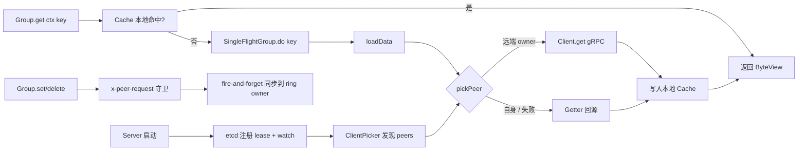

:::note 事实基线
本文依据 `$HOME/github/yukino.js/packages/cache` 在 `1afcb40eef9` 的源码事实撰写；文中的路径、常量与 API 名称均可在该检出中定位。
:::

**主线一览**



`@yukino.js/cache` 是 Go 版 `yukino.go/yukino_cache`（groupcache 架构）的 TypeScript 镜像，纯 ESM、要求 Node >= 20。本站不重复 LRU/一致性哈希/缓存穿透的通用教程（由 h 覆盖），只聚焦这套实现自己的取舍：**2Q 双级 LRU + 共享 Promise 的单飞、CRC32 虚拟节点环、gRPC peer 扇出、etcd 租约自愈，以及 `x-peer-request` 传播守卫**。

## 定位与整体架构

`src/index.ts` 是唯一的公开契约（其余均为内部实现，README 明确声明可无通知变更）。组件映射（`README.md` Architecture 段与源码一一对应）：

| 模块                            | 文件                             | 职责                                      |
| ------------------------------- | -------------------------------- | ----------------------------------------- |
| `Group`                         | `group.ts`                       | 编排器；全局注册表；读穿透/写传播；统计   |
| `Cache` / `LruStore`            | `cache.ts` / `lru.ts`            | 缓存门面；分片 2Q LRU，字节预算 + TTL     |
| `ByteView`                      | `byte-view.ts`                   | 不可变字节容器，进出均防御性拷贝          |
| `SingleFlightGroup`             | `single-flight.ts`               | 合并同 key 的并发加载                     |
| `ConHashMap`                    | `consistent-hash.ts`             | 一致性哈希环，可选自适应 rebalance        |
| `Client` / `ClientPicker`       | `client.ts` / `client-picker.ts` | gRPC peer；环 + peer 生命周期 + etcd 发现 |
| `Server`                        | `server.ts`                      | gRPC 服务 + 健康检查 + etcd 注册          |
| `register` / `ServiceDiscovery` | `register.ts`                    | 租约保活；注册表 watcher + 重连 resync    |

**读路径**：`Group.get` → 本地 `Cache.get` 命中即返回；未命中 → `SingleFlightGroup.do(key, ...)` 去重 → `loadData`：`peers.pickPeer(key)` 选出 owner，远端则走 `Client.get`，自身或失败走 `Getter(ctx, key)` 回源；加载结果在 single-flight 回调**内部**写回本地缓存，因此 `loads`/`loadDuration` 只统计真实加载而非等待者。

**写路径**：`Group.set`/`delete` 先同步更新本地缓存，再在非 peer 请求时通过 `syncToPeers` 把操作异步转发给 ring 中该 key 的唯一 owner（fire-and-forget，错误只记日志）。

**启动顺序**（README Lifecycle）：`newGroup` → `Server.start()` → `ClientPicker.start()`（用**同一个** advertiseAddr）→ `group.registerPeers(picker)` → 流量 → 关闭 `server.stop()` → `picker.close()` → `destroyAllGroups()`。README 强调：若在 `picker.start()` resolve 前接 peers，环里只有自身，所有读都会穿透到本地 `Getter`。

README 给出三种由浅入深的装配方式。纯进程内 L1（无 gRPC、无 etcd）：

```ts
import { Cache, ByteView, defaultCacheOptions } from "@yukino.js/cache";

const cache = new Cache({ ...defaultCacheOptions(), maxBytes: 64 << 20 });
cache.add("k", new ByteView(Buffer.from("v")));
const [view, ok] = cache.get("k"); // ok === true
cache.addWithExpiration("t", new ByteView(Buffer.from("x")), Date.now() + 5000);
cache.close();
```

单节点 + TTL + 统计：

```ts
import { newGroup, withExpiration } from "@yukino.js/cache";

const group = newGroup(
  "users",
  8 * 1024 * 1024,
  async (signal, key) => loadUserFromDB(signal, key), // Getter
  withExpiration(30_000),
);

const view = await group.get(new AbortController().signal, "alice");
console.log(view.toString(), group.getStats());
group.close();
```

集群节点（README 称之为 reference assembly）：

```ts
import { newGroup, Server, ClientPicker, getLocalIP } from "@yukino.js/cache";

const SVC = "yukino_cache";
const PORT = 8001;
const bindAddr = `0.0.0.0:${PORT}`;
const advertiseAddr = `${getLocalIP()}:${PORT}`;

const group = newGroup("users", 8 << 20, loader);
const server = new Server(bindAddr, SVC, { advertiseAddr });
await server.start();
const picker = new ClientPicker(advertiseAddr, { serviceName: SVC });
await picker.start();
group.registerPeers(picker);

process.on("SIGINT", async () => {
  server.stop();
  await picker.close();
  process.exit(0);
});
```

直接把 `Client` 当 gRPC 客户端用（不经 `Group`）也是公开能力：`new Client("127.0.0.1:8001", { deadlineMs: 5000 })` 后 `set("users", "alice", Buffer.from("payload"))` / `get(...)` / `close()`。

## 核心 API 与实现机制

### ByteView 与 Store 抽象

`ByteView`（`byte-view.ts`）实现 `Value` 接口（只有 `len(): number`）。构造时**不拷贝**（`this.b = b`），但 `byteSlice()` 返回 `Buffer.from(this.b)` 副本；`cloneBytes(b)` 用 `Buffer.alloc` + `b.copy` 做防御性拷贝。`Group.set`/`getFromPeer`/`loadData` 在写入缓存前都调用 `cloneBytes`，所以调用方持有的 `Buffer` 之后被修改不会影响缓存内容。

`Store` 接口（`store.ts`）定义 `get/set/setWithExpiration/delete/clear/len/close`。`defaultStoreOptions()` 返回 `{ maxBytes: 8192, bucketCount: 16, capPerBucket: 512, level2Cap: 256, cleanupInterval: 60_000, onEvicted: undefined }`。

### LruStore：分片 2Q 双级 LRU

`LruStore`（`lru.ts`）是本包最密集的实现。每个分片是一个 `[InternalCache, InternalCache]` 元组：level 0（ probation，`capPerBucket`）与 level 1（protected，`level2Cap`）：

- 分片索引 `hashBKRD(key) & this.mask`，其中 `hashBKRD` 用 `hash = (hash * 131 + charCodeAt(i)) | 0` 后 `>>> 0`；`maskOfNextPowOf2(bucketCount)` 把 bucketCount 向上取整到 2 的幂（README：`bucketCount: 24` → 32）。
- `InternalCache` 用**数组 + 双向链表**实现 O(1) LRU：`doubleLink[i] = [prev, next]`，`hashMap: Map<string, number>` 把 key 映射到槽位，`adjust(idx, f, t)` 把节点移到链头。`P = 0`、`N = 1` 是 prev/next 的下标常量。
- `expireAt > 0` 同时是"槽位占用"标记：`get`/`del`/`walk` 都据此判断节点是否有效；无 TTL 时写入 `MAX_EXPIRE_AT = Number.MAX_SAFE_INTEGER`。
- 命中 level 0 的 `get` 会 `del` 出来、校验未过期后 `put` 进 level 1——这就是 2Q 的"晋升"，使偶发扫描不污染保护级。
- 字节预算：`sizeOf(key, value) = key.length + value.len()`；`bucketMaxBytes = max(1, floor(maxBytes / (mask + 1)))`，insert 后 `while (bucketBytes[idx] > bucketMaxBytes)` 从 level 0 再 level 1 的尾部驱逐。
- 过期清理由 `cleanupTimer = setInterval(..., cleanupInterval)` 驱动，`cleanupLoop` 遍历两级的所有 key 收集过期项再 `deleteInternal`；`cleanupInterval: 0` 可关闭该定时器。`close()` 幂等并 `clearInterval`。

:::warning 两套默认值不一致
直接 `new LruStore({...})` 时，稀疏选项走类内自己的 fallback：`capPerBucket = 1024`、`level2Cap = 1024`、`maxBytes = 0`（无字节预算）；而 `defaultStoreOptions()` 是 `512`/`256`。README 明确提醒：想要文档默认值必须显式展开 `defaultStoreOptions()`。`Cache` 门面走 `defaultCacheOptions()`（8 MiB、16、512、256、`cleanupTime: 60_000`），它在 `ensureInitialized()` 里把 `cleanupTime` 映射成 `LruStore` 的 `cleanupInterval`，不会踩到这个坑。
:::

### Cache 门面与统计

`Cache`（`cache.ts`）是懒初始化的：`ensureInitialized()` 在第一次 `add` 时才 `new LruStore(...)`。`get` 在未初始化时直接记 `misses++` 并返回 `[null, false]`；`addWithExpiration(key, value, expirationTime)` 接收的是**绝对时间戳**（README 特别大写 ABSOLUTE），内部换算 `expirationMs = expirationTime - Date.now()`，若 `<= 0` 则退化为 `delete`。`stats()` 返回 `{ initialized, closed, hits, misses, size?, hit_rate? }`，`hit_rate = hits / (hits + misses)`。

### SingleFlightGroup：共享 Promise

`SingleFlightGroup.do(key, fn)`（`single-flight.ts`）用一个 `Map<string, Call<unknown>>` 实现去重。核心手法（`tests/single-flight.test.ts` 用 16 个并发调用验证 `fn` 只执行 1 次）：

```ts
const existing = this.m.get(key);
if (existing) return existing.promise as Promise<T>;
const promise = new Promise<T>((res, rej) => {
  resolve = res;
  reject = rej;
});
promise.catch(() => {}); // 抑制无等待者时的 unhandled rejection
this.m.set(key, call as Call<unknown>);
try {
  const result = await fn();
  resolve(result);
  return result;
} catch (err) {
  reject(err);
  throw err;
} finally {
  this.m.delete(key);
}
```

`finally` 保证失败也释放 key，允许后续顺序重试；不同 key 完全独立。`promise.catch(() => {})` 是关键：即使只有一个调用者关心结果，被 reject 的共享 Promise 也不会触发未处理拒绝告警。

### ConHashMap：CRC32 虚拟节点环

`ConHashMap`（`consistent-hash.ts`）用 `keys: number[]`（排序后的虚拟节点哈希）+ `hashMap: Map<number, string>`（哈希 → 真实 node）实现。`withConHashConfig(config)` 是函数式选项，底层调用 `setConfig()`。默认配置（`config.ts`）：

```ts
export const defaultConHashConfig: ConHashConfig = {
  defaultReplicas: 50,
  minReplicas: 10,
  maxReplicas: 200,
  hashFunc: crc32,
  loadBalanceThreshold: 0.25,
  autoRebalance: false,
};
```

虚拟节点 id 为 `` `${node}-${i}` ``，`get(key)` 走 `binarySearch` 顺时针找第一个 ≥ hash 的节点，越过尾部则回绕到 `keys[0]`；同时累加 `nodeCounts`/`totalRequests` 供 `getStats()` 返回各节点请求占比。**rebalance 是 opt-in**：`autoRebalance: true` 时 `startBalancer()` 每 1000 ms 调一次 `checkAndRebalance`；后者仅在 `totalRequests >= 1000` 且最大偏差超过 `loadBalanceThreshold` 时触发 `rebalanceNodes()`，按 `loadRatio = count / avgLoad` 增减副本数并 clamp 到 `[minReplicas, maxReplicas]`，随后清零统计。README 建议"宁可提高 `defaultReplicas` 也不要调低阈值"，因为低阈值会振荡。`close()` 停掉 balancer 定时器。

`crc32(data: string | Buffer)`（`crc32.ts`）是 IEEE CRC32，用模块初始化时构建的 256 项 `crcTable`（多项式 `0xedb88320`）逐字节计算，返回无符号 32 位。

### Group：全局注册表与错误语义

`Group` 构造器接受 `(name, cacheBytes, getter, ...opts)`；falsy getter 抛 `"nil Getter"`。`newGroup` 把它登记进模块级 `groups: Map<string, Group>`，同名会打 warning 后覆盖；另有 `getGroup`、`listGroups`、`destroyGroup`、`destroyAllGroups` 管理生命周期。

选项函数是 `GroupOption`（`(g: Group) => void`）：`withExpiration(ms)` 写 `_setExpiration`、`withPeers(picker)` 写 `_setPeers`、`withCacheOptions(opts)` 关闭旧 Cache 并新建。`registerPeers` 是后绑定版本，重复调用抛 `"RegisterPeers called more than once"`。

哨兵错误是模块级单例（**未导出**），只能按 message 匹配：`"key is required"`、`"value is required"`、`"cache group is closed"`，加载失败被包装成 `"failed to get data: ${err}"`。`getStats()` 返回 `GroupStats`，含 `loads/local_hits/local_misses/peer_hits/peer_misses/loader_hits/loader_errors`、`hit_rate`、`avg_load_time_ms` 及嵌套的 `cache: CacheStats`。

### Peer、Client、ClientPicker 与 Server

`Peer` 接口（`peers.ts`）是 `get(group,key) / set(group,key,value) / delete(group,key) / close`；`PeerPicker.pickPeer(key)` 返回三元组 `[Peer | null, boolean, boolean]`，依次是 peer、是否找到、是否自身。

`Client`（`client.ts`）实现 `Peer`：`DEFAULT_DEADLINE_MS = 3000`，每次调用带 `deadline: new Date(Date.now() + deadlineMs)`；`peerRequest: true` 时附加 gRPC metadata `x-peer-request: "true"`；底层用 `getProto().pb.YukinoCache` 与 `grpc.credentials.createInsecure()`（**只支持非 TLS**）。

`ClientPicker`（`client-picker.ts`）默认服务名 `DEFAULT_SVC_NAME = "yukino_cache"`。构造器内部 `new ConHashMap()`——README 明确说这里**没有配置钩子**，自定义环配置要自己实现 `PeerPicker`。`start()` 先把 `selfAddr` 加进环、`fetchAll()` 拉全部 peer、`watch()` 监听变化。`pickPeer` 命中自身返回 `[null, true, true]`，命中远端但无 Client 返回 `[null, false, false]`（触发回源）。`addPeer` 先用 `validPeerAddr` 校验，再创建 `peerRequest: true` 的 Client。

`Server`（`server.ts`）在 `start()` 里 `bindAsync` 后调用 `register(...)` 并广播 `advertiseAddr`；gRPC 挂 `YukinoCache` 的 `Get/Set/Delete` 与 `grpc.health.v1.Health/Check`（仅配置的服务名返回 status 1/SERVING，其余 0）。两个关键辅助：`isPeerRequest(call)` 读 metadata，`requestSignal(call)` 监听 `cancelled` 事件转成 `AbortSignal`，贯穿到 `Getter`。`stop()` 先 `abortController.abort()`（撤销 etcd 租约）再 `tryShutdown`。

### etcd 注册发现与 proto 懒加载

`register()`（`register.ts`）以 `/services/{svcName}/{addr}` 为键写入 etcd，值为 addr 本身；`defaultRegisterConfig = { endpoints: ["localhost:2379"], dialTimeout: 5000, leaseTTL: 10 }`。`lease.on("lost")` 触发 1 秒后 `acquire()` 重注册；`stopSignal` abort 时 `lease.revoke()` + 删键 + `client.close()`。`resolveAdvertiseAddr` 把 `:port` / `0.0.0.0:port` 形式换成 `getLocalIP()` 得到的地址。`ServiceDiscovery.watch()` 监听 `put/delete/disconnected/connected/error`，其中 `connected` 会重新 `fetchAll()` 做全量 resync——这是重连自愈的核心。

`getProto()` / `getHealthProto()`（`src/proto/index.ts`）是**懒加载 + 缓存**的：`LOADER_OPTIONS = { keepCase: true, longs: String, enums: String, defaults: true, oneofs: true }`，用 `protoLoader.loadSync(join(__dirname, "yukino.proto"))`。注释解释为何不能在模块顶层加载：仅用内存 `Cache` 的消费者不应被要求 proto 文件与模块相邻，否则打包后导入即抛错。`yukino.proto` 定义 `Request { group, key, value }` 与 `YukinoCache` 的三个 unary RPC。

## 并发、边界与容错

- **惊群防护**：`SingleFlightGroup` 把同 key 的 16 个并发 `get` 压成 1 次加载（测试断言 `calls === 1`），失败与成功都会 `finally` 释放 key。
- **peer 失败降级**：`Group.loadData` 对远端 `getFromPeer` 用 try/catch 包裹，任何失败只 `peerMisses++` + `log.warn`，随后回落到本地 `Getter`；因此冷读链路 `Group.load → pickPeer → Client.get → Server.handleGet → Group.get → Getter` 可能很长，README 建议提高 `peerDeadlineMs` 或预热热 key。
- **传播守卫**：`Client.set/delete` 带 `x-peer-request: "true"`，`Server.handleSet/handleDelete` 用 `isPeerRequest` 识别并在 `Group.set/delete` 里跳过再次扇出，避免无限回环。`syncToPeers` 用 async IIFE fire-and-forget，异常只记录不抛出。
- **弱一致**：README 明确"not a replicated store"——无 quorum、无 anti-entropy、无持久化保证；写只同步给 ring owner，**其他节点不会收到通知**，可能一直提供旧值直到驱逐或过期。
- **资源关闭**：`Group.close → Cache.close → LruStore.close` 级联；另行负责的是 `ConHashMap` 的 balancer（仅在 autoRebalance 时）、`ServiceDiscovery` 的 watcher、etcd 租约保活、以及每个 `Client` channel。README 指出泄漏几乎都源于漏掉某个 `close`，测试应 `try/finally` 或传 `cleanupTime: 0`。

:::danger 一致性与地址陷阱
这不是复制存储：没有仲裁、没有反熵、没有持久化，不能用于要求强一致或持久的场景。另外 `ClientPicker` 必须用与 etcd 中**完全一致**的 advertiseAddr 构造，否则节点会把"自己"当作 peer 转发；环把 `localhost` 与 `127.0.0.1` 视为不同节点，集群内主机拼写必须统一。
:::

:::tip 可观测性接入
所有日志走 `Logger` 间接层，默认 `[YukinoCache]` 前缀的 console。用 `setLogger({ info, warn, error })` 可整体接入结构化日志或在测试中静默。统计分两层：`Group.getStats()` 看命中/加载/peer 维度，`Cache.stats()` 看本地 LRU 的 hits/misses/hit_rate；`LruStore.usedBytes()` 可观测字节预算实际占用。
:::

## 适用与不适用

**适用**：

- 多节点读多写少的回源加速（用户资料、配置、渲染结果），允许弱最终一致；
- 需要无中心协调者的 P2P 分片：一致性哈希选 owner，etcd 只做服务发现；
- 与 Go 版 `yukino.go/yukino_cache` 混合部署——README 称 API、语义、etcd 键布局与 wire format 逐符号对齐，改行为时要两侧同步；
- 单机也能用：不启动 Server/Picker 时就是纯进程内 L1 缓存。

**不适用**：

- 强一致/持久化需求（见 danger 块）；
- 写多读少或需要跨节点立即失效的场景——其他节点只靠 TTL/驱逐收敛；
- 浏览器环境——依赖 gRPC、etcd、Node `os`/`fs`/`Buffer`，`engines.node >= 20`。

## 交叉链接

- `yukino-bloom-filter`：同样处理大规模去重，但它是本地概率结构；本包用 LRU + 一致性哈希做分布式缓存。
- `yukino-http-server` / `yukino-create-servers`：本包的 `Server` 用 gRPC 与 etcd；那两篇聚焦 HTTP，可作为不同服务形态的对照。
- 一致性哈希、LRU/2Q、gRPC/etcd 基础原理由 h 文档覆盖，本文只写本包的具体实现取舍。

**核心源码文件清单**：`src/index.ts`、`src/{group,cache,store,lru,byte-view,single-flight,consistent-hash,config,crc32,peers,client,client-picker,server,register,utils,logger,main}.ts`、`src/proto/{index.ts,yukino.proto,health.proto}`、`tests/{single-flight,cache,lru,group,consistent-hash,crc32,byte-view,utils}.test.ts`、`README.md`、`package.json`。
