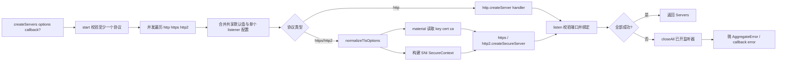

:::note 事实基线
本文依据 `$HOME/github/yukino.js/packages/create-servers` 在 `1afcb40eef9` 的源码事实撰写；文中的路径、常量与 API 名称均可在该检出中定位。
:::

**主线一览**



`@yukino.js/create-servers` 是 `create-servers` 的 TypeScript 重写，用 Node 内置的 `http`/`https`/`http2`/`tls` API 在一个共享 handler 下同时创建多协议监听器。本站不重复 Node 如何创建 HTTPS 服务器的通用教程（由 h 覆盖），只聚焦它相对上游的**设计取舍：并发启动、全有或全无的失败语义、TLS 配置在监听前完成物化，以及不修改调用方选项**。

## 定位与整体架构

包只有一个入口 `src/index.ts`（zero runtime dependencies——`package.json` 的 `devDependencies` 里只有 Rolldown/TypeScript/Vitest/ESLint/Prettier），导出如下公开面（`package.json` 的 `exports` 仅映射 `"."`）：

| 导出                                                              | 类型                                  | 说明                            |
| ----------------------------------------------------------------- | ------------------------------------- | ------------------------------- |
| `createServers(options)`                                          | 函数 → `Promise<Servers>`             | 主 API                          |
| `createServers(options, callback)`                                | 函数 → `Promise<void>`                | 保留 callback 风格              |
| `createServer`                                                    | 别名                                  | 与 `createServers` 同一函数引用 |
| `default`                                                         | 同上                                  | 默认导出                        |
| `normalizeTlsOptions`                                             | 函数 → `Promise<https.ServerOptions>` | TLS 选项归一化                  |
| `ListenerOptions` / `TlsListenerOptions` / `CreateServersOptions` | interface                             | 配置类型                        |
| `Servers` / `Server` / `ListeningCallback`                        | interface / type                      | 返回值与回调类型                |

`Servers` 的形状是 `{ http?, https?, http2? }`：每个属性是单个 Node server，或当该协议配置为数组时是数组。判断依据是 `start()` 中 `Array.isArray(value) ? servers : servers[0]`（`src/index.ts:183`）——即**返回形状由配置形状决定**，与协议本身无关。`Server` 类型是 `http.Server | https.Server | http2.Http2SecureServer` 的联合；HTTP/2 一律是 secure server（README：HTTP/2 is secure）。README 的示例展示了数组与单对象混用：

```ts
import createServers from "@yukino.js/create-servers";

const servers = await createServers({
  host: "127.0.0.1",
  handler: (_request, response) => response.end("Hello"),
  http: [8080, { port: 8081, keepAliveTimeout: 0 }],
  https: { port: 8443, root: "./tls", key: "key.pem", cert: "cert.pem" },
});
for (const server of Object.values(servers).flat()) server.close();
```

## 核心 API 与实现机制

### 配置类型与默认值

`ListenerOptions`（`src/index.ts:8`）是 `{ port?, host?, handler?, timeout?, keepAliveTimeout? }`。`TlsListenerOptions` 在它基础上 `Omit<https.ServerOptions, "ciphers">`，并自加 `root?`、`ciphers?: string | string[]`、`sni?: Record<string, TlsListenerOptions>`、`allowHTTP1?`。`CreateServersOptions` 则 `Omit<ListenerOptions, "port">` 后加三个协议字段与 `log?`。

共享默认通过 spread 注入到每个 listener（`src/index.ts:146`）：

```ts
const config: TlsListenerOptions = {
  host: options.host,
  handler: options.handler,
  timeout: options.timeout,
  keepAliveTimeout: options.keepAliveTimeout,
  ...(typeof raw === "object" ? raw : { port: raw }),
};
```

注意顺序：共享值在前、单个 listener 的对象在后，因此 per-listener 可以覆盖 `host/handler/timeout/keepAliveTimeout`；协议字段若是数字/字符串则包装成 `{ port: raw }`。整个过程是**新建对象**，调用方传入的 `options` 及嵌套 listener 对象不被改动（README 明确承诺 "caller options are not mutated"）。`http` 的数字默认端口 80，`https`/`http2` 为 443，由 `listen(server, config, defaultPort)` 的第三参数提供。

`handler` 是所有 listener 的必需项：`if (!config.handler) throw new Error("handler option is required")`。端口 0 用于请求临时端口（测试大量使用 `port: 0`）。`http2` 使用共享的 HTTP/1 兼容 request/response 方法，需要 HTTP/2 专属行为时用返回 server 的 `stream` 事件（README）。

README 的选项速查表（与源码类型一一对应）：

| 选项                                                | 行为                                                                                                   |
| --------------------------------------------------- | ------------------------------------------------------------------------------------------------------ |
| `http`                                              | 端口号/字符串、listener 对象，或它们的数组；对象默认端口 80                                            |
| `https` / `http2`                                   | TLS listener 对象或数组，默认端口 443；HTTP/2 是 secure 的，`allowHTTP1` 开启回退                      |
| `host` / `handler` / `timeout` / `keepAliveTimeout` | 共享默认值，单个 listener 可覆盖；超时单位为毫秒；每个 listener 都必须有 handler                       |
| TLS `root` / `key` / `cert` / `ca`                  | 相对路径按 `root`（默认 cwd）解析；Buffer 与内联 PEM 也可用；证书数组默认组成一条链，除非 key 也是数组 |
| TLS `sni`                                           | 主机名/通配模式到 TLS 配置的映射，在监听前准备好；显式 `SNICallback` 优先                              |
| TLS `ciphers`                                       | 字符串或数组（数组用 `:` 连接）；省略时采用 Node 24 默认                                               |
| `log`                                               | 可选函数，接收每个 listener 的启动消息                                                                 |

构建侧：`package.json` 的 `build` 是 `rolldown -c && tsc -p tsconfig.build.json`——Rolldown 产出 ESM JavaScript 与 source map，TypeScript 只负责声明文件；测试用 Vitest 跑真实本地监听器。`README.md` 的 Development 段要求从 workspace 根执行 `pnpm install`、`pnpm http:build`，再用 `--filter` 跑该包的 test/typecheck/lint/format:check。`NOTICE.md` 与 `LICENSE.upstream` 记录上游 `create-servers` 的归属。

### TLS 物化：`material` 与 `normalizeTlsOptions`

`material(value, root)`（`src/index.ts:40`）递归处理证书材料：

- 数组 → `Promise.all(value.map(item => material(item, root)))`；
- 字符串且包含 `"-----BEGIN"` → 视为**内联 PEM**，原样返回（不读文件）；
- 其他字符串 → `readFile(resolve(root, value))` 读成 Buffer。

`root` 默认 `process.cwd()`，因此相对路径按 `root` 解析。`normalizeTlsOptions(options)`（`src/index.ts:46`）依次物化 `key`、`cert`、`ca`；若 `cert` 是数组而 `key` 不是数组，则用 `cert.map(String).join("\n")` 拼成一条链（README：证书数组默认组成一条链，除非 key 也是数组）。`ciphers` 为数组时用 `:` 连接，省略时采用 Node 24 的 TLS 默认值。

**SNI 预准备**是这里最重要的取舍：当 `options.sni` 存在且没有显式 `SNICallback` 时（`src/index.ts:64`），对每个 `hostname → config` 条目：

1. `escapePattern` 把 `*` 拆开，对各段做正则转义后用 `.*` 连接；
2. 以 `*.` 开头的 pattern 生成 `(?:.*\\.)?${escapePattern(host.slice(2))}`，再包成 `new RegExp(\`^${pattern}$\`, "i")`；
3. 用 `createSecureContext(await normalizeTlsOptions({ ...options, sni: undefined, ...config }))` 构造上下文——显式把 `sni` 置 `undefined` 防止递归展开；
4. 生成 `SNICallback`：按声明顺序 `find` 第一个匹配，`callback(null, match.context)`；无匹配则 `callback(new Error(\`Unrecognized hostname: ${hostname}\`))`。

由于**显式 `SNICallback` 优先**，这条分支只在未提供自定义回调时执行。所有文件读取与 SecureContext 构造都在 `listen()` 之前 `await` 完成——TLS 配置错误不会留下已绑定端口。

### 端口绑定：`listen`

`listen(server, config, defaultPort)`（`src/index.ts:95`）先算 `port = Number(config.port ?? defaultPort)`，校验 `Number.isInteger(port) && 0 <= port <= 65535`，否则抛 `RangeError(\`Invalid port: ${config.port}\`)`。随后应用 `server.setTimeout(config.timeout)`与`server.keepAliveTimeout = config.keepAliveTimeout`（后者用 `"keepAliveTimeout" in server`做存在性判断）。真正的绑定是一次`once("error")`/`once("listening")`竞赛：先触发者`removeListener`掉另一个，成功则`resolve(server)`，失败则 `reject(error)`；底层调用 `server.listen({ port, host: config.host })`。

### 启动事务：全有或全无

`start(options)`（内部函数，`src/index.ts:130`）是并发与回滚的核心：

1. 若 `http`/`https`/`http2` 三者全为 `undefined`，抛 `"http, https, and/or http2 are required options"`。
2. 维护 `opened: Server[]` 与 `result: Servers`。按 `["http","https","http2"]` 过滤出已配置协议，**并发** map 成任务。
3. 每个协议内部把 value 统一成 configs 数组，用 `Promise.allSettled` 并发启动所有 listener；`config.handler` 缺失直接抛错；按协议选用 `http.createServer`、`https.createServer(await normalizeTlsOptions(config), handler)` 或 `http2.createSecureServer(...)`。
4. 每次 `listen` 成功后 `opened.push(server)` 并调用 `options.log?.(\`${protocol} | listening on ${JSON.stringify(server.address())}\`)`。
5. 任一 listener 失败（`settled.find(status === "rejected")`）就抛出那个 reason；协议间再套一层 `Promise.allSettled`，若有失败则 `await closeAll(opened)` 关闭这次调用打开的**全部**监听器，然后 `throw new AggregateError(errors.map(reason), errors.map(String).join("; "))`。

这正是 README 所说的相对上游的关键差异：上游是 "partially successful startup"，本实现任何一个监听器失败都会关闭本次调用打开的所有监听器并以 `AggregateError` 拒绝；callback 模式也拿不到部分成功的 listener。`closeAll` 用 `Promise.all` 并发 `server.close(() => resolve())`。

### Promise / callback 双接口

三个重载共享同一个实现（`src/index.ts:204`）：

```ts
export function createServers(options: CreateServersOptions): Promise<Servers>;
export function createServers(
  options: CreateServersOptions,
  callback: ListeningCallback,
): Promise<void>;
export function createServers(
  options: CreateServersOptions,
  callback?: ListeningCallback,
): Promise<Servers | void> {
  if (!callback) return start(options);
  return start(options).then(
    (servers) => callback(null, servers),
    (error) => callback(error),
  );
}
```

有 callback 时返回的 Promise ** resolve 为 `void`**（在 callback 执行完之后），而不是把错误重新抛出——错误只通过 `callback(error, undefined)` 传递。测试中把 callback 包装回 Promise 的用法如下（`tests/index.test.ts`）：

```ts
const servers = await new Promise<Servers>((resolve, reject) => {
  void createServers(
    { http: { port: 0, handler: (_req, res) => res.end("custom") } },
    (error, value) => (error ? reject(error) : resolve(value!)),
  );
});
```

这个例子同时说明了两个事实：单个 listener 可以用自己的 `handler` 覆盖顶层默认值；callback 的第二个参数在成功时才非空。

## 并发、边界与容错

`test/index.test.ts` 用真实本地监听器验证了关键边界：

- **共享 handler + 多 listener**：`http: [0, { port: 0 }]` 得到两个 `http.Server`，各自 `timeout === 1500`、`keepAliveTimeout === 0`，`fetch` 都返回 `"hello"`。
- **错误校验**：缺协议 → `"required options"`；缺 handler → `"handler"`；`port: -1` → `"Invalid port"`。
- **绑定失败回滚**：先占住一个端口，再请求 `http: [0, port]`，断言抛 `"EADDRINUSE"`（验证 AggregateError 包含底层原因）。
- **TLS 路径/内联 PEM**：`{ port: 0, root, key: "key.pem", cert: ["cert.pem"] }` 用相对路径加载；`{ port: 0, key, cert }`（Buffer）直接用内联材料。
- **SNI 通配**：`sni: { "*.example.test": {...} }` 对 `example.test` 与 `deep.sub.example.test` 都成功握手——印证 `(?:.*\.)?` 同时匹配根域与深层子域。
- **HTTP/2**：`http2: { port: 0, root, key, cert }` 用 `http2.connect` 走共享 handler 拿到 `"hello"`。

:::warning 全有或全无是有意的破坏性变更
不要期待"部分监听器启动成功"。任何协议、任何 listener 失败，本次调用打开的所有 server 都会被 `closeAll` 关闭，并以 `AggregateError` 拒绝（其 `errors` 数组含所有协议级失败原因）。`AggregateError.message` 是各原因 `String()` 后以 `; ` 连接。生产代码应捕获它并遍历 `error.errors` 展示具体失败，而不是只看 message。
:::

:::tip 用 port 0 做测试
端口校验允许 `0`（临时端口），测试用 `server.address()` 取实际端口后发请求。相比硬编码端口，这避免了 CI 上的端口冲突。`log` 回调收到形如 `http | listening on {"address":"127.0.0.1","family":"IPv4","port":12345}` 的消息，可直接作为启动探针。
:::

## 适用与不适用

**适用**：

- 同一套 handler 需要同时暴露 HTTP、HTTPS、HTTP/2（例如本地开发网关、边缘代理的监听层）；
- 需要严格的启动原子性——要么全部协议就绪，要么一个都不留；
- 需要 SNI 多证书、内联 PEM、证书链等较完整的 TLS 配置，但不想自己拼 `https.ServerOptions`；

**不适用**：

- Node < 24（`package.json` 的 `engines.node: ">=24"`，README 同）；
- 只需要单个 HTTP 监听——直接用 `node:http` 更少依赖；
- 需要显式控制部分成功（某个协议挂了仍保留其他协议）——本包刻意不支持；
- 需要 HTTP/2 专属 API（`stream` 事件、push、HPACK 细节）——共享 handler 只走 HTTP/1 兼容层，要自己监听返回 server 的 `stream`。

## 交叉链接

- `yukino-http-server`：同为 `@yukino.js` 的服务器类包，但聚焦静态文件服务；本包只负责"把监听器开起来"。
- `yukino-cache`：其 `Server` 用 gRPC 而非 HTTP，且带 etcd 注册；可与本包对照不同服务形态的启动/关闭语义。
- Node `http`/`https`/`http2`/`tls` 的基础用法由 h 文档覆盖，本文只写本包的封装取舍（并发启动、回滚、TLS 物化、SNI 预构建）。

**核心源码文件清单**：`src/index.ts`、`tests/index.test.ts`、`README.md`、`package.json`、`NOTICE.md`、`LICENSE.upstream`。
