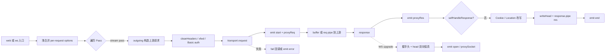

:::note 事实基线
本文依据 `$HOME/github/yukino.js/packages/http-proxy` 在 `1afcb40eef9` 的源码事实撰写；文中的路径、常量与 API 名称均可在该检出中定位。
:::

**主线一览**



`@yukino.js/http-proxy` 是从 `node-http-proxy` 重写而来的流式 HTTP/HTTPS 反向代理，声称"no dependency on the upstream implementation"，运行时唯一依赖是 `follow-redirects`。本站不重复反向代理/正向代理的一般概念（由 h 覆盖），只聚焦这版实现的具体取舍：**命名 Pass 管道、逐请求的浅合并配置、响应头的原地改写，以及 WebSocket 升级时的握手头与缓冲字节保真**。

## 定位与整体架构

`src/index.ts` 单文件实现。工厂与别名都指向同一个 `ProxyServer`（README：`createProxyServer`、`createServer`、`createProxy` 返回 `ProxyServer`，`Server` 是别名）：

```ts
export function createProxyServer(options?: ProxyOptions): ProxyServer {
  return new ProxyServer(options);
}
export const createServer = createProxyServer;
export const createProxy = createProxyServer;
export { ProxyServer as Server };
export default {
  createProxyServer,
  createServer,
  createProxy,
  ProxyServer,
  Server: ProxyServer,
};
```

`ProxyServer extends EventEmitter<ProxyEvents>`（`src/index.ts:235`），持有一个只读 `options`、可选的 `_server`（自己 `listen()` 时才有）、两个 `NamedPass[]` 数组（`webPasses` / `wsPasses`）以及一个 `sockets: Set<Duplex>` 用于跟踪升级后的连接。构造器写入 `this.options = { prependPath: true, ...options }`，并分别向两条管道压入一个名为 `"stream"` 的内置 Pass（唯一下游执行者）。

README 的推荐装配方式是把代理挂到外部 server，自行处理错误与升级：

```ts
import { createServer } from "node:http";
import { createProxyServer } from "@yukino.js/http-proxy";

const proxy = createProxyServer({
  target: "http://127.0.0.1:9000",
  changeOrigin: true,
  xfwd: true,
});
const server = createServer((req, res) => {
  proxy.web(req, res, (error) => {
    res.writeHead(502);
    res.end(error.message);
  });
});
server.on("upgrade", (req, socket, head) => proxy.ws(req, socket, head));
proxy.on("error", (_error, _req, response) => response?.destroy());
server.listen(8080);
```

README 的选项速查（与 `ProxyOptions` 接口逐项对应）：

| 选项                                              | 行为                                                                                                        |
| ------------------------------------------------- | ----------------------------------------------------------------------------------------------------------- |
| `target` / `forward`                              | URL 字符串、WHATWG URL 或 Node request-options 对象；支持 HTTP(S) 与 WS(S)；`forward` 镜像流或作唯一 target |
| `changeOrigin` / `xfwd` / `headers` / `auth`      | 改写 Host、追加 X-Forwarded-*、添加出站头、设置 Basic 认证                                                  |
| `prependPath`                                     | 前置 target 的 path（默认 `true`）                                                                          |
| `ignorePath` / `toProxy`                          | 忽略入站 URL，或为正向代理保留绝对 URL                                                                      |
| `agent` / `localAddress` / `secure`               | Node 传输选项；除非 `secure: false` 否则校验 TLS；对象 target 上的 TLS 字段支持客户端证书                   |
| `timeout` / `proxyTimeout`                        | 入站/出站不活动超时，单位毫秒                                                                               |
| `hostRewrite` / `autoRewrite` / `protocolRewrite` | 改写指向上游 authority 的绝对 Location 头                                                                   |
| `cookieDomainRewrite` / `cookiePathRewrite`       | 字符串、带可选 `*` 兜底的映射，或 `false`；空字符串移除属性                                                 |
| `preserveHeaderKeyCase`                           | 保留上游响应头的原始大小写                                                                                  |
| `selfHandleResponse`                              | 把响应所有权交给 `proxyRes` 监听器                                                                          |
| `buffer`                                          | 用指定 Readable 替代原始请求体                                                                              |
| `followRedirects`                                 | 用 `follow-redirects` 跟随上游重定向（常规流式不缓冲）                                                      |

构建侧：`package.json` 的 `build` 是 `rolldown -c && tsc -p tsconfig.build.json`，Node >= 24，唯一运行时依赖 `follow-redirects`。README 要求从 workspace 根执行 `pnpm install`、`pnpm http:build`，再用 `--filter` 跑该包的 test/typecheck/lint/format:check；`NOTICE.md` / `LICENSE.upstream` 记录上游归属。

## 核心 API 与实现机制

### 请求构造：`targetOptions` 与 `outgoing`

`ProxyTarget = string | URL | (https.RequestOptions & { host?: string })`。`targetOptions(target)`（`src/index.ts:76`）把三种形态归一成 `https.RequestOptions`：

- 对象（非 `URL`）→ 直接展开，并用 `hostname: target.hostname ?? target.host`、`protocol: target.protocol ?? "http:"` 补齐；
- 字符串/`URL` → `new URL(target)`，协议把 `^ws` 替换为 `http`，`hostname` 去掉 IPv6 方括号，路径取 `pathname + search`，有用户名时把 `username:password` 做 `decodeURIComponent` 后作为 `auth`。

`outgoing(req, options, websocket = false)`（`src/index.ts:94`）是核心。缺 `target` 抛 `"Must provide a proper URL as target"`，协议不在 `["http:", "https:"]` 抛 `"Unsupported target protocol: ${target.protocol}"`。路径规则：

1. `ignorePath` → 起点为空，否则取 `req.url ?? "/"`；
2. 非 `toProxy` 且路径是绝对 `http(s)://` URL → 用 `new URL()` 取出 `pathname + search`（正向代理场景才保留绝对 URL）；
3. `prependPath !== false` → 拼接 target 的 path：base 含 `?` 时直接 `base + path`，否则去掉 base 尾部 `/` 与 path 头部 `/` 后拼成 `${base}/${path}`。

头部处理分两条路：WebSocket 直接 `{ ...req.headers }`（**保留握手头**），普通 HTTP 走 `cleanHeaders`。`cleanHeaders` 删除 `hopHeaders` 数组里的八个逐跳头（`connection`、`keep-alive`、`proxy-authenticate`、`proxy-authorization`、`te`、`trailer`、`transfer-encoding`、`upgrade`），还会读 `connection` 头里列出的自定义头一并删除。随后：

- `Object.assign(headers, options.headers)` 叠加自定义头；
- `changeOrigin` 把 `host` 改写成 target 的 hostname（IPv6 自动补方括号）+ 端口；
- `xfwd` 追加 `x-forwarded-for`（`socket.remoteAddress`）、`x-forwarded-port`（从 `req.headers.host` 的 `:port` 提取，或 443/80）、`x-forwarded-proto`（`wss`/`ws`/`https`/`http`），以及 `x-forwarded-host`；
- `auth` 用 `Basic ${Buffer.from(auth).toString("base64")}`；
- `DELETE`/`OPTIONS` 且无 `content-length`/`transfer-encoding` 时补 `content-length: "0"`。

最终 options 带 `method: req.method`、`path: path || "/"`、`headers`、`agent`、`localAddress`、`rejectUnauthorized: options.secure !== false`——即 TLS 校验默认开启，显式 `secure: false` 才关闭。

### 错误汇聚：`fail` 与一次性保护

`fail(error, req, res, options, callback)` 是统一的失败出口：有 callback 就 `callback(error, req, res, options.target)`，否则 `emit("error", error, req, res, options.target)`。`web()`/`ws()` 用 `try/catch` 包住整条 Pass 管道，同步抛错也走 `fail`。

`stream()` 内部另有一个 `failed` 布尔量包住局部 `fail`，保证连接失败只上报一次（`test/index.test.ts` 的 "reports connection failures and timeouts once" 用例验证 502 只触发一次）。超时分两种：`timeout` 作用于入站 `req`（`req.destroy(new Error("Incoming request timed out"))`），`proxyTimeout` 作用于出站 `request`（destroy 一个带 `code: "ETIMEDOUT"` 的 `"Proxy request timed out"`）。

### 命名 Pass 管道

`ProxyPass<T>` 签名是 `(request, response, options, head?, proxy?, callback?) => boolean | void`，**返回 `true` 即停止后续 Pass**。两个公开方法 `before(type, passName, callback)` / `after(...)` 都委托给 `insert(type, name, run, offset)`（`src/index.ts:540`）：`offset = 0` 插在目标 Pass 之前，`1` 插在之后；用 `passes.findIndex(pass => pass.name === name)` 定位，找不到抛 `"No such pass: ${name}"`，非法 type 抛 `"type must be web or ws"`。README 说明唯一内置 Pass 名为 `stream`，本实现**不暴露**上游那批内部小 Pass 名，也不暴露 `createRightProxy` 内部实现。

测试里的用法：

```ts
p.before("web", "stream", function add(req) {
  req.headers["x-pass"] = "added";
});
expect(await (await fetch(url)).text()).toBe("added");
expect(() => p.before("web", "unknown", () => {})).toThrow("No such pass");
```

`selfHandleResponse` 的接管示例（`tests/index.test.ts`），展示了事件与改写规则的真实配合：

```ts
const { url, p } = await proxy(target, { selfHandleResponse: true });
p.on("proxyRes", (response, _req, res) => {
  response.resume();
  response.once("end", () => res.end("changed"));
});
expect(await (await fetch(url)).text()).toBe("changed");
```

另一个用例把上游的 `302` Location 与两条 `set-cookie` 同时改写，断言 `location` 变为 `https://new.test/landing`，且 `Domain=old.test` 属性被空字符串移除、`Path=/old` 被替换为 `Path=/`——这正是 `rewriteCookie` 与 Location 改写协同的结果。

### 响应改写：`stream()` 的后半段

`transport` 由 `opts.followRedirects` 决定：开启时用 `follow-redirects` 的 `redirects.https` / `redirects.http`，否则用原生 `https` / `http`（README：常规流式转发不缓冲，跟随重定向会用该库的 replay 缓冲与上限）。发出 `start` 与 `proxyReq` 事件后，把 `(opts.buffer ?? req)` pipe 到上游请求——`buffer` 允许替换原始请求体，用于已被消费、需要重放的场景（测试用 `Readable.from("hello")` 重新注入 body）。

收到上游 `response` 后：

1. emit `proxyRes`；`selfHandleResponse: true` 时直接 `return`，把响应所有权交给监听器（测试用这个把 `"original"` 改成 `"changed"`）；
2. 对 `headers` 再跑一次 `cleanHeaders`；若有 `set-cookie`，逐条依次应用 `rewriteCookie(cookie, "domain", cookieDomainRewrite)` 与 `rewriteCookie(cookie, "path", cookiePathRewrite)`；
3. `rewriteCookie`（`src/index.ts:164`）用 `new RegExp(\`;\\s*(${attribute})=([^;]_)\`, "ig")`，映射可以是字符串、`Record`（按原值查表，支持 `"_"`兜底）或`false`；替换成空字符串时**移除该属性**；
4. `location` 是字符串且状态码在 `[201, 301, 302, 307, 308]` 时，若其 host 与 target host 相同，则按 `hostRewrite` 或（`autoRewrite` 时的 `req.headers.host`）改写 hostname/port，再按 `protocolRewrite` 改协议；相对 Location 解析失败时被 catch 忽略（注释：对客户端本来就有效）；
5. 未 `headersSent` 时逐条 `setHeader`，`preserveHeaderKeyCase` 为 true 时用 `response.rawHeaders` 里的原始大小写形式，最后 `res.writeHead(response.statusCode ?? 502, response.statusMessage)` 并 `response.pipe(res)`，结束时 emit `end`。

`forward` 选项则镜像一份流：用 `outgoing(req, {...opts, target: opts.forward})` 构造第二个请求，`response.resume()` 丢弃其响应，`forward.on("error", ...)` emit `econnreset`。`target` 与 `forward` 同时给出时二者都会收到流。

### WebSocket 升级：`upgrade()` 与字节保真

`upgrade(req, socket, head, opts, callback)`（`src/index.ts:433`）先校验 `req.method === "GET"` 且 `req.headers.upgrade?.toLowerCase() === "websocket"`，否则 `socket.destroy()`。随后用 `outgoing(req, opts, true)` 构造请求（保留握手头），emit `proxyReqWs` 并 `request.end()`。

关键的 `upgrade` 事件回调（`src/index.ts:469`）：

- `request.setTimeout(0)` 取消超时；把客户端 `socket` 与上游 `upstream` 都放进 `sockets` 集合；
- `upstream.pipe(socket).pipe(upstream)` 建立双向流；两端都 `setNoDelay(true)`；
- `socket.write(rawResponse(response))` 回写上游的握手响应头——`rawResponse` 用 `response.rawHeaders` 成对拼出原始状态行与头，避免大小写/格式丢失；
- `upstreamHead.length` 时写回客户端，`head.length` 时写给上游（**两侧预读字节都不丢**）；
- emit `open` 与 `proxySocket`；任一 `close` 触发 `cleanup()` 把两端从集合移除并销毁，emit `close(response, upstream, upstreamHead)`。

`close(callback?)` 会先 `destroy()` 所有跟踪中的 socket，再 `server.close(...)`；没有 `_server`（挂在外部 server）时用 `queueMicrotask(() => callback?.())`。`listen(port, hostname?, callback?)` 重复调用抛 `"Proxy is already listening"`，有 `ssl` 时用 `https.createServer`，`ws: true` 时自动挂 `upgrade` 监听。

## 并发、边界与容错

- **事件面**：`ProxyEvents` 用类型化元组定义 `error`、`start`、`proxyReq`、`proxyRes`、`proxyReqWs`、`end`、`open`、`close`，以及 `proxySocket`、`econnreset`。`proxyReq`/`proxyReqWs` 在请求头发出**之前**触发，所以监听器里 `request.setHeader("x-event", "yes")` 能生效（测试断言请求头含 `x-event`）。
- **单次失败**：`stream()` 的 `failed` 标志与 `upgrade()` 的 `failed` 标志分别防止重复上报；`req.once("aborted")`、`res.once("close")`（未 `writableFinished` 时销毁上游请求）、`request.once("close")` 里的监听器清理，覆盖了客户端提前断开的场景。
- **TLS 策略**：`rejectUnauthorized: options.secure !== false` 是唯一的证书开关；测试用自签证书起 HTTPS 上游，`secure: false` 时返回 `"secure"`，默认严格校验时返回 502。
- **正则注入边界**：`rewriteCookie` 的 `attribute` 来自内部固定字符串（`"domain"`/`"path"`），不是用户输入；映射值是替换文本，不走正则构造，因此不会因特殊字符破坏表达式。

:::warning 浅合并不是深合并
`web()`/`ws()` 的 per-request options 用 `{ ...this.options, ...(typeof options === "object" ? options : {}) }` 浅合并；`stream()` 还会再覆盖一次 `target: opts.target ?? opts.forward`。如果传了 `headers`，它会**整体替换**构造器里的 `headers` 对象，而不是逐键合并——需要叠加头部时要么在事件里用 `request.setHeader`，要么自己先合并好。另外 `before`/`after` 只能插在**已存在的**命名 Pass 周围，唯一内置名是 `stream`。
:::

:::tip 两种错误出口二选一
给 `web`/`ws` 传 callback（或把函数作为第三参数）时，错误走 callback；否则走 `emit("error", ...)`。README 明确要求"Listen for error or provide a per-request callback"——只挂其中一种，否则错误可能被静默。HTTP/2 专属行为不属于本包范围，它只处理 HTTP/1 兼容流与 WebSocket 升级。
:::

## 适用与不适用

**适用**：

- 需要真正的流式转发（大 body/长连接不缓冲到内存）；
- 需要在转发链路中插入自定义逻辑（鉴权、改写请求头）——用 `proxyReq` 事件或命名 Pass；
- 需要 WebSocket 升级且要求握手头与两端预读字节不丢；
- 需要按请求切换 target/ignorePath/重放 body（`buffer`）。

**不适用**：

- 需要 HTTP/2 原生特性——本包只处理 HTTP/1 与 WS；
- Node < 24（`engines.node: ">=24"`）；
- 需要上游 `node-http-proxy` 的全套内部 Pass 名称或 `createRightProxy` 扩展点——本实现刻意不暴露；
- 需要自动熔断/重试/负载均衡——本包只做单 target 转发与一次性错误上报。

## 交叉链接

- `yukino-create-servers`：负责"把监听器开起来"（HTTP/HTTPS/HTTP2 + TLS/SNI），本包负责"把请求转发出去"；两者可组合成完整网关。
- `yukino-http-server`：静态文件服务形态，与本包的反向代理形态互补。
- `yukino-cache`：其 peer 通信用 gRPC 而非 HTTP 流，可作为另一种服务间协议对照。
- 代理基础概念、Hop-by-hop 头语义、WebSocket 握手流程由 h 文档覆盖，本文只写本包的代码实现与取舍。

**核心源码文件清单**：`src/index.ts`、`tests/index.test.ts`、`README.md`、`package.json`、`NOTICE.md`、`LICENSE.upstream`。
