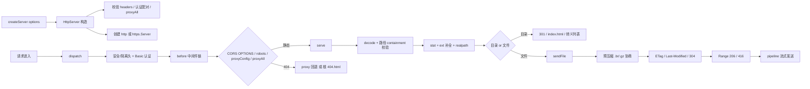

:::note 事实基线
本文依据 `$HOME/github/yukino.js/packages/http-server` 在 `1afcb40eef9` 的源码事实撰写；文中的路径、常量与 API 名称均可在该检出中定位。
:::

**主线一览**



`@yukino.js/http-server` 是从 `http-party/http-server` 重写的静态文件服务器与 `http-server` CLI，依赖 workspace 内的 `@yukino.js/http-proxy` 与 `@yukino.js/port-finder`。本站不重复 HTTP 缓存头/状态码的通用教程（由 h 覆盖），只聚焦这版实现自己的取舍：**先 realpath 再 containment 的路径安全、弱 ETag + Range 的协商实现、预压缩兄弟文件的零运行时压缩，以及 CLI 对传统紧凑参数的原生归一化**。

## 定位与整体架构

`src/index.ts` 导出 `createServer(options)`、`HttpServer` 类（别名 `HTTPServer`）与 default 对象；`src/cli.ts` 是 `bin.http-server` 的实现。README 的最短用法：

```ts
import { createServer } from "@yukino.js/http-server";
const server = createServer({ root: "./public", cache: -1, cors: true });
server.listen(8080, "127.0.0.1", () => console.log(server.address()));
// server.close();
```

```sh
pnpm --filter @yukino.js/http-server exec http-server ./public -p 8080 --cors -c-1
```

公开面里 `HttpServer` 有 `server`、`root`、`headers`、`listen`、`address`、`close`。`server` 是原生 `http.Server | https.Server`，库本身不包装请求对象。`root` 默认值是 `existsSync("public") ? "public" : "."` 再 `resolve`（`src/index.ts:107`），并统一 `resolve` 成绝对路径。`listen` 有四个重载，可接 `(port, hostname?, callback?)`、`(port, callback)`、`(path, callback?)` 或 `ListenOptions`，实现里按参数类型分派后返回 `this`。

README 的选项速查（与 `HttpServerOptions` 对应）：

| 选项                                                                    | 行为                                                                                  |
| ----------------------------------------------------------------------- | ------------------------------------------------------------------------------------- |
| `root` / `baseDir`                                                      | 文件系统根目录与 URL 挂载前缀                                                         |
| `autoIndex` / `showDir`                                                 | 是否服务 index.html、是否输出转义后的目录列表（默认 true；`false` 或 `"false"` 关闭） |
| `dirOverrides404`                                                       | 让目录列表优先于根 `404.html`                                                         |
| `showDotfiles` / `hidePermissions`                                      | 点文件可见性（默认可见）、目录权限位显示                                              |
| `ext`                                                                   | 回退扩展名（默认 html，`false` 禁用）                                                 |
| `cache`                                                                 | 秒数（默认 3600）、`-1` 禁用，或 Cache-Control 字符串                                 |
| `gzip` / `brotli` / `forceContentEncoding`                              | 服务预压缩 `.gz`/`.br` 兄弟文件；Brotli 优先；尊重 `q=0`；无运行时压缩                |
| `headers` / `contentType` / `mimetypes`                                 | 自定义响应头、回退 MIME、扩展名到 MIME 的映射；头部会被校验                           |
| `username` / `password` / `allowedHosts`                                | Basic 认证与精确主机名白名单；两个凭证必须同时给                                      |
| `cors` / `corsHeaders` / `coop` / `coopHeader` / `privateNetworkAccess` | 跨源与隔离头，含 CORS 预检处理                                                        |
| `robots`                                                                | `true` 输出 deny-all robots.txt；字符串作自定义内容                                   |
| `https` / `timeout`                                                     | 原生 HTTPS 选项（PEM 内容/Buffer）、socket 超时毫秒（默认 120000）                    |
| `proxy` / `proxyOptions` / `proxyAll` / `websocket`                     | 回退上游、代理选项、全量代理、WS 升级                                                 |
| `proxyConfig`                                                           | glob → 代理选项映射，首个匹配生效；每项可带正则 `pathRewrite`                         |
| `before` / `logFn`                                                      | `(req,res,next)` 中间件数组与可选请求/错误日志器                                      |

几个模块级工具函数值得单独指出：

- `escapeHtml(value)`——转义 `& < > " '`，用于目录列表文件名；
- `contained(root, path)`——`relative(root, path)` 不是 `..`、不以 `..${sep}` 开头、且非绝对路径；
- `equal(a, b)`——用 `createHash("sha256")` + `timingSafeEqual` 做常量时间比较，供 Basic 认证使用；
- `enabled(value, fallback = true)`——把 `false` 与字符串 `"false"` 都视为关闭；
- `fail(status)`——`Object.assign(new Error(http.STATUS_CODES[status]), { status })`；
- `accepts(header, encoding)`——解析 `Accept-Encoding`，命中 encoding 或 `*` 且没有 `q=0` 参数时返回 true。

## 核心 API 与实现机制

### 构造器与前置校验

`HttpServer` 构造器（`src/index.ts:105`）做三件校验，全部 fail-fast：

1. 把 `options.headers` 与固定的 `"Accept-Ranges": "bytes"` 合并后，逐项过 `http.validateHeaderName` / `http.validateHeaderValue`（测试用 `"x-test": "bad\r\nvalue"` 验证会抛错）；
2. `username` 与 `password` 必须同时提供，否则 `"Basic authentication requires both username and password"`；
3. `proxyAll` 为真但没有 `proxy` 时抛 `"proxyAll option requires proxy"`。

若提供 `proxy` 或 `proxyConfig`，就用 `createProxyServer({ changeOrigin: true, ...options.proxyOptions, target: options.proxy })` 建一个内置 `ProxyServer`。`server` 根据 `options.https` 选择 `https.createServer` 或 `http.createServer`，超时 `options.timeout ?? 120_000`（毫秒）。`websocket: true` 且有 proxy 时挂 `upgrade` 监听转给 `proxy.ws`；`server.once("close")` 会顺带 `proxy.close()`。

### `dispatch`：安全头、认证与中间件

`dispatch(req, res)`（`src/index.ts:148`）是请求主链，顺序固定：

1. 写入构造器里的统一 headers；
2. `coop` → `Cross-Origin-Opener-Policy`（默认 `same-origin`）+ `Cross-Origin-Embedder-Policy: require-corp`；
3. `cors` → `Access-Control-Allow-Origin: *`、`Access-Control-Allow-Headers`（含 `Range` 与可选 `corsHeaders`）、`Allow-Methods: GET, HEAD, OPTIONS`；
4. `privateNetworkAccess` → `Access-Control-Allow-Private-Network: true`；
5. `allowedHosts` → 用 `new URL(\`http://${req.headers.host}\`).hostname`解析，解析失败或不在精确列表中`throw fail(403)`；
6. Basic 认证 → 从 `authorization` 取 base64，按第一个 `:` 切分，`equal()` 常量时间比对；失败时写 `WWW-Authenticate: Basic realm=""` 并 `throw fail(401)`；
7. `before` 中间件数组逐个 `await` 一个 Promise，监听 `finish`/`close`/`next` 三种推进方式（`res.emit("next")` 也能推进），中间件返回 `false` 则终止；
8. `cors && OPTIONS` → 204；`robots` 且路径为 `/robots.txt` → `true` 时输出 `"User-agent: *\nDisallow: /"`，字符串时把 `\\n` 还原为换行；
9. `proxyConfig` → 按声明顺序用 `minimatch(req.url, pattern)` 取**首个匹配**，对每条 `pathRewrite` 做 `req.url.replace(new RegExp(search), replacement)`，再交给 proxy；
10. `proxyAll` → 直接代理；非 `GET`/`HEAD` → `Allow: GET, HEAD, OPTIONS` + 405；其余进入 `serve`。

`serve` 抛错后的收敛（`src/index.ts:256`）很有意思：`status === 404 || code === "ENOENT" || code === "ENOTDIR"` 时，优先代理回退（若有 `proxy`），否则尝试发 `root/404.html`（失败才 404）；`EACCES` → 403；其余原样抛出。顶层 handler catch 后若 `headersSent` 则 `res.destroy(error)`，否则回 `error.status ?? 500` 与 `http.STATUS_CODES[...]`。

`tests/index.test.ts` 里中间件与代理改写同时生效的例子：

```ts
const { url } = await start({
  proxy,
  before: [
    (_req, res, next) => {
      res.setHeader("x-before", "yes");
      next();
    },
  ],
  proxyConfig: {
    "/api/**": { target: proxy, pathRewrite: { "^/api": "/v1" } },
  },
});
expect(await (await fetch(url + "/hello.txt")).text()).toBe("0123456789");
expect((await fetch(url + "/missing")).headers.get("x-before")).toBe("yes");
expect(await (await fetch(url + "/api/users")).text()).toBe(
  "upstream /v1/users",
);
```

同一份测试还断言 `bytes=2-5` 返回 206 + `Content-Range: bytes 2-5/10` 与内容 `"2345"`，后缀 `bytes=-3` 返回 `"789"`，越界 `bytes=50-60` 返回 416 + `bytes */10`——覆盖 `sendFile` 的三种 Range 分支。

### `safePath` 与 `serve`：路径安全

路径处理是这个包最该关注的部分。`serve(req, res)`（`src/index.ts:299`）：

1. 取 `(req.url ?? "/").split("?")[0]`，`decodeURIComponent` 失败 400；
2. 含 `\0` 或 `\` 直接 400，路径段含 `..` 直接 403；
3. `baseDir` 规整成 `"/" + parts.join("/")`，不匹配挂载前缀 404，匹配后剥掉前缀；
4. `showDotfiles === false` 且任一段以 `.` 开头（排除 `.`）→ 404；
5. `path = resolve(this.root, "." + pathname)`，先做一次字符串级 `contained(this.root, path)` → 403；
6. `stat(path)`，若 `ENOENT` 且无扩展名则按 `ext`（默认 `"html"`，`false` 禁用）补后缀再 stat；
7. 再经 `safePath(path)`。

`safePath`（`src/index.ts:291`）并行 `realpath(this.root)` 与 `realpath(path)`，然后 `contained(root, actual)`——**用真实路径而非字符串路径做包含判定**，因此指向 root 之外（如测试里 `symlink(tmpdir(), join(root, "outside"))`）的符号链接被 403 拒绝。

目录分支：URL 不以 `/` 结尾则 301 到 `raw + "/"` 并保留 query；`autoIndex` 开启时尝试 `index.html`（只在 `ENOENT` 时继续）；若 `dirOverrides404` 为假且根目录存在 `404.html` 则抛 404；否则按 `showDir` 决定是否列目录——`readdir(..., { withFileTypes: true })`，目录排前、同名排序，逐项再过一次 `safePath`（越界或坏链接静默跳过），输出用 `escapeHtml` 转义文件名、用 `encodeURIComponent` 做 href，并可隐藏权限位（`hidePermissions`）。

### `sendFile`：协商缓存、Range 与预压缩

`sendFile(req, res, path, status = 200)`（`src/index.ts:398`）再次 `safePath` + `stat` 确认是文件。

**预压缩**：遍历 `[["br",".br",brotli],["gzip",".gz",gzip]]`（Brotli 在前，优先命中），若 `forceContentEncoding` 或 `accepts(accept-encoding, encoding)` 通过，就 `safePath(path + suffix)` + `stat` 确认存在后改 `path` 并写 `Content-Encoding`；写 `Vary: Accept-Encoding`。**没有任何运行时压缩**，只服务预生成的 `.br`/`.gz` 兄弟文件。

**元数据**：ETag 是 `W/"${info.size.toString(16)}-${Math.trunc(info.mtimeMs).toString(16)}"`（弱校验，尺寸+毫秒时间戳的十六进制），`Last-Modified` 取 `info.mtime.toUTCString()`。Content-Type 优先级为 `mimetypes[extname(original).slice(1)]` → `lookup(original)` → `contentType` fallback → `opts.contentType` → `application/octet-stream`；注意用 `original`（未加压缩后缀）取扩展名。`cache` 默认 3600：`-1` → `"no-cache, no-store, must-revalidate"`，数字 → `max-age=${cache}`，字符串原样透传。

**条件请求**：`status === 200` 时，`if-none-match` 支持 `*` 与逗号列表，双方都去掉 `W/` 后比较；否则 `if-modified-since` 解析时间 ≥ `floor(mtimeMs/1000)*1000` 即命中；命中写 304 并返回。

**Range**：`if-range` 为弱 ETag（以 `W/` 开头）或时间早于 mtime 时忽略 Range。正则 `/^bytes=(\d*)-(\d*)$/` 支持 `bytes=start-end` 与 `bytes=-N` 后缀范围；`start > end`、`start >= size`、或后缀长度为 0 时写 `Content-Range: bytes */size` 并 416；合法则 206 + `Content-Range: bytes start-end/size`。`HEAD` 或空文件直接 `res.end()`，否则 `pipeline(createReadStream(path, { start, end }), res)`；pipeline 抛 `ERR_STREAM_PREMATURE_CLOSE` 且请求未销毁时被吞掉。

### CLI：参数归一化与 workspace 协作

`src/cli.ts` 用 Node 原生 `parseArgs`（未知 flag 显式失败）。几个归一化步骤：

- 传统紧凑负数写法 `-c-1` / `-p0` / `-t5` 被正则 `/^-[pct]-?\d+$/` 改写成 `--cache=-1` 等；
- `--cors=<headers>` 拆成 `--cors --cors-headers <headers>`，`--robots=<content>` 同理；
- `-d`/`-i`/`--directories`/`--index` 后若不是显式 `true|false` 则补 `"true"`；
- `-o`/`--open` 后无路径则补 `"/"`；
- `--proxy-options.<key>` 支持点号路径，显式拦截 `__proto__`/`constructor`/`prototype` 防原型污染，值先 `JSON.parse` 失败再当字符串；
- `PORT` 环境变量作为默认端口，`port === 0` 时调用 workspace 的 `getPort({ port: 8080, host })`；
- CLI `timeout` 单位是秒，装配进 library 时 `* 1000`；
- `--ssl`/`--tls` 读 `cert.pem`/`key.pem` 内容为 Buffer（不是路径），passphrase 取 `NODE_HTTP_SERVER_SSL_PASSPHRASE`；
- `--open` 按平台选 `open`/`rundll32`/`xdg-open` 并 `child.unref()`；`SIGINT`/`SIGTERM` 调 `server.close()`。

## 并发、边界与容错

- **中间件链**：`before` 数组串行推进，`finish`/`close` 都会中止后续处理，`res.emit("next")` 也能推进（README 明确提到）。中间件同步抛错会被捕获回 500。
- **代理回退层级**：`proxyConfig` 精确 glob 匹配优先 → `proxyAll` → 静态 404 时回退到 `proxy` → 再回退到根 `404.html`。`proxyConfig` 里 `pathRewrite` 是 `new RegExp(search)`，用户需自行转义特殊字符。
- **安全默认**：目录名 HTML 转义、href 用 `encodeURIComponent`（测试中 `<script>.txt` 变成 `&lt;script&gt;.txt` 与 `%3Cscript%3E.txt`）、dotfiles 与越界符号链接默认拒绝、非 GET/HEAD 静态请求 405。
- **CLI 护城河**：原型污染字段被拒；`--header` 必须是 `Name: value`；`--version` 输出 `"0.0.0"`；未知 flag 以退出码 1 失败（测试覆盖 `--invalid-option`）。

:::danger 路径与代理配置是安全敏感面
`serve()` 的多层校验（decode、`\0`/`\`、 `..` 段、`baseDir` 前缀、`contained`、`safePath` 的 realpath）任何一层都不能省略——测试明确覆盖 `%2e%2e%2f` 编码穿越、`%00`/`%FF` 畸形路径与指向 root 外的符号链接。`allowedHosts` 是**精确主机名**匹配，不是后缀匹配。`proxyConfig` 的 `pathRewrite` 用 `new RegExp(search)` 直接构造，正则元字符由调用方负责转义。
:::

:::tip 与 workspace 内聚
本包是三个 workspace 包协作的例子：`@yukino.js/http-proxy` 提供回退转发与 WS 升级，`@yukino.js/port-finder` 的 `getPort()` 为 CLI 的 `-p 0` 找可用端口，`mime-types` + `minimatch` 分别处理 MIME 与代理 glob。`Content-Type` 映射用 `Record<string, string>` 而不是上游那种 `.types` 文件路径（CLI 的 `--mimetypes` 会自行把文件读进映射）。
:::

## 适用与不适用

**适用**：

- 本地开发静态资源服务、文档预览、CI 产物冒烟测试；
- 需要 Range/条件请求/预压缩/目录列表等完整静态文件语义；
- 需要"静态优先、缺失回退到上游"的混合部署（`proxy` / `proxyConfig`）；
- 需要一个行为明确的 CLI（PORT 环境变量、端口 0 自动寻端口、SIGTERM 优雅退出）。

**不适用**：

- 需要运行时压缩——本包只服务预生成的 `.gz`/`.br`；
- 需要 WebSocket 业务处理本身——只会把 upgrade 转给 http-proxy；
- Node < 24（`engines.node: ">=24"`）；
- 需要上游 `lib/core` 低层 API 或 union 专属响应对象——README 明确不导出；自定义 MIME 用映射而非 `.types` 路径。

## 交叉链接

- `yukino-http-proxy`：本包直接依赖它做回退代理与 WebSocket 升级；其 Pass 管道与错误语义见对应解析。
- `yukino-create-servers`：同为 HTTP 监听层，但那边是"多协议共享 handler"，本包是"单 server 上的静态文件路由"。
- `yukino-cache`：同为 workspace 包但走 gRPC + etcd，与本包的 CLI 中心化用法形成对照。
- HTTP 缓存/Range/状态码、Basic 认证、MIME 类型等通用知识由 h 文档覆盖，本文只写本包的具体实现。

**核心源码文件清单**：`src/index.ts`、`src/cli.ts`、`tests/index.test.ts`、`README.md`、`package.json`、`NOTICE.md`、`LICENSE.upstream`。
