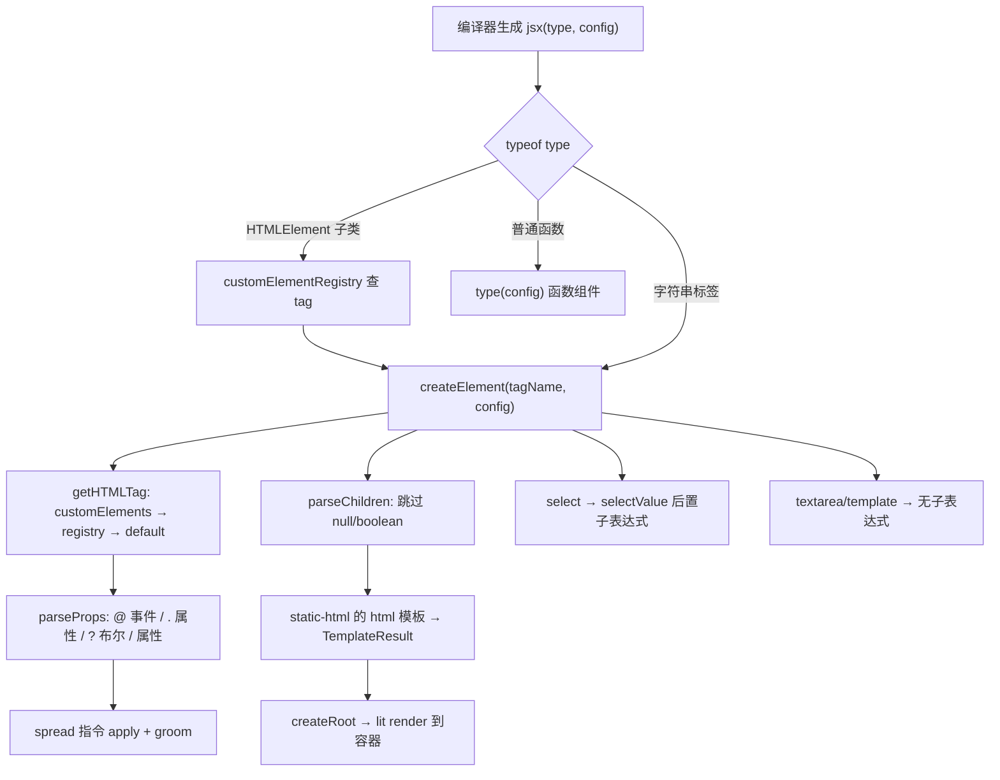

:::note 事实基线
本文依据 `$HOME/github/yukino.js/packages/lit-jsx` 在 `1afcb40eef9` 的源码事实撰写；文中的路径、常量与 API 名称均可在该检出中定位。
:::

**主线一览**



Lit 本身的模板、指令与响应式属性由 h/docs 覆盖；本站只记录 `@yukino.js/lit-jsx` 自己的那一段：编译后的 `jsx()` 调用如何变成 Lit 的 `TemplateResult`，props 如何被编码进 `spread` 指令，以及为 `<select>` / `<textarea>` 这些"HTML 解析器不配合"的标签做了哪些特例。

## 一、定位与整体架构

README 第一行就写明版本边界：**需要 `lit@latest`（3.x）**。配置上把 JSX 交给本包处理：

```json
{
  "compilerOptions": {
    "jsx": "react-jsx",
    "jsxImportSource": "@yukino.js/lit-jsx"
  }
}
```

Babel 侧对应 `@babel/plugin-transform-react-jsx` 的 `runtime: "automatic"` + `importSource: "@yukino.js/lit-jsx"`，并设 `throwIfNamespace: false`。README 还要求 `experimentalDecorators`、`emitDecoratorMetadata` 与 `useDefineForClassFields: false`。

`package.json` 暴露四个入口：`@yukino.js/lit-jsx`（根）、`jsx-runtime`、`jsx-dev-runtime`（映射到同一份文件）、`community`。根入口 `src/index.ts` 是：

```ts
export * from "lit";
export { createRoot } from "./core/create-root";
export { assignElements, resetElements } from "./core/create-element";
export * from "./decorators";
export * from "./directives";
export * from "./types";
```

注意根入口<u>不导出 `jsx` / `Fragment` / `createElement`</u>——它们只属于 `jsx-runtime` 入口，由编译器自动引入。构建用 tsup 打三个入口的 ESM/CJS/d.ts，并有 `raw-import` 插件支持 `?raw`。

| 文件                               | 角色                                                            |
| ---------------------------------- | --------------------------------------------------------------- |
| `src/jsx-runtime.ts`               | `jsx` / `jsxs` / `jsxDEV` / `Fragment` 与整套 JSX 类型          |
| `src/core/create-element.ts`       | `createElement`、标签注册表、`assignElements` / `resetElements` |
| `src/core/create-root.ts`          | `Root` / `createRoot` 挂载生命周期                              |
| `src/core/element-registry.ts`     | 生成的 HTML 标签表与 `default = div`                            |
| `src/utils/element-utils.ts`       | `getHTMLTag` / `parseProps` / `parseChildren`                   |
| `src/utils/event-utils.ts`         | `getNativeEventName` 与 `Proxy` 回退规则                        |
| `src/directives/spread.ts`         | `SpreadDirective`，props 的 `@` / `.` / `?` / 属性编码与清理    |
| `src/directives/select-value.ts`   | `SelectValueDirective`，`<select>` 的值后置应用                 |
| `src/decorators/custom-element.ts` | 记录类→标签映射并 `customElements.define`                       |
| `src/community/*`                  | 可选路由与 SVG 图标助手                                         |

## 二、JSX 调用到模板的转换链

### 2.1 运行时入口只有两个函数

`src/jsx-runtime.ts` 末尾把同一个函数导出三次：

```ts
function jsx(type: string | Function, config: Record<string, unknown>) {
  if (typeof type === "function") {
    if (type.prototype instanceof HTMLElement) {
      let tagName = customElementRegistry.get(type);
      if (!tagName) {
        const CustomElement = type as new () => HTMLElement;
        const element = new CustomElement();
        tagName = element.localName;
        customElementRegistry.set(type, tagName);
      }
      return createElement(tagName, config);
    }
    return type(config);
  }
  return createElement(type, config);
}

function jsxFragment(fragment: { children?: unknown }) {
  return Array.isArray(fragment.children)
    ? fragment.children
    : [fragment.children];
}

export { jsx, jsx as jsxs, jsx as jsxDEV, jsxFragment as Fragment };
```

三条分支含义不同：字符串标签与自定义元素**类**都走 `createElement`（生成 `TemplateResult`）；普通函数被当作函数组件直接 `type(config)` 调用，其返回值本身可以是一段 JSX。`Fragment` 只把 children 摊成数组，单个 child 也会包成数组。

对自定义元素类，若本地 `customElementRegistry` 没有记录，运行时会 `new CustomElement()` 一次读 `localName` 并缓存——所以传进来的必须已经是定义好的 custom element（随包的 `customElement` 装饰器定义的类天然有记录）。

### 2.2 标签解析顺序

`createElement` 先解构掉 `children` / `ref` / `style` / `key`，再 `getHTMLTag(type, elementRegistry)`：

1. `window.customElements.get(type)` 命中 → `unsafeStatic(type)`；
2. 否则查 `elementRegistry[type]`；
3. 再否则用 `registry.default`，初始是 `unsafeStatic("div")`。

默认表由 `src/core/element-registry.ts` 用一长串 HTML 标签字符串 `.split(" ")` 生成，每项都包成 `unsafeStatic(tag)`。包内 `skills/yukino-lit-jsx/SKILL.md` 特别指出：表里<u>没有 `svg` / `path` 条目</u>，未映射的 SVG 标签会落到 default（div），运行时也没有 SVG 模板分支。

`assignElements({ button: "my-button" })` 会把字符串包装成 `unsafeStatic` 后合并进注册表，也接受 `literal`my-lit-button`` 这样的 `StaticValue`；`resetElements()` 复制默认表重建。测试覆盖了字符串覆盖、`StaticValue` 覆盖、覆盖 `default`、以及"textarea 映射到 div 时保留 children"等反转场景。

### 2.3 props 编码：`spread` 指令

`parseProps` 把 JSX props 转成带前缀的记录，规则只对注册表内的原生标签生效（`if (registry[type])`）；其它情况一律当属性赋值：

```ts
if (propName === "class") {
  parsedProps[".className"] = value;
  continue;
}
if (propName.includes("-")) {
  parsedProps[propName] = value;
  continue;
}
if (typeof value === "boolean") parsedProps[`?${propName}`] = value;
parsedProps[`.${propName}`] = value;
```

事件名先过 `getNativeEventName`。`src/utils/event-utils.ts` 用 `Proxy` 实现：只有 `onDoubleClick → dblclick` 是显式特例，其余 `/^on[A-Z]/` 的名字统一 `slice(2).toLowerCase()`。所以 `onKeyDown → keydown`、`onPointerRawUpdate → pointerrawupdate` 都自动成立，且 React 风格与 DOM 原生拼写（`onKeydown`）都能用。转出来的事件 prop 写成 `@${eventName}`。

`SpreadDirective extends AsyncDirective` 负责把这些标记真正落到 DOM：`@` 用 `element.addEventListener(name, this, options)`（指令自己实现 `handleEvent` 并转发到 `prevData` 中的 handler，host 取 `part.options?.host`）；`.` 直接写属性；`?` 真则 `setAttribute(name, "")`、假则移除；默认前缀用 `setAttribute(key, String(value))`。

`groom()` 处理"上一次有、这一次没有"的 prop：事件移除监听、`.` 属性先尝试 `delete`，`className` 走 `removeAttribute("class")`，字符串 IDL 属性清成 `""`，其它清成 `undefined`。`disconnected()` / `reconnected()` 还会随 DOM 摘挂事件监听。测试用 `spread` 直接搭配 `html` 模板验证 nullish 值被视为"省略"且不修改传入的数据对象：

```ts
const view = (data: Record<string, unknown>) => html`<input ${spread(data)} />`;
```

### 2.4 children：跳过空值，保留顺序

`parseChildren` 把 children 摊平后跳过 `boolean` 与 nullish，于是 `{cond && <div />}` 与 React 一样安全。若 children 的**类型名**在注册表里有条目（例如 `string`），会额外包一层 `html`<${wrapper}>${child}</${wrapper}>``；这是给文本节点做类型化包装的钩子。

`key` 在 `createElement` 里被解构掉，不会漏到 DOM；README 明说它只为 React 习惯而接受，Lit 的 diff 没有 key 语义。

### 2.5 两个内容受限标签的例外

`NO_CHILD_EXPRESSION_TAGS = new Set(["textarea", "template"])`。`createElement` 用 `tagName._$litStatic$` 取解析后的标签字符串做判断：

- **`<select>`**：把 `value` / `defaultValue` 从 spread 数据中摘出，作为**子表达式** `selectValue(value, defaultValue)` 放在 options 之后。原因是 lit-html 按文档顺序提交 part，开始标签里的 `spread` 先执行，那时 `<option>` 还不存在，设 `.value` 会被浏览器忽略并退回第一项。
- **`<textarea>` / `<template>`**：不渲染任何子表达式（HTML 解析器把内容当 raw text，lit-html 会警告）。`<textarea>` 额外调用 `withTextChildrenAsValue`：没有显式 `value`/`defaultValue` 时，把纯文本 children（字符串/数字，跳过 nullish 与 boolean）拼成 `defaultValue`；出现任何非文本 child 就放弃转换。`<template>` 直接丢弃 children。
- 这个判断基于**解析后的标签**，所以 `assignElements({ div: "textarea" })` 后 `<div>` 也会走 textarea 分支；反向覆盖则能恢复 children。

`SelectValueDirective` 把"受控 vs 非受控"做成明确的差异：`value != null` 时每次渲染都调 `applySelectValue`（数组则逐项设 `option.selected`，标量设 `select.value`）；`defaultValue` 时用 `appliedDefaultValue` 存一份字符串数组快照，只有数组内容变化时才重设 `option.defaultSelected` 并应用——因此等价的数组字面量不会覆盖用户操作，`form.reset()` 会恢复到最新默认值。

```ts
const previous = this.appliedDefaultValue;
if (
  !previous ||
  values.length !== previous.length ||
  values.some((item, index) => item !== previous[index])
) {
  this.appliedDefaultValue = values;
  // ...
}
```

## 三、注册、挂载与类型层

`customElement(tagName)` 装饰器先 `customElementRegistry.set(classOrDescriptor, tagName)`，再按两种形态处理：函数直接 `customElements.define`；descriptor 则返回带 `finisher(clazz) { customElements.define(tagName, clazz); }` 的 descriptor。`src/utils/custom-element-registry.ts` 在 `beforeunload` 时清空映射。它同时是 JSX 类标签查 localName 的依据。

`createRoot(container)` 接受 `HTMLElement | DocumentFragment`，用静态 `Root._roots` Map 去重：同一容器重复调用会 `console.warn` 并返回已有 root。`root.render(value)` 调 Lit 的 `render` 并返回传入值；`root.unmount()` 渲染 `nothing`、注销映射并置 `_container = undefined`，此后 `render` 抛 `"Cannot render an unmounted root."`。

类型层是这套运行时的另一半，全部在 `src/jsx-runtime.ts`：

- `NativeEventProps` 从 `HTMLElementEventMap` 生成 `on${Capitalize<EventName>}`；
- `ReactEventNames` 显式列出 `onKeyDown → keydown`、`onDoubleClick → dblclick`、`onTransitionEnd → transitionend` 等映射，`ReactEventProps` 会过滤掉目标 TS lib 里不存在的事件名；
- `KnownKeys<T>` 剔除 `form` 这类带字符串索引签名的 key，保证 `Omit` 精确；
- `ValueProps<T>` 把 `value`/`defaultValue` 放宽到 number 与 `readonly string[]`，`ElementProps` 用 `Omit<EventProps, KnownKeys<T>>` 让自定义元素自己声明的 `onXxx` 回调属性获胜，而不是与原生事件类型交叉成不可调用的函数；
- `namespace JSX` 里 `Element = unknown`，`IntrinsicElements` 由 `HTMLElementTagNameMap` 生成并保留任意标签兜底。

`tests/types/jsx-types.tsx` 用 `@ts-expect-error` 钉住这些约束；例如自定义 `<student-form onSubmit={(values) => ...}>` 的回调参数不能被 `SubmitEvent` 污染。

:::tip 包里自带一份维护说明
`skills/yukino-lit-jsx/SKILL.md` 与 `references/rendering.md`、`references/router.md` 随包发布，记录入口映射、渲染约定和路由细节；构建时由 `tsup.config.ts` 的 exit 钩子从 `.agents/skills/` 复制进 `skills/`。改实现前先读它，比从 README 猜要准。
:::

## 四、社区层：路由与图标

`community` 入口是可选的高层工具，不参与 JSX 转换本身：

- `createHashRouter(routes)` / `createBrowserRouter(routes)`（别名 `createHistoryRouter`）配置共享的 `router` 实例；`router.mode` 报告 `"hash"` 或 `"history"`，`router.stop()` 摘掉 URL 监听。
- 路由配置支持 `path` / `index` / `children`、`:params`、`*` catch-all、重定向 `{ path, to }` 与 `loader` / `action`；组件包括 `<route-view>`、`<route-outlet>`、`Link`、`NavLink`、`Form`、`Outlet(depth?)`、`Fetcher`。
- 所有 hook（`useParams` / `useLocation` / `useNavigate` / `useNavigation` / `useLoaderData` / `useActionData` / `useSearchParams` / `useMatch` / `useOutletContext`）都读同一个 router 实例。`<route-outlet>` 会沿父链（含 ShadowRoot 的 host）推断 depth。
- `icon(svg, className?)` / `iconWith(svg, { className, strokeWidth })` 去掉注释、折叠空白，并只改根 `<svg>` 开标签的 class/stroke-width，属性替换会解析引号、转义插入值；它们返回字符串且**不做 SVG 消毒**。
- `?raw` 由 tsup 的 `raw-import` 插件实现：相对/绝对路径 + `?raw` 读 UTF-8 文本并生成默认导出字符串，裸包名会被拒绝；`src/types/raw.d.ts` 提供类型。

## 五、边界与适用

:::warning 模块加载需要浏览器环境
`custom-element-registry.ts` 在模块顶层访问 `window`，`community` 入口在导入时构造浏览器对象并定义 custom elements。要在 SSR 或纯 Node 测试里导入这些入口，必须先准备 DOM（仓库测试用 jsdom 与 vitest `resolve.alias` 指向源码）。另外 SVG 助手返回字符串且不消毒，插入 DOM 前自行确保内容可信。
:::

**适用**

- 已有 Lit 项目想用 JSX 写模板，并希望 props 按 React 习惯书写（`class`/`className`、camelCase 事件、`style` 对象）。
- 需要把 HTML 标签名整体替换成另一套组件（README 里 WebXR/three.js 的原始动机），或需要给未知标签设置统一兜底。
- 需要 `<select>` / `<textarea>` 的 React 式表单语义，同时保留 lit-html 的高效 diff。

**不适用**

- 把它当通用 Lit 教程或 Lit 的替代品：通用主题归 h，本包只提供 JSX 运行时与少量胶水。
- 需要 keyed diff：README 明确 `key` 不参与 Lit 的差异算法。
- 希望直接用 `icon` 渲染不可信 SVG，或希望 `<svg>` 标签自动按 SVG 命名空间处理：这两件事本包都不做。

## 六、交叉链接

- 同仓库的规范实现：[yukino-promises-a-plus](./yukino-promises-a-plus)，对照"公开 API 与编译器入口分离"的组织方式。
- 同仓库的测试注册表：[yukino-registry-mock](./yukino-registry-mock)，展示另一条 `community` 之外的工具链路径。
- 前端专题索引：[index](./index)；React/Lit 通用主题由 h/docs 覆盖。

**小结**：lit-jsx 的全部工作可以读成一条流水线——编译器产出 `jsx(type, config)`，运行时判定"组件函数还是标签"，标签经注册表解析后由 `createElement` 用 `static-html` 的 `html` 生成模板，`parseProps` 把 props 编码成 `spread` 指令的操作码，`<select>` / `<textarea>` 走两条后置子表达式特例。抓住这条线，剩下的类型层与 community 工具都是围绕它的加固与扩展。
