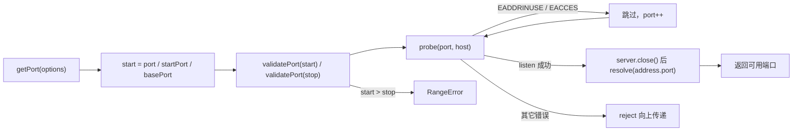

:::note 事实基线
本文依据 `$HOME/github/yukino.js/packages/port-finder` 在 `1afcb40eef9` 的源码事实撰写；文中的路径、常量与 API 名称均可在该检出中定位。
:::

**主线一览**



本地起测试服务、起 mock server、跑集成用例时，第一件事往往是"哪个端口现在能用"。`@yukino.js/port-finder` 把这件事收敛成三个函数：找一个端口、找一组端口、找一个没被占用的 Unix socket 路径。本站是 h/docs 的补充，通用 Node `net` 模块与端口概念由 h 覆盖，这里只讲这个包自己的探测策略、API 重载与边界处理。

## 一、定位与整体架构

包从 `node-portfinder@1.0.38` 重写而来，`NOTICE.md` 保留了上游归属，`LICENSE.upstream` 收录原始 MIT 声明；实现只用 Node 标准库，没有运行时依赖。构建用 Rolldown 打 ESM + sourcemap，TypeScript 单独出声明；测试用 Vitest 并真实起本地 listener。

| 文件                             | 角色                                                            |
| -------------------------------- | --------------------------------------------------------------- |
| `src/index.ts`                   | 全部实现与导出，单文件约 177 行                                 |
| `tests/index.test.ts`            | 真实 listener、回调、参数校验与 socket 行为验证                 |
| `README.md`                      | 快速上手与"结果是建议而非预占"的说明                            |
| `NOTICE.md` / `LICENSE.upstream` | 上游 `node-portfinder` 归属                                     |
| `rolldown.config.ts`             | `input: src/index.ts`，`platform: node`，external 含 `/^node:/` |

导出的表面分三层：

```ts
// 三个主入口，同时支持 Promise 与回调
getPort(options?): Promise<number>
getPorts(count, options?): Promise<number[]>
getSocket(options?): Promise<string>

// 显式 Promise 别名
getPortPromise / getPortsPromise / getSocketPromise

// 实时默认值与 setter
basePort / highestPort / basePath
setBasePort / setHighestPort / setBasePath
```

`README.md` 给出的最小用法把三者串在一起：

```ts
import { getPort, getPorts, getSocket } from "@yukino.js/port-finder";
const port = await getPort({ port: 8080, stopPort: 9000, host: "127.0.0.1" });
const ports = await getPorts(3, { port: 9001 });
const socket = await getSocket({ path: "/tmp/my-app/server.sock" });
```

## 二、核心 API 与实现机制

### 2.1 `probe`: 一次真实的 listen/close

所有端口查找最终都落到私有的 `probe(port, host)`。它用 `node:net` 的 `createServer()` 做一次真实绑定：

```ts
const server = createServer();
server.once("error", (error: NodeJS.ErrnoException) => {
  if (error.code === "EADDRINUSE" || error.code === "EACCES")
    resolve(undefined);
  else reject(error);
});
server.listen({ port, host, exclusive: true }, () => {
  const address = server.address();
  const found = typeof address === "object" && address ? address.port : port;
  server.close((error) => (error ? reject(error) : resolve(found)));
});
```

三个细节决定了它的语义：

- <u>只有 `EADDRINUSE` 与 `EACCES` 被当作"这个端口不能用"</u>。其它错误（例如非法 host 导致的解析失败）直接 `reject`，不会被静默跳过。
- `listen` 带 `exclusive: true`，成功回调里先取 `server.address()`，再 `server.close()` 之后才 resolve。**探测端口在返回前一定已经释放**，不会泄漏 listener。
- `port: 0` 交给操作系统分配临时端口，此时 `address.port` 才是真实结果；`found` 的兜底分支用于 `address` 不是对象的情形。

### 2.2 `getPort` 与 `getPortPromise`

`getPortPromise(options)` 是核心循环。`start` 按 `options.port ?? options.startPort ?? basePort` 取值，`stop` 按 `options.stopPort ?? highestPort` 取值，随后 `validatePort` 检查两者都是 `[0, 65535]` 内整数，`start > stop` 抛 `RangeError`。循环从 `start` 递增到 `stop`（含端点），第一次 `probe` 返回非 `undefined` 的端口即为结果；全军覆没则抛：

```ts
throw new Error(`No open ports available between ${start} and ${stop}`);
```

默认值是模块级的 `export let`：<u>`basePort = 8000`、`highestPort = 65535`、`basePath = "/tmp/portfinder"</u>。setter 会改这些 live binding，因此后续调用立即看到新值；`setBasePort`/`setHighestPort`复用`validatePort`，`setBasePath`只拒绝空串（抛`TypeError`）。

### 2.3 `getPorts`: 递增量去重

`getPortsPromise(count, options)` 先校验 `count` 为非负整数，然后反复调用 `getPortPromise({ ...options, port })`：

```ts
const ports: number[] = [];
let port = options.port ?? options.startPort ?? basePort;
while (ports.length < count) {
  const found = await getPortPromise({ ...options, port });
  if (!ports.includes(found)) ports.push(found);
  port = found + 1;
}
```

<u>结果互不相同且天然升序</u>：每轮把搜索下界推到上一个结果 +1。`count = 0` 直接返回 `[]`。测试同时断言了升序与去重：

```ts
const ports = await getPorts(3, { port: 19000, host: "127.0.0.1" });
expect(new Set(ports).size).toBe(3);
expect(ports).toEqual([...ports].sort((a, b) => a - b));
```

### 2.4 `getSocket`: 只找名字，不碰文件

`getSocketPromise(options)` 解决的是另一类问题：给 Unix domain socket 挑一个未使用的路径。

```ts
const path = options.path ?? `${basePath}.sock`;
await mkdir(dirname(path), { recursive: true, mode: options.mod ?? 0o755 });
const ext = extname(path);
const stem = ext ? path.slice(0, -ext.length) : path;
for (let index = 0; ; index++) {
  const candidate = index ? `${stem}${index}${ext}` : path;
  try {
    await lstat(candidate);
  } catch (error) {
    if ((error as NodeJS.ErrnoException).code === "ENOENT") return candidate;
    throw error;
  }
}
```

它用 `lstat` 检查存在性（包括符号链接本身），命中 `ENOENT` 就返回；其它错误抛出。已存在的条目**不删除、不占用**，只是在文件名里插入数字后缀：`/tmp/my-app/server.sock` → `server1.sock` → `server2.sock`。父目录用 `mkdir(..., { recursive: true, mode: mod ?? 0o755 })` 创建；`mod` 只影响新建目录。

### 2.5 回调重载与 ESM default

三个主入口都是函数重载：可传 `(options)` 返回 Promise，可传 `(callback)`，也可传 `(options, callback)`；回调形态返回 `void`。内部统一走 `callbackOrPromise(promise, callback)`：

```ts
if (!callback) return promise;
void promise.then(
  (value) => callback(null, value),
  (error) => callback(error),
);
```

注意参数识别是"第一个参数是不是函数"：`getPort(cb)` 会把 `cb` 当回调、options 用 `{}`；`getPorts(count, cb)` 同理。默认导出是一个对象，除函数外还带三个只读 getter（`basePort` / `highestPort` / `basePath`）；README 明确要求用 setter 改默认值，而不是给模块属性赋值。

:::tip 为什么 `port: 0` 值得单独测
`probe` 在 `listen` 成功后读的是 `server.address().port`，而不是入参。测试用 `getPort({ port: 0 })` 拿到端口后马上用它起服务，确认返回的是 OS 真正分配的那个端口，而不是字面量 0。
:::

## 三、并发、边界与容错

- **结果是建议，不是预占**。`probe` 在 resolve 前已经 `close()`，从返回到调用方 `listen()` 之间存在窗口，别的进程可能抢先绑定。README 把这一点写得很直白：调用方仍须处理 `EADDRINUSE`。
- **无 `host` 时用通配绑定**。README 特别指出这与上游不同：上游会枚举网络接口，这里直接把 `host` 交给 `server.listen({ port, host, exclusive: true })`，省略时就是 Node 的通配地址。
- **socket 搜索不做声明**。`getSocket` 只做 `lstat` 存在性检查，既不会 unlink 旧 socket，也不会创建/绑定新 socket；它返回的是"现在看起来空闲的路径"。
- **错误分类清楚**：被占用/无权限跳过，其它传输错误向上抛；范围错误用 `RangeError`，空路径用 `TypeError`。测试覆盖了 `port: -1`、`1.5`、`start > stop`、`getPorts(-1)` 与 `setBasePort(65536)`。

```ts
await expect(getPort({ port: -1 })).rejects.toThrow(RangeError);
await expect(getPort({ port: 1.5 })).rejects.toThrow(RangeError);
await expect(getPort({ port: 9000, stopPort: 8000 })).rejects.toThrow(
  RangeError,
);
await expect(getPorts(-1)).rejects.toThrow(RangeError);
expect(await getPorts(0)).toEqual([]);
```

:::warning 实时默认值是全局可变状态
`basePort` / `highestPort` / `basePath` 与三个 setter 作用于模块级状态，会影响同一进程里的所有调用方。测试用 `try/finally` 保存并恢复原值；并行测试若同时改默认值会互相干扰，生产代码也应尽早一次性配置，不要在请求路径上来回切换。
:::

## 四、适用与不适用

**适用**

- 测试与本地开发里给 mock server、集成环境挑端口或 socket 路径。
- 需要"从某个起点向上扫到上限"的可控搜索，`stopPort` 是闭区间。
- 想复用上游 `portfinder` 的心智模型，但不愿引入依赖或处理其网络接口枚举。

**不适用**

- 需要<strong>原子占有</strong>端口的场景：这里没有预留机制，仍要在真正 `listen` 时处理竞争。
- 需要按网卡枚举可用地址的场景：本包只把单个 `host` 交给 Node。
- 需要管理 socket 文件生命周期：本包不创建、不删除、不监听 socket，只找名字。

## 五、交叉链接

- 同为 yukino.js packages 的缓存型测试服务：[yukino-registry-mock](./yukino-registry-mock)，它用 `http: 0` 让 OS 分配端口，并用 `address().port` 读取真实值。
- 同为 yukino.js packages 的规范实现：[yukino-promises-a-plus](./yukino-promises-a-plus)，对照两者如何把 Promise/回调双形态组织成公开 API。
- 前端专题索引：[index](./index)；通用 Node 网络与端口知识由 h/docs 覆盖，本站只记录本包的取舍。

**小结**：port-finder 的全部正确性都压在一个短函数上——真绑定、真释放、只对两种"忙"错误放行。剩下的工作是把这个探测原语包装成友好的重载与可配置的默认值；理解 `probe` 就理解了整个包。
