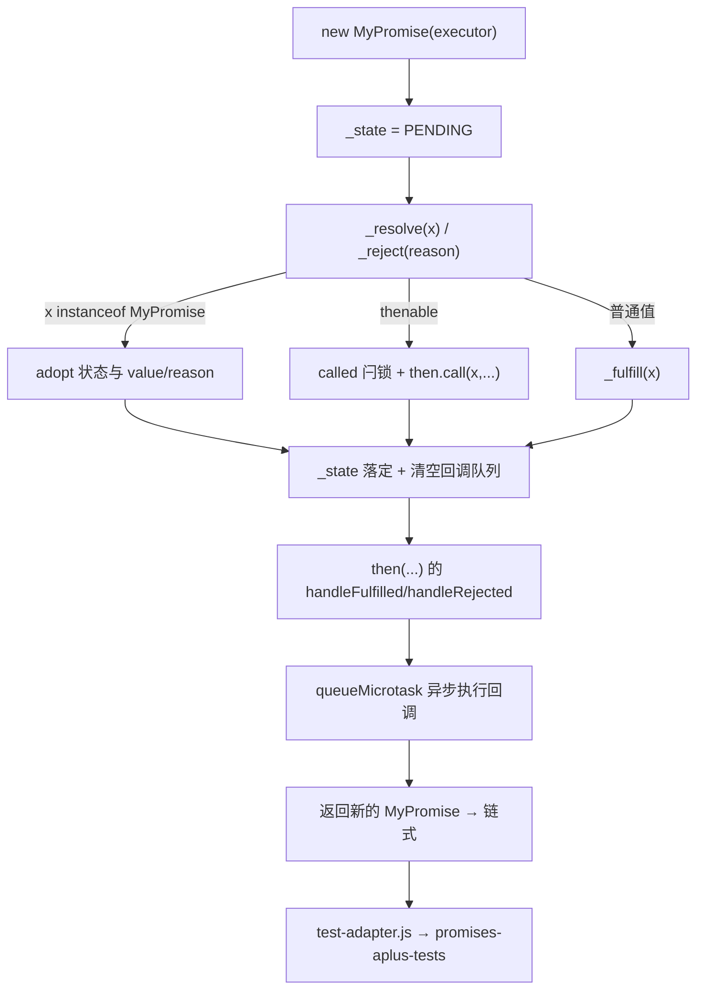

:::note 事实基线
本文依据 `$HOME/github/yukino.js/packages/promises-a-plus` 在 `1afcb40eef9` 的源码事实撰写；文中的路径、常量与 API 名称均可在该检出中定位。
:::

**主线一览**



这个包是一份<u>可验证</u>的 Promises/A+ 实现：`src/my-promise.ts` 手写核心语义，`src/test-adapter.js` 把它接到官方 `promises-aplus-tests` 上，`src/index.js` 是测试入口，`examples/2.2.6.js` 用一个独立小例子演示"同一个 promise 的多个 then 回调"。本站是 h/docs 的补充，原生 Promise/微任务/事件循环的通用知识由 h 覆盖，这里只讲本包的实现取舍。

## 一、定位与整体架构

包名为 `@yukino.js/promises-a-plus`，`private: true`、`type: module`，`main` 与 `exports["."]` 都直指 `src/my-promise.ts`，没有发布产物目录。唯一的运行时依赖是没有的：`promises-aplus-tests` 只是 devDependency，用来跑合规测试；`engines.node` 要求 `>=22`。

| 文件                  | 角色                                                          |
| --------------------- | ------------------------------------------------------------- |
| `src/my-promise.ts`   | `MyPromise` 全部实现与 `export default`                       |
| `src/test-adapter.js` | Promises/A+ 适配器：`resolved` / `rejected` / `deferred`      |
| `src/index.js`        | `promisesAPlusTests(adapter, callback)` 测试入口              |
| `examples/2.2.6.js`   | 规范 2.2.6 条款的独立演示                                     |
| `README.md`           | 规范条款摘录与 QA                                             |
| `tsconfig.json`       | `allowJs: true`、`module: nodenext`、`strict`、`noEmit: true` |

`package.json` 的 `test` 脚本写成 `pnpm build && node ./dist/index.js`，build 是 `rm -rf ./dist && tsc`；读懂实现只需 `src/my-promise.ts` 一个文件。

## 二、状态机与 `_resolve`：规范 2.1 与 2.3

### 2.1 三态与字段

`enum PromiseState` 只有三个值：`PENDING = "pending"`、`FULFILLED = "fulfilled"`、`REJECTED = "rejected"`。`MyPromise<T = any>` 用五个私有字段保存全部状态：

```ts
private _state: PromiseState = PromiseState.PENDING;
private _value: any = undefined;
private _reason: any = undefined;
private _onFulfilledCallbacks: (() => void)[] = [];
private _onRejectedCallbacks: (() => void)[] = [];
```

构造器用 `try/catch` 包住 executor：`executor(this._resolve.bind(this), this._reject.bind(this))` 抛异常时立刻 `this._reject(e)`。对应规范 2.1：落定后 `_state` 不再改变，`_value` / `_reason` 一次性写入。

### 2.2 `_resolve(x)` 的四道门

`_resolve` 是整份实现里最密集的函数，顺序严格对应规范 2.3：

1. **状态闸门**：`if (this._state !== PromiseState.PENDING) return;`，已落定直接忽略。
2. **自引用检测**：`x === this` 时用 `new TypeError("Chaining cycle detected for promise")` 调 `_reject`，避免无限循环（2.3.1）。
3. **同类 promise 吸收**：`x instanceof MyPromise` 时按 x 的三态分支——pending 就 `x.then(v => this._resolve(v), r => this._reject(r))` 继续等待；fulfilled 取 `x._value` 走 `_fulfill`；rejected 取 `x._reason` 走 `_reject`（2.3.2）。
4. **thenable 吸收**：`x !== null && (typeof x === "object" || typeof x === "function")` 时先试着读 `x.then`；读取抛异常直接 `_reject(e)`（2.3.3.2）。若 `then` 是函数，用 `called` 布尔闩锁包住 `resolvePromise` / `rejectPromise`，保证"首次调用优先、后续忽略"（2.3.3.3.3）；再 `then.call(x, resolvePromise, rejectPromise)`，调用本身抛错时只有 `called` 仍为 false 才 `_reject(e)`（2.3.3.3.4）。
5. 以上都不命中，普通值走 `this._fulfill(x)`（2.3.4）。

### 2.3 `_fulfill` 与 `_reject`

两个方法结构对称：先检查 PENDING，再写 `_state` 与 `_value`/`_reason`，然后<u>先清空回调数组、再按注册顺序同步调用</u>：

```ts
const callbacks = this._onFulfilledCallbacks;
this._onFulfilledCallbacks = [];
this._onRejectedCallbacks = [];
for (const callback of callbacks) callback();
```

这一步是规范 2.2.6 的关键：同一个 promise 的多个 `then` 必须按注册顺序全部执行；先摘下数组再清空，避免回调里再注册 then 时污染本次遍历。注意 `callback()` 本身是同步调用的，真正的异步性由 `then` 内部的 `queueMicrotask` 提供。

## 三、`then`：链式返回与异步调度

`then<TResult1 = T, TResult2 = never>(onFulfilled?, onRejected?)` 返回 `new MyPromise(...)`，对应规范 2.2.7 的 `promise2`：

```ts
const handleFulfilled = () => {
  queueMicrotask(() => {
    try {
      if (typeof onFulfilled !== "function") resolve(this._value);
      else resolve(onFulfilled.call(undefined, this._value));
    } catch (e) {
      reject(e);
    }
  });
};
```

`handleRejected` 对称地处理 onRejected：非函数时 `reject(this._reason)`（2.2.7.4），函数时把返回值交给 `resolve(x)`（2.2.7.1）。几个设计点：

- **异步性用微任务**：规范 2.2.4 允许宏任务或微任务，这里选 `queueMicrotask`。
- **`this === undefined`**：handler 用 `.call(undefined, ...)` 调用，满足 2.2.5。
- **异常转拒绝**：`try/catch` 包住 handler 调用，`throw e` 变成 `reject(e)`（2.2.7.2）。
- **三种状态分支**：已 FULFILLED 直接 `handleFulfilled()`，已 REJECTED 直接 `handleRejected()`，PENDING 则把两个 handle 分别 push 进 `_onFulfilledCallbacks` / `_onRejectedCallbacks`。

于是 `promise.then(a).then(b)` 的链条是：第一个 `then` 返回的 promise2 在 `queueMicrotask` 里被 resolve，第二个 `then` 再为 promise2 注册自己的微任务，天然满足链式顺序。

`catch` 就是 `this.then(undefined, onRejected)`。`finally` 用 `this.then` 实现两条分支，并借 `MyPromise.resolve(onFinally()).then(...)` 等待回调返回值：成功分支最终 `() => value`，失败分支 `() => { throw reason; }`，因此 finally 不改变最终 value/reason。

## 四、静态组合子

`MyPromise` 还提供了一组超出 Promises/A+ 最小集的便捷方法，全部基于 `then`：

| 方法                   | 关键行为                                                                                                          |
| ---------------------- | ----------------------------------------------------------------------------------------------------------------- |
| `resolve(value)`       | `value instanceof MyPromise && value.constructor === MyPromise` 时原样返回，否则新建后 resolve                    |
| `reject(reason)`       | `new MyPromise((_, reject) => reject(reason))`                                                                    |
| `all(promises)`        | 空迭代对象 resolve `[]`；按索引写 `results`，计数器到 n 才 resolve；任一 reject 立即 reject                       |
| `allSettled(promises)` | 每项写成 `{ status: PromiseState.FULFILLED, value }` 或 `{ status: PromiseState.REJECTED, reason }`               |
| `any(promises)`        | 空迭代对象 reject `new AggregateError([], "All promises were rejected")`；首个成功即 resolve；全失败才聚合 reject |
| `race(promises)`       | 逐项 `MyPromise.resolve(item).then(resolve, reject)`，首个落定者胜出                                              |
| `try(fn)`              | 在构造器里 `resolve(fn())`，同步 throw 会走 executor 的 catch                                                     |
| `withResolvers<T>()`   | 返回 `{ promise, resolve, reject }`，外部可控的 deferred                                                          |

所有组合子都接受 `Iterable<any>`：先用 `Array.isArray(promises) ? promises : Array.from(promises)` 归一化再取 `length`。

:::tip `allSettled` 的状态字符串来自同一份 enum
`status` 字段直接写 `PromiseState.FULFILLED` / `PromiseState.REJECTED`，所以输出是 `"fulfilled"` / `"rejected"`，与 `_state` 取值同源，不是另立的一套字面量。
:::

## 五、规范测试适配

`src/test-adapter.js` 暴露 Promises/A+ 测试套件需要的三件套：

```js
const adapter = {
  resolved: (value) => MyPromise.resolve(value),
  rejected: (reason) => MyPromise.reject(reason),
  deferred: () => {
    let resolve;
    let reject;
    const promise = new MyPromise((res, rej) => {
      resolve = res;
      reject = rej;
    });
    if (resolve === undefined || reject === undefined) {
      throw new Error(
        "Deferred promise must have resolve and reject functions",
      );
    }
    return { promise, resolve, reject };
  },
};
```

`deferred` 在返回前显式检查两个函数都存在，避免 executor 没被调用时静默产出不可控对象。`src/index.js` 把 adapter 交给 `promisesAPlusTests`：

```js
promisesAPlusTests(adapter, function (err) {
  if (err) {
    console.error("Tests failed!");
    console.error(err);
    process.exit(1);
  } else {
    console.log("Tests finished.");
  }
});
```

README 用大量篇幅摘录规范条款，尤其是 1.1~1.5 的术语、2.1 的三态、2.2 的 then 契约与 2.3 的 resolve 程序；QA 部分点明"2.2.4 允许宏任务也允许微任务"，以及 `promise2 = promise1.then(onFulfilled, onRejected)` 中 promise1/promise2 的指代关系。

## 六、2.2.6 例子与边界

`examples/2.2.6.js` 是一个带 `// @ts-check` 的独立脚本。它<u>使用全局 `Promise`</u>（不是 `MyPromise`）来演示规范 2.2.6 的可观察行为，这一点要看清：

```js
const promise = new Promise((resolve) => {
  console.log("promise is pending");
  setTimeout(() => resolve("promise is fulfilled"), 3000);
});

promise.then((value) => console.log("first .then() callback:", value));
promise.then((value) => console.log("second .then() callback:", value));
promise.then((value) => console.log("third .then() callback:", value));

setTimeout(() => {
  console.log("after 2s");
  promise.then((value) => {
    console.log("fourth .then() callback:", value);
    return "fourth then";
  });
}, 5000);
```

三个在落定前注册的回调会在 promise fulfilled 后按注册顺序执行；5 秒时再注册的第四个回调拿到同一个 value。这正对应源码里 `_onFulfilledCallbacks` 的"快照 + 顺序调用"和"已落定则立即调度 handle"两条分支。

:::danger 自引用与重复调用都由闩锁兜底
`_resolve(x === this)` 会生成 `TypeError`，而不是放任循环；thenable 分支的 `called` 让"先 resolve 后 reject"或多次调用只在第一次生效。若自己改这份实现，破坏这两个闩锁会让 `promises-aplus-tests` 的 2.3.1 / 2.3.3.3.3 用例立刻失败。
:::

:::warning 这是学习/验证实现，不是运行时依赖
`package.json` 标了 `private: true`，`exports` 指向 `.ts` 源文件，依赖列表里没有任何生产依赖，测试入口还会 `process.exit(1)`。把它当教科书读、用 `promises-aplus-tests` 验证可以；在应用里替代原生 Promise 之前，先看清 `queueMicrotask` 调度与原生实现的差异。
:::

## 七、适用与不适用

**适用**

- 逐条对照 Promises/A+ 规范理解 `promise1`/`promise2`、resolve 程序与回调顺序。
- 想用一个短小实现验证"状态只落定一次""thenable 吸收""异步 handler"等性质。
- 需要 `withResolvers` 这类现代便利方法的学习样本。

**不适用**

- 生产环境的高性能 Promise 实现：这里是教学与合规验证优先，不是为吞吐与深度优化设计。
- 需要比 Promises/A+ 更广的语义保证（例如原生 Promise 的 Unhandled Rejection 追踪）：本实现没有对应机制。
- 需要稳定的 published API：包是 private，入口直接暴露 TypeScript 源文件。

## 八、交叉链接

- 同仓库的缓存型测试服务：[yukino-registry-mock](./yukino-registry-mock)，展示另一类"用 Promise/回调双形态包装异步操作"的公开 API。
- 同仓库的端口探测包：[yukino-port-finder](./yukino-port-finder)，对照它如何用 `callbackOrPromise` 组织重载。
- 前端专题索引：[index](./index)；JS 事件循环与原生 Promise 的通用讲解由 h/docs 覆盖。

**小结**：`MyPromise` 把规范拆成三块——`_state` 三态机保证只落定一次，`_resolve` 的四道门保证 thenable 吸收与循环检测，`then` 的 `queueMicrotask` 保证异步与链式。`test-adapter.js` 则把这三块交给官方测试套件验收；读懂这四处，就读懂了这个包。
