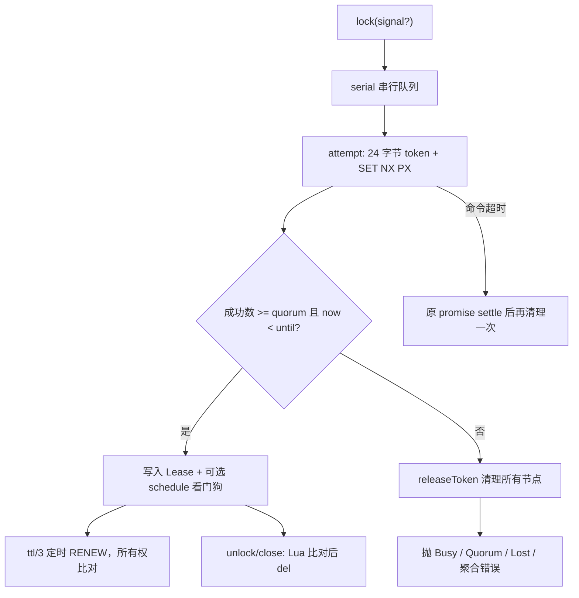

:::note 事实基线
本文依据 `$HOME/github/yukino.js/packages/redis-lock` 在 `1afcb40eef9` 的源码事实撰写；文中的路径、常量与 API 名称均可在该检出中定位。
:::

**主线一览**



`@yukino.js/redis-lock` 用 Redis 做跨进程互斥。它的核心事故模型是"释放别人的锁"：A 超时后租约过期，B 拿到同一把锁，A 的迟到释放把 B 的锁删掉。这里把所有权编码成每次获取都重新生成的 token，并让所有状态变更都走 Lua 里的"先比较再执行"。本站是 h/docs 的补充，Redis 命令与分布式锁通用理论由 h 覆盖，这里只讲本包自己的实现细节。

## 一、定位、边界与整体架构

README 明确写出两件事：**客户端由调用方提供、没有运行时依赖**；当前公开形态只有 `RedisLock` 与 `RedLock` 两条路径。包要求 Node.js `>=22`，构建用 Rollup + terser 同时输出 ESM/CJS 与 d.ts。

:::danger 这是 JS 版，与 be 下的 Go 版是两个不同实现
同仓库另一个文档 [yukino-redis-lock](../be/yukino-redis-lock) 解析的是 `$HOME/github/yukino.go/components/redis_lock`（Go 1.26+）。两者对齐协议而非共用代码：都用 24 字节 hex token、`DISTRIBUTED_LOCK_PREFIX_` 前缀、Lua 比对后删除/续期、ttl/3 看门狗、多数派 RedLock 与全节点清理。差异要记牢——<u>Go 的单锁过期 API 用秒（`WithExpireSeconds` / `DelayExpire(ctx, seconds)`），JS 全部用毫秒（`ttlMs` / `delayExpire(ttlMs)`）</u>；Go 自带 go-redis 适配器并创建/关闭自己的客户端，JS 只接受符合 `LockClient` 结构的借用客户端且 `close()` 从不关闭它们；Go 用 `context.Context` 取消，JS 用 `AbortSignal`，且 acquisition signal 在获取成功后**不会**停止续期。不要拿一边的 API 名去调用另一边。
:::

| 文件                       | 角色                                                         |
| -------------------------- | ------------------------------------------------------------ |
| `src/index.ts`             | 全部常量、类型、错误类、`BaseLock` / `RedisLock` / `RedLock` |
| `test/index.test.ts`       | `Fake` 假客户端驱动的确定性故障测试，无需 Redis              |
| `test/integration.test.ts` | 需要 `REDIS_URLS` 的 3 个独立 master 才运行                  |
| `README.md`                | 用法、选项表、Redlock 示例与 Go/JS 差异说明                  |

## 二、常量、类型与错误

`src/index.ts` 顶部导出的常量：

```ts
export const REDIS_LOCK_KEY_PREFIX = "DISTRIBUTED_LOCK_PREFIX_";
export const DEFAULT_TTL_MS = 30_000;
export const DEFAULT_BLOCK_WAIT_MS = 5_000;
export const DEFAULT_RETRY_INTERVAL_MS = 50;
export const DEFAULT_COMMAND_TIMEOUT_MS = 2_000;
export const DEFAULT_NODE_TIMEOUT_MS = 50;
```

调用方只需提供 `LockClient` 的结构子集，便于适配或 fake：

```ts
export interface LockClient {
  set(
    key: string,
    value: string,
    options: { NX: true; PX: number },
  ): Promise<unknown>;
  eval(
    script: string,
    options: { keys: string[]; arguments: string[] },
  ): Promise<unknown>;
}
```

README 对客户端有硬性要求：<u>限制传输超时、禁用离线命令队列与自动重试</u>，否则命令可能"返回错误但稍后才真正执行"，破坏 token 清理语义。错误家族各有明确分工：

| 错误                                 | 含义                         |
| ------------------------------------ | ---------------------------- |
| `LockBusyError`                      | 竞争失败，锁被别人持有       |
| `LockLostError`                      | 所有权或本地租约有效期已丢失 |
| `LockStateError`                     | 重入，或 close 后再次获取    |
| `LockTimeoutError`                   | 命令等待超过 bounded 时限    |
| `QuorumError extends AggregateError` | RedLock 未拿到多数派         |

`isRetryableError(error)` <u>只认 `LockBusyError` 与 `QuorumError`</u>，因此阻塞重试不会重试网络错误。

## 三、token、Lua 与有效窗口

`attempt` 每次获取都调 `randomBytes(24).toString("hex")`，得到 48 个十六进制字符（测试用 `/^[0-9a-f]{48}$/` 断言）；真实 key 是 `REDIS_LOCK_KEY_PREFIX + key`，保存在 `lock.key`。

两段 Lua 都先 `get` 比对 token：

```ts
const RELEASE = `if redis.call('get', KEYS[1]) == ARGV[1] then return redis.call('del', KEYS[1]) else return 0 end`;
const RENEW = `if redis.call('get', KEYS[1]) == ARGV[1] then return redis.call('pexpire', KEYS[1], ARGV[2]) else return 0 end`;
```

`eval` 包装器只接受 `0` 或 `1` 两种返回值，其它一律 `TypeError("unexpected redis script response")`。加锁用 `client.set(key, token, { NX: true, PX: this.ttl })`，响应必须是 `null` 或 `"OK"`，否则同样视为异常。

**有效窗口**用发起时刻而非响应时刻计算：

```ts
const until = started + this.ttl - drift(this.ttl);
// drift(ttl) = Math.ceil(ttl * 0.01) + 2
```

`held` / `remainingMs` 只读这个本地 `Lease.until`，是保守估计，**不是向 Redis 查询所有权**。`duration()` 统一校验所有毫秒参数：`Number.isSafeInteger` 且在 `[1, 2_147_483_647]`；构造时还要求 `ttl > drift(ttl)`，开启自动续期时额外要求 `ttl >= 30`。

## 四、`BaseLock`：串行队列、重试与超时

### 4.1 `serial` 与 `bounded`

所有公开操作都经 `serial(operation)`：

```ts
const result = this.queue.then(operation);
this.queue = result.catch(() => {});
return result;
```

队列吞掉上一次失败的拒绝，保证锁/解锁/续期在实例内串行执行，一次失败不会毒化后续调用。`bounded(pending, ms, signal)` 同时处理三种结束方式：定时器触发 `LockTimeoutError`、`AbortSignal` 触发 `signal.reason`、pending 完成但 `now() >= deadline` 也算超时。命令真正发出后超时**无法撤销**，这是下一节清理逻辑存在的原因。

### 4.2 `lock(signal?)` 与阻塞预算

`lock` 先检查 `closed` 与已有 lease，随后进入循环：

```ts
for (;;) {
  try {
    await this.attempt(signal, this.block ? deadline - now() : this.timeout);
    return;
  } catch (error) {
    aborted(signal);
    if (!this.block || !isRetryableError(error) || now() >= deadline)
      throw error;
    await pause(
      Math.min(this.interval + Math.random() * this.interval, deadline - now()),
      signal,
    );
    if (now() >= deadline) throw error;
  }
}
```

`retryIntervalMs` 默认 50，每次再加最多一个 interval 的随机抖动。只有可重试错误才继续；网络错误第一次就抛出。`blockWaitingMs` 默认 5000，预算从 `lock` 开始算，包含首次尝试。

### 4.3 失败清理与"迟到的 SET"

`attempt` 用 `Promise.allSettled` 并行写所有节点，成功数达到 `quorum = Math.floor(clients.length / 2) + 1` 且 `now() < until` 且 signal 未中止才算成功。失败路径：

```ts
catch (error) {
  // A timeout cannot cancel a dispatched Redis command. Clean up again
  // AFTER it settles, so a delayed SET cannot outlive the failed attempt.
  void pending
    .then(() => this.eval(client, RELEASE, token))
    .catch(() => {});
  throw error;
}
```

即命令超时后挂一个"等原 promise 落定再做 RELEASE"的尾巴。测试用 gate 拦住 `client.set`：先让 `lock()` 因 `commandTimeoutMs: 15` 抛 `LockTimeoutError`，再放开 gate 并确认 Redis key 最终被清掉。

`releaseToken` 对所有节点 `Promise.allSettled` 后聚合错误为 `AggregateError("redis lock cleanup failed")`。若获取失败且清理也失败，两者被包成新的 `AggregateError("redis lock acquisition and cleanup failed")`。

## 五、续期、释放与 RedLock

### 5.1 看门狗

`autoRenew = options.autoRenew ?? (options.ttlMs === undefined)`：<u>省略 `ttlMs` 才默认开看门狗</u>（30 秒 TTL），显式给 TTL 则默认关闭。`schedule(lease)` 定时器间隔 `Math.max(1, Math.floor(lease.ttl / 3))` 并 `unref()`；触发时经 `serial` 调 `renew(lease.ttl)`，失败就 `stop(lease)`。续期成功后写回新的 `until` / `ttl` 并重新调度。`delayExpire(ttlMs = this.ttl)` 会重置为传入的新 TTL——"重新调度手动续期 TTL"有专门测试。

`renew` 的守卫很严：`!lease || !lease.active || now() >= lease.until` 直接 `LockLostError`；续期后若成功数不足 quorum、或 `now() >= oldUntil`、或 `now() >= until`（新窗口已经过期），同样停止并抛 `LockLostError`。

### 5.2 `unlock` 与 `close`

`unlock()` 在拿不到 lease 时抛 `LockLostError`；无论传输是否成功都会先 `stop(lease)`（清 timer、置 `active=false`），让看门狗立刻停。之后对所有节点 RELEASE：有错误抛 `AggregateError("redis lock release failed")`，全部成功但没有任何节点返回 1 则抛 `LockLostError`。<u>transport 失败时 lease 保留，调用方可以重试清理</u>——测试先让 `failEval = true` 触发失败，再恢复并成功 `unlock()`。

`close()` 置 `closed = true`、停续期、释放 token，但不关闭借来的客户端；关闭后再 `lock()` 抛 `LockStateError`。

### 5.3 `RedLock`

```ts
new RedLock("order:42", [masterA, masterB, masterC], {
  ttlMs: 30_000,
  nodeTimeoutMs: 50,
});
```

构造期铁律：

- 至少 3 个客户端，`new Set(clients).size === clients.length`（对象身份去重），否则 `TypeError`。README 强调"连到同一 master 的不同对象不算独立票"。
- `nodeTimeoutMs` 默认 50，必须满足 `timeout * 10 < ttl`（TTL 默认 30000）。
- 强制 `autoRenew: false`：Redlock **没有看门狗**，调用方必须在 `remainingMs` 归零前完成，或显式 `delayExpire()` 重新拿多数派。

所有 master 收到同一个 token 并行 SET；失败时清理**包括 SET 已写入但响应丢失的节点**（测试让第一个客户端写完就 throw，再断言 `QuorumError` 且所有节点都被清）。`QuorumError` 携带每个节点的错误，`isRetryableError` 让阻塞模式可以重试。

## 六、测试与适用边界

`test/index.test.ts` 用 `Fake implements LockClient` 构造确定性故障：20 个锁竞争只有一个成功、不删后继者 token、AbortSignal 取消、阻塞超时、`LockTimeoutError` 后清理、重入被拒、看门狗在释放/失败后停止、重复客户端与超大 node timeout 被拒等。`test/integration.test.ts` 以 `describe.skipIf(urls.length < 3)` 守卫，只有提供三个 URL 才验证真实 Lua、pTTL、跨 master 共享 token 与"占用节点不被清除"。

```sh
pnpm test   # 纯 Fake，无需 Redis
REDIS_URLS=redis://127.0.0.1:6379,redis://127.0.0.1:6380,redis://127.0.0.1:6381 pnpm test
```

:::warning TTL 是最后一道防线
命令超时无法撤销已发往 Redis 的 SET，cleanup 又可能因为网络不通而失败。此时真正让锁失效的是 key 的 TTL。临界区耗时必须有上界，且必须在 `lock.held` 为真、`remainingMs > 0` 时完成；把 TTL 设成远小于业务耗时，任何锁实现都救不了。
:::

**适用**：短临界区的跨进程互斥；需要把"竞争失败"和"真故障"区分开（直接用 `LockBusyError` / `isRetryableError` 驱动重试）；多 master 部署且接受有界时钟漂移假设。

**不适用**：把它当 CP 系统或共识服务（README 明确说不提供存储侧 fencing 或 consensus）；超长事务或耗时不可预测的临界区；需要可重入语义；无法控制客户端传输行为的场景（离线队列/自动重试会破坏清理语义）。

## 七、交叉链接

- Go 版对照：[yukino-redis-lock](../be/yukino-redis-lock)，重点看秒/毫秒 API 差异、自带客户端与 `context.Context` 取消。
- 同仓库的测试服务：[yukino-registry-mock](./yukino-registry-mock)，同样有"回调 + Promise"双形态与真实 listener 的测试组织方式。
- 前端专题索引：[index](./index)。

**小结**：JS 版 redis-lock 只押注两个不变量——每次获取换一个不可预测的 token，每次变更都在 Lua 里先比对。看门狗、抖动重试、多数派与迟到 SET 清理都只是在不同失败模式下守住这两条线；真正的安全边界仍是 TTL 与业务对临界区耗时的承诺。
