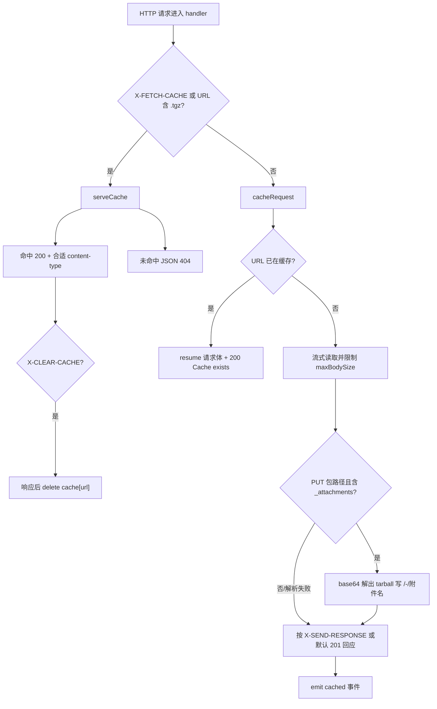

:::note 事实基线
本文依据 `$HOME/github/yukino.js/packages/registry-mock` 在 `1afcb40eef9` 的源码事实撰写；文中的路径、常量与 API 名称均可在该检出中定位。
:::

**主线一览**



`registryMock` 是给集成测试用的假 npm registry，同时也是"把请求原始 body 按 URL 存起来"的通用 HTTP 缓存。本站是 h/docs 的补充：通用 HTTP 语义与 npm publish 协议由 h 覆盖，这里只讲这个包自己的分支顺序、缓存键、附件抽取与事件设计。

## 一、定位与整体架构

包从 `registry-mock` 重写而来（`NOTICE.md` 记录上游 commit `137c4de…`），用原生 stream 实现，没有运行时依赖，要求 Node.js `>=24`。构建用 Rolldown 打 ESM + sourcemap、TypeScript 出声明；测试用 Vitest，并且真的在本机起 listener。

| 文件                             | 角色                                                            |
| -------------------------------- | --------------------------------------------------------------- |
| `src/index.ts`                   | `Registry` 类、`registryMock` / `createRegistry` 工厂与全部类型 |
| `src/cli.ts`                     | `npm-registry-echo` 可执行入口                                  |
| `tests/index.test.ts`            | 缓存、附件、响应头、体积限制与端口错误验证                      |
| `rolldown.config.ts`             | 两个入口 `index` 与 `cli`，external 含 `/^node:/`               |
| `NOTICE.md` / `LICENSE.upstream` | 上游归属                                                        |

`package.json` 把 `bin.npm-registry-echo` 指向 `./dist/cli.js`。最小用法：

```ts
import registryMock from "@yukino.js/registry-mock";
const registry = await registryMock({ http: 0, host: "127.0.0.1" });
console.log(registry.address());
registry.on("cached", (request) => console.log(request.method, request.url));
// registry.close();
```

README 同时点出三种创建方式：`registryMock(options)` / `createRegistry(options)` 返回 Promise；`registryMock(options, cb)` 是回调形态；`new Registry(options)` 得到未绑定实例，再 `listen(callback)` 启动。`Registry` 既是具名导出，也是默认工厂上的属性（`export default Object.assign(registryMock, { Registry })`）。

## 二、公开 API 与配置

```ts
export interface RegistryOptions {
  http?: number; port?: number; host?: string; maxBodySize?: number;
}
export interface CachedRequest {
  method: string;
  url: string;
  headers: IncomingMessage["headers"];
  body: Buffer;
}
export class Registry extends EventEmitter { ... }
```

| 选项            | 默认值                       | 含义                                             |
| --------------- | ---------------------------- | ------------------------------------------------ |
| `http` / `port` | `0`                          | 监听端口；`http` 优先于 `port`，`0` 表示临时端口 |
| `host`          | Node 通配绑定                | 传给 `server.listen(port, host, ...)`            |
| `maxBodySize`   | `64 * 1024 * 1024`（64 MiB） | 单个请求体上限，超出返回 413                     |

实例上可直接读的属性与方法：

- `server`：`node:http` 的 `Server`；`cache`：`Object.create(null)` 创建的 null 原型记录，值可能是 `Buffer` 或 `string`。
- `port` 是**配置值**，不是实际监听端口；要读临时端口必须用 `address().port`。README 和 CLI 都遵循这一约定。
- `listen(callback?)` / `close(callback?)` 返回 `this` 便于链式调用；`address()` 转发 `server.address()`。
- `cached` 事件在成功缓存后携带 `{ method, url, headers, body }`，其中 `headers` 是浅拷贝。

`registryMock` 的实现很短：构造 `Registry` → `listen` → Promise resolve；回调形态用 `promise.then` 转接：

```ts
const promise = new Promise<Registry>((resolve, reject) => {
  const registry = new Registry(options);
  registry.listen((error) => (error ? reject(error) : resolve(registry)));
});
if (!callback) return promise;
void promise.then(
  (registry) => callback(null, registry),
  (error) => callback(error),
);
```

## 三、请求路由：先判缓存，再判写入

`handler(req, res)` 是整个分发的入口，顺序不能颠倒：

```ts
if (
  req.headers["x-fetch-cache"] !== undefined ||
  (req.url ?? "").includes(".tgz")
) {
  this.serveCache(req, res);
  return;
}
await this.cacheRequest(req, res);
```

### 3.1 `serveCache`：取、回、清

缓存键是**完整 `req.url`**（`req.url ?? "/"`）。命中（`value !== undefined && value !== null`）时回 200，并按 URL 是否含 `.tgz` 选 `application/octet-stream` 或 `application/json`；未命中回 JSON 404 `{ message: `${url} not found.` }`。

响应写出之后才检查 `x-clear-cache`：

```ts
res.end(value);
if (req.headers["x-clear-cache"] !== undefined) delete this.cache[url];
```

也就是说"读并清除"是一次请求里先返回旧值、再删掉条目。空字符串与空 Buffer 是合法缓存值，测试专门用 `POST /__proto__` + 空 body 确认 null 原型记录不会被原型属性干扰。

### 3.2 `cacheRequest`：流式读入与首写胜出

若 URL 已有缓存，`cacheRequest` 调 `req.resume()` 丢弃请求体并回 200 `{ message: `Cache exists for ${url}` }`，**保留第一次的 body**。否则按 chunk 累积，边读边计字节数，超过 `maxBodySize` 就回 413 并 `req.resume()`；最后 `Buffer.concat(chunks)` 得到 body。

默认响应是 `{ status: 201, body: { message: `Cached data for: ${url}` } }`。`x-send-response` 允许覆盖：JSON 解析成功且满足 `status` 是 `[200, 599]` 整数、`body` 字段存在时生效，否则保留默认（解析失败被 `catch` 吞掉）。

```ts
const response = await fetch(url + "/a", {
  method: "POST",
  body: "ok",
  headers: {
    "x-send-response": JSON.stringify({ status: 202, body: { ok: true } }),
  },
});
expect(response.status).toBe(202);
```

写完 `this.cache[url] = body`、发响应后 `emit("cached", ...)`。测试同时验证畸形头（`bad` 与 `{"status":999}`）都回落到 201。

## 四、npm publish 附件展开

只有 **PUT** 且 URL 匹配 `/^\/(?:@[^/]+(?:%2f|\/))?[\w.-]+$/i` 时才解析 `_attachments`。这个正则覆盖普通包与 scoped 包（含 `%2f` 编码形式）。解析逻辑：

1. `JSON.parse(body.toString())`，要求解析结果是对象且含 `_attachments`。
2. `_attachments` 必须是对象；逐项要求 attachment 是对象、`data` 是字符串。
3. 附件名不能含 `..` 也不能以 `/` 开头，防路径穿越。
4. 写入路径为 `` `${url}/-/${name}` ``，值是 `Buffer.from(attachment.data, "base64")`。

测试对三种路径做了参数化验证：

```ts
it.each(["/package", "/@scope%2Fpackage", "/@scope/package"])(
  "serves npm attachments for %s",
  async (path) => {
    const body = JSON.stringify({
      "dist-tags": { latest: "1.0.0" },
      _attachments: {
        [name]: { data: Buffer.from("tarball bytes").toString("base64") },
      },
    });
    expect((await fetch(url + path, { method: "PUT", body })).status).toBe(201);
    expect(await (await fetch(url + path + "/-/" + name)).text()).toBe(
      "tarball bytes",
    );
  },
);
```

注意附件写入发生在主缓存写入之前，但整个解析被 `try/catch` 包住：任何一步失败都回 400 `{ message: "Invalid publish payload" }` 并直接 return，**不会把坏 JSON 写进 `cache[url]`**。测试用 `PUT /package` + body `"{"` 断言 400 且 `registry.cache["/package"]` 仍是 `undefined`。

:::warning 缓存键是原始 URL，且首写胜出
同一路径第二次 POST 得到的是 200 + `Cache exists`，而不是覆盖。想换 body 必须先带 `x-clear-cache` 读一次清掉，或用另一个 URL。把它当"可反复写入的 mock backend"会踩坑。
:::

## 五、生命周期、错误与 CLI

`listen` 用 `complete` 标志保证回调只触发一次，并移除 `error` 监听；有 callback 时错误交给 callback，没有时 `emit("error")`。`close` 直接转发 `server.close(callback)`。构造 `Registry` 时会校验 `maxBodySize` 必须为非负安全整数，否则 `RangeError`。

请求处理器外层统一兜底：

```ts
void this.handler(req, res).catch((error) => {
  if (!res.headersSent)
    this.send(res, 500, { message: (error as Error).message });
  else res.destroy(error as Error);
});
```

即"还没写头就 500，已经写头就销毁连接"。启动阶段的错误则走 Promise rejection 或 callback：测试用被占用的端口确认 `registryMock({ http: port }, cb)` 的 `error.code === "EADDRINUSE"`。

`src/cli.ts` 提供 `npm-registry-echo`：

```ts
const port = Number(process.env.PORT ?? 3676);
const registry = await registryMock({ http: port });
registry.on("cached", (request: CachedRequest) => {
  console.log("%s %s %s", request.method, request.url, request.body.toString());
  if (process.env.DUMP_CACHE || request.headers["x-dump-cache"])
    console.dir(registry.cache);
});
for (const signal of ["SIGINT", "SIGTERM"] as const)
  process.once(signal, () => registry.close());
```

README 特别说明 CLI 用 `cached` 事件打印请求，而不是"再发一次 HTTP 请求去读"，因此不存在竞态；`DUMP_CACHE` 环境变量与 `x-dump-cache` 请求头都能打印当前缓存。

:::tip 集成测试怎么验端口占用失败
`tests/index.test.ts` 先启动一个 registry 拿到真实端口，再用同一个端口调用回调形态的 `registryMock`，断言返回的 error 匹配 `EADDRINUSE`。这比断言 "Promise reject 了" 更精确，也复用了同一份工厂代码。
:::

## 六、适用与不适用

**适用**

- 集成测试里顶替 npm registry：需要 `PUT /package` 上传、`.tgz` 读取、`form.reset()` 式可清除缓存语义。
- 需要按 URL 记录请求原始 body 并在缓存成功时收到事件的场景。
- 想用 `http: 0` 让 OS 分配端口，再用 `address()` 拿到真实值，避免测试间端口冲突。

**不适用**

- 持久化 registry：README 明确说这是内存缓存的测试服务器，进程退出即丢。
- 需要真实 npm 元数据语义（版本协商、dist-tags 计算、权限、完整性校验）：这里只做 URL → body 的存取与附件展开。
- 需要流式转发上游或做请求去重：每个 URL 只保留第一份 body，没有合并逻辑。

## 七、交叉链接

- 同仓库的端口探测包：[yukino-port-finder](./yukino-port-finder)；本包用 `http: 0` + `address().port` 走的是 OS 分配路径。
- 同仓库的 Promise 实现：[yukino-promises-a-plus](./yukino-promises-a-plus)，对照工厂函数如何同时提供 Promise 与回调两种形态。
- 前端专题索引：[index](./index)。

**小结**：registry-mock 的复杂度集中在 `handler` 的分支顺序与 `cacheRequest` 的解析守卫上。记住三件事就够用了——缓存键是原始 URL、首写胜出、成功缓存后会发 `cached` 事件——就不会把它误当成真注册表。
