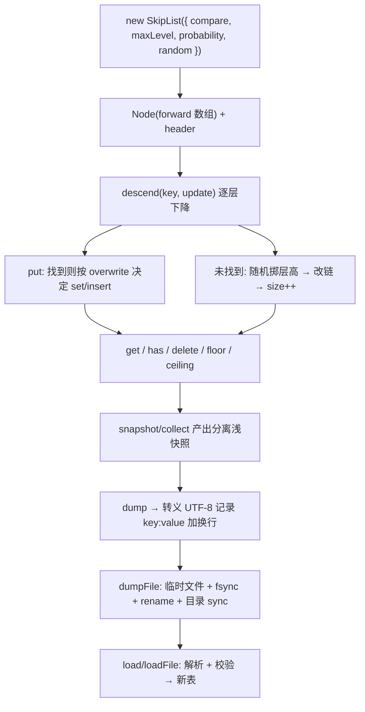

:::note 事实基线
本文依据 `$HOME/github/yukino.js/packages/skiplist` 在 `1afcb40eef9` 的源码事实撰写；文中的路径、常量与 API 名称均可在该检出中定位。
:::

**主线一览**



`@yukino.js/skiplist` 是一个泛型有序 map（`generic ordered map`），用跳表实现，并与 `yukino.go/libs/yukino_skiplist` 的行为和文本格式对齐。README 强调它是泛型 map，所有操作都围绕 `Entry<K,V>` 与比较器展开。本站是 h/docs 的补充，跳表算法通识由 h 覆盖，这里只讲本包的参数校验、比较语义、迭代器快照与持久化格式。

## 一、定位与整体架构

包要求 Node.js `>=22`，构建用 Rollup 输出 ESM/CJS + d.ts。三个源文件职责干净：

| 文件                 | 角色                                                                                                 |
| -------------------- | ---------------------------------------------------------------------------------------------------- |
| `src/skiplist.ts`    | 常量、`compareOrdered`、`Node<K,V>`、`SkipList<K,V>` 全部结构操作                                    |
| `src/persist.ts`     | `MAX_RECORD_SIZE`、`ParseError`、`Format`/`Codec`、`dump`/`load`/`dumpFile`/`loadFile` 与内置 codecs |
| `src/index.ts`       | 转出 `SkipList`、`compareOrdered`、三个常量、类型与整个 persist 模块                                 |
| `test/index.test.ts` | 与排序 Map 的 10000 次随机对照、Go 格式往返与文件原子性测试                                          |

`src/index.ts` 的完整导出面：

```ts
export {
  SkipList,
  compareOrdered,
  DEFAULT_MAX_LEVEL,
  DEFAULT_PROBABILITY,
  MAX_LEVEL_LIMIT,
} from "./skiplist.js";
export type { Comparator, Entry, SkipListOptions } from "./skiplist.js";
export * from "./persist.js";
```

README 给出的最小示例把主要操作串起来：

```ts
import {
  SkipList,
  dump,
  load,
  intCodec,
  stringCodec,
} from "@yukino.js/skiplist";

const list = new SkipList<number, string>();
list.insert(2, "two"); // true；从不覆盖
list.insert(2, "ignored"); // false
const [previous, existed] = list.set(2, "II");
list.get(2); // "II"
list.floor(3); // { key: 2, value: "II" }
for (const { key, value } of list.range(0, 10)) {
  list.delete(key); // 迭代基于分离快照
}
const format = { key: intCodec, value: stringCodec };
const restored = load(dump(list, format), format);
```

## 二、构造参数与比较语义

### 2.1 三个默认值与校验

```ts
export const DEFAULT_MAX_LEVEL = 16;
export const DEFAULT_PROBABILITY = 0.5;
export const MAX_LEVEL_LIMIT = 4096;
```

`SkipListOptions<K>` 提供 `compare`、`maxLevel`、`probability`、`random` 四个可选项；默认分别取 `compareOrdered`、`16`、`0.5`、`Math.random`。构造期校验：

- `maxLevel` 必须是 `[1, 4096]` 内整数，否则 `RangeError("skiplist: maxLevel must be in [1, 4096]")`；
- `probability` 必须严格在 `(0, 1)`，否则 `RangeError`；
- `compare` / `random` 必须是函数，否则 `TypeError`。

层高计数包含底层，掷硬币循环在 `draw >= probability` 时停止；`random()` 必须返回 `[0, 1)` 内的有限数，否则 `RangeError("skiplist: random must return a number in [0, 1)")`。所有用户代码（比较器与随机源）都在改链之前执行，避免异常留下半更新状态。

### 2.2 `compareOrdered`: 对齐 Go `cmp.Compare`

默认比较器只接受 number / string / bigint，且两边类型必须一致，否则抛 `TypeError` 提示"supply compare for other keys"。具体规则：

- **number**：NaN 等于 NaN，且排在所有其它数字之前；`-0 === +0` 走 `a === b` 的相等分支。
- **string**：按 Unicode 码点顺序逐个比较，用 `codePointAt` 并按 `x > 0xffff` 跨 2 个 UTF-16 单元步进，因此有效 Unicode 字符串的序与 UTF-8 字节序一致。
- **bigint**：直接用 `<` 比较。
- 其它类型（包括对象）必须自己传 `compare`。

测试直接断言了这套序：

```ts
for (const key of [Infinity, -Infinity, NaN, 0, -0, 1]) list.set(key, 1);
expect([...list.keys()]).toEqual([NaN, -Infinity, 0, 1, Infinity]);
expect(compareOrdered("\u{10000}", "\ue000")).toBe(1);
expect(compareOrdered(2n, 3n)).toBe(-1);
```

自定义比较器必须定义全序、返回负数/零/正数；返回 NaN 或非数字会被 `cmp()` 拦下并抛 `TypeError`。<u>比较相等即 key 同一</u>：更新 value 时保留最初插入的 key 对象。

## 三、结构操作与返回值

`Node<K,V>` 只有 `key`、`value`、`forward: (Node|undefined)[]`；header 用 `maxLevel` 高度的哨兵节点，`height` 是当前实际层数，`size` 是元素数。

| TypeScript                            | 返回                         | 说明                                  |
| ------------------------------------- | ---------------------------- | ------------------------------------- |
| `insert(key, value)`                  | `boolean`                    | 不覆盖；已存在返回 false              |
| `set(key, value)`                     | `[previous, existed]`        | 覆盖并返回旧值                        |
| `get(key)` / `has(key)`               | `V \| undefined` / `boolean` | `has` 用来区分存了 undefined 与不存在 |
| `delete(key)`                         | `[value, deleted]`           | 删除后按需收缩 `height`               |
| `clear()`                             | `void`                       | 换一个新 header，`O(maxLevel)`        |
| `min()` / `max()`                     | `Entry<K,V> \| undefined`    | min 走 `header.forward[0]`，O(1)      |
| `floor(key)` / `ceiling(key)`         | `Entry<K,V> \| undefined`    | 向下/向上取整的相邻项                 |
| `range(from, to)` / `rangeFrom(from)` | `IterableIterator<Entry>`    | 左闭右开 `[from, to)` / `[from, ∞)`   |

所有查找走私有 `descend(key, update?)`：从 `height - 1` 层向下，沿 `forward[i]` 前进直到下一个 key 不小于目标，同时可选地把每层的前驱写进 `update` 数组：

```ts
private descend(key: K, update?: Node<K, V>[]): Node<K, V> {
  let node = this.header;
  for (let i = this.height - 1; i >= 0; i--) {
    let next = node.forward[i];
    while (next && this.cmp(next.key, key) < 0) {
      node = next; next = node.forward[i];
    }
    if (update) update[i] = node;
  }
  return node;
}
```

`find(key)` 先做一次 `this.cmp(key, key)` 触发校验，再检查 `descend(key).forward[0]` 是否比较相等。`put` 把"是否覆盖"做成参数，`insert`/`set` 只是它的两个壳；`delete` 逐层摘链后循环收缩 `height`。

:::tip 存 undefined 为什么要用 has
`get` 的返回值与"没找到"共用 `undefined`；测试明确构造了 `list.set(2, undefined)` 后 `has(2) === true`、`get(2) === undefined` 的情形。要判断存在性，永远用 `has`。
:::

## 四、迭代器：分离浅快照

`all()`、`range()`、`rangeFrom()`、`keys()`、`values()`、`[Symbol.iterator]()` 都**在调用时**通过 `collect()` 构造独立数组，再返回它的迭代器：

```ts
private collect(node, end?) {
  const result: Entry<K, V>[] = [];
  while (node && (!end || this.cmp(node.key, end.key) < 0)) {
    result.push(entry(node)!);
    node = node.forward[0];
  }
  return result;
}
```

因此"先拿迭代器、再 `clear()`"不会影响遍历结果。测试一次性取六种迭代器后清空列表，断言长度仍是 5/3/2/5/5/5。代价是**全量迭代吃 O(n) 内存**；有界 `range` 是 O(log n + k) 时间与 O(k) 内存。快照是浅拷贝：key/value 本身不会被深复制，迭代后修改 key 对象仍可能破坏有序性。

:::warning 比较器与随机源不得重入列表
`cmp()` 在 `descend`、`find`、`put`、`delete`、`floor`、`ceiling`、`range` 等路径上高频调用；若在自定义 `compare` 里调 `list.get(...)`，或在 `random()` 里碰列表，就形成重入。README 还要求 key 在存储期间保持排序不变——换了 key 的排序值，跳表的链就不再有序。
:::

## 五、持久化：与 Go 同格式的文本

`Format<K,V>` 提供 `key` / `value` 两个 `TextCodec<T>`（`encode` / `decode`）与可选 `separator`。分隔符默认 `":"`，必须是单个可打印 ASCII 字符，且排除 `\`、`n`、`r`。

### 5.1 转义规则

记录格式是 `key:value\n`：

- `escape` 依次替换 `\` → `\\`、分隔符 → `\` + 分隔符、换行 → `\n`、回车 → `\r`，并要求 codec 输出 `isWellFormed()` 的合法 Unicode 文本；
- `unescape` 只接受 `\n`、`\r`、`\\`、`\<separator>`，其它转义序列直接报错；
- 解析时跳过空行，容忍 CRLF 与结尾无 LF；分隔符查找会跳过被反斜杠转义的字符，所以 `a\\:b` 这类 key 不会被误切。

单条记录上限是 `export const MAX_RECORD_SIZE = 16 << 20`（16 MiB），按 `Buffer.byteLength` 计。测试中 `dump` 超长 value 与 `load` 超长记录都抛 `"record too large"`。

### 5.2 `ParseError` 与失败原子性

```ts
export class ParseError extends Error {
  constructor(
    readonly line: number,
    readonly record: string,
    cause: unknown,
  ) {
    super(
      `skiplist: line ${line} (${JSON.stringify(record.slice(0, 32))}): ${String(cause)}`,
      { cause },
    );
    this.name = "ParseError";
  }
}
```

`line` 是从 1 开始的行号，`record` 最多截 32 字符，`cause` 保留底层错误（codec 失败、非法转义、缺分隔符、重复 key、超长）。`load()` 用 offset 扫描而不是先 `split` 出所有行，避免额外内存；失败时直接抛出，**不会返回半加载的表**。比较相等的重复 key 也会被 `list.insert(...) === false` 拦下并抛 `"duplicate key"`。

### 5.3 内置 codecs

| Codec          | 行为                                                                                    |
| -------------- | --------------------------------------------------------------------------------------- |
| `stringCodec`  | 原样字符串                                                                              |
| `boolCodec`    | encode `String(value)`；decode 接受 `1/t/T/true/TRUE/True` 与 `0/f/F/false/FALSE/False` |
| `intCodec`     | 安全整数，超出 `Number.isSafeInteger` 抛 `RangeError`                                   |
| `int64Codec`   | `bigint`，范围 `[-(1<<63), (1<<63)-1]`                                                  |
| `uint64Codec`  | `bigint`，范围 `[0, (1<<64)-1]`                                                         |
| `float64Codec` | 保留 NaN / +Inf / -Inf / -0 的 Go 风格文本，decode 用严格正则与有限性检查               |
| `bytesCodec`   | 无 padding 标准 base64，decode 去掉 CRLF 后校验                                         |

数值 codec 读的是 Go codec 的规范十进制输出；二进制应放进 `bytesCodec`，文本本身必须是合法 Unicode。

### 5.4 文件落盘

`dumpFile(list, path, format)` 的顺序是：`mkdir(..., { recursive: true, mode: 0o755 })` → 在目标目录创建 `.${basename}.tmp-${randomBytes(12).hex}` → 以 64 KiB 为阈值分批 `writeFile` → `file.sync()` → `rename(temp, path)` → 打开目录再 `sync()`。`finally` 里关闭文件并 `unlink(temp)`（忽略 ENOENT）。

`loadFile(path, format, options)` 用 `createReadStream` + `TextDecoder("utf-8", { fatal: true, ignoreBOM: true })` 流式按 `\n` 切记录，BOM 会作为 key 的一部分保留；测试用跨 chunk 的超长记录（65530 + 雪 + 😀 + 65540）验证边界处理。

:::warning 目录 sync 失败发生在 rename 之后
README 明说：文件已重命名生效后，目录 fsync 仍可能报错。也就是说二进制层面的替换已经完成，`dumpFile` 才抛错。调用方若要"失败就当没写"，需要在更高层做版本/备份管理；另外 codec 抛错发生在写临时文件之前，测试验证了此时旧文件内容保持 `a:b\n` 不变。
:::

## 六、适用与不适用

**适用**

- 需要有序 KV、范围扫描、`floor`/`ceiling` 这类查询的内存索引。
- 与 Go 侧 skiplist 交换人类可读文本（同款转义与 codec 格式）。
- 需要原子替换的文件快照，且单条记录可控制在 16 MiB 内。

**不适用**

- 需要并发写：本包没有锁，读者自行保证；要并发模型请看 Go 版 [yukino-skiplist](../be/yukino-skiplist) 的 `RWMutex` 方案。
- 需要深拷贝或持久化后随机访问：`load` 是整表重建，key/value 都是浅引用。
- key 会在存储期间改变排序值，或需要在比较器里重入容器。

## 七、交叉链接

- Go 版对照：[yukino-skiplist](../be/yukino-skiplist)，关注 `WithRandSource` 与 `-race` 验证的并发约束。
- 同仓库的 Redis 租约：[yukino-redis-lock](./yukino-redis-lock)，同样强调"校验发生在变更之前"。
- 前端专题索引：[index](./index)。

**小结**：这个包把跳表当作"带排序语义的 Map"来做：比较相等即同一 key，迭代器给分离快照，持久化给与 Go 一致的转义文本。`maxLevel`/`probability`/`random` 三个旋钮决定形状，`compareOrdered` 决定兼容边界，而 `dumpFile` 的临时文件 + fsync + rename 决定崩溃时的可恢复性。
