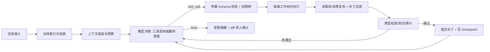
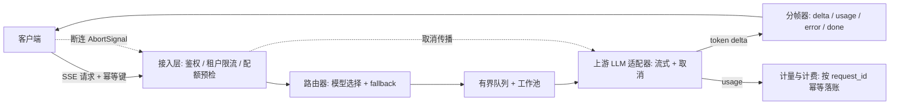

三道开放式设计题覆盖 **Agent 执行链路 / 上下文工程（D1–D2）**、**多租户 LLM 网关（D4）** 与 **流式对话前端（D5）**。共同采分点是：先给主干链路，再谈终止条件、取消传播、幂等与状态分层，最后补失败模式。

## 事实基线

| 项目既有做法                                                                                                 | 事实依据                                                                                                 |
| ------------------------------------------------------------------------------------------------------------ | -------------------------------------------------------------------------------------------------------- |
| 会话 JSONL append-only、坏行跳过、工具结果先溢出磁盘再 LLM 摘要、近期消息逐字保留                            | `content/docs/yukino/agents-md-and-memory.md`、`content/docs/yukino/context-compaction.md`               |
| 每个并发工作单元一份独立 git worktree；写工具权限与人在回路确认；OS 级沙箱收敛写入目录                       | `content/docs/yukino/worktree.md`、`content/docs/yukino/permission.md`、`content/docs/yukino/sandbox.md` |
| tools 数组位于 system 之后、messages 之前，变动会使整段历史缓存失效（源码注释实测 99.4% → 9.5%）             | `content/docs/yukino/mcp.md`                                                                             |
| 执行引擎用 Ajv 按 JSON Schema 校验工具参数，身份参数由系统注入而非模型生成，`ToolAuditLog` 全程审计          | `content/docs/yukino-ecomm-agent/llm.md`                                                                 |
| 拉取式背压：消费方 `await` 下一个事件，循环才前进一步；`pool` 队列容量 `size*4`、满时阻塞                    | `content/docs/yukino/yukino-code.md`、`content/be/node-pool.md`                                          |
| SSE 用原生 `fetch` + `ReadableStream`，chunk 以 JSON 字符串编码进 `data` 字段避免换行破坏分帧                | `content/fe/yukino-chatbot.md`                                                                           |
| `429` 归类为带 `Retry-After` 的 `RateLimitError`，优先解析 `Retry-After`（秒数或 HTTP date），缺省则指数退避 | `content/docs/yukino/react-and-agent-loop.md`                                                            |
| 取消沿调用链传播，`cancel()` 触发内部 `AbortController`                                                      | `content/docs/langgraph.md`                                                                              |
| 固定窗口（`INCR` + 首次设过期）、滑动窗口（zset + Lua）、令牌桶（hash + Lua）三种限流实现与取舍              | `content/be/redis.md`                                                                                    |
| 消息分帧需要清晰边界：JSONL 换行、WebSocket 帧、SSE 事件                                                     | `content/docs/a2ui.md`                                                                                   |

:::note 边界
上表是仓库文档记载的**项目事实**；下面的架构建议是**通用工程方案推导**，用于组织答题，不代表项目已实现。
:::

---

## Q1 · Coding Agent 的执行链路

> 给这个仓库的所有 API 加上鉴权中间件。请描述从用户输入到最终落盘改动的完整执行链路，并回答：
>
> - **(a)** 上下文怎么组织、怎么裁剪，仓库很大时如何避免塞爆窗口？
> - **(b)** tool-call 循环靠什么终止？如何防止死循环和「反复改同一处」？
> - **(c)** 工具执行失败、或批量修改只成功一部分时，怎么恢复？
> - **(d)** 怎么防止它改坏不该改的文件？

**考察点**：Agent loop、上下文工程、检索 vs 全量灌入、终止条件、状态与幂等、权限边界、人在回路。



### 标准答法骨架

| 阶段             | 关键动作                                                                                                   | 失败模式                                          |
| ---------------- | ---------------------------------------------------------------------------------------------------------- | ------------------------------------------------- |
| 1 · 任务解析     | 把自然语言目标转成**结构化任务图**（目标文件集合、预期产物、完成条件、预算）                               | 目标含糊就全仓扫描，浪费窗口                      |
| 2 · 检索而非灌入 | 符号表 / 路由表 / 依赖图 / 全文检索先定位候选文件，只把**相关片段**放进上下文                              | 把整仓塞进窗口 → 前缀缓存失效、成本高、注意力稀释 |
| 3 · 上下文组装   | 四类消息分层：系统策略（不可改）· 运行时状态（可信结构）· 用户意图 · 工具结果 / 检索证据（**不可信数据**） | 拼成一个自然语言串让模型自己区分 → 提示注入       |
| 4 · 决策         | 模型输出结构化 tool_call 或最终答案；tools 数组保持稳定以命中 prompt cache                                 | 动态注册工具使历史缓存整体失效                    |
| 5 · 执行         | 参数过 Ajv / JSON Schema 校验、身份参数系统注入、权限闸 + 人在回路确认                                     | 直接执行模型给的路径/命令 → 越权与注入            |
| 6 · 状态与幂等   | 每步记事件（读集合、补丁、命令、退出码、测试结果），带 `run_id` + 单调 `sequence` + 幂等键                 | 重试重复应用同一补丁                              |
| 7 · 验证与提交   | 在隔离工作树内跑类型检查 / 单测 / lint，通过后再合并；失败回到决策步                                       | 只改不测，坏改动直接落到主工作区                  |

### 逐问要点

**(a) 上下文组织与裁剪**：先按「结构检索 → 片段」而不是「全仓灌入」。分级裁剪策略：① 大工具结果溢出磁盘，历史里只留预览 + 路径（无损，可 ReadFile 回读）；② token 用量越阈值时做 LLM 摘要，但**必须保留任务约束、用户明确要求、未完成步骤、关键工具结果**；③ 近期消息逐字保留，压缩边界写入会话日志供恢复。稳定 system / tools / 历史前缀是硬约束——工具列表变化会让整段前缀缓存失效。

**(b) 终止条件**：不能只靠「模型说停」。显式条件包括 `max_steps` 预算、Token / 费用预算、总墙钟超时、连续 N 轮无新证据、重复工具调用指纹（同一 `(tool, args, file)` 组合命中即拦截）、任务图中所有节点满足完成条件、验证通过。防「反复改同一处」还要记录**已尝试补丁的哈希**与失败原因，把「上次为什么失败」作为下一轮输入。

**(c) 部分成功恢复**：把批量修改建模成**可重放的事件序列**，而不是一次性大事务。每个文件改动是独立补丁 + 版本/内容哈希；应用前复检哈希，若并发改动则重读重规划。崩溃后从最后一条有效 checkpoint 重放，用幂等键跳过已完成项；无法自动修复的项进入「需人工确认」列表并给出已成功/失败清单，**不谎报全部完成**。验证失败时回滚该文件的补丁而非整批回滚。

**(d) 权限边界**：三层叠加——① 工作区隔离（每个并发单元独立 worktree / 容器）；② 执行器校验（符号链接必须解析真实路径并确认仍在允许根目录内，网络默认关闭，凭证不进沙箱）；③ 流程约束（高风险操作需确认、变更后强制 review + diff）。**权限边界在运行时和工具网关，不在 Prompt**：即使 tool_call 来自高优先级消息，执行器也要二次校验。

**追问链**：MCP 在这条链路里扮演什么角色，和直接 function calling 有何区别？工具权限确认该放在哪一层？如何让 tools 数组稳定又不牺牲能力发现？见 [Agent 执行链路与 MCP](/interview/fundamentals/agent-and-mcp)。

---

## Q2 · 多租户 LLM 网关

> 设计一个多租户 LLM 网关：支持流式输出（SSE）、多模型路由、按租户限流、超时与重试、按 token 计费。给出核心组件与一次请求的数据流：
>
> - **(a)** 客户端断连后，后端怎么止损、避免继续烧 token？
> - **(b)** 重试如何避免重复计费与非幂等的副作用？
> - **(c)** 流式返回中途模型报错，怎么把「已生成的部分」和「错误」一起交给前端？
> - **(d)** token 计量放在哪一层才准？

**考察点**：SSE 语义、取消传播、背压、幂等键、限流算法、错误分帧、计量口径、可观测性。



| 组件              | 职责                                                            | 关键取舍                                                       |
| ----------------- | --------------------------------------------------------------- | -------------------------------------------------------------- |
| 接入层            | 鉴权、租户级令牌桶 / 滑动窗口限流、配额预检、`413`/`429` 早拒绝 | 限流按**连接数 + 字节**双维度；慢连接能吃满连接数              |
| 路由器            | 按租户策略 / 成本 / 延迟选模型，维护健康度与 fallback           | fallback 要设重试预算与熔断，否则故障被放大                    |
| 有界队列 + 工作池 | 削峰与背压，队列满快速失败而非堆内存                            | 容量按租户公平分片，防单租户打满                               |
| 上游适配器        | 统一不同厂商的流式协议、超时、取消、重试                        | 重试只对**可判定为未产生副作用**的阶段生效                     |
| 分帧器            | 把 `delta` / `usage` / `error` / `[DONE]` 统一成带类型的事件    | 一帧一行 `data:`，payload 用 JSON 字符串编码避免换行破坏分帧   |
| 计量              | 以 `request_id` + 幂等键聚合 usage，落账与对账                  | 计费口径要区分 input / cached input / output，并声明是否含重试 |

### 逐问要点

**(a) 断连止损**：`AbortController` 关流 → 网关取消上游请求 → 取消传播到工作池任务与模型调用（如 LangGraph `cancel()` 内部 AbortController）。底层不可取消时**停止继续处理其结果**并标记「取消中」，不向用户虚报已终止。断连后按幂等键去重，避免重连触发第二次完整生成。

**(b) 重试与幂等**：客户端带幂等键（如 `Idempotency-Key`），网关在首次请求时持久化 `request_id → 状态`。重试只在「尚未向上游发出 / 上游明确未消费」阶段自动进行；一旦已有 `delta` 产出，重试改为**续传或返回已生成结果**，不再重新计费。上游返回的 `429` 优先解析 `Retry-After`（秒数或 HTTP date），缺省用指数退避 + 抖动，且受总重试预算限制。计费以**成功结算的 usage 事件**为准，按 `request_id` 幂等落账，重复事件不重复记账。

**(c) 部分结果 + 错误**：分帧器把 SSE 拆成带类型的事件流：`{"type":"delta","text":"..."}` → `{"type":"error","code":"upstream_error","message":"...","partial":true}` → `[DONE]`。前端保留已渲染文本并展示「生成中断，可续写」，同时携带 `last_sequence` 供续传；不要把已输出的内容回滚成空白，也不要把错误伪装成正常结束。错误分帧要在服务端记录 `request_id`、已产出 token 数、失败阶段，便于对账。

**(d) token 计量**：放在**上游适配器与分帧器之间**最准——只有这里能拿到厂商回传的真实 usage（含缓存命中与 reasoning token）。客户端估算只能做配额预检，不能计费。流式响应把 usage 作为最后一个独立事件发出；非流式或异常中断时由服务端按已产出 token 估算并标注 `estimated`。计量口径必须写清是否包含重试、缓存读写与系统提示词。

**追问链**：SSE vs WebSocket 如何取舍？多模型路由的 fallback 怎么设计才不放大故障？限流用固定窗口还是滑动窗口？见 [JS 手写限流器](/interview/code/rate-limiter) 与 [大 Body 与并发容量](/interview/answers/large-payload-capacity)。

---

## Q3 · 流式对话前端

> 实现 ChatGPT 式对话页：流式渲染 Markdown + 代码块、可中途停止生成、切换会话再切回来不丢消息、刷新页面能续上。说明状态怎么分层、流式数据怎么进 React 状态而不卡顿：
>
> - **(a)** 为什么不能简单地逐 token `setState` 追加？替代方案是什么？
> - **(b)** TanStack Query / SWR 在这套方案里该用在哪一层，哪里不该用？
> - **(c)** 点「停止」后服务端可能还在跑，前端如何保证不出现「幽灵消息」？
> - **(d)** 乐观更新失败怎么回滚？

**考察点**：server state vs client state、批处理与背压、`AbortController`、请求与会话解耦、缓存失效。

| 层                        | 内容                                                   | 归属                                                            |
| ------------------------- | ------------------------------------------------------ | --------------------------------------------------------------- |
| **会话元数据 / 历史消息** | 会话列表、分页历史、标题、服务端已确认的消息           | server state → TanStack Query / SWR 缓存                        |
| **进行中的流**            | `run_id`、当前累积文本、`sequence`、生成状态、错误信息 | client state → 独立 store（按 `run_id` 索引，**不挂在组件树**） |
| **视图态**                | 当前选中会话、滚动位置、输入框草稿、代码块展开状态     | client state → 组件/localStorage                                |
| **持久化续接**            | `sessionId` + `last_sequence` + 服务端会话游标         | URL / localStorage + 服务端状态                                 |

### 逐问要点

**(a) 不要逐 token `setState`**：每个 token 触发一次 React 渲染与整棵子树 reconcile，长回答下 Markdown 重解析与语法高亮会被放大成卡顿，还会撕裂代码块。替代方案是把网络流读进**可变缓冲区**，按 `requestAnimationFrame` 或时间片（如 16–33 ms）合并成一次提交；Markdown 按「已闭合的块」增量解析，代码块只对新增片段做高亮而不重解析整篇。

```ts
// 流式数据先进缓冲区, 按帧批量提交到 store
let buffer = "";
let frame = 0;
async function consume(stream: ReadableStream<Uint8Array>, runId: string) {
  const reader = stream.pipeThrough(new TextDecoderStream()).getReader();
  const flush = () => {
    frame = 0;
    if (buffer) {
      store.append(runId, buffer); // 一次 setState
      buffer = "";
    }
  };
  for (;;) {
    const { value, done } = await reader.read();
    if (done) break;
    buffer += value;
    if (!frame) frame = requestAnimationFrame(flush);
  }
  flush();
}
```

**(b) 该用与不该用**：TanStack Query / SWR 管**可缓存、可失效、可重试的 server state**——会话列表、历史消息分页、模型列表。逐 token 的流式增量不是缓存对象，不该塞进 query cache（每次写入都触发规范化与订阅广播）。正确做法是流结束时把最终消息**写回** query cache 并 invalidate 会话列表，让 server state 与本地流状态收敛到同一份事实。

**(c) 幽灵消息**：点「停止」时先 `AbortController.abort()` → 立即把本地 `run` 标记为 `cancelled` 并冻结 UI → 向服务端发取消（携带 `run_id`）→ 只有收到服务端确认事件（或重连后以服务端游标为准）才最终落库。关键是把**请求生命周期与会话组件解耦**：进行中的流按 `run_id` 存在全局 store，切换会话不卸载、不丢弃；回来时以后端游标对账，服务端仍在跑但已取消的 `run_id` 一律忽略其迟到 `delta`。刷新后用 `sessionId + last_sequence` 续接。

**(d) 乐观更新回滚**：发送消息时以临时 `client_id` 插入乐观气泡，请求成功后用服务端 `message_id` 替换；失败则移除该气泡、恢复输入框草稿并给出可重试入口。若失败发生在**已有部分流输出**之后，保留已确认内容、追加失败标记，不要整段回滚导致用户丢失内容。缓存层用 `onMutate` 快照 + `onError` 还原 + `onSettled` invalidate 的标准三段式。

**追问链**：如何做代码块的流式语法高亮而不反复重解析整个文档？多个浏览器窗口同时打开同一会话如何避免双写？断网重连后 `delta` 重复如何按 `sequence` 去重？

---

## 采分点

| 维度     | 加分                                                               | 扣分                                    |
| -------- | ------------------------------------------------------------------ | --------------------------------------- |
| 正确性   | 取消传播、幂等键、消息分层、server/client state 边界无硬伤         | 把 SSE 当双向通道、把工具结果当可信输入 |
| 深度     | 讲到 prompt cache 前缀、哈希复检、checkpoint 重放、`sequence` 去重 | 只列组件名，不讲状态机                  |
| 工程取舍 | 流式批处理成本、fallback 放大故障、缓存失效口径、可回读的无损压缩  | 只给一种方案不讲代价                    |
| 表达结构 | 链路 → 分层 → 失败模式 → 边界，先主干后细节                        | 想到哪说到哪                            |
| 边界意识 | 断连、部分成功、重复事件、并发修改、凭证与沙箱、计量口径           | 只考虑 happy path                       |

## 速记卡

- **Agent loop**：结构检索 → 分层上下文 → 结构化决策 → 校验后执行 → 事件化状态 → 验证后提交；终止靠预算 + 重复指纹 + 完成条件。
- **恢复**：每个文件改动是独立补丁 + 哈希，checkpoint 可重放，幂等键跳过已完成项。
- **权限边界在运行时**：worktree / 容器隔离 + 执行器真实路径校验 + 人在回路，Prompt 不是安全边界。
- **网关**：取消沿链传播、幂等键防重复计费、错误分帧带 `partial`、usage 由上游适配器计量。
- **流式前端**：缓冲区按帧批量提交、流状态按 `run_id` 全局持有、服务端游标是唯一事实、乐观更新三段式回滚。

## 延伸阅读

[Agent 执行链路与 MCP](/interview/fundamentals/agent-and-mcp) · [浏览器、React 与流式前端](/interview/fundamentals/frontend-browser) · [Go 并发模型与 AI 网关工程](/interview/fundamentals/backend-go-gateway) · [JS 手写限流器](/interview/code/rate-limiter) · [全量题库](/interview/question-bank)
