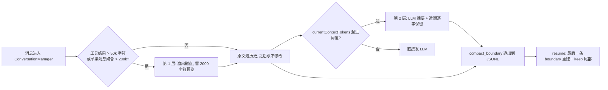

上下文与记忆类追问最容易把「设计动机」讲成「效果数据」。本页给出可核对的机制、调研边界，以及相对指标 baseline 缺口的诚实口径。

## 事实基线

| 事实依据   | 内容                                                                                                                                                                                                       |
| ---------- | ---------------------------------------------------------------------------------------------------------------------------------------------------------------------------------------------------------- |
| 知识库文档 | `content/docs/yukino/` 共 **27 篇**；frontmatter 声明 `local_path: $HOME/github/yukino-code/apps/yukino`、`local_commit: 1847a71e03f9`                                                                     |
| 本机检出   | `$HOME/github/yukino-code`（pnpm workspace，`apps/yukino` 是 npm 包 `@yukino.js/yukino`），**当前 HEAD `88a8d5c`**（比文档基线新）                                                                         |
| 检索结论   | 仓库内 **无 `eval-*` / `bench` / `report` 脚本**（`find` 为空）；`README.md` 的 Highlights 只写 "resumable sessions, automatic context compaction, long-term memory across sessions"，**无任何百分比指标** |

:::danger 事实缺口
Q3 是**事实缺口**：仓库里没有定义过「输入 Token 降低 X% / 写入率提升 Y%」的 baseline，也没有对照实验报告。唯一可引用的实测数字是 **cache 命中率 99.4% → 9.5%**，但它是「tools 数组变动」的单次对照，用于解释设计动机，**不是压缩/记忆方案的收益**。把设计动机讲成效果数据，是这题最容易翻车的地方。
:::

---

## Q1 · 是否调研过已有的长期上下文 / Agent Memory 方案

分两层回答，缺一不可。

### ✅ 有源码级调研（知识库里有证据）

`README.md` 把这些明确归为 **coding-agent surveys** 与 **AI framework surveys**：

| 已有方案                      | 调研文档                      | 可对照的机制                                                                                                                                                                                                           |
| ----------------------------- | ----------------------------- | ---------------------------------------------------------------------------------------------------------------------------------------------------------------------------------------------------------------------- |
| **Claude Code**（反编译源码） | `content/docs/claude-code.md` | `QueryEngine.ts` 的会话状态、上下文压缩、文件历史快照、轮次记账；延迟工具发现使 tools 数组稳定、对 prompt cache 友好；压缩时快照到边界标记跨压缩存活                                                                   |
| **Pi**                        | `content/docs/pi.md`          | 会话是**树**不是线性数组，JSONL v3 追加友好；entry 带 parent 指针与 active branch；`compaction` 存摘要并带 `firstKeptEntryId`、`context_edit` 覆盖单条 entry；明确写出「JSONL 全部历史留内存，长跑 agent 应选 SQLite」 |
| **LangChain.js**              | `content/docs/langchain.md`   | 压缩做成 `beforeModel` 中间件，两条路线：`summarization`（有损摘要）与 `contextEditing`（清空大工具结果）；`store` 承载跨会话长期记忆，与「短期消息历史」分工；区分程序性记忆（固定偏好）与语义记忆（按需检索）        |
| **LangGraph.js**              | `content/docs/langgraph.md`   | `Store` 跨线程长期记忆 + `checkpointer` 线程内历史；`interrupt/resume` 人机协同                                                                                                                                        |

**Yukino 的实现与这些方案同源思路可对照**：同样用 JSONL 追加、同样把压缩分成「工具结果」与「对话摘要」两层、同样用文件索引 + reminder 做长期记忆、同样把 prompt cache 前缀稳定当作硬约束。

### ✅ 项目内部有设计取舍记录（但不是「选型对比表」）

- `agents-md-and-memory.md`：**为什么不用 sqlite**（多余依赖、用不上条件查询）、**为什么不用普通 JSON**（写回整文件、崩溃损坏全量）→ 选 JSONL append-only，坏行跳过、崩溃只损最后一行。
- `context-compaction.md`：**为什么不按「窗口用量 x%」触发**（buffer 与窗口总大小无关，不存在适配所有窗口的百分比）、**为什么给摘要预留 20k**（复杂会话摘要 15–18k tokens）。
- `system-prompt.md` / `llm.md`：system / tools / messages 三字段分工与 prompt cache 计费口径。
- `yukino-code.md`：**第十一节设计取舍**（缓存优先 / 失败要显式 / 人负责方向）+ **三十一问设计问答**。

### ⚠️ 但没有正式的「方案选型调研报告」

检索不到 MemGPT / Letta / mem0 / LangMem 这类**专门 Agent Memory 框架**的调研记录，也没有「方案 A vs 方案 B」的对照表或选型 benchmark。

> **面试口径**：「调研过同类 coding agent（Claude Code、Pi）与框架（LangChain.js / LangGraph.js）的源码实现，重点看会话持久化、压缩与长期记忆分层，并把结论落到自己的取舍上；但没有做正式的框架选型对比实验或专项调研报告。」——⚠️ 别把「读过源码」说成「做过方案 benchmark」。

## Q2 · 短期记忆机制如何实现

先对齐术语：项目把记忆分三层（`agents-md-and-memory.md`）——**工作记忆 = 上下文窗口本身**、长期记忆 = AGENTS.md / JSONL 会话日志 + 文件快照 / 自动记忆。面试问的「短期记忆」对应**前两层的上下文窗口管理与会话恢复**。

| 层                                      | 机制                                                                                                                                                                                                                                                                                                                                                     | 关键实现 / 常量                                                                         |
| --------------------------------------- | -------------------------------------------------------------------------------------------------------------------------------------------------------------------------------------------------------------------------------------------------------------------------------------------------------------------------------------------------------- | --------------------------------------------------------------------------------------- |
| **工作记忆**                            | `ConversationManager` 内存对话；消息只追加、**进入历史后不再修改**（保 prompt cache 前缀）；`tool_use ↔ tool_result` 严格配对                                                                                                                                                                                                                            | `src/conversation/`、`src/llm/`                                                         |
| **第 1 层压缩**（同步、本地、**无损**） | 单个工具结果 > `MAX_OUTPUT_CHARS=50000` 字符 → 写 `tool-results/<toolUseId>.txt`，历史里换成 `<persisted-output>` 预览（`TOOL_RESULT_PREVIEW_CHARS=2000` + 路径 + 原始字符数）；单条消息聚合 > `MESSAGE_AGGREGATE_LIMIT=200000` → 按长度降序逐个溢出；写盘失败保留原文                                                                                   | `src/tool-result/`；预览**逐字节确定**，读回调用豁免溢出防循环                          |
| **第 2 层压缩**（LLM、**有损**）        | **usage anchor** 校准：每轮 `stream_end` 记 `baselineTokens = input + output + cacheRead + cacheCreation`，之后只估算增量（`CHARS_PER_TOKEN=3.5`，图片按 `IMAGE_CHAR_EQUIV=7000` 字符当量）；阈值 `effective - min(13000, effective×0.25)`，`effective = window - min(maxOutput, 20000)`                                                                 | `src/compact/`；冷启动退回全量估算；连续失败 3 次熔断，越过 hard block 无视熔断强制压缩 |
| **摘要生成**                            | **cache-sharing**：新建 ConversationManager 原样 append 待压缩消息，摘要指令作末尾 user 消息，携带**相同 tools / 相同 system** → 复用 prompt cache（源码注释：Anthropic 90%、OpenAI 50%、DeepSeek 约 90%）。摘要强制 6 段结构（Goal / Constraints / Progress / Key Decisions / Next Steps / Critical Context），严格协议校验，PTL 时序列化并逐组丢弃最旧 | `SUMMARY_INSTRUCTIONS`；`MAX_PTL_RETRIES=3`                                             |
| **保留与恢复**                          | 尾部逐字保留：`KEEP_RECENT_TOKENS=10000` 或 `MIN_KEEP_MESSAGES=5` 满足其一即停，上限 `KEEP_MAX_TOKENS=40000`；不拆散 tool_use/tool_result 对；恢复附件含最近 **5 个文件 × 5000 token** 快照 + 可见工具列表 + 「精确内容请重读源文件」提示；压缩后 `restoreContext` 重新注入长期记忆                                                                      | `computeKeepStartIndex`、`recovery.ts`；`compact_boundary` 内联 `{summary, keep}`       |
| **会话持久化**                          | JSONL append-only，`persistLastMessage` 在主循环即时落盘；恢复时逐行 schema 校验、坏行跳过；从**最后一条有效 boundary** 重建；`ensureToolPairing` 修复悬空 tool_use（只作用本次请求，不回写）；票据式文件锁串行化多进程读写；30 天惰性清理                                                                                                               | `src/session/`；`SESSION_EXPIRY_DAYS=30`                                                |
| **检查点 / 回退**                       | `FileHistory` 三态基线 `existing` / `absent` / `unavailable`；快照最多 100 个；`/rewind` 三种粒度（代码+对话 / 仅对话 / 仅代码）；对话截断以 **`sessionLineCount`** 为权威坐标（能穿越 resume 与压缩）                                                                                                                                                   | `src/file-history/`                                                                     |

> **一句话**：短期记忆不是「滑动窗口丢旧消息」，而是 **「大工具结果先溢出到磁盘 → token 越阈值再 LLM 摘要 → 近期消息逐字保留 + 磁盘随时可 ReadFile 回读 + JSONL 可跨进程恢复 + 快照可回退」** 的多层结构。
>
> ⚠️ 别把长期记忆混进来答：AGENTS.md 指令、MEMORY.md 索引、主动 recall（每轮并行预取、最多 5 条）、后台提取（5 轮迭代的小 subagent）、24h 记忆整合（15 轮、≥5 会话门槛）属于 Q1 的长期记忆层。

## Q3 · 「输入 Token 降低 / 写入率提升」的相对指标 baseline 是什么

### ✅ 项目确实有的：可观测打点，不是 A/B 实验

| 打点                | 出处                                                  | 说明                                                                                                 |
| ------------------- | ----------------------------------------------------- | ---------------------------------------------------------------------------------------------------- |
| 四类 token 计费口径 | `llm.md` / `system-prompt.md`                         | `inputTokens`（未命中缓存）、`cacheReadInputTokens`、`cacheCreationInputTokens`、`outputTokens`      |
| `usage anchor`      | `context-compaction.md`                               | `baselineTokens = input + output + cacheRead + cacheCreation`；TUI 状态栏显示 `currentContextTokens` |
| 遥测                | `telemetry.md`                                        | agent / LLM / tool 三层观测点                                                                        |
| **唯一实测数字**    | `mcp.md`、`function-calling.md`、`yukino-code.md:717` | 源码注释：约 **20k token 历史下，仅在 tools 末尾追加一个工具，cache 命中率从 99.4% 掉到 9.5%**       |

那句实测的正确用法是解释**「为什么 tools 数组必须稳定、系统提示词必须项目无关」**的设计动机（`yukino-code.md:458` 把它列为「缓存优先」取舍的证据），**不是**「本方案比 baseline 省了多少输入 token」。

### ⚠️ 项目没有的：相对指标的定义、对照组、报告

- `yukino-code` 仓库 **没有任何 eval / benchmark / report 脚本**，`README.md` 也没有量化收益。
- 检索不到「输入 Token 降低 X%」或「写入率提升 Y%」的指标定义与前后对比结果。
- **「写入率」本身有歧义**，面试里应先反问澄清：

| 可能口径                                               | 项目里对应什么                                                                                  | 有无「提升」对比 |
| ------------------------------------------------------ | ----------------------------------------------------------------------------------------------- | ---------------- |
| **cache 写入率** = `cacheCreationInputTokens / 总输入` | 有 usage 打点                                                                                   | ❌ 无 baseline   |
| **记忆写入率** = 真正落盘的记忆文件数 / 触发轮次       | `extractWrittenPaths` 只统计写工具成功的 `file_path`（模型口头说写了不算）、`Memory saved` 提示 | ❌ 无 baseline   |
| **会话写入率** = JSONL append 频次 / 成功率            | append-only + 文件锁 + 坏行跳过                                                                 | ❌ 无指标        |

### ⚠️ 若简历上写了这类数字，baseline 应该这样定义（推导，明确说不是项目已做）

| 要素     | 正确做法                                                                                                                |
| -------- | ----------------------------------------------------------------------------------------------------------------------- |
| 对照组   | **同一批会话轨迹 / 同一模型 / 同一 prompt / 同一工具集**，只切换一个变量（如关闭第 1 层溢出、关闭压缩、或关闭缓存优化） |
| 指标     | 每轮 `inputTokens`、`cacheRead`/`cacheCreation` 占比、压缩触发次数、累计 token、墙钟延迟                                |
| 质量护栏 | 同时记任务成功率 / 答案质量 / 是否需要 ReadFile 回读，**防止「省了 token 但答错」**                                     |
| 统计     | 多次运行取均值与方差，报告样本数、模型版本与 commit（`local_commit`）                                                   |
| 写入率   | 先把分子分母写清楚再谈提升，否则这个指标不可比                                                                          |

> **面试口径**：「项目里有完整的 token / cache 打点和一处源码注释实测，但**没有定义过这类相对指标的 baseline，也没有跑过对照实验**。如果要给这类数字，我会用固定会话轨迹做开关式 A/B 并同时守住质量指标；现在只能讲机制与动机，不能报百分比。」

---

## 三分钟口述版

> 调研层面，我对 Claude Code、Pi、LangChain.js、LangGraph.js 做过源码级调研：Pi 是树形 JSONL v3 加 compaction/context_edit，LangChain 把压缩拆成 summarization 与 contextEditing 两条中间件路线，Claude Code 用延迟工具发现保住 tools 数组稳定——这些直接影响了 Yukino 的取舍，但没有正式的框架选型 benchmark。短期记忆分四层：工作记忆是 ConversationManager 里只追加不改的消息；第一层把超过 5 万字符的工具结果溢出到磁盘只留 2000 字符预览；第二层在 usage anchor 校准的 token 用量越过阈值时做 cache-sharing 摘要，近期 1 万 token 逐字保留，压缩结果以 compact_boundary 追加进 JSONL，resume 时从最后一条边界重建；再加文件快照与 /rewind 回退。长期记忆另算：AGENTS.md、MEMORY.md 索引、每轮并行 recall、后台提取与 24 小时整合。
>
> 至于「输入 token 降低 / 写入率提升」——项目有 token 与 cache 四类打点，源码注释里有一次 99.4%→9.5% 的命中率实测来说明工具数组必须稳定，但**没有定义过相对指标的 baseline，也没有对照实验报告**。这类数字我不会现场给，会说明该用固定会话轨迹做开关式 A/B、并同时守住任务成功率。

## 追问链

1. 为什么第 1 层压缩是「无损」而第 2 层是「有损」？无损的代价是什么？（完整内容仍在磁盘，需要一次 ReadFile 回读；读回结果豁免溢出防循环）
2. 为什么不按窗口百分比触发压缩？（摘要输出 + 下一轮消耗的绝对 buffer 与窗口大小无关，`min(13k, effective×0.25)` 的 ratio cap 才适配小窗口）
3. 摘要请求为什么要 cache-sharing？（前缀 = 同 tools + 同 system + 原样 append 的历史，能吃到缓存折扣；否则压缩本身很贵）
4. `compact_boundary` 为什么内联 `keep` 而不是回读文件？（恢复时不需要回到 boundary 之前找保留消息；会话文件比进程活得久，恢复附件按进程重建、不持久化）
5. 长期记忆放 messages 而不是 system 的理由？（system 保持项目无关、跨项目共享 prompt cache；项目内容走 `<system-reminder>`）
6. 如果真要测「输入 token 降低」，怎么避免压缩导致的质量下降被忽略？（同轨迹回放 + 任务成功率/回读率作为护栏 + 多次运行取均值）

## 延伸阅读

[Agent 执行链路与 MCP](/interview/fundamentals/agent-and-mcp) · [指标口径与基线定义](/interview/metrics-baseline) · [RAG 全链路](/interview/fundamentals/rag-pipeline)
