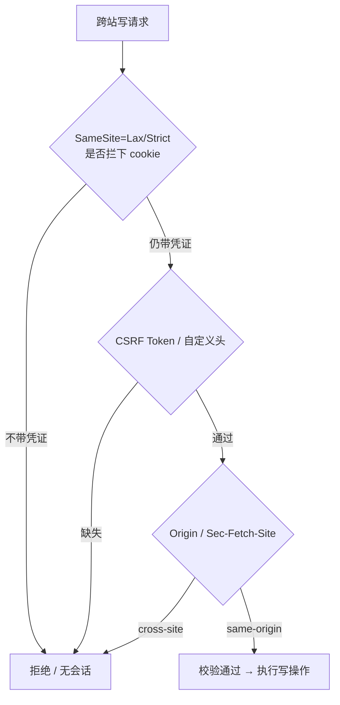

这题的题面包含一个概念陷阱：**cookie 没有 same origin 属性**。开口做澄清、分清三组判定，本身就是采分点；随后按成因 → 分层防御 → 场景展开。

## 题目

> **如何防止跨域请求伪造？cookie 的 same origin 是什么？有真实使用场景吗？**

## 第一反应：这题有个概念陷阱

:::warning 「cookie 的 same origin」不存在
面试官这句要么在**故意挖坑**，要么把三个概念说混了。开口先做澄清，本身就是得分点：
:::

| 概念                    | 判定依据                                                                 | 管什么                                                            | 谁执行               |
| ----------------------- | ------------------------------------------------------------------------ | ----------------------------------------------------------------- | -------------------- |
| **Same-Origin（同源）** | `scheme + host + port` **三者全等**                                      | 限制 JS **读取**跨域响应 / DOM；**不限制请求发出**                | 浏览器               |
| **Same-Site（同站）**   | **eTLD+1**（Public Suffix List 下的可注册域），忽略 scheme / port / 子域 | `SameSite` 决定跨站请求**是否携带 cookie**                        | 浏览器 + cookie 属性 |
| **Cookie 作用域**       | `Domain` + `Path`（`Secure` 限 HTTPS）                                   | 决定 cookie 发给谁；**不看 port，不区分 scheme**（除非 `Secure`） | 浏览器               |

**三组判定，面试直接背**：

| A ↔ B                                                 | cross-origin? | cross-site?                    | 后果                                                              |
| ----------------------------------------------------- | ------------- | ------------------------------ | ----------------------------------------------------------------- |
| `https://app.example.com` ↔ `https://api.example.com` | ✅ 是         | ❌ 否，**same-site**           | `SameSite=Strict` 的 cookie **照样带**，但 CORS 必须放行          |
| `http://a.com` ↔ `https://a.com:8443`                 | ✅ 是         | ❌ 否                          | cookie **共享**（无 port 隔离；非 `Secure` 时 http/https 也共享） |
| `https://a.github.io` ↔ `https://b.github.io`         | ✅ 是         | ✅ 是（`github.io` 在 PSL 中） | `SameSite` 会拦下 cookie                                          |

> 用户真正想问的多半是 **`SameSite`**，或「同源策略下 cookie 怎么判定」。`content/fe/fe.md:548-558` 已把 cookie 属性逐条写全，可直接引用。

## Q1 · 如何防止 CSRF

### 成因

浏览器对目标站点**自动携带 cookie**（ambient authority）。攻击者在 `evil.com` 构造指向 `bank.com` 的 `<form POST>` / `img` / `fetch`，用户已登录 → 请求带凭证 → 服务端只认 cookie 就执行转账。攻击者**读不到响应**（同源策略拦的是这一步），但攻击只需要「请求被发出且被执行」。

### 分层防御（与 `content/fe/fe.md:695` 一致）

| 层  | 手段                                      | 关键边界                                                                                                                           |
| --- | ----------------------------------------- | ---------------------------------------------------------------------------------------------------------------------------------- |
| 1   | **`SameSite=Lax` / `Strict`**             | 第一道防线。`Lax` 放行**顶层导航 GET** → 必须保证 GET 无副作用；`Strict` 太严，外部链接进来会掉登录                                |
| 2   | **CSRF Token（同步器模式）**              | 服务端下发、绑定 session、不可预测；跨源页面读不到                                                                                 |
| 3   | **双重提交 cookie**                       | token 同时放 cookie 与**自定义头**，服务端比对；跨源页面带得了 cookie、读不到值、也写不了自定义头。配 `__Host-` 前缀防子域注入覆盖 |
| 4   | **强制自定义头 / 触发 preflight**         | 表单无法加自定义头，跨源 `fetch` 加头会先发 OPTIONS。**不能只靠「接口只收 JSON」**——表单能用 `text/plain` 拼出 JSON 字符串         |
| 5   | **`Origin` / `Referer` + Fetch Metadata** | `Sec-Fetch-Site` / `-Mode` / `-Dest` / `-User` 由浏览器强制附加，攻击者伪造不了                                                    |
| 6   | **规范与产品层**                          | GET 幂等；转账、改密加二次验证 / 验证码                                                                                            |
| 7   | **架构层取舍**                            | 改用 `Authorization: Bearer`（浏览器不自动带）→ 天然免疫 CSRF，但 **XSS 窃取风险上升**；要说清 trade-off                           |

**配套但别答错**：`HttpOnly` 防 **XSS 窃取凭证**，不防 CSRF；`Secure`、`__Host-`/`__Secure-` 前缀防 cookie 被低权限子域篡改；**CORS 控制的是「响应能否被 JS 读取」，请求早已到达服务端，不能当 CSRF 防线**（`content/fe/fe.md:632` 明确把这两点列为「跨域安全两大常见误判」）。

推荐组合：`HttpOnly` + `Secure` + `SameSite=Lax/Strict` + `__Host-` 前缀，敏感写操作叠加 CSRF Token（`content/fe/fe.md:558`）。

## Q2 · 「cookie 的 same origin」→ 正解是 SameSite

| 值       | 跨站请求带 cookie 吗                                         | 典型用途                                             |
| -------- | ------------------------------------------------------------ | ---------------------------------------------------- |
| `Strict` | 完全不带                                                     | 高安全后台；代价是外部链接进来掉登录                 |
| `Lax`    | 仅**顶层导航 GET** 带；跨站 POST / iframe / img / fetch 不带 | **现代浏览器缺省值**（Chrome 80 起）；兼顾体验与安全 |
| `None`   | 总是带，**必须同时 `Secure`**                                | 第三方支付 / SSO 回调、跨站 iframe 嵌入              |

`Domain`（不设即 host-only，设了含子域）、`Path`、`Secure`、`HttpOnly`、`SameSite`、`Partitioned`（CHIPS）、`__Host-`/`__Secure-` 前缀 —— 这才是 cookie 的属性集（`content/fe/fe.md:549-556`）。

## Q3 · 真实使用场景

| #   | 场景                                                                                                     | 机制落点                                                                                                                               |
| --- | -------------------------------------------------------------------------------------------------------- | -------------------------------------------------------------------------------------------------------------------------------------- |
| A   | **从邮件/IM 点链接进站点**：顶层 GET 导航带 cookie → 免登录；恶意站 `<form POST>` 转账不带 cookie → 被挡 | 这正是 `Lax` 成为默认值的理由；`Strict` 会让所有外链进来都掉登录                                                                       |
| B   | **第三方支付 / OAuth 回调**：支付网关跨站 POST 回商户，Lax 不带 cookie → 会话丢失                        | 必须 `SameSite=None; Secure`，再用 OAuth `state`（本质就是 CSRF Token）+ 回调校验兜底；嵌入式客服/支付 iframe 同理                     |
| C   | **多子域架构** `app.example.com` → `api.example.com`：same-site 但 cross-origin                          | `SameSite=Strict` 仍带 cookie；**CORS 仍要** `Allow-Origin` 精确匹配 + `Allow-Credentials: true`（不能 `*`）（`content/fe/fe.md:639`） |
| D   | **SSR 表单 / 银行后台**：Rails、Django、Spring Security 默认隐藏域 CSRF Token                            | SPA + JWT 通常改 Bearer + 自定义头，不再依赖 cookie                                                                                    |

### 项目内的真实代码（面试可直接举，已核对文档）

| 实例                            | 事实                                                                                                                                                                                        | 事实依据                                            |
| ------------------------------- | ------------------------------------------------------------------------------------------------------------------------------------------------------------------------------------------- | --------------------------------------------------- |
| **WebSocket 跨站劫持（CSWSH）** | 浏览器**不会**像同源策略那样自动拦截跨域 WS 连接；`yukino_http` 握手第 1 步就是 `opts.CheckOrigin` 来源校验，失败 `Throw(403)`；该项默认 `nil` = 跳过校验（便于开发），**生产必须显式配置** | `content/be/yukino-http.md:252,268,345`             |
| **Remote 模式的 Origin 闸门**   | 升级路径必须是 `/ws`；`Origin` 存在时必须与 `Host` **同源且协议为 `http:`**，违反返回 403；不带 `Origin` 的非浏览器客户端不受此限                                                           | `content/docs/yukino/remote.md`                     |
| **反面案例**                    | 「当前无鉴权、**CORS 全开**、单进程长连接」被列为不适合公网的理由；工程建议首条即「给关键入口加认证并**收敛 CORS**」                                                                        | `content/docs/yukino-dev-agent/yukino-dev-agent.md` |
| **CORS 中间件实现**             | `cors` 反射 `Origin`、`OPTIONS` 直接 204、前后各应用一次以扛住 `Recovery` 清头                                                                                                              | `content/be/wanproxy.md:340`                        |

:::note 可延伸的讨论点
「反射 Origin」在**带凭证**场景要谨慎：应改为白名单精确匹配，并配合 `Vary: Origin` 与 `Allow-Credentials`。面试里主动点出这一层，比背八股更有说服力。
:::

## 采分点

| 维度     | 加分                                                                         | 扣分                           |
| -------- | ---------------------------------------------------------------------------- | ------------------------------ |
| 正确性   | 主动纠偏「cookie 没有 same origin 属性」，分清 origin / site / cookie 作用域 | 把 SameSite 与同源策略混为一谈 |
| 深度     | 讲清「同源策略拦读不拦发」，因此 CSRF 成立且 CORS 无效                       | 「配好 CORS 就安全了」         |
| 工程取舍 | Lax vs Strict vs None 的体验代价；Bearer 方案把风险从 CSRF 转到 XSS          | 只背 `HttpOnly` / Token 名词   |
| 表达结构 | 成因 → 分层防御 → 概念辨析 → 场景                                            | 想到哪说到哪                   |
| 边界意识 | GET 副作用、`text/plain` 伪装 JSON、子域 cookie 注入、WS 需单独校验 Origin   | 只考虑 happy path              |

## 追问链

1. `SameSite=Strict` 能防住所有 CSRF 吗？（不能：GET 副作用、同站子域被接管、与 XSS 组合）
2. 为什么 CORS 不能当 CSRF 防线？（请求已到达服务端，CORS 只控读响应）
3. `Lax` 到底放行什么？`None` 为什么必须 `Secure`？
4. 子域能写父域 cookie 时，**双重提交**怎么被绕过？`__Host-` 怎么救？
5. WebSocket 为什么要服务端自己校验 `Origin`？
6. 换成 Bearer token 是不是就安全了？（免疫 CSRF，但 XSS 窃取代价与刷新/吊销策略要一起交代）

## 速记卡

- **一句话**：CSRF 的根因是「浏览器自动带 cookie + 同源策略只拦读不拦发」；防线是 `SameSite` 打底、Token / 自定义头、`Origin` + Fetch Metadata 兜底、GET 幂等。
- **三个不要**：不要说「cookie 的 same origin」；不要拿 CORS / `HttpOnly` 当 CSRF 防线；不要只靠「接口只收 JSON」。
- **最值钱的辨析**：`app.example.com` ↔ `api.example.com` 是 **cross-origin 但 same-site** —— SameSite 拦不住，CORS 还得配。
- **项目实例**：`yukino_http` 的 `CheckOrigin` / Remote 的 `/ws` Origin 403 / dev-agent 的「CORS 全开」反面案例。

## 延伸阅读

[Web 安全与可观测性](/interview/fundamentals/security-observability) · [浏览器与 React](/interview/fundamentals/frontend-browser) · [全量题库](/interview/question-bank)
