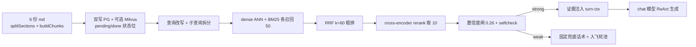

**项目事实核对型**示范答案。所有数值取自源码实读与本机实测；九问中有四个事实缺口，文内以 **项目事实** / **推导或需澄清** 明确区分。

## 事实基线

| 事实依据   | 内容                                                                                                                                       |
| ---------- | ------------------------------------------------------------------------------------------------------------------------------------------ |
| 知识库文档 | `content/docs/yukino-ecomm-agent/` 共 9 篇，frontmatter 声明 `local_path: $HOME/github/yukino-ecomm-agent`、`local_commit: b160dff57b5d`   |
| 本机检出   | `/c/Users/usr16/github/yukino-ecomm-agent`，**当前 HEAD `c90c843`**（比文档基线新）；本页数值均取当前检出并实测                            |
| 实测数据   | `server/data/kb/` **6 份 md、20,950 字节**；按 `buildChunks` 默认参数实跑得 **74 条 chunk**；`server/tests/data/eval_rag.jsonl` **300 行** |
| 未归档产物 | `server/data/rag/reports/` 目录**不存在**（运行时生成），所以历史评测分数不在仓库里                                                        |

:::danger 事实缺口
9 问里有 **4 个事实缺口**：改造前分数无归档、无跨模型 A/B 实验、无参数规模论证、`INTENT_MODEL` 实际未单独配置。下面用 ✅ **项目事实** / ⚠️ **推导或需澄清** 标清。**把推导讲成「项目已经做了」是这类追问最容易翻车的地方**。
:::

---

## Q1 · 完整介绍 RAG 如何回答问题



| 阶段            | 项目事实                                                                                                                                                                                                                                                                                                                                  | 关键常量 / 文件                                                                                       |
| --------------- | ----------------------------------------------------------------------------------------------------------------------------------------------------------------------------------------------------------------------------------------------------------------------------------------------------------------------------------------- | ----------------------------------------------------------------------------------------------------- |
| **文档解析**    | `splitSections` 按 `#{1,4}` 标题切小节并维护标题栈（代码围栏内的 `#` 不误判）；`buildChunks` 对表格按行分组、**每块复制表头**（最多 10 行数据，引导文字只跟第一块）；非表格用 `RecursiveCharacterTextSplitter`（分隔优先级：空行 → 换行 → 中文句读 → 中文逗号 → 空格 → 字符），再由 `applySentenceOverlap` 做**句子级** overlap，不截半句 | `server/src/kb/chunking.ts`、`documents.ts`；`chunkSize=400`、`overlap=60`、`tableMaxRows=10`         |
| **chunk 结构**  | `{ category, questions, answer, sectionPath, contentType, isKeyClause }`；`sectionPath` 取标题路径，`questions` 取末级标题，`category` 为父路径；`KEY_TERMS`（refund / warranty / shipping fee 等）标关键条款；`prevChunkId`/`nextChunkId` 串成双向链表                                                                                   | 被向量化的只有 **`category\nquestions\nanswer` 三段拼接**，与 Milvus `text` 字段同一字符串            |
| **存储**        | PostgreSQL(Prisma) `knowledge_chunk` 是**权威原文**；双写状态位 `pending → done`。Milvus 可选：`dense` FloatVector COSINE/AUTOINDEX + `text`（analyzer）+ `sparse`（BM25 Function 自动派生）+ 标量字段。无 `MILVUS_URI` 时退化为进程内全量余弦 + BM25                                                                                     | `dualwrite.ts`、`milvus.ts`、`store.ts`；BM25 `K1=1.5 / B=0.75`，中文 **bigram** 分词，不依赖分词服务 |
| **向量化**      | OpenAI 兼容 embedding 端点，**不加** `query:` / `document:` 前缀；换 `EMBED_MODEL` 或 `embeddingModel` 与当前值不一致即自动全量重嵌                                                                                                                                                                                                       | `EMBED_MODEL=qwen3.7-text-embedding-flash`；`batchSize=64`、`MAX_EMBED_BATCH=20`                      |
| **查询理解**    | 图入口 `coref.resolve` 做指代消解（失败原样透传）；`understand()` 结构化产出 `{standard, expanded}`，**standard 走 dense、expanded 3–6 个同义词拼进 `bm25Text`**，扩写不污染向量路；失败降级原查询。子查询按中英文标点切分（每段 ≥4 字符、至少 2 段触发），各子句检索后 round-robin 合并去重                                              | `core/query-understanding.ts`、`retrieval.ts`、`SUBQUERY_SPLIT`                                       |
| **召回 / 粗排** | 默认策略 `hybrid_rerank`：dense + BM25 各召回 50 → **RRF 融合 `k=60`**（只比排名，不比分数，避开余弦与 BM25 量纲差异）                                                                                                                                                                                                                    | `RECALL_TOP_K=50`、`RERANK_TOP_K=10`                                                                  |
| **精排**        | cross-encoder rerank，jina 协议（默认）或 DashScope 原生协议；429/5xx 重试 3 次、退避 1.5s 起、60s 超时；精排分 < 0.3 视为证据不足。`arrangeHeadTail` 把第 2 名挪到队尾 `(1,3,4,…,2)`，利用首因/近因效应                                                                                                                                  | `RERANK_MODEL=qwen3.7-text-rerank`                                                                    |
| **门禁**        | `score = 0.5·top1 + 0.2·(valid≤3)/3 + 0.2·(top1−top2) + 0.1·keyTerm`，< `0.26` 判 weak；过分数闸后还有 LLM 自检 `selfcheck`（**调用失败一律按证据不足**）；weak → 固定兜底话术 + 写入低置信问题池                                                                                                                                         | `core/confidence.ts`、`selfcheck.ts`、`graph/routing.ts`                                              |
| **生成**        | strong → 证据以 `[n] question: answer` 编号注入 **turn-ctx**（见 Q7），主力 agent 用 chat 模型 + `bindTools` 跑 ReAct；要求关键结论后附 `[1][2]`、型号照抄、证据不足明说                                                                                                                                                                  | `graph/nodes.ts`、`prompts.ts`                                                                        |

> **一句话链路**：6 份 md → 74 chunk → PG(权威)+Milvus/内置向量 → 改写+双路召回+RRF+rerank → 双门禁 → 编号证据进上下文 → chat 模型生成带引用的答案。

## Q2 · 大约多少份文档、多少条 chunk

| 项        | ✅ 实测值                                                  | 依据                                                                                                          |
| --------- | ---------------------------------------------------------- | ------------------------------------------------------------------------------------------------------------- |
| 文档      | **6 份 markdown**                                          | `server/data/kb/`；`sources.ts` 的 `SOURCE_TYPES` 映射为 `faq / policy / manual / spec` 四类 contentType      |
| 原始体量  | **20,950 字节**（3.4K / 1.9K / 1.9K / 4.5K / 6.2K / 3.0K） | 本机 `wc -c`                                                                                                  |
| **chunk** | **74 条**（11 / 6 / 6 / 18 / 22 / 11）                     | 用 Node 22 `--experimental-strip-types` 直接 import `documents.ts` 的 `buildChunks(md, contentType)` 实跑求和 |
| 评测集    | **300 条 JSONL**                                           | `server/tests/data/eval_rag.jsonl`                                                                            |

**面试口径**：「6 份领域文档、按 400 字符 + 60 句子级 overlap 切出约 70 多条 chunk，评测集 300 条」。

⚠️ 三个必须补的边界：

1. **74 是纯文档切分基数**。飞轮写回的 `flywheel_review`（人工审核 FAQ）与 `conversation_history`（会话挖掘）会**追加 chunk**，库内实际数更大。
2. 运行时确切值来自 `store.count()`，写进 `data/rag/reports/rag_eval.json` 的 `meta.kb_chunks`（`eval-rag.ts:727-730`），管理台 `/api/kb/overview` 也做双写计数校验。
3. 这 6 份是**演示语料**，不是生产规模；面试要主动说清「百级 chunk 下 hybrid_rerank 的价值主要在精度而非性能」，别把结论外推到百万级。

## Q3 · 效果提升与什么 baseline 比？改造前分数怎么来的？

✅ **有明确定义的 baseline**：`scripts/eval-rag.ts` 在**同一份 300 条固定数据集**上跑 4 种检索策略：

| 策略            | 角色                          |
| --------------- | ----------------------------- |
| `vector`        | 纯稠密向量（最朴素的 RAG）    |
| `bm25`          | 纯关键词                      |
| `hybrid`        | RRF 融合、**无精排**          |
| `hybrid_rerank` | **生产策略**（融合 + rerank） |

指标分三层（`observable.md`）：

1. **检索**：4 策略 × 4 问题桶（A_policy / B_model / C_colloquial / E_multi），`Recall@5`、`MRR`，top-10，按期望 section 命中排名算，**确定性可复现**；最佳策略按 overall MRR 选出。
2. **证据覆盖率**：标准答案关键点在 top-10 证据文本中的子串匹配比例，**不经过 LLM**。
3. **生成**：同一 `RAG_ANSWER_PROMPT` 产答案；答案覆盖率由 LLM 评审数关键点；`faithfulness` 只对生产策略评（`FAITHFULNESS_PROMPT` + `temperature: 0`）；D_absent 库外样本走 `query_faq`，`sufficient=false` 记为正确拒答。

⚠️ **「改造前分数」的诚实答案**：报告 `data/rag/reports/rag_eval.json/.txt` 是**运行时产物，当前仓库没有 `reports/` 目录**，因此历史具体分数**未归档**。正确说法是「改造前后各跑一次同一脚本、同一数据集，对比 `rag_eval.json` 里的 overall MRR / Recall@5 与证据覆盖率，报告 meta 带 `chat_model`、`kb_chunks` 和时间戳以便对齐」。若面试官追问具体数字，**说需要调当时的报告或 `eval_run` 趋势表**，不要现场编。

⚠️ 另一个容易混淆的 baseline：README 写明本项目 **migrated from the original Python project**（Python + MySQL + Milvus）。这是**架构迁移对齐**（行为一致、响应形状接近），仓库里**没有 Python 版 vs Node 版的定量分数对比**。别把它当效果提升的证据。

> **加分补充**：`eval-rag.ts` 有防「假分数」设计——生成阶段若全部调用失败会**抛错拒绝记录零分**，避免把上游故障写进报告；部分失败会在报告里注明「scores use the available samples」。

## Q4 · 意图分类 / query 改写模型怎么选？对比过其他模型吗？

✅ **模型槽位事实**（`llm.md`、`core/llm.ts`、`server/.env.example`）：

| 槽位               | 环境变量               | 用途                                                            | 当前配置                                               |
| ------------------ | ---------------------- | --------------------------------------------------------------- | ------------------------------------------------------ |
| `chat`             | `CHAT_MODEL` 等        | 主力 agent、指代消解、query 改写、自检、评审                    | **`deepseek-flash`**（`https://api.deepseek.com`）     |
| `intent`           | `INTENT_MODEL` 等      | 意图分类（九分类，`structured(intentSchema, {slot:"intent"})`） | **未配置 → 逐字段回落 chat 组**                        |
| `summary`          | `SUMMARY_MODEL` 等     | 滚动摘要                                                        | **未配置 → 回落 chat 组**                              |
| embedding / rerank | `EMBED_*` / `RERANK_*` | 独立上游                                                        | `qwen3.7-text-embedding-flash` / `qwen3.7-text-rerank` |

**所以真相是**：意图分类、query 改写（`structured(rewriteSchema)`、`expandQueries`）、指代消解（`getChatModel()`）**实际都走 chat 模型的 `deepseek-flash`**；项目只是把「可独立换模型」的能力做成了 `resolveSlot`（改环境变量即可，不改代码）。`observable.md:97` 的 `cost-report` 按 `intent:xxx` 标签聚合 token 账单，是**成本维度的选型依据**。

✅ **有单模型定量验收，但没有跨模型 A/B**：`server/scripts/` 下有 `eval-intent2.ts`（18 条标注样本，打印 `Correct x/18` 与 JSON 合法率，并自注「LLM is non-deterministic; re-run and record honestly」）、`eval-intent.ts`（端到端多轮意图漂移验收）、`eval-expand.ts`（3 个 case 校验扩写恰好 3 条且保留关键实体）、`eval-coref.ts`、`eval-retrieval.ts`、`eval-judge.ts`。**全部是「当前这一个模型/这一条管线」的验收**，检索不到任何「模型 A vs 模型 B」的对照脚本或报告。

⚠️ **面试口径**：「选型依据是任务特性 + slot 化可替换 + 按意图的 token 账单；我做过单模型准确率验收，但**没有做严格的跨模型 A/B**」。若确实做过人工试用，就明说是主观试用，并当场给出「补做方案」：固定 18/300 条标注集 + 同一 prompt、同一 `temperature=0`、每模型跑 3 次取均值，对比准确率 / P95 延迟 / 每千次成本 / JSON 合法率。

## Q5 · 模型对比怎么实施的？定量还是主观？

| 对象                    | 是否定量                  | 证据                                                                                                                       |
| ----------------------- | ------------------------- | -------------------------------------------------------------------------------------------------------------------------- |
| **4 种检索策略**        | ✅ **定量**               | 300 条固定 JSONL、4 策略 × 4 桶、Recall@5/MRR（确定性）、证据覆盖率（机械匹配）、报告落盘 json/txt                         |
| **置信度阈值**          | ✅ **定量**               | `calibrate-confidence.ts`：0.05–0.95 步长 0.01 扫描，以 **Youden J**（库内通过率 − 库外漏放率）最大选推荐阈值，默认 `0.26` |
| **趋势防劣化**          | ✅ **定量**               | `eval-flywheel.ts` 记 `recall_at_5 / mrr / faithfulness / refusal_rate` 进 `eval_run`，相邻轮差 > 0.005 标 ↑ / ⚠↓          |
| **答案覆盖率 / 忠实度** | ⚠️ **LLM 评审**（半定量） | `temperature: 0` 结构化输出、`FAITHFULNESS_SYSTEM` 七类豁免 + 真实边界判例；仍属模型判定，需多次运行                       |
| **LLM 模型之间的选型**  | ❌ **无定量实验**         | 无 A/B 脚本、无对照报告                                                                                                    |

**关键区分**：不要把「检索策略的定量结果」说成「模型选型的定量依据」。前者是消融实验（ablation），后者需要控制变量的模型对照。面试官问这句，通常就是在验证你能不能分清这两类证据。

## Q6 · 为什么意图分类用 xxx 量级模型？参数规模怎么考虑？

✅ **先校正题目里的前提**：项目**没有为意图分类指定某个参数量级的小模型**。`INTENT_MODEL` 在 `.env.example` 里为空，运行时回落 `chat` 组的 `deepseek-flash`；而且用的是**API 模型，上游不公开参数规模**，仓库里也没有任何参数规模论证的记录。

✅ 项目真正做的**稳定性设计**不在模型，而在流程：意图分类是 LangGraph 里的**确定性前置节点**（`START → resolve_reference → classify_intent → routeByIntent`），九类判据 + 边界 few-shot、强制结构化输出（zod schema 二次校验、失败重试 2 次、兜底 `other`）、只喂一行摘要 + 最近 6 条历史的轻量上下文；分类结果直接查表路由到五出口，**不让 agent 自己决定要不要检索**。

⚠️ **若被追问「为什么该用小模型 / 参数规模怎么定」，可讲的推导（明确说这是设计思路，不是项目已做）**：

| 维度       | 判断                                                           |
| ---------- | -------------------------------------------------------------- |
| 任务复杂度 | 九分类、输出仅 `intent + confidence`，属窄任务，不需要长链推理 |
| 调用位置   | 每轮**前置串行关键路径**，延迟预算最紧；高频调用放大成本       |
| 上下文     | 只需摘要行 + 6 条历史，不需要大窗口                            |
| 输出稳定性 | function calling / JSON schema 比模型规模更决定可用性          |
| 成本       | QPS × 每轮调用数；`cost-report` 按意图聚合 token 正是为此准备  |

**结论口径**：参数规模本身**不是可靠决策依据**（尤其 API 模型不公开参数量）；应该用「固定标注集上的准确率 / JSON 合法率 / P95 延迟 / 每千次成本」四轴实测来定档位，再借 `resolveSlot` 只改环境变量切换。这一句把 Q5 的缺口也补上了。

## Q7 · 检索出的内容会放进提示词吗？放在什么位置？

✅ **会，但不在 system 里**。生产主链路 `agentMessages`（`context.md:146-179`）的消息序列：

```js
[
  { role: "system", content: AGENT_SYSTEM }, // 固定前缀, 命中 prompt cache
  // 层 2 压缩历史 → 层 1 原文历史
  { role: "user", content: "<当前用户消息>" },
  {
    role: "user",
    content:
      "## Summary of earlier conversation ...\n## Retrieved knowledge evidence [1] ...",
  }, // turn-ctx
];
```

- `turnContext` 由 `withTurnContext` **紧跟在当前用户消息之后插入**（窗口尾部），含历史摘要 + 编号证据 `[n] question: answer` + `KNOWLEDGE_EVIDENCE_HINT`（引用编号规则、型号必须照抄证据、证据外型号不许写、条件性结论要带条件）；退款分支另附 `REFUND_JUDGE_HINT`。
- **放尾部而不是 system 头部**：`system + 历史` 前缀保持字节稳定，命中前缀缓存；项目对「激进压缩让前缀稳定以保住 prompt cache」有明确取舍。
- 预算上按 `EVIDENCE_TOKENS_PER_CHUNK=160 × RERANK_TOP_K=10` 计入 `fixed`（`context.md:77`）。
- 意图分类 / 指代消解发生在检索**之前**，用更轻的 `historyText`，**不注入 evidence**。

⚠️ 另一条路径别混：`RAG_ANSWER_PROMPT`（纯 RAG 回答与 `eval-rag` 评测用）是 `system + human`，证据放在 **human 消息**的 `Knowledge evidence:\n{evidence}` 槽位里。

## Q8 · 组装后最终调用什么模型生成答案？

| 项            | ✅ 事实                                                                                                                                     |
| ------------- | ------------------------------------------------------------------------------------------------------------------------------------------- |
| 模型          | **`CHAT_MODEL=deepseek-flash`**（`server/.env.example`），OpenAI 兼容 Chat Completions，经 `@langchain/openai` 的 `ChatOpenAI`              |
| 调用参数      | `getChatModel` 默认 `temperature=0.3`、`maxTokens=10000`、`streaming=true`、`streamUsage=true`、`thinking` 由 `CHAT_THINKING=adaptive` 控制 |
| 主链路        | `mainAgent`：`getChatModel({streaming:true}).bindTools(toolDefs)` 跑 **ReAct 工具循环**，最终答案由它生成                                   |
| 纯 RAG / 评测 | 同一个 chat 模型 + `RAG_ANSWER_PROMPT`                                                                                                      |
| 结构化节点    | 意图、改写、自检、摘要、评审统一 `thinking:false` + `withStructuredOutput(functionCalling)`，返回后再过 zod；忠实度评审额外 `temperature=0` |
| 兼容性        | `needsNonStreamingTools` 对模型名含 `minimax` 的家族降级为非流式工具调用                                                                    |

> 所以「生成模型」和「意图/改写模型」在当前配置下**是同一个**；embedding 与 rerank 是另两个独立上游。这个点在 Q4/Q6 被追问时很关键。

## Q9 · 提示词怎么设计才能降低幻觉？

✅ **项目已落地的 9 条**（`prompts.ts`、`rag.md`、`observable.md`）：

| #   | 手段                    | 具体实现                                                                                                                                                                                                                   |
| --- | ----------------------- | -------------------------------------------------------------------------------------------------------------------------------------------------------------------------------------------------------------------------- |
| 1   | **证据边界 + 强制引用** | `AGENT_SYSTEM` / `RAG_ANSWER_SYSTEM`：严格基于证据，关键结论后附 `[1][2]`，绝不编造证据外内容                                                                                                                              |
| 2   | **型号照抄 + 机械闸门** | 型号串须 verbatim；`core/model-guard.ts` 检出答案里证据中不存在的型号串，带修复提示重试一次并统计救回数                                                                                                                    |
| 3   | **条件不丢**            | 带条件结论必须连条件一起说（防止「7 天」从价保规则挪到无理由退货）                                                                                                                                                         |
| 4   | **显式拒答规则**        | `sufficient=false` / 证据不足 → 明确「暂未找到相关信息」+ 引导人工，不硬答                                                                                                                                                 |
| 5   | **负向知识**            | 禁止承诺到账/配送/维修时限与赔偿金额，退款统一 `subject to the platform's after-sales rules`                                                                                                                               |
| 6   | **生成前双门禁**        | 置信度分数闸 `0.26` + LLM `selfcheck`（失败按不足处理）；weak 直接走**固定兜底话术**，根本不进生成模型                                                                                                                     |
| 7   | **忠实度评审与台账**    | `FAITHFULNESS_SYSTEM` 只对「无中生有的具体事实」判罚，列 **七类豁免**（兜底引导、不确定语气、跨证据合并、常识注释等）与**两类最高危编造**（凭空补数字、条件/起点张冠李戴），附真实边界判例；不忠实样本进 `faith_case` 台账 |
| 8   | **位置与预算**          | 证据放尾部 user 消息，不污染 system 前缀；按块计预算防止超窗截断证据                                                                                                                                                       |
| 9   | **知识缺口闭环**        | 低置信问题池 → 人工三道闸门审核 → 审核答案写回知识库并立即向量化，下一轮即可召回                                                                                                                                           |

⚠️ **可讲的设计原则（推导）**：指令分层（角色 / 证据 / 引用 / 拒答 / 负向知识）· 给证据编号并要求逐条引用 · 把「不确定时怎么办」写成显式规则而非指望模型自觉 · 结构化输出 + schema 校验 · 低 temperature + 关闭 thinking · 确定性指标与 LLM judge 双轨评测 · **宁可拒答不可编造**。

---

## 三分钟口述版

> 6 份领域 md，按 400 字符 + 句子级 60 overlap 切成 74 条 chunk，PG 存权威原文、可选 Milvus 存向量，双写状态位保证幂等。查询先指代消解再改写，standard 走 dense、扩写词走 BM25，两路各召回 50 条 RRF 融合，cross-encoder 精排取 10 条，头尾重排。之后是两道门禁：加权置信度 0.26 与 LLM 自检，弱证据直接固定兜底并把问题送进飞轮池。强证据以编号 `[n]` 放进当前用户消息之后的 turn-ctx（不放 system，为了保住前缀缓存），由 `deepseek-flash` 跑 ReAct 生成，提示词强制引用、型号照抄、条件不丢、证据不足拒答，外挂 model-guard 与忠实度评审做兜底防幻觉。
>
> 效果对比是在 300 条固定评测集上做 4 策略消融（vector / bm25 / hybrid / hybrid+rerank），看 Recall@5、MRR、证据覆盖率、答案覆盖率、faithfulness 和库外拒答率；报告运行时生成，**历史具体分数没归档**。模型层面只有单模型验收，没有跨模型 A/B，参数规模也没有论证记录——这部分我会如实说明并给出补做方案。

## 追问链

1. 74 条 chunk 的规模下，hybrid_rerank 相比纯向量提升主要来自哪一步？（RRF 补字面型号命中、rerank 补排序；用分桶 MRR 定位是 B_model 桶受益）
2. 报告没归档，怎么向面试官证明提升是真实的？（重跑 `eval-rag`、同数据集同 prompt、`--skip-gen` 先跑确定性阶段）
3. 意图分类和生成用同一个模型，为什么还做 slot 化？（可替换性 + 按意图成本账单，将来换小模型不改代码）
4. 若真要补跨模型 A/B，怎么控制变量？（同一数据集 / prompt / temperature / 重试策略，多次运行取均值，四轴指标）
5. 证据放尾部 user 消息，会不会被历史裁剪挤掉？（`trimHistory` 从最旧裁、turn-ctx 在窗口尾部；预算里 fixed 已预留 10×160）
6. `faithfulness` 用 LLM judge，评审模型自己幻觉怎么办？（temperature 0、结构化输出、七类豁免与边界判例、台账人工复核 `resolved`/`dismissed`）

## 延伸阅读

[RAG 全链路](/interview/fundamentals/rag-pipeline) · [指标口径与基线定义](/interview/metrics-baseline) · [RAG 六连问](/interview/answers/rag-deep-dive)
