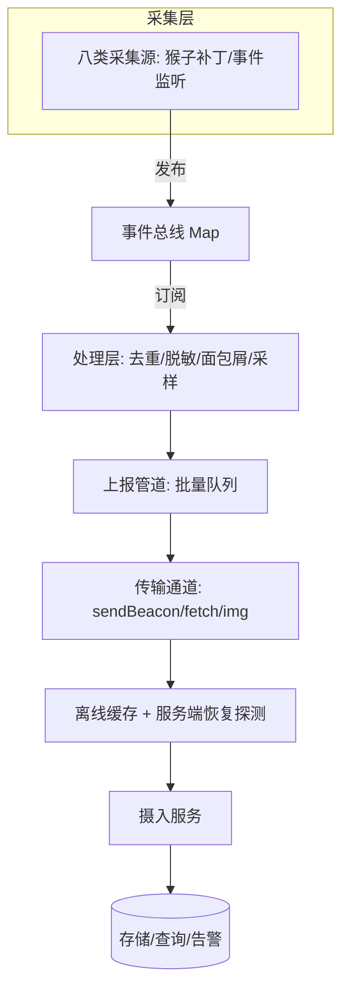

**系统设计型**示范答案。以「设计一个前端监控系统」为题，给出可复述的设计骨架，并用真实项目 `yukino-sentry`（`@yukino.js/sentry`，HEAD `75500f8`）作为参照实现。每个设计决策标注 ✅ **项目事实**（源码实读）或 ⚠️ **推导**（通用设计）。

## 事实基线

| 事实依据 | 内容                                                                                                                                                                                                |
| -------- | --------------------------------------------------------------------------------------------------------------------------------------------------------------------------------------------------- |
| 参照实现 | `~/github/yukino-sentry/sentry` @ `75500f8`（框架无关浏览器监控 SDK：错误/HTTP/PV/性能/点击/曝光/白屏/录屏八类采集、发布订阅总线、批量上报、离线缓存、W3C traceparent 全链路、React/Vue/Node 接入） |
| 源码笔记 | `content/fe/yukino-sentry.md`，frontmatter `local_commit` 与本机 HEAD 一致                                                                                                                          |
| 深挖题库 | [前端监控 SDK 题库](/interview/qa/frontend-monitoring-sdk)（90 题，对照 data.md 与 yukino-sentry 源码）                                                                                             |

:::note 答题节奏
先澄清「前端监控要监控什么、数据量多大、隐私边界」，再给四层架构，然后深入「上报管道」与「全链路 trace」两个核心难点，最后讲体积治理与取舍。
:::

---

## 一、需求澄清（开口必做）

**功能需求**（要监控什么）：JS 运行时错误与资源加载错误、未处理 Promise 拒绝、HTTP 请求、页面浏览与停留时长、性能指标（Web Vitals、导航/资源计时、长任务、首屏、内存）、用户行为（点击、曝光）、白屏检测、错误前操作录屏。

**非功能需求**（要主动问）：

| 维度   | 要澄清的问题                           | 对设计的影响                              |
| ------ | -------------------------------------- | ----------------------------------------- |
| 数据量 | DAU 多少、每页多少事件、上报 QPS 多少  | 决定批量上报、采样、存储成本              |
| 延迟   | 错误要实时还是要能容忍分钟级           | 决定传输通道（beacon vs fetch）与批量策略 |
| 隐私   | 能否采集用户输入、URL 参数、录屏       | 决定脱敏规则与合规边界                    |
| 可靠性 | 页面卸载/弱网/服务端宕机时数据要不要保 | 决定离线缓存、keepalive、服务端恢复探测   |
| 体积   | SDK 预算多少 KB                        | 决定插件化、按需加载、tree-shaking        |

✅ **项目事实**：yukino-sentry 采集**八类来源**（JS/资源错误、未处理拒绝、console.error；XHR/fetch；PV 与停留时长；性能指标；声明式点击；元素曝光；白屏检测；错误前录屏），所有事件携带 W3C Trace Context 的 `traceId`，被监控的出站请求注入 `traceparent` 头，与 Node 入口的 `continueTrace` 配合把前端报错与后端故障串成同一条链路。

## 二、核心挑战：前端监控的独特难点

⚠️ **推导**（要主动讲，这是前端监控区别于后端监控的难点）：

1. **采集不能影响业务**：监控代码跑在业务页面里，拦截 XHR/fetch/路由的猴子补丁必须轻量、无副作用、可卸载。
2. **页面生命周期短暂**：页面随时可能卸载/跳转，上报必须在卸载前发出（beacon/keepalive），否则数据丢失。
3. **弱网与离线**：用户在弱网/离线时产生的数据要缓存、恢复后补传。
4. **体积敏感**：SDK 在每个页面加载，体积直接影响首屏，必须插件化 + 按需加载。
5. **隐私合规**：采集用户行为/录屏要脱敏、要可控。

**采分点**：能说出「**前端监控的五大独特难点（不影响业务、生命周期短暂、弱网离线、体积敏感、隐私合规）**」——这是这道题的核心认知。

## 三、高层架构：采集-处理-上报-存储

✅ **项目事实**：yukino-sentry 的分层是「Public API / Core / Node 入口 / Reporter / Plugins / Framework 接入 / 构建期集成 / Utils」。四条设计原则：① **采集与处理通过事件总线完全解耦**；② **性能、录屏、曝光这类重能力做成插件按需加载**；③ **核心不依赖任何前端框架，框架集成放在独立入口**；④ **多出口构建，每个入口提供 ESM/CJS/类型声明三套产物，框架依赖是可选 peer**。

**采分点**：能说出「**采集与处理用事件总线解耦 + 重能力插件化按需加载 + 核心框架无关**」——这是监控 SDK 可扩展性的三个关键设计。

## 四、采集层设计

✅ **项目事实**：采集靠**猴子补丁**（拦截 XHR/fetch/History/HashChange）+ 事件监听（error/unhandledrejection/click）。事件总线是 `Map<EventType, Set<TEventHandler>>` 的发布订阅——采集方只管发布原始事件，不关心后续是上报、留面包屑还是触发录屏；一个事件可同时驱动多个消费者；采集层与处理层可分别测试；单处理器异常被隔离。

⚠️ **推导**（猴子补丁的陷阱）：① 必须保存原始函数引用、销毁时还原（否则多次 init 会叠加拦截）；② 拦截要透传原始行为（不能改变业务请求的语义）；③ 要处理「补丁之后其他库也补丁」的顺序问题。

## 五、上报管道设计（核心难点，深入讲）

✅ **项目事实**：上报管道是「入队 → 批量 → 传输 → 离线缓存」：

- **批量聚合**：事件入队后按批聚合，减少请求数；错误类事件可去重（相同错误短时间内只报一次）。
- **传输通道选择**：`sendBeacon`（页面卸载时可靠，但只能 POST、有约 64KB 在途预算）、`fetch`（可设 `keepalive`，但**只在载荷不超过 60KB 时设置**，因为浏览器对 keepalive 请求有约 64KB 在途预算，超限会被拒绝且失败请求会卡在队列头部）、`img`（兜底）。载荷字节数用 `TextEncoder` 实测而非字符串长度（多字节字符不会被低估）。
- **同步快路径**：无异步钩子时，整条管道从入队到传输层必须保持同步——**一个无条件 `await` 即使面对同步返回值也会强切一个微任务**，而页面隐藏时触发的停留时长上报等不起这个微任务（页面可能在回调恢复前就被销毁，beacon 永远发不出去）。所以用「是否 Promise」的守卫代替无条件等待。
- **离线缓存与服务端恢复**：区分「客户端离线」与「服务端不可达」两种故障；非 2xx 触发失败回插与服务端恢复探测；离线数据本地镜像，恢复后补传。
- **上报器单例懒加载**：以代理对象导出，首次属性访问才实例化——因为构造会注册在线/离线监听并从本地存储恢复上个会话的离线数据，若在模块加载时就实例化，副作用会早于初始化应用配置。

**采分点**：能说出「**keepalive 有 64KB 在途预算所以只在 ≤60KB 时设置 + 同步快路径避免微任务导致卸载时 beacon 发不出 + 上报器懒加载避免副作用早于配置**」——这三个是上报管道最容易踩的坑，答出来说明真做过。

## 六、全链路 Trace：用一个 traceId 串起前后端

✅ **项目事实**：全链路 trace 是「**浏览器页面视图是 trace 的根**」——同一页面视图内所有事件共享一个 traceId；被监控的出站请求注入 `traceparent` 头（W3C Trace Context）；Node 入口用 `continueTrace` 还原请求上下文（基于 AsyncLocalStorage），把前端报错与后端故障串成同一条链路；查询时一个 traceId 拉出整条链路。

**采分点**：能说出「**浏览器页面视图是 trace 根 + traceparent 注入出站请求 + Node 用 continueTrace/AsyncLocalStorage 续接**」——这是「前端监控如何与后端 APM 打通」的完整答案。

## 七、错误处理：去重、fingerprint、sourcemap 反解

✅ **项目事实**：错误采集的关键处理：

- **去重**：相同错误短时间内只报一次（error-dedup），避免错误风暴。
- **面包屑**：只附加到六类错误事件（JS 错误、未处理拒绝、资源错误、Vue、React、其他框架），因为它是故障前的操作轨迹；若给每条批量事件都带上，载荷体积会成倍放大且没有诊断价值。容量按 `maxBreadcrumbs` 保留最新若干条。
- **sourcemap 反解**：生产代码是压缩的，堆栈是混淆的行列号，需要 sourcemap 反解到源码行（构建期集成 Vite/webpack dev-server mock + Source Map 反解）。

⚠️ **推导**（fingerprint 聚合）：同一根因的错误（不同用户、不同参数）应聚合成一个 issue（fingerprint），否则告警会被海量相似错误淹没。fingerprint 通常取「错误类型 + 消息模板 + 关键堆栈帧」。

## 八、性能与体积治理

✅ **项目事实**：体积治理靠：① **插件化按需加载**——性能、录屏、曝光是插件，不启用就不进产物；② **核心框架无关**——React/Vue 集成是独立入口，不用就不装（可选 peer）；③ **多出口构建**——每个入口提供 ESM/CJS/类型声明三套产物，支持 tree-shaking。

⚠️ **推导**（采样）：高流量下要采样（错误全采、性能/行为按比例采），否则上报量爆炸。采样要在「数据完整性」与「成本」间权衡。

## 九、扩展性与取舍（主动讲）

✅ **项目事实**（要主动声明的边界）：

- **白屏检测不走总线**：由 setup 直接启动采样（视口采样点检测），因为它要在页面早期就判断，等总线初始化太晚。
- **录屏是重能力**：rrweb 滚动窗口录屏体积大，做成插件按需启用，且只录错误前的一段（滚动窗口）。
- **隐私边界**：采集用户输入/URL 参数要脱敏；录屏要可控（默认关闭或按需）。

**标准话术**：「前端监控的核心取舍是『采集不能影响业务 + 体积敏感 + 弱网可靠』。yukino-sentry 用事件总线解耦采集与处理、插件化按需加载控制体积、同步快路径 + keepalive 保证卸载时数据不丢、离线缓存 + 服务端恢复探测保证弱网可靠。这些都是在『监控能力』与『不影响业务/体积/性能』之间的权衡。」

---

## 追问链与应对

| 追问                           | 应对要点                                                                                |
| ------------------------------ | --------------------------------------------------------------------------------------- |
| 「猴子补丁会不会影响业务」     | 保存原始引用、透传原始行为、销毁时还原；拦截只做旁路观测不改变语义                      |
| 「页面卸载时数据怎么保证不丢」 | sendBeacon（卸载时可靠）+ fetch keepalive（≤60KB）+ 同步快路径避免微任务延迟            |
| 「弱网/离线数据怎么办」        | 离线缓存本地镜像 + 服务端恢复探测（HEAD 探测摄入服务），恢复后补传                      |
| 「错误风暴怎么去重」           | error-dedup 相同错误短时间内只报一次 + fingerprint 聚合同根因                           |
| 「sourcemap 怎么不泄漏源码」   | 生产用隐藏式 sourcemap（hidden），上传到监控服务但不发布到 CDN                          |
| 「SDK 体积怎么控制」           | 插件化按需加载 + 核心框架无关（可选 peer）+ tree-shaking + 多出口构建                   |
| 「全链路 trace 怎么跨前后端」  | 浏览器注入 traceparent 到出站请求，Node 用 continueTrace + AsyncLocalStorage 还原上下文 |
| 「白屏怎么检测」               | 视口采样点检测（判断视口内关键位置是否有有效元素），由 setup 直接启动不走总线           |

---

**延伸阅读**

- [前端监控 SDK 题库](/interview/qa/frontend-monitoring-sdk)：yukino-sentry 实现的 90 题深挖（rrweb 现场还原、componentStack、sourcemap 反解、全链路 trace）。
- [前端监控与可观测性题库](/interview/qa/frontend-observability)：前端可观测性的通用原理。
- [Yukino Agent Go Eino 运维 Agent 项目深挖示范答案](/interview/answers/yukino-agent-project)：监控桥如何把前端上报转成 Prometheus 指标（前端监控的服务端消费侧）。
- [实时 IM 系统设计示范答案](/interview/answers/realtime-im-system-design)：另一套系统设计型示范（实时 IM 方向）。
- [多租户 Agent 宿主系统设计示范答案](/interview/answers/multi-tenant-agent-host-design)：另一套系统设计型示范（多租户 Agent 方向）。
- [指标口径与基线定义](/interview/metrics-baseline)：监控指标的证据纪律。
