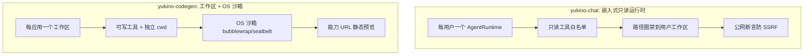

**系统设计型**示范答案。以「设计一个多租户 AI Agent 宿主（让多个用户安全共享一个 coding agent 能力）」为题，给出可复述的设计骨架，并用两个真实项目作参照——`yukino-chat`（每用户内嵌只读 Agent，HEAD `555f625`）与 `yukino-codegen`（每应用可写工作区 + OS 沙箱，HEAD `da904a2`）。每个设计决策标注 ✅ **项目事实**（源码实读）或 ⚠️ **推导**（通用设计）。

## 事实基线

| 事实依据   | 内容                                                                                                                                                                                                                               |
| ---------- | ---------------------------------------------------------------------------------------------------------------------------------------------------------------------------------------------------------------------------------- |
| 参照实现 A | `~/github/yukino-chat` @ `555f625`：自托管 IM，每用户内嵌一个**只读** Yukino Agent（库形式同进程），实读确认 `applyReadOnlyPolicy`/`containReadTools`/`assertPublicHttpUrl`/`FORK_DISALLOWED_TOOLS`/`sweepConnections` 存在        |
| 参照实现 B | `~/github/yukino-codegen` @ `da904a2`：AI 代码生成平台，每应用一个**可写**工作区 + OS 沙箱构建，实读确认 `claimTurn`/`TurnGate`/`AGENT_MAX_CONCURRENT_TURNS=4` 存在                                                                |
| 深挖题库   | [Yukino Chat 项目深挖](/interview/qa/yukino-chat-project)（92 题）、[Yukino Codegen 项目深挖](/interview/qa/yukino-codegen-project)（90 题）、[Yukino Code 多代理协作与宿主形态](/interview/qa/yukino-code-orchestration)（95 题） |

:::note 答题节奏
先澄清「多租户 Agent 宿主」与普通多租户 SaaS 的**本质区别**（租户跑的是能执行代码、读写文件、发网络请求的 Agent，不是无状态 CRUD），再给两种参照架构，然后深入「隔离」与「并发准入」两个核心难点，最后讲扩展性与取舍。
:::

---

## 一、需求澄清（开口必做）

**功能需求**：每个用户/应用拥有一个 Agent 实例，能对话、执行工具、（可选）写代码与构建预览；用户之间互不可见、互不干扰。

**非功能需求**（要主动问）：

| 维度         | 要澄清的问题                                     | 对设计的影响                                 |
| ------------ | ------------------------------------------------ | -------------------------------------------- |
| **能力边界** | Agent 要不要写文件/执行命令？还是只读调研？      | 决定「只读圈禁」还是「可写沙箱」两种隔离模型 |
| **隔离强度** | 租户间要防到什么程度（误操作 / 恶意攻击 / 合规） | 决定路径圈禁、网络出口、进程/容器隔离的强度  |
| **规模**     | 同时多少租户、每租户 QPS、Agent 运行时多重       | 决定单实例内存态还是分布式 + 粘性路由        |
| **生命周期** | Agent 运行时是长驻还是按请求创建                 | 决定空闲驱逐、心跳、再水化策略               |

✅ **项目事实**：两个参照项目代表了能力边界的两端——**yukino-chat 选「只读」**（每用户 Agent 被收敛为只读工具，禁锢在独立工作区），**yukino-codegen 选「可写」**（每应用 Agent 在独立工作区写代码 + OS 沙箱构建）。**面试时先讲清这个分叉：能力边界决定隔离模型**。

## 二、核心挑战：多租户 Agent 宿主难在哪

⚠️ **推导**（这是与普通多租户 SaaS 的本质区别，要主动讲）：普通 SaaS 的租户隔离主要是**数据隔离**（行级/库级）；但 Agent 宿主的租户跑的是**能执行代码、读写文件、发网络请求的自治循环**，所以隔离要覆盖四个维度：

1. **数据隔离**：租户 A 的 Agent 不能读到租户 B 的文件/会话。
2. **执行隔离**：租户 A 的 Agent 执行的代码/命令不能破坏宿主机或影响租户 B。
3. **资源隔离**：租户 A 不能占满 CPU/内存/模型配额，饿死租户 B。
4. **能力隔离**：租户 A 的 Agent 能力边界（能调哪些工具、能写哪里、能访问哪些网络）要被约束。

**采分点**：能说出「**Agent 宿主的隔离是四维的（数据/执行/资源/能力），比普通 SaaS 的数据隔离难得多**」——这是这道题的核心认知，答出这点就超过了大多数候选人。

## 三、两种参照架构

✅ **项目事实**：

- **yukino-chat（嵌入式只读）**：以库形式（`@yukino.js/yukino` 的 `Remote.Server` 面）把完整 coding agent 栈嵌入服务进程，每用户一个运行时、独立工作区、**只读工具策略**。与桌面/终端形态的关键差异在于**多用户隔离**——能力不打折，但边界靠三层叠加。
- **yukino-codegen（工作区 + 沙箱）**：每应用一个可写工作区（`tmp/code_output/<appId>`），Agent 在文件系统迭代写代码，再在 **OS 沙箱**（Linux bubblewrap / macOS seatbelt）内构建，产物经能力 URL 发布为静态预览。

**采分点**：能说出「**只读圈禁适合『能力不打折但要绝对安全』的聊天宿主，可写沙箱适合『要真正改代码』的生成平台**」——两种模型对应两种产品形态。

## 四、租户隔离的四个维度（深入讲）

### 4.1 能力隔离：只读圈禁的三层（yukino-chat）

✅ **项目事实**：`applyReadOnlyPolicy` 在句柄就绪时一次性施加，由 `read-only-tools.ts` 实现三层隔离：

1. **工具白名单**：`handle.toolFilter` 只放行读类工具（ReadFile/Glob/Grep/WebFetch/ToolSearch/McpCall/LoadSkill/AskUserQuestion 等）+ 全部 `mcp__*`（仍受权限 broker 把关）；写/命令类工具（Bash/EditFile/WriteFile/worktree/团队/子代理派生）从模型可见面与执行面同时消失。**EnterPlanMode/ExitPlanMode 也被排除**（它们会翻转权限模式、破坏「永远只读」的不变量）。
2. **路径圈禁**：Yukino 自身权限层只对**写**做路径沙箱、读是放行的，所以 `containReadTools` 把 ReadFile/Glob/Grep 重新注册为带守卫的包装版——路径按「展开 `~`、解析符号链接、判包含关系」归一化后必须落在本用户工作区内，Glob 还拒绝绝对路径与 `..` 段。**没有这层，一个 ReadFile 就能读到隔壁用户工作区或宿主机的 `~/.yukino/config.yaml`**。
3. **网络与 fork 出口**：WebFetch 先过自建公网断言 `assertPublicHttpUrl`（只允许 http/https、拒绝内嵌凭据、DNS 解析后逐个地址判 `isPublicIpAddress`，拒绝环回/私网/链路本地/保留段）堵 SSRF；fork 模式的技能子代理通过 `FORK_DISALLOWED_TOOLS`（14 个写/命令工具）剥掉同一组能力并复用被包装的注册表——**委派不成为写的逃生舱**。

**采分点**：能说出「**只读圈禁是三层叠加（工具白名单 + 路径圈禁 + 公网断言），且 fork 子代理继承同一约束**」——这是「多用户宿主如何安全内嵌能力不打折的 coding agent」的完整答案。

### 4.2 执行隔离：OS 沙箱（yukino-codegen）

✅ **项目事实**：可写场景下，生成代码**从不在服务器进程内执行**，构建跑在 OS 沙箱子进程里（Linux bubblewrap + 用户命名空间、macOS seatbelt），**沙箱不可用时直接抛错不执行（fail-closed）**。两个硬安全线：

- **环境变量白名单**：构建子进程只拿 PATH/LANG/TERM，HOME/TMPDIR/npm_config_cache 全指向 scratch 目录，**不继承服务器进程环境**——数据库连接串、会话密钥、模型 API key 都不会泄漏进不可信项目的生命周期脚本。
- **进程组回收**：子进程 detached spawn，中止/超时/退出时对整个进程组（`-pid`）发 SIGKILL，收掉构建脚本留下的后代进程。

⚠️ **推导/需澄清**：**OS 沙箱是写路径限制而非虚拟机或完整多租户隔离边界**——托管不可信项目时应以专用 OS 账户或容器（甚至 microVM 如 Firecracker）运行服务。这是要主动声明的边界，不能夸大为「完全隔离」。

### 4.3 数据隔离

✅ **项目事实**：yukino-chat 每用户独立工作区（`.yukino/chat/<uid>`）+ 数据库会话行按 userId 唯一约束；yukino-codegen 每应用独立工作区（`tmp/code_output/<appId>`）+ 运行时按 `${ownerId}:${appId}` 键控。数据隔离靠「每租户独立工作区目录 + 数据库行级归属」。

### 4.4 资源隔离

✅ **项目事实**：yukino-codegen 用 **TurnGate 进程级并发准入**（`AGENT_MAX_CONCURRENT_TURNS=4`）+ **用户公平调度**（优先唤醒与上一个被准入者不同用户的等待者，防止单用户占满全局名额）——这是「模型配额」维度的资源隔离。

## 五、资源生命周期与心跳驱逐

✅ **项目事实**（yukino-chat）：Agent 运行时是长生命周期对象，空闲回收由 30 秒定时器扫描，每轮先做**连接心跳**（`sweepConnections`）：超过 75 秒没见过任何帧/pong 的 socket 直接 `terminate()`，其余逐个协议层 ping。心跳之后，运行时若既不在忙、连接数为 0、且空闲超过阈值（默认 30 分钟）就释放。

**心跳是驱逐正确性的前提**——浏览器标签页被杀掉时不发 close 帧，若不回收，它的连接槽会让 `connectionCount` 永远大于 0，整个用户运行时（连同 agent 句柄）就**永久泄漏**。

**采分点**：能说出「**心跳先于空闲驱逐，否则被杀标签页的连接槽会让运行时永久泄漏**」——这是「长生命周期 Agent 与易断浏览器连接共处」的核心正确性约束。

## 六、并发与准入：claimTurn + TurnGate

✅ **项目事实**（yukino-codegen）：多实例下同一工作区的轮次不能并发执行，用两层：

- **claimTurn 跨节点互斥**：一条原子 SQL（`updateMany` 把会话状态从 IDLE 置为 RUNNING，条件是 `status=IDLE` 或 `status=RUNNING` 但 `lastActiveTime` 早于 `AGENT_TURN_CLAIM_STALE_MS`）抢占执行权——**用数据库行级原子性替代分布式锁**，后半条件回收崩溃节点留下的「僵死 RUNNING」。
- **TurnGate 进程级准入**：上限 `AGENT_MAX_CONCURRENT_TURNS=4`，带用户公平调度。

**采分点**：能说出「**claimTurn 用原子 updateMany + 僵死回收替代分布式锁（跨节点），TurnGate 做进程级并发上限 + 用户公平（单节点）**」——两层分别管「分布式互斥」与「资源配额」。

## 七、安全边界（汇总）

| 边界     | yukino-chat（只读）                       | yukino-codegen（可写）                                 |
| -------- | ----------------------------------------- | ------------------------------------------------------ |
| 工具能力 | 只读白名单（写/命令工具消失）             | 可写工具 + 权限模式（默认 bypassPermissions 无人值守） |
| 文件路径 | containReadTools 圈禁到用户工作区         | 工作区独立 + 沙箱写路径限制                            |
| 网络出口 | assertPublicHttpUrl 防 SSRF               | 沙箱网络可关 + 能力 URL 不读 cookie                    |
| 凭据     | 配置只读挂载                              | MCP 凭据 AES-256-GCM 加密、前端只给 hasHeaders/hasEnv  |
| 执行     | 不执行代码（只读）                        | OS 沙箱 + 环境白名单 + 进程组回收                      |
| 提示注入 | 工具描述/网页内容不可信，只读限制爆炸半径 | 生成代码不可信，沙箱隔离                               |

⚠️ **推导**：**prompt 注入是多租户 Agent 宿主的特有攻击面**——被污染的文件内容/网页可能诱导模型执行恶意动作。只读模型把爆炸半径限制在「读」，可写模型靠沙箱限制「写」与「执行」。两者都不能完全消除注入，只能限制其能力边界。

## 八、扩展性：单实例 → 多实例

✅ **项目事实**：yukino-chat 是单实例（连接表、Agent 运行时表、限流桶都在进程内存）。要做多实例需先解决：① 把 Agent 运行时**按用户做粘性路由**或外置会话；② 把限流桶换成共享计数器；③ 跨实例的连接扇出。yukino-codegen 已经用 claimTurn 做了跨节点轮次互斥，但运行时仍是进程内长驻（多实例需要粘性路由把同一工作区的请求路由到同一实例）。

⚠️ **推导**：多租户 Agent 宿主的多实例难点在于「**运行时是有状态的长驻对象**」（工作区、上下文、MCP 连接、沙箱会话），不像无状态 CRUD 可以任意路由。两条路：粘性路由（简单但牺牲故障转移）或运行时外置（把会话/上下文存共享存储，运行时按需重建，复杂但可弹性扩缩）。

## 九、取舍与边界（主动讲）

✅ **项目事实**（要主动声明的边界）：

- **yukino-chat**：单实例、无 TLS（需 Nginx 之前终结）、改密无验证（公网暴露前必须加）——「内网自托管」定位下的自觉取舍。
- **yukino-codegen**：OS 沙箱不是完整多租户隔离边界（托管不可信项目应用专用账户/容器）、权限默认 bypassPermissions（无人值守生成，需人工把关时切 default/plan）、可观测性目前只有 token 用量。

**标准话术**：「两个项目都做了明确的隔离，但都有自觉的边界——yukino-chat 的只读圈禁保证『能力不打折但绝对只读』，yukino-codegen 的 OS 沙箱保证『写路径受限但不是虚拟机级隔离』。要做公网多租户、托管完全不可信的代码，需要升级到专用账户/容器/microVM，并补 TLS、鉴权、可观测性。」

**采分点**：主动讲边界与取舍，比假装「我的设计完美隔离」可信得多——这正是 [指标口径与基线定义](/interview/metrics-baseline) 强调的证据纪律。

---

## 追问链与应对

| 追问                                                | 应对要点                                                                                                                    |
| --------------------------------------------------- | --------------------------------------------------------------------------------------------------------------------------- |
| 「为什么 yukino-chat 选只读而不是沙箱」             | 聊天宿主的 Agent 是「一等聊天参与者」，主要做调研/问答，只读圈禁能保证「能力不打折但绝对安全」，且无需承担沙箱的运维复杂度  |
| 「路径圈禁为什么要解析符号链接」                    | 否则用 `ln -s /etc/passwd ~/workspace/x` 就能绕过包含检查——必须 realpath 解析后判包含                                       |
| 「assertPublicHttpUrl 为什么要 DNS 解析后逐地址判」 | 防 DNS rebinding 与「域名解析到内网 IP」的 SSRF——只看域名不够，要解析后逐个 IP 判 isPublicIpAddress                         |
| 「claimTurn 为什么不用 Redis 锁」                   | 原子 updateMany 已经是数据库行级互斥，无需额外组件；僵死回收靠 lastActiveTime 超时，比锁 TTL 更贴合「轮次」语义             |
| 「运行时泄漏怎么排查」                              | 心跳驱逐（75 秒无帧 terminate）+ 连接槽计数 + 空闲阈值；泄漏的根因通常是「被杀标签页不发 close 帧导致连接槽虚高」           |
| 「fork 子代理为什么要继承只读约束」                 | 否则委派成为「写的逃生舱」——子代理另起一套不受限工具面就绕过了父代理的只读圈禁                                              |
| 「多实例下运行时怎么路由」                          | 粘性路由（按用户/应用哈希到固定实例）或运行时外置（会话存共享存储、运行时按需重建）——前者简单牺牲故障转移，后者复杂但可弹性 |

---

**延伸阅读**

- [Yukino Chat 自托管 IM 与内嵌 Agent 项目深挖题库](/interview/qa/yukino-chat-project)：只读圈禁三层隔离的 92 题深挖。
- [Yukino Codegen AI 代码生成平台项目深挖题库](/interview/qa/yukino-codegen-project)：工作区 + OS 沙箱 + claimTurn/TurnGate 的 90 题深挖。
- [Yukino Code 多代理协作、权限与宿主形态题库](/interview/qa/yukino-code-orchestration)：权限多层短路、OS 沙箱、宿主形态的 95 题深挖。
- [实时 IM 系统设计示范答案](/interview/answers/realtime-im-system-design)：另一套系统设计型示范（实时 IM 方向）。
- [Agent 沙箱与 JS 运行时题库](/interview/qa/agent-sandbox-autofix)：OS 沙箱、构建与自动修复的通用原理。
- [指标口径与基线定义](/interview/metrics-baseline)：量化结论与边界声明的证据纪律。
