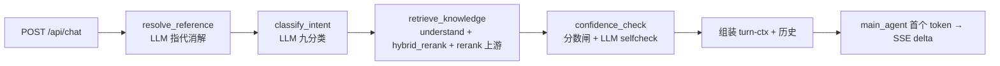

语料、参数依据、评估与延迟四条主线。核心纪律：**参数是源码默认常量、报告未归档、SSE 不降低 TTFT**，不把推导讲成项目已做。

## 事实基线

沿用[电商 RAG 项目深挖](/interview/answers/ecomm-rag-project)的核对结果：`content/docs/yukino-ecomm-agent/` 9 篇（frontmatter `local_commit: b160dff`），本机检出 `$HOME/github/yukino-ecomm-agent` HEAD `c90c843`；6 份 md、实测 **74 条 chunk**、`tests/data/eval_rag.jsonl` **300 行**、`data/rag/reports/` **未提交**。

本页补充核对：

| 事实                                                                                                                                                            | 事实依据                                                       |
| --------------------------------------------------------------------------------------------------------------------------------------------------------------- | -------------------------------------------------------------- |
| 6 份 md 的 contentType 映射与四类描述                                                                                                                           | `server/src/kb/sources.ts`（源码实读）                         |
| `buildChunks(md, contentType, chunkSize=400, overlap=60, tableMaxRows=10)` 是**函数默认参数**，调用点 `api/kb.ts` / `scripts/kb-build.ts` 都只传 `(raw, ctype)` | `server/src/kb/documents.ts` + 全 `src/` 检索无配置化          |
| 无 chunk 相关环境变量                                                                                                                                           | `server/src/config.ts`（对照项目深挖已核对的三槽位与检索常量） |

:::danger 依据缺口
Q3（分块长度谁定）与 Q4（rerank 效果有多好）都指向同一问题：**参数与效果缺少可复现的依据**。源码里 400/60/10 是开发者写死的默认值，没有消融实验；`data/rag/reports/` 未归档，rerank 增量没有可引用的具体数值。下面用 ✅ 事实 / ⚠️ 推导 标清。
:::

---

## Q1 · 知识库放的是哪些内容？

✅ **6 份演示领域文档**（`server/data/kb/`），由 `sources.ts` 的 `SOURCE_TYPES` 映射：

| 文件                    | contentType | 内容定位（`CONTENT_TYPE_DESC` 源码原话）          |
| ----------------------- | ----------- | ------------------------------------------------- |
| `product-faq.md`        | `faq`       | Product FAQ，**questions 存真实用户问法**         |
| `returns-policy.md`     | `policy`    | 政策条款，questions 存小节标题、category 存父路径 |
| `after-sales-manual.md` | `manual`    | 售后手册，按标题层级切分                          |
| `product-specs.md`      | `spec`      | 产品参数，**含具体型号串，精确词面召回依赖它**    |
| `member-benefits.md`    | `policy`    | 会员权益                                          |
| `billing-shipping.md`   | `policy`    | 计费与配送                                        |

`CONTENT_TYPES = ["faq", "policy", "manual", "spec"]`。**实测 74 条 chunk**（11/6/6/18/22/11）。

✅ **另有两类动态写回的 chunk**（`documents.ts`）：

- `approvedReviewChunk`：`category=flywheel_review`、`contentType=faq` —— 低置信问题经人工审核后的答案写回。
- `approvedStagingChunk`：`category=conversation_history`、`contentType=mined`、`sectionPath=mined` —— 历史会话挖掘出的问答对，审核后写回。

✅ **被向量化的是什么**：只有 `category\nquestions\nanswer` 三段拼接（与 Milvus `text` 字段同一字符串）。`sectionPath` / `contentType` / `isKeyClause` / `prevChunkId` / `nextChunkId` 都是元数据，**不进 embedding**。`KEY_TERMS`（refund / warranty / shipping fee 等）标关键条款，参与置信度信号。

> ⚠️ 边界：这是**演示语料**，不是生产规模。面试官问「多少文档」时主动说明「6 份、百级 chunk，结论不能外推到百万级」。

## Q2 · 文档如何分块？

✅ 两阶段（`chunking.ts` + `documents.ts`）：

1. **`splitSections`**：正则 `/^(#{1,4})(?:\s+(.*))?$/` 按 h1–h4 切小节，维护标题栈产出 `sectionPath`；**代码围栏（``` 或 ~~~）整体扫描**，围栏内的 `#` 不误判为标题。
2. **`buildChunks`**：
   - 表格块（`|` 表头 + `|---|` 分隔线识别）→ `splitTableRows` 按行切，**每组 10 行数据且每组复制表头**，表格前引导文字只跟第一组。
   - 非表格文本 → `RecursiveCharacterTextSplitter`（`chunkSize=400`、`chunkOverlap=0`、`keepSeparator`），分隔优先级：空行 → 换行 → 中文句读 → 英文标点 → 中文逗号 → 空格 → 字符。
   - 再 `applySentenceOverlap` 加 **60 字符句子级 overlap**：从前一块尾部按完整句子回卷（句读 `.。！？!?…` 和换行），**不截半个句子**；单句超预算也至少带一句。
3. **结构化 chunk**：`category`（父路径）、`questions`（末级标题）、`answer`（正文）、`sectionPath`、`contentType`、`isKeyClause`；`insertKnowledgeChunks` 在事务内回填 `prevChunkId/nextChunkId` 串成双向链表。

> **为什么这样切**（`rag.md:34-46` 的通用理由）：结构感知切分保留章节语义；表格复制表头避免跨块丢列；overlap 按句而非按字数，避免半个句子变噪音。

## Q3 · 每一块多大？分块长度怎么定？谁来定？

✅ **事实**：

| 参数           | 值                                                           | 出处                                     |
| -------------- | ------------------------------------------------------------ | ---------------------------------------- |
| `chunkSize`    | **400 字符**                                                 | `documents.ts` 的 `buildChunks` 默认参数 |
| `overlap`      | **60 字符**（句子级）                                        | 同上                                     |
| `tableMaxRows` | **10 行/块**                                                 | 同上                                     |
| 检索配套       | `RECALL_TOP_K=50`、`RERANK_TOP_K=10`、`RERANK_MIN_SCORE=0.3` | `rag.md`                                 |

⚠️ **「谁来定」的诚实答案**：这三个值是**开发者在源码里写死的默认常量**——调用点 `api/kb.ts`、`scripts/kb-build.ts` 都只传 `(raw, ctype)`，全 `src/` 检索不到 chunk 相关环境变量或配置项。知识库文档给出了**定性的设计理由**（结构感知、句子级 overlap、表格复制表头），但**没有 400/60 的参数消融实验，也没有「为什么不是 300/500」的数据依据**。这又是一个「依据缺口」，不要编「我们对比了多种切分长度」。

⚠️ **如果重做，应该怎么定（推导，明说是设计思路）**：

| 约束     | 判断依据                                                                                                                                    |
| -------- | ------------------------------------------------------------------------------------------------------------------------------------------- |
| 上限     | embedding 模型的输入 token 上限与向量化成本；本项目向量化文本是 `category+questions+answer`，实际长度要按三段合计估                         |
| 下限     | 单个 chunk 要能**独立回答一个问题**；切太碎会丢条件、丢型号、丢表格列                                                                       |
| 结构优先 | 标题/表格边界是天然语义边界，**先按结构切，长度只作兜底**，不能让固定字数切断一条政策条款                                                   |
| 定量调优 | 用固定 300 条评测集做 `chunkSize × overlap × topK` 网格，看 **Recall@5 / MRR / 证据覆盖率**的拐点，同时看答案覆盖率与 faithfulness 是否劣化 |
| 联动     | chunk 大小与 `RECALL_TOP_K` / `RERANK_TOP_K` / 上下文预算（`EVIDENCE_TOKENS_PER_CHUNK=160 × 10`）是**一组参数**，单独调一个没有意义         |

## Q4 · 重排序效果好吗？怎么评估？

✅ **评估机制是定量的**（`observable.md` / `scripts/eval-rag.ts`）：

| 项       | 内容                                                                                                                                            |
| -------- | ----------------------------------------------------------------------------------------------------------------------------------------------- |
| 对照设计 | 4 策略 × 4 问题桶（A_policy / B_model / C_colloquial / E_multi）+ D_absent 只测拒答；**`hybrid` 与 `hybrid_rerank` 的差值就是 rerank 的净增量** |
| 检索指标 | `Recall@5`、`MRR`（按期望 section 在 top-10 中的排名算，确定性可复现）；每策略 top-10；最佳策略按 **overall MRR** 选出                          |
| 证据层   | **证据覆盖率** = 标准答案关键点在 top-10 证据文本中的子串匹配比例，**不经过 LLM**，可复现                                                       |
| 生成层   | 答案覆盖率由 LLM 评审数关键点；`faithfulness` 只对生产策略 `hybrid_rerank` 评（`FAITHFULNESS_PROMPT` + `temperature: 0`）                       |
| 拒答     | D_absent 走生产 `query_faq`，`sufficient=false` 记为正确拒答                                                                                    |
| 防假分数 | 生成阶段全部调用失败会**抛错拒绝记录零分**；部分失败在报告注明「scores use the available samples」                                              |

✅ **另有天然的开关式对照组**：`rag.md:235-244` 的 `rerankEnabled()` —— 缺 `RERANK_API_KEY` 时跳过 rerank，用 `scoreAsConfidence()` 把 top score 归一化成交给下游的 `rerank_score`。**开关 rerank + 同一评测集**就能直接量化增量，无需改代码。

⚠️ **「效果好吗」的诚实答案**：机制齐备，但 `data/rag/reports/rag_eval.json/.txt` 是运行时产物、**仓库未提交**，所以**没有可引用的具体分数**。正确说法是「用固定 300 条集做 hybrid 与 hybrid_rerank 对照，看 overall MRR 与证据覆盖率；报告 meta 带 `kb_chunks` 与 `chat_model` 便于对齐版本」，需要数字就调当时的报告或 `eval_run` 趋势表。

⚠️ **必须一起讲的代价**（面试官会追）：

- cross-encoder 更慢：单次 60s 超时、429/5xx 重试 3 次、退避 1.5s 起，是 **TTFT 的主要来源之一**（见 Q5）。
- 召回 50 → 精排 10 是**延迟换精度**；`arrangeHeadTail` 把第 2 名挪到尾部是利用首因/近因效应，但项目里**没有独立评测**这一步的增量。
- 精排分 `< 0.3` 视为证据不足，直接影响拒答率——所以 rerank 不只影响排序，还影响**置信度闸与兜底比例**。

## Q5 · 模型首字符返回时间（TTFT）太长怎么办？

✅ **先定位：项目里 TTFT 花在哪**（`workflow.md` 的 12 节点图 + `observable.md` 的 Langfuse trace 树）：



**关键事实**：`workflow.md` 写明 SSE 的 `delta` 只来自 `ANSWER_NODES`（**只有 `main_agent`**）的 token 增量；`script_reply` / `complaint_reply` / `fallback_reply` 是**一次性完整 answer**（确定性话术，不走模型）。所以 **首字符时间 = 一串前置串行 LLM/检索节点 + 生成模型首 token**，不是单纯「模型慢」。

✅ **定位手段（项目已有）**：Langfuse 双链路 tracing —— `graphCallbacks()` 让 langgraph 每个节点的输入/输出/耗时/token 成为 span；`recordTurn` 记整轮 `chat-turn`。**按 span 拆 TTFT，先找到最慢的那个节点再优化**，不要凭感觉调参。

⚠️ **优化手段（推导，按性价比排序）**：

| 优先级 | 手段                      | 说明 / 项目锚点                                                                                                                                                                                          |
| ------ | ------------------------- | -------------------------------------------------------------------------------------------------------------------------------------------------------------------------------------------------------- |
| 1      | **拆 span，找瓶颈**       | 用 Langfuse trace 看是 refer 分类、rerank 上游、还是生成模型排队                                                                                                                                         |
| 2      | **减少前置串行 LLM 调用** | 指代消解 / 意图分类 / 查询改写 / selfcheck 都是结构化小调用；可按条件跳过（如无上下文跳过 coref）、改用更小/更快的模型槽位（`resolveSlot` 支持按 slot 配 `INTENT_MODEL` 等）                             |
| 3      | **并行化能并行的**        | 查询改写的 `standard`/`expanded` 两路、多路召回；✅ 可迁移思路：`yukino-code` 的记忆 recall 用 **prefetch promise 与主请求并行**、`claude-code.md:92` 的**流式工具执行**把模型剩余输出与工具执行时间重叠 |
| 4      | **检索侧**                | 缩小 `RECALL_TOP_K=50`、对 rerank 加更紧的超时/降级、缓存高频 query 的检索结果；缺 rerank key 时项目已能降级（但会掉精度，需 A/B 验证）                                                                  |
| 5      | **prompt cache**          | 稳定 system / tools / 历史前缀；✅ `yukino-code.md:458` 的缓存优先取舍、99.4%→9.5% 实测                                                                                                                  |
| 6      | **产品层掩盖**            | SSE 已启用（`POST /api/chat`，一帧一行 `data:`，`[DONE]` 收尾）；可先推「正在查询知识库」等状态事件，让用户感知的首字节提前                                                                              |
| 7      | **上下文瘦身**            | `context.md` 的三层记忆与预算分账、`EVIDENCE_TOKENS_PER_CHUNK=160 × 10`；历史与证据越长，prefill 越慢                                                                                                    |
| 8      | **兜底**                  | 给前置链路设总超时，超时走确定性话术（项目已有 `FALLBACK_REPLY_TEXT`）而不是让用户干等                                                                                                                   |

> ⚠️ 区分两个指标：**TTFT**（首 token）与**总生成时长**。SSE 解决的是「让用户尽早看到字」，不减少总耗时；要降 TTFT 得动前置链路与 prefill。

## Q6 · 除了知识检索，还有哪些模块能减少模型幻觉？

✅ 按**模块**列（项目深挖已给出提示词视角，这里换成责任模块视角）：

| 模块                           | 机制                                                                                                                                                                                     | 出处                                      |
| ------------------------------ | ---------------------------------------------------------------------------------------------------------------------------------------------------------------------------------------- | ----------------------------------------- |
| **① 图编排（确定性路由）**     | 知识意图 `product_inquiry` **硬接** `retrieve_knowledge` 节点，检索不可能被跳过；宁可用 workflow 也不全交给 ReAct，理由之一就是「模型可能遗漏检索，凭参数记忆作答」                      | `workflow.md:36-41`                       |
| **② 置信度闸 + selfcheck**     | `score = 0.5·top1 + 0.2·valid/3 + 0.2·margin + 0.1·key` < `0.26` 判 weak；过闸后还有 LLM 自检，**调用失败一律按不足**；weak 直接走固定兜底话术，模型根本没机会编                         | `rag.md:246-255`、`observable.md:117-136` |
| **③ 提示词约束集**             | `AGENT_SYSTEM` / `RAG_ANSWER_SYSTEM` / `KNOWLEDGE_EVIDENCE_HINT`：严格基于证据、关键结论附 `[1][2]`、型号 verbatim、条件连条件说、证据不足拒答、禁止承诺时限与赔偿                       | `prompts.ts`（项目深挖已逐条核对）        |
| **④ 结构化输出 + schema 校验** | `structured()` 用 `withStructuredOutput(functionCalling)`，返回后再过 `zod parse`；失败重试 2 次；评测 judge 额外 `temperature=0`                                                        | `llm.md:56-66`                            |
| **⑤ 工具执行引擎**             | Ajv 按 JSON Schema 校验参数、失败返回「修正参数/先问用户/不要编造」；`injectUserId` / `injectConversation` **系统注入身份参数，不经过模型**；超时/重试/结果截断；`ToolAuditLog` 全程审计 | `llm.md:127-148`                          |
| **⑥ 机械闸门 model-guard**     | 答案里出现证据中不存在的型号串 → 检出并带修复提示重试一次，统计命中数与救回数                                                                                                            | `observable.md:79`                        |
| **⑦ 忠实度评审 + 幻觉台账**    | `FAITHFULNESS_SYSTEM` 七类豁免 + 两类高危编造 + 真实边界判例；不忠实样本写 `faith_case`（`unresolved/resolved/dismissed` + `seenCount` + reopened），形成「评审 → 处理 → 复评」          | `observable.md:103-107`                   |
| **⑧ 数据飞轮**                 | 低置信/点踩问题进池 → 人工三道闸门审核 → 审核答案写回知识库并立即向量化，下一轮可召回，减少「知识真缺失」导致的硬编                                                                      | `observable.md:109-171`                   |
| **⑨ 上下文与预算管理**         | 证据放尾部 turn-ctx 保前缀缓存、按块计预算防截断证据；摘要 prompt 要求「本批未提到的事实不得写入」防摘要漂移                                                                             | `context.md`、`yukino-ecomm-agent.md`     |
| **⑩ 确定性话术**               | `CHITCHAT_REPLY_TEXT` / `COMPLAINT_REPLY_TEXT` / `FALLBACK_REPLY_TEXT` **不经过 LLM**，闲聊/投诉/兜底零幻觉风险                                                                          | `llm.md:77`                               |
| **⑪ 可观测性与成本**           | Langfuse trace 树逐节点记录、`cost-report` 按意图聚合 token，让幻觉治理可定位、可回归                                                                                                    | `observable.md:26-35,93-97`               |

> **一句话**：减少幻觉不是「检索 + 一句提示词」，而是 **「确定性流程保证必检索 → 双门禁决定要不要生成 → 结构化输出与工具注入约束能写什么 → 机械闸门/评审/台账事后兜底 → 飞轮补知识缺口」** 的完整责任链。

---

## 三分钟口述版

> 知识库是 6 份演示 Markdown，映射成 faq/policy/manual/spec 四类，实测切出 74 条 chunk，另外还有人工审核与会话挖掘两类写回 chunk；被向量化的只有 `category+questions+answer`。分块先按 h1–h4 切小节，表格按 10 行一组复制表头，正文用 400 字符递归切分再加 60 字符句子级 overlap——**这三个值是源码默认常量，开发者定的，没有参数消融实验**，我会如实说。rerank 的评估是 4 策略消融，`hybrid` 与 `hybrid_rerank` 的差值就是增量，看 Recall@5/MRR、证据覆盖率、答案覆盖率与 faithfulness，还可用 `RERANK_API_KEY` 开关做天然对照；但报告未归档，具体分数我不会现场编。首字符慢要先拆 Langfuse span：图里 main_agent 之前的指代消解、意图分类、检索精排、selfcheck 全是串行，SSE 只让已生成的字尽早出现，降 TTFT 得减前置调用、并行化、稳住 prompt 前缀。防幻觉靠整条责任链：确定性路由保证必检索、双门禁决定要不要生成、结构化输出与工具注入约束内容、model-guard 与忠实度台账事后兜底、飞轮补缺口。

## 追问链

1. 400 字符切成 200 会怎样？（chunk 变多、语义更碎、条件与型号更易被切断；要连带调 topK 与上下文预算）
2. rerank 关掉后置信度公式还成立吗？（`scoreAsConfidence` 把 top score 归一化成 `rerank_score`，闸仍能工作但口径变了，必须重新校准阈值）
3. 为什么 `faithfulness` 只对生产策略评？（控制评测成本；但这样就无法横向比较各策略的忠实度）
4. 首字符慢但总时长正常，说明瓶颈在哪？（prefill 前的前置链路或排队，不是解码速度）
5. 把 selfcheck 去掉能省一次 LLM 调用，风险是什么？（弱证据直接进生成模型，兜底率下降、幻觉上升；需用拒答率与 faithfulness 验证）
6. 飞轮写回的新知识会不会把检索质量拖下水？（`eval-flywheel` 记录 4 指标趋势、相邻轮差 >0.005 标回归，就是防这个）

## 延伸阅读

[RAG 全链路](/interview/fundamentals/rag-pipeline) · [指标口径与基线定义](/interview/metrics-baseline) · [电商 RAG 项目深挖](/interview/answers/ecomm-rag-project)
