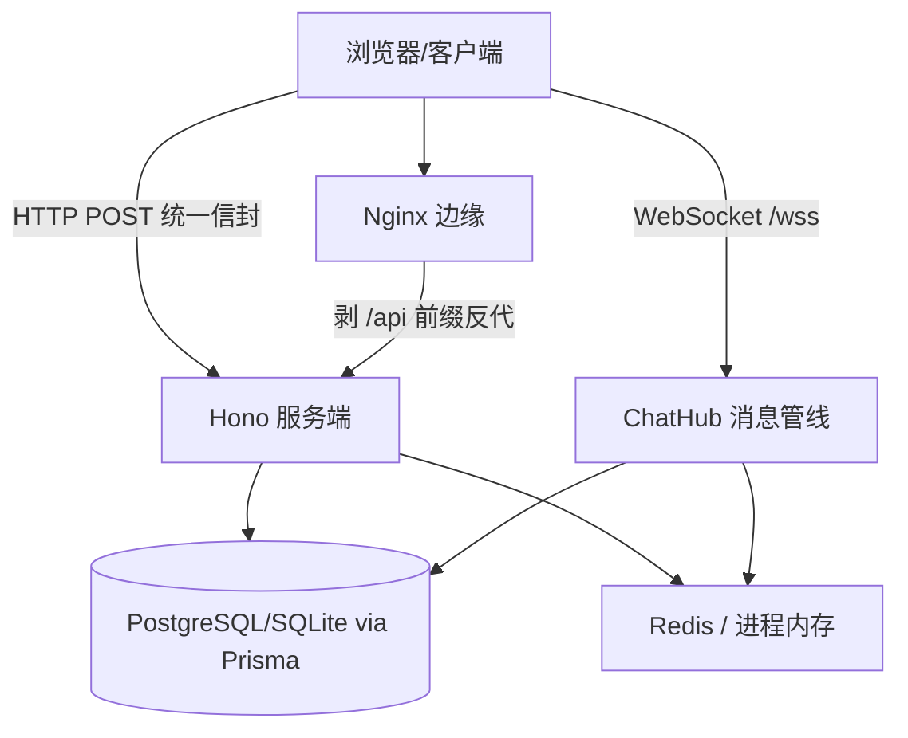

**系统设计型**示范答案。以「设计一个自托管实时 IM 系统」为题，给出可复述的设计骨架，并用真实项目 `yukino-chat` 作为参照实现——每个设计决策都标注 ✅ **项目事实**（yukino-chat 源码实读，HEAD `555f625`）或 ⚠️ **推导**（通用设计，非项目已实现）。系统设计题的采分点不在「背架构图」，而在**需求澄清 → 取舍论证 → 边界意识**。

## 事实基线

| 事实依据 | 内容                                                                                                              |
| -------- | ----------------------------------------------------------------------------------------------------------------- |
| 参照实现 | `~/github/yukino-chat` @ `555f625`（Hono + Prisma + WebSocket 的自托管 IM，单聊/群聊/WebRTC/断点续传/内嵌 Agent） |
| 源码笔记 | `content/fe/yukino-chat.md`，frontmatter `local_commit` 与本机 HEAD 一致                                          |
| 深挖题库 | [Yukino Chat 自托管 IM 与内嵌 Agent 项目深挖题库](/interview/qa/yukino-chat-project)（92 题）                     |

:::note 答题节奏
系统设计题先花 2-3 分钟**澄清需求与规模**（不要上来就画架构），再给高层设计，然后挑 1-2 个核心难点深入（本题选「消息投递语义」与「实时通道」），最后主动讲**扩展性与取舍**。下面按这个节奏组织。
:::

---

## 一、需求澄清（开口必做）

**功能需求**：单聊、群聊、在线状态、消息历史、文件/图片传输、（可选）音视频通话、（可选）内嵌 AI 助手。

**非功能需求**（要主动问规模）：

| 维度   | 要澄清的问题                           | 对设计的影响           |
| ------ | -------------------------------------- | ---------------------- |
| 规模   | DAU 多少、同时在线多少、日消息量多少   | 决定单实例还是分布式   |
| 一致性 | 消息要不要「不丢不重」、要不要已读回执 | 决定投递语义与存储     |
| 延迟   | 消息端到端延迟要求                     | 决定实时通道方案       |
| 部署   | 自托管内网还是公网多租户               | 决定 TLS/鉴权/隔离强度 |

✅ **项目事实**：yukino-chat 的定位是**内网自托管、单实例**——这个前提决定了它大量用进程内存态（连接表、通话房间、消息串行链、限流桶都在内存），换取极简设计与可预测调试。**面试时先讲清「这是单实例自托管定位」，后面的取舍才站得住**。

## 二、容量估算（推导）

⚠️ **推导**（通用方法，非项目实测）：假设 10 万 DAU、人均 40 条消息/日 → 400 万消息/日 ≈ 平均 46 条/秒、峰值（×5）约 230 条/秒。单条消息 ~200 字节 → 日增 ~800MB、年增 ~290GB。同时在线按 DAU 的 20% 估 → 2 万并发长连接。

**结论**：这个量级**单实例 + 单库完全扛得住**（2 万长连接、230 msg/s 对 Node 单进程不是瓶颈），不需要一上来就分布式。容量估算的意义是**证明「不需要过度设计」**——这本身就是采分点。

## 三、高层架构

✅ **项目事实**：yukino-chat 的架构是「**前后端分离 + Nginx 边缘 + 纯 Node API 进程**」：SPA 由独立 Nginx 镜像托管，边缘把 `/api/*` 全量路径（HTTP、WebSocket、上传静态资源）剥前缀反代到后端 `:8000`；后端只提供 API、不托管前端静态文件。**收益是换域名、加 TLS 无需重建前端**。依赖通过 `Deps` 接口集中注入（数据库、缓存、通话管理器、聊天枢纽、五个业务服务、Agent 管理器），无全局单例。

**采分点**：能说出「**前后端分离让 TLS/域名变更与前端解耦**」+「**依赖注入而非全局单例便于测试与有序释放**」。

## 四、数据模型

✅ **项目事实**：八个模型（UserInfo、Session、Message、GroupInfo、UserContact、ContactApply、ContactTag、AgentSession），由两套镜像 schema 承载（PostgreSQL 与 SQLite，由 `DATABASE_PROVIDER` 选用）。关键设计：

- **带前缀 uuid 承载路由语义**：聊天实体的 uuid 是「1 位前缀 + 11 位随机字符」，前缀即路由——收件人 id 以 `U` 开头走单聊、以 `G` 开头走群聊，业务层仅凭 id 前缀就能选分发路径，无需查库。
- **Message 冗余发送者昵称与头像**省去 JOIN；通话信令以 JSON 存 `avData` 字段。
- **Session 每用户每对端一行**（以拥有者视角），软删除，`lastReadAt` 驱动未读计数。
- **状态/类型列保持整数而非数据库枚举**——线路上传输的就是原始整数，这些取值是「承重墙」，改枚举会引入序列化层不一致。

**采分点**：能说出「**id 前缀编码路由语义（U 单聊/G 群聊）**」+「**线协议整数是承重墙，不轻易改枚举**」——这是把「类型信息编码进标识符」与「线协议稳定性」两个设计意识。

## 五、实时通道：WebSocket 设计

✅ **项目事实**：三条独立 WebSocket 端点——`/wss`（消息、在线状态、通话信令）、`/agent/ws`（内嵌 Agent 的 JSON-RPC）、`/dashboard/ws`（管理员缓存看板）。鉴权要点：

- **token 只能走 query**——浏览器无法在 WS 升级请求加自定义头。
- **`/wss` 额外校验 `client_id`**：非空时必须与 token 主体一致，否则握手回 403。**动机是防连接劫持**——若信任客户端自报的 id，任何知道他人 uuid 的人都能顶掉其连接并接收消息。

⚠️ **推导**（多实例扩展时）：单实例下连接表在内存，多实例需要「跨实例总线」（Redis Pub/Sub）把消息扇出到持有目标连接的其他实例，或按用户做粘性路由。

**采分点**：能说出「**WS 握手 token 走 query + client_id 与 token 主体绑定防劫持**」——这是长连接鉴权最容易被忽略的安全点。

## 六、消息投递语义（核心难点，深入讲）

这是 IM 系统设计的**核心难点**，要深入。✅ **项目事实**：yukino-chat 的消息管线是**单消费者串行链**，七步：

1. **串行化**：所有帧经一条 Promise 链顺序处理；链深度达 1024 时回发溢出帧让客户端重试，而不是无限堆积。
2. **帧解析**：JSON 零值语义——缺失字符串字段取空串零值，字段类型错误才拒绝整帧。
3. **防伪**：发送者字段强制覆写为连接属主主体，昵称头像从缓存/数据库重取，客户端无法冒充他人。
4. **持久化**：普通消息先写消息表。
5. **会话触达**：保证双方/群成员各有会话行（软删自动恢复）——会话行是消息投递的副产物。
6. **扇出**：单聊为接收者加发送者回显，群聊为全体成员；逐个检查在线后发送；至少送达一人且非信令帧时置已送达。
7. **Agent 分发**：收件人是内置 Agent 时进入 Agent 路径。

**最关键的性质：持久化先行、扇出在后**。即使扇出阶段所有目标都离线，消息也已落库；离线用户上线后靠会话列表未读计数与历史接口补齐，**不依赖实时通道的可靠性**。

**采分点**：能说出「**实时通道只是加速手段，数据库才是事实来源；持久化先行保证离线消息不丢**」——这是 IM 投递语义的核心认知，答出这点就超过了大多数候选人。

⚠️ **推导**（不丢不重的更强保证）：若要「精确一次」投递，需要客户端消息去重（client_msg_id 唯一约束）+ 服务端 ACK + 离线消息拉取游标。yukino-chat 是「至少落库一次 + 客户端 uuid 去重」，没做端到端 ACK——这是单实例自托管定位下的取舍。

## 七、群聊扇出（fan-out）

⚠️ **推导**：群聊扇出有两种模型——**写扩散**（每条消息给每个成员写一条收件箱记录，读快写慢，适合小群）与**读扩散**（消息只写一份到群时间线，读时拉取，写快读慢，适合大群/万人群）。

✅ **项目事实**：yukino-chat 用**读扩散的变体**——消息写一份到 Message 表，群成员各有一行 Session（`lastReadAt` 驱动未读），扇出时逐个检查在线推送。这适合中小群（自托管团队场景），万人群需要专门的大群优化（如只推在线成员、离线成员靠拉取）。

## 八、文件传输：断点续传

✅ **项目事实**：分块上传是「**无数据库状态机**」——服务器状态就是磁盘上已存在的分块文件集合：

- **校验**：传文件哈希、扩展名、分块总数；最终文件存在则秒传，否则探测分块目录返回缺失下标。
- **上传分块**：multipart，正则白名单校验哈希（8-64 位十六进制）与扩展名，单块上限 10 MiB。
- **合并**：按序拼接，写出最终文件后删分块目录；中途失败删半成品（避免被误判秒传）；最终文件已存在直接返回成功（幂等）。
- **内容寻址命名**（哈希+扩展名）天然去重，正则白名单压掉路径穿越攻击面。
- **客户端**：分块 5 MiB（服务端上限一半，留 multipart 开销余量）、并发 3（信号量限流）、每块重试 3 次线性退避、总上限 2 GiB；哈希在 Web Worker 里逐片 SHA-256 再二次 SHA-256（Web Crypto 无增量摘要 API，分片二次哈希把内存钳制在一个切片）。

**采分点**：能说出「**无数据库状态机（分块目录即进度）+ 内容寻址去重 + worker 二次摘要规避内存峰值**」——这是断点续传的优雅实现。

## 九、音视频：WebRTC 信令

✅ **项目事实**：**服务端不理解 WebRTC，只做信令路由**——把类型 3 消息的信令字段当 JSON 信封转发。通话管理器只有两张表（房间→成员、用户→房间）。客户端是**全网状（mesh）拓扑**，每个对端一条 RTCPeerConnection，没有 SFU。**创建连接不带任何配置（无 STUN/TURN）**，ICE 只靠 host candidate，跨 NAT 打不通——这是「自托管内网工具」的自觉取舍。glare 消除靠角色约定（一对一主叫发 offer、群聊既有成员向新人发，发起方唯一）。

⚠️ **推导**（公网/跨 NAT 扩展）：需要 STUN（打洞）+ TURN（中继兜底），大群通话需要 SFU（选择性转发单元）替代 mesh（mesh 的上行带宽随人数平方增长）。

## 十、扩展性：单实例 → 多实例

✅ **项目事实**：yukino-chat 是单实例（连接表、通话房间、消息串行链、Agent 运行时表、限流桶都在进程内存）。要做多实例需先解决四件事：

1. 把聊天扇出改为**跨实例总线**（Redis Pub/Sub）；
2. 把**通话房间状态外置**；
3. 把 **Agent 运行时按用户做粘性路由**或外置会话；
4. 把**限流桶换成共享计数器**（Redis）。

**采分点**：能说出「**单实例的内存态是自觉取舍，多实例改造的四个具体点**」——展示「知道当前设计的边界，也知道怎么演进」，而不是假装一开始就做了分布式。

## 十一、取舍与边界（主动讲）

✅ **项目事实**（yukino-chat 的已知约束，要主动声明）：

| 约束         | 说明                                                                                 |
| ------------ | ------------------------------------------------------------------------------------ |
| 单实例       | 无跨实例总线，无法水平扩展                                                           |
| 无 TLS       | 后端明文 HTTP，TLS 需在 Nginx 之前终结；且 getUserMedia 与 Web Crypto 要求安全上下文 |
| 改密无验证   | 免鉴权按手机号重置，只有 IP 限流，公网暴露前必须加验证                               |
| 无 STUN/TURN | WebRTC 跨 NAT 打不通                                                                 |

**标准话术**：「这些约束大多是『内网自托管』定位下的自觉取舍——单实例换来极简内存态与可预测调试，代价是无法水平扩展。若要公网多租户，优先级最高的是补 TLS、改密验证、跨实例总线与 TURN。」

**采分点**：主动讲边界与取舍，比假装「我的设计完美无缺」可信得多——这正是 [指标口径与基线定义](/interview/metrics-baseline) 强调的证据纪律。

---

## 追问链与应对

| 追问                 | 应对要点                                                                                                        |
| -------------------- | --------------------------------------------------------------------------------------------------------------- |
| 「消息怎么保证不丢」 | 持久化先行扇出在后 + 离线靠未读计数与历史接口补齐；要精确一次需 client_msg_id 去重 + ACK + 拉取游标             |
| 「已读回执怎么做」   | Session 的 lastReadAt 驱动未读计数；已读回执是「把 lastReadAt 推给对端」，群聊已读要聚合                        |
| 「万人群怎么优化」   | 读扩散 + 只推在线成员 + 离线拉取 + 消息合并推送；写扩散在小群才行                                               |
| 「在线状态怎么维护」 | 连接表 + 心跳；标签页被杀不发 close 帧，要靠服务端心跳超时清理（yukino-chat 的 Agent 连接 75 秒无帧 terminate） |
| 「多端同步怎么做」   | 同一用户多连接都扇出 + 数据库为事实源，新端登录拉历史 + 实时增量                                                |
| 「消息顺序怎么保证」 | 单消费者串行链 + 数据库自增/时间戳排序；多实例下按会话路由到同一实例保证局部有序                                |

---

**延伸阅读**

- [Yukino Chat 自托管 IM 与内嵌 Agent 项目深挖题库](/interview/qa/yukino-chat-project)：本设计参照实现的 92 题深挖。
- [Agent 链路、网关与流式前端示范答案](/interview/answers/agent-loop-gateway-streaming)：另一套系统设计型示范（Agent 网关方向）。
- [大 Body 与并发容量示范答案](/interview/answers/large-payload-capacity)：容量估算与分层防守的方法论。
- [续传、虚拟滚动、告警与死锁示范答案](/interview/answers/upload-scroll-alerting-deadlock)：断点续传与实时列表的深挖。
- [RPC 与网络编程题库](/interview/qa/rpc-and-network)：长连接、心跳、背压的网络层基础。
- [分布式组件与一致性题库](/interview/qa/distributed-components)：多实例扩展时的跨实例总线与一致性。
