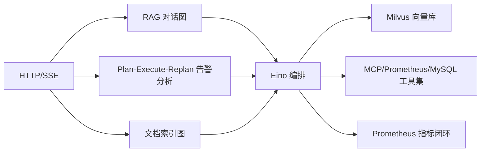

**项目事实核对型**示范答案。所有常量取自源码实读（本机 `~/github/yukino.go/apps/agent/server` @ `facf5d6`，`go 1.26.0`）；十问中有若干「事实缺口」，文内以 ✅ **项目事实** / ⚠️ **推导或需澄清** 明确区分。这是「介绍一个你做过的 Go AI Agent / AIOps 项目」这一高频题的完整串讲脚本。

## 事实基线

| 事实依据   | 内容                                                                                                                                                                                                                                         |
| ---------- | -------------------------------------------------------------------------------------------------------------------------------------------------------------------------------------------------------------------------------------------- |
| 本机检出   | `~/github/yukino.go/apps/agent/server`，当前 HEAD `facf5d6`，`go 1.26.0`；六个可执行入口 `cmd/{agent,chat,ai_ops,knowledge,recall,llm_tool}`                                                                                                 |
| 源码笔记   | `content/be/yukino-agent.md`，frontmatter `local_commit` 与本机 HEAD 一致                                                                                                                                                                    |
| 关键常量   | 均实读源码确认：`MaxIterations=20`（Plan-Execute 整体）与 `999999`（单步 ReAct）、`MaxStep=25`（ReAct 步数）、`MaxSessions=100`、`MaxWindowSize=6`（会话记忆滑窗）、`TopK=1`（RAG 检索）、`MaxContentLength=8192`、`maxUploadBytes=50`（MB） |
| 关键函数   | 实读确认存在：`NewThinkChatModel`/`NewQuickChatModel`、`signaturePatchingTransport`、`ProbeDimension`、`TolerateEmptyArguments`、`extractJSONObject`、`emptyTolerantRetriever`、`AIOpsQuery`、`model_provider`                               |
| 未归档产物 | RAG 检索效果（MRR/Recall）、Plan-Execute 告警分析准确率、监控桥告警准确率**均未归档**（见 Q9 事实缺口）                                                                                                                                      |

:::danger 事实缺口
十问里有 **3 类事实缺口**：① RAG 检索效果与告警分析准确率**无归档评测**；② Milvus **维度不匹配时 drop 重建 collection**，换 embedding 模型即清空知识库（要主动声明的边界）；③ 监控桥的指标覆盖度与告警准确率无归档。下面用 ✅ **项目事实** / ⚠️ **推导或需澄清** 标清。
:::

---

## Q1 · 一句话介绍这个项目 + 定位

✅ **项目事实**：yukino_agent 是一个用 Go 编写的 **AI 运维助手后端（AIOps）**，把「检索增强对话（RAG）」「自主告警分析（Plan-Execute-Replan）」「文档向量化索引」三条能力统一构建在 **CloudWeGo Eino** 编排框架之上，对外经 yukino_http 暴露 HTTP/SSE，对内以 Milvus 为向量知识库、以 MCP/Prometheus/MySQL/时间/文档检索为工具集。它还承担一个**监控桥**角色：把浏览器 SDK（`@yukino.js/sentry`）上报的前端可观测性事件转成 Prometheus 指标，供告警规则消费，让「前端异常」反向触发「Agent 分析」。

**串讲口径**：定位是「把传统运维排障链路（看告警、翻文档、查日志、跑 SQL、写报告）交给 Agent」。要解决的四个工程问题：如何让 LLM 用上私有知识（RAG 而非微调）、如何触达真实系统（工具调用）、如何完成多步复杂任务（Plan-Execute-Replan）、如何让前端异常可被告警（观测数据指标化）。

## Q2 · 整体架构与三条流水线

✅ **项目事实**：三条流水线共享同一套 Eino 编排与工具集：



- **RAG 对话图**：检索与对话变量并行准备，汇聚到 ChatTemplate，终点是 ReAct Agent。
- **Plan-Execute-Replan**：Planner（Think 模型）拆步骤 → Executor（Quick 模型）逐步执行 → Replanner（Think 模型）复盘决定继续或收尾。
- **文档索引图**：`Source → FileLoader → MarkdownSplitter → MilvusIndexer → IDs`。

## Q3 · 为什么用 Eino 编排框架（核心取舍）

✅ **项目事实**：核心取舍是「**编排框架 + 组件适配**」而非「从零造轮子」——图的编排、ReAct 循环、Plan-Execute 骨架都复用 Eino/ADK 的 prebuilt 能力，**项目自身代码集中在两件事**：① 把外部世界（Milvus、MCP、Prometheus、MySQL、各家 LLM Provider）适配成 Eino 组件；② 为不可靠的 LLM 输出与外部依赖做容错兜底。

**采分点**：能说出「**复用 Eino/ADK prebuilt，自研代码集中在『外部系统适配成组件』与『容错兜底』**」——这是「用框架」与「造框架」的清醒分工，也是这个项目最有区分度的设计哲学。

## Q4 · RAG 对话图如何工作

✅ **项目事实**：`chat_pipeline.BuildChatAgent` 用 `compose.NewGraph[*UserMessage, *schema.Message]` 声明有向图，关键是**检索与对话变量准备并行，二者汇聚到同一个 ChatTemplate**，图以 `compose.WithNodeTriggerMode(compose.AllPredecessor)` 编译——ChatTemplate 必须等两条入边（检索结果 + 对话变量）都就绪才触发，这是「并行准备、汇聚渲染」的语义保证。

- `InputToRag`（Lambda）只抽 Query 作检索输入；`MilvusRetriever` 用 `WithOutputKey("documents")` 把检索结果写进模板变量；`InputToChat` 产出 `{content, history, date}`。
- ReAct Agent 用 Quick 模型，`MaxStep=25` 限制推理-行动步数。

**采分点**：能说出「**AllPredecessor 触发模式保证检索与对话变量都就绪才渲染**」——这是 Eino 图编排的并行汇聚语义。

## Q5 · Plan-Execute-Replan 告警分析如何工作

✅ **项目事实**：复用 Eino ADK 的 `planexecute` prebuilt，三角色闭环：

| 角色      | 模型       | 职责                         | 关键约束                                           |
| --------- | ---------- | ---------------------------- | -------------------------------------------------- |
| Planner   | Think 模型 | 把目标拆成 steps             | 结构化输出 JSON，非工具调用                        |
| Executor  | Quick 模型 | 逐步执行，每步可多轮工具调用 | 单步 ReAct 循环 `MaxIterations=999999`（近乎无限） |
| Replanner | Think 模型 | 复盘进度，决定继续或收尾     | 输出 `{done, remaining, summary}`                  |

整体 `MaxIterations=20` 封顶。**单步循环放大到近乎无限、整体循环成为唯一收敛边界**——因为一个计划步骤可能对每条活跃告警各发一次工具调用。

Planner/Replanner **不走工具调用，走基于 prompt 的结构化输出**（`structuredOutputModel` 包装 + `extractJSONObject` 剥掉模型可能套的 ```json 围栏或前置推理文字）——这是为兼容性做的妥协：部分模型对 `tool_choice: forced` 支持不完整。

`/api/ai_ops` 与 `cmd/ai_ops` 共用 `AIOpsQuery`：先 `query_prometheus_alerts` 拉活跃告警，再对每条告警按告警名调 `query_internal_docs` 取处理手册，时间参数先经 `get_current_time`，日志查询必须带 region 与 topic，最后按固定中文报告骨架输出。**告警名就是 API**——`prometheus.rules.yml` 的每条规则名都要在知识库的处理手册里有同名章节，检索才能命中。

## Q6 · 工具集如何适配成 Eino Tool（容错设计）

✅ **项目事实**：对话图与 Plan-Execute 执行器共享同一套工具（MCP、Prometheus、MySQL、时间、文档）。三个容错设计是采分点：

- **错误即观测**：MySQL、Prometheus、文档检索工具在运行期失败时，**不返回 Go error，而是返回 `{success:false, error, message}` 的 JSON 字符串**（error 为 nil）——错误作为「工具观测结果」回喂模型，让 Agent 有机会推理并重试（比如修正 DSN），而不是直接中断 ReAct 流。
- **TolerateEmptyArguments**：无参工具（`get_current_time`、`query_prometheus_alerts`）挂这个选项，把空/纯空白 Arguments 归一成 `"{}"` 再解码——因为部分模型（如 Qwen）对无参工具返回空串而非规范 `"{}"`，Eino 默认的 sonic 反序列化会把空串当语法错误。
- **signaturePatchingTransport**：Anthropic 路径的兼容补丁，包装 `http.RoundTripper`，给缺失 `signature` 字段的 thinking 内容块补空字符串——官方 Anthropic API 总在思考块带 signature，但第三方网关会省略，导致 SDK 拒绝整个响应。

**采分点**：能说出「**错误即观测（错误回喂模型而非中断）+ TolerateEmptyArguments（兼容 Qwen 空参）+ signaturePatchingTransport（兼容第三方网关）**」——这三个是「为不可靠 LLM 输出与外部依赖做容错」的具体落地，是这个项目最硬核的工程细节。

## Q7 · Milvus 向量知识库如何引导与读写

✅ **项目事实**：`internal/utility/milvus` 把 Milvus 从零引导到可用并缓存连接。关键设计：

- **ProbeDimension**：用临时 embedder 对探针文本 `"dimension probe"` 向量化，**以实际输出长度作为权威维度**——配置里无需也不应手写维度，避免「配置维度与实际模型输出不一致」。
- **emptyTolerantRetriever**：collection 还没有任何行时 Eino 组件会抛 "no results found"，这个包装器把它映射成空文档列表——否则「索引第一篇文档之前就聊天」会让整条流水线失败。
- **维度不匹配 drop 重建**：`ensureSchema` 发现存储维度与探测维度不一致时直接 `DropCollection` 重建——**换 embedding 模型即清空知识库，需重新索引**（要主动声明的边界）。
- **MarkdownSplitter** 按 `#` 一级标题切分，把标题写进 `title` 元数据；检索 `TopK=1`，配合按一级标题切分，偏向「精确命中单篇文档」的运维问答。

## Q8 · 监控桥如何把前端可观测性转成 Prometheus 指标

✅ **项目事实**：`sentry_metrics_handler.go` 是独立子系统，把 `@yukino.js/sentry` 浏览器 SDK 的上报转成 Prometheus 指标：`/api/log` 接收 SDK 上报（SDK 的 dsn），转成 `yukino_sentry_*` 指标，`/api/metrics` 暴露给 Prometheus 抓取。维护私有 registry 与全局默认 registry 隔离。

**这闭合了告警回路**：前端异常 → 指标 → Prometheus 告警规则 → `query_prometheus_alerts` 工具拉回给 Agent 分析。配合 `prometheus.rules.yml` 的五组告警（targets、go-runtime、telemetry-pipeline、client-errors、client-performance）。

**采分点**：能说出「**前端异常 → 指标 → 告警 → Agent 分析的完整闭环**」——这是「可观测性数据驱动 AIOps」的完整链路，是这个项目最有想象力的设计。

## Q9 · 量化结果与事实缺口（诚实口径）

⚠️ **这是最容易翻车的一问，必须主动声明缺口**：

| 想说的                    | 诚实口径                                                                         |
| ------------------------- | -------------------------------------------------------------------------------- |
| 「RAG 检索准确率 X%」     | **无归档评测**——检索机制完整（TopK=1、按标题切分），但 MRR/Recall 没有系统化评测 |
| 「告警分析准确率」        | Plan-Execute 机制完整，但**分析准确率无归档**                                    |
| 「监控桥告警准确率」      | 指标转换与告警规则完整，但**告警准确率/误报率无归档**                            |
| 「换 embedding 模型无感」 | **不行**——维度不匹配会 drop 重建 collection，清空知识库需重新索引                |

**标准话术**：「三条流水线的机制与常量都在源码里可查（MaxStep=25、TopK=1、MaxIterations 整体 20/单步近乎无限、会话记忆滑窗 6），但检索效果、告警分析准确率、监控桥告警准确率这些效果指标我没有归档——要复现需要补一套评测数据集。我能确定讲的是机制与容错设计，不是效果数字。」

**采分点**：能主动声明「**效果指标无归档 + Milvus 维度 drop 重建的边界**」——把「机制完整」与「效果已证」分开讲。

## Q10 · 反思与扩展

⚠️ **推导**（反思题展示判断力）：

1. **RAG 检索增强**：当前 TopK=1 + 按一级标题切分偏向精确命中，复杂运维问题可引入混合检索（BM25 + 向量 + RRF）与 rerank，但要先建评测数据集证明收益。
2. **会话记忆外置**：当前会话记忆是进程内 LRU（`MaxSessions=100`、滑窗 6），多副本部署不共享、重启即丢；生产级多实例需外置存储（Redis）。
3. **告警分析的确定性**：Plan-Execute 依赖 LLM 规划，可加「告警名 → 处理手册」的确定性路由兜底（告警名就是 API 的设计已经为此铺路），减少对 LLM 规划的依赖。
4. **监控桥的指标治理**：前端上报是高基数来源（错误名、URL 路径），要做标签收敛防止 Prometheus 基数爆炸。

**采分点**：反思要具体到可执行的改进，且承认现有设计的合理性（「TopK=1 + 按标题切分在当时是为了精确命中运维手册，复杂场景才需要混合检索」）。

---

## 追问链与应对

| 追问                                           | 应对要点                                                                                                             |
| ---------------------------------------------- | -------------------------------------------------------------------------------------------------------------------- |
| 「为什么用 Eino 不用 LangChain」               | Eino 是 Go 原生的编排框架（CloudWeGo 生态），与 Go 后端栈一致；LangChain 是 Python/JS 生态。选型看语言栈与团队熟悉度 |
| 「Plan-Execute 的 Planner 为什么不用工具调用」 | 部分模型对 tool_choice forced 支持不完整，用 prompt 结构化输出 + extractJSONObject 剥围栏更稳                        |
| 「单步 ReAct 为什么设 999999」                 | 一个计划步骤可能对每条告警各发一次工具调用，单步不该被人为掐断，整体 MaxIterations=20 才是收敛边界                   |
| 「错误即观测会不会让模型无限重试」             | 错误回喂后模型通常一两轮自纠；整体 MaxIterations=20 与 ReAct MaxStep=25 是兜底，不会无限                             |
| 「监控桥的高基数怎么治理」                     | 错误名/URL 路径是高基数来源，要标签收敛（归一化路径、限制标签值基数），否则 Prometheus 基数爆炸                      |
| 「Milvus 为什么不用 pgvector」                 | Milvus 是专用向量库，支持大规模 ANN；pgvector 适合「已有 PG 且向量量小」的场景。选型看向量规模与是否想引入新组件     |

---

**延伸阅读**

- [Yukino Agent（Go Eino RAG 运维 Agent）项目深挖题库](/interview/qa/yukino-agent-project)：本项目机制的 88 题深挖。
- [Yukino Code 编码 Agent 项目深挖示范答案](/interview/answers/yukino-code-project)：TS 编码 Agent 的项目串讲（与本篇 Go AIOps 对照）。
- [Yukino Codegen AI 代码生成平台项目深挖示范答案](/interview/answers/yukino-codegen-project)：AI 生成平台的项目串讲。
- [Go 实现 AI Agent 工程题库](/interview/qa/go-agent-engineering)：Go 落地 LLM Agent 的通用工程视角。
- [中间件与分布式基础设施题库](/interview/qa/middleware-infrastructure)：Prometheus/Grafana/OpenTelemetry 可观测性三支柱。
- [指标口径与基线定义](/interview/metrics-baseline)：量化结论的证据纪律（本篇 Q9 的方法论）。
