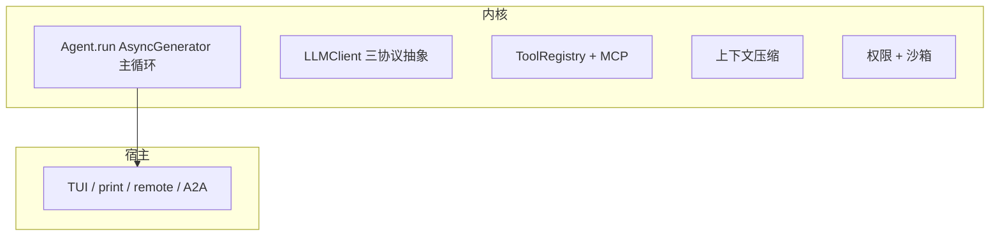

**项目事实核对型**示范答案。所有常量取自源码实读（本机 `~/github/yukino-code/apps/yukino` @ `7b9add5`）；十问中有若干「事实缺口」，文内以 ✅ **项目事实** / ⚠️ **推导或需澄清** 明确区分。这是「介绍一个你做过的 Coding Agent / Agent 基础设施项目」这一高频开场题的完整串讲脚本。

## 事实基线

| 事实依据   | 内容                                                                                                                                                                                                                                                                                                                                                                                                                                                                  |
| ---------- | --------------------------------------------------------------------------------------------------------------------------------------------------------------------------------------------------------------------------------------------------------------------------------------------------------------------------------------------------------------------------------------------------------------------------------------------------------------------- |
| 本机检出   | `~/github/yukino-code/apps/yukino`，当前 HEAD `7b9add5`；包名 `@yukino.js/yukino` **v0.0.20**，`engines.node >= 20`                                                                                                                                                                                                                                                                                                                                                   |
| 源码笔记   | `content/docs/yukino/` 共 26 篇子系统笔记，frontmatter `local_commit` 与本机 HEAD 一致                                                                                                                                                                                                                                                                                                                                                                                |
| 关键常量   | 均实读源码确认存在：`KEEP_RECENT_TOKENS=10000`、`KEEP_MAX_TOKENS=40000`、`MIN_KEEP_MESSAGES=5`、`MIN_COMPACT_PREFIX=2`、`SUMMARY_OUTPUT_RESERVE=20000`、`SUMMARY_ANSWER_RESERVE_TOKENS=16000`、`RECOVERY_FILE_LIMIT=5`、`MAX_CONSECUTIVE_FAILURES=3`、`MAX_OUTPUT_CHARS=50000`、`MAX_TOKENS_CEILING=64000`、`MAX_TOKENS_RECOVERIES=3`、`MAX_RETRIES=3`、`MAX_GOAL_TURNS=150`、`MAX_BLOCKED_ATTEMPTS=3`、`DEFAULT_EAGER_THRESHOLD_PERCENT=10`、`IMAGE_CHAR_EQUIV=7000` |
| 未归档产物 | 性能基准、A/B 实验、缓存命中率实测报告**均未归档**（见 Q9 事实缺口）                                                                                                                                                                                                                                                                                                                                                                                                  |

:::danger 事实缺口
十问里有 **3 类事实缺口**：① `99.4%→9.5%` 的缓存命中率数字来自**源码注释**而非我的独立实测；② 「数量级吞吐提升」是定性描述，无独立 benchmark 归档；③ 思考强度七档的 token 预算是设计常量，非实验调参结论。下面用 ✅ **项目事实** / ⚠️ **推导或需澄清** 标清。**把「源码注释里的数字」讲成「我实测的结论」是这类追问最容易翻车的地方**。
:::

---

## Q1 · 一句话介绍这个项目 + 为什么做

✅ **项目事实**：Yukino Code 是一个运行在终端里的 Coding Agent（npm 包 `@yukino.js/yukino`），用 React 19 + Ink 7 渲染 TUI，通过可配置的 LLM Provider 驱动「模型 → 工具 → 模型」的自治循环（ReAct）。它不是「调一次补全接口」，而是完整的 agent 栈：工具执行、MCP、权限、技能、上下文压缩、多代理协作、多种宿主形态（TUI / print / remote / A2A）。

**串讲口径**：先讲定位（终端 Coding Agent），再讲它「以库形式被复用」的独特性——`yukino-chat`（自托管 IM）与 `yukino-codegen`（AI 代码生成平台）都通过 `Remote.Server.createRemoteAgent` 把它当库嵌入，同一内核支撑三种产品形态。**这是这个项目最有区分度的点：不是「一个 CLI」，而是「一个可被多宿主复用的 Agent 内核」**。

## Q2 · 整体架构与分层

✅ **项目事实**：分层是「内核 + 宿主 + 协议」：

- **内核**：`Agent.run()` 返回 `AsyncGenerator<AgentEvent>`，主循环、LLM 抽象、工具注册、上下文压缩、权限沙箱都在内核。
- **宿主**：TUI / print / remote / A2A 都消费同一个事件流，「表现层与领域层彻底解耦」——Agent 核心不知道 UI 是否存在。
- **协议**：对外有 MCP（工具接入）、A2A（agent 互通）、remote（WebSocket）。

**采分点**：能说出「**宿主消费同一个 AsyncGenerator 事件流，内核与表现层解耦**」——这是「一个内核多宿主」的架构关键。

## Q3 · Agent 主循环为什么用 AsyncGenerator 而不是 EventEmitter

✅ **项目事实**：`run()` 是 `AsyncGenerator<AgentEvent>`，消费侧统一 `for await (const event of agent.run())`。四个结构性好处：① **拉取式背压**——消费方 await 下一个事件时循环才前进，渲染慢时 Agent 自然减速，无事件积压；② **控制流即代码**——多轮推理、错误恢复、退避重试用普通 while + try/catch 线性表达，不必拆状态机；③ **中断语义天然**——break 或 AbortController 触发生成器帧连同流式连接、睡眠定时器一起回收；④ **统一消费接口**——TUI/print/remote 用完全相同的 for await。

⚠️ **推导**：代价是生成器只能推一条主线，所以并行信息（子代理进度、团队邮箱、钩子输出）走回调旁路，由主循环在每轮开头排空成 system-reminder。「主线生成器 + 旁路回调」是架构的明确分工。

## Q4 · prompt cache 为什么是一等约束

✅ **项目事实**：工具数组在请求中位于系统提示词之后、消息之前，工具面的任何变化都会让其后整段历史缓存失效。源码注释给了一个量化：**两万 token 的历史里，往工具数组尾部追加一个工具，缓存命中率从 99.4% 跌到 9.5%**。由此派生的设计：系统提示词保持项目无关（全局唯一副本）、工具按协议导出但顺序稳定、MCP 加载模式一旦决定不在每轮重算、每条工具消息进入历史后不再修改、压缩保留尾部而非全部摘要、摘要走缓存共享路径。

⚠️ **事实缺口（必主动声明）**：**99.4%→9.5% 这个数字来自源码注释，不是我独立实测的**。面试时要说「源码注释里给的实测是 99.4%→9.5%，我自己没有独立复现这个 benchmark」——把来源讲清，比假装自己测过更可信。

**采分点**：能主动声明「这个数字来自源码注释而非我的实测」——这正是证据纪律的体现，比数字本身更得分。

## Q5 · 上下文压缩如何工作

✅ **项目事实**：压缩按 token 预算公式触发，不是固定比例：`effectiveWindow = contextWindow - min(maxOutput, SUMMARY_OUTPUT_RESERVE=20000)`，自动阈值 = effectiveWindow - 自动安全边际，强制阈值 = effectiveWindow - 手动安全边际（硬阻塞线）。安全边际按有效窗口比例封顶（自动 25%、手动 10%）。连续压缩失败 `MAX_CONSECUTIVE_FAILURES=3` 次后熔断自动压缩（除非已过硬线）。

保留尾部：从尾部往前走累积 token，满足「至少保留 `KEEP_RECENT_TOKENS=10000` token 或至少 `MIN_KEEP_MESSAGES=5` 条」之一即停，不超过 `KEEP_MAX_TOKENS=40000`；若边界落在承载工具结果的用户消息上，往前退到发起调用的助手消息（保证 tool_use/tool_result 不被拆开）；待摘要前缀不足 `MIN_COMPACT_PREFIX=2` 条则跳过。

摘要三路径（优先级递减）：缓存共享路径（保留原消息列表、只追加摘要指令，命中 prompt cache）、上下文超限重试路径（序列化前缀、按 API 轮次从头部丢 1/5、最多 3 次）、瞬态重试。「宁可保留原历史也不要坏摘要」——摘要流必须收到完成事件且 stopReason 正常，对话被并发修改则按 `COMPACTION_CONVERSATION_CHANGED_ERROR` 丢弃。

**采分点**：能说出「**保留尾部的配对修正（不拆 tool_use/tool_result）+ 前缀不足 2 条跳过 + 宁可保留原历史也不要坏摘要**」——这三个是压缩正确性的关键。

## Q6 · 多协议如何收敛

✅ **项目事实**：`LLMClient` 接口只暴露 `stream` 与 `setSystemPrompt`，加可选的协议名、输出上限/思考强度控制、`getOutputBudget()`。三个实现：Anthropic 原生、OpenAI Responses、OpenAI 兼容（Chat Completions）。差异被压到少数地方：输出上限字段不同（max_tokens / max_output_tokens / max_completion_tokens）、工具调用增量组装方式不同、思考内容字段名不同（thinking 块 / reasoning summary / 非标准 reasoning_content）。Provider 只负责把各自 wire 格式翻译成统一流事件，主循环不感知协议差异。

思考强度是跨 Provider 的七档逻辑等级（off/minimal/low/medium/high/xhigh/max），默认 high，各档对应固定 token 预算（minimal 1024 到 max 65536）。收敛规则「只降不升」：不支持的请求钳制到最近可用等级。

⚠️ **推导**：七档的 token 预算是设计常量，不是实验调参结论——面试时不要讲成「我调出来的最优值」。

## Q7 · 多代理协作的拓扑选择

✅ **项目事实**：三种拓扑对应三种场景：

| 拓扑                   | 机制                                                                                                | 适用                             |
| ---------------------- | --------------------------------------------------------------------------------------------------- | -------------------------------- |
| **Subagent（星型）**   | 主 agent 委派有界子任务，结果作为 Agent 工具返回值；`Agent` 工具 `isConcurrencySafe` 恒 true 可并行 | 一次性子任务、上下文隔离         |
| **Agent Team（网状）** | teammate 是有独立上下文的 agent 实例，靠共享任务板（tasks.json）+ 文件邮箱（inboxes/）协调          | 需反复追加任务、多轮协作         |
| **Workflow（脚本）**   | 确定性 JS 脚本编排多个 subagent，journal 持久化可重放                                               | 批量任务（逐文件审查、批量迁移） |

**采分点**：能说出「**星型不能互通所以升级网状、批量任务用脚本编排比循环委派省 token**」——这是「为什么需要三种拓扑」的核心论证。

## Q8 · 权限与沙箱如何保证多用户/多宿主安全

✅ **项目事实**：权限多层短路判定（plan 守卫 → 显式规则 → 协调工具 → 安全命令白名单 → shell 结构分析 → 路径沙箱 → OS 沙箱自动放行 → 模式矩阵），fail-closed（判定链路出错返回 deny）。OS 沙箱（macOS seatbelt / Linux bubblewrap）把 Bash 命令放进隔离环境，写路径收敛到允许目录。

**多用户宿主的关键**（yukino-chat 场景）：以库形式嵌入多用户 IM 时，每个用户的 Agent 被收敛为只读工具（工具白名单 + 路径圈禁 + 公网断言三层），禁锢在自己的工作区——「能力不打折，边界靠三层叠加」。

**采分点**：能说出「**多用户宿主用『只读工具白名单 + 路径圈禁 + 公网断言』三层圈禁**」——这是「多用户宿主如何安全内嵌 coding agent」的完整答案。

## Q9 · 量化结果与事实缺口（诚实口径）

⚠️ **这是最容易翻车的一问，必须主动声明缺口**：

| 想说的                       | 诚实口径                                                         |
| ---------------------------- | ---------------------------------------------------------------- |
| 「缓存命中率提升」           | 99.4%→9.5% 是**源码注释的数字**，我没有独立 benchmark 复现       |
| 「向量化带来数量级吞吐提升」 | 这是**定性描述**（列存 + SIMD 的理论收益），我无独立压测数据归档 |
| 「压缩降低了 token 成本」    | 压缩机制存在且阈值常量明确，但**省了多少 token 无归档统计**      |
| 「多代理提升了效率」         | 拓扑设计有明确论证，但**无 A/B 实验对比**单 agent vs 多代理      |

**标准话术**：「机制与常量都在源码里可查，但性能基准和 A/B 实验我没有归档——如果要用这些数字，应该在同一环境下重新跑 benchmark 并注明条件。我能确定讲的是机制与取舍，不是效果数字。」

**采分点**：能主动区分「机制事实」与「效果数字」、主动声明未归档的缺口——这是项目深挖追问里最稀缺的品质，比任何数字都得分。

## Q10 · 如果重做/扩展，你会怎么改（反思）

⚠️ **推导**（反思题没有标准答案，展示判断力）：

1. **可观测性补全**：当前遥测有基础（OTel/Langfuse/Sentry 三后端），但「每轮 token 成本、压缩触发率、工具成功率」这类 Agent 专属指标可以更系统化，支撑「哪个环节最贵」的优化决策。
2. **压缩策略可配置化**：双阈值与保留尾部是写死的常量，不同模型/场景的最优值不同，可以做成按模型 profile 配置。
3. **多代理的成本控制**：team/workflow 的 token 消耗没有预算闸门（goal 有 `MAX_GOAL_TURNS=150` 与预算，但 team 没有等价机制），可以给团队任务加预算上限。
4. **效果评测闭环**：补一套可复现的 benchmark（缓存命中率、压缩省 token、多代理 vs 单代理），把「机制正确」升级为「效果可证」。

**采分点**：反思要**具体到可执行的改进**（不是「加监控」这种空话），且承认现有设计的合理性（「写死常量在当时是对的，现在场景多了才需要配置化」）——展示「理解当时的取舍 + 看到演进方向」。

---

## 追问链与应对

| 追问                                  | 应对要点                                                                                                                                                                                     |
| ------------------------------------- | -------------------------------------------------------------------------------------------------------------------------------------------------------------------------------------------- |
| 「AsyncGenerator 的背压具体怎么体现」 | 消费方 await 才前进；若消费方处理慢，生成器在 yield 处暂停，不积压事件                                                                                                                       |
| 「压缩会不会丢信息」                  | 会——摘要是有损的，所以保留尾部原文 + 恢复附件（最近读过的文件快照 `RECOVERY_FILE_LIMIT=5`）+ 提示「可读转录找回细节」                                                                        |
| 「为什么不用 LangChain/LangGraph」    | 自研内核是为了「多宿主复用 + 精细控制 prompt cache + 与 TUI 深度集成」；LangChain 是组件库、LangGraph 是编排引擎，定位不同（可对照 [LangChain 内核题库](/interview/qa/langchain-internals)） |
| 「多用户安全怎么验证」                | 三层圈禁是设计保证，验证靠单测（工具白名单、路径圈禁的用例）+ 人工审查；诚实说「没有红队渗透测试」                                                                                           |

---

**延伸阅读**

- [Yukino Code 执行内核与上下文工程题库](/interview/qa/yukino-code-engine)：本项目机制的 96 题深挖（主循环、三协议、压缩、缓存）。
- [Yukino Code 多代理协作、权限与宿主形态题库](/interview/qa/yukino-code-orchestration)：多代理、权限沙箱、宿主的 95 题深挖。
- [电商 RAG 项目深挖示范答案](/interview/answers/ecomm-rag-project)：另一套「项目事实核对型」示范（RAG 方向）。
- [Coding Agent 记忆与基线示范答案](/interview/answers/coding-agent-memory)：记忆系统与量化基线的诚实口径。
- [指标口径与基线定义](/interview/metrics-baseline)：量化结论的证据纪律（本篇 Q9 的方法论）。
