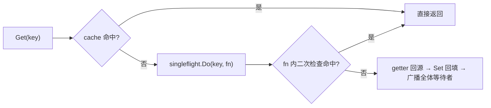

零依赖、可直接 `go run` 的代码题参考实现。先澄清击穿/穿透/雪崩与 singleflight 语义，再给主实现、五组自测与追问四连，全程对照 `yukino_cache` 库的真实实现。

:::note 运行方式
本文代码仅依赖 Go 标准库（Go ≥ 1.19，用到 `any` 与 `atomic.Int64`），四段代码依次拼接即单个 `main.go`，`go run` 输出 `ALL PASS`。已在 **go1.26.5 (darwin/arm64)** 实测：`gofmt`/`go vet` 零告警，`go run -race` 多次运行全部通过。
:::

## 题目

> 用 Go 手写 **singleflight**：同一个 key 的并发请求**只回源一次**，其余等待并共享结果；再在其上搭一个**两级 LRU** 的 read-through 缓存，同时扛住缓存击穿与扫描污染。

## 开口先澄清语义（必拿分）

三个「缓存失效」概念先分清，singleflight 只治第一种：

| 概念     | 含义                                  | 对策                                 |
| -------- | ------------------------------------- | ------------------------------------ |
| **击穿** | 单个热 key 失效瞬间，海量并发同时回源 | **singleflight**（本题）/ key 级互斥 |
| **穿透** | 查询根本不存在的数据，缓存永远 miss   | 缓存空值 / 布隆过滤器                |
| **雪崩** | 大量 key 同时失效或源站宕机           | TTL 抖动 / 熔断降级                  |

- **合并窗口**：singleflight 只合并**时间上重叠**的调用；执行结束 key 即摘除，下一个请求触发新一轮——它不落地结果，落地是 LRU 的事。
- **共享的是全部**：等待者拿到同一个 `val` **和同一个 `err`**；`fn` panic 时所有等待者一起失败（本文实现把 panic 转成 error）。

## 项目里是怎么做的（yukino_cache 事实对照）

`$HOME/github/yukino.go/libs/yukino_cache`（HEAD `facf5d6`）是 groupcache 风格的分布式缓存库，本文手写版是它的面试简化形态：

| 维度         | 项目实现（路径 / 结构体）                                                                                                        | 面试手写版怎么简化                |
| ------------ | -------------------------------------------------------------------------------------------------------------------------------- | --------------------------------- |
| singleflight | `single_flight.go`：`SingleFlightGroup{m sync.Map}` + `call{wg, val, err}`，`LoadOrStore` 抢占，panic recover 成 error           | 逐行对齐，无删减                  |
| read-through | `group.go`：`Group.Get` → `mainCache` miss → `load` → `loader.Do`，**fn 内二次检查**缓存防串行重复回源                           | 同链路，去掉 peers/TTL/stats      |
| 两级 LRU     | `lru.go`：`lruStore` 16 桶 × `[2]*cache` 数组式双向链表（BKDR 分桶、字节预算、粗粒度原子时钟），L1 写入 / L2 提升，淘汰先 L1     | `container/list` + map、条数容量  |
| 写入权威     | `lru.go` `SetWithExpiration` 写 L1 后 `drop` L2 旧副本防「复活」；值用不可变 `ByteView` + `cloneBytes`                           | `Set` 先清 L2 同语义；裸 `[]byte` |
| 分布式       | `consistent_hash.go`（crc32 + 50 虚拟节点）、`peers.go`（etcd List+Watch）、`register.go`（10s 租约）、gRPC peer 通信（3s 超时） | 不实现，追问第 4 节展开           |

## 主实现 · singleflight + 两级 LRU + read-through

四段代码依次拼接即完整 `main.go`（第四段在自测一节）。

### 1/4 singleflight

```go
package main

import (
	"container/list"
	"context"
	"errors"
	"fmt"
	"strings"
	"sync"
	"sync/atomic"
	"time"
)

type call struct {
	wg  sync.WaitGroup
	val any
	err error
}

type SingleFlightGroup struct {
	m sync.Map // key -> *call
}

// Do 同 key 并发只执行一次 fn, 其余等待并共享结果
func (g *SingleFlightGroup) Do(key string, fn func() (any, error)) (any, error) {
	c := &call{}
	c.wg.Add(1)

	actual, loaded := g.m.LoadOrStore(key, c) // 一步完成「查在飞 + 抢占登记」
	if loaded {                               // 已有在飞: 等同一个 call
		existing := actual.(*call)
		existing.wg.Wait()
		return existing.val, existing.err // 共享 val, 也共享 err
	}

	defer g.m.Delete(key) // 先注册后执行: panic 也会清场, key 不卡死
	defer c.wg.Done()     // LIFO: 先唤醒等待者, 再摘除 key

	func() {
		defer func() {
			if r := recover(); r != nil { // panic 转 error, 不打挂进程
				c.val, c.err = nil, fmt.Errorf("singleflight: panic during call: %v", r)
			}
		}()
		c.val, c.err = fn()
	}()
	return c.val, c.err
}
```

### 2/4 两级 LRU

```go
type entry struct {
	key string
	val []byte
}

// TwoLevelLRU 新写入进 L1(试用层), 第二次访问提升到 L2(保护层); 一次性扫描只经过 L1
type TwoLevelLRU struct {
	mu         sync.Mutex
	cap1, cap2 int
	l1, l2     *list.List
	m1, m2     map[string]*list.Element
}

func NewTwoLevelLRU(cap1, cap2 int) *TwoLevelLRU {
	if cap1 < 1 || cap2 < 1 {
		panic("capacity must be >= 1")
	}
	return &TwoLevelLRU{cap1: cap1, cap2: cap2, l1: list.New(), l2: list.New(),
		m1: make(map[string]*list.Element), m2: make(map[string]*list.Element)}
}

func (c *TwoLevelLRU) Get(key string) ([]byte, bool) {
	c.mu.Lock()
	defer c.mu.Unlock()
	if e, ok := c.m1[key]; ok { // L1 命中: 提升到 L2
		en := e.Value.(*entry)
		c.l1.Remove(e)
		delete(c.m1, key)
		c.push(c.l2, c.m2, en, c.cap2)
		return en.val, true
	}
	if e, ok := c.m2[key]; ok { // L2 命中: 移到队首
		c.l2.MoveToFront(e)
		return e.Value.(*entry).val, true
	}
	return nil, false
}

func (c *TwoLevelLRU) Set(key string, val []byte) {
	c.mu.Lock()
	defer c.mu.Unlock()
	if e, ok := c.m2[key]; ok { // L1 是唯一写入权威: 先清 L2 旧副本, 防旧值「复活」
		c.l2.Remove(e)
		delete(c.m2, key)
	}
	if e, ok := c.m1[key]; ok { // 原地更新
		e.Value.(*entry).val = val
		c.l1.MoveToFront(e)
		return
	}
	c.push(c.l1, c.m1, &entry{key: key, val: val}, c.cap1) // 新写入只进 L1
}

// push 入队首, 超出容量则从队尾淘汰(调用方已持锁)
func (c *TwoLevelLRU) push(l *list.List, m map[string]*list.Element, en *entry, capacity int) {
	m[en.key] = l.PushFront(en)
	for l.Len() > capacity {
		tail := l.Back()
		l.Remove(tail)
		delete(m, tail.Value.(*entry).key)
	}
}

func (c *TwoLevelLRU) Len() int {
	c.mu.Lock()
	defer c.mu.Unlock()
	return c.l1.Len() + c.l2.Len()
}
```

### 3/4 read-through Group

```go
type Getter func(ctx context.Context, key string) ([]byte, error)

type Group struct {
	getter Getter
	cache  *TwoLevelLRU
	loader SingleFlightGroup
}

func NewGroup(getter Getter, cap1, cap2 int) *Group {
	if getter == nil {
		panic("nil Getter")
	}
	return &Group{getter: getter, cache: NewTwoLevelLRU(cap1, cap2)}
}

func (g *Group) Get(ctx context.Context, key string) ([]byte, error) {
	if key == "" {
		return nil, errors.New("key is required")
	}
	if v, ok := g.cache.Get(key); ok {
		return v, nil
	}
	v, err := g.loader.Do(key, func() (any, error) {
		// 二次检查: singleflight 只合并时间上重叠的调用, 串行迟到者可能已被回填
		if v, ok := g.cache.Get(key); ok {
			return v, nil
		}
		b, err := g.getter(ctx, key)
		if err != nil {
			return nil, err // 错误不进缓存: 下个请求重试
		}
		g.cache.Set(key, b)
		return b, nil
	})
	if err != nil {
		return nil, err
	}
	return v.([]byte), nil
}
```



### 设计要点（逐条讲给面试官）

| #   | 点                                                 | 为什么加分                                                                 |
| --- | -------------------------------------------------- | -------------------------------------------------------------------------- |
| 1   | `LoadOrStore` 一步完成「查在飞 + 抢占登记」        | 避免 check-then-act 竞态；等待者拿到的是同一个 `*call`                     |
| 2   | defer 顺序：`wg.Done()` 先于 `Delete(key)`（LIFO） | 先放等待者再摘 key；窗口内新调用共享刚算完的结果，对缓存语义无害           |
| 3   | panic 转 error、错误不缓存                         | 回源 panic 不打挂进程；失败后 key 立即摘除，下个请求重试，不会长期黑洞     |
| 4   | fn 内二次检查缓存                                  | 只合并重叠调用；串行迟到者先查缓存再回源（`yukino_cache` `group.go` 同款） |
| 5   | L1 试用 / L2 保护，`Set` 先清 L2 旧副本            | 扫描流量只污染 L1、热数据受 L2 保护；L1 是唯一写入权威（`lru.go` 同款）    |

## 自测（可直接 `go run` 跑）

第四段代码：五组 case 的 `main()`；`ready`/`release` + 20ms 的同步手法与 `yukino_cache` 自带的 `single_flight_test.go` 一致。

```go
func assert(cond bool, msg string) {
	if !cond {
		panic("FAIL: " + msg)
	}
}

func main() {
	// case 1: 并发去重 —— 16 个 goroutine 同 key, fn 只执行一次, 人人拿到同一结果
	{
		var g SingleFlightGroup
		var calls atomic.Int64
		var once sync.Once
		ready, release := make(chan struct{}), make(chan struct{})
		fn := func() (any, error) {
			calls.Add(1)
			once.Do(func() { close(ready) })
			<-release
			return "value", nil
		}
		var wg sync.WaitGroup
		for i := 0; i < 16; i++ {
			wg.Add(1)
			go func() {
				defer wg.Done()
				v, err := g.Do("hot-key", fn)
				assert(err == nil && v == "value", "case1 shared result")
			}()
		}
		<-ready
		time.Sleep(20 * time.Millisecond) // 让其余 goroutine 进入等待(同 yukino_cache 自带测试)
		close(release)
		wg.Wait()
		assert(calls.Load() == 1, "case1 fn executed exactly once")
	}
	// case 2: 错误原样返回且不被缓存; panic 转 error, key 正常清理
	{
		var g SingleFlightGroup
		var calls atomic.Int64
		wantErr := errors.New("load failed")
		_, err := g.Do("k", func() (any, error) { calls.Add(1); return nil, wantErr })
		assert(errors.Is(err, wantErr), "case2 error passthrough")
		v, err := g.Do("k", func() (any, error) { calls.Add(1); return "ok", nil })
		assert(err == nil && v == "ok" && calls.Load() == 2, "case2 error not cached, retry")
		_, err = g.Do("boom", func() (any, error) { panic("kaboom") })
		assert(err != nil && strings.Contains(err.Error(), "kaboom"), "case2 panic becomes error")
		v, err = g.Do("boom", func() (any, error) { return 42, nil })
		assert(err == nil && v == 42, "case2 key cleaned after panic")
	}
	// case 3: 两级 LRU —— L1 命中提升 L2; 容量压力先淘汰 L1 队尾
	{
		c := NewTwoLevelLRU(2, 1)
		c.Set("a", []byte("1"))
		c.Set("b", []byte("2"))
		c.Get("a") // a 提升 L2; l1=[b]
		c.Set("c", []byte("3"))
		c.Set("d", []byte("4")) // l1 超容量, 淘汰队尾 b
		_, okA := c.Get("a")
		_, okB := c.Get("b")
		assert(okA && !okB && c.Len() == 3, "case3 promotion + L1 evicted first")
	}
	// case 4: L1 是写入权威 —— 覆盖写必须清掉 L2 旧副本
	{
		c := NewTwoLevelLRU(2, 2)
		c.Set("k", []byte("v1"))
		c.Get("k") // 提升到 L2
		c.Set("k", []byte("v2"))
		v, ok := c.Get("k")
		assert(ok && string(v) == "v2" && c.Len() == 1, "case4 L1 is write authority, no duplicate")
	}
	// case 5: read-through 集成 —— 8 路并发 miss 只回源一次, 之后走缓存
	{
		var fetches atomic.Int64
		g := NewGroup(func(ctx context.Context, key string) ([]byte, error) {
			fetches.Add(1)
			time.Sleep(30 * time.Millisecond) // 模拟慢回源
			return []byte("data-" + key), nil
		}, 8, 4)
		var wg sync.WaitGroup
		for i := 0; i < 8; i++ {
			wg.Add(1)
			go func() {
				defer wg.Done()
				v, err := g.Get(context.Background(), "user:1")
				assert(err == nil && string(v) == "data-user:1", "case5 value")
			}()
		}
		wg.Wait()
		v, _ := g.Get(context.Background(), "user:1")
		assert(fetches.Load() == 1 && string(v) == "data-user:1", "case5 one fetch, then cached")
	}

	fmt.Println("ALL PASS")
}
```

```text
ALL PASS
```

> case 5 的确定性值得口述：迟到者要么作为等待者共享结果，要么成为新执行者但被 **fn 内二次检查**拦下（此时缓存已回填）——两条路径都只回源一次。两级结构的收益是抗扫描污染：等容量单层 LRU 会被一次性扫描冲掉热 key，两级结构让热 key 稳在 L2，case 3 验证其提升与淘汰次序。

## 复杂度分析

| 操作              | 时间          | 说明                                            |
| ----------------- | ------------- | ----------------------------------------------- |
| `Do` 执行者       | `O(1)` + fn   | 每个在飞 key 一个 `call`，结束即删              |
| `Do` 等待者       | `O(1)` + 等待 | 共享 `*call`，零额外分配                        |
| `Get` / `Set`     | `O(1)`        | map + 双向链表；空间 `O(cap1 + cap2)`           |
| 项目版 `lruStore` | `O(1)` 均摊   | 分桶锁 + 数组式链表预分配，稳态复用尾节点零分配 |

## 追问与延伸（必答四连）

### 1. DoChan：不能阻塞等待怎么办？

阻塞版 `Do` 一旦 `wg.Wait()` 就无法响应调用者自己的超时/取消。官方 `x/sync/singleflight` 的解法是 `DoChan`：每个调用者挂一个缓冲 channel，执行结束后**广播** `Result`；另有 `Forget(key)` 主动摘牌，让后续调用不再等旧结果。以下是最小复刻（省略 panic 处理与 `shared` 计数）：

```go
type Result struct {
	Val any
	Err error
}

// 官方 x/sync/singleflight 用 mutex + map: 「查在飞」与「挂 channel」必须在同一临界区,
// sync.Map 的 LoadOrStore 无法原子地追加 chans
type Group struct {
	mu sync.Mutex
	m  map[string]*call
}

type call struct {
	val   any
	err   error
	chans []chan Result // 每个调用者挂一个缓冲 channel, 结束时广播
}

func (g *Group) DoChan(key string, fn func() (any, error)) <-chan Result {
	ch := make(chan Result, 1)
	g.mu.Lock()
	if g.m == nil { // 懒初始化
		g.m = make(map[string]*call)
	}
	if c, ok := g.m[key]; ok { // 已有在飞: 挂上自己的 channel 等广播
		c.chans = append(c.chans, ch)
		g.mu.Unlock()
		return ch
	}
	c := &call{chans: []chan Result{ch}}
	g.m[key] = c
	g.mu.Unlock()
	go func() { // 执行者异步跑 fn
		c.val, c.err = fn()
		g.mu.Lock()
		delete(g.m, key) // 先摘牌: 之后的新请求触发新一轮
		for _, sub := range c.chans {
			sub <- Result{c.val, c.err} // 缓冲 1: 接收方已离开也不阻塞
		}
		g.mu.Unlock()
	}()
	return ch
}

// 调用方把「等结果」与「超时」解耦 —— 阻塞版 Do 做不到
func loadWithTimeout(g *Group, ctx context.Context, key string, load func() (any, error)) (any, error) {
	select {
	case r := <-g.DoChan(key, load):
		return r.Val, r.Err
	case <-ctx.Done():
		return nil, ctx.Err() // 中途离开不影响 leader 执行, 结果照常广播给还在等的人
	}
}
```

### 2. 共享结果与错误缓存

- **共享的是同一份数据**：所有等待者拿到同一个 `[]byte`，谁改谁污染全员。`yukino_cache` 用不可变 `ByteView` + `cloneBytes`（`byte_view.go`）防御；手写版要么返回拷贝，要么约定只读。
- **错误也被共享，但不被缓存**：一次失败整批等待者一起失败；`Do` 结束即 `Delete`，下个请求重试。若源站持续故障，重试会持续打过去——「错误负缓存 + 短 TTL」或熔断要在 Group 层自己做。
- **panic 哲学差异**：本文与 `yukino_cache` 都 recover 转 error（缓存库优先保进程）；`x/sync` 把 panic 包成带堆栈的 `panicError`，在每个 `Do` 等待者处**重新 panic**，有 `DoChan` 等待者时宁可让进程崩溃也不让 channel 永远阻塞——两种取舍都要说得出。

### 3. 超时与取消怎么传播？

- 等待者的 ctx 被完全忽略；**leader 的 ctx 才是回源用的那个**——本文 `g.getter(ctx, key)` 捕获第一个到达者的 ctx，`yukino_cache` `group.go` 的 `load` 同款；leader 超时则全体等待者一起失败。
- 正解两件套：等待侧用 DoChan + `select` 随时离场；leader 侧用与单个调用者解耦的 ctx（`context.WithTimeout(context.Background(), ...)`，或 Go 1.21+ 的 `context.WithoutCancel` 保留值、剥离取消）。代价是离场者的结果照算——浪费的是那次回源，不是正确性。

### 4. 分布式场景：一致性哈希 + peer 同步

singleflight 的去重范围是**单进程**：N 个节点最坏 N 次回源。`yukino_cache` 这样收敛：

- **一致性哈希定归属**：`ConsistentHashMap`（crc32 + 每物理节点 50 虚拟节点，`sort.Search` 二分）把 key 固定到一个节点；miss 时 `PickPeer` 命中远端走 gRPC `peer.Get`（3s 超时），归属自己才本地回源——同一 key 全集群只回源一次。
- **单跳防环**：`server.go` 给转发请求注入 `peerRequestContextKey` 标记，`loadData` 见标记不再 `PickPeer`——即使各节点哈希环视图短暂不一致，请求也不会被弹回别的节点。
- **成员发现与写传播**：`register.go` 以 etcd 10s 租约 + KeepAlive 注册，`peers.go` 全量拉取 + 带 revision 增量 Watch；`Set`/`Delete` 先写本地再 fire-and-forget 同步归属节点（3s 超时、失败只记日志）——最终一致、last-write-wins。节点下线时其区间 key 集体回源（单副本无兜底），正是 singleflight + LRU 要扛住的时刻。

## 速记卡

- **主解**：`sync.Map.LoadOrStore` 抢占 + `WaitGroup` 广播，同 key 并发只跑一次 fn，人人共享 val 与 err。
- **三个工程细节**：panic 转 error、错误不缓存、fn 内二次检查防串行重复回源。
- **两级 LRU**：新写入进 L1，二次访问提升 L2，淘汰先 L1；`Set` 先清 L2 旧副本（L1 是写入权威）。
- **两个必答延伸**：DoChan + `select`（取消传播）；一致性哈希把集群回源收敛到归属节点（单跳防环）。

## 延伸阅读

[缓存、存储与 ORM](/interview/qa/cache-storage-orm) · [分布式组件与一致性](/interview/qa/distributed-components) · [Go 并发模型与 AI 网关工程](/interview/fundamentals/backend-go-gateway) · [全量题库](/interview/question-bank)
