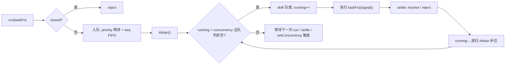

零依赖、可直接 `node` 运行的代码题参考实现。先澄清「并发池」与「限流器」「任务队列」的语义边界，再给主实现、七组自测与生产延伸。

:::note 运行方式
本文代码为 TypeScript，零依赖；Node ≥ 23.6 原生支持类型剥离，可直接 `node promise-pool.ts` 执行，自测输出 `ALL PASS`（已在 **Node v24.16.0** 实际运行）。
:::

## 题目

> 用 JS/TS 手写一个**并发池（任务调度器）**：提交一批异步任务，任意时刻**在飞任务数不超过 concurrency**，任务完成后自动补位；支持优先级、取消与动态调容量。

## 开口先澄清语义（必拿分）

三个概念经常被混为一谈，答之前先对齐：

| 概念       | 控制目标                        | 典型场景                         | 对照实现                                      |
| ---------- | ------------------------------- | -------------------------------- | --------------------------------------------- |
| **并发池** | 同时在飞的任务数（concurrency） | LLM 调用配额、浏览器连接数、爬虫 | 本文 `TaskPool`                               |
| **限流器** | 单位时间请求速率（rate）        | API 网关、防刷                   | [JS 手写限流器](/interview/code/rate-limiter) |
| **资源池** | 复用昂贵对象（连接、句柄）      | DB 连接池、线程池                | `generic-pool`（见下文对照）                  |

还要问清三件事：**失败语义**（单任务抛错是否影响池）、**公平性**（FIFO 还是优先级）、**取消语义**（排队中可移除，执行中只能协作式取消）。

## 方案选型对照

| 方案                     | 优点                         | 缺点                                 | 适用                |
| ------------------------ | ---------------------------- | ------------------------------------ | ------------------- |
| `Promise.all` 手动分片   | 零实现成本                   | 批内最慢者拖住整批，补位不及时       | 任务数少且均匀      |
| 递归 `next()` 指针       | 实现最短                     | 无优先级 / 取消 / 动态容量           | 面试白板第一步      |
| **本文 `TaskPool`**      | 优先级、取消、重试、动态容量 | 队列 `sort` 为 `O(n log n)` 插入     | **本题主解**        |
| `generic-pool`（服务端） | 资源生命周期管理完整         | 面向「可复用资源」而非「一次性任务」 | DB 连接、客户端句柄 |
| BullMQ 等分布式队列      | 持久化、重试、多消费者       | 引入 Redis 与运维成本                | 跨进程生产级任务流  |

> 事实依据：`yukino-codegen` 的 `server/rollup.config.js` externals 列表同时出现 `generic-pool`、`bullmq`、`node-cron`——一个真实 Node 后端里「资源池 / 分布式任务队列 / 定时调度」三者并存、各司其职。`node-pool`（generic-pool v3.9.0）的 `index.js` 只导出 `Pool / Deque / PriorityQueue / DefaultEvictor / createPool(factory, config)`，工厂约定 `{ create, destroy }`，与本文「一次性任务」模型正好互补。

## 主实现 · TaskPool

```ts
type TaskFn<T> = (ctx: { signal?: AbortSignal }) => T | PromiseLike<T>;

interface QueueItem<T> {
  priority: number;
  seq: number;
  taskFn: TaskFn<T>;
  resolve: (value: T) => void;
  reject: (err: unknown) => void;
  signal?: AbortSignal;
}

export class TaskPool {
  #concurrency: number;
  #running = 0;
  #queue: QueueItem<unknown>[] = [];
  #seq = 0;
  #closed = false;
  #signal?: AbortSignal;
  #onAbort?: () => void;

  constructor({
    concurrency = 4,
    signal,
  }: { concurrency?: number; signal?: AbortSignal } = {}) {
    if (!Number.isInteger(concurrency) || concurrency < 1) {
      throw new RangeError("concurrency must be an integer >= 1");
    }
    this.#concurrency = concurrency;
    if (signal) {
      this.#signal = signal;
      this.#onAbort = () =>
        this.#abortQueued(signal.reason ?? new Error("pool aborted"));
      if (signal.aborted) this.#onAbort();
      else signal.addEventListener("abort", this.#onAbort, { once: true });
    }
  }

  run<T>(
    taskFn: TaskFn<T>,
    { priority = 0, signal }: { priority?: number; signal?: AbortSignal } = {},
  ): Promise<T> {
    if (this.#closed) return Promise.reject(new Error("pool is closed"));
    if (typeof taskFn !== "function") {
      return Promise.reject(new TypeError("taskFn must be a function"));
    }
    return new Promise<T>((resolve, reject) => {
      if (signal?.aborted) {
        reject(signal.reason ?? new Error("task aborted"));
        return;
      }
      const item = {
        priority,
        seq: this.#seq++,
        taskFn,
        resolve,
        reject,
        signal,
      } as QueueItem<unknown>;
      signal?.addEventListener(
        "abort",
        () => {
          // 排队中的任务直接移除; 已在执行的任务不可抢占, 由 taskFn 自查 signal
          const idx = this.#queue.indexOf(item);
          if (idx !== -1) {
            this.#queue.splice(idx, 1);
            reject(signal.reason ?? new Error("task aborted"));
          }
        },
        { once: true },
      );
      // 优先级降序, 同级 FIFO; 任务量大时应换二叉堆 (O(log n) 插入)
      this.#queue.push(item);
      this.#queue.sort((a, b) => b.priority - a.priority || a.seq - b.seq);
      this.#drain();
    });
  }

  async runWithRetry<T>(
    taskFn: TaskFn<T>,
    {
      retries = 0,
      baseDelayMs = 10,
      shouldRetry = () => true,
      signal,
    }: {
      retries?: number;
      baseDelayMs?: number;
      shouldRetry?: (err: unknown) => boolean;
      signal?: AbortSignal;
    } = {},
  ): Promise<T> {
    let attempt = 0;
    for (;;) {
      try {
        return await this.run(taskFn, { signal });
      } catch (err) {
        if (attempt >= retries || !shouldRetry(err)) throw err;
        attempt++;
        await new Promise((r) =>
          setTimeout(r, baseDelayMs * 2 ** (attempt - 1)),
        );
      }
    }
  }

  setConcurrency(n: number): void {
    if (!Number.isInteger(n) || n < 1)
      throw new RangeError("concurrency must be an integer >= 1");
    this.#concurrency = n;
    this.#drain();
  }

  get stats(): {
    running: number;
    queued: number;
    concurrency: number;
    closed: boolean;
  } {
    return {
      running: this.#running,
      queued: this.#queue.length,
      concurrency: this.#concurrency,
      closed: this.#closed,
    };
  }

  close(): void {
    this.#closed = true;
    this.#abortQueued(new Error("pool is closed"));
    if (this.#signal && this.#onAbort)
      this.#signal.removeEventListener("abort", this.#onAbort);
  }

  #abortQueued(reason: unknown): void {
    for (const item of this.#queue.splice(0)) item.reject(reason);
  }

  #drain(): void {
    while (this.#running < this.#concurrency && this.#queue.length > 0) {
      const item = this.#queue.shift()!;
      this.#running++;
      Promise.resolve()
        .then(() => item.taskFn({ signal: item.signal }))
        .then(
          (value) => item.resolve(value),
          (err) => item.reject(err),
        )
        .finally(() => {
          this.#running--;
          this.#drain();
        });
    }
  }
}
```



### 设计要点（逐条讲给面试官）

| #   | 点                                | 为什么加分                                                                                     |
| --- | --------------------------------- | ---------------------------------------------------------------------------------------------- |
| 1   | **`#drain` 由三个入口触发**       | `run` 入队、任务 settle、`setConcurrency` 扩容都要补位；漏掉任何一个都会「卡死不消费」         |
| 2   | **`seq` 单调序号保 FIFO**         | `Array.prototype.sort` 是稳定排序，但显式 `seq` 让「同级先来先服务」不依赖引擎实现细节         |
| 3   | **取消分两种语义**                | 排队中：从队列移除并 reject；执行中：JS 无法抢占，只能把 `signal` 传给 `taskFn` 协作式退出     |
| 4   | **单任务失败不污染池**            | `settle` 用 `then(onOk, onErr)` 双回调，`finally` 保证槽位必然释放，否则一次抛错永久少一个槽   |
| 5   | **`close` 拒绝排队 + 拒收新任务** | 优雅关闭语义：在飞任务跑完，排队任务立刻拿到明确 rejection，而不是永远 pending                 |
| 6   | **原子性**                        | `#drain` 同步执行、无 `await`，JS 单线程内天然原子；**多进程 / Worker 各自为政**，与限流器同理 |

> 事实依据：`node-pool` 的 `lib/PoolDefaults.js` 给出了服务端资源池的对应参数面——`fifo: true`、`priorityRange: 1`（默认无优先级）、`testOnBorrow: false`、`idleTimeoutMillis: 30000`、`numTestsPerEvictionRun: 3`，而 `acquireTimeoutMillis / maxWaitingClients / min / max` 默认全为 `null`。`content/be/node-pool.md` 明确「库内没有锁，计数器只在单进程内一致」——进程内调度器的原子性边界与本文 `TaskPool` 完全相同。

## 自测（零依赖，可直接 `node` 跑）

```ts
function assert(cond: unknown, msg: string): void {
  if (!cond) throw new Error("FAIL: " + msg);
}

function deferred<T = void>() {
  let resolve!: (v: T) => void;
  let reject!: (e: unknown) => void;
  const promise = new Promise<T>((res, rej) => {
    resolve = res;
    reject = rej;
  });
  return { promise, resolve, reject };
}

const tick = () => new Promise((r) => setTimeout(r, 0));

// case 1: 并发上限严格遵守 + FIFO
{
  const pool = new TaskPool({ concurrency: 2 });
  let running = 0;
  let peak = 0;
  const gates = [deferred(), deferred(), deferred(), deferred()];
  const tasks = gates.map((g, i) =>
    pool.run(async () => {
      running++;
      peak = Math.max(peak, running);
      await g.promise;
      running--;
      return i;
    }),
  );
  await tick();
  assert(pool.stats.running === 2 && pool.stats.queued === 2, "case1 slots");
  for (const g of gates) {
    g.resolve();
    await tick();
  }
  const out = await Promise.all(tasks);
  assert(peak === 2, "case1 peak <= 2");
  assert(out.join(",") === "0,1,2,3", "case1 fifo order");
}

// case 2: 优先级插队, 同级 FIFO
{
  const pool = new TaskPool({ concurrency: 1 });
  const gate = deferred();
  const order: string[] = [];
  const t0 = pool.run(async () => {
    await gate.promise;
    order.push("first");
  });
  await tick();
  const tLow = pool.run(async () => order.push("low"));
  const tHigh = pool.run(async () => order.push("high"), { priority: 10 });
  const tMid = pool.run(async () => order.push("mid"), { priority: 5 });
  gate.resolve();
  await Promise.all([t0, tLow, tHigh, tMid]);
  assert(order.join(",") === "first,high,mid,low", "case2 priority order");
}

// case 3: 排队中的任务被 AbortSignal 取消, 不占槽位
{
  const pool = new TaskPool({ concurrency: 1 });
  const gate = deferred();
  const ac = new AbortController();
  const t0 = pool.run(() => gate.promise);
  await tick();
  const t1 = pool.run(() => "should not run", { signal: ac.signal });
  ac.abort(new Error("user cancelled"));
  let reason: string | null = null;
  await t1.catch((e: Error) => (reason = e.message));
  assert(
    reason === "user cancelled" && pool.stats.queued === 0,
    "case3 queued abort",
  );
  gate.resolve();
  await t0;
}

// case 4: 任务抛错不影响后续任务, 槽位正常释放
{
  const pool = new TaskPool({ concurrency: 1 });
  const results = await Promise.allSettled([
    pool.run(() => {
      throw new Error("boom");
    }),
    pool.run(() => "ok"),
  ]);
  assert(results[0].status === "rejected", "case4 first rejected");
  assert(
    results[1].status === "fulfilled" && results[1].value === "ok",
    "case4 second ok",
  );
  assert(pool.stats.running === 0, "case4 slot released");
}

// case 5: 动态调容量
{
  const pool = new TaskPool({ concurrency: 1 });
  const gates = [deferred(), deferred(), deferred()];
  const tasks = gates.map((g) => pool.run(() => g.promise));
  await tick();
  assert(pool.stats.running === 1, "case5 starts at 1");
  pool.setConcurrency(3);
  await tick();
  assert(pool.stats.running === 3, "case5 expanded to 3");
  for (const g of gates) g.resolve();
  await Promise.all(tasks);
}

// case 6: 失败重试, 指数退避后成功; 重试耗尽则抛出
{
  const pool = new TaskPool({ concurrency: 2 });
  let attempts = 0;
  const value = await pool.runWithRetry(
    () => {
      attempts++;
      if (attempts < 3) throw new Error("flaky");
      return "done";
    },
    { retries: 3, baseDelayMs: 1 },
  );
  assert(value === "done" && attempts === 3, "case6 retry succeeds");
  let threw = false;
  try {
    await pool.runWithRetry(
      () => {
        throw new Error("always");
      },
      { retries: 2, baseDelayMs: 1 },
    );
  } catch {
    threw = true;
  }
  assert(threw, "case6 retries exhausted");
}

// case 7: close 后拒绝新任务, 排队任务被 reject
{
  const pool = new TaskPool({ concurrency: 1 });
  const gate = deferred();
  const t0 = pool.run(() => gate.promise);
  await tick();
  const t1 = pool.run(() => "queued");
  pool.close();
  let reason: string | null = null;
  await t1.catch((e: Error) => (reason = e.message));
  assert(reason === "pool is closed", "case7 queued rejected on close");
  let refused = false;
  await pool.run(() => 1).catch(() => (refused = true));
  assert(refused, "case7 new task refused");
  gate.resolve();
  await t0;
}

console.log("ALL PASS");
```

> 已在 **Node v24.16.0** 实际运行，七组 case 全部通过，输出 `ALL PASS`。测试全部用 `deferred` 手动门控，不依赖真实耗时，结果确定。

## 生产延伸

| 问题             | 答案                                                                                                                                                  |
| ---------------- | ----------------------------------------------------------------------------------------------------------------------------------------------------- |
| **队列规模大**   | `push + sort` 是 `O(n log n)` 插入，换二叉堆 / `PriorityQueue`；`generic-pool` 就自带 `lib/PriorityQueue.js` + `lib/Deque.js` 双队列                  |
| **背压**         | `queued` 无上限会吃爆内存 → 学 `generic-pool` 的 `maxWaitingClients`（默认 `null` 即无上限，是已知风险位），超限直接 reject 或返回 `429`              |
| **等待超时**     | `acquireTimeoutMillis` 语义：排队超过阈值就 reject，避免调用方无限挂起；`generic-pool` 默认同为 `null`，生产必须显式设置                              |
| **多实例部署**   | 进程内计数器各自为政 → 分布式任务队列（BullMQ / Redis）或网关层统一配额；与[限流器](/interview/code/rate-limiter)的「多实例必须 Redis + Lua」同一结论 |
| **对接上游配额** | LLM Provider 返回 `429` + `Retry-After` 时，`shouldRetry` 判错误类型、退避优先读 `Retry-After`，再指数退避加抖动                                      |
| **执行中取消**   | JS 无抢占式取消：`taskFn` 收到 `ctx.signal` 后自查（`fetch` 直接透传 signal）；池只能保证「排队中立即移除」                                           |
| **可观测**       | 暴露 `stats`（running / queued）打点；队列长度持续增长 = 消费能力不足的最早信号                                                                       |

## 采分点

| 维度     | 加分                                                 | 扣分                         |
| -------- | ---------------------------------------------------- | ---------------------------- |
| 正确性   | 先辨析并发池 / 限流器 / 资源池；槽位释放走 `finally` | 把并发池写成速率限流         |
| 深度     | `seq` 保 FIFO、取消双语义、`#drain` 三入口           | 只写递归 `next()` 无边界处理 |
| 工程取舍 | 说清 `sort` 队列的规模上限与堆替代、背压与等待超时   | 队列无上限、无超时           |
| 表达结构 | 语义 → 选型 → 实现 → 测试 → 分布式延伸               | 埋头写代码不解释             |
| 边界意识 | 参数校验、close 语义、单进程原子性、协作式取消       | 只测 happy path              |

## 追问链

1. 为什么 `finally` 里要**递归** `#drain` 而不是只补一个任务？（一次 settle 可能伴随 `setConcurrency` 扩容，需循环补满）
2. 执行中的任务能强制取消吗？（不能，JS 无抢占；只能协作式 `signal`，`fetch`/流式读取原生支持）
3. 优先级队列怎么做到 `O(log n)`？（二叉堆；对照 `generic-pool` 的 `PriorityQueue` + `priorityRange` 分桶）
4. 排队任务无限增长怎么办？（`maxWaitingClients` 上限 + 拒绝策略；网关层先行限流）
5. 和 `Promise.allSettled` 分片方案的本质区别？（分片是「批同步」，池是「完成即补位」，长尾任务不拖批）
6. 多进程部署为什么失效？（计数器在进程内存里；需要 Redis 集中式配额或分布式队列，同[限流器](/interview/code/rate-limiter)结论）

## 速记卡

- **主解**：队列 + `#drain` 循环补位；`run` / settle / `setConcurrency` 三入口触发。
- **三个工程细节**：`seq` 保 FIFO、`finally` 释放槽位、取消分「排队移除」与「协作式 signal」。
- **两个必答边界**：队列无上限会 OOM（背压）；单进程原子、多实例失效。
- **对照记忆**：并发池控「在飞数」，限流器控「速率」，`generic-pool` 控「资源复用」。

## 延伸阅读

[JS 手写限流器](/interview/code/rate-limiter) · [SSE 客户端与重连退避](/interview/code/sse-retry) · [前端工程化](/interview/qa/frontend-engineering) · [算法手撕](/interview/fundamentals/algorithms)
