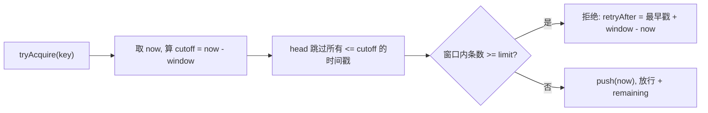

零依赖、可直接 `node` 运行的代码题参考实现。先澄清固定窗口与滑动窗口的语义，再给主实现、对照实现、六组自测与生产延伸。

:::note 运行方式
本文代码零依赖、可直接用 `node` 执行，自测输出 `ALL PASS`。
:::

## 题目

> 用 JS 手写一个限流器：**同一个 key 在一定时间范围内请求不能超过 limit 次数**。

## 开口先澄清语义（必拿分）

「一定时间范围」有两种解释，答之前先问清：

| 解释             | 含义                                               | 后果                                 |
| ---------------- | -------------------------------------------------- | ------------------------------------ |
| **固定窗口**     | 按 `Math.floor(now / window)` 对齐的窗口内 ≤ limit | 简单、O(1)，但**边界可放行 2×limit** |
| **任意滑动窗口** | 任意长度为 window 的时间区间内 ≤ limit             | 精确符合字面语义，是本题主解         |

## 算法选型对照

| 算法                     | 内存 / key | 精确性                   | 突发         | 适用                   |
| ------------------------ | ---------- | ------------------------ | ------------ | ---------------------- |
| 固定窗口计数             | `O(1)`     | 弱（边界效应）           | 允许 2×      | 粗粒度、低成本         |
| **滑动窗口日志**         | `O(limit)` | **精确**                 | 不允许       | **本题主解**、严格配额 |
| 滑动窗口计数（加权近似） | `O(1)`     | 近似                     | 较平滑       | 高 QPS、可接受误差     |
| 令牌桶                   | `O(1)`     | 控制**速率**而非窗口总量 | **允许突发** | API 网关、上游配额     |
| 漏桶                     | `O(queue)` | 恒定输出速率             | 排队         | 平滑流量、整形         |

> 事实依据：`content/be/redis.md:434-444` 已把固定窗口（`INCR` + 首次设过期）、滑动窗口（`zset` + `ZREMRANGEBYSCORE`/`ZCARD`/`ZADD` + Lua）、令牌桶（hash + Lua）三种方案与取舍写全。

## 主实现 · 滑动窗口日志

```js
class SlidingWindowLimiter {
  #buckets = new Map(); // key -> { ts: number[], head: number }
  #timer = null;

  constructor({
    limit,
    windowMs,
    now = () => Date.now(),
    sweepIntervalMs = 60_000,
  }) {
    if (!Number.isInteger(limit) || limit < 1)
      throw new RangeError("limit must be an integer >= 1");
    if (!Number.isFinite(windowMs) || windowMs <= 0)
      throw new RangeError("windowMs must be > 0");
    this.limit = limit;
    this.windowMs = windowMs;
    this.now = now;
    this.sweepIntervalMs = sweepIntervalMs;
  }

  tryAcquire(key) {
    let b = this.#buckets.get(key);
    if (!b) {
      b = { ts: [], head: 0 };
      this.#buckets.set(key, b);
    }

    // 单调保护: 时钟回拨时不让时间戳倒退, 否则队列有序性被破坏
    const t = Math.max(this.now(), b.ts.at(-1) ?? 0);
    const cutoff = t - this.windowMs;

    // 裁掉窗口外的时间戳; 用 head 指针代替 shift(), 避免 O(n) 搬移
    while (b.head < b.ts.length && b.ts[b.head] <= cutoff) b.head++;

    // 数组只增不减, 头指针过大时压缩, 避免长跑内存泄漏
    if (b.head > 1024 && b.head * 2 > b.ts.length) {
      b.ts = b.ts.slice(b.head);
      b.head = 0;
    }

    const used = b.ts.length - b.head;
    if (used >= this.limit) {
      const resetAtMs = b.ts[b.head] + this.windowMs;
      return {
        allowed: false,
        remaining: 0,
        retryAfterMs: Math.max(0, resetAtMs - t),
        resetAtMs,
      };
    }

    b.ts.push(t);
    return {
      allowed: true,
      remaining: this.limit - used - 1,
      retryAfterMs: 0,
      resetAtMs: b.ts[b.head] + this.windowMs,
    };
  }

  // 清理长期不活跃的 key, 否则 Map 无限增长
  sweep() {
    const cutoff = Math.max(this.now(), 0) - this.windowMs;
    for (const [key, b] of this.#buckets) {
      while (b.head < b.ts.length && b.ts[b.head] <= cutoff) b.head++;
      if (b.head === b.ts.length) this.#buckets.delete(key);
    }
  }

  startSweep() {
    if (this.#timer) return;
    this.#timer = setInterval(() => this.sweep(), this.sweepIntervalMs);
    this.#timer.unref?.(); // Node 下不阻止进程退出; 浏览器无 unref
  }

  stopSweep() {
    if (this.#timer) clearInterval(this.#timer);
    this.#timer = null;
  }

  get size() {
    return this.#buckets.size;
  }
}
```



### 设计要点（逐条讲给面试官）

| #   | 点                          | 为什么加分                                                                   |
| --- | --------------------------- | ---------------------------------------------------------------------------- |
| 1   | **head 指针代替 `shift()`** | `shift()` 每次 O(n)；head 均摊 O(1)，配合 `slice` 压缩防数组无限增长         |
| 2   | **`sweep()` 清 key**        | 只裁时间戳不清 key，长跑必然内存泄漏；这是最高频追问                         |
| 3   | **`now` 可注入**            | 假时钟可做确定性单测；单调保护避免 `Date.now()` 回拨破坏有序性               |
| 4   | **返回值对接 HTTP**         | `allowed=false` → `429` + `Retry-After`（秒）+ `X-RateLimit-Remaining/Reset` |
| 5   | **复杂度**                  | 时间 O(过期条数)，均摊 O(1)；空间 `O(limit)` / key                           |
| 6   | **原子性**                  | `tryAcquire` 同步无 `await` → JS 单线程内天然原子；**多进程即失效**          |

> 事实依据：`content/docs/yukino/yukino-code.md` 与 `react-and-agent-loop.md` 记载了消费端的对应实现——Provider 把 `429` 归类为带 `Retry-After` 的 `RateLimitError`，**优先解析 `Retry-After`（支持秒数与 HTTP date 两种格式）**，缺省则指数退避（限流 5s 起步、上限 60s、最多 3 次）。你返回的 `retryAfterMs` 正好喂给这条链路。

## 对照实现 · 固定窗口（展示缺陷）

```js
class FixedWindowLimiter {
  #windows = new Map(); // key -> { id, count }

  constructor({ limit, windowMs, now = () => Date.now() }) {
    this.limit = limit;
    this.windowMs = windowMs;
    this.now = now;
  }

  tryAcquire(key) {
    const t = this.now();
    const id = Math.floor(t / this.windowMs);
    let w = this.#windows.get(key);
    if (!w || w.id !== id) {
      w = { id, count: 0 };
      this.#windows.set(key, w);
    }
    const resetAtMs = (id + 1) * this.windowMs;
    if (w.count >= this.limit) {
      return {
        allowed: false,
        remaining: 0,
        retryAfterMs: resetAtMs - t,
        resetAtMs,
      };
    }
    w.count++;
    return {
      allowed: true,
      remaining: this.limit - w.count,
      retryAfterMs: 0,
      resetAtMs,
    };
  }
}
```

**边界双倍突发**：`window=1000ms, limit=5`，`t=990` 发 5 次、`t=1010` 再发 5 次 → 落在两个固定窗口各 5 次，都放行；但区间 `[10, 1010]` 这 1 秒内实际有 **10 次**。滑动窗口日志版在 `t=1010` 会拒绝。

## 自测（假时钟，零依赖，可直接 `node` 跑）

```js
function assert(cond, msg) {
  if (!cond) throw new Error("FAIL: " + msg);
}

let clock = 0;
const now = () => clock;

// case 1: 前 limit 次放行, 第 limit+1 次拒绝, retryAfter 正确
const L = new SlidingWindowLimiter({ limit: 5, windowMs: 1000, now });
for (let i = 0; i < 5; i++)
  assert(L.tryAcquire("u1").allowed === true, "case1 allow");
const denied = L.tryAcquire("u1");
assert(
  denied.allowed === false && denied.retryAfterMs === 1000,
  "case1 deny + retryAfter",
);

// case 2: 最早一条过期后恢复
clock = 1001;
assert(L.tryAcquire("u1").allowed === true, "case2 recover");

// case 3: remaining 递减 + 多 key 互不影响
clock = 0;
const L2 = new SlidingWindowLimiter({ limit: 2, windowMs: 1000, now });
assert(L2.tryAcquire("a").remaining === 1, "case3 remaining");
assert(L2.tryAcquire("a").remaining === 0, "case3 remaining 0");
assert(L2.tryAcquire("a").allowed === false, "case3 deny a");
assert(L2.tryAcquire("b").allowed === true, "case3 key isolated");

// case 4: 窗口边界双倍突发 —— 滑动拒绝, 固定放行
clock = 990;
const S = new SlidingWindowLimiter({ limit: 5, windowMs: 1000, now });
const F = new FixedWindowLimiter({ limit: 5, windowMs: 1000, now });
for (let i = 0; i < 5; i++) {
  S.tryAcquire("k");
  F.tryAcquire("k");
}
clock = 1010;
assert(S.tryAcquire("k").allowed === false, "case4 sliding blocks burst");
assert(F.tryAcquire("k").allowed === true, "case4 fixed allows burst");

// case 5: sweep 清理空闲 key
clock = 5000;
S.sweep();
assert(S.size === 0, "case5 sweep clears idle keys");

// case 6: 参数校验
let threw = false;
try {
  new SlidingWindowLimiter({ limit: 0, windowMs: 1000 });
} catch {
  threw = true;
}
assert(threw, "case6 validate limit");

console.log("ALL PASS");
```

> 已在 **Node 22** 实际运行，六组 case 全部通过，输出 `ALL PASS`。

## 生产延伸

| 问题              | 答案                                                                                                                                                                                                 |
| ----------------- | ---------------------------------------------------------------------------------------------------------------------------------------------------------------------------------------------------- |
| **多实例部署**    | 进程内计数各自为政 → Redis `zset` 记录时间戳，成员带唯一后缀防同毫秒重复；`ZREMRANGEBYSCORE` 裁剪 + `ZCARD` + `ZADD` **必须放进 Lua 原子执行**，否则「检查与写入」之间的竞态会超发（`redis.md:440`） |
| 固定窗口 Redis 版 | `INCR` 计数，**只在首次设置 `EXPIRE`**；键名带窗口 id（`redis.md:436`）                                                                                                                              |
| 内存代价          | 滑动窗口每个请求占一个成员，内存随请求量增长；高 QPS 可改加权近似或令牌桶                                                                                                                            |
| 单进程上限        | `content/be/node-pool.md` 明确「库内没有锁，计数器只在单进程内一致；多进程需按进程数放大或改用集中式限流」——同一道理                                                                                 |
| 时钟              | `Date.now()` 会回拨；生产用单调时钟或 Redis `TIME`                                                                                                                                                   |
| key 洪泛          | attacker 造大量不同 key 打爆 Map → 需容量上限 / LRU / 网关层先按 IP 粗限流                                                                                                                           |
| 分层              | 网关粗限流（IP / 租户）+ 进程内细限流（user / API key）；拒绝用 `429` 而非 `403`                                                                                                                     |
| 客户端配合        | `Retry-After` + 指数退避 + 抖动，避免重试风暴；对应 `yukino-code.md` 的 `RateLimitError` 退避策略                                                                                                    |

## 采分点

| 维度     | 加分                                                            | 扣分                       |
| -------- | --------------------------------------------------------------- | -------------------------- |
| 正确性   | 先澄清固定窗口 vs 滑动窗口；任意窗口内严格 ≤ limit              | 直接写固定窗口当答案       |
| 深度     | `head` 指针 + 压缩、`sweep` 清 key、单调时钟保护                | 用 `shift()`、Map 只增不删 |
| 工程取舍 | 说清 `O(limit)` 内存代价、精确性 vs 成本、令牌桶何时更合适      | 只给一种实现不讲 trade-off |
| 表达结构 | 语义 → 选型 → 实现 → 边界 → 分布式                              | 埋头写代码不解释           |
| 边界意识 | 并发原子性、多进程失效、参数校验、`429`/`Retry-After`、key 洪泛 | 只测 happy path            |

## 追问链

1. 固定窗口边界为什么是 **2×limit**？不存时间戳怎么修？（滑动窗口计数加权近似）
2. key 越来越多内存怎么控？（`sweep` + 容量上限 / LRU + 网关层粗限流）
3. 多实例部署为什么必须 Redis + **Lua**？（`ZCARD` 与 `ZADD` 非原子会超发）
4. 时钟回拨、同一毫秒重复请求怎么处理？（单调时钟；zset 成员加唯一后缀）
5. 被拒后客户端怎么做？（`Retry-After` 优先，否则指数退避 + 抖动）
6. 令牌桶 vs 滑动窗口怎么选？（允许突发 vs 严格窗口总量）

## 速记卡

- **主解**：每 key 一个时间戳队列，判「过去 window 内条数 < limit」，拒绝时 `retryAfter = 最早戳 + window - now`。
- **三个工程细节**：`head` 指针（别 `shift`）、`sweep` 清 key（别泄漏）、`now` 可注入（能测 + 单调保护）。
- **两个必答边界**：固定窗口 2×limit 突发；单进程计数器多实例失效 → Redis + Lua。
- **对接 HTTP**：`429` + `Retry-After` + `X-RateLimit-Remaining/Reset`。

## 延伸阅读

[算法手撕](/interview/fundamentals/algorithms) · [Go 网关](/interview/fundamentals/backend-go-gateway) · [大 Body 与并发容量](/interview/answers/large-payload-capacity)
