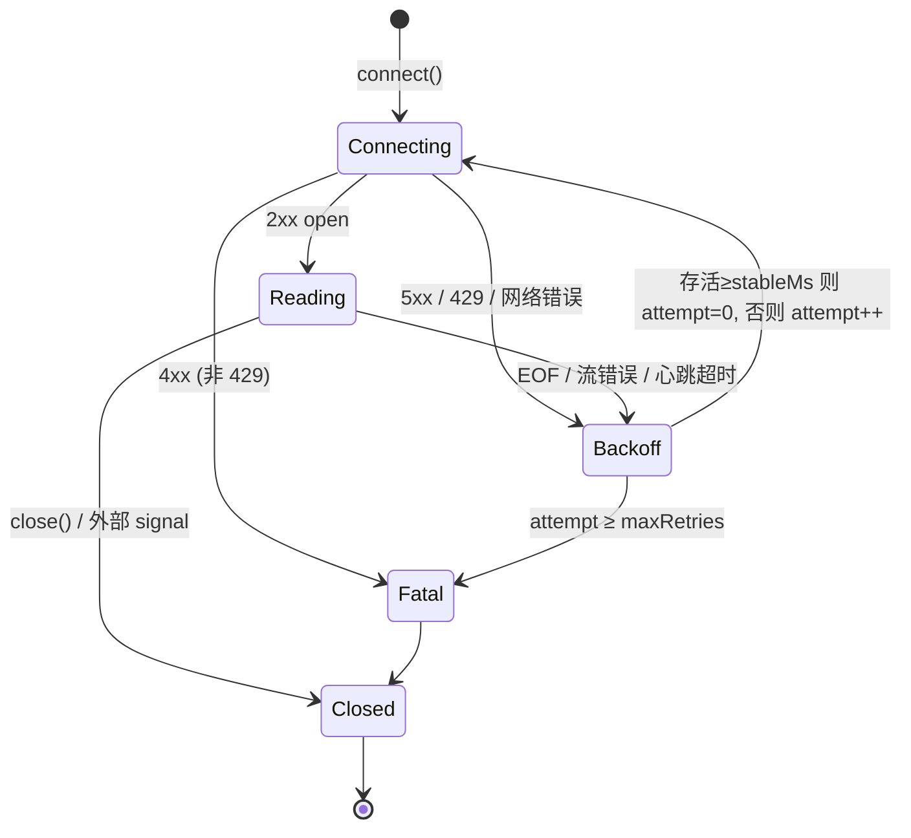

零依赖、可直接 `node` 运行的代码题参考实现。先辨析 `EventSource` 与 `fetch + ReadableStream` 两条路线，再给完整协议解析、重连状态机、五组自测与生产延伸。

:::note 运行方式
本文代码为 TypeScript，零依赖；Node ≥ 23.6 原生支持类型剥离，可直接 `node sse-retry.ts` 执行，自测输出 `ALL PASS`（已在 **Node v24.16.0** 实际运行）。
:::

## 题目

> 手写一个 **SSE（Server-Sent Events）客户端**：解析 `text/event-stream` 事件流；连接断开后**自动重连并指数退避**；重连时携带 `Last-Event-ID` 断点续传；支持心跳超时检测与用户主动取消。

## 开口先澄清（必拿分）

**路线一：浏览器原生 `EventSource`**。零代码即得重连，但有硬限制：**只能 GET**、**不能带自定义 header**（Authorization 都加不了）、不能设请求体、重连间隔只能靠服务端 `retry:` 字段控制、且仅浏览器可用（Node 无原生实现）。

**路线二：`fetch` + `ReadableStream` 手工解析**。协议全掌控：任意 method / header、自定义退避、心跳超时、精确取消。代价是**协议解析与重连状态机全部自己写**——这正是本题考点。

> 事实依据：`yukino-codegen` 的 `client/package.json` 依赖 `@microsoft/fetch-event-source@^2.0.1`——生产项目没有用原生 `EventSource`，而是选了 fetch 路线的现成库，原因就是上表的限制。手写一遍才能讲清库在做什么。

## 协议要点（WHATWG SSE 规范）

| 规则     | 内容                                                                  |
| -------- | --------------------------------------------------------------------- |
| 事件分隔 | **空行**；行结束符兼容 `\r\n` / `\n` / `\r`                           |
| `data:`  | 多行 `data` 用 `\n` 拼接；冒号后**只去掉一个**前导空格                |
| `event:` | 事件类型，缺省为 `message`                                            |
| `id:`    | 写入 last event ID（含 `\0` 则忽略）；重连时经 `Last-Event-ID` 头回传 |
| `retry:` | 整数毫秒，覆盖客户端重连基准间隔                                      |
| `:` 开头 | 注释行，服务端常用作**心跳**保活；不派发                              |
| 跨 chunk | TCP 分片与事件边界无关，必须缓冲到空行才派发                          |

## 主实现 · SseClient

```ts
const DEFAULT_RETRY_MS = 3000;

interface SseOptions {
  fetch?: (
    url: string,
    init: { headers: Record<string, string>; signal: AbortSignal },
  ) => Promise<{
    ok: boolean;
    status: number;
    body?: ReadableStream<Uint8Array> | null;
  }>;
  headers?: Record<string, string>;
  signal?: AbortSignal; // 用户主动关闭
  maxRetries?: number; // 默认 Infinity
  backoffBaseMs?: number; // 退避基准, SSE 规范 retry: 字段可覆盖
  backoffMaxMs?: number; // 退避上限
  heartbeatTimeoutMs?: number; // 0 禁用, 默认 45000
  stableMs?: number; // 连接存活超过该时长才重置退避计数
}

export class SseClient {
  #url: string;
  #fetchImpl: NonNullable<SseOptions["fetch"]>;
  #headers: Record<string, string>;
  #signal?: AbortSignal;
  #ac: AbortController | null = null; // 当前连接
  #lastEventId = "";
  #retryMs: number;
  #maxRetries: number;
  #backoffMaxMs: number;
  #heartbeatMs: number;
  #timer: ReturnType<typeof setTimeout> | null = null;
  #attempt = 0;
  #connectedAt = 0;
  #stableMs: number;
  #closed = false;
  #listeners = new Map<string, Set<(e: any) => void>>();

  constructor(url: string, o: SseOptions = {}) {
    if (!/^https?:/.test(url))
      throw new TypeError("url must be absolute http(s)");
    this.#url = url;
    this.#fetchImpl =
      o.fetch ??
      (globalThis.fetch as unknown as NonNullable<SseOptions["fetch"]>);
    this.#headers = o.headers ?? {};
    this.#signal = o.signal;
    this.#maxRetries = o.maxRetries ?? Infinity;
    this.#retryMs = o.backoffBaseMs ?? DEFAULT_RETRY_MS;
    this.#backoffMaxMs = o.backoffMaxMs ?? 30000;
    this.#heartbeatMs = o.heartbeatTimeoutMs ?? 45000;
    this.#stableMs = o.stableMs ?? 1000;
    if (this.#signal?.aborted) this.#closed = true;
    this.#signal?.addEventListener("abort", () => this.close(), { once: true });
  }

  on(type: string, h: (e: any) => void): this {
    if (!this.#listeners.has(type)) this.#listeners.set(type, new Set());
    this.#listeners.get(type)!.add(h);
    return this;
  }

  #emit(type: string, e: Record<string, unknown>): void {
    for (const h of this.#listeners.get(type) ?? []) h(e);
    if (type !== "*")
      for (const h of this.#listeners.get("*") ?? []) h({ type, ...e });
  }

  close(): void {
    if (this.#closed) return;
    this.#closed = true;
    this.#clearTimer();
    this.#ac?.abort();
    this.#emit("close", { reason: "client" });
  }

  get lastEventId(): string {
    return this.#lastEventId;
  }

  get retryMs(): number {
    return this.#retryMs;
  }

  // 主循环: 连接 -> 读流 -> 断开 -> 退避重连, 直到 close() 或超过 maxRetries
  async connect(): Promise<void> {
    if (this.#closed) return;
    for (;;) {
      this.#connectedAt = 0;
      try {
        await this.#connectOnce();
        if (this.#closed) return;
        this.#emit("disconnect", { reason: "eof" }); // 服务端正常关流也要重连
      } catch (err) {
        if (this.#closed) return;
        this.#emit("disconnect", { reason: "error", error: err });
      }
      // 只有连接稳定存活过才重置退避; 否则 flapping (连上就断)
      // 会让计数器永远归零, 重连风暴打穿刚恢复的服务端
      if (
        this.#connectedAt &&
        Date.now() - this.#connectedAt >= this.#stableMs
      ) {
        this.#attempt = 0;
      }
      if (this.#attempt >= this.#maxRetries) {
        this.#emit("error", { fatal: true, message: "max retries exceeded" });
        this.close();
        return;
      }
      const delay = this.#nextDelay();
      this.#attempt++;
      this.#emit("retry", { attempt: this.#attempt, delay });
      await new Promise((r) => setTimeout(r, delay));
      if (this.#closed) return;
    }
  }

  // 指数退避 + 等抖动, 避免服务端恢复瞬间的重连风暴 (thundering herd)
  #nextDelay(): number {
    const exp = Math.min(
      this.#retryMs * 2 ** this.#attempt,
      this.#backoffMaxMs,
    );
    return Math.round(exp / 2 + Math.random() * (exp / 2));
  }

  async #connectOnce(): Promise<void> {
    this.#ac = new AbortController();
    const headers: Record<string, string> = {
      Accept: "text/event-stream",
      ...this.#headers,
    };
    if (this.#lastEventId) headers["Last-Event-ID"] = this.#lastEventId; // 断点续传
    const res = await this.#fetchImpl(this.#url, {
      headers,
      signal: anySignal([this.#ac.signal, this.#signal]),
    });
    if (!res.ok) {
      // 4xx 语义性失败不重试 (401/404/410); 5xx 与 429 可重试
      if (res.status >= 400 && res.status < 500 && res.status !== 429) {
        this.#emit("error", { fatal: true, status: res.status });
        this.close();
        return;
      }
      throw new Error(`SSE HTTP ${res.status}`);
    }
    this.#connectedAt = Date.now();
    this.#emit("open", { url: this.#url });
    await this.#readLoop(res.body);
  }

  async #readLoop(body?: ReadableStream<Uint8Array> | null): Promise<void> {
    if (!body) throw new Error("response has no body");
    const reader = body.getReader();
    const decoder = new TextDecoder("utf-8");
    const onTimeout = () => this.#ac?.abort(new Error("heartbeat timeout"));
    let buf = "";
    this.#arm(onTimeout);
    try {
      for (;;) {
        const { done, value } = await reader.read();
        if (done) break;
        this.#arm(onTimeout); // 每收到字节就重置心跳
        buf += decoder.decode(value, { stream: true });
        // 事件以空行分隔; 兼容 \r\n / \n / \r 三种行结束符
        let b: number;
        while ((b = boundary(buf)) !== -1) {
          this.#dispatch(buf.slice(0, b));
          buf = buf.slice(skip(buf, b));
        }
      }
      buf += decoder.decode(); // flush 残余多字节字符
      if (buf.trim()) this.#dispatch(buf);
    } finally {
      this.#clearTimer();
      reader.releaseLock();
    }
  }

  #arm(onTimeout: () => void): void {
    if (!this.#heartbeatMs) return;
    this.#clearTimer();
    // 不能 unref: 静默流场景下心跳是唯一驱动事件循环的定时器
    this.#timer = setTimeout(onTimeout, this.#heartbeatMs);
  }

  #clearTimer(): void {
    if (this.#timer) clearTimeout(this.#timer);
    this.#timer = null;
  }

  // 解析事件块: 字段 event/data/id/retry, ':' 开头是注释行 (常用作心跳)
  #dispatch(raw: string): void {
    let eventType = "message";
    const dataLines: string[] = [];
    for (const line of raw.split(/\r\n|\n|\r/)) {
      if (!line || line.startsWith(":")) continue;
      const colon = line.indexOf(":");
      const field = colon === -1 ? line : line.slice(0, colon);
      let val = colon === -1 ? "" : line.slice(colon + 1);
      if (val.startsWith(" ")) val = val.slice(1); // 只去掉一个前导空格
      if (field === "event") eventType = val;
      else if (field === "data") dataLines.push(val);
      else if (field === "id" && !val.includes("\0")) this.#lastEventId = val;
      else if (
        field === "retry" &&
        Number.isInteger(Number(val)) &&
        Number(val) > 0
      ) {
        this.#retryMs = Number(val);
      }
    }
    if (dataLines.length === 0) return; // 纯注释/心跳块不派发
    this.#emit(eventType, {
      data: dataLines.join("\n"),
      lastEventId: this.#lastEventId,
    });
  }
}

// 最早出现的空行边界 (\r\n\r\n / \n\n / \r\r)
function boundary(buf: string): number {
  const idx = [
    buf.indexOf("\r\n\r\n"),
    buf.indexOf("\n\n"),
    buf.indexOf("\r\r"),
  ].filter((i) => i !== -1);
  return idx.length ? Math.min(...idx) : -1;
}

function skip(buf: string, start: number): number {
  return buf.startsWith("\r\n\r\n", start) ? start + 4 : start + 2;
}

function anySignal(signals: (AbortSignal | undefined)[]): AbortSignal {
  const ac = new AbortController();
  for (const s of signals) {
    if (!s) continue;
    if (s.aborted) {
      ac.abort(s.reason);
      return ac.signal;
    }
    s.addEventListener("abort", () => ac.abort(s.reason), { once: true });
  }
  return ac.signal;
}
```



### 设计要点（逐条讲给面试官）

| #   | 点                           | 为什么加分                                                                                                                          |
| --- | ---------------------------- | ----------------------------------------------------------------------------------------------------------------------------------- |
| 1   | **缓冲到空行才派发**         | TCP 分片与事件边界无关；`decode(value, { stream: true })` 保证多字节 UTF-8 字符跨 chunk 不裂                                        |
| 2   | **`stableMs` 防 flapping**   | 收到 200 就把退避计数清零是**经典错误**：连上就断的抖动会让客户端以最高频率无限重连，打穿刚恢复的服务端。只有连接存活超过阈值才重置 |
| 3   | **4xx / 5xx 分流**           | `401/404/410` 是语义性失败，重试无意义；`429/5xx` 才进退避。与[限流器](/interview/code/rate-limiter)的 `Retry-After` 链路呼应       |
| 4   | **心跳超时 ≠ TCP keepalive** | 代理可能静默吞掉半开连接；应用层「N 秒无字节即 abort 重连」才能兜住。注释行 `: ping` 就是服务端心跳                                 |
| 5   | **等抖动（equal jitter）**   | `exp/2 + random·exp/2`：既保留指数退避的下界，又打散重连时刻，避免 thundering herd                                                  |
| 6   | **`anySignal` 合并取消源**   | 用户 signal 与内部重连 abort 互不干扰；每次连接新建 `AbortController`，旧连接的 abort 不污染新连接                                  |
| 7   | **心跳定时器不能 `unref`**   | Node 下静默流场景心跳是唯一驱动事件循环的定时器，`unref` 会让进程带着未完成的连接直接退出（实测踩坑）                               |

> 事实依据：`yukino-chat` 的 `docker/nginx.conf.template` 是这套客户端的服务端对照——`location /api/` 下 `proxy_buffering off`、`proxy_request_buffering off`（**关缓冲，否则 Nginx 攒满缓冲区才转发，流式变批式**）、`proxy_read_timeout 3600s` / `proxy_send_timeout 3600s`（长连接不被 60s 默认超时掐断）、`client_max_body_size 100m`（分片上传）；`gzip_types` 列表**不含** `text/event-stream`，事件流不被压缩缓冲。

## 自测（伪 fetch，零依赖，可直接 `node` 跑）

```ts
function assert(cond: unknown, msg: string): void {
  if (!cond) throw new Error("FAIL: " + msg);
}

const streamOf = (...chunks: string[]) =>
  new ReadableStream<Uint8Array>({
    start(c) {
      const enc = new TextEncoder();
      for (const s of chunks) c.enqueue(enc.encode(s));
      c.close();
    },
  });

// 永不结束的静默流, 响应 abort (模拟真实 fetch 被取消时 body 出错)
const silent = (init?: { signal?: AbortSignal }) => ({
  ok: true,
  status: 200,
  body: new ReadableStream<Uint8Array>({
    start(c) {
      c.enqueue(new TextEncoder().encode("data: first\n\n"));
      init?.signal?.addEventListener("abort", () => {
        try {
          c.error(init.signal?.reason ?? new Error("aborted"));
        } catch {
          /* 已关闭 */
        }
      });
    },
  }),
});

// case 1: event/data/id 解析、多行 data、注释行、跨 chunk 拼接
{
  const events: any[] = [];
  const client = new SseClient("http://x.test/stream", {
    fetch: async () => ({
      ok: true,
      status: 200,
      body: streamOf(
        ": heartbeat\n\n",
        'event: token\ndata: {"t":"he"}\nid: 1\n\n',
        "data: line1\ndata: line2\n\n",
        "data: split", // 与下一块拼成完整事件
        "ed\n\n",
      ),
    }),
    maxRetries: 0,
  });
  client.on("*", (e) => events.push(e));
  await client.connect();
  const tokens = events.filter((e) => e.type === "token");
  const messages = events.filter((e) => e.type === "message");
  assert(tokens.length === 1 && tokens[0].data === '{"t":"he"}', "case1 token");
  assert(client.lastEventId === "1", "case1 lastEventId");
  assert(messages[0].data === "line1\nline2", "case1 multiline data");
  assert(messages[1].data === "splited", "case1 cross-chunk concat");
}

// case 2: 断流自动重连, 携带 Last-Event-ID 续传
{
  let calls = 0;
  const seen: Record<string, string>[] = [];
  const client = new SseClient("http://x.test/stream", {
    fetch: async (_u, init) => {
      calls++;
      seen.push(init.headers);
      const body =
        calls === 1
          ? streamOf("id: 41\ndata: a\n\n")
          : calls === 2
            ? streamOf("id: 42\ndata: b\n\n")
            : streamOf("data: c\n\n");
      return { ok: true, status: 200, body };
    },
    backoffBaseMs: 1,
    maxRetries: 5,
  });
  const got: string[] = [];
  client.on("message", (e) => got.push(e.data));
  client.on("open", () => calls >= 3 && setTimeout(() => client.close(), 0));
  await client.connect();
  assert(calls === 3 && got.join("") === "abc", "case2 resume data");
  assert(seen[1]["Last-Event-ID"] === "41", "case2 resume id 41");
  assert(seen[2]["Last-Event-ID"] === "42", "case2 resume id 42");
}

// case 3: 4xx 不重试直接关闭; 5xx 重试到 maxRetries 放弃
{
  let c401 = 0;
  const bad = new SseClient("http://x.test/stream", {
    fetch: async () => (c401++, { ok: false, status: 401, body: null }),
  });
  let fatal: any = null;
  bad.on("error", (e) => (fatal = e));
  await bad.connect();
  assert(
    c401 === 1 && fatal?.fatal && fatal.status === 401,
    "case3 no retry on 401",
  );

  let c503 = 0;
  const flaky = new SseClient("http://x.test/stream", {
    fetch: async () => (c503++, { ok: false, status: 503, body: null }),
    backoffBaseMs: 1,
    maxRetries: 2,
  });
  let giveUp: any = null;
  flaky.on("error", (e) => (giveUp = e));
  await flaky.connect();
  assert(
    c503 === 3 && giveUp?.message === "max retries exceeded",
    "case3 5xx give up",
  );
}

// case 4: retry: 字段覆盖退避基准; 心跳超时触发重连
{
  const r = new SseClient("http://x.test/stream", {
    fetch: async () => ({
      ok: true,
      status: 200,
      body: streamOf("retry: 777\n\n", "data: x\n\n"),
    }),
    maxRetries: 0,
  });
  await r.connect();
  assert(r.retryMs === 777, "case4 retry field");

  const hb = new SseClient("http://x.test/stream", {
    fetch: async (_u, init) => silent(init),
    heartbeatTimeoutMs: 20,
    backoffBaseMs: 1,
    maxRetries: 1,
  });
  let disconnects = 0;
  hb.on("disconnect", () => disconnects++);
  await hb.connect();
  assert(disconnects >= 1, "case4 heartbeat reconnect");
}

// case 5: 外部 AbortSignal 关闭
{
  const ac = new AbortController();
  const client = new SseClient("http://x.test/stream", {
    fetch: async (_u, init) => silent(init),
    signal: ac.signal,
    heartbeatTimeoutMs: 0,
  });
  const p = client.connect();
  setTimeout(() => ac.abort(), 10);
  await p;
  assert(true, "case5 external abort");
}

console.log("ALL PASS");
```

> 已在 **Node v24.16.0** 实际运行，五组 case 全部通过，输出 `ALL PASS`。伪 fetch 通过依赖注入替换网络层，全部用例确定性可复现。

## 生产延伸

| 问题                 | 答案                                                                                                                                                  |
| -------------------- | ----------------------------------------------------------------------------------------------------------------------------------------------------- |
| **服务端续传**       | `Last-Event-ID` 只是「客户端告知断点」；服务端必须**保留事件缓冲**（如 Redis Stream 按 ID 回放）才能真正续传，否则只能全量重发或丢事件                |
| **代理链路**         | 每一跳都要关缓冲：Nginx `proxy_buffering off` + 拉长 `proxy_read_timeout`（`yukino-chat` 用 `3600s`）；`gzip_types` 不要包含 `text/event-stream`      |
| **连接数上限**       | HTTP/1.1 浏览器对同域限 6 条连接，多开 SSE 标签页会耗尽；HTTP/2 多路复用缓解，或改 WebSocket                                                          |
| **SSE vs WebSocket** | 单向推送 + 自动重连语义 + 纯 HTTP 基建选 SSE；双向低延迟（协同编辑、游戏）选 WebSocket——`yukino-chat` 两者并存：`/api/wss` 走 WS 升级，流式响应走 SSE |
| **鉴权**             | `EventSource` 加不了 header → fetch 路线带 `Authorization`；或短期 ticket 放 query（注意日志脱敏）                                                    |
| **与限流联动**       | `429` 进退避且优先读 `Retry-After`；对照[限流器](/interview/code/rate-limiter)的服务端口径                                                            |
| **渲染侧衔接**       | token 事件流入增量 Markdown 渲染与滚动锚定，见 [AI 流式前端专题](/interview/qa/ai-streaming-ui)                                                       |

## 采分点

| 维度     | 加分                                                                   | 扣分                        |
| -------- | ---------------------------------------------------------------------- | --------------------------- |
| 正确性   | 先辨析 EventSource 局限；空行分帧 + 跨 chunk 缓冲                      | 按行 `split("\n")` 直接解析 |
| 深度     | `stableMs` 防 flapping、等抖动、4xx/5xx 分流、心跳超时                 | 固定间隔无限重连            |
| 工程取舍 | 说清服务端续传前提、代理关缓冲、SSE vs WS 选型                         | 只写客户端不谈链路          |
| 表达结构 | 路线 → 协议 → 状态机 → 实现 → 测试                                     | 直接背 EventSource API      |
| 边界意识 | `id` 含 `\0` 忽略、`retry` 校验整数、多字节 UTF-8 跨 chunk、幂等 close | 只测 happy path             |

## 追问链

1. 收到 200 就重置退避计数有什么问题？（flapping 重连风暴；需「稳定存活 ≥ stableMs」才重置——本实现实测踩过的坑）
2. `Last-Event-ID` 发过去服务端就能续传吗？（不能，服务端要有事件缓冲与回放；否则只是重连）
3. 心跳为什么放在应用层而不是靠 TCP keepalive？（代理/LB 会静默吞半开连接；keepalive 默认 2 小时且中间设备不透传）
4. 为什么抖动是必须的？（同批客户端同时断开同时重连，无抖动会周期性打垮刚恢复的服务端）
5. Nginx 后面 SSE 变「一次性吐全部」怎么排查？（`proxy_buffering off` 缺失、gzip 压缩事件流、`proxy_read_timeout` 太短三件套）
6. 什么时候放弃 SSE 改 WebSocket？（需要客户端高频上行、二进制帧、或同域连接数吃紧时）

## 速记卡

- **主解**：fetch + `getReader()` 循环读，缓冲到**空行**分帧；`event/data/id/retry` 四字段 + `:` 注释心跳。
- **重连三件套**：指数退避 + 等抖动 + `Last-Event-ID`；**稳定存活才重置计数**（防 flapping）。
- **两个必答边界**：4xx 不重试 / 5xx、429 才重试；心跳定时器在 Node 下不能 `unref`。
- **链路对照**：Nginx `proxy_buffering off` + `3600s` 超时 + 不 gzip 事件流（`yukino-chat` 实测配置）。

## 延伸阅读

[JS 手写限流器](/interview/code/rate-limiter) · [Promise 并发池](/interview/code/promise-concurrency) · [AI 流式前端专题](/interview/qa/ai-streaming-ui) · [Agent 链路、网关与流式前端](/interview/answers/agent-loop-gateway-streaming)
