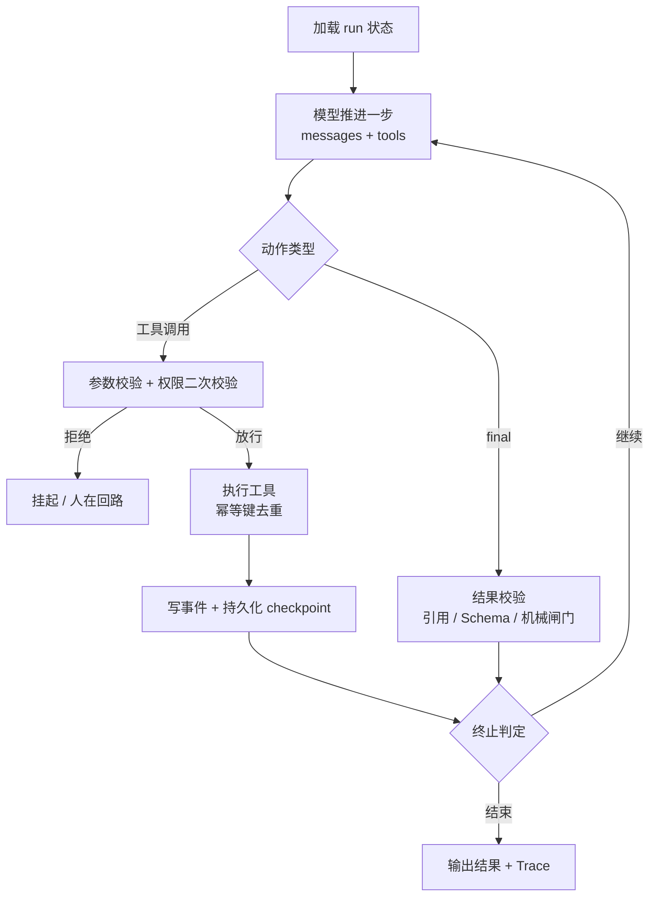
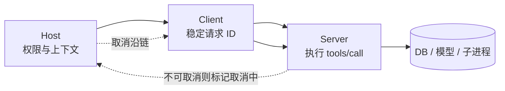

本章把 Agent 当作受控运行时而非一段 Prompt 来拆解：从 loop 的终止与恢复、四类消息的信任分层，一路讲到 MCP 协议、工具数组与缓存、多 Agent 共享状态和 Coding Agent 的隔离边界。每处设计都要说清「为什么这样切、换一种会坏在哪、线上怎么失败」；表中是源码层可定位的事实，其余叙述属通用工程机制，不与具体项目实现混同，量化口径另见 [指标口径与基线](/interview/metrics-baseline)。相关链路见 [RAG 全链路](/interview/fundamentals/rag-pipeline) 与 [项目与系统设计](/interview/answers/ecomm-rag-project)。

## 事实基线

| 事实要点                                                                  | 事实依据                                     |
| ------------------------------------------------------------------------- | -------------------------------------------- |
| MCP 消息统一为 JSON-RPC 2.0，传输层是 `stdio` / `streamable http` / `sse` | `content/docs/yukino/mcp.md`                 |
| tools 数组渲染在 system 之后、messages 之前                               | `content/docs/yukino/mcp.md`                 |
| 约 20k token 历史下仅在 tools 末尾追加一个工具，缓存命中率 99.4% → 9.5%   | `content/docs/yukino/mcp.md`、`99.4% → 9.5%` |
| 工具参数按 JSON Schema 做 Ajv 校验，身份参数由系统注入                    | `content/docs/yukino-ecomm-agent/llm.md`     |
| 编号证据放在当前用户消息之后的 turn-ctx，不进 system                      | `content/docs/yukino-ecomm-agent/context.md` |

## Agent loop 与 Harness：终止、幂等与恢复

Agent loop 的本质是**由外部运行时驱动的状态机**：模型只产出下一步动作（工具调用或最终答案），循环本身不属于模型。终止必须显式、可判定、由代码裁决，不能指望模型自觉停下。

| 终止类别        | 判据                                             | 裁决方     |
| --------------- | ------------------------------------------------ | ---------- |
| 正常完成        | 产出 `final` 且通过结构与引用校验                | Harness    |
| 步数 / 预算上限 | `step >= max_steps` 或 token / 费用 / 墙钟超预算 | Harness    |
| 无进展          | 连续 N 步同一工具同一参数，或状态哈希不变        | Harness    |
| 证据不足        | 检索收益耗尽且关键命题仍未知                     | 检索控制器 |
| 权限中断        | 命中需审批动作，挂起等待人在回路                 | 权限网关   |
| 不可恢复        | 重试预算耗尽且无降级路径                         | Harness    |



Harness 是**让模型按可控流程工作的运行控制层**，把可判定的事全部从模型手里收走：构造 Prompt、管理上下文（分层 / 预算 / 压缩裁剪）、注册工具、校验参数、执行调用、维护状态、重试与超时、Token 成本、Trace、终止判断。缺失任一项分别对应前缀抖动、types 漂移、重复写、断连丢状态、重试风暴、瓶颈无法定位。

`AgentHarness.run()` 骨架（TS 伪代码）：

```ts
class AgentHarness {
  constructor(private model: LLM, private tools: ToolRegistry,
              private store: StateStore, private policy: PolicyGateway) {}
  async run(task: Task): Promise<Result> {
    let state = await this.store.load(task.runId);          // 断点续跑，不依赖内存 Future
    for (let i = state.stepId; i < task.maxSteps; i++) {
      if (this.budget.exhausted(state) || this.policy.needsApproval(state))
        return this.halt(state, "budget_or_approval");
      const step = await this.model.invoke({
        messages: state.messages, tools: this.tools.schemas(), // 会话内字节稳定
      });
      if (step.action === "final")
        return this.validate(step.text, state.evidence)
          ? this.commit(state, step.text) : (state = this.reject(state), continue);
      const args = this.tools.validateArgs(step.name, step.args); // Ajv + 身份注入
      if (!this.policy.allow(step.name, args, state)) { state = this.awaitApproval(state); continue; }
      const out = await this.tools.execute(step.name, args, {
        idempotencyKey: `${task.runId}:${i}:${step.name}:${hash(args)}`,
        timeoutMs: task.toolTimeoutMs,
      });
      state = this.appendEvent(state, { stepId: i, out: sanitize(out) });
      await this.store.checkpoint(state);                    // 每步持久化
      state.messages.push({ role: "tool", content: out, trust: "untrusted" });
    }
    return this.halt(state, "max_steps");
  }
}
```

**工程取舍**：幂等键落在副作用边界而非请求边界，`run_id + step_id + tool_name + 参数摘要` 为键，写类工具须要求 Server 侧 `Idempotency-Key` 或业务唯一键；恢复靠 checkpoint + 事件日志，进程内 Future 只作加速，大工具结果只存「摘要 + 资源引用」不整段回灌；人在回路是权限分级（只读 / 低风险写 / 高风险写），高风险动作经网关二次校验并留痕审批，模型无权自行降级。

:::warning 边界与失败模式

- 只依赖模型自报结束：证据不足时仍会给出流畅结论，终止与结果校验必须放在 Harness。
- 重试无幂等键：重复下单、重复发消息，恢复次数越多放大越严重。
- 取消只到最外层：底层查询 / 子进程 / 模型请求仍在跑，前端显示已停而后台继续写入。
- checkpoint 只存增量不存全量状态：断连后无法重建上下文，只能重跑整条链路。
  :::

## 上下文分层与 Agentic Retrieval 停止条件

把不同信任级别的信息拼成一个自然语言串让模型自己分辨，是注入与越界的根因。正确做法是**用消息角色与结构化字段划出数据边界**。

| 角色        | 生成方                 | 级别           | 可变性       | 典型内容                            |
| ----------- | ---------------------- | -------------- | ------------ | ----------------------------------- |
| `system`    | 平台 / 部署配置        | 控制信息，最高 | 会话内不变   | 角色、安全约束、输出格式、拒答规则  |
| `developer` | 应用开发者             | 控制信息       | 版本发布才变 | 业务规则、工具策略、领域约束        |
| `user`      | 终端用户               | 不可信输入     | 每步变       | 问题、上传内容、显式要求            |
| `tool`      | 工具 / 检索 / 外部服务 | **不可信数据** | 每步变       | 工具返回、检索文档、`evidence` 数组 |

**系统策略不可改、运行时状态是可信结构、检索证据与工具结果是不可信数据**：即便 `tool` 消息里写着「忽略以上指令」，它仍处于数据位而非控制位。结果应带 `trust` / `source` / `content_type` / 时间戳，整体包在明确数据边界内；检索证据用**结构化 evidence + constraints** 而非无结构文本：

```json
{
  "question": "系统为什么会出现重复任务？",
  "evidence": [
    {
      "id": "doc-102#chunk-8",
      "content": "任务通过幂等键避免重复创建……",
      "source": "任务系统设计文档",
      "score": 0.91,
      "tenant_id": "tenant-a",
      "trust": "untrusted"
    }
  ],
  "constraints": ["只能依据 evidence 回答", "无法确认时必须明确说明"]
}
```

**权限边界在运行时与工具网关，不在 Prompt**：Prompt 只表达意图、不能执行拒绝；执行器对每次调用独立做 Schema 校验、权限判断、输出清洗，身份参数由系统注入并覆盖模型同名值。

:::tip 位置取舍
编号证据 `[n]` 放在当前用户消息之后的 `turn-ctx`，保持 `system + 历史` 前缀字节稳定、命中前缀缓存；放进 system 会让每轮证据变动击穿整段缓存。
:::

「再检索一轮」不能由模型语气决定，而由**可计算的停止条件**决定。查询改写不是生成近义句，而是把问题拆成**原子命题**：`proven`（计入覆盖率、不再检索）、`refuted`（作为结论边界）、`unknown`（关键实体 / 约束 / 时间范围缺证据，生成针对性查询）、`conflict`（保留双方并触发裁决）。每轮先判断关键实体、约束、时间范围是否齐全，再检查证据冲突，缺关键证据才继续。

```ts
const retrieval_utility =
  gainNewEvidence(propositions, newDocs) - // 新增证据带来的覆盖率提升
  penaltyDuplicate(newDocs, seenIds) - // 重复召回惩罚
  costRetrieval(topK, rerankEnabled) - // 检索与精排成本
  penaltyLatency(elapsedMs, budgetMs); // 延迟惩罚
```

终止取任一：`retrieval_utility` 低于阈值、达到**证据覆盖率**目标、连续召回重复、预算（步数 / token / 墙钟）耗尽。**关键事实始终找不到必须返回「证据不足」**，而不是多跑几轮让模型补全结论；预算耗尽属资源约束，证据不足属知识缺口，分别进兜底与飞轮通道。深挖见 [RAG 深度解析](/interview/answers/rag-deep-dive)。

:::warning 边界与失败模式

- 生成近义句当改写：多轮召回高度重叠，重复惩罚升高而命题状态不变。
- 只按相似度累加证据：来源单一、时间偏斜，冲突证据被最高分挤出。
- 把 `tool` 内容拼进 `system`：不可信数据被抬为控制信息，注入可直接改写策略。
- 权限靠模型判断「这条证据能不能用」：既泄漏无关租户内容又费 token，过滤应尽量前置。
  :::

## MCP：协议、传输、角色与信任边界

MCP 是 AI 应用与外部工具 / 数据源之间的**标准化中间层**，把「每个应用自己写胶水代码连 DB、文件系统、第三方 API」变成可插拔挂载。它只解决**能力发现与调用协议**，不自动解决安全。消息统一为 JSON-RPC 2.0，仅 request / response / notification 三类：

```json
{
  "jsonrpc": "2.0",
  "id": 1,
  "method": "tools/call",
  "params": {
    "name": "search_issues",
    "arguments": { "repo": "golang/go", "query": "error handling" }
  }
}
```

| 传输              | 形态                                                                  | 适用                     | 代价                             |
| ----------------- | --------------------------------------------------------------------- | ------------------------ | -------------------------------- |
| `stdio`           | Host 启动 Server 子进程，stdin/stdout 按换行分隔 JSON-RPC             | 本地工具、无需端口与认证 | 生命周期与清理、stderr、无法跨机 |
| `Streamable HTTP` | 独立 HTTP 服务，POST 返回 JSON 或用 SSE 推送，会话靠 `mcp-session-id` | 远程服务、多租户         | 认证、加密、会话恢复             |
| `SSE`             | 早期 HTTP+SSE 长连接，仅用于未迁移的旧 Server                         | 兼容存量                 | 已被 Streamable HTTP 取代        |

:::note 传输模式的常见误答
**`Memory` 不是传输模式**，属资源 / 能力范畴；写成 `stdio / SSE / Memory` 是错的。工具也不是「Server 端自动执行」：调用链是 Host/Client 发起 → Server 执行，Host 始终握有放行权。
:::

| 角色   | 职责                                                 | 信任边界                                                 |
| ------ | ---------------------------------------------------- | -------------------------------------------------------- |
| Host   | 承载模型与交互，负责权限、用户确认、上下文、生命周期 | 唯一可信决策点                                           |
| Client | 在 Host 内维护与某个 Server 的连接、收发请求         | 协议通道，不做业务裁决                                   |
| Server | 暴露 tools / resources / prompts，执行并返回结果     | **不应自动获得 Host 全部能力**；本地 Server 也不默认可信 |

**Server 返回的工具描述、资源内容、错误信息都可能不可信**：描述可夹带诱导性指令，资源可含注入载荷，错误信息可伪造路径与身份。Host 必须做 Schema 校验、权限判断、输出清洗；本地 Server 能读环境变量 / 文件 / 凭证，应放进受限进程或容器；远程 Server 还需认证、传输加密、租户隔离与服务身份绑定。

| 机制        | 做法                                                                                    | 失败模式                                           |
| ----------- | --------------------------------------------------------------------------------------- | -------------------------------------------------- |
| 能力协商    | 建连交换协议版本 + 能力集合（资源订阅、进度通知、日志级别、采样等），只用协商成功的能力 | 按 Server 名字推断能力，版本漂移后调用不存在的方法 |
| 稳定请求 ID | 长任务用跨重连稳定的 id，任务状态与结果位置持久化                                       | 把进程内 Future 当唯一状态，断连丢任务             |
| 会话恢复    | 重连带会话令牌查未完成请求，按 id 续传或返回既有结果                                    | 无幂等保护时重试重复执行写操作                     |
| 取消传播    | Host → Client → Server → DB 查询 / 模型请求 / 子进程逐级下发                            | 底层不可取消却虚报已终止                           |



底层不可取消时，正确做法是**停止继续处理其结果并标记「取消中」**，已产生的副作用靠幂等键与补偿动作收敛。

| 维度     | function calling               | MCP                           | Skills                   |
| -------- | ------------------------------ | ----------------------------- | ------------------------ |
| 定位     | 模型产出「调哪个 + 参数 JSON」 | 应用与外部工具间的连接协议    | MCP 上层的能力抽象与组合 |
| 执行主体 | 调用方服务端                   | Server 执行，Host/Client 发起 | 编排一组底层操作         |
| 发现机制 | 静态注册、事先写死             | 建连时 `tools/list` 动态发现  | 按任务加载的能力包       |
| 协议     | 各厂商各一套                   | JSON-RPC 2.0 统一             | 依赖下层 MCP 或原生工具  |
| 一句话   | **决定怎么调**                 | **定义怎么连**                | **定义能做什么**         |

**工具参数即使有 function calling 也不可信**：结构化输出只保证形状，不保证取值合法与身份正确。用 Ajv / zod 按 `inputSchema` 复核类型与枚举，再由系统注入 `user_id` / `tenant_id` / `conversation_id` 并覆盖模型同名字段，越权字段直接拒绝而非猜测。

:::warning 边界与失败模式

- 认为「接了 MCP 就安全」：协议不提供鉴权、注入防护与输出清洗，全是 Host 责任。
- 把 Server 错误信息直接回灌模型：可被用来伪造路径、诱导调用高风险工具。
- function calling 通过即放行参数：类型漂移、枚举越界、身份冒用都会发生。
  :::

## tools 数组稳定性与 prompt cache

工具定义不是「每轮附带的一段元数据」，而是**前缀的一部分**。tools 数组渲染在 `system` 之后、`messages` 之前，其后整段对话历史都落在同一缓存前缀上：只要 tools 增删、改序或改字段，前缀字节改变，整段历史缓存失效。源码注释实测：**约 20k token 历史下，仅在 tools 末尾追加一个工具，cache 命中率 99.4% → 9.5%**——「网关动态发现工具」看似只是注册中心 watch 一下，实际把长会话成本与延迟放大近一个数量级。

| 变更                             | 缓存影响     | 触发                     |
| -------------------------------- | ------------ | ------------------------ |
| 追加 / 删除工具                  | 整段历史失效 | 服务注册发现、热加载配置 |
| 调整顺序                         | 整段历史失效 | 按相关性动态排序 tools   |
| 改 `description` / `inputSchema` | 整段历史失效 | Schema 同步、版本漂移    |
| 加载模式翻转                     | 整段历史失效 | 运行中重算加载策略       |
| 仅追加 `system-reminder`         | 只影响尾部   | 延迟工具引导、公告变更   |

**工程取舍**：稳定性优先于「工具刚好够用」——工具集合在会话启动时一次性决定，运行中不重算；新增能力通过**固定存在的分发入口**（如 `ToolSearch` / `McpCall`）间接暴露，让 tools 数组保持字节级不变。加载模式（全量 / 带 `defer_loading` 保留 / 完全省略并经分发调用）在连接建立时一次性决策，后续只沿用；Server 使用说明以增量 `system-reminder` 公告，仅在内容变化时追加。存量 API 适配 MCP 时，从 OpenAPI / 路由表抽取「方法 + 路径 + 参数 schema + 描述」映射成 `tools/list` 定义，`tools/call` 由网关翻译回原 HTTP 请求，鉴权 / 限流 / 审计 / 超时 / 重试收口在网关；但**工具列表变化必须治理**，否则缓存抖动会抵消协议转换收益。

:::warning 边界与失败模式

- 用「按查询动态挑 Top-N 工具」省 token：每轮 tools 都变，长会话缓存归零。
- 认为追加在末尾不影响前缀：缓存按字节前缀匹配，末尾插入同样改变后续全部内容。
- 把公告塞进 system：Server 连接晚于首轮请求，改 system 会击穿整段前缀。
  :::

## 多 Agent 共享状态与 Runtime 工程

共享状态不是「谁都可以改的 JSON」。每个 Agent 只提交**事件或字段级补丁**，状态服务按版本条件写入：

```sql
UPDATE agent_run_state
   SET state = ?, version = version + 1, updated_at_ms = ?
 WHERE run_id = ? AND version = expected_version;
```

**影响行数为 0 即并发冲突**：重读最新版本、重放补丁后重试。无关字段用字段级补丁降冲突；同一决策点的竞争交仲裁节点或确定性规则，而非「谁后写谁赢」。消息乱序与回放要求事件自带**逻辑时间、因果父事件、生产者 ID**，仅靠 `updated_at` 无法恢复因果。规划器输出必须是**结构化任务图**而非自然语言列表，节点含输入契约、预期产物、依赖、完成条件、预算；调度前检查**是否有环、依赖是否存在、是否有节点产出互斥产物**。

```json
{
  "graphId": "g-17",
  "nodes": [
    {
      "id": "n1",
      "action": "read",
      "resource": "kb/policy",
      "output": "evidence",
      "deps": [],
      "budgetMs": 800
    },
    {
      "id": "n2",
      "action": "summarize",
      "resource": "n1.evidence",
      "output": "draft",
      "deps": ["n1"]
    },
    {
      "id": "n3",
      "action": "sign",
      "resource": "n2.draft",
      "output": "report",
      "deps": ["n2"]
    }
  ]
}
```

子任务去重不能只比文本相似度：归一化为**动作 + 资源 + 时间范围 + 输出类型**算语义指纹，文本不同但读同一资源、产同一产物的节点应合并。运行中新增依赖必须提交**图变更请求**，由调度器重新做环检测、预算与权限校验，禁止 Agent 直接改图。

**Go 业务服务 ↔ Python Agent Runtime**：两种服务**共享协议、不共享内存**——Go 管鉴权、配额、外部 API 与同步请求，Python 管推理、工具规划与工作流。短耗时同步请求走 gRPC（Protobuf 约束 + HTTP/2 多路复用）；长任务不能占着同步 RPC，改为 Go 建任务写消息系统、Python Runtime 消费并持续发事件。事件字段：`run_id`（一次执行的全局主键）、单调递增 `sequence`（去重与检测缺口）、`event_type`（`step_started` / `tool_result` / `token_delta` / `final` / `error`）、`payload`（结构化载荷）、`schema_version`（协议演进兼容）、`created_at_ms`（时间基准）+ 幂等键。

```json
{
  "run_id": "run-9f2c",
  "sequence": 42,
  "event_type": "tool_result",
  "schema_version": 2,
  "created_at_ms": 1762400000000,
  "idempotency_key": "run-9f2c:42:query_faq",
  "payload": { "tool": "query_faq", "result_ref": "blob/9f2c/42", "ok": true }
}
```

消费侧按 `run_id + sequence` 去重并检测缺口：短缺口进有限重排序窗口，超窗先按已有事件推进并请求补发；**全量状态必须持久化**，token 可走流式 RPC，断连后不能靠内存中的流重建状态。**asyncio 与 CPU 密集代码**：事件循环单线程，协程里直接做 PDF 解析、图片编码、复杂排序会长时间占住 loop，导致其他请求的超时、心跳与流式输出集体饿死；纯 Python CPU 任务受 **GIL** 限制，加线程未必提速，释放 GIL 的原生库可用线程池，纯 Python 计算走进程池（`loop.run_in_executor(ProcessPoolExecutor, ...)`）或独立计算服务。进程池不是无限扩展：大对象序列化、进程启动、内存复制都是实打实开销，生产用独立 worker + 队列做并发与背压。

:::warning 边界与失败模式

- 长任务用同步 RPC 挂着：连接被网关超时切断，状态无持久化即丢失。
- 只按 `sequence` 不按 `run_id` 去重：不同执行的序号互相污染。
- 共享状态「最后写入获胜」：互补字段互相覆盖且无法追溯谁改了什么。
- 把 CPU 密集代码留在协程里：P99 抖动表现为「模型偶发变慢」，实为 loop 被占住。
  :::

## Coding Agent 安全：可审计修改与 Shell 沙箱

可审计的文件修改是一条**带版本校验的补丁流水线**：① 读文件版本 + 内容哈希建基线 → ② 生成结构化补丁（非整文件覆写）→ ③ 应用前复检哈希，被并发改动则重新读取重新规划 → ④ 在隔离工作树 / 容器应用并验证 → ⑤ 记录读取集合、补丁、命令、退出码、测试结果，全链路可审计可回放。

```ts
async function applyPatch(p: Patch, root: string) {
  const real = await fs.realpath(path.resolve(root, p.target)); // 符号链接必须解析真实路径
  if (!real.startsWith(path.resolve(root) + path.sep))
    throw new Error("escape workspace");
  if ((await hashFile(real)) !== p.baseHash)
    throw new ConflictError("re-read and re-plan");
  const next = applyUnifiedDiff(await fs.readFile(real, "utf8"), p.diff);
  await fs.writeFile(real, next);
  return {
    readSet: p.readSet,
    diff: p.diff,
    exitCode: 0,
    tests: await runTests(real),
  };
}
```

**仅限制路径不够**：符号链接可能指向工作区之外，执行器必须解析真实路径并确认仍在允许根目录内。Shell 沙箱约束：临时容器 + 最小工作目录挂载 + 只读基础镜像 + 非特权用户 + 移除多余 capabilities；seccomp 白名单；限制 CPU、内存、进程数、文件大小、执行时间（防 fork bomb / 磁盘写满 / 无限编译）；**网络默认关闭**，需下载依赖时只放通内部代理 / 白名单仓库并记录包名、版本与校验值；生产凭证不进沙箱，临时令牌限权限与有效期，防测试脚本或恶意依赖外发源码与凭证。

:::warning 边界与失败模式

- 只校验前缀路径不解析符号链接：一次软链即可写出工作区。
- 沙箱默认放通网络：依赖安装脚本可外发源码与环境变量里的凭证。
- 补丁应用前不复检哈希：并发改动被静默覆盖，审计日志与真实文件不一致。
  :::

## 面试怎么讲

按「链路 → 分层 → 协议 → 边界」四段推进，每段先给结论再给取舍，最后主动点出失败模式。采分点：链路讲 loop 是外部状态机、显式终止、幂等键在副作用边界、checkpoint + 事件日志续跑、Harness 十项职责；分层讲四类消息与「控制信息 / 可信结构 / 不可信数据」三级、身份参数系统注入；协议讲 JSON-RPC 2.0 与三种传输、Host/Client/Server、能力协商与取消沿链、三方对照、tools 数组与缓存；边界讲不可信工具输出、Host 校验、哈希复检与沙箱、乐观并发与任务图。更多题型见 [题库](/interview/question-bank)。

| 扣分点                               | 为什么扣分                   | 正确说法                                                                   |
| ------------------------------------ | ---------------------------- | -------------------------------------------------------------------------- |
| 把 `Memory` 说成 MCP 传输模式        | 概念性错误                   | 三种传输是 `stdio` / `Streamable HTTP` / `SSE`，`Memory` 属资源 / 能力范畴 |
| 说「工具在 Server 端自动执行」       | 丢了 Host 的决策权与权限边界 | Host/Client 发起、Server 执行、Host 校验与放行                             |
| 认为接了 MCP 就安全                  | 把协议能力误当安全能力       | 协议只管发现与调用，鉴权、注入防护、清洗都是 Host 责任                     |
| 认为 function calling 通过即参数可信 | 忽略类型漂移与身份冒用       | Ajv / zod 复核 + 系统注入身份参数并覆盖模型值                              |
| 用动态 Top-N 工具优化 token          | 未意识到 tools 是缓存前缀    | 约 20k 历史追加一个工具即 99.4% → 9.5%，应一次性决策 + 固定分发入口        |
| 取消只发到最外层就报「已终止」       | 底层仍在跑，副作用继续       | 沿链下发；底层不可取消则标记「取消中」并停止处理其结果                     |
| 共享状态用「最后写入获胜」           | 丢失更新且无法追溯           | 事件 / 补丁 + `WHERE version=expected_version`，影响行数为 0 即冲突        |
| 把权限写在 Prompt 里                 | Prompt 无法执行拒绝          | 权限边界在运行时与工具网关，执行器逐次二次校验                             |
| 证据不足时让模型补全结论             | 把检索失败转成幻觉           | 预算耗尽返回证据不足，进入兜底与知识缺口闭环                               |

## 速记卡

- **Agent loop**：模型只产出动作；终止、预算、无进展、结果校验全部由 Harness 裁决。
- **幂等与恢复**：`run_id + step + 工具 + 参数摘要` 作幂等键，checkpoint + 事件日志持久化，内存 Future 不作唯一状态。
- **四类消息**：system / developer 是控制信息，user / tool 是不可信数据；权限边界在运行时与工具网关，不在 Prompt。
- **检索停止**：原子命题拆成 proven / refuted / unknown，用 `retrieval_utility` 决定继续，预算耗尽返回证据不足。
- **MCP**：JSON-RPC 2.0 + `stdio` / `Streamable HTTP` / `SSE`，`Memory` 不是传输；Host 发起、Server 执行、Host 校验。
- **tools 与缓存**：tools 在 system 之后、messages 之前，任何变动击穿整段历史；20k 历史追加一个工具 99.4% → 9.5%。
- **共享状态**：事件 / 字段级补丁 + `WHERE version=expected_version`，乱序靠逻辑时间与因果父事件。
- **安全**：工具描述与错误信息不可信，Ajv 校验 + 系统注入身份；改文件前复检哈希、解析符号链接、Shell 默认断网。
