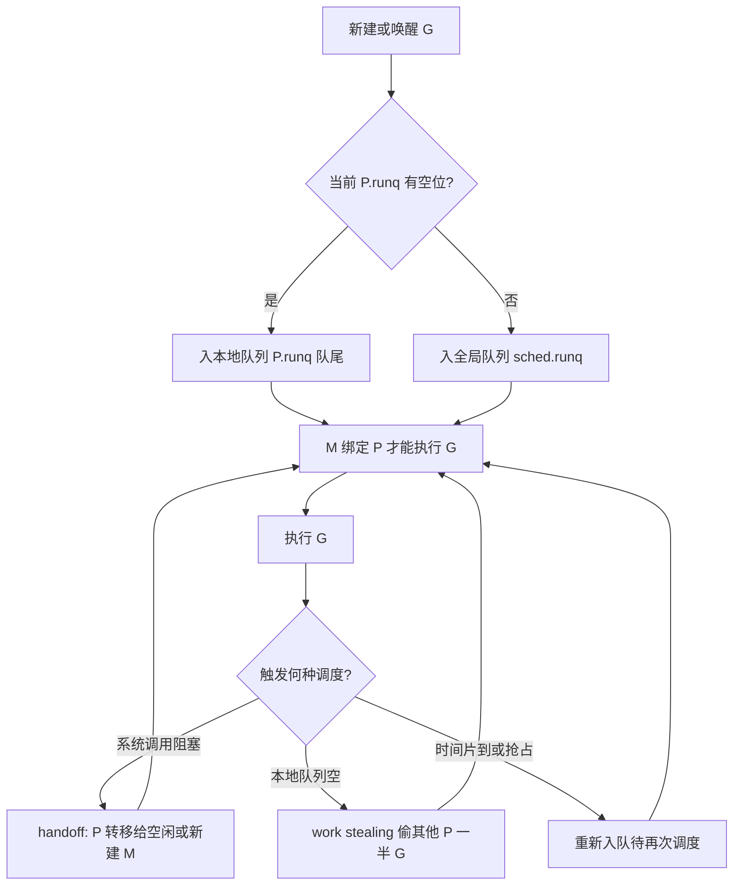
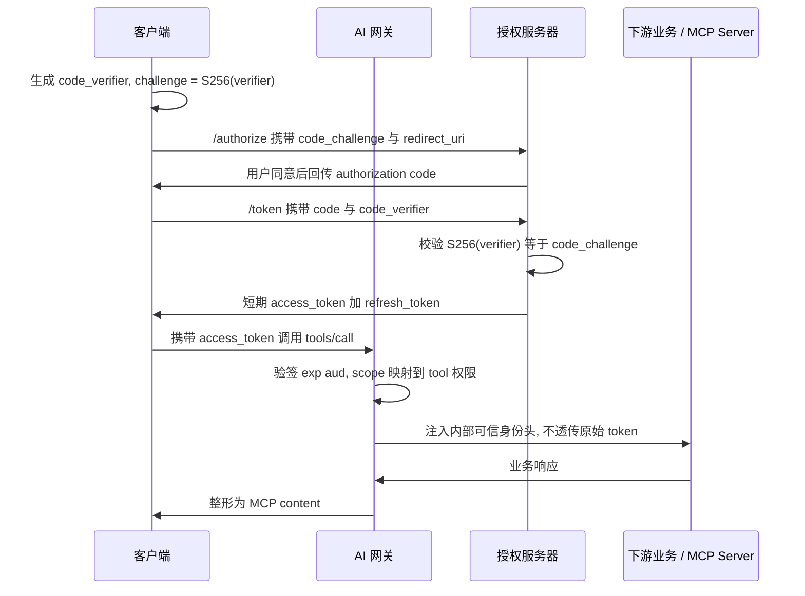

:::note 本章定位
本章把 Go 运行时并发机制与 AI 网关的工程治理放在同一条因果链上：前半段说明 GMP、channel、defer 的语言级语义与成本边界，后半段说明把这些机制用于「存量 REST 服务接入 MCP 工具生态」时的协议映射、授权、注册发现与高并发治理。全篇给机制与取舍，面向能直接口述的密度，不作概念罗列。
:::

## 结论先行

| 主线 | 核心结论                                                                    | 关键机制                                |
| ---- | --------------------------------------------------------------------------- | --------------------------------------- |
| 并发 | goroutine 是用户态、由 runtime 调度的轻量执行体，成本比内核线程低若干数量级 | 2KB 可增长栈、M 绑定 P、本地运行队列    |
| 同步 | channel 是 CSP 落地，「通过通信共享内存」；关闭语义决定接收方如何收尾       | 缓冲语义、`v, ok := <-ch`、由发送方关闭 |
| 收尾 | defer 在 return 之后、函数返回之前按 LIFO 执行，参数在语句处求值            | 命名返回值可被 defer 改写               |
| 网关 | 协议转换收口在网关，存量服务零改造，鉴权/限流/审计复用                      | OpenAPI→tools/list→tools/call 翻译      |
| 代价 | 工具集变化会击穿 prompt cache，tools 数组稳定性是一等约束                   | 固定排序、版本化灰度、会话内冻结        |

:::tip 一条主线
语言层机制解释「为什么能扛高并发」，网关层取舍解释「为什么把复杂度收口在一处」，二者通过「控制面与数据面分离」连起来：调度与协议都是把易变逻辑放到可灰度、可观测的一层。
:::

## 机制：Go 运行时并发

### goroutine 与内核线程

| 维度     | goroutine                       | 内核线程                     |
| -------- | ------------------------------- | ---------------------------- |
| 调度者   | Go runtime 用户态调度           | 内核调度器                   |
| 初始栈   | 约 **2KB**，按需增长/收缩       | MB 级固定，预留虚存          |
| 切换成本 | 保存少量寄存器，不陷内核        | 陷内核、切换特权级与地址空间 |
| 数量级   | 单机可创建十万~百万级           | 通常千级即显著吃紧           |
| 阻塞影响 | 网络 I/O 走 netpoller，不独占 M | 阻塞即占住一个内核调度实体   |

创建、销毁、切换的成本差来自「是否经过内核」：goroutine 的栈按需分段增长，调度在用户态完成；内核线程切换要做上下文与地址空间切换。**并发量高、生命周期短、大量阻塞在 I/O 的任务**适合用 goroutine；**数量可数、需长期绑定 CPU、依赖线程本地存储或特定信号语义**的任务，用线程或直接限制并发度更可控。

### GMP 调度模型

| 角色         | 职责                                                                                             |
| ------------ | ------------------------------------------------------------------------------------------------ |
| `G`          | goroutine，保存栈、状态与上下文                                                                  |
| `M`          | machine，内核线程，**必须绑定 P 才能执行 G**                                                     |
| `P`          | processor，持有调度上下文与**本地运行队列 `P.runq`（容量通常 256）**，`GOMAXPROCS` 决定 P 的数量 |
| `sched.runq` | 全局运行队列，本地队列溢出或被抢占的 G 进入此处                                                  |

`GOMAXPROCS` 决定并行执行 Go 代码的 P 数，不等于 M 数：M 可多于 P，多出的 M 在阻塞系统调用时被创建或用于 handoff。关键点：**本地运行队列挂在 P 而非 M**，这是高频陷阱；work stealing 从其他 P 的 `P.runq` 尾部**偷一半** G 到本地，避免全局锁竞争。



**调度时机**：`go` 关键字创建、channel 收发阻塞、系统调用返回、`runtime.Gosched()`、GC 抢占、栈增长检查。调度发生在「G 无法继续推进」或「被抢占」的时刻，而非任意指令边界。协程何时该让出，取决于是否阻塞，不取决于写了多少代码。

:::warning 边界与失败模式

- 纯 CPU 密集且无函数调用的循环可能延迟抢占（Go 1.14+ 异步抢占已缓解但未消除），应主动拆分或限流。
- `GOMAXPROCS` 在容器里若未感知 cgroup 配额，会创建过多 P，引发上下文切换放大。
- 阻塞在 cgo 或阻塞式系统调用会独自占住 M，需 handoff 才能维持并行度。
- **不适合用协程**的场景：需要严格绑核的实时计算、依赖线程局部状态的库、原子性要求覆盖多核并行的临界区（仍要靠锁而非多开协程）。
  :::

### channel：CSP 与关闭语义

| 类型                     | 语义                              | 典型用途                 |
| ------------------------ | --------------------------------- | ------------------------ |
| 无缓冲 `make(chan T)`    | 发送/接收双方 rendezvous，同步    | 信号通知、取消、强制握手 |
| 有缓冲 `make(chan T, n)` | 缓冲未满/非空时不阻塞             | 任务分发、结果汇聚、削峰 |
| `chan<- T` / `<-chan T`  | 单向，编译期约束方向              | 接口收口，防误写         |
| 容量为 n 的信号量        | 占坑/归还                         | **限流**                 |
| `select`                 | 多路复用 + `default`/`time.After` | 超时控制、非阻塞尝试     |

:::warning 关闭语义（高频陷阱）

| 行为                  | 结果                                                   |
| --------------------- | ------------------------------------------------------ |
| 向已关闭 channel 发送 | **panic**                                              |
| 关闭已关闭 channel    | **panic**（重复 close）                                |
| 接收已关闭 channel    | 先取完缓冲剩余值，之后立即得**零值**，`ok=false`       |
| `for range ch`        | 取空且关闭后**自动退出**                               |
| 关闭动作              | **由发送方关闭**，接收方不关；关闭会唤醒所有阻塞接收者 |
| :::                   |

```go
package main

import "fmt"

func demo(label string, fn func()) {
	defer func() {
		if r := recover(); r != nil {
			fmt.Printf("%s => panic: %v\n", label, r)
		}
	}()
	fn()
}

func main() {
	ch := make(chan int, 2)
	ch <- 10
	ch <- 20
	close(ch) // 只由发送方关闭一次

	// 1. 关闭后先取完缓冲剩余值，for range 取空后自动退出
	for v := range ch {
		fmt.Println("recv:", v) // recv: 10 / recv: 20
	}

	// 2. 取空后再接收：立即返回零值，ok=false，不阻塞
	v, ok := <-ch
	fmt.Println("zero:", v, ok) // zero: 0 false

	// 3. 向已关闭 channel 发送、重复关闭都会 panic
	demo("send on closed", func() { ch <- 30 })
	demo("close of closed", func() { close(ch) })
}
```

输出：

```
recv: 10
recv: 20
zero: 0 false
send on closed => panic: send on closed channel
close of closed => panic: close of closed channel
```

`v, ok := <-ch` 是区分「真实零值」与「关闭后零值」的唯一手段；广播取消惯用 `close(done)` 而非发送 N 个信号，正是利用「关闭会唤醒所有阻塞接收者」。

### defer 执行语义

| 规则       | 说明                                        |
| ---------- | ------------------------------------------- |
| LIFO       | 多个 defer 逆序执行，后注册先执行           |
| 参数求值   | 实参在 **defer 语句处**求值，不在执行时求值 |
| 执行时机   | **return 赋值之后、函数真正返回之前**       |
| 命名返回值 | defer 可读写命名返回值，从而改写最终结果    |

```go
package main

import "fmt"

func f() (result int) { // 命名返回值
	defer func() { result++ }()                            // 注册①：最后执行，改写返回值
	defer func() { fmt.Println("defer2: result =", result) }() // 注册②：先执行
	return 1 // result 先被赋为 1
}

func order() {
	i := 0
	defer fmt.Println("first, i =", i)  // 语句处求值：i=0
	i = 100
	defer fmt.Println("second, i =", i) // 语句处求值：i=100
	// LIFO：second 先打印，first 后打印
}

func main() {
	fmt.Println("f() =", f()) // 2
	order()
}
```

输出：

```
defer2: result = 1
f() = 2
second, i = 100
first, i = 0
```

`recover` 只在 defer 中有效，且必须直接位于 panic 的同一 goroutine 调用栈；跨 goroutine 的 panic 无法被外层 recover 捕获。释放资源（关文件、解锁）用 defer 时，要确认参数在语句处已取到正确值，闭包写法常用来延迟读取变量当前值。

## 工程取舍：把存量服务接入 MCP 工具生态

### 存量 REST API → MCP tool 的映射

映射是一次「契约提取 + 双向翻译」，不涉及业务逻辑改写：

| 阶段     | 输入                             | 输出                                               |
| -------- | -------------------------------- | -------------------------------------------------- |
| 契约提取 | OpenAPI/路由表                   | 方法、路径、参数 schema、描述、错误码              |
| 工具注册 | 上一步结构化结果                 | `tools/list` 的 `name`/`description`/`inputSchema` |
| 调用翻译 | `tools/call` 的 name + arguments | 还原为原 HTTP 方法 + 路径 + 参数 + 头              |
| 响应整形 | 上游 HTTP 响应                   | MCP `content` 数组（文本/结构化）                  |

工具发现与信任边界另见 [Agent 与 MCP](/interview/fundamentals/agent-and-mcp)。

```ts
// 网关把一次 tools/call 翻译回存量 HTTP 请求
type ToolCall = { name: string; arguments: Record<string, unknown> };

function toHttp(call: ToolCall, route: Route): Request {
  const url = new URL(route.path, route.baseUrl);
  for (const p of route.queryParams) {
    if (call.arguments[p] !== undefined) {
      url.searchParams.set(p, String(call.arguments[p]));
    }
  }
  const body = route.bodyParams.length
    ? JSON.stringify(pick(call.arguments, route.bodyParams))
    : undefined;
  return new Request(url, {
    method: route.method,
    headers: { "content-type": "application/json" },
    body,
  });
}
```

```json
{
  "name": "order_query",
  "description": "按租户与状态查询订单列表",
  "inputSchema": {
    "type": "object",
    "properties": {
      "tenant_id": { "type": "string" },
      "status": { "type": "string" }
    },
    "required": ["tenant_id"]
  }
}
```

### 为什么收口在网关层

| 维度                     | 网关层转换                   | 每个服务嵌 SDK           |
| ------------------------ | ---------------------------- | ------------------------ |
| 多语言存量服务           | 零改造，统一收口             | 每种语言都要实现一遍     |
| 鉴权/限流/审计/超时/重试 | 一处实现、一处灰度           | 散落各服务，策略漂移     |
| 协议升级                 | 改一处                       | 全量升级，版本碎片       |
| 失败域                   | 网关成**单点**，需自身高可用 | 分散，无单点但无统一治理 |

:::warning 代价

- **单点**：网关必须无状态水平扩容 + 健康检查，否则放大为全站故障。
- **schema 同步与版本漂移**：上游改路由/参数，工具定义需同步更新，建议由 OpenAPI 自动生成并做契约测试。
- **流式与长连接**：SSE/流式响应要单独打通协议透传，不能只用请求-响应翻译。
  :::

### OAuth 授权码 + PKCE 与 token 治理

`code_verifier`/`code_challenge`（S256）把授权码与令牌请求绑定，避免授权码被截获后冒用；网关把外部身份转换成内部可信头，**原始 token 不透传下游业务**。



| 治理点       | 做法                                                                  |
| ------------ | --------------------------------------------------------------------- |
| 校验与刷新   | 网关验签、`exp`/`aud`/`iss`，用 refresh token 轮换换取新 access token |
| 作用域映射   | `scope → tool 权限` 白名单，越权调用在网关拒绝                        |
| token 不透传 | 换成内部身份头 + 租户 ID，业务只见已核验身份                          |
| refresh 轮换 | 一次性 refresh token，重放即吊销整个令牌链                            |
| 远程 MCP     | **服务身份绑定 + 租户隔离**，连接级鉴权，不复用用户令牌               |

### 服务注册发现与配置管理

注册中心（etcd/Consul/Nacos）+ 健康检查 + `watch` 增量推送；配置走版本化、灰度、可回滚。一个容易被忽略的连带效应：工具列表一旦变化，LLM 的 `tools` 数组就变动，而该数组通常渲染在 `system` 之后、`messages` 之前，**任何变动都会使整段历史前缀缓存失效**，命中率骤降、首 token 延迟与成本同时上升。因此动态发现必须配套：新增工具**追加且固定排序**、变更走版本化灰度、对同一会话**冻结工具集**。

**事实基线**

下表只登记仓库内可核对的事实依据，机制解释见上文。

| 事实依据                                  |
| ----------------------------------------- |
| `content/docs/yukino/mcp.md`              |
| `content/docs/yukino/function-calling.md` |
| `99.4% → 9.5%`                            |

其中数值来自源码注释实测：在 20k token 历史下，仅在 tools 末尾追加一个工具，前缀缓存命中率即从 99.4% 掉到 9.5%。这条约束把「工具能否动态发现」从可用性问题变成了成本与延迟问题。

## 工程取舍：高并发治理与 AI 工程认知

### 高并发网关扩展治理

| 手段              | 作用                                  | 取舍                       |
| ----------------- | ------------------------------------- | -------------------------- |
| 无状态水平扩容    | 会话外置后线性加实例                  | 有状态连接需单独迁移       |
| 连接池            | 复用上游连接，降低握手与 TIME_WAIT    | 池过大压垮上游，需上限     |
| 令牌桶限流        | 按**租户/API** 双维度，允许突发       | 维度键与配额要可热更新     |
| 熔断              | 上游连续失败时快速失败                | 半开探测防「全放行」       |
| 超时 + 重试预算   | 全链路 deadline，重试次数受总预算约束 | 无预算会重试风暴放大       |
| 背压              | 有界队列 + 拒绝，不无限堆积           | 早拒绝优于超时雪崩         |
| 分片/一致性哈希   | 租户或会话稳定路由，提升本地命中      | 扩缩容需虚拟节点降迁移量   |
| 控制面/数据面分离 | 配置、工具注册、配额走控制面          | 数据面只做转发，故障域隔离 |

大量调用失败按四层定位，逐层聚合而非逐条翻日志：

| 层     | 聚合维度                    | 判据                     |
| ------ | --------------------------- | ------------------------ |
| 客户端 | status、SDK 版本、地域      | 4xx 集中、握手失败       |
| 网关   | 实例、路由、限流拒绝数、P99 | 单实例异常、限流是否误伤 |
| 上游   | 错误码、连接池水位、P99     | 上游超时、连接耗尽       |
| 依赖   | 缓存与第三方 RT、锁等待     | 慢查询、依赖抖动         |

用 trace 把一次请求在各层的 status、错误码、P99、重试次数、实例串起来；先区分**瞬时故障**（重试可恢复）与**系统性故障**（重试只会放大），重点检查是否出现重试风暴、熔断与降级是否真正生效。容量与限流的量化口径参见 [大容量与高并发](/interview/answers/large-payload-capacity)，令牌桶实现参见 [手写限流器](/interview/code/rate-limiter)。

### AI 工程认知

| 维度                | 结论                                                                                                   |
| ------------------- | ------------------------------------------------------------------------------------------------------ |
| 适合交给 AI         | 脚手架与样板代码、单测生成、重构建议、报错定位、陌生代码阅读理解                                       |
| 不交给 AI           | **安全敏感逻辑、并发与事务正确性、对外契约**（schema/API/协议）                                        |
| 人工 review 重点    | 意图对齐、边界、并发正确性、安全、可维护性；针对幻觉 API、过度抽象、吞异常、忽略幂等设检查单           |
| AI review AI 的边界 | 对格式、规范、明显逻辑、测试覆盖等**可判定**问题有效；对需求理解、架构取舍、隐式业务规则会**同源犯错** |
| 更稳组合            | **AI 生成 + 确定性工具（类型检查/lint/测试/静态分析）把关 + 人工抽样复核**                             |

:::tip 为什么确定性工具不可省
模型对「同一类隐含假设」的盲区是一致的，让同族模型互相复核补不上需求理解偏差；类型系统与测试给出的是与模型无关的可判定信号，才是可靠的把关层。确定性工具负责「能不能编译、有没有回归」，人负责「该不该这么做」。
:::

## 边界与失败模式

| 边界         | 失败模式                                   | 缓解                                        |
| ------------ | ------------------------------------------ | ------------------------------------------- |
| GMP          | 阻塞 cgo 调用占住 M、CPU 密集循环延迟抢占  | handoff、主动限流与拆分                     |
| channel      | 接收方关闭、向已关闭发送、无接收者导致泄漏 | 由发送方关闭、`context` 取消、`select` 超时 |
| 网关单点     | 实例全挂导致整站不可用                     | 无状态多活 + 健康检查                       |
| 工具 schema  | 上游改契约未同步 → 调用参数错              | OpenAPI 自动生成 + 契约测试                 |
| prompt cache | tools 数组变动 → 缓存整段失效              | 固定排序、会话内冻结、版本灰度              |
| token        | 透传下游 → 权限绕过、令牌泄露面扩大        | 身份转换、scope 白名单                      |
| 重试         | 无预算重试放大为雪崩                       | 全链路 deadline + 重试预算 + 熔断           |

## 面试怎么讲

:::warning 采分点与扣分点

| 采分点                                                                   | 扣分点                                                    |
| ------------------------------------------------------------------------ | --------------------------------------------------------- |
| 说清 goroutine 是用户态、约 2KB 可增长栈、runtime 调度                   | 把 goroutine 说成「轻量线程」就停，不给成本来源           |
| 明确指出**本地队列挂 P**、`P.runq`、全局 `sched.runq`、偷一半            | 含糊说「有个队列」，或把队列挂到 M 上                     |
| channel 关闭逐条讲清：发送 panic、取完剩余再零值、`ok=false`、发送方关闭 | 只背「close 后不能再发」，漏 `for range` 与唤醒阻塞接收者 |
| defer 三点：LIFO、语句处求值、命名返回值可改写                           | 说「return 之后执行」却不提参数求值时机                   |
| REST→MCP 给出四段映射 + 网关收口理由 + 代价                              | 只说「写个适配器」，不讲 schema 漂移与单点                |
| 主动点出 tools 数组稳定性与 prompt cache 失效                            | 把动态发现只当可用性问题，漏成本与延迟                    |
| token 不透传、scope→tool 映射、refresh 轮换                              | 把原始 token 直接透传给业务                               |
| 失败排查按四层聚合 + 区分瞬时与系统性                                    | 上来就说「看日志」「重启」                                |
| AI 认知给「可判定 vs 同源盲区」与确定性工具把关                          | 空谈「AI 提效」，不划不交给 AI 的边界                     |
| :::                                                                      |

## 速记卡

- **goroutine**：用户态、初始约 2KB 可增长栈、runtime 调度，切换不陷内核；数量级可到百万，内核线程千级即吃紧。
- **GMP**：`G` 协程 / `M` 内核线程 / `P` 处理器；**M 必须绑定 P**，本地队列 `P.runq` 挂在 **P**（通常 256），另有全局 `sched.runq`，work stealing 偷一半，阻塞系统调用 handoff。
- **channel**：CSP 通过通信共享内存；关闭后发送 panic、接收先取完剩余再得零值 `ok=false`、`for range` 自动退出、**由发送方关闭**、重复 close panic。
- **defer**：LIFO、参数语句处求值、return 后返回前执行、命名返回值可被改写，`recover` 仅同 goroutine 的 defer 有效。
- **REST→MCP**：OpenAPI 抽方法+路径+schema → `tools/list` 定义 → `tools/call` 翻译回 HTTP → 整形为 MCP content；网关收口鉴权/限流/审计，存量零改造。
- **tools 稳定性**：tools 数组在 system 与 messages 之间，变动即击穿前缀缓存；固定排序、会话内冻结、版本灰度。
- **OAuth**：授权码 + PKCE(S256)，网关验签/刷新/scope→tool 映射，token 不透传，refresh 轮换，远程 MCP 绑定服务身份与租户隔离。
- **AI 工程**：适合样板/单测/报错定位，安全敏感、并发事务、对外契约不交给 AI；「AI 生成 + 确定性工具 + 人工抽样」比 AI review AI 更稳。
