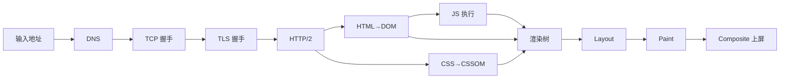
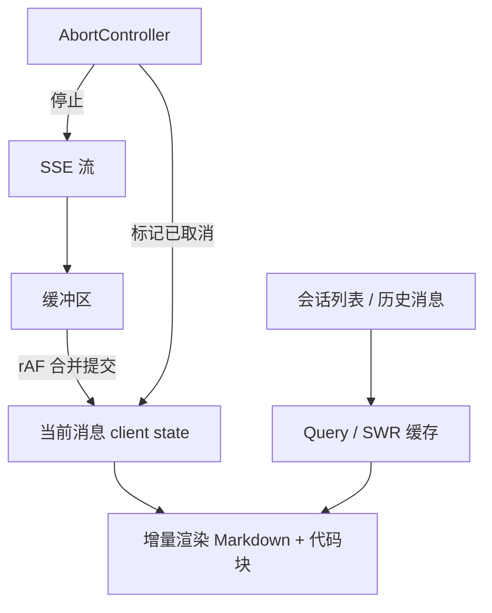

本章定位：把「URL 到首屏」「React 运行时」「错误治理」「流式交互」「大数据量渲染与传输」串成一条有因果的主线，而不是并列的术语清单。每节先给机制，再给工程取舍，最后点出失败模式，目标是能脱离提示讲清一条完整链路。算法骨架见 [高频手撕题解法骨架](/interview/fundamentals/algorithms)，题目索引见 [题目索引](/interview/question-bank)。

## 一、URL 输入到页面渲染：有先后依赖的四段流水线

**结论/机制**：这是「建链 → 解析 → 执行 → 渲染」四段，前一段的输出是后一段的输入；任一段阻塞会把后续整体推迟，而不是各步独立计时。

| 段   | 步骤                     | 关键机制                                                                   | 主要阻塞点                       |
| ---- | ------------------------ | -------------------------------------------------------------------------- | -------------------------------- |
| 建链 | DNS → TCP → TLS → HTTP/2 | DNS 递归与各级缓存、TCP 三次握手、TLS 1.3 `1-RTT`、HTTP/2 多路复用与 HPACK | RTT 累加、队头阻塞只留在 TCP 层  |
| 解析 | HTML → DOM、CSS → CSSOM  | 预加载扫描器提前发请求、遇同步 `<script>` 暂停解析                         | CSS 阻塞渲染树、同步脚本阻塞解析 |
| 执行 | 编译 + 运行              | 事件循环、宏任务 / 微任务、长任务占主线程                                  | 单个长任务卡住交互               |
| 渲染 | 布局 → 绘制 → 合成       | 渲染树 → Layout 盒模型 → Paint 指令 → Composite 分层光栅化                 | 频繁重排重绘                     |



`DOMContentLoaded` 在 HTML 解析完成、同步与 `defer` 脚本执行完即触发，**不等**图片、样式表、子框架；`load` 等全部依赖资源就绪才触发。把初始化挂在 `load` 上会被一张慢图拖住；`defer` 在 `DOMContentLoaded` 前按序执行，`async` 与解析无序竞争，二者都别用来承载有依赖的初始化。

**工程取舍**：`preconnect` / `dns-prefetch` 提前吃掉建链 RTT；`fetchpriority` 之类的 Priority Hints 把 LCP 资源抬到高优先级；HTTP/2 多路复用后「域名分片」反而增加握手与拥塞控制开销；`Cache-Control` / `ETag` 决定哪些请求根本不发出；HSTS 让后续明文请求在浏览器内部直接升级，省掉一跳重定向。

**边界与失败模式**：HSTS 只在浏览器拿到过 `Strict-Transport-Security` 之后生效，**首次明文那一跳仍在**，这是它单独无法覆盖的缺口；强缓存命中不等于内容最新，要配合 `no-cache` 校验；`fetchpriority` 只是提示，不保证调度顺序。

## 二、React Fiber 与 Diff：变的是调度模型，不是量级

**结论/机制**：传统树编辑距离是 `O(n³)`；React 用**三条启发式**把调和压到近似 `O(n)` —— **不同类型节点直接替换整棵子树、只在同层比较、用 `key` 标识稳定元素**。同层双指针遍历时，`key` 命中则复用并判断是否移动，未命中则新建或删除；`lastPlacedIndex` 决定移动方向：新节点在旧序列中的位置小于该基准就要右移，否则更新基准。

:::warning 先澄清问法
被问「v16 前后时间复杂度怎么变」时先反问是比较复杂度还是调度模型：Fiber 把递归栈式调和改成**可中断、可分片、可恢复**的链表遍历，复杂度仍是 `O(n)`，**量级没变，变的是可中断与优先级调度**。答「从 `O(n³)` 变 `O(n)`」是把两条不同时间线拼在了一起。
:::

| 维度       | Stack Reconciler（v16 前） | Fiber（v16 起）                                            |
| ---------- | -------------------------- | ---------------------------------------------------------- |
| 遍历结构   | 递归调用栈，一旦开始不可停 | 单链表 `child/sibling/return`，可逐帧让出                  |
| 中断与恢复 | 不支持                     | 支持，配合 Scheduler 分片                                  |
| 双缓冲     | 无                         | `current` 与 `workInProgress` 两棵树交替，提交时一次性切换 |
| 优先级     | 无                         | lane 模型，更新可插队、可过期、可批量                      |

**hooks 链表与批量更新**：hooks 按**调用顺序**挂在 Fiber 的 `memoizedState` 单向链表上，所以不能写在条件或循环里；`useEffect` / `useMemo` 用 `Object.is` 逐项比较依赖数组决定复用还是重算；事件回调里的多次 `setState` 被批量合并为一次渲染，避免中间态。

**工程取舍与边界**：`key` 用数组下标会在插入或重排时错配状态（输入框串值），必须用稳定业务 id；Fiber 让出主线程让高优先级交互更跟手，但低优先级渲染可能被反复打断后重做；双缓冲省掉就地修改的回滚成本，代价是内存里同时存在两份 Fiber 树。

## 三、原型链、`new` 与 class：一张链与四步

**结论/机制**：对象的 `__proto__` 指向其构造函数的 `.prototype`，层层向上到 `Object.prototype` 再到 `null`；属性读取沿这条链逐级查找，`instanceof` 本质就是判断右侧 `.prototype` 是否出现在左侧对象的原型链上。ES6 `class` 只是语法糖，`extends` / `super` 底层仍是原型链拼接。

```js
function Ctor(x) {
  this.x = x;
}
Ctor.prototype.get = function () {
  return this.x;
};

// new 四步的等价手写
function myNew(Ctor, ...args) {
  const obj = Object.create(Ctor.prototype); // 1 建空对象并链到 prototype
  const ret = Ctor.apply(obj, args); // 2 绑定 this 执行构造函数
  // 3 构造函数显式返回对象则用它，否则用 obj
  return ret !== null && (typeof ret === "object" || typeof ret === "function")
    ? ret
    : obj;
}
const o = myNew(Ctor, 7);
console.log(
  o.get(),
  o instanceof Ctor,
  Object.getPrototypeOf(o) === Ctor.prototype,
); // 7 true true
```

**对照 Vue 与 React**：Vue 用 `Proxy`（或 `defineProperty`）做**可变数据 + 依赖追踪**，改哪个字段就精确通知订阅它的组件；React 走**不可变数据 + 重新渲染**，靠引用变化触发调和，再用 `memo` / 依赖数组裁剪重算范围。前者写入即精确更新但要维护依赖图，后者模型简单但默认重跑整棵子树。

**边界**：`__proto__` 是可改写的访问器，生产代码用 `Object.create` / `Object.getPrototypeOf`；原型链过长会拖慢查找；把方法挂在实例而非 `prototype` 会让每个实例各存一份。

## 四、错误状态的分层治理：捕获、兜底、可定位

**结论/机制**：不同错误发生在 React 生命周期的不同位置，**没有一种机制能全抓**，必须分层。

| 错误类型               | 捕获手段                                                             | 兜底动作             |
| ---------------------- | -------------------------------------------------------------------- | -------------------- |
| 渲染 / 生命周期抛错    | `Error Boundary`（`getDerivedStateFromError` + `componentDidCatch`） | 降级 UI、重试按钮    |
| 事件回调、异步 `await` | `try-catch`，Boundary **抓不到**这两类                               | 局部提示、可重试入口 |
| 未处理的 Promise 拒绝  | `unhandledrejection` 监听                                            | 上报后给用户一致提示 |
| 资源加载失败           | `onerror`、全局 `error` 捕获阶段                                     | 占位图、备用地址     |

:::tip 上报要能定位，而不只是计数
压缩混淆后的堆栈必须经 **sourcemap 反解**回到源码行列；`componentStack` 沿 Fiber 树向上重建，给出「哪个组件挂的」这个归因维度，与反解互补。数据模型统一为 `name/message/line/column/stack` 并带 `userId / release / sdkVersion` 维度；跨域脚本配齐 CORS 才能拿到完整堆栈，否则只剩 `Script error`。现场用 rrweb 的结构化事件滚动窗口还原，比录屏省带宽且可检索。
:::

**工程取舍与边界**：Boundary 只包「可能出错的子树」，包整个 App 会让一处白屏带走全页；重试要有退避与次数上限，否则故障期自我放大；上报 SDK 自身要限流去重，避免错误风暴把监控打挂；`Script error` 这类无堆栈信息要靠 `try-catch` 主动补报兜底。相关安全边界见 [CSRF 与 SameSite](/interview/answers/csrf-and-samesite)。

## 五、HTTPS：TLS 握手与它不解决的问题

**结论/机制**：握手三步 —— **证书校验**（CA 链逐级验签、核对域名与有效期）→ **密钥协商**（ECDHE 交换出会话密钥）→ **对称加密**传输（AES-GCM 等，带 AEAD 防篡改校验）。TLS 1.3 把握手压到 `1-RTT`，会话复用可做到 `0-RTT` 首包带数据。**解决三件事**：**机密性**（防窃听）、**防篡改**（integrity，靠 MAC / AEAD 校验）、**身份认证**（CA 链防冒充）。

:::warning 明确不解决什么
服务端被入侵、客户端本身恶意、证书被误签发、以及 **HSTS 生效前那一次明文重定向被劫持**，都不在 HTTPS 的覆盖范围内。后者需 HSTS 预加载清单、证书透明（CT）等配合；把「上了 HTTPS 就安全」当结论是典型失分点。
:::

**工程取舍与边界**：`0-RTT` 牺牲了重放保护，只适合幂等 GET；会话票据要轮换密钥，否则前向保密失效；证书链不完整会让部分客户端校验失败；混合内容（https 页面加载 http 子资源）会被浏览器拦截。CSRF 与 cookie 的作用域辨析见 [CSRF 与 SameSite](/interview/answers/csrf-and-samesite)。

## 六、自定义 hook：依赖数组、清理函数与卸载竞态

**结论/机制**：抽 hook 的价值不是复用几行代码，而是把「请求状态 + 生命周期 + 清理」封成可推理的单元。五类典型场景：请求状态（带竞态取消）、分页 / 筛选、权限判定、防抖值、WebSocket 订阅。

```ts
// 组件内使用（React 18+）
function useRequest<T>(url: string) {
  const [state, setState] = useState<{
    data?: T;
    error?: Error;
    loading: boolean;
  }>({ loading: true });
  useEffect(() => {
    const ac = new AbortController();
    setState({ loading: true });
    fetch(url, { signal: ac.signal })
      .then((r) => r.json() as Promise<T>)
      .then((data) => setState({ data, loading: false }))
      .catch((e) => {
        if (e.name !== "AbortError") setState({ error: e, loading: false });
      });
    return () => ac.abort(); // 卸载或依赖变化时取消在途请求
  }, [url]); // url 进依赖，变化即重发
  return state;
}
```

**工程取舍与边界**：**清理函数必须取消在途请求**，否则卸载后 `setState` 会告警、且慢响应会覆盖新请求结果（竞态）；依赖数组漏写会读到旧闭包，多写不稳定引用（每次渲染新建的对象 / 函数）会死循环；`AbortError` 要单独忽略，别当错误上报；防抖与订阅类 hook 同样要在清理里 `clearTimeout` / `unsubscribe`。请求缓存与竞态的成熟封装见站内 TanStack Query、SWR 相关笔记。

## 七、流式对话前端：状态分层与背压

**结论/机制**：先把状态切成两层 —— **server state**（会话列表、历史消息、生成任务元数据）与 **client state**（输入框、当前流式缓冲、滚动位置、UI 开关）。两层生命周期不同，混在一起会导致刷新丢消息、切会话串消息。



**为什么不能逐 token `setState`**：每个 token 一次状态更新会触发一整轮调和与 DOM 提交，生成速度远高于帧率时既浪费 CPU 又掉帧；正确做法是把 token 写进**可变缓冲**，用 `requestAnimationFrame` 或短定时器按帧合并成一次提交，形成天然背压。

:::note 增量渲染与「幽灵消息」
流式 Markdown 不能每来一个字符就重解析整篇：把文档切成「已封闭块」与「尾部未封闭块」，只重渲染尾部那一块；代码块用增量高亮器按 token 追加着色，避免整篇重新词法分析。点「停止」只是前端 `abort()`，**服务端可能仍在生成并续推**，所以要给每次生成分配 `generationId`，停止时把该 id 标记为已取消，后续到达的帧一律丢弃，否则会出现「幽灵消息」。刷新续上靠服务端保存生成任务与已产出内容，前端用会话 id 重新订阅或拉取。
:::

**工程取舍**：TanStack Query / SWR 用在**会话列表与历史消息**这类可缓存、可失效、可重试的 server state；**绝不用于逐 token 流** —— 它们假设「一次请求一次响应」，而流式是长连接增量帧，模型不匹配。乐观更新（发送用户消息先上屏）要在失败时按 `clientId` 回滚或标记重发。

**边界与失败模式**：切换会话要清空或隔离各自的缓冲，否则旧会话的帧写进新会话；`AbortController` 断开后服务端仍在跑，算力止损要靠服务端取消传播兜底；重连要按帧序号去重；背压缓冲要有上限，防止超长回复吃满内存。

## 八、虚拟滚动：少渲染节点，不是少加载数据

**结论/机制**：先纠偏 —— 虚拟滚动优化的是 **DOM 数量**带来的样式计算、布局、绘制、合成与 GC 成本；**传输量要靠服务端分页 + 字段裁剪**解决，两者不是一回事。

**定高四行公式**：

```ts
const start = Math.floor(scrollTop / itemHeight);
const end = start + Math.ceil(viewportH / itemHeight) + buffer * 2;
const offsetY = start * itemHeight; // 绝对定位或 transform 顶起可视区
const totalH = n * itemHeight; // 撑出滚动条总高度
```

**不定高三个问题**：总高度怎么撑、可视区间怎么找、真实高度怎么修正 → **预估高度 + 前缀和 + 二分 + 实测增量重算**。

```ts
function findStartIndex(prefix: number[], scrollTop: number): number {
  let lo = 0,
    hi = prefix.length - 1;
  while (lo < hi) {
    const mid = (lo + hi + 1) >> 1;
    if (prefix[mid] <= scrollTop) lo = mid;
    else hi = mid - 1;
  }
  return lo; // prefix[i] 为第 i 项之前的累计高度
}

function onMeasure(
  i: number,
  realH: number,
  heights: number[],
  prefix: number[],
) {
  if (heights[i] === realH) return;
  const delta = realH - heights[i];
  heights[i] = realH;
  for (let k = i + 1; k < prefix.length; k++) prefix[k] += delta; // 增量重算后续前缀和
}
```

:::tip 规模上去换数据结构
`prefix` 数组单点更新是 `O(n)`；把前缀和换成**树状数组（Fenwick）**，单点更新与区间查询都降到 `O(log n)`。可视项用 `prefix[i]` 绝对定位，`ResizeObserver` / `useLayoutEffect` 量真实高度回写，越滚越准、滚动条抖动逐步收敛。
:::

**边界与失败模式**：快速拖动白屏 → 加 `buffer` 与占位骨架；缩放改变真实高度 → 重新测量；容器 resize → 重算 `viewportH`；SSR 无 `scrollTop`、无 `ResizeObserver` → 按预估高度直出首屏；**向上加载历史必须补偿 `scrollTop`**（加上新增高度），否则视口瞬间跳动；测量必须放在布局完成后。手写约两三百行且要处理上述全部边界，通用中后台直接用 `@tanstack/react-virtual` 更划算，只有强定制或场景收敛才手写。二分与前缀和的通用骨架见 [高频手撕题解法骨架](/interview/fundamentals/algorithms)。

## 九、断点续传：应用层状态机与 HTTP 语义是两件事

**结论/机制**：应用层分块是「校验 → 上传分块 → 合并」三端点状态机。校验入参为文件哈希 / 扩展名 / 分块总数，最终文件已存在直接秒传；否则逐个探测分块目录的 `chunk-<下标>`，**返回缺失下标数组**。服务器进度就是磁盘上已落盘的完整块集合，没有数据库记录；客户端只补传缺失块。合并按序拼接、中途失败删半成品（防被误判秒传）、最终文件已存在直接返回成功，**幂等**。

```ts
// 浏览器端分块调度（实测参数：5 MiB / 并发 3 / 重试 3 次线性退避）
async function upload(file: File, missing: number[], signal: AbortSignal) {
  const SIZE = 5 * 1024 * 1024;
  let cursor = 0;
  const worker = async () => {
    while (cursor < missing.length && !signal.aborted) {
      const idx = missing[cursor++];
      const fd = new FormData();
      fd.append("idx", String(idx));
      fd.append("chunk", file.slice(idx * SIZE, (idx + 1) * SIZE));
      for (let n = 1; ; n++) {
        try {
          await fetch("/api/upload/chunk", {
            method: "POST",
            body: fd,
            signal,
          });
          break;
        } catch (e) {
          if (n === 3) throw e;
          await new Promise((r) => setTimeout(r, n * 1000));
        }
      }
    }
  };
  await Promise.all(Array.from({ length: 3 }, worker));
}
```

**HTTP 层必须分清**：`Range` / `206 Partial Content` / `Content-Range` / `If-Range` 全是 **GET 下载的语义**，标准 HTTP **没有上传续传字段**。上传要做到块内偏移，需 `PATCH + Content-Range`（tus 约定）、S3 multipart（`uploadId + partNumber + ETag`），或干脆像这里一样只认完整块。

| 字段                                           | 方向         | 作用                                   |
| ---------------------------------------------- | ------------ | -------------------------------------- |
| `Accept-Ranges: bytes`                         | 响应         | 声明支持范围请求                       |
| `Range: bytes=start-end`                       | 请求（GET）  | 指定字节区间                           |
| `206` + `Content-Range: bytes start-end/total` | 响应         | 返回该区间                             |
| `416`                                          | 响应         | 非法区间                               |
| `If-Range: <ETag>`                             | 请求（GET）  | 资源变了返回全量 `200`，防新旧版本拼坏 |
| `PATCH` + `Content-Range`                      | 请求（上传） | 非标准但通行的块内偏移做法             |

:::warning 半块断了怎么算
进度粒度是**完整块**：某一块传到一半中断（未写成 `chunk-<下标>`），**这一块要整块重传**，前面已落盘的块全部保留。要省掉这一块的重传，就得引入 `PATCH + Content-Range` 或 tus，并让服务端持久化每个 uploadId 的已收字节数 —— 代价是引入状态存储；这里选择块粒度，就是为了把状态机压在磁盘文件集合上。
:::

**边界与失败模式**：状态挂在本地磁盘 → 多实例部署时校验与合并必须落同一实例或改共享存储；文件哈希要用 worker 二次摘要避免主线程内存峰值；`If-Range` 缺失会在文件被替换后把新旧字节拼成损坏文件；总大小上限要先在客户端拦住。虚拟滚动、告警与死锁的同一组取舍见 [上传、滚动、告警与死锁](/interview/answers/upload-scroll-alerting-deadlock)。

## 十、协同文档：ProseMirror 与一致性取舍

**结论/机制**：Tiptap 基于 **ProseMirror**，而不是裸 `contentEditable` —— 后者把 DOM 当真值源，浏览器差异、选区崩溃、撤销栈不可控。ProseMirror 用 **Schema** 约束文档结构、**Transaction / Step** 描述每次变更、**Plugin** 挂行为、**Selection / Decoration** 管选区与不改变文档的视觉标记，所有变更走同一条可重放、可转换的事务管线。

| 维度        | 要点                                                                                                                        |
| ----------- | --------------------------------------------------------------------------------------------------------------------------- |
| 冲突合并    | **OT**（操作转换，中心化、需服务端定序）vs **CRDT**（Yjs，无中心、可离线合并，元数据更重）                                  |
| undo / redo | 协同下不能简单回退本地栈：只能撤销「自己的、且未被他人后续操作依赖」的 Step，需按 origin 过滤并重放                         |
| awareness   | 光标 / 在线状态走轻量临时通道，不进文档历史、不持久化                                                                       |
| 断线重连    | 本地先缓存 Steps，重连后按版本补齐并转换；离线编辑靠 CRDT 或 OT 的本地队列                                                  |
| Word 互转   | 导入 `mammoth` / `docx` 映射为节点、导出反序列为 OOXML；**round-trip 必然有损**：样式 / 列表 / 表格 / 图片 / 批注难一一对应 |
| 修订模式    | 用 mark / annotation 记录 insert / delete 与编辑者、时间，接受 / 拒绝是一次事务；评论锚点用 `RelativePosition` 防编辑漂移   |
| AI 接入     | 建议以「修订」写入而非直接覆盖，保留人在回路确认，避免模型输出绕过审阅                                                      |

**工程取舍与边界**：大文档要分块渲染 + 虚拟滚动 + 增量同步，否则长文档输入延迟不可控；快照压缩控制历史体积；评论锚点在区间被整段删除后要定义「孤立线程」的展示与关闭策略；AI 建议若直接覆盖写入，会破坏修订链与审计。Agent 侧工具与权限边界见 [Agent 与 MCP](/interview/fundamentals/agent-and-mcp)。

## 事实依据

| 主题                 | 事实依据                                                                               |
| -------------------- | -------------------------------------------------------------------------------------- |
| 建链、缓存、首屏链路 | `content/fe/fe.md`、`content/fe/fetchpriority-swr.md`                                  |
| 错误上报与现场还原   | `content/fe/yukino-sentry.md`、`content/docs/data.md`                                  |
| 请求状态、缓存与 SWR | `content/fe/tanstack.md`、`content/fe/fetchpriority-swr.md`                            |
| 不定高虚拟滚动       | `content/docs/tiktok.md`                                                               |
| 分块状态机参数       | `content/fe/yukino-chat.md`、`5 MiB`、`10 MiB`、`并发 3`、`重试 3 次线性退避`、`2 GiB` |
| 下载区间语义         | `content/be/wanproxy.md`、`206`、`Content-Range`、`416`                                |

## 面试怎么讲

| 维度     | 采分点                                                                                                         | 扣分点                                                   |
| -------- | -------------------------------------------------------------------------------------------------------------- | -------------------------------------------------------- |
| 概念纠偏 | 先说「Fiber 改的是可中断 / 分片，不是 `O(n³)→O(n)`」；先说「Range 是下载语义」；先说「虚拟滚动省渲染不省传输」 | 把三条启发式与 Fiber 混成一条时间线，把 Range 当上传续传 |
| 机制深度 | 讲清 DOM / CSSOM 合渲染树、两个就绪事件、hooks 链表按序、双缓冲 `current` / `workInProgress`                   | 只背名词，说不出谁阻塞谁                                 |
| 工程取舍 | 说清逐 token `setState` 的背压、TanStack Query 只用在 server state、手写 vs 虚拟滚动库的成本                   | 一句「用缓存就行」，不划边界                             |
| 失败模式 | 幽灵消息用 `generationId`、卸载竞态用 `AbortController`、向上加载补 `scrollTop`、HSTS 首次明文缺口             | 只讲 happy path                                          |
| 表达结构 | 机制 → 取舍 → 边界，链路按因果推进                                                                             | 想到哪说到哪、列术语                                     |

## 速记卡

- **渲染链路**：DNS→TCP→TLS→HTTP/2→DOM / CSSOM→JS→布局→绘制→合成；`DOMContentLoaded` 不等图片，`load` 等全部资源。
- **Diff**：三条启发式把 `O(n³)` 压到近似 `O(n)`；Fiber 变的是**可中断 / 可分片**与双缓冲，复杂度量级不变。
- **原型链**：`__proto__` → `.prototype` → `Object.prototype` → `null`；`instanceof` 查链，`new` 四步，class 是语法糖。
- **错误治理**：Boundary 抓渲染 / 生命周期，事件与异步靠 `try-catch`，拒绝靠 `unhandledrejection`，上报要 sourcemap 反解 + `componentStack`。
- **HTTPS**：证书校验 → 密钥协商 → 对称加密；解决机密性 / 防篡改 / 身份认证，不解决服务端入侵与首次明文重定向。
- **流式前端**：state 分 server / client 两层，token 进缓冲按帧合并提交，`generationId` 挡幽灵消息，Query / SWR 只管会话列表与历史。
- **虚拟滚动**：定高除法定位；不定高 = 预估高度 + 前缀和二分 + `ResizeObserver` 增量重算 + 树状数组 `O(log n)`。
- **续传**：进度是磁盘上的完整块集合，`5 MiB` / 并发 `3` / 重试 `3` 次；`Range` / `206` / `If-Range` 是 GET 下载语义。
