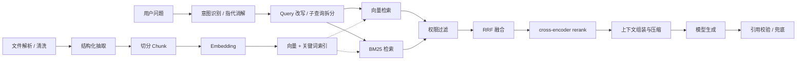

本章把 RAG 拆成可复述的工程链路：离线建索引、在线检索与重排、上下文组装、生成与引用校验，以及贯穿全程的评估与幻觉治理。相关项目事实见[电商 RAG 项目深挖](/interview/answers/ecomm-rag-project)与[RAG 六连问](/interview/answers/rag-deep-dive)。

## 一、离线与在线管线

**权限过滤必须尽量前置**：先召回全租户内容再让模型判断，既泄漏又浪费 token。生成后要有**引用校验闭环**，核对答案里的每个 `[n]` 是否真能落到证据 ID。

## 二、实时转写与事件溯源

| 环节     | 结论                                                                                                                                 |
| -------- | ------------------------------------------------------------------------------------------------------------------------------------ |
| 流式识别 | 不等整段音频结束；ASR 返回「中间结果」与「最终结果」                                                                                 |
| 落库时机 | 只有 `is_final` 才发布索引事件；**中间结果绝不入库**，否则同一段重复写入，仅用于实时展示                                             |
| 数据结构 | 转写记录带 `meeting_id` / `speaker` / `start_ms` / `end_ms` / `text` / `sequence`                                                    |
| 事件溯源 | 原始音频事件、临时转写、修订转写、决策事件分别保存；前端按 `segment_id + revision` 合并，ASR 后续修正不覆盖审计记录                  |
| 乱序收敛 | 有限重排序缓冲 + 事件 ID 去重 + 会话游标；缺号不能永久阻塞后续消息，超时后先展示并请求补发                                           |
| 分区扩容 | `meeting_id` 作 Key **只保证分区内有序**；扩容需冻结旧路由 → 记录切换位点 → 提升 Epoch → 拒绝旧 Epoch 迟到写入 → DB 更新校验会议版本 |

## 三、切分：结构优先，长度兜底

| 文档形态    | 切法                                                          |
| ----------- | ------------------------------------------------------------- |
| 标题 / 章节 | 按 h1–h4 切小节，`sectionPath` 保留标题路径                   |
| 表格        | 按行分组、每组复制表头，避免跨块丢列                          |
| 代码        | 优先按函数 / 类 / 模块，不按普通文本切                        |
| 会议内容    | 按说话人切换、静音区间、标点形成语义单元，再按主题相似度合并  |
| 普通文本    | 递归字符切分 + **句子级 overlap**（按完整句子回卷，不截半句） |

**风险对照**：太短丢语义、太长丢检索粒度、固定重叠引入重复与召回污染。局部修订时用**内容哈希定位受影响区间**，只重切该区间及相邻边界，不重建整场索引。

:::note 参数依据
`content/docs/yukino-ecomm-agent/rag.md` 的默认参数是 `chunkSize=400`、`overlap=60`、`tableMaxRows=10`、`RECALL_TOP_K=50`、`RERANK_TOP_K=10`、`RRF k=60`。这些是**源码默认常量，无消融实验**。合理调优方式是用固定评测集做 `chunkSize × overlap × topK` 网格，看 `Recall@5` / `MRR` / 证据覆盖率拐点——三者是一组参数，单独调一个没有意义。
:::

## 四、检索与重排

| 方式                 | 适合                              | 不适合                             |
| -------------------- | --------------------------------- | ---------------------------------- |
| 向量检索             | 语义相近但关键词不一致            | 型号、错误码、订单号等精确字面匹配 |
| BM25                 | 专有名词、SKU、口语中缺失的精确词 | 同义改写                           |
| 图检索               | 实体关系、多跳约束                | 纯语义相似                         |
| cross-encoder rerank | 对 Top20/50 候选做精细相关性判断  | 全量候选（延迟与成本）             |

**分数校准**不能把余弦与 BM25 直接归一化相加；RRF `1/(k+rank)` 只比排名，规避量纲差异，也可用于**跨模型、跨索引**的融合。HNSW 三参数：`M` 增召回但涨内存与构建成本、`efConstruction` 提索引质量但写入变慢、`efSearch` 提召回但涨查询延迟；线上看 `Recall@K` / P95 / 索引大小 / 吞吐。高选择性租户过滤要**过滤下推**或扩大候选集再重排。

## 五、上下文预算与进阶设计

- **固定预算**：系统提示、输出格式、安全约束；当前用户问题优先级最高。
- **竞争剩余空间**：近期对话、历史摘要、检索证据按相关性分配；证据不能只按相似度截断，还要看来源多样性、时间范围、重复度与覆盖率。
- **冲突保留双方**，不自动只留最高分；先对历史生成层级摘要，再按信息价值排序。
- **依赖感知压缩**必须保留任务约束、未完成步骤、关键工具结果，不能只留最近消息。
- **预留输出空间**，避免输入占满窗口导致答案被截断。

进阶题的标准切入：快照一致查询 = 语料版本号 + 同一版本内检索；时间旅行索引 = 索引带 `valid_from/valid_to` 并按版本过滤；引用漂移防护 = 证据 ID 与 chunk 哈希绑定、生成后机械校验；记忆事实冲突 = 按来源权威等级、时间、置信度裁决覆盖 / 并存 / 拒绝；确定性回放 Harness = 固定输入、固定工具结果、记录每个 span 与随机性来源。

## 六、Embedding 模型迁移与评估归因

**影子索引**：索引里除向量外存原文哈希 / 切分版本 / 模型版本 / 维度 → 按访问热度渐进回填 → 查询先走新索引，未迁移数据回退旧索引 → **不同模型的向量距离不可直接比较，各自算排名后 RRF 融合** → 覆盖率与质量达标后切主读，旧索引保留回滚窗口。规模决定方案：项目只有 6 份文档 / 74 条 chunk，`vectorizePending` 检测到 `embeddingModel` 不一致即**全量重嵌**成本可忽略；海量历史索引才需要影子索引。

| 阶段 | 指标                         | 判据                                            |
| ---- | ---------------------------- | ----------------------------------------------- |
| 召回 | `Recall@K`、`MRR`            | 正确证据是否进入候选集                          |
| 排序 | `NDCG`                       | 存在但排名太低 → 重排问题                       |
| 生成 | 忠实度 / 完整性 / 引用正确性 | 证据正确但答错 → 上下文组织、模型能力或答案约束 |

线上必须保存**查询改写、过滤条件、召回列表、重排分数、最终引用**才能事后归因。4 策略消融（`vector` / `bm25` / `hybrid` / `hybrid_rerank`）的差值即 rerank 净增量；`RERANK_API_KEY` 缺失时降级是天然开关式对照。历史报告是运行时产物、仓库未归档，**不能现场编分数**，口径见[指标口径与基线定义](/interview/metrics-baseline)。

## 七、TTFT 与防幻觉责任链

**首字符时间 = 一串前置串行 LLM/检索节点 + 生成模型 prefill**。SSE 只让已生成的字尽早出现，不减少总耗时。优化顺序：拆 Langfuse span 定位瓶颈 → 减少前置串行结构化调用 → 并行化可并行的改写与召回 → 检索侧超时与降级 → 稳定 system/tools 前缀命中 prompt cache → 状态事件掩盖感知延迟 → 上下文瘦身 → 总超时走确定性话术。

防幻觉不是「检索 + 一句提示词」，而是**确定性路由保证必检索 → 置信度闸 + selfcheck 决定要不要生成 → 结构化输出与工具注入约束内容 → 机械闸门 / 忠实度评审 / 台账事后兜底 → 数据飞轮补知识缺口**。证据以编号 `[n]` 放在当前用户消息之后的 turn-ctx，不放 system，为保住前缀缓存。

## 八、面试怎么讲

| 加分                                          | 扣分                           |
| --------------------------------------------- | ------------------------------ |
| 先画离线/在线两段链路，再逐层展开             | 只背「切块 → 向量库 → 大模型」 |
| 主动区分 RRF 融合与分数归一化、消融与对照实验 | 把检索策略消融说成模型选型实验 |
| 说清结构优先切分、句子级 overlap 的代价       | 只报 400/60 而不知依据缺口     |
| TTFT 先拆 span 再谈优化                       | 认为 SSE 降低 TTFT             |
| 参数无消融、报告未归档时如实说明              | 现场编提升幅度                 |

## 速记卡

- **中间结果不入库**；事件带 `segment_id + revision`，修订覆盖视图但历史版本保留。
- **顺序不能靠分区**：扩容用 Epoch + 冻结路由 + 版本校验。
- **结构优先切分、长度兜底**；句子级 overlap 不截半句；局部修订按哈希增量重切。
- **RRF 按排名融合**，规避量纲差异；rerank 只处理 Top20/50。
- **换 embedding**：影子索引 + 渐进回填 + 按排名融合 + 覆盖率阈值切主读 + 回滚窗口。
- **三段归因**：没召回查索引，召回但排低看 NDCG，证据对答错查上下文与约束。
- **SSE 不降 TTFT**；降 TTFT 要减前置串行调用、并行化、稳住 prompt 前缀。

## 延伸阅读

[Agent 执行链路与 MCP](/interview/fundamentals/agent-and-mcp) · [指标口径与基线定义](/interview/metrics-baseline) · [全量题库](/interview/question-bank)
