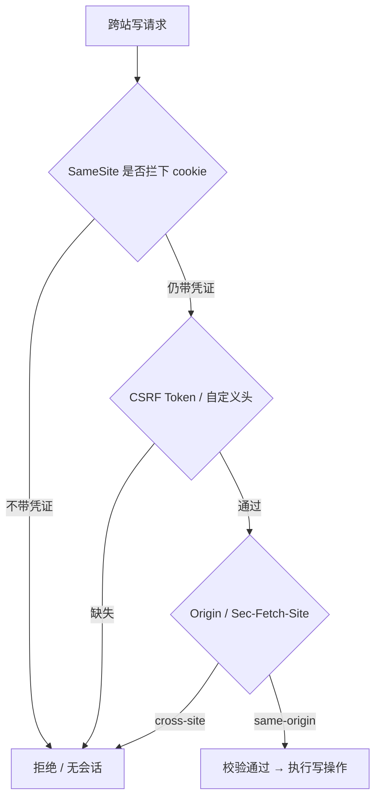
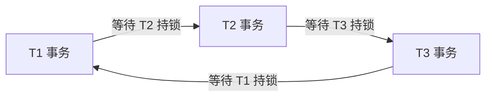

本章定位：把「同源 / 同站 / cookie 作用域」这组最易混淆的概念先钉死，再沿 CSRF 防御、登录安全、云侧 DDoS、内存与告警治理、死锁检测逐层展开。全章按机制 → 工程取舍 → 失败模式推进，重点在分清「哪一层真正解决问题、哪一层只是配套」。图算法骨架见 [高频手撕题解法骨架](/interview/fundamentals/algorithms)，题目索引见 [题目索引](/interview/question-bank)。

## 一、三组概念辨析：同源、同站、cookie 作用域

**结论/机制**：这三者判定依据不同、执行者不同、管的事情也不同，混为一谈会直接答错 CSRF。

| 概念                    | 判定依据                                                             | 管什么                                                            | 谁执行               |
| ----------------------- | -------------------------------------------------------------------- | ----------------------------------------------------------------- | -------------------- |
| **Same-Origin（同源）** | `scheme + host + port` **三者全等**                                  | 限制 JS **读取**跨域响应 / DOM；**不限制请求发出**                | 浏览器               |
| **Same-Site（同站）**   | eTLD+1（Public Suffix List 下的可注册域），忽略 scheme / port / 子域 | `SameSite` 决定跨站请求**是否携带 cookie**                        | 浏览器 + cookie 属性 |
| **Cookie 作用域**       | `Domain` + `Path`（`Secure` 限 https）                               | 决定 cookie 发给谁；**不看 port**，不区分 scheme（除非 `Secure`） | 浏览器               |

:::warning 「cookie 的 same origin」不存在
开口先纠偏：**cookie 没有 same origin 属性**。面试里这句话多半是把上面三个概念说混了，主动澄清本身就是得分点；真正想问的通常是 `SameSite`，或「同源策略下 cookie 怎么判定」。
:::

| A ↔ B                                       | cross-origin | cross-site                  | 后果                                                     |
| ------------------------------------------- | ------------ | --------------------------- | -------------------------------------------------------- |
| `app.example.com` ↔ `api.example.com`       | 是           | 否，**same-site**           | `SameSite=Strict` 的 cookie **照样带**，但 CORS 必须放行 |
| `a.com` ↔ `a.com:8443`（`http` 与 `https`） | 是           | 否                          | 无 port 隔离，非 `Secure` 时 cookie 共享                 |
| `a.github.io` ↔ `b.github.io`               | 是           | 是（`github.io` 在 PSL 中） | `SameSite` 会拦下 cookie                                 |

## 二、CSRF：成因、分层防御与真实场景

**成因**：浏览器对目标站点**自动携带 cookie**（ambient authority）。攻击页面构造指向目标站的 `<form POST>` / `img` / `fetch`，用户已登录 → 请求带凭证 → 服务端只认 cookie 就执行转账。攻击者**读不到响应**（同源策略拦的是读），但攻击只需「请求被发出且被执行」。详细辨析见 [CSRF 与 SameSite](/interview/answers/csrf-and-samesite)。

**分层防御（七层）**：

| 层  | 手段                                      | 关键边界                                                                                                                     |
| --- | ----------------------------------------- | ---------------------------------------------------------------------------------------------------------------------------- |
| 1   | **`SameSite=Lax` / `Strict`**             | 第一道防线；`Lax` 放行**顶层导航 GET** → 必须保证 GET 无副作用；`Strict` 太严，外链进来掉登录                                |
| 2   | **CSRF Token（同步器模式）**              | 服务端下发、绑定 session、不可预测；跨源页面读不到                                                                           |
| 3   | **双重提交 cookie**                       | token 同放 cookie 与**自定义头**，服务端比对；配 `__Host-` 前缀防子域注入覆盖                                                |
| 4   | **强制自定义头 / 触发 preflight**         | 表单无法加自定义头，跨源 `fetch` 加头会先发 OPTIONS；**不能只靠「接口只收 JSON」** —— 表单能用 `text/plain` 拼出 JSON 字符串 |
| 5   | **`Origin` / `Referer` + Fetch Metadata** | `Sec-Fetch-Site` / `-Mode` / `-Dest` / `-User` 由浏览器强制附加，攻击者伪造不了                                              |
| 6   | **规范与产品层**                          | GET 幂等；转账、改密加二次验证 / 验证码                                                                                      |
| 7   | **架构层取舍**                            | 改用 `Authorization: Bearer`（浏览器不自动带）→ 天然免疫 CSRF，但 **XSS 窃取风险上升**，要说清 trade-off                     |

| `SameSite` 值 | 跨站请求带 cookie 吗          | 用途                                                 |
| ------------- | ----------------------------- | ---------------------------------------------------- |
| `Strict`      | 完全不带                      | 高安全后台；代价是外部链接进来掉登录                 |
| `Lax`         | 仅**顶层导航 GET** 带         | **现代浏览器缺省值**（Chrome 80 起），兼顾体验与安全 |
| `None`        | 总是带，**必须同时 `Secure`** | 第三方支付 / SSO 回调、跨站 iframe 嵌入              |

| 场景                                         | 机制落点                                                                                                                |
| -------------------------------------------- | ----------------------------------------------------------------------------------------------------------------------- |
| 从邮件 / IM 点链接进站                       | 顶层 GET 导航带 cookie 免登录；恶意站 `<form POST>` 不带 cookie 被挡 —— 这正是 `Lax` 成为默认值的理由                   |
| 第三方支付 / OAuth 回调                      | 支付网关跨站 POST 回商户，`Lax` 不带 → 必须 `SameSite=None; Secure`，再用 OAuth `state`（本质是 CSRF Token）兜底        |
| 多子域 `app.example.com` → `api.example.com` | same-site 但 cross-origin；`SameSite=Strict` 仍带 cookie，**CORS 仍要**精确匹配 + `Allow-Credentials: true`（不能 `*`） |
| SSR 表单 / 银行后台                          | 隐藏域 CSRF Token；SPA + JWT 通常改 Bearer + 自定义头，不再依赖 cookie                                                  |



:::note 配套但别答错
`HttpOnly` 防 **XSS 窃取凭证**，不防 CSRF；`Secure`、`__Host-` / `__Secure-` 前缀防 cookie 被低权限子域篡改；**CORS 只控「响应能否被 JS 读取」，请求早已到达服务端，不能当 CSRF 防线**。推荐组合：`HttpOnly` + `Secure` + `SameSite=Lax/Strict` + `__Host-`，敏感写操作再叠加 CSRF Token。
:::

## 三、工程落点与事实依据

浏览器**不会**像同源策略那样自动拦截跨域 WebSocket 连接，握手时的 `Origin` 校验必须由服务端自己承担；带凭证场景下反射 `Origin` 要收敛为白名单并配合 `Vary: Origin`。

| 主题                    | 事实依据                                                                    |
| ----------------------- | --------------------------------------------------------------------------- |
| WebSocket 跨站劫持      | `content/be/yukino-http.md`、`opts.CheckOrigin`、`nil`、`Throw(403)`        |
| Remote 模式 Origin 闸门 | `content/docs/yukino/remote.md`、`/ws`、`Origin`、`Host`、`403`             |
| dev-agent 反面案例      | `content/docs/yukino-dev-agent/yukino-dev-agent.md`、`无鉴权`、`CORS 全开`  |
| CORS 中间件             | `content/be/wanproxy.md`、`反射 Origin`、`OPTIONS 直接 204`、`Vary: Origin` |

## 四、登录安全的分层清单

**机制**：从外到内逐层设防，任何一层单独都不够；越权防线必须落在服务端逐次鉴权，不能信前端传来的 `userId`。

| 层   | 手段                                                                                        |
| ---- | ------------------------------------------------------------------------------------------- |
| 传输 | 全站 HTTPS / HSTS、证书校验、敏感 cookie `Secure + HttpOnly + SameSite=Lax`                 |
| 凭证 | 密码加盐慢哈希（Argon2id / bcrypt）、永不存明文、密钥轮换；MFA / TOTP；口令强度与泄露库检测 |
| 会话 | 服务端会话 + 轮换 session id、闲置 / 绝对超时、异地登录提醒、设备指纹                       |
| 爆破 | 按账号 + IP + 全局三级**限流**、指数退避、验证码、账号锁定策略                              |
| 注入 | 参数化查询 / ORM、输入校验、最小权限 DB 账号                                                |
| CSRF | `SameSite` + CSRF Token / 自定义头 + `Origin` / Fetch Metadata                              |
| XSS  | 输出编码 + CSP、富文本白名单                                                                |
| 越权 | 服务端逐次鉴权，**身份参数由系统注入、不经过模型 / 前端**                                   |
| 审计 | 登录 / 失败 / 敏感操作日志、异常告警、追溯链路                                              |

**取舍**：限流要分层 —— 网关按 IP / 租户粗限，进程内按 user / API key 细限；MFA 与验证码提升安全但增加登录摩擦，按操作敏感度分级施加。

## 五、云服务商视角的 DDoS 防护

**机制**：与「自己站点做限流」的差别是**带宽耗尽**与**多租户** —— 链路被打满时进程内计数器毫无意义，云厂商必须在流量进入租户前就吸收掉。

| 层          | 手段                                                                                              |
| ----------- | ------------------------------------------------------------------------------------------------- |
| 网络层 L3/4 | **Anycast / BGP 引流 + 清洗中心**、黑洞路由、限速与 SYN Cookie、UDP / ICMP 泛洪过滤、超大带宽储备 |
| 连接层      | 连接数限制、TLS 握手限速、慢连接（Slowloris）防护，**只能靠网关 / 边缘节点**扛，源站不暴露        |
| 应用层 L7   | WAF、CC 防护、JS Challenge / CAPTCHA、按 URL / 租户的速率与配额、Bot 管理                         |
| 架构        | 高防 IP / CDN 边缘吸收、**源站隐藏**、弹性扩容 + 降级（静态化 / 只读）、多区域容灾                |
| 运营        | 基线画像（正常流量模型）、异常检测、演练、按租户计量与配额、攻击报告与溯源                        |

**取舍与边界**：接入层早拒绝、双维度限流（连接数 + 字节）、有界队列、异步削峰（见 [大载荷与容量](/interview/answers/large-payload-capacity)）；误杀率与成本是硬约束 —— 清洗阈值过严会挡正常突发，黑洞路由等于主动放弃可用性，只作最后手段。

## 六、内存泄漏检测

| 手段     | 要点                                                                                                          |
| -------- | ------------------------------------------------------------------------------------------------------------- |
| 指标分层 | RSS / `heapUsed` / `external` 三线叠加先判**堆内 vs 堆外**；Buffer 数据体落在 `external`，`heapUsed` 几乎不动 |
| 趋势外推 | `predict_linear(process_resident_memory_bytes[1h], 6*3600)` 外推 6 小时后越线才告警，不用绝对阈值             |
| 堆快照   | 三次 GC 后对比 retained size，看 **dominator 树**找闭包引用                                                   |
| 常见成因 | 全局缓存无淘汰、监听未解绑、闭包持有大对象、定时器未清、连接池 / 句柄未归还                                   |
| 告警分级 | 症状优先（内存水位 + GC 耗时 + eventloop lag 联看），原因级指标只上看板；`for` 持续时间 + 分组抑制            |

**边界**：RSS 冲高后不回落不等于泄漏（glibc malloc 的 arena 缓存与碎片不主动归还 OS），判断看**长期单调增长趋势**；native 侧泄漏在 heap snapshot 里查不到，只能靠 RSS 趋势与 valgrind / ASan 定位。

## 七、告警归属率与分级治理

**机制**：治理漏斗是 `接入 → 聚合去重 → 归属 → 派单 → 处理 → 关闭`。归属是「能不能找到人」的分水岭 —— 无归属或归错人直接拉长 MTTR、制造告警疲劳与责任推诿，最终导致静默无人看。

| 指标           | 分子                                           | 分母                                                                 |
| -------------- | ---------------------------------------------- | -------------------------------------------------------------------- |
| **归属覆盖率** | 带齐备归属标记且校验通过的告警数               | **有效告警总数**（去重后，排除维护窗口、测试流量、已静默、重复风暴） |
| **归属准确率** | 归属判定与**事后复盘确认的责任方一致**的告警数 | 已归属的告警数                                                       |

**「归属正确」三条判据（缺一不可）**：**主体正确**（落到具体模块 / 服务 / 团队且与事后根因一致，而非告警触发点所在服务 —— 上游故障常让下游背锅）、**证据链齐备**（含 `trace_id` / `commit` / `release` / 堆栈反解到源码行与组件，能复现能复核）、**可闭环**（派单被认领、有处理动作、复盘无转派；**转派过的应计为归属不准**或单列转派率）。 **前后端职责**：前端做错误边界 + sourcemap 反解、`userId / projectId / sdkVersion` 归属维度、rrweb 现场还原、SDK 侧过滤跨域噪声；后端做三支柱 metrics / traces / errors、OpenTelemetry 跨服务串联、服务 / 实例 / 接口维度打标。分级治理**机制优先、人工兜底**，共七层：

| 层           | 机制                                                                                         |
| ------------ | -------------------------------------------------------------------------------------------- |
| 1 确定性基线 | 规则引擎先算分类 / 优先级 / 复杂度，LLM 输出只叠加在基线之上                                 |
| 2 聚合收敛   | 指纹去重、同名合并、按入口溯源、时间窗口聚合，压掉风暴                                       |
| 3 分级       | 按 severity 路由；**SLO 多窗口燃烧率**（短窗口高燃烧率立即响应、长窗口低燃烧率工作时间通知） |
| 4 降噪       | `for: 5m/10m/30m` 持续时间、分组去重、维护窗口静默、抑制规则、症状优先于原因                 |
| 5 趋势       | `predict_linear` 外推、多指标联看（堆占用 + GC + eventloop lag）                             |
| 6 归属自动化 | owner 由 CODEOWNERS / 服务目录 / 依赖拓扑 / 最近提交自动推断，派单超时自动升级               |
| 7 人工兜底   | 抽样复核产出归属准确率的 ground truth；处理未归属池里的新类型，补打标规则后**回归验证**提升  |

**失败模式**：覆盖率刷到 99% 但 MTTR 没降，多半是挂了默认 owner 把覆盖率做虚高 —— 必须联看归属准确率与转派率。量化口径见 [指标口径与基线](/interview/metrics-baseline)。

## 八、死锁、等待图与环检测

**四必要条件**（缺一不可）：互斥、持有并等待、不可剥夺、**循环等待**；工程上最常破的是循环等待（固定加锁顺序）。经典案例：可重复读下两个事务并发「不存在则插入」，各拿**互相兼容的间隙锁** `(5,10)`，随后各自的插入意向锁被对方的间隙锁阻塞 → 循环等待。

```sql
-- T1: SELECT * FROM t WHERE id = 8 FOR UPDATE;   -- 拿到间隙锁 (5,10)
-- T2: SELECT * FROM t WHERE id = 9 FOR UPDATE;   -- 间隙锁互相兼容，也拿到 (5,10)
-- T1: INSERT INTO t VALUES (8, ...);             -- 插入意向锁被 T2 的间隙锁阻塞
-- T2: INSERT INTO t VALUES (9, ...);             -- 插入意向锁被 T1 的间隙锁阻塞 → 死锁

SHOW ENGINE INNODB STATUS;                         -- 看 LATEST DETECTED DEADLOCK 段
SELECT * FROM performance_schema.data_lock_waits; -- 等待关系
SHOW VARIABLES LIKE 'innodb_deadlock_detect';      -- 默认 ON，检测等待环后回滚代价最小的事务
SHOW VARIABLES LIKE 'innodb_lock_wait_timeout';    -- 默认 50 秒兜底
```

**排查与规避**：`innodb_deadlock_detect` 检测等待环后**回滚代价最小的事务**，但热点行高并发下等待图扫描本身耗 CPU；`innodb_lock_wait_timeout` 默认 `50s` 兜底。业务上按主键升序固定访问顺序、事务尽量小、`INSERT ... ON DUPLICATE KEY UPDATE`、降读已提交去掉间隙锁、建索引缩小锁范围。 **等待图建模**：节点 = 事务 / 线程 / 协程（带 `trx_id`、SQL、开始时间），**有向边** `T1 → T2` 表示 T1 正在等待 T2 持有的资源；**存在环 ⇔ 存在死锁**（单资源实例模型，多实例资源需更一般的资源分配图判定）。



| 算法                                     | 复杂度   | 适用                                                                    |
| ---------------------------------------- | -------- | ----------------------------------------------------------------------- |
| **DFS 三色**（白 / 灰 / 黑，遇灰即回边） | `O(V+E)` | 直接给出**具体环路径**，告警要带证据链时首选；InnoDB 等待图扫描本质如此 |
| **Kahn 拓扑排序**                        | `O(V+E)` | 实现最简单、易并行，输出「环涉及的节点集合」但**不直接给环路径**        |
| **Tarjan / Kosaraju SCC**                | `O(V+E)` | 找所有强连通分量，`size>1` 或自环即环，适合批量分析多个环               |
| ❌ 并查集                                | —        | 只能判**无向图**环，等待图是有向图，不要用                              |

```ts
type Graph = Map<string, string[]>;

// A. DFS 三色标记：返回具体环路径，无环返回 null
function cyclePath(graph: Graph): string[] | null {
  const color = new Map<string, 0 | 1 | 2>(); // 0 白 1 灰(在栈) 2 黑
  const stack: string[] = [];
  const dfs = (u: string): string[] | null => {
    color.set(u, 1);
    stack.push(u);
    for (const v of graph.get(u) ?? []) {
      if (color.get(v) === 1) return stack.slice(stack.indexOf(v)); // 回边 => 环
      if (color.get(v) !== 2) {
        const c = dfs(v);
        if (c) return c;
      }
    }
    stack.pop();
    color.set(u, 2);
    return null;
  };
  for (const u of graph.keys())
    if (!color.get(u)) {
      const c = dfs(u);
      if (c) return c;
    }
  return null;
}

// B. Kahn：返回环涉及的节点集合（不含环路径）
function cycleNodes(graph: Graph): Set<string> {
  const indeg = new Map<string, number>();
  for (const u of graph.keys()) indeg.set(u, 0);
  for (const vs of graph.values())
    for (const v of vs) indeg.set(v, (indeg.get(v) ?? 0) + 1);
  const q = [...indeg.keys()].filter((k) => indeg.get(k) === 0);
  const seen = new Set<string>();
  while (q.length) {
    const u = q.shift()!;
    seen.add(u);
    for (const v of graph.get(u) ?? []) {
      indeg.set(v, indeg.get(v)! - 1);
      if (indeg.get(v) === 0) q.push(v);
    }
  }
  return new Set([...graph.keys()].filter((k) => !seen.has(k)));
}

// 自测
const g: Graph = new Map([
  ["T1", ["T2"]],
  ["T2", ["T3"]],
  ["T3", ["T1"]],
  ["T4", []],
]);
console.log(cyclePath(g)); // [ 'T1', 'T2', 'T3' ]
console.log([...cycleNodes(g)]); // [ 'T1', 'T2', 'T3' ]
```

:::warning 别把并查集套到等待图上
并查集判环的前提是**无向图**（加边时两端已连通即成环）；等待图 `T1 → T2` 是**有向**等待关系，丢掉方向会把「两事务互相等」和「一个等另一个」混为一谈。要环路径用 DFS 三色，要节点集合用 Kahn，批量环用 Tarjan SCC。
:::

**监控系统分层**：

| 层           | 设计                                                                                                                                |
| ------------ | ----------------------------------------------------------------------------------------------------------------------------------- |
| 接入         | `performance_schema.data_lock_waits`、应用侧锁注册表、分布式锁 `owner + ttl`、Go goroutine 栈，统一带 `trace_id` 与时间戳           |
| 构图         | 按滑动窗口（如 5s）聚合，**过期边自动剔除**，避免陈旧等待关系误报；按租户 / 实例分片控制规模                                        |
| 检测         | 周期 1–5s 跑 DFS；边数超阈值降级为采样 + Kahn；记录环长、等待最久的事务、回滚代价估算                                               |
| 告警         | 「持续 N 个周期仍存在同一环」才告警（区分瞬时锁竞争与真死锁），带环路径、SQL、持锁时长、建议牺牲者，按 severity 路由 + 相同指纹抑制 |
| 处置         | 只读告警 → 人工确认或自动回滚代价最小者；输出「固定加锁顺序」类根因提示                                                             |
| 自监控       | 接入延迟、构图耗时、检测 CPU、漏报（用 `LATEST DETECTED DEADLOCK` 做对账）                                                          |
| 设计层消除环 | 让被转发的请求不再二次选点，从机制上消除环路，比事后检测更彻底                                                                      |

**边界**：分布式场景无全局时钟，跨进程等待图会不一致 → 需向量时钟 / 统一 trace，或退化为「超时 + 租约」；多实例资源下「有环」只是充分条件，还要结合资源可用数判定。同组取舍见 [上传、滚动、告警与死锁](/interview/answers/upload-scroll-alerting-deadlock)。

## 事实依据

| 主题                   | 事实依据                                                                                                       |
| ---------------------- | -------------------------------------------------------------------------------------------------------------- |
| 内存指标与趋势         | `content/docs/ieg.md`、`predict_linear`、`heapUsed`、`external`、`nodejs_heap_space_size_used_bytes`           |
| 连接池与句柄           | `content/be/node-pool.md`                                                                                      |
| 错误归属维度与现场还原 | `content/docs/data.md`、`content/fe/yukino-sentry.md`                                                          |
| 规则引擎基线           | `content/docs/yukino-dev-agent/dev-flow.md`                                                                    |
| 死锁参数与排查         | `content/be/mysql.md`、`innodb_deadlock_detect`、`innodb_lock_wait_timeout`、`50s`、`LATEST DETECTED DEADLOCK` |
| 等待关系与限流         | `content/docs/tiktok.md`、`content/be/redis.md`                                                                |

## 面试怎么讲

| 维度     | 采分点                                                                               | 扣分点                                  |
| -------- | ------------------------------------------------------------------------------------ | --------------------------------------- |
| 概念辨析 | 主动纠偏「cookie 没有 same origin 属性」，分清 origin / site / cookie 作用域         | 把 `SameSite` 与同源策略混为一谈        |
| 成因深度 | 讲清「同源策略拦读不拦发」，因此 CSRF 成立、CORS 无效                                | 「配好 CORS 就安全了」                  |
| 指标口径 | 归属覆盖率与准确率的分子分母、转派计入不准                                           | 挂默认 owner 把覆盖率刷高，不讲验证方式 |
| 图算法   | 等待图是有向图，DFS / Kahn / Tarjan 按需求选，并查集不适用                           | 用并查集判等待图环                      |
| 边界意识 | `text/plain` 伪装 JSON、子域 cookie 注入、WS 需单独校验 `Origin`、云 DDoS 的带宽口径 | 只考虑 happy path                       |
| 表达结构 | 成因 → 分层防御 → 概念辨析 → 场景；机制 → 取舍 → 边界                                | 想到哪说到哪                            |

## 速记卡

- **三概念**：Same-Origin 看 `scheme+host+port` 全等、Same-Site 看 eTLD+1、cookie 作用域看 `Domain+Path`；cookie 没有 same origin 属性。
- **判定**：`app.example.com` ↔ `api.example.com` 是 **cross-origin 但 same-site**；`a.github.io` ↔ `b.github.io` 是 cross-site。
- **CSRF 根因**：浏览器自动带 cookie + 同源策略只拦读不拦发；防线 = `SameSite` 打底、Token / 自定义头、`Origin` + Fetch Metadata、GET 幂等。
- **三个不要**：不要拿 CORS / `HttpOnly` 当 CSRF 防线；不要只靠「接口只收 JSON」；不要忽略 WS 需服务端校验 `Origin`。
- **云 DDoS**：差别在带宽耗尽与多租户；L3/4 Anycast 引流清洗、L7 WAF/CC、架构层隐藏源站 + 弹性降级。
- **内存泄漏**：RSS / `heapUsed` / `external` 先分堆内堆外，`predict_linear` 看趋势、三次 GC 后堆快照看 dominator 树。
- **归属指标**：覆盖率分母是去重后有效告警总数，准确率以事后复盘责任方一致为准，转派计入不准。
- **死锁**：四必要条件最易破循环等待；等待图**有环 ⇔ 死锁**，DFS 三色给环路径、Kahn 给节点集合，**并查集不适用**。
