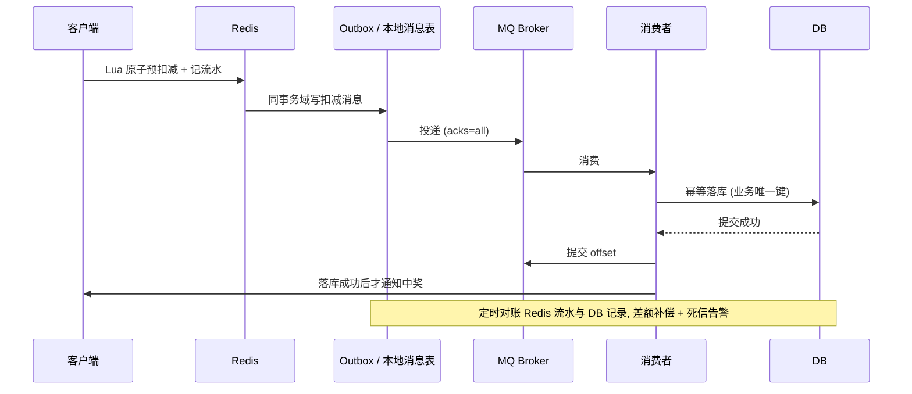

本章把存储题分成三层：**单机正确性**（索引、事务、日志）、**缓存与原子操作**（Redis）、**跨系统最终一致**（MQ、outbox、对账）。项目事实依据见[大 Body 与并发容量](/interview/answers/large-payload-capacity)。

## 一、SQL 基础高频误判

| 题                    | 结论                                                                                                                                       |
| --------------------- | ------------------------------------------------------------------------------------------------------------------------------------------ |
| `VARCHAR(n)` 的 `n`   | **字符数**不是字节数；`utf8mb4` 下每字符最多 4 字节                                                                                        |
| `int(1)` vs `int(10)` | 只是**显示宽度**，存储恒 4 字节、范围不变，仅 `ZEROFILL` 补零                                                                              |
| `TEXT` 能无限大吗     | 不能：`TINYTEXT 255B` / `TEXT 64KB` / `MEDIUMTEXT 16MB` / `LONGTEXT 4GB`，按**字节**计；还受 `max_allowed_packet` 限制，大文件宜放对象存储 |
| 金额                  | 用 `DECIMAL(10,2)` 或 `BIGINT` 存「分」；`FLOAT/DOUBLE` 是近似值，应用层也要用精确类型并明确舍入规则                                       |
| 三大范式              | 1NF 列原子；2NF 消除非主属性对主码的**部分**依赖（针对联合主键）；3NF 消除传递依赖                                                         |
| `IN` vs `EXISTS`      | `IN` 判断左值是否在结果集；`EXISTS` 判断子查询是否返回行，外层表大时通常更优                                                               |
| 避免重复插入          | `UNIQUE` 约束（重复报错）或 `INSERT ... ON DUPLICATE KEY UPDATE`                                                                           |

## 二、索引与 MVCC

**聚簇索引 B+ 树叶子存完整数据行**（索引即数据），二级索引叶子存索引列 + 主键值 → 查非索引列要**回表**。每表只有一个聚簇索引；无主键时取第一个全 `NOT NULL` 唯一索引，再没有则生成 6 字节隐藏 row ID。

| 机制           | 作用                                                                                                                             |
| -------------- | -------------------------------------------------------------------------------------------------------------------------------- |
| 覆盖索引       | 索引已含查询所需全部列，**完全不回表**                                                                                           |
| 索引下推 ICP   | 可用索引列的条件下推到存储引擎先过滤再回表，执行计划显示 `Using index condition`                                                 |
| 最左前缀       | 联合索引 `(tenant_id, status, created_at)` 可服务 `tenant_id` 或 `tenant_id + status`；跳过前缀、`status` 范围后的列无法完整利用 |
| 索引失效三件套 | 左模糊 `LIKE '%xx'`、对索引列用函数或计算、隐式类型转换（VARCHAR 列传数字）                                                      |
| B+ 树          | 叶子链表支持范围扫描、层高低、单点查询稳定；哈希索引只能等值，不适合主索引                                                       |

**隔离级别**：读未提交 / 读提交 / **可重复读（InnoDB 默认）** / 串行化。RR 下可见性**不取决于谁先 `BEGIN`**，而取决于**快照建立时机**与**快照读 vs 当前读**：已建快照且对方在其后提交则沿 undo 版本链读旧版本；`SELECT ... FOR UPDATE` 是当前读，不复用旧快照。经典死锁：两个事务在 RR 下并发「不存在则插入」，各拿互相兼容的**间隙锁 (5,10)**，随后插入意向锁被对方阻塞成环。防超卖用唯一键 + 原子扣减，事务尽量小。

## 三、日志与持久性

:::warning WAL 不是「顺序写就不丢」
持久性来自 **redo 先于数据页刷盘 + 崩溃恢复**：`innodb_flush_log_at_trx_commit=1` 时提交等 redo 刷盘、不等所有脏页；崩溃后从 **checkpoint** 起按页 **LSN** 判断重放哪些，再回滚未提交事务。顺序写与组提交只是**降低 fsync 次数**，不取消持久化保证。
:::

| 日志                  | 职责                                                                                       |
| --------------------- | ------------------------------------------------------------------------------------------ |
| `redo log`            | 崩溃恢复，物理页级 WAL                                                                     |
| `undo log`            | 事务回滚 + MVCC 版本链                                                                     |
| `binlog`              | 复制与归档；两阶段提交是**内部 XA**，binlog 当协调者，避免主库恢复结果与从库复制结果不一致 |
| `double write buffer` | 解决 16KB 页**部分写入 / torn page**，不替代 redo                                          |

`innodb_flush_log_at_trx_commit`：`0` 提交不要求写出（进程崩可能丢）、`1` 写入并刷盘（默认最强）、`2` 写文件但不立即同步（OS 崩/掉电仍可能丢）。

**调优**：`EXPLAIN` 看 `possible_keys` / `key`（NULL 即没走索引）/ `key_len`（判断联合索引用了几个前缀列）/ `rows` / `filtered`（都是优化器估算）。深分页 `LIMIT 1000000,20` 要读过并丢弃前 100 万条——改用**游标分页** `WHERE id > 上一页末尾实际 ID ORDER BY id LIMIT 20`，别把「第 100 万条」当成 `id=1000000`。主从延迟先分「复制为什么追不上」（大事务、从库 IO/CPU、长事务 DDL、并行复制不足）与「业务怎么避免读旧数据」，用 `SHOW REPLICA STATUS` 定位。

## 四、PG vs MySQL 引擎差异

| 维度     | MySQL (InnoDB)                         | PostgreSQL                                                                 |
| -------- | -------------------------------------- | -------------------------------------------------------------------------- |
| 存储模型 | **聚簇索引**，数据行在主键 B+ 树叶子   | **堆表 (heap)**，元组独立存放，索引指向 `ctid`；无聚簇索引概念             |
| MVCC     | 旧版本放 **undo log**，ReadView 判可见 | **多版本元组**直接插入堆表，旧版本靠 VACUUM 回收 → 需关注膨胀与 autovacuum |
| 索引类型 | B+Tree、Fulltext、Spatial              | B-Tree + **GIN / GiST / BRIN / SP-GiST**、部分索引、表达式索引             |
| DDL      | 多数非事务式（隐式提交）               | **DDL 可事务化**，可回滚                                                   |
| 复制     | binlog 逻辑复制 / 半同步               | **WAL 流复制**（物理）+ 逻辑解码                                           |
| 选型     | 简单 OLTP、读多写少、生态成熟          | 复杂查询、JSONB / 地理、分析型混合负载、扩展需求                           |

## 五、Redis 原子操作

**ZSet**：小数据量用 **listpack**（旧版 ziplist），元素多或成员长时转**跳表 skiplist + 哈希表**——跳表支持 `O(log N)` 按 score 范围查询，哈希表保 member→score 的 `O(1)`；阈值由 `zset-max-listpack-entries` / `-value` 控制。排行榜用 `ZADD / ZREVRANGE / ZRANK`。

**扣减必须原子**：`DECR` / `DECRBY`（或 `INCRBY` 负值），更稳的是 **Lua 脚本**把「判库存 + 扣减 + 记录用户」打包成一次调用。不能先 `GET` 再 `DECR`（竞态）。分布式锁用 `SET key value NX PX ttl` 原子设置 + 唯一 value + Lua 释放；**禁用 `SETNX` + `EXPIRE` 两条命令**，中间宕机会留下永不过期的锁。有了 Lua 原子扣减后，分布式锁主要防重复发奖与并发重建缓存，两者解决的不是同一个问题。

缓存三件套：穿透（空值/布隆过滤）、击穿（热点 key 互斥重建）、雪崩（过期时间加随机抖动 + 多级缓存 + 熔断）。

## 六、Kafka 与最终一致性

Kafka 是**至少一次**语义，**分区内有序**：位点必须在业务处理成功后提交；消费侧用业务唯一键 / 去重表幂等；`acks=all` + `min.insync.replicas` 保投递；失败进死信队列并告警。消息拥塞按 `lag + 消费 RT + DB 锁等待` 三层定位。

**关键结论**：Redis 与 DB 之间**只能是最终一致**，不能声称强一致。分层防守：① 生产者侧 outbox / 事务消息，把 Redis 扣减与消息落同一事务域；② Broker 持久化；③ 消费侧幂等 + 成功后提交 offset；④ 定时对账补偿；⑤ 死信告警。**通知必须在落库且事务提交后发出**，否则会出现「用户收到中奖通知但库里没有」。抽奖/秒杀项目的量化口径见[指标口径与基线定义](/interview/metrics-baseline)。

## 七、面试怎么讲

| 加分                                           | 扣分                     |
| ---------------------------------------------- | ------------------------ |
| 先讲清回表、覆盖索引、ICP 三者的边界           | 把三者混成「加索引就快」 |
| 明确 WAL + redo 刷盘才保证持久性               | 「顺序写所以不丢」       |
| 主动说「Redis 与 DB 只能最终一致」并给对账补偿 | 声称同步双写强一致       |
| 扣减用 Lua 原子脚本，锁与扣减分工讲清          | 先 `GET` 再 `DECR`       |
| 给出 QPS / 压测数字时先给统计口径              | 现场编数                 |

## 速记卡

- **聚簇叶子存整行、二级索引叶子存主键**；回表 = 再查一次聚簇，覆盖索引不回表。
- **失效三件套**：左模糊、函数/计算、隐式类型转换。
- **RR 可见性**看快照建立时机与当前读，不是谁先 `BEGIN`。
- **binlog 两阶段提交**是内部 XA；**doublewrite** 防 torn page 不替代 redo。
- **深分页**用游标 `WHERE id > 上一页末尾 ID`。
- **ZSet** = listpack → 跳表 + 哈希表；扣减用 Lua，锁用 `SET NX PX`。
- **最终一致五件套**：outbox、持久化、幂等、对账、死信告警；通知在落库后。

## 延伸阅读

[Go 并发模型与 AI 网关工程](/interview/fundamentals/backend-go-gateway) · [大 Body 与并发容量](/interview/answers/large-payload-capacity) · [全量题库](/interview/question-bank)
