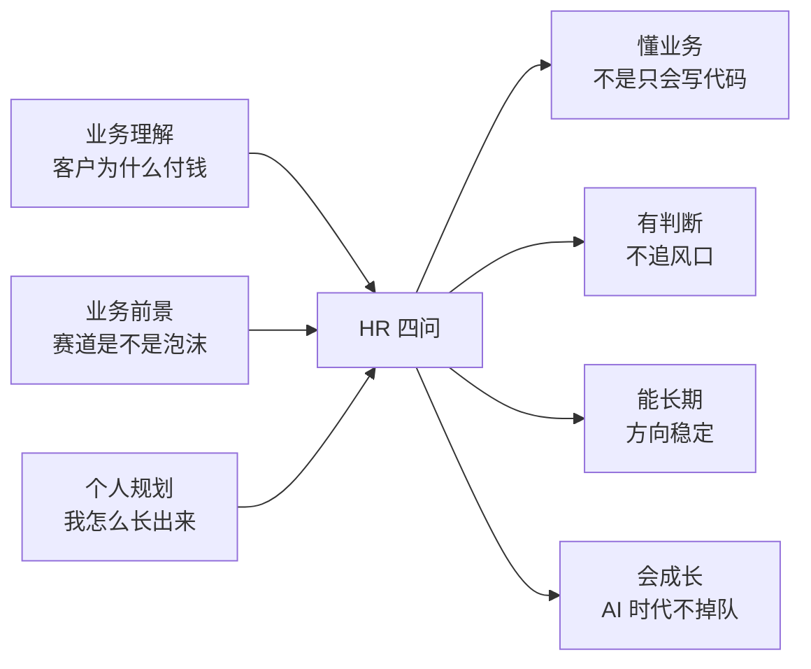

本篇只负责三件事：**业务理解、业务前景的观点、个人发展的规划**。动机/城市/薪资/压力/行为面已有专篇，不重复（索引见文末）。素材沉淀自本机 Chrome 的三个豆包对话标签页（2026-10-27 的运行时八股、2026-11-07 的 Managed Agent 业务讨论与「对未来规划」「代码都是 agent 生成，我们自己的能力怎么去提升呢」）；厂商动向的已核实事实见 [业务面 QA：Managed Agent 运行时与赛道判断](/interview/qa/managed-agents-business)。

## 〇、答题纪律（**先读**）

| 纪律            | 说明                                                                                                                                                                                                                                                                              |
| --------------- | --------------------------------------------------------------------------------------------------------------------------------------------------------------------------------------------------------------------------------------------------------------------------------- |
| **事实口径**    | 所有项目陈述沿用本仓库 [简历叙事](/interview/hr/narrative)：2027 届硕士，三段实习主线「**测量（字节）→ 稳定（腾讯 IEG）→ 自动化（阿里妈妈）**」；阿里经营托管 Agent 的 `recall@5 98%` / 幻觉率 0.7% / 置信度门控误放率 0%、误拦率 17%。**不编新经历、不把团队成果说成个人成果。** |
| **三层标注**    | 【素材】豆包对话是复习记录，页面自带「AI 生成可能有误」；【事实】官网/官方文档/权威报道，核实于 2026-11-08；【观点】我自己的判断。**观点必须说「我的判断是」，不能说成事实。**                                                                                                    |
| **HR 在评什么** | 业务理解（能不能把技术翻译成价值）、稳定性（会不会来、会不会走）、成长性（AI 时代还有没有竞争力）、沟通（能不能让非技术的人听懂）。**考的不是技术对不对，是像不像一个能长期合作的人。**                                                                                           |
| **时长**        | 每题 60–90 秒，先结论后展开；被追问再给细节，不要一上来讲架构名词。                                                                                                                                                                                                               |

:::danger 在腾讯的面试里评价腾讯的产品调整
被问到「元器停服 / 某产品线收缩」时，**不要**说「腾讯砍掉了 Agent 产品」「这说明方向不行」「我觉得这个决策有问题」。稳妥口径：**「我看到的是官方公告里写的业务调整与迁移安排，具体内部考量我不了解，也不该替公司下判断；我能说的是，从公开产品动作看，资源在往企业级平台和云基础设施集中，这和我个人想做的 Agent 工程化方向是一致的。」** 不评价决策对错、不显得比面试官更懂公司、不传播未经核实的内部消息。
:::

## 一、业务理解：把技术讲成客户价值

### Q1. 你怎么理解我们这块业务？

**结论：** 我们做的不是「聊天机器人」，是 **让 Agent 在真实业务链路里可控地干活**；客户付钱买的是「省下来的人力 + 可审计的结果」，不是模型有多聪明。

> 我的理解分三层。第一层是**用户价值**：商家、客服、运营这些岗位每天有大量重复但要求准确的判断，Agent 要把「查数据 → 判断 → 给建议」这条链跑完，还不能乱承诺。第二层是**企业要求**：结果要能追溯、能回滚、出错能兜住，所以权限、评测、审计和模型本身一样重要。第三层是**工程现实**：模型能力是上游给的，真正难的是让它在生产环境里稳定、成本可控、出问题能定位。我在阿里妈妈做经营托管 Agent 时体会很深——团队最担心的不是「答不出来」，是「答错了导致纠纷」，所以我们把查订单、查政策这些必经步骤放进 workflow，agent 只在证据足够后做判断，生成前还有置信度门控。

**采分点：** 说「客户/用户/风险」在先，技术在后。**雷区：** 一上来讲 LangGraph、RAG、reranker；把业务说成「接个大模型 API」。

### Q2. 客户为什么会为这类产品花钱？

> 表面看是买 AI，其实是买三件事：**省人、兜责、快上线**。省人好理解，重复问答和经营诊断可以自动化。兜责是企业最看重的——Agent 一旦能执行动作、能碰到业务数据，安全隔离、全链路留痕、出错有人负责，这些自己从零做要投入平台和安全人力，很多团队没有。快上线是试点阶段最在意的，负载忽高忽低，自建集群要么空转要么排队。所以我会说客户买的是「**能安全稳定跑长任务的环境**」，不是「一个更聪明的模型」。

**追问「那大客户为什么不自己做」：** 有云原生团队、规模稳定、要深度定制的客户确实倾向自建；愿意付费的更多是「缺基建人力的成长期团队」和「强合规审计要求的行业客户」。**能说出「哪些客户不会买」，比只说优点更像懂业务。**

### Q3. 你做过的事里，哪一件最接近「业务价值」？

> 阿里妈妈的经营托管 Agent。业务问题是商家客服和讲师人力成本高、又怕答错引发纠纷；我负责把确定性 workflow 和 agent 混着编排、做 RAG 检索和生成前的置信度校验。结果是已经在淘宝商家端落地，450 道可回答题上 `recall@5 98%`、人工核验幻觉率 0.7%，置信度门控误放率 0%、误拦率 17%。**我最在意的不是这几个数字，是「误放 0%」背后的业务选择**：宁可多追问一句、多转一次人工，也不让模型乱承诺。误拦 17% 说明还有优化空间，这是我下一步会做的事。

**采分点：** 业务问题 → 我的动作 → 数字（给口径）→ 边界/反思。**雷区：** 把「0% 误放」说成「模型不会错」——那是门控之后的结果。

### Q4. 用一句非技术同事能听懂的话，解释「云端 Agent 为什么比本地跑起来难」

> 打个比方：本地跑 Agent 像**一个人在自己书房里干活**，纸笔随手拿、门是锁着的、干完就走；放到云上，等于**开了一家共享办公室**，同时有很多人进来，谁也不认识谁，不能让人翻别人的柜子，任务可能要干一整天，中间换班、停电、有人请假都得接着干，还得把每一步记下来给审计看。所以要有个「前台」管任务排队和记录，有个「隔离工位」让高风险动作单独干——**难的不是让人更聪明，是把这间办公室管起来。**

**采分点：** 用比喻、不出现术语；最后一句能落回业务（审计、稳定、成本）。这题在业务型 HR 面里是「变相二面」，**永远不要答「接触不多」**（真实被挂案例见 [动机与岗位匹配](/interview/hr/motivation#业务理解题)）。

### Q5. 你觉得这个岗位/这块业务最难的地方是什么？

> 我觉得是 **「不确定的模型」和「确定的业务约束」之间的距离**。模型每次输出都可能不一样，但业务要求可审计、可回滚、错误成本可控。第二难是成本，Agent 跑得越久、执行越多，token 和算力都是真金白银。第三难是链路长——从文档、检索、模型、工具到前端，任何一环出问题用户都只会说「答得不好」，所以要全链路可观测。这三件事我在阿里的项目里都碰过，也是我想继续做深的原因。

**加分衔接：** 「我更看重腾讯云这类 ToB 场景，正是因为业务链路复杂、客户对稳定性/权限/评测要求最高，最能检验这套工程能力」——与 [为什么腾讯](/interview/hr/motivation#为什么腾讯) 的口径完全一致，不要另编一套动机。

### Q6. 你说自己懂业务，那你怎么衡量「做得好」？

> 不只看「回答了多少」，我看四类：**业务结果**（人力成本、首响/解决时长、建议采纳率）、**风险指标**（误承诺率、误放率、转人工是否及时）、**系统指标**（延迟、成功率、成本）、**可迭代性**（有没有评测集、有没有数据飞轮）。我在阿里做过 500 题五桶评估集，就是为了让「变好了」这件事能被证明，而不是靠感觉。

**采分点：** 指标分层 + 给口径。**雷区：** 只报准确率；说不出 baseline 或采集位置。

## 二、业务前景：有观点，但不追风口

### Q7. 你觉得 Agent 赛道是泡沫吗？

> **短期有泡沫，长期是基础设施，中间会有一轮形态洗牌。** 泡沫在「套个对话框就是 Agent」的 demo，太容易被复制；但企业里「让流程自动化、还能审计和兜底」的需求是真实的。我的判断依据是今年的公开产品动作：一边是一些面向个人创作者的零代码智能体平台在收缩，另一边是几家大厂反而把资源压到**托管运行时**上——把沙箱、会话、权限、可观测做成云产品卖给企业。**不是 Agent 不行，是「搭个 bot 玩一玩」这个形态不行。** 我看好「workflow + agent + 评测 + 权限」这条工程化路线，我在阿里做的就是这件事，所以我不是追风口，是把它当长期方向。

**采分点：** 有分层、有依据、有个人锚点。**雷区：** 「绝对不是泡沫」显得没判断力；「是泡沫，随便做做」直接和岗位冲突。与既有 [业务理解题](/interview/hr/motivation#业务理解题) 的答案保持同一口径，别在两场面试里说反。

### Q8. 最近一批产品关停/调整，你怎么看？

> 我不了解各家内部决策，只能说公开信息里看到的趋势：**资源在从「面向 C 端的零代码智能体广场」收拢到「面向 B 端的开发平台和运行基础设施」**。这背后我觉得有两笔账。一笔是成本账：长任务、沙箱、闲置会话都要持续烧资源，用户越多不一定越划算；另一笔是责任账：一旦平台替客户执行代码，逃逸、数据泄露这些责任就落到平台身上。所以厂商更愿意把运行时做成企业客户愿意为 SLA 和合规付费的产品。**对做工程的人来说这其实是好消息**——说明这个方向从「做 demo」进入「做生产系统」了，而生产系统正好需要稳定性、可观测、故障排查这些能力。

:::warning 安全阀
被追问到具体公司（尤其面试官所在公司）时，回到：「具体调整以官方公告为准，内部考量我不了解，也不适合替公司评价。」**不分析人家为什么失败、不说「战略失误」、不比较哪家不行。**
:::

### Q9. 三年后这个方向会变成什么样？

> 我的判断是三点，**都是推测，不是预测**：第一，Agent 会从「一个应用」变成「云上的一种标准资源」，像现在用数据库、用容器一样，会话、沙箱、权限都有标准接口；第二，行业会分层——底层是云厂商和平台做运行基础设施，上层是各家做自己业务里的场景和知识，**差异化会落在业务数据和上下文，而不是谁家模型更聪明**；第三，成本口径会变，从只看 token 变成看「一个任务跑完总共花了多少」，所以怎么让空闲时不烧钱、失败能续跑，会变成很实际的工程问题。

**采分点：** 明说「这是我的判断」，再给依据；最后落回自己——「所以我打算把分布式基础和可观测这些不变的能力打扎实」。

### Q10. 如果方向变了、或者来了之后不做 Agent，你会怎么样？

> 底层能力是相通的：长连接、状态、并发、性能、稳定性、故障定位，这些我在腾讯 IEG 和字节都练过，短期做业务需要的方向我没问题。但我也不想说假话——我长期想做的还是 Agent / AI 全栈，如果团队明确需要我长期做和 Agent 完全没交集的工作，我会坦诚沟通；只要岗位里有一部分 AI/Agent 的事，或者一两年内能转过去，我很愿意先把眼前的事做好。

**与 [岗位方向不一致](/interview/hr/motivation) 的既有答案逐句一致。** **雷区：** 「我都可以」「公司安排什么做什么」——HR 会认为没方向；「我只做 Agent」——太窄。

### Q11. 你看好我们（腾讯）在这块的什么？

> 三点，都是我从公开信息和自己的实习体验里看到的。第一是**场景密度**：社交、游戏、广告、云、内容，Agent 不是做一个聊天入口，而是要嵌进真实业务链路。第二是 **ToB 的客户要求**：腾讯云这类业务对稳定性、权限、评测、审计的要求最高，最能检验工程能力，也和我一直想做的方向一致。第三是**工程标准**：我在 IEG 实习时做过连接池、native 内存和监控，知道这里对稳定性和可观测性的要求，这不是从招聘页上看来的。

**雷区：** 吹「行业第一」、贬低前东家、把产品名背一遍却说不出场景。

### Q12. 你怎么看「AI 会取代工程师」？

> 我不担心「被取代」，但很警惕「被稀释」。AI 把写样板代码的成本压到接近零，如果一个工程师的价值只剩「把需求翻译成代码」，那确实会被压缩。但需求拆解、边界判断、架构取舍、识别模型写错的地方、线上故障定位、成本和效果权衡，这些反而更重要了。**所以我给自己的定位不是「写得更快的人」，是「能判断产出对不对、能对结果负责的人」。** 具体怎么做我在下一节展开。

## 三、个人发展规划：具体、可验证、和岗位一致

### Q13. 你的职业规划是什么？（**90 秒标准版**）

> 我按能力阶段说，不按 title 说。
>
> **第一年**：快速吃透团队技术栈，独立承接一个 RAG / Agent 类功能，从接口、前端交互、服务、测试到上线跑完整闭环；重点补线上问题排查——慢在哪、错在哪、怎么定位，而不是只会写 demo。
>
> **一到三年**：从「做好一个模块」走到「做可复用的平台能力」，比如知识库与提示词管理、Agent 编排、模型路由、评测体系、计费限流；能把**效果、成本、稳定性**三个指标一起扛起来，参与方案选型和容量预估，也能做技术评审、提前识别链路里的隐患。
>
> **三年以上**：在 Agent 工程 / AI 基础设施方向形成自己的方法论，能定义一个方向、带小团队，把它落到更多业务场景里，而不只是一个聊天入口。长期我希望在腾讯这样有真实场景的地方做深，不太想做两年一跳的人。
>
> 有一点我会一直坚持：**框架和模型一直在变，但分布式基础、工程稳定性、可观测这些是不变的**；我打算两手抓，一边保证交付，一边持续跟进 Agent、推理、多模态的新进展，避免只会用新框架、底层却很薄。

**与 [Q13 职业规划](/interview/hr/behavioral#q13-你的职业规划是什么) 完全一致，只是把「能力清单」补实。** **雷区：** 「3 年当管理」「攒够经验去创业」「先干两年再看」。

### Q14. 短期（入职一年内）具体打算怎么补？

> 三件可检查的事。第一，**把项目做深而不是做广**：不只会调框架，去看底层——编排框架源码、推理服务部署、量化与 GPU 调度；把踩过的坑（token 开销、链路超时、并发冲突、脏数据）写成复盘。第二，**补齐薄弱项**：前端流式交互、容器 K8s、可观测体系，和团队对齐优先级。第三，**保持对底层的敏感**：我最近复习时就在把 RPC 连接池、消息队列积压、Redis 锁、HTTP/2 这些老问题和 Agent 运行时串起来看——因为托管 Agent 的长任务、沙箱池化，本质还是这些老问题在新约束下重做一遍。

**采分点：** 有具体内容、有可检查的产出（复盘、分享、评测集）。**雷区：** 「好好学习、尽快融入」这类空话。

### Q15. 代码都让 Agent 写了，你的能力怎么提升？（**成长性王牌题**）

> 我的答案是**换角色，不是比手速**：从「让 Agent 写代码」变成「给 Agent 定规范、审方案、做评审、修幻觉、复盘问题」。
>
> 具体我会改工作流：**先自己想**——链路几步、哪里会慢、并发安全吗、失败怎么重试，把约束写下来再交给 Agent；这样它写出来的东西和我预期不一致时我能立刻发现，而不是被动接收。**再做严格评审**——并发有没有 data race、资源有没有释放、超时降级和脏数据覆盖了吗、有没有更合适的写法；看不懂的地方就是我的短板，去查文档看源码。**核心逻辑自己写**：并发控制、消息消费、锁、重试这些关键路径手写一遍，Agent 帮我写参数校验、日志、单测和文档。**最后用工具做闭环**：lint、type check、单测的报错回喂给 Agent，让它改，我来判方向。
>
> 还有一块是 Agent 天然弱项，也是我认为最有价值的地方：**压测、异常测试、故障演练、埋点告警、降级预案**。很多 Agent 写的代码单测能过，一上高并发就出消息积压、锁异常、协程泄漏；能提前发现并定位这些问题，就是工程师的价值。再往后，如果团队大量用 Code Agent，我还想参与把项目规范、禁止清单、自动化校验流水线沉淀下来——那已经从「使用者」变成「平台建设者」了，和我想走的 Agent 工程化方向是一条线。

**采分点：** 承认工具价值（不抵触 AI）＋ 给出具体工作流 ＋ 落到「判断力/验证/复盘」＋ 和长期方向对齐。**雷区：** 「我要坚持手写所有代码」显得排斥工具；「AI 写得比我好，我负责提需求」显得没有不可替代性。

### Q16. 你怎么保证自己不被工具淘汰？

> 我给自己定的是**两手抓**。一手是「不变的」：分布式基础、操作系统和网络、并发模型、稳定性与故障定位、可观测，这些十年后也还是底座，我现在还在系统复习。另一手是「变的」：持续跟 Agent、推理、多模态的进展，但**跟的方式是读官方文档和源码、动手跑一遍**，不是收藏几篇公众号。判断自己有没有进步的标准也很实在：能不能独立定位线上问题、能不能审出 Agent 生成代码里的并发或资源漏洞、能不能给一个方案讲清取舍和代价。

**衔接：** 与 Q13 的「两手抓」是同一句，别在两题里说成两套规划。

### Q17. 你为什么选择做工程，而不是读博/做研究？

> 我更喜欢工程落地和快速验证。读论文、看源码我也做，但我不想把职业路径放在科研上；我希望做出来的东西有人用、有反馈、能迭代。阿里那段最让我有成就感的，就是看到商家真的在用、并且因为有门控而不会乱承诺——这种「把不确定的模型放进确定的业务约束里」的反馈，是我确认自己适合做工程的原因。

**与 [动机与岗位匹配](/interview/hr/motivation#业务理解题) 的既有答案一致。**

### Q18. 三年后你希望别人怎么评价你？

> 我希望是三句话：**交付靠得住**（给一个模块能从需求做到上线、出了问题能兜住）、**判断说得清**（选型不只讲好处，能讲代价和边界，量化结论给得出口径）、**愿意把经验沉淀下来**（复盘、分享、把踩过的坑变成团队规范）。比起头衔，我更在意这三件事是不是真的成立。

### Q19. 你最近在学什么？怎么学的？（**真实性检验题**）

> 必须按真实情况答，但结构可以固定：**在学什么 → 为什么和岗位相关 → 怎么验证学会了**。示例骨架（按实际情况替换）：
>
> 「最近我在把 Agent 运行时这条线补系统：一边复习 RPC 连接池、消息队列积压、分布式锁、HTTP/2 这些工程基础，一边对照几家厂商公开的托管 Agent API 文档，看它们怎么把会话、沙箱、权限做成产品。方法是**先看官方资料、再自己写一个最小版本**，比如把任务提交和事件流、断点重放跑通；学没学会的检验标准是能不能解释清楚『为什么长任务必须和 HTTP 请求解耦』，而不是背下几个产品名。」

**雷区：** 说「最近在学」却举不出任何一个具体材料或产出；把厂商宣传数字当自己实践过的结果。

## 四、交叉追问链（业务前景 × 规划，最容易被连着问）

| 追问                                         | 他要确认什么         | 回答要点                                                                                              |
| -------------------------------------------- | -------------------- | ----------------------------------------------------------------------------------------------------- |
| 你说长期看好，那如果两年后这个方向凉了呢？   | 稳定性、是不是追风口 | 底部能力可迁移（IEG/字节经历）＋ 看好的是「流程自动化」这个长期需求，不是某款产品                     |
| 既然看好，为什么不自己创业/做独立开发？      | 会不会干几个月就走   | 喜欢做产品，但现阶段更想在真实业务里练工程能力；业余项目替代不了大规模业务的复杂度                    |
| 你规划里提到平台化，是不是不想写业务代码？   | 眼高手低             | 平台能力是从业务里长出来的，第一年先把业务模块跑完整闭环；不排斥任何具体活                            |
| 你用 Agent 写代码，那我们为什么要招应届生？  | 自我认知             | 招的是能对结果负责的人：判断、验证、复盘、跨团队协作；工具降低了编码成本，没降低责任                  |
| 你这些行业判断是从哪来的？                   | 信息素养、诚实       | 公开官方文档与权威报道（核实日期）＋ 自己的实习体会；**明确区分「事实」和「我的判断」**，不装内部消息 |
| 规划这么清晰，如果岗位内容和你想的不一样呢？ | 灵活度               | 先沟通、先把眼前的事做好；长期方向不变，但路径允许调整（回 Q10）                                      |

## 五、速背卡

**60 秒三合一（业务理解 + 前景 + 规划）：**

> 我理解这块业务是让 Agent 在真实链路里可控地干活，客户买的是省下来的人力和可审计的结果，不是模型多聪明——我在阿里妈妈做经营托管 Agent 时，把必经步骤放进 workflow、生成前加门控，就是为了让「不确定的模型」待在「确定的业务约束」里。行业上我的判断是短期有泡沫、长期是基础设施，今年看到的是低代码形态在收缩、企业级运行时在加码，所以这不是退潮，是形态洗牌，而从 demo 到生产系统，恰恰更需要稳定性和可观测。规划上第一年我想独立跑通一个功能的完整闭环、补线上排查；一到三年做可复用的平台能力，把效果、成本、稳定性一起扛起来；长期在 Agent 工程方向形成方法论。框架会变，但我打算把分布式底子和工程判断打扎实，这是不变的部分。

**30 秒「脑手分离」给非技术同事：** 见 Q4 的共享办公室比喻，收口一句「**难的不是让 AI 更聪明，是把这间办公室管起来**」。

**雷区清单：**

- ❌ 「接触不多 / 不了解」——态度题，真实被挂案例（[业务理解题](/interview/hr/motivation#业务理解题)）。
- ❌ 在腾讯面试里评价腾讯产品调整的对错，或替公司分析「为什么失败」。
- ❌ 把厂商宣传数字、豆包对话里的行业结论当事实讲；把【观点】说成「业内都知道」。
- ❌ 编经历、把团队成果说成个人成果、把方案推导讲成已落地；数字不给口径。
- ❌ 「3 年当管理」「先干两年再看」「我都可以」「公司安排什么做什么」。
- ❌ 贬低阿里/字节等前东家；把「为什么腾讯」讲成另一套和 [动机篇](/interview/hr/motivation) 不一致的说法。
- ❌ 谈 AI 时走极端：要么「工程师要被取代了」，要么「AI 写的都不行、我全手写」。

## 六、与已有材料的分工

| 需要                                               | 去哪篇                                                                             |
| -------------------------------------------------- | ---------------------------------------------------------------------------------- |
| 厂商动向的核实事实、时间与链接                     | [业务面 QA：Managed Agent 运行时与赛道判断](/interview/qa/managed-agents-business) |
| 云业务 / Agent + 云 / Managed Agent API 的商业理解 | [云业务与 Agent：从卖算力到卖 Agent 运行环境](/interview/qa/cloud-business-agent)  |
| 为什么腾讯、为什么这个岗位、城市/offer/家庭        | [动机与岗位匹配](/interview/hr/motivation)                                         |
| 自我介绍、三段实习主线、数字口径                   | [简历叙事](/interview/hr/narrative)                                                |
| 成就感、压力、分歧、行为面 STAR                    | [行为面题库](/interview/hr/behavioral)                                             |
| 职业规划原版、岗位匹配原版                         | [Q13 职业规划](/interview/hr/behavioral#q13-你的职业规划是什么)                    |
| 真题频次、HR 面形态与评估维度                      | [HR 面总览](/interview/hr/)                                                        |
| 分题型练习、追问链、7 天计划                       | [练习手册](/interview/hr/practice)                                                 |
| 到岗时间、薪资、反问、收尾                         | [收尾与背调](/interview/hr/close-and-compensation)                                 |

:::note 维护提示
本篇的行业判断依赖 2026-11-08 核实的公开状态；元器停服（2026-11-09）、OpenAI Agent Builder/Evals 停服（2026-11-30）都在近几周内。**面试前一天回业务面 QA 的来源清单重查一次**，日期不确定时改用「今年上半年 / 最近」这类模糊但不会错的说法。
:::
