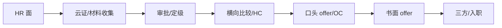

HR 面的最后 10 分钟，往往决定「你是候选人」还是「你是准同事」。这一部分不考技术，考的是 **边界感、诚创意和决策效率**：薪资不狮子大开口，到岗不空口承诺，offer 不拖着不答复，反问不问减分题。

## 薪资期望

**原则：** 校招通常定级定薪，HR 面不是谈薪面。**先表达「按公司体系」，再给「总包结构」，最后才给区间；不要先报一个具体数字。**

**标准答法：**

> 我了解腾讯校招有比较规范的定级定薪体系，所以薪资上我更希望按公司的标准来。对我来说，岗位方向、团队和成长空间是优先的；如果到了 offer 阶段，我会结合总包结构（月 base、签字费、股票/期权、补贴）综合判断，不会只盯月薪。`[如果 HR 坚持要一个数：]` 如果一定要给参考，我的预期是行业同档位，具体数字我们可以基于岗位职责和总包结构再沟通。

**如果 HR 追问「给个具体数字」：**

> 我不想随便报一个数字误导您。我的底线是「不低于同档位市场水平」，更看重总包和成长；如果公司有区间，您可以告诉我大概范围，我再判断是否匹配。`[如果必须说：给区间，不给点；并说明「区间的前提是岗位职责/城市/总包结构」]`

**如果 HR 问「你现在的实习薪资是多少？」**

> 实习薪资和校招总包不是一回事，我不太想用它来锚定校招；我更希望按岗位和公司的校招标准来。`[如果 HR 坚持，如实说实习日薪/月薪，但补一句「实习是学习为主，不代表校招预期」]`

**如果 HR 问「阿里/字节给你多少？」**

> 我理解您想了解市场水平，但我不太想用别家的数字来谈判；我更看重腾讯这个岗位是否匹配。如果到了 offer 阶段，我会把总包结构摊开看，给您一个明确的答复。`[不要编数字；不要拿别家 offer 威胁；不要当场比价]`

**总包拆解（自己心里要有数）：**

| 项          | 要问清什么                        |
| ----------- | --------------------------------- |
| 月 base     | 基本工资、绩效工资占比、发几个月  |
| 签字费      | 一次性还是分期、是否绑定服务期    |
| 股票/期权   | 授予数量、归属周期、按什么价格    |
| 年终奖      | 目标月数、是否保底、历史兑现情况  |
| 补贴        | 房补/餐补/交通/通讯、是否计入总包 |
| 公积金/社保 | 缴纳基数、比例                    |
| 城市/岗位   | base 地、是否需要轮岗/出差        |

**雷区：** 一上来报「低于 40 万不考虑」；说「我不在乎钱」——HR 会觉得你不真诚；拿别家 offer 抬价但最后不来——会被记录。

### 开奖阶段的谈薪策略（HR 面之后、offer 之前）

:::note 来源
本节策略来自小红书高信息密度帖《大厂秋招开奖&如何a薪资》（XS-1，见 [社区面经全景库](/interview/hr/community-cases#五开奖与谈薪策略xs-1全网最实用的一篇)）。**注意阶段区分**：HR 面阶段执行上面「不主动报数」的纪律；开奖阶段（HR 反复问你「多少钱会满意」时）才用下面的策略。
:::

**机制认知：**

1. 大厂开奖集中在 **11 月末–12 月上旬**；手里有一家已开奖的 offer，可以催其他家抓紧开奖。
2. 没有别家 offer 时，HR 往往不急着开奖、甚至压钱——HR 的可发总额有范围，优先留给「可能不来的人」。
3. **鹅厂开奖前会反复问你「多少钱会满意」**——这是定价输入，不是闲聊；每次回答都要一致、留有余地。
4. 不问期望、直接发带薪资的官方 offer = 不给谈的空间 = 重视度一般。

**四句禁忌（说了就被压价）：** 「我没有别的 offer」「我一定会来」「我对象也在这个城市」「满足 X 条件一定来」。**永远留余地：「我要综合考虑一下」「想再看看其他家的情况」。**

**可以说的：** 「某某家开的职级是 X，我希望对应职级……」「某某家签字费/股票是 X，我希望……」。**base 谈不动时，签字费、股票、职级都能谈。**

**行情参考（算法岗，BAT，2026 秋招）：** 55–60w 白菜、65w 小 SP、70w SP、75w 大 SP（总包 = 月薪 + 年终奖 + 签字费 + 股票）。开发岗通常略低，Agent/AI 方向按算法岗靠齐争取。

**base 之外必问：** 年假天数与组内请假氛围（腾讯 30 天全薪病假「不一定能请几天」）、上下班时间、忙碌周期、**年终奖 n 个月是否按 base 计算**。

## 到岗时间与提前实习

**结论：** 2027 年 6 月毕业，**最早 2027 年 7 月正式入职**；如果公司需要，可以在毕业前提前实习，但需要和导师、当前实习交接确认。

**标准答法：**

> 我是 2027 年 6 月毕业，正式入职最早是 7 月。如果团队需要，我可以在毕业前提前实习，时间大概在 `[2027 年 3 月–6 月]`，具体要和我导师确认毕业论文/答辩安排，也要和现在阿里的实习做交接。我不想给您一个模糊的承诺；您给我一个大概的时间窗口，我可以在一周内确认后回复您。

**如果 HR 问「能不能 12 月/1 月就来？」**

> 如果公司需要，我可以尽量协调，但我需要先确认两件事：学校的论文/答辩安排，以及阿里这边的交接。`[如果确实可以，给明确日期；如果不可以，说「最早 X 月，原因是什么」，不要只说「我尽量」]`

**如果 HR 问「提前实习多久？一周几天？」**

> 如果导师同意，我可以按 `[4–5 天/周]` 实习 `[3–6 个月]`；具体到岗日期我会提前两周确认。`[按真实情况；不要承诺全职实习却每周只去两天]`

**如果 HR 问「你现在还在阿里实习吗？什么时候能交接完？」**

> 是的，我目前还在阿里实习 `[待确认]`。如果确定入职腾讯，我会按公司要求提前 `[2–4 周]` 提交接，把手上项目文档、代码和 owner 交接清楚，不会突然消失。

**如果 HR 问「能接受出差/轮岗吗？」**

> 出差可以 `[按真实情况]`；轮岗/调剂如果方向匹配，我愿意沟通。如果长期偏离 Agent/全栈，我会先和团队确认，不想入职后才发现不匹配。`[不要为了拿 offer 说「什么都可以」，入职后反悔成本更高]`

**雷区：** 「我随时都能来」——学校/导师/当前实习都没确认；「我要到 7 月才能来」但没解释提前实习的可能性；「我可以在阿里继续实习到入职前」——HR 会担心竞业/精力。

## offer 接受与三方

**原则：** 不在电话里当场答应；要书面 offer；在 deadline 内明确答复；不签多家三方。

**标准答法（拿到口头 offer）：**

> 谢谢您和团队的认可，我很愿意加入。我想先看一下书面 offer 的岗位、城市、薪资结构和入职时间，确认没有问题后，我会在您给的期限内明确答复。`[不要当场说「我签」，也不要说「我再看看别家」]`

**如果 HR 问「你还有其他 offer 吗？会不会不来？」**

> 我理解您关心接受率。我可以明确说：如果岗位和地点匹配，腾讯是我的第一优先级；我不会拿腾讯的 offer 去抬价，也不会在签约前临时反悔。`[只有真话才说；如果有其他 offer，诚实说「有在流程中的」，但不要报数字]`

**如果 HR 给的时间很短（比如 24 小时）：**

> 我理解公司有审批节奏，但 24 小时对我来说有点紧，我需要和家里沟通、确认岗位细节。能不能给我 `[2–3 个工作日]`？我会在期限内给您明确答复，不会拖着。`[礼貌争取，不要硬刚；如果对方坚持，评估自己是否真的想去]`

**三方/违约金：**

> 我还没有签三方 `[待确认]`。如果决定加入腾讯，我会按学校流程走；如果之前签了其他公司，我会如实说明违约情况，按合同处理，不会隐瞒。`[不要建议「先签再违约」；不要编「学校不让违约」]`

**雷区：** 同时签多家三方；口头答应后失联；拿 offer 当谈判筹码反复横跳；入职前临时毁约。

## 腾讯开奖/三方/提前实习/入职：社区口径

:::warning 数据性质
以下是社区众包口径（XS-25《腾讯开奖-实习-入职常见问题解答》，2026 秋招视角，与 XS-1 交叉验证），**不是官方承诺**：具体随年份、BG、对接 HR 变化。用途是建立心理预期、准备确认清单；offer 阶段一律以 HR 书面口径为准。
:::

| 环节         | 社区口径                                                                                          | 对你的意义                                                                                                          |
| ------------ | ------------------------------------------------------------------------------------------------- | ------------------------------------------------------------------------------------------------------------------- |
| 开奖节奏     | 往年 11 月中下旬开启，陆续开到 12 月底（XS-1：集中在 11 月末–12 月上旬）                          | 11 月中下旬拿到别家开奖可以催腾讯；12 月上旬没开不算异常                                                            |
| base 谈判    | 腾讯 base 很难 a；能 a 的前提基本是「同大厂 offer 且开得比腾讯高」，也只小 a                      | 别指望 base 大幅抬升；把空间放在签字费/股票/职级（见 [开奖阶段的谈薪策略](#开奖阶段的谈薪策略hr-面之后offer-之前)） |
| 三方签署     | 无固定几天内签完，可以拖；每个对接 HR 的要求不一样                                                | 不要电话里被催着立刻签；确认书面细节后再签                                                                          |
| 提前实习薪资 | 100% 正式薪资                                                                                     | 提前实习不是廉价劳动力，确认写进 offer/邮件                                                                         |
| 提前实习补贴 | 双程交通补贴 2k（相邻城市 600）；正式入职单程交通补贴；有一次中转酒店机会（实习与正式只能用一次） | 留好票据，和 HR 确认口径                                                                                            |
| 封培         | 正式入职前后有 7 天带薪封闭培训，时间可以自己选                                                   | 和论文/答辩安排错开                                                                                                 |
| 公积金       | 双边 12%                                                                                          | 硬福利，计入总包心理账户                                                                                            |
| 违约金       | 5k                                                                                                | 签三方再违约的成本；别冲动签                                                                                        |
| 签字费       | 随第一个月工资一起发                                                                              | 不要预期提前到账                                                                                                    |
| 职级         | 校招生基本都是 5，部分是 6 和 7                                                                   | 职级直接决定薪酬带宽，开奖时确认职级                                                                                |
| 试用期       | 3 个月；提前实习不抵试用期，但算晋升工龄                                                          | 别把「提前实习」误解为「提前转正」                                                                                  |
| 晋升         | 年中/年底两次（年中需特批）；5→6 无需材料直接升；晋升条件是在一个职级停留一年且过试用期           | 成长路径信息，可作反问素材                                                                                          |
| 年假         | 新人第一年 3.5 天，之后 7 天，一年涨一天；试用期不能用年假                                        | 腾讯年假偏少，提前建立预期                                                                                          |

**offer 阶段必确认的三件事（对应上表）：** ① 职级与总包结构（base×月数 + 签字费 + 股票）；② 入职时间、提前实习安排与补贴口径；③ 三方期限与违约条款。

## 反问清单

反问不是「表演勤奋」，是 **确认这份工作值不值得去**，同时让 HR 感到你认真。准备 3–5 个，按优先级问；**第一个不要问薪资/加班/结果**。

### 推荐问（选 3 个）

1. **团队与岗位**
   > 「这个岗位在团队里最核心的交付是什么？如果我入职，前 6 个月最重要的目标是什么？」
2. **业务与挑战**
   > 「团队现在做 Agent/AI 落地时，最大的挑战是效果、成本、稳定性还是组织协作？您希望新人先补哪一块？」
3. **成长与培养**
   > 「团队对新人的培养路径是怎样的？有没有导师制/轮岗/内部技术分享？」
4. **协作方式**
   > 「这个岗位需要和哪些团队协作？产品、算法、前端、数据大概是什么分工？」
5. **技术氛围**
   > 「团队最近在技术上的投入重点是什么？有没有在做评测、权限、沙箱这类 Agent 工程化的事情？」
6. **结果时间（最后问）**
   > 「我理解流程需要时间，请问大概什么时候会有反馈？我好安排其他流程的时间。」

### 谨慎问

- 「加班多吗？」→ 换成「团队平时的节奏是怎样的？项目关键节点一般怎么安排？」
- 「薪资能给多少？」→ 留到 offer 阶段，或问「校招薪资结构大概是怎样的？」
- 「我能转正吗？」→ 校招 offer 一般不涉及；问「新人考核标准是什么？」
- 「您觉得我今天表现怎么样？」→ 可以问，但不要放在第一个；更好的说法是「如果我有机会加入，您建议我提前补哪一块？」

### 不要问

- 「腾讯是不是很卷？」「你们部门会不会裁员？」——负面预设。
- 「我能不能不加班？」——还没入职就谈条件。
- 「我可以先不来实习吗？」——除非确有学校/家庭原因，否则减分。
- 「您觉得我稳了吗？」——把焦虑抛给 HR。

**反问的收尾：**

> 谢谢您的时间，这些问题问完我对岗位更清楚了。如果后续需要我补充材料/做测评，随时告诉我。

## 流程节奏与结果

**典型链路（来自真实面经，非官方承诺）：**

**时间预期：**

- HR 面本身：10–50 分钟（S4 10 分钟，S5 50 分钟，S6 40 分钟，S7/S8 30 分钟）。
- 审批：约 1 周是常见口径（S4：「后续审批一个周左右」）；也可能更久，取决于 HC、定级、横向。
- 云证：不是 offer。S4 是「HR 面 → 云证 → 转录用」；S7 是「HR 面 → 次日云证 → 状态码 20/21/6」。评论区还有「云证之后还会挂人吗」的担心，说明云证≠稳。
- 状态码/官网状态：不同 BG 口径不同，不要过度解读；以 HR 的书面/口头通知为准。

**小红书 9 篇面经的真实 timeline（从二面通过到 offer，见 [小红书面经拆解](/interview/hr/xhs-cases)）：**

| 来源      | 二面通过→HR 面     | HR 面形式/时长                              | HR 面→offer                                          | 备注              |
| --------- | ------------------ | ------------------------------------------- | ---------------------------------------------------- | ----------------- |
| X1 IEG    | —                  | —                                           | HR 面次日录用评估+填基础信息+HR 加微信，5 天后 offer | 双非上岸天美      |
| X2 技术岗 | 7 天               | **电话面**，当场口头 offer                  | 口头→正式 offer 约 3 天                              | 仅两面就进 HR 面  |
| X3 CSIG   | 1 天               | **10 分钟，当场 OC + 云证**                 | 4 天后 offer                                         | 靠邮件催推进      |
| X8 校招   | **10 天**（HR 忙） | 当晚 HR 面 + 云证                           | 次日电话 offer                                       | 等 10 天正常      |
| X9 CSIG   | —                  | HR 面后**加总监面/用人决策者面/交叉 HR 面** | 跨中秋国庆，约 3 周后意向书                          | HR 面不是最后一关 |

**四条校准预期的结论：**

1. **二面通过到约 HR 面，5–10 天都正常**，HR 忙时更久；可发邮件礼貌问进度，不减分。
2. **HR 面短（10 分钟）/电话面/当场 OC 都可能是好信号**，不要因「面得短」而慌。
3. **HR 面后可能还有加面**（总监面、用人决策者面、交叉 HR 面）和云证，别提前松懈。
4. **节假日会显著拉长流程**（X9 跨中秋国庆约 3 周），做好预期管理。

**如果 HR 说「回去等通知」：**

> 好的，谢谢您。请问大概多久会有反馈？如果超过这个时间我没有收到消息，可以再联系您确认吗？`[给 HR 一个合理的跟进节奏，不要每天问]`

**如果超过约定时间没消息：**

> 您好，我是 X 月 X 日参加 HR 面的杭天铖。想礼貌确认一下流程是否有更新；如果有需要我补充的材料，我随时可以配合。感谢您的时间。`[一次跟进即可；不要连发消息/打电话轰炸]`

**如果收到感谢信：**

> 谢谢您的反馈。如果方便的话，能否告诉我主要差距在哪？我希望在下一段准备里补上。`[保持体面；校招圈子很小，未来可能还会遇到]`

**真实面经里的心态：**

- S4 在 HR 面后等了几天，官网状态反复，最后收到正式 offer；评论区有人说「只要不给你发感谢信就是好事」——这是候选人的经验，不是官方规则，但可以缓解焦虑。
- S7 的 30 分钟 HR 面后次日云证，状态码 20→21→6；说明流程节点多，不要用单一状态判断成败。
- S5 的 50 分钟 HR 面问得很细，评论区说「HR 面还问技术难点，这是变相二面吧」；**时长和深度不等于挂**，可能是 HR 懂业务。

## 收尾与背调

### 面试结束的收尾话术

> 谢谢您今天的时间，也谢谢您把岗位和团队情况讲得这么清楚。我今天聊完更确认这个方向是我想要的；如果有需要补充的材料，随时联系我。`[不要问「我过了吗」；不要当场要微信；不要发长篇感谢信]`

### 背调会查什么

**时序与时长（XS-24《腾讯校招背调全流程》）：** 先发 offer 意向/条件 offer → 启动背调 → 通过后签正式三方。普通岗位 **3–7 个工作日**，重点岗位（研发/产品/风控/涉密）可到 10 天。**证明人优先级：实习直属导师 > 项目负责人 > 实习 HR > 带教师兄师姐**（不必填大领导）；提前和字节/腾讯/阿里的 mentor 或 HR 打招呼「近期可能有背调电话」，并留常用手机号。一般不专门查成绩单；实习经历少不影响（查真实性，不因经历少刷人）；信息出入可补充说明，**造假基本无法挽回**；有处分提前主动说明（被查出来比主动说明严重得多）。

| 项                      | 你要保证什么                                                              |
| ----------------------- | ------------------------------------------------------------------------- |
| 学历/毕业时间           | 与简历、学信网一致；2027-06 毕业，别写成 2026                             |
| 实习公司/部门/岗位/时间 | 与简历一致；腾讯 2025-10~2026-02、字节 2025-06~2025-09、阿里 2026-05~至今 |
| 离职原因                | 与面试口径一致；不要面试说「项目结束」、背调说「和团队不合」              |
| 项目职责/成果           | 不把团队成果说成个人；不虚构上线/用户量/数字                              |
| 其他 offer/薪资         | 不编造；不泄露别家机密                                                    |
| 竞业/保密               | 不带走前东家代码/数据；不违反竞业协议                                     |

### 入职材料（提前准备）

- 身份证、学历/学位证（应届生先提供学信网/在读证明）、成绩单 `[按公司要求]`。
- 三方协议/就业推荐表/报到证 `[按学校流程]`。
- 体检报告 `[按公司指定医院/项目]`。
- 银行卡、照片、社保/公积金材料 `[按 HR 清单]`。
- 背调授权/联系人信息 `[提前和实习主管打招呼]`。

### 如果这次没通过

> 我会先复盘：是岗位匹配、表达，还是经验缺口；如果方便，希望您给一点反馈。我不会因为一次没通过就否定自己，也会继续推进其他机会；如果未来有合适的岗位，我还会再投腾讯。`[保持体面，不纠缠；不要当场追问「为什么不要我」]`

### 入职前可以做的三件事

1. **补团队技术栈**：如果团队用 Go/Node/React/Agent 框架，提前读文档/源码，入职后能快速上手。
2. **整理交接**：把阿里实习的项目、文档、代码 owner 交接清楚；离职见人品，也给未来留口碑。
3. **确认城市/租房/报到**：入职城市租房、报到日期、体检预约；不要等到入职前一周才处理。

## 常见 HR 黑话翻译

| 说法              | 大概率含义                    | 你怎么应对                       |
| ----------------- | ----------------------------- | -------------------------------- |
| 「回去等通知」    | 流程还要走，不是结果          | 问大概时间，按节奏跟进一次       |
| 「流程中/审批中」 | 还在审批/横向，没有挂         | 保持耐心，别频繁催               |
| 「横向比较」      | 和别的候选人比，HC 有限       | 补充差异化证据，表达意愿         |
| 「云证」          | 材料/背景信息收集，不是 offer | 配合提交，但别辞职/毁约          |
| 「OC」            | 口头 offer                    | 等书面 offer，确认岗位/薪资/城市 |
| 「开奖」          | 发 offer                      | 在期限内答复                     |
| 「泡池子」        | 在候选池等待                  | 继续面其他公司，不要停           |
| 「感谢信」        | 拒信                          | 问反馈，保持体面                 |
| 「白菜/SP/SSP」   | offer 档位                    | 不必纠结叫法，看总包结构         |
| 「总包」          | 月 base×月数+签字费+股票+补贴 | 逐项问清，别只看月薪             |
| 「base」          | 月基本工资，或工作地点        | 看上下文；地点要说清             |
| 「背调」          | 背景调查                      | 保证简历/面试/背调三处一致       |

## 最后一页 checklist

- [ ] 薪资：先按公司体系，再给总包结构，最后才给区间；不编别家数字。
- [ ] 到岗：2027-07 正式；提前实习给明确窗口，不空口承诺。
- [ ] offer：不当场答应；要书面；在期限内明确答复；不签多家三方。
- [ ] 反问：3 个，先问团队/岗位/成长，最后问结果时间；不问薪资/加班/裁员。
- [ ] 流程：知道 HR 面 → 云证 → 审批 → 横向 → offer 的链路；云证≠offer。
- [ ] 跟进：按约定时间跟进一次；不轰炸；被拒问反馈。
- [ ] 背调：简历、面试、背调三处一致；不虚构时间/职责/数字。
- [ ] 收尾：感谢 + 表达意愿 + 不追问结果；保持体面。

:::note 最后一句
HR 面不是「求 offer」，是 **双向确认**：你在确认这家公司/岗位值不值得去，公司也在确认你是不是那个「想来、能来、待得住」的人。**真诚 + 具体 + 有边界**，比任何「标准答案」都有效。
:::
