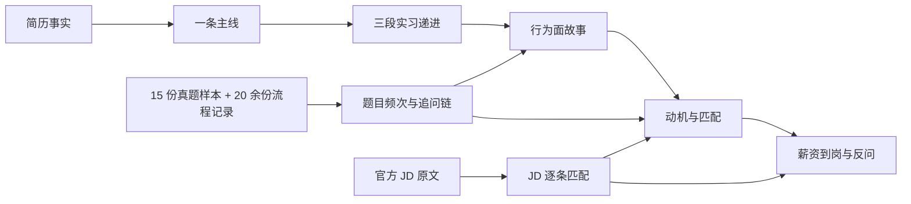

这份资料面向 **2027 届腾讯云（CSIG）「技术与产品方向」** 的 HR 面——技术类以 AI 全栈工程师为主锚（兼 AI 应用工程师 / 后台开发 / 前端开发），产品类以技术产品经理为锚点；以腾讯为主，兼顾阿里、字节的 HRG/HR 面话术。所有项目陈述来自本仓库 `content/docs/` 的实习复盘与简历 JSON；题目与流程结论来自 **15 份含明确题目清单的 HR 面真题样本**（时间跨度 2014–2026，覆盖 IEG/WXG/TEG/CSIG/PCG 等多个 BG 与后台/算法/前端/产品/测试岗位，见 [真题样本与规律](/interview/hr/real-questions)）与 **20 余份完整流程记录**（见 [流程节奏、信号与机制](/interview/hr/process)）；岗位要求来自腾讯 2027 校招官网 `join.qq.com` 的官方 JD，**目标部门是腾讯云（CSIG）「技术与产品方向」**：技术类主投「AI 全栈工程师」，产品类主投「技术产品经理」（逐条对照见 [岗位 JD 匹配](/interview/hr/jd-matching)）。**不编造未发生的经历，不把团队成果说成个人成果，不把方案推导讲成已落地。**

## 一、HR 面到底在评什么

HR 不是技术面的复述者，也不是走过场。真题样本里有一条判断很准：**腾讯的 HR 面「和阿里的 HRG 一样，都是懂业务的」**——有直接问「游戏服务器后端与普通互联网后端的区别」「Agent 在广告业务上怎么实现自动化和提效」的实例，这类面试被称为「变相二面」。所以准备时要把 HR 面当成 **「业务理解 + 动机 + 稳定性 + 沟通」四合一**，而不是只背「优缺点」。

| 评估维度              | HR 真正想确认的事                                 | 他会怎么问                                                      | 你的证据素材                                              |
| --------------------- | ------------------------------------------------- | --------------------------------------------------------------- | --------------------------------------------------------- |
| **接受意愿 / 接受率** | 给你 offer 你会不会来；城市、岗位、方向是否真匹配 | 城市优先级、其他 offer、 offer 优先级、为什么深圳、什么时候能来 | 三段实习都在外地；芜湖→南京→深圳的迁移成本要能讲清        |
| **稳定性**            | 会不会干几个月就走；频繁实习是不是「待不住」      | 为什么三段实习方向不同、为什么腾讯只待 4 个月、职业规划         | 「测量→稳定→自动化」的递进主线，而不是三段散点            |
| **沟通与执行**        | 能不能听懂需求、把事闭环、及时同步风险            | 介绍项目、最有成就感的事、压力最大时刻、如何熟悉业务            | 阿里经营托管 Agent 的 0→1；腾讯内存泄漏的定位闭环         |
| **合作与文化**        | 是不是「我们的人」；遇到分歧怎么处理              | 和领导/导师分歧、跨团队合作、别人怎么评价你                     | workflow + agent 的架构分歧；JSError 自动修复的跨团队链路 |
| **抗压与积极**        | 能不能扛住上线、故障、横向比较                    | 压力最大、失败、加班、被拒                                      | 腾讯 native 泄漏；字节/腾讯/阿里三段高强度实习            |
| **业务理解**          | 是不是只会写代码，能不能理解业务和用户            | Agent 在广告业务怎么提效、游戏后端 vs 互联网后端                | 阿里妈妈广告技术部；商家经营托管 Agent                    |
| **诚信与一致性**      | 简历时间线、数字、职责是否经得起背调              | 为什么有空档、数字怎么来的、哪些是你做的                        | 简历 JSON + `content/docs/` 的复盘；所有数字给口径        |

:::warning HR 有一票否决权，但不是「凭感觉」
流传很广的一个总结把 HR 的否决拆成三类：**offer 接受意愿**（地点、是否手握别家 offer）、**是否合适**（执行力/沟通、合作精神、积极向上）、**客观择优**（HC 与横向）。这个总结解释了一个稳定现象：**HR 的 KPI 里有「接受率」和「招到合适的人」**。所以「我都可以」「哪里都行」不是加分，而是让 HR 无法判断你的真实意愿。
:::

## 二、腾讯 HR 面的真实形态

把真题样本的「时长 / 题目 / 结果节奏」放在一起看，能得到一张比「常见 HR 面 20 题」更有用的图（各形态原题清单见 [真题样本与规律](/interview/hr/real-questions)）：

| 形态           | 真实案例                    | 时长        | 题目范围                                               | 结果节奏                            |
| -------------- | --------------------------- | ----------- | ------------------------------------------------------ | ----------------------------------- |
| 短场           | CSIG 后台开发（2026）       | **10 分钟** | 到岗时间 + 常见问题，几乎不深挖                        | 当晚过；审批约一周；云证后转录用    |
| 业务深挖       | 后台/AI 全栈（2026）        | **50 分钟** | 14 题，含业务/岗位方向/家庭/薪资/提前实习              | 面试后进入等待                      |
| 成长型         | WXG golang（2026）          | **40 分钟** | 实习经历、收获、规划、打分、优缺点、是什么样的人       | 每个答案被深挖                      |
| 标准题单       | TEG 基础架构（2023）        | **30 分钟** | 成就感、压力、工作倾向、优缺点、其他 offer、地点、亲属 | 次日云证；状态码 20→21→6            |
| 业务型         | 广告业务 Agent 方向（2026） | **30 分钟** | Agent 项目、广告业务提效、技术难点、分歧、base、到岗   | 已通过                              |
| 偏技术 HRBP 面 | WXG 算法/大模型             | 约 1 小时   | 9 个项目深挖题：价值、取舍、意义感                     | HRBP 执行，偏技术                   |
| 短场电话面     | 技术岗（仅两轮进 HR 面）    | 电话        | 到岗、意愿、常见问题                                   | 当场口头 offer，约 3 天后书面 offer |

**四条结论：**

1. **时长从 10 分钟到 1 小时都有**。10 分钟不代表稳，50 分钟也不代表挂；时长取决于 HR 风格、岗位和当日排期。有 10 分钟短场「问了一些到岗时间和其他常见问题」之后仍走审批、云证等流程的案例。
2. **HR 面可能问业务和技术判断**。真题里有「游戏服务器后端与普通互联网后端的区别」「Agent 在广告业务怎么自动化提效」「Agent 项目的技术难点」。这些题不是让你手撕代码，而是确认 **你是不是理解岗位、能不能把技术翻译成业务价值**。
3. **通过 HR 面 ≠ 拿到 offer**。真实时间线有「HR 面 → 云证/转录用 → 正式 offer」（HR 说审批约一周），也有「HR 面 → 次日云证 → 状态码反复变化」；「云证之后还会挂人吗」是普遍存在的担心。**审批、横向、HC 都是变量**，HR 面的作用是「不让你在最后一步被刷」。
4. **HR 会确认「你会不会来」**。真题里直接问「其他公司给你发 offer，你会优先选择我们吗」「父母在广州，深圳是不是首选」「是否愿意在深圳」「有没有和家里人商量」「有没有其他 offer、优先级排序」。这不是八卦，是接受率。

## 三、全量题目频次（15 份真题样本）

频次按 15 份含明确题目清单的 HR 面真题样本统计（时间跨度 2014–2026，覆盖多个 BG 与技术/产品/测试岗位；各样本原题清单见 [真题样本与规律](/interview/hr/real-questions)），每份样本在一个题目类别里只计一次：

| 题目类别                     | 次数 | 典型问法                                                                                       | 对应答案                                                                                                            |
| ---------------------------- | ---- | ---------------------------------------------------------------------------------------------- | ------------------------------------------------------------------------------------------------------------------- |
| 自我介绍                     | 8    | 「先做个自我介绍」                                                                             | [自我介绍三版](/interview/hr/narrative#自我介绍三版)                                                                |
| 实习经历/项目/收获/打分      | 7    | 「实习做了什么、收获、打几分」「介绍一下你的 Agent 项目」                                      | [三段实习怎么讲](/interview/hr/narrative#三段实习怎么讲)、[Q12](/interview/hr/behavioral#q12-如果给你的实习打分)    |
| 其他 offer/优先级            | 7    | 「有别的 offer 吗」「怎么排序」「有没有其他更想去的 offer」                                    | [其他 offer 与优先级](/interview/hr/motivation#其他-offer-与优先级)                                                 |
| 城市/base/家乡               | 5    | 「接受哪里的 base」「哪里人」「实习都在深圳，未来偏向哪些城市」                                | [城市与稳定性](/interview/hr/motivation#城市与稳定性)                                                               |
| 优缺点/自我画像              | 5    | 「两三个词概括优缺点」「是个什么样的人」                                                       | [Q5 优缺点](/interview/hr/behavioral#q5-你的优点和缺点是什么)、[Q6](/interview/hr/behavioral#q6-用两三个词概括自己) |
| 家庭/对象/亲属/父母          | 5    | 「有没有对象」「独生子吗」「直系亲属在腾讯吗」「父母职业」「你在女朋友心中的样子」             | [家庭与亲属](/interview/hr/motivation#家庭与亲属)                                                                   |
| 到岗/提前实习/出勤           | 5    | 「什么时候能来」「课程论文情况、能否全勤」                                                     | [到岗与实习](/interview/hr/close-and-compensation#到岗时间与提前实习)                                               |
| 反问                         | 5    | 「你有什么想问我的」（收尾验货环节）                                                           | [反问清单](/interview/hr/close-and-compensation#反问清单)                                                           |
| 职业规划/未来发展            | 4    | 「未来职业规划」「以后朝哪些方向发展」                                                         | [Q13 职业规划](/interview/hr/behavioral#q13-你的职业规划是什么)                                                     |
| 业务理解                     | 4    | 「游戏后端 vs 互联网后端」「Agent 在广告业务怎么提效」「对游戏开发的看法」「了解岗位和部门吗」 | [业务理解题](/interview/hr/motivation#业务理解题)                                                                   |
| 成就感/价值感                | 3    | 「最有成就感的事」「哪个项目最有价值感」                                                       | [Q1 成就感](/interview/hr/behavioral#q1-你最有成就感的一件事是什么)                                                 |
| 压力/困难                    | 2    | 「实习中压力最大的时刻」「Agent 项目的技术难点」                                               | [Q2 压力](/interview/hr/behavioral#q2-实习中压力最大的时刻)                                                         |
| 分歧（领导/导师）            | 2    | 「和领导/导师出现分歧怎么办」                                                                  | [Q4 分歧](/interview/hr/behavioral#q4-和领导或导师出现分歧怎么办)                                                   |
| 薪资                         | 2    | 「薪资要求」「预期薪资」                                                                       | [薪资](/interview/hr/close-and-compensation#薪资期望)                                                               |
| 学习/熟悉业务/与 mentor 沟通 | 2    | 「怎么学新技术」「平时怎么和 mentor 交流」                                                     | [Q7 学习](/interview/hr/behavioral#q7-你如何学习一项新技术)、[Q8](/interview/hr/behavioral#q8-你如何快速熟悉业务)   |
| 为什么暑期没来               | 1    | 「暑期实习过了为什么没来」                                                                     | [动机题](/interview/hr/motivation#为什么离开阿里与为什么看机会)                                                     |
| 岗位方向不一致               | 1    | 「成长方向不一样能接受吗」                                                                     | [岗位方向不一致](/interview/hr/motivation#岗位方向不一致)                                                           |
| 选择工作要素/价值观          | 1    | 「选择工作的要素有哪些」                                                                       | [为什么腾讯](/interview/hr/motivation#为什么腾讯)                                                                   |
| 实习选择动机/主线            | 1    | 「为什么选这几家公司实习，背景分别是什么」                                                     | [三段实习怎么讲](/interview/hr/narrative#三段实习怎么讲)                                                            |
| 兴趣爱好                     | 1    | 「平常有什么兴趣爱好」                                                                         | [Q20 兴趣爱好](/interview/hr/behavioral#q20-你有什么兴趣爱好)                                                       |
| 身体状况                     | 1    | 「身体状况怎么样」                                                                             | [收尾与背调](/interview/hr/close-and-compensation#收尾与背调)                                                       |

**题目清单之外的五个要点：**

1. **业务认知是送命/送分题**：「对游戏开发的看法」答「接触的不多」被 HR 明显不满意并进池子——全部样本里最典型的「送分题变送命题」，完整练法见 [练习组 5](/interview/hr/practice#练习组-5业务认知送命题真实被挂案例)。
2. **反问环节是验货**：答「没有，都挺清楚的」会让 HR 怀疑你的意愿；永远准备 3 个反问。
3. **对象题有变体**：「你认为你在女朋友心中的样子」这类问法本质是稳定性测试；简短、真实、不展开。
4. **Agent 岗 HR 面会深挖实习时间线（淘天 Agent 算法 HR 面，低可信度但题型值得警惕）**：「简历上实习经历时间问题、每段实习的收获、收获最多的一段展开讲、技术创新点、为什么选这几家公司」——这正是你三段实习 + 一年空档会被问的题簇。
5. **跨公司对照**：题型与腾讯高度一致（实习深挖 + offer + 薪资 + 对公司/岗位的了解）；其中谈薪是最大翻车点——有报 35% 涨幅被砍到 15%、没谈拢直接挂的真实案例。

> 频次只代表 15 份真题样本，不代表腾讯官方题库；不同 BG/HR 差异很大。**自我介绍、实习经历、其他 offer、城市、优缺点、到岗** 六项按 ≥5/15 的频次优先准备；**业务理解与反问** 频次虽低，但定生死。

## 四、回答纪律：不要背稿，要背「骨架 + 证据」

HR 面的失分通常不是「不会」，而是「讲不清、不可信、不像要来」。下面六条是这套资料的统一口径：

1. **先结论，后证据，再反思**。每题 60–90 秒。第一句给结论（「我最有成就感的是把经营托管 Agent 从 0 做到上线」），第二段给 2–3 个动作，第三段给一个数字，最后一句给反思或边界。HR 不需要听完整技术细节，但需要听到「你知道自己做了什么」。
2. **一个故事只留一个数字**。阿里那题留 `recall@5 98% / 幻觉率 0.7%` 中的一个，或者 `误放率 0% / 误拦率 17%`；腾讯那题留「RSS 持续增长、V8 堆稳定」这个分诊结论；字节那题留「插桩 + 采样抓栈两条链路」。数字多了会像背简历，数字少了像没做过。
3. **不贬低前东家，不贬低其他 offer**。离开腾讯/字节/阿里的原因只讲「客观周期 + 方向选择」，不讲「团队不好/业务不行/太卷」。HR 会据此判断你入职后会不会也这样评价腾讯。
4. **不空泛承诺**。「我学习能力强」后面必须跟一个证据（跨专业、三段技术栈、开源 PR）；「我什么都能做」会被追问「那你最擅长什么」；「哪里都可以」会被追问「那为什么不是深圳」。
5. **区分事实与推导**。项目里做过的，说「项目里是这么做的，数字口径是……」；没做过的，说「如果要做，我会这样设计」。本仓库的 [指标口径与基线定义](/interview/metrics-baseline) 就是为此准备的：HR 不一定追问口径，但技术面/交叉面会。
6. **不编造时间线和身份信息**。空档、短实习、转正状态、其他 offer、对象/家庭，都是背调和追问的高危区。**宁可说「这个点我需要确认后给您准确答复」，也不要编一个当场圆不回来的故事。**
7. **按腾讯的口味答题：务实、重用户、懂生态、有灰度。** 少讲「平台大、流量多、技术领先」这类形容词，多讲「用户是谁、业务怎么闭环、风险怎么兜底、取舍的代价是什么」。技术名词能省则省；一个方案讲不清边界，就不算想过。

## 五、简历事实清单（面试前逐项确认）

| 项       | 事实                                                                                                                       | HR 可能追问                                   |
| -------- | -------------------------------------------------------------------------------------------------------------------------- | --------------------------------------------- |
| 身份     | 杭天铖，男，2002-02，安徽芜湖人，现居南京                                                                                  | 年龄、家乡、父母是否支持异地                  |
| 学历     | 南京邮电大学·计算机技术·硕士（2024-09~2027-06）；西安电子科技大学·微电子科学与工程·本科（2019-09~2023-06）                 | 为什么转专业、为什么有 1 年空档、成绩/排名    |
| 求职身份 | 2027 届应届生，`freshGraduate: true`，`workStart` 为空                                                                     | 什么时候毕业、什么时候能入职、是否全日制      |
| 实习 1   | 阿里巴巴·阿里妈妈·广告技术部·全栈开发（2026-05~2026-11，已结束）                                                           | 有转正吗、为什么看机会、什么时候能来          |
| 实习 2   | 腾讯·IEG·基础技术产品部·全栈开发（2025-10~2026-02）                                                                        | 为什么只做 4 个月、为什么离开、能不能回原团队 |
| 实习 3   | 字节跳动·TikTok Performance·全栈开发（2025-06~2025-09）                                                                    | 为什么实习结束、学到了什么                    |
| 项目     | Coding Agent（yukino-code，2026-02~至今）；前端监控/埋点（2025-04~2025-12，简历隐藏）；WAN 传输优化代理（2024-09~2025-05） | 哪个是你独立做的、有没有用户、为什么做        |
| 荣誉     | 西电大二三等奖学金；南邮研一/研二/研三三等奖学金                                                                           | 为什么都是三等、成绩怎么样                    |
| 技能     | Go、TypeScript、React/Vue/Next.js、MySQL/Redis、Agent 开发                                                                 | 你最擅长哪一块、前端还是后端                  |

:::note 三个已确认的事实口径（2026-11 确认，面试直接用）

1. **一年空档（2023-07~2024-08）**：疫情影响身体不适，毕业后休养了一段时间；期间出于对计算机的热爱，决定从微电子（专业偏计算机组成 + 数电模电）转计算机，系统补基础并备考研究生，2024-09 入学南邮计算机技术。讲法见 [一年空档](/interview/hr/narrative#q2023-年本科毕业到-2024-年-9-月读研这一年空档在做什么)。
2. **腾讯 IEG 只有 4 个月（2025-10~2026-02）**：因为学校课题（WANProxy，数据中心网络校企合作项目）需要回校推进，与团队协商后结束实习。讲法见 [压力点 2](/interview/hr/pressure#压力点-2腾讯只有-4-个月是不是没留你--你干不下去了)。
3. **阿里**：实习已结束；转正还不明确（今年 HC 紧缺）；从行业考虑更希望加入腾讯云业务。**不要虚构转正 offer 抬价**，背调/交叉询问很容易穿帮。讲法见 [为什么离开阿里](/interview/hr/motivation#为什么离开阿里与为什么看机会)。

另注意：简历 JSON 的阿里实习仍标「至今」，**面试前先把简历结束时间更新为实际时间**，保证简历、面试、背调三处一致。
:::

## 六、30 秒自检（面试前 10 分钟）

- [ ] 30 秒自我介绍能脱稿，第一句说清「我是谁 + 主线 + 为什么这个岗位」。
- [ ] 三段实习各能讲出「一句话定位 + 一个动作 + 一个结果」，不混淆公司、部门、时间。
- [ ] 阿里经营托管 Agent 能讲清「workflow + agent 为什么混合」，以及 `误放率 0% / 误拦率 17%` 的口径。
- [ ] 腾讯内存泄漏能讲清「RSS 涨、V8 堆稳定 → 堆外 → Valgrind → protobuf destroy」的因果链。
- [ ] 字节性能采集能讲清「插桩 vs 采样抓栈」的取舍，不把「虚拟滚动」说成「减少传输量」。
- [ ] 为什么腾讯、为什么这个岗位、为什么深圳，各有一版 30 秒答案，且不贬低阿里。
- [ ] 能讲清「为什么腾讯云技术与产品方向」，技术岗（AI 全栈）与产品岗（技术产品经理）各有一版 30 秒匹配答案，见 [岗位 JD 匹配](/interview/hr/jd-matching)。
- [ ] 优缺点各 1 个，缺点有具体改进动作，不用「太追求完美」。
- [ ] 薪资、到岗、提前实习、其他 offer 四项有明确口径，不含糊。
- [ ] 反问准备 3 个，第一个不问薪资/加班/结果。
- [ ] 能用「生态 + 灰度 + 落地」讲腾讯的核心优势，且每个词有一个自己的观察或岗位落点。
- [ ] 一年空档（身体不适 + 热爱转专业）、腾讯 4 个月（学校课题 WANProxy）、阿里（已结束、转正不明确、意向腾讯云）三项口径统一，各能 20 秒讲清。

## 七、文件地图

| 文档                                                     | 解决什么                                                                                                                                                                                                       |
| -------------------------------------------------------- | -------------------------------------------------------------------------------------------------------------------------------------------------------------------------------------------------------------- |
| [自我介绍与简历叙事](/interview/hr/narrative)            | 30 秒/90 秒/3 分钟三版自我介绍；三段实习主线；转专业、空档、短实习、频繁实习、项目归属                                                                                                                         |
| [行为面题库](/interview/hr/behavioral)                   | 成就感、压力、失败、分歧、优缺点、学习、业务熟悉、合作、抗压、规划等 20 题 STAR 答案                                                                                                                           |
| [动机与岗位匹配](/interview/hr/motivation)               | 为什么腾讯/为什么这个岗位/为什么离开阿里/城市/其他 offer/家庭/岗位方向/业务理解                                                                                                                                |
| [岗位 JD 匹配](/interview/hr/jd-matching)                | 腾讯云（CSIG）「技术与产品方向」官方 JD 原文：技术类 AI 全栈 / AI 应用 / 后台 / 前端、产品类技术产品经理，逐条对照真实证据，含技术岗与产品岗的 30/90 秒答案、追问应对、JD 专属压力题与练习题、差距补齐清单     |
| [薪资、到岗与反问](/interview/hr/close-and-compensation) | 薪资、提前实习、offer 接受、反问、审批/横向/云证、背调与材料                                                                                                                                                   |
| [真题样本与规律](/interview/hr/real-questions)           | 8 种面试形态的真题清单（10 分钟短场到 1 小时业务深挖）、从真题反推的 7 条规律、真题到答案的映射、不可照搬的边界                                                                                                |
| [流程节奏、信号与机制](/interview/hr/process)            | 全链路节奏基准、HR 面被挂 7 类原因、复活与捞起机制、流程信号解读表、交叉面/用人决策者面/面委会/加面、催更技巧、薪酬与开奖机制                                                                                  |
| [压力面题库](/interview/hr/pressure)                     | 压力面应对心法与 19 个基于真实简历的高频压力点：三段实习方向不同、腾讯 4 个月、空档、转专业、数字被质疑、实习产出不被信、yukino-code 被说玩具、base 城市不符、薪资到岗施压，每题给 HR 真实意图、参考回答与雷区 |
| [HR 面练习题](/interview/hr/practice)                    | 4 套模拟卷（10/30/50 分钟与压力面）、6 类 40 道练习题（每题给答案要点与评分标准）、追问链练习、自评评分表、录音复盘模板与 7 天练习计划                                                                         |

:::note 与其他资料的分工
HR 面不考八股，但会考「业务理解」和「项目真实性」。技术细节回 [专题题库](/interview/qa/fullstack-ai-app) 与 [项目深挖](/interview/answers/ecomm-rag-project)；量化口径回 [指标口径与基线定义](/interview/metrics-baseline)；本专区只负责 **怎么把已经做过的事讲成一个可信、匹配、愿意来的候选人**。
:::
