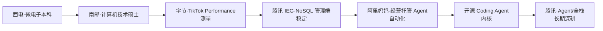

本文只解决 **「怎么讲」**，不解决「讲什么」。事实以简历 JSON 与 `content/docs/` 的实习复盘为准；空档、离开腾讯、阿里状态的原因已确认（见 [简历事实清单](/interview/hr/index#五简历事实清单面试前逐项确认)），其余仍未确认的细节用 `[待确认]` 标出。

## 自我介绍三版

### 30 秒版（HR 面开场 / 电话初聊）

> 我是杭天铖，南京邮电大学计算机技术硕士，2027 年 6 月毕业，方向是 **Agent 工程化 + 全栈**。我在阿里妈妈做过经营托管 Agent，负责 workflow 与 agent 混合编排、RAG 检索和幻觉治理，已经在淘宝商家端落地；之前在腾讯 IEG 做 NoSQL 管理端的 Node/native 稳定性治理和前端监控，在字节 TikTok Performance 做性能采集和数据链路。我自己还维护了一个开源 Coding Agent，支持多模型协议、MCP、权限沙箱和 Agent Team。我希望在腾讯把 Agent 落到真实业务里，长期做深。

**为什么这样排：** 第一句给身份和方向；第二句给最强证据（阿里 Agent 上线）；第三句用腾讯/字节证明工程底子；第四句用开源项目证明「不是只会调 API」；最后一句回答「为什么来」。**不要**在 30 秒里报 GPA、奖学金、家乡，HR 没问就不主动展开。

### 90 秒版（「请介绍一下你自己」标准答案）

> 我是杭天铖，2027 届硕士，南京邮电大学计算机技术，本科在西电读微电子。我的主线是 **让 AI 在真实业务里可控地干活**，具体分三段实习：
>
> 第一段在字节 TikTok Performance，做移动端性能采集和数据链路。我用插桩和采样抓栈两种方式采集性能数据，把 Kafka、Hive、ClickHouse、MySQL、Redis 按读写模式分工，前端还手写了不定高虚拟滚动。这段让我养成 **先测量、再优化** 的习惯。
>
> 第二段在腾讯 IEG，做 TcaplusDB NoSQL 管理端的全栈开发。我做过 TCP 连接池、进程池和对象池，定位并修复了一个 ffi 调用 C++ `.so` 的堆外内存泄漏，也负责前端监控 SDK 的 JSError 采集、rrweb 现场还原和体积治理。这段让我学会 **在存量系统里做高风险改造**。
>
> 第三段在阿里妈妈广告技术部，做了经营托管 Agent。我负责确定性 workflow 加 agent 的混合编排、RAG + BM25 双路召回、生成前的置信度校验和数据飞轮，项目已经在淘宝商家端落地，实习也已结束交接。这段让我学会 **把模型能力放进业务约束里**，而不是做一个 demo。
>
> 业余我维护开源 Coding Agent `yukino-code`，从 LLM 协议适配、工具与 MCP、权限沙箱、上下文压缩到 subagent 和 Agent Team 都自己写了一遍。所以我对 Agent 的理解不只是 prompt，而是整条执行链路。我想在腾讯找一个能长期深耕的业务场景，把 Agent 真正做成产品。

**采分点：** 三段实习不是流水账，每段都有一句「这段让我学会……」；最后把「开源项目」和「岗位」扣在一起。**雷区：** 不要把 90 秒讲成 3 分钟；不要在第一段就展开 Valgrind、RRF、A2UI 这些名词，HR 听不懂会走神；不要提「我还有很多不足」这种自我削弱的话。

### 3 分钟版（「详细讲讲你的经历」/ 交叉面）

在 90 秒版基础上，每段补一个 **具体动作 + 一个结果 + 一个取舍**：

| 段落     | 补什么                  | 建议原话                                                                                                                                                                                                              |
| -------- | ----------------------- | --------------------------------------------------------------------------------------------------------------------------------------------------------------------------------------------------------------------- |
| 字节     | 插桩 vs 抓栈的取舍      | 「插桩精确到单次调用，但开销大；采样抓栈开销低，适合海量设备。我没有二选一，而是让两条链路互补：已知瓶颈用插桩精确定位，未知热点用采样发现。」                                                                        |
| 腾讯     | 内存泄漏的因果链        | 「现象是 RSS 持续涨、V8 堆稳定，所以先判断是堆外。用 Valgrind 定位到 ffi 调 C++ `.so` 的 protobuf message 没释放，补了 destroy NAPI 调用，再用 RSS 和 heapUsed 两条曲线确认修复。」                                   |
| 阿里     | 为什么 workflow + agent | 「纯 agent 灵活，但可能跳过查订单/查政策这些必经步骤，导致错误承诺；纯 workflow 可控，但回答很死。所以我们把必经步骤交给 workflow，证据足够后的判断交给 agent，生成前用三信号置信度校验，不够就追问，再不够转人工。」 |
| 开源项目 | 为什么自己写            | 「我想知道 Agent 内核到底怎么运转，而不是只会调 API。所以从协议适配、工具调度、权限、沙箱、上下文压缩到多 agent 协作都自己实现了一遍，再用 SWE-bench-Live 做评测。」                                                  |
| 收尾     | 为什么腾讯              | 「我待过腾讯 IEG，知道团队对稳定性和性能的要求；阿里这段又验证了 Agent 在广告业务的价值。从行业考虑，我更希望加入腾讯云业务——ToB 场景的复杂度和工程标准正是我想长期做的地方。」                                       |

## 简历主线

**一句话主线：** 「先能测量（字节），再能稳定（腾讯），最后能自动化（阿里）——我想做的是 **可观测、可控、可落地** 的 Agent，而不是一个只会聊天的 demo。」

**三种能力：**

1. **Agent 工程化**：workflow + agent 混合编排、RAG/BM25 双路召回、置信度门控、评测与数据飞轮、MCP/Skill/Hook/Subagent。
2. **全栈交付**：Node/native、Go、React/TypeScript，能自己把前端、服务端、数据链路串起来。
3. **稳定性与可观测性**：连接池/进程池/对象池、native 内存、前端监控、指标与告警。

**一个作品：** `yukino-code`，5 层架构、3 种 LLM 协议、MCP 延迟加载、权限/沙箱/HITL、两层上下文压缩、Goal 模式、subagent、Agent Team、Worktree。它证明的是「我理解 Agent 的整条链路」，不是「我会写 prompt」。

## 三段实习怎么讲

| 公司                    | 时间            | 一句话定位                   | 关键动作                                                               | 结果                                                       | 离开原因                                 |
| ----------------------- | --------------- | ---------------------------- | ---------------------------------------------------------------------- | ---------------------------------------------------------- | ---------------------------------------- |
| 字节·TikTok Performance | 2025-06~2025-09 | 先测量：性能数据采集与链路   | 插桩 + 采样抓栈；Kafka/Hive/ClickHouse/MySQL/Redis；不定高虚拟滚动     | 定位慢函数；支撑性能数据查询；沉淀 hooks                   | 暑期实习周期结束，回校开学               |
| 腾讯·IEG 基础技术产品部 | 2025-10~2026-02 | 再稳定：NoSQL 管理端工程治理 | TCP 连接池、进程池/对象池、Valgrind 定位堆外泄漏、监控 SDK、类组件迁移 | RSS 曲线稳定；监控 SDK 体积治理；迁移可回滚                | 回校推进学校课题（WANProxy）             |
| 阿里·阿里妈妈广告技术部 | 2026-05~2026-11 | 自动化：经营托管 Agent       | workflow + agent、RAG + BM25、RRF + rerank、置信度门控、A2UI、数据飞轮 | 淘宝商家端落地；`recall@5 98%`、`幻觉率 0.7%`、`误放率 0%` | 实习结束；转正不明确，从行业考虑选腾讯云 |

> **口径提醒：** 阿里实际结束月份以真实离职时间为准，简历、面试、背调三处保持一致（简历 JSON 目前仍标「至今」，面试前先更新简历）。

### 字节：先测量，再优化

> 我在字节 TikTok Performance 做性能采集和数据链路。设备端有两条采集链路：一条是编译期/运行时插桩，记录函数调用的起止时间，适合精确定位已知瓶颈；另一条是采样式 Profiling，按固定频率抓 JS 调用栈，开销低，适合在海量设备上发现热点。两条链路不是二选一，而是互补。
>
> 数据链路上，Kafka 承接上报洪峰、解耦生产和消费；Hive 存全量离线数仓，ClickHouse 做在线聚合，MySQL 存关系型数据，Redis 和进程内 LRU 做热点缓存。ClickHouse 这边用 AggregatingMergeTree 预聚合、批量写入控制 part 数量。
>
> 前端是一个性能数据长列表，我手写了不定高虚拟滚动：预估高度撑总高度，前缀和加二分查找定位可视区间，ResizeObserver 实测回写修正，配合 passive 监听和 rAF 节流消除快速滚动白屏。这段最大的收获是 **任何优化都要先有测量口径**，不然只是凭感觉。

**追问「虚拟滚动是不是减少了数据传输？」** 不是。虚拟滚动只减少 DOM 节点，传输量要靠服务端分页和字段裁剪。这个纠偏点在本仓库 [高频易错点](/interview/pitfalls) 里有记录。

### 腾讯：在存量系统里做高风险改造

> 我在腾讯 IEG 做 TcaplusDB NoSQL 管理端的全栈开发。这段的核心是「稳定」：管理端和数据库之间是 TCP 长连接，我设计了通用资源池，同时池化连接、解析进程和对象；连接池覆盖建立连接/认证超时、请求超时、对端主动关闭、静默断开四类异常，归还前做校验。
>
> 私有数据表解析要调 C++ `.so`，我用进程池隔离，避免 native 崩溃和堆外泄漏带走 Node 主进程；对象池复用解析上下文，固定属性初始化顺序和对象 schema 来共享 V8 隐藏类，降低 GC 压力。
>
> 最典型的一次是 RSS 持续增长、但 V8 堆稳定。我先分诊是堆外，再用 Valgrind Memcheck 定位到 ffi-napi 调 C++ `.so` 时 protobuf message 没有释放，补了 destroy 的 NAPI 调用，最后用 RSS 和 heapUsed 两条曲线确认修复。
>
> 另外我负责前端监控 SDK 的 JSError 采集和故障现场还原：rrweb 增量录制 + 定长环形缓冲区保留错误前 5 秒，sourcemap 和 componentStack 双路反解，fingerprint 聚合告警；还把录屏、白屏检测拆成插件和子路径入口，运行时按需动态导入，控制体积。
>
> 这段让我学会 **在存量系统里做改造，先想清楚失败模式和回滚**，而不是追求一次写对。

### 阿里：把模型能力放进业务约束

> 我在阿里妈妈广告技术部做经营托管 Agent，目标是降低商家经营客服团队和讲师团队的人力成本。它不是纯 agent，而是 **确定性 workflow + agent 混合架构**：
>
> - 用 LangGraph4j 编排 8 类意图到 5 个出口的分流状态机；指代消解、query 扩写、意图识别、RAG + BM25 双路召回、置信度校验、agent loop 这些步骤由 workflow 调度。
> - 知识检索、查订单/政策这类必经步骤放在 workflow 里，agent 只负责证据足够后的判断和回答。这样从架构上排除「模型跳过必经步骤导致错误承诺」。
> - 生成前做三信号加权的置信度打分：证据不够就先追问，追问后仍澄清失败就转人工。实测误放率 0%、误拦率 17%。
> - 检索用 RAG + BM25 双路召回，RRF 粗排 + reranker 精排；500 题五桶评估集里 450 道可回答题上 recall@5 98%、答案覆盖率 97%，人工逐条核验的幻觉率 0.7%。
> - 我还接了 A2UI，提高 LLM 生成 A2UI JSON 的速率和准确率；服务端支持失败重试，客户端支持失败降级。前端参与了 webpack/vite 模块联邦接入，修了 module-federation/vite 的 CJS/ESM 入口崩溃问题（PR #860）。
>
> 这段让我确认：Agent 的价值不在「能聊」，而在 **能不能在业务约束下稳定交付**。误拦率 17% 也说明我们还有优化空间，比如追问策略和置信度阈值还可以继续调。

### 「为什么三段实习方向不同？」标准答法

> 表面看是三个方向，其实是一条线：字节解决「怎么测量」，腾讯解决「怎么稳定」，阿里解决「怎么自动化」。如果没有性能采集和可观测性，就不知道 Agent 慢在哪、错在哪；如果没有连接池、native 内存、监控这些稳定性治理，Agent 上了生产也扛不住；有了这两层，才敢把 Agent 放进真实业务。所以我不是在换方向，而是在补一条完整的工程链路。

**采分点：** 把「跳」解释成「递进」；每段都给一个可验证的动作；最后落到「所以我现在明确要做 Agent 全栈」。**雷区：** 不要说「前一家太卷/没意思/学不到东西」；不要说「我就是想多试试」——HR 会担心你入职后也这样。

## 频繁实习与稳定性

### 「为什么实习这么频繁/会不会不稳定？」标准答法

> 我理解您的担心。这三段都是 **实习**，实习对我来说是低成本验证方向；正式工作我会按长期来做。而且这三段不是随便换：字节是性能、腾讯是基础设施、阿里是 Agent，每一段都拿到了可复用的能力和交付结果。现在我已经明确方向是 Agent 全栈，所以秋招我看的是「能不能长期深耕」，而不是再换一个方向试试。

**如果追问「那你毕业前还会换吗？」** 「不会。我的开源项目 `yukino-code` 从 2026 年 2 月持续迭代到现在；阿里这段也是把经营托管 Agent 做到淘宝商家端落地才结束的。我更喜欢把一件事做深，而不是频繁换。」

## 转专业、空档与成绩

### Q：本科微电子，为什么转计算机？

> 我本科在西电读微电子，这个专业本身就偏计算机组成、数字电路和模拟电路，课程里也会接触嵌入式、算法和编程——所以我转计算机不是从零跨行，而是从「硬件/系统层」往「软件层」延伸。真正让我转向的是我发现 **我更喜欢软件系统的抽象和迭代速度**：硬件的反馈周期长，软件可以当天写、当天验证、当天上线。毕业后那一年我出于对计算机的热爱下定决心转方向，考研到计算机技术，并自己补了 Go、TypeScript、操作系统、网络这些基础。后面的三段实习和开源项目，算是把「喜欢」验证成了「能做」。

**采分点：** 给一个内在动机（喜欢软件迭代），再给一个验证（考研 + 自学 + 实习）。**雷区：** 「微电子不好就业」「硬件太苦」——贬低原专业会让 HR 觉得你也会贬低现在的工作。

### Q：2023 年本科毕业到 2024 年 9 月读研，这一年空档在做什么？

**事实口径（已确认）：** 疫情影响身体不适，毕业后休养了一段时间；期间出于对计算机的热爱，决定从微电子转计算机，系统补基础并备考研究生，2024-09 入学南邮。

> 本科毕业后到读研前，我有一年空档。这一年主要两件事：第一，疫情影响加上身体不适，我休养调整了一段时间；第二，出于对计算机的热爱，我下定决心从微电子转到计算机——我本科专业偏计算机组成和数电模电，转过来不是零基础，但我还是系统补了数据结构、操作系统、计算机网络这些基础，同时备考研究生，2024 年 9 月入学南邮计算机技术。这一年不是空窗，是我做出最重要方向选择的一年；读研后的三段实习和开源项目，证明这个选择是对的。

**回答纪律：**

- 20–30 秒结束，不要展开成「我那年有多难」；健康部分一句带过，HR 不是要听病历。
- 重点放在「热爱 + 选择 + 收获」：休养是客观原因，转专业备考是主动选择。
- 如果 HR 追问「为什么别人应届直接读研，你要空一年」，答「那年身体状态不好需要调整，而且从微电子转计算机也需要时间确认方向、补基础；这一年让我更确定，所以读研后我没有再摇摆」。
- 如果 HR 追问身体状况：「已经完全恢复，不影响工作强度」——给确定性，不展开细节。

### Q：成绩/排名怎么样？为什么奖学金都是三等？

> 我的成绩稳定在中上，没有挂科 `[待确认]`；奖学金从西电大二到南邮研一、研二、研三连续拿到，都是三等奖学金。没有拿到更高档，主要是因为我把较多时间投入了工程实践和实习。我不觉得这是借口，但它确实是我的取舍：我希望毕业时拿得出手的不只是成绩单，还有能落地的项目。`[如排名/绩点较好，直接给数字；否则不要编]`

**采分点：** 诚实 + 不找借口 + 说明取舍。**雷区：** 「我们学校奖学金很难拿」「评比不公平」——抱怨规则是减分项。

### Q：为什么选择南京邮电大学？

> 我本科是微电子，考研时希望找一个 **计算机方向和工程实践都强** 的学校。南邮的计算机技术专业和我现在做的方向匹配，地点也在南京，离安徽老家近，方便我兼顾实习和家庭。`[如导师/实验室方向是真实原因，替换成具体方向]`

### Q：三段实习都在读研期间，导师/学业怎么平衡？

> 我读研期间安排实习时，原则是先和导师沟通、按学校要求来。我会先把课程、开题/论文的节点排出来，实习期间用周末和晚上推进学校的事，关键节点回学校。一个真实的例子：腾讯 IEG 那段实习做到 4 个月时，学校课题（WANProxy）需要我回校推进，我和团队协商后就结束了实习回校——学业的关键节点我是优先保证的。`[导师态度/论文进度按真实情况说；如果实际没有沟通过，不要编「导师很支持」或「论文已经写完」]` 我不建议隐瞒导师去实习，也不建议为了实习拖毕业；如果两者冲突，我会优先保证毕业要求，再和团队沟通实习节奏。

**追问「导师支持吗？」** 如实回答。如果导师不支持，不要编；说「我会先和导师沟通，按学校要求安排，不会影响毕业」。**追问「论文进度？」** 如实说；不要承诺一个自己做不到的时间。

## 项目归属与数字口径

### Q：这些项目里，哪些是你独立做的？

> 我分三类说：
>
> 1. **个人项目**：`yukino-code` 是我自己从 0 写的，仓库在我个人 GitHub 下，5 层架构、协议适配、工具/MCP、权限沙箱、上下文压缩、subagent、Agent Team 都是我自己实现的。
> 2. **我负责的模块**：阿里经营托管 Agent 里，我负责 workflow 编排、RAG 检索、置信度校验、A2UI 接入和前端模块联邦修复；腾讯管理端里，我负责连接池/进程池/对象池、native 内存排查、监控 SDK 和类组件迁移；字节里，我负责性能采集、数据链路和虚拟滚动。团队里还有产品、算法、前端、DBA、native 的同学。
> 3. **我参与但不独占的**：比如整体架构选型、业务指标定义、跨团队上线，这些是团队一起定的，我不会说成是我一个人的。

**采分点：** 主动区分「个人 / 负责 / 参与」，比一味说「都是我做的」可信得多。**雷区：** 把团队成果全部据为己有；背调/交叉询问时很容易穿帮。

### Q：简历上的数字怎么来的？

> 阿里的数字来自 500 题五桶评估集，其中 450 道是可回答题；`recall@5 98%`、答案覆盖率 97%、人工逐条核验的幻觉率 0.7%。误放率 0%、误拦率 17% 是置信度门控的线上/离线评估口径。腾讯的内存修复不是百分比，是「RSS 曲线恢复稳定、V8 堆保持平稳」这个可复现的观察。字节的性能采集更多是能力建设，不是单一指标提升。

**如果 HR 追问口径：** 「具体口径我在文档里有记录，简单说：baseline 是同一份评估集、同一个模型和 prompt，只切换检索/置信度策略；分子分母和采集位置都能对上。如果您感兴趣，我可以在技术面展开。」**不要**在 HR 面背公式，但要让对方知道「你不是随口说的」。

### Q：为什么做 `yukino-code`？

> 我在阿里做 Agent 时，很多能力是平台封装好的。我想知道 **内核到底怎么运转**：模型协议怎么适配、工具怎么调度、权限和沙箱怎么隔离、上下文超了怎么压缩、subagent 怎么并行、多个 agent 怎么协作。所以我自己写了一个 Coding Agent，支持 OpenAI Chat Completions/Response、Anthropic Messages 三种协议，支持 MCP 延迟加载、Slash Command、Skill、Hook、Worktree、Agent Team，还用 SWE-bench-Live 做评测。它是我对 Agent 工程化的长期投入，也是我理解「平台能力」和「内核能力」差异的方式。

### Q：这个项目有人用吗/上线了吗？

> `yukino-code` 是开源项目，仓库公开，主要是我自己长期使用和迭代；阿里的经营托管 Agent 已经在淘宝商家端落地；腾讯的管理端是内部系统；字节的性能平台也是内部链路。**我不会把内部系统说成有外部用户**，但可以讲清楚它服务的角色和解决的问题。

## 一句话素材库

面试时最容易卡壳的不是「没做过」，而是「想不起来用哪个故事」。下面 10 个素材，每个只记一句：

| #   | 素材                 | 一句话                                                                     | 最适合的问题             |
| --- | -------------------- | -------------------------------------------------------------------------- | ------------------------ |
| 1   | 阿里经营托管 Agent   | 用 workflow + agent 把「查订单/查政策」变成必经步骤，误放率 0%、误拦率 17% | 成就感、分歧、业务理解   |
| 2   | 腾讯 native 内存泄漏 | RSS 涨、V8 堆稳 → 堆外 → Valgrind → protobuf destroy                       | 压力、排查、稳定性       |
| 3   | 腾讯类组件迁移       | 机械翻译踩了闭包过期值和请求竞态，后来用规范 + TDD + 小步提交              | 失败、改进、说服         |
| 4   | 腾讯监控 SDK         | rrweb 环形缓冲区保留错误前 5 秒；插件化 + 子路径按需加载                   | 主动性、跨团队、体积治理 |
| 5   | 字节性能采集         | 插桩精确、抓栈低开销，两条链路互补                                         | 学习、取舍、测量         |
| 6   | 字节虚拟滚动         | 预估高度 + 前缀和 + 二分 + ResizeObserver；只减 DOM 不减传输               | 技术细节、纠偏           |
| 7   | 阿里 A2UI            | 生成 JSON 的速率/准确率；服务端重试、客户端降级                            | 全栈、容错、业务         |
| 8   | 开源 Coding Agent    | 5 层架构、3 协议、MCP、权限沙箱、subagent、Agent Team                      | 项目、热情、长期主义     |
| 9   | 开源 PR              | module-federation/vite #860、coze-js #257                                  | 主动性、工程能力         |
| 10  | WANProxy             | Go 双端 TCP 代理；XCodec 2KB 滑窗去重；ASK/LEARN/ADVANCE/EOS               | 后端基础、项目           |

:::note 下一步
自我介绍定稿后，去 [行为面题库](/interview/hr/behavioral) 把素材 1–5 展开成 STAR；再去 [动机与岗位匹配](/interview/hr/motivation) 准备「为什么腾讯/为什么深圳/其他 offer」。
:::
