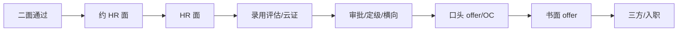

HR 面只是流程里的一个节点，它前后还有录用评估、云证、审批、横向、开奖。等待期的焦虑和误判，大多来自 **不知道每个状态意味着什么、哪些节奏是正常的**。本文基于 20 余份完整流程记录，整理全链路节奏、被挂原因、复活机制、信号解读与催更技巧，用于预期管理和避免焦虑下的错误操作。

:::warning 数据性质
本文的节奏与信号是真实流程记录的归纳，**不是官方承诺**：不同 BG/岗位/年份有差异。用于预期管理与应对参考，一律以官方通知为准。
:::

## 一、全链路节奏基准

| 环节                   | 常见节奏                                | 说明                                        |
| ---------------------- | --------------------------------------- | ------------------------------------------- |
| 二面通过 → 约 HR 面    | 5–10 天                                 | HR 忙时更久；发邮件礼貌问进度不减分         |
| HR 面时长/形式         | 10 分钟 – 1 小时                        | 电话/视频/现场都有；短 ≠ 挂，长 ≠ 稳        |
| HR 面 → 录用评估/云证  | 当晚 – 2 周                             | 有当晚云证的案例，也有跨节假日约 3 周的案例 |
| 录用评估 → offer       | 3 天 – 1 个月                           | 有评估一个月后 OC 的真实案例                |
| 薪酬环节（偏社招口径） | HR 面后约 3 天收集流水，再约 3 天给方案 | 流水对得仔细，超额年终奖不计入              |

**等待期心态基准（多条记录交叉验证）：**

- 二面/终面通过到约 HR 面，等 **5–10 天** 是正常区间，方差很大（「一定要等 7–8 天」「一般第二天或第三天约」都有）。
- HR 面到云证/录用评估，**当晚到 2 周** 都有。
- 录用评估到 offer，**3 天到 1 个月** 都有。
- **节假日显著拉长流程**（有跨中秋国庆约 3 周的案例）。
- **基准内的等待不要焦虑，超基准再礼貌催问一次**（见 [催更技巧](#七催更技巧)）。

## 二、面试时长与形态

- **时长分布**：10 分钟到 1 小时都有。10 分钟不代表稳（有当场 OC 的案例），50 分钟也不代表挂（可能是 HR 深挖业务）。
- **形式**：电话面、视频、现场都有；HR 面完全可能只打电话。
- **面试官构成**：常见 HR 单面；也有「HR + HRBP」双面试官（HRBP 不开摄像头旁听，面 1 小时）；WXG 的 HR 面由 HRBP 执行、偏技术深挖（见 [真题样本与规律](/interview/hr/real-questions)）。
- **当场 OC**：有 10 分钟 HR 面当场口头 offer、约 3 天后转书面 offer 的案例。
- **面委会可能在 HR 面前**：跨业务组 Leader 评审（见第六节）。

## 三、HR 面被挂的 7 类真实原因

「HR 面会不会挂人？」答案明确：**会**。但挂的原因高度可归类，其中大部分可以提前规避：

| #   | 原因                  | 真实案例                                                                                                           | 可规避性              |
| --- | --------------------- | ------------------------------------------------------------------------------------------------------------------ | --------------------- |
| 1   | **HC 耗尽/池子缩编**  | HR 面后 4 天没联系，找一面面试官催问，答复「没 HC 了」；有候选人自述「面了 5 次 HR 面挂了 4 次」                   | 不可控，但可催问确认  |
| 2   | **横向比较**          | HR 面 1 小时后接到电话「已挂，需要再考虑考虑，有合适机会会推荐到其他部门」→ 5 天后被捞回，OC+云证 → offer          | 部分可控（表现+意愿） |
| 3   | **业务认知答砸**      | 魔方后台，HR 问「对游戏开发的看法」，答「接触的不多」，HR 明显不满意 → 进池子；后被捞回 OC                         | **完全可控**          |
| 4   | **到岗时间冲突**      | 面试时间、到岗时间、学校联培计划三者不匹配导致死锁，在 HR 面被挂；也有过两轮技术面因不能到岗在 HR 面被挂           | **完全可控**          |
| 5   | **系统误挂/流程超时** | HR 面+云证后显示挂 → 次日 HR 加微信说「系统给我挂了」，捞起转录用评估；GM 面评 7 天未上传超时自动挂 → 邮件申诉复活 | 不可控，但可申诉复活  |
| 6   | **掉锁**              | HR 交叉面后「掉锁」，HR 说还在评估，一个月后 OC → offer                                                            | 不可控，保持联系      |
| 7   | **岗位匹配度**        | 一面被问「你都是 AI 的项目吗，想要更传统后端的」；面委会评价「简历上都是已有技术，没什么亮点」→ HR 面挂            | 部分可控（叙事对齐）  |

**三条行动结论：**

1. **第 3、4 类是完全可控的送分题**：「对游戏/业务怎么看」必须提前准备一版有内容的回答（见 [业务理解题](/interview/hr/motivation#业务理解题)）；到岗时间必须给出明确、可兑现的窗口（见 [到岗时间与提前实习](/interview/hr/close-and-compensation#到岗时间与提前实习)）。那句「接触的不多」价值千金——**永远不要在 HR 面说「不了解/接触不多」**。
2. **第 1、5、6 类不可控但可确认**：超过 5 个工作日没动静，礼貌催问一次（邮件/电话），既能确认状态，也可能触发捞起（有电话催完「刚挂电话就发了加面邀请」的真实案例）。
3. **第 2、7 类靠叙事**：横向比较时 HR 手里是你的全部材料，「意愿明确 + 匹配度高」的候选人优先；你的「测量→稳定→自动化」主线和 JD 逐条匹配（见 [岗位 JD 匹配](/interview/hr/jd-matching)）就是对抗横向的武器。

## 四、复活与捞起机制（挂了 ≠ 结束）

多个案例证明：**腾讯的流程有多条复活路径**，被挂后不要立刻心态崩：

| 复活路径           | 案例                                                                               | 你该做什么                     |
| ------------------ | ---------------------------------------------------------------------------------- | ------------------------------ |
| 挂电话后被捞回     | 接到「已挂」电话 5 天后进度被捞回，OC+云证+转录用评估 → offer                      | 保持电话畅通、态度体面         |
| 系统误挂被纠正     | 「系统给我挂了」，次日 HR 加微信捞起转录用评估                                     | 发现状态异常，礼貌询问 HR      |
| 流程超时邮件申诉   | GM 面评 7 天未上传自动挂 → 发邮件给 campus 邮箱 → 流程复活回三面状态 → 最终 offer  | 记录 campus 邮箱，超时即申诉   |
| 跨批次复活         | 提前批 HR 面挂 → 重投正式批 → 流程直接变「等待 HR 面」→ 云证 → 录用评估 → 确认意向 | 被挂后关注下一批次，尽早重投   |
| 简历被捞（换流程） | 「捞起简历是为了让你以后投腾讯的岗位不至于被当前流程卡住」                         | 理解「被捞」有时是释放流程占用 |
| 技术面试官争取     | HR 想挂，二面面试官（已加微信）主动通风报信并「去争取一下」                        | 技术面期间与面试官建立良好关系 |

:::note 最实用的一条
**加过你微信的面试官/HR 是信息通道。** 有候选人靠二面面试官提前知道「HR 想挂」并获得争取机会；也有终面 HR 加微信后直接发云证。微信通过后保持礼貌、及时回复，不要在公开平台发泄负面情绪。
:::

## 五、流程信号解读表

把所有「这个状态是什么意思」汇总成一张表（按信号强度排序）：

| 信号                              | 含义                                              |
| --------------------------------- | ------------------------------------------------- |
| HR 电话确认岗位/城市/薪资         | offer 前夜，最强信号                              |
| HR 主动加微信                     | 进入发 offer 通道                                 |
| 发云证                            | 转录用中；云证 ≠ offer 但很近                     |
| 转「录用评估」                    | offer 报批中/流程中                               |
| HR 面完当场 OC                    | 直接口头 offer                                    |
| 「四无」（无面评/云证/微信/评估） | **≠ 挂**，可能只是慢（有四无后照样 offer 的案例） |
| HR 面链接还在                     | HR 还没提交面评，不是挂                           |
| 面试链接消失                      | 面评已提交，等下一步                              |
| 面评 7 天未上传                   | 流程超时自动挂，可邮件申诉                        |
| 「已挂」电话                      | 可能横向挂，仍可能被捞回                          |
| 部分 BG 今年不发意向书            | 直接等开奖，不是坏信号                            |

## 六、交叉面、用人决策者面、面委会、加面

- **交叉面**：由 **不同事业群** 的面试官来面，目的是减少单部门主观偏差；三面出现「交叉面」字样是正常流程。
- **用人决策者面**：≈ 原来的总监面/三面。不难、不手撕、约 1 小时。
- **HR 交叉面**：HR 面之后可能还有一轮 HR 交叉面（真实案例：HR 面时被通知，两天后面）。
- **面委会**：WXG 等 BG 的跨业务组 Leader 评审，可能多轮（真实案例：面委会三面 30min/1h/1h10min）。面委会是技术轮不是 HR 轮，但其评价会直接影响 HR 面结果（有面委会被评「没亮点」→ HR 面挂的案例）——每一轮都要按同一套纪律对待。
- **加面**：流程卡住时可能出现加面邀请；催更可能直接触发（真实案例：电话催完刚挂电话就发加面邀请）。
- **应对**：这些都不是坏信号，是流程细化。每一轮都按同一套纪律答（见 [回答纪律](/interview/hr/index#四回答纪律不要背稿要背骨架--证据)）。

## 七、催更技巧

以下手段都有真实成功案例：

| 手段                  | 效果案例                                                  |
| --------------------- | --------------------------------------------------------- |
| 邮件催流程            | 「每一个流程都是发邮件催来的」，有催后 2 小时发面邀的案例 |
| 电话催                | 第 4 个工作日电话催，「刚挂电话就发了加面邀请」           |
| 请 HR「长按加速审批」 | 和 HR 说要长按加速审批，**2 小时后通过**                  |
| HR 加微信后催         | HR 一般在最后才加微信，加了就可以催                       |
| 拨打腾讯招聘官方热线  | 加速流程三招之一                                          |
| push 面试官内部推进   | 每轮面试时请面试官帮忙内部加速                            |
| 超时邮件 campus 申诉  | 流程 7 天超时自动挂，邮件 campus 后复活                   |

**催更纪律：** 一次催一个渠道、间隔 ≥3 个工作日、语气礼貌给台阶（「想确认流程是否需要我补充材料」）；不要连环轰炸（见 [流程节奏与结果](/interview/hr/close-and-compensation#流程节奏与结果)）。

## 八、薪酬与开奖机制

- **开奖节奏**：集中在 11 月中下旬–12 月底；手里有一家已开奖的 offer，可以催其他家 HR 抓紧开奖。详见 [腾讯开奖/三方/提前实习/入职：常见口径](/interview/hr/close-and-compensation#腾讯开奖三方提前实习入职常见口径)。
- **年终奖口径**：不同 BU 口径有差异，16/17/18 甚至 20 薪都有；股票按 3 年发放（偏社招口径，校招以 offer 为准）。
- **谈薪策略与禁忌**：见 [开奖阶段的谈薪策略](/interview/hr/close-and-compensation#开奖阶段的谈薪策略hr-面之后offer-之前)。

:::note 与其他文档的分工
本文解决「流程怎么走、每个状态什么意思」；怎么答题去 [行为面题库](/interview/hr/behavioral) 与 [动机与岗位匹配](/interview/hr/motivation)；薪资/到岗/反问的话术去 [薪资、到岗与反问](/interview/hr/close-and-compensation)；会被问什么题去 [真题样本与规律](/interview/hr/real-questions)。
:::
