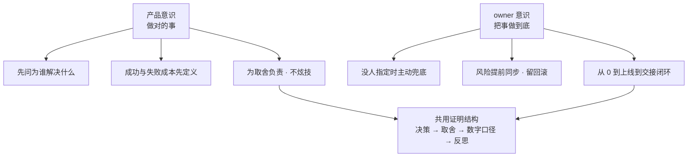

面试官问这两个词，真正想确认的是：**你能不能从「被分配任务」走到「对结果负责」**。形容词一律无效，只有**决策点**有效。本篇把这套答法落成可以直接练的题库，示例全部沿用 [简历叙事](/interview/hr/narrative) 与 [行为面题库](/interview/hr/behavioral) 里已确认的事实，**不新增任何经历**。

:::tip 与腾讯云「技术产品经理」JD 的直接对应
本篇的「产品意识」正是腾讯云（CSIG）**技术产品经理**（postId `1284317600528245760`）要的核心能力：JD 职责 1「toB 平台产品策划、实现增长与商业化」对应本篇「先定义成功/失败成本」，职责 5「提炼通用需求、判断优先级」对应本篇「做对的事」。你面产品岗时，本篇 Q1/Q13 的「定义误放/误拦指标」就是最有力的产品决策证据；JD 加分项「有一定的编程能力者」你远超。逐条对照见 [岗位 JD 匹配](/interview/hr/jd-matching#岗位-b技术产品经理产品类--产品岗主投)。
:::

## 〇、答题纪律与口径统一（**先读**）

**三层证据**，与 [证据纪律](/interview/) 一致：

| 标记         | 含义                               | 允许表述                       |
| ------------ | ---------------------------------- | ------------------------------ |
| **【项目】** | 本仓库已确认的实习事实、常量、数字 | 「项目里是这么做的，指标是 X」 |
| **【推导】** | 通用方法论、假设情境下的做法       | 「如果当时……我会……」           |
| **【观点】** | 我对概念的理解                     | 「我理解的产品意识是……」       |

**万能证明结构（四步，每题都用）**：一句结论 → **一个具体决策** → 当时有什么别的选项、为什么这么选 → 结果数字（**给口径**）→ 一句反思/边界。

**反例对照**：「我比较有产品 sense、也比较 owner」＝零分；「我把误拦率 17% 留着，是因为宁可多问一句也不让模型乱承诺」＝有决策、有取舍、有数字。

:::warning 三词口径分叉（真实存在，面试前必须统一）
仓库里出现过三组「三个词」：

| 出处                                                          | 三个词                                   | 定位                        |
| ------------------------------------------------------------- | ---------------------------------------- | --------------------------- |
| [行为面 Q6](/interview/hr/behavioral#q6-用两三个词概括自己)   | **结构化、靠谱、长期主义**               | ✅ **正式答案，以此为准**   |
| [行为面 Q5](/interview/hr/behavioral#q5-你的优点和缺点是什么) | 结构化闭环、学习迁移快                   | 优点题用，不是三词题        |
| [练习手册 A-4](/interview/hr/practice)（已修正）              | 原写「结构化闭环、学习迁移快、愿意兜底」 | 曾与 Q6 冲突，已改为指向 Q6 |

**规则**：被问「用三个词形容自己」→ 一律答 Q6 的「结构化、靠谱、长期主义」；只有面试官**专门**问「用三个词概括你的产品/owner 意识」时，才用本篇 Q13 的专场版本，并说明是「就这两个意识而言」。**临场换词会让面试官觉得答案是背了好几套。**
:::

## 一、先把两个词拆开

|                | **产品意识**                   | **owner 意识**                                                                                 |
| -------------- | ------------------------------ | ---------------------------------------------------------------------------------------------- |
| 一句话         | **做对的事**                   | **把事做到底**                                                                                 |
| 面试官怕你     | 只会接需求写代码，不懂为什么做 | 交付完就撒手，边界外不管                                                                       |
| 他真正想听     | 用户/业务/指标/风险/取舍/成本  | 补位/同步/兜底/闭环/交接                                                                       |
| 反例口头禅     | 「功能我做完了」               | 「这块不归我」                                                                                 |
| 该给的证据     | 一次**取舍**                   | 一次**兜底**                                                                                   |
| 对应腾讯价值观 | 用户为本、创造                 | 进取（无功便是过，勇于突破有担当）、协作（[文化价值观](/interview/hr/tencent-culture-values)） |

**两者关系【观点】**：产品意识决定方向，owner 意识决定方向能不能落地；只有 owner 没有产品意识是「把错的事做得很彻底」，只有产品意识没有 owner 是「点评很到位但没人收尾」。

## 二、三段核心口述（**背动作顺序与关键数字，不要逐字背**）

### 产品意识 · 90 秒

> 我不太会说「我很有产品 sense」，我讲一个做过的判断。阿里经营托管 Agent 立项时，团队最担心的不是答不出来，是**答错了导致商家纠纷**。所以我先做了三件和技术无关的事：把**角色**（商家/客服/讲师）、**流程**（哪些步骤必须走）、**数据**（怎么算答得好）、**风险**（哪些错不能犯）问清楚，把成功指标定成**误放率和误拦率**，而不是只看准确率。
>
> 口径定了，架构选择就很自然：查订单/查政策这类必经步骤放进 workflow，agent 只在证据足够后判断，生成前加置信度门控，不够就追问或转人工。结果在淘宝商家端落地，450 道可回答题 `recall@5 98%`、人工核验幻觉率 0.7%、误放率 0%、误拦率 17%。**误拦 17% 是我主动接受的业务代价**——宁可多问一句也不乱承诺。
>
> 我给自己扣分的一点也是产品层面的：早期太钻技术细节，业务指标定义得不够早，有些优化「技术上漂亮、业务上一般」。重来一次，我会在项目开始就把成功指标、baseline 和失败成本定清楚。所以我理解的产品意识不是提需求，是**动手前先定义什么叫做成、什么叫不能错**。

### owner 意识 · 90 秒

> 我理解的 owner 不是头衔，是**没人指定时谁来兜底**。三个层面：
>
> **从 0 设计**——置信度门控的三信号加权、追问、转人工是我设计并落地的；`yukino-code` 整个从 0 设计，5 层架构、权限沙箱、Agent Team 通信，没有 leader 给方案。
> **边界外补位**——腾讯类组件迁移第一版踩了闭包过期值和请求竞态，我没有只改完自己那几个组件，而是把生命周期映射、竞态处理、state 拆分写成规范，后面批量迁移都按它来；监控 SDK 也把录屏、白屏检测拆成插件和按需加载入口来控体积。
> **对结果和风险负责**——JSError 自动修复是跨团队链路，我做的是让前端监控、Agent、CI 三边对「什么算修复成功」有共同标准；内存泄漏那次先分诊 RSS/heapUsed 口径、用进程池隔离先兜住线上再定位；离开阿里时把文档、代码和 owner 交接清楚。
>
> 我不会说「这块不归我」，但也不越权替别人做决定：**边界内的结果我兜底，边界外的风险我提前同步**。

### 30 秒「三个词」合并版（**仅限专场提问，见〇节规则**）

> 就产品意识和 owner 意识而言，我会用三个词：**定口径、能取舍、愿意兜底**。定口径是内存泄漏先分诊 RSS/heapUsed 再上 Valgrind、经营托管 Agent 先定误放/误拦再谈架构；能取舍是门控宁可误拦 17%；愿意兜底是跨团队链路里主动去对齐「什么算修复成功」。

## 三、16 题 QA

### Q1. 你怎么理解「产品意识」？

**结论**：工程师的产品意识不是提需求，是**在动手前定义「什么叫做成、什么叫不能错」**。

> 我把它拆成三问：为谁解决什么问题、成功用什么指标衡量、什么错误不可接受。第三问最容易被跳过，但往往决定架构。做经营托管 Agent 时，如果只盯准确率，最省事的做法是让模型自由回答；但把「错误承诺会引发商家纠纷」写进约束后，就必须把查订单/查政策做成必经步骤、生成前加门控。**产品意识不是多一个功能，是先给技术方案划出不可越过的线。**

**采分点**：三问结构 + 一个由约束推导出架构的例子。**雷区**：「我懂用户需求」「我会用竞品」「我常和产品经理沟通」。

### Q2. 讲一个最能体现产品意识的决定

用**第二节产品意识 90 秒**完整作答。追问「为什么不用准确率」：「准确率回答不了『答错了代价多大』；误放率和误拦率才能把业务风险变成可调的阈值，也让我们能明确选择『宁可误拦』。」

**雷区**：把「0% 误放」说成模型不会错——那是**门控后的结果**，不是模型能力。

### Q3. 你怎么理解 owner 意识？和「责任心」有什么区别？

> 【观点】责任心偏态度（答应了就做到），owner 意识偏**边界**：当一件事没有明确归属、或者跨了几个人的边界时，谁把它接起来、对齐标准、跟到收尾。JSError 自动修复那条链路上，前端监控、Agent、CI 各管一段，没人天然负责「什么算修复成功」；我做的就是把这条链路串起来、定义共同标准。**owner 不是把别人的活抢过来，是把没人管的那一段管起来。**

**采分点**：区分态度与边界 + 给一个「无主地带」的例子。

### Q4. 举个没人要求你做、但你主动做了的事

用**行为面 Q11** 的既有答案（迁移规范、监控 SDK 插件化、开源 PR、`content/docs/` 复盘）。收口改成 owner 视角：「共同点是**把一次性的踩坑变成团队可复用的产出**，而不是我多加了几个小时的班。」

### Q5. 「这些架构是不是 leader 设计好你照着做的？」

用 [压力点 13](/interview/hr/pressure) 的既有答案（区分「执行的」和「设计的」，点名置信度门控 + `yukino-code` 从 0 设计）。**雷区**：「都是 leader 设计的」（坐实没设计能力）、「全是我设计的」（不可信）。

### Q6. 产品意识和产品经理的工作有什么区别？

> 产品经理定「做什么、为什么值得做」，工程师的产品意识是**在既定约束内做取舍并对结果负责**。我不越权替产品定需求，但我负责把模糊目标翻译成可测的验收口径：哪些步骤必须走、什么情况必须转人工、什么指标算上线成功、失败成本多大。经营托管 Agent 里我定义的是模块的误放/误拦和门控策略，不是产品方向。

**采分点**：边界清晰、不抢产品经理的活、给具体的「验收口径」例子。

### Q7. 如果产品要的功能你觉得没价值，怎么办？

> 先澄清「这个功能想改善哪个指标、现在的 baseline 是多少」——很多分歧其实是没有共同口径。然后用 [行为面 Q4](/interview/hr/behavioral#q4-和领导或导师出现分歧怎么办) 的方法：把「失败成本 + 可测指标」摆出来，把争论变成小范围实验或对照。**如果结论仍不是我的方案，我先把风险和验证指标讲清楚，然后执行，并在小范围保留对照，等数据出来再复盘**；不会阳奉阴违，也不会因为坚持己见耽误上线。

### Q8. 你说对结果负责，那结果不好时呢？

用 [行为面 Q12](/interview/hr/behavioral#q12-如果给你的实习打分) 的扣分反思 + [Q3 失败](/interview/hr/behavioral#q3-讲一次失败或踩坑)：「早期业务指标定义得不够早，有些优化技术漂亮但业务一般；评测设计还可以更严谨。」**不推给团队、时间或需求变更**，并给改进动作（项目开始就定成功指标、baseline、失败成本）。

### Q9. 实习生能 owner 到什么程度？（**边界题**）

> 我不越权定方向，也不替别人做决定。但在**自己的模块**里，我会端到端负责：口径和指标、实现、上线与告警、异常回滚、文档和交接。跨出模块的部分我做三件事——把风险提前同步、把接口和标准对齐、把「谁来决定」说清楚。腾讯内存泄漏那次，我先分诊、再用进程池隔离兜住线上，同时把进展同步给团队，就是「边界内兜底、边界外同步」。

**采分点**：诚实边界 + 具体负责范围。**雷区**：「我什么都会管」；「我只是实习生，做好分配的事就行」。

### Q10. 有没有为了业务放弃过更漂亮的技术方案？

> 有，而且我认为这是常态。① **不先做「通用 Agent」再找场景**——先找哪一步最痛、哪一步可测，只覆盖高频意图再扩；② 置信度门控**保留 17% 误拦**——技术上可以调得更激进让指标好看，但业务上宁可多问一句；③ A2UI 链路做服务端重试 + 客户端降级，而不是追求一次生成永远成功。判断标准一直一样：**技术方案的优劣要在业务约束里评，不是在真空里评。**

### Q11. 你定义过最「产品」的一个指标是什么？

> 误放率与误拦率这一对。它们不是模型指标，是**业务风险指标**：误放＝放过了不该放过的回答，可能引发商家纠纷；误拦＝把本可以回答的问题挡住，损失体验。把两者分开，才第一次让「模型不确定性」变成可调的产品策略——我们选择误放 0%、接受误拦 17%，并明确下一步是优化追问策略把误拦降下来。**一个好指标要能暴露取舍，而不是只报一个好看的数。**

**采分点**：给口径、给分子分母含义、说明取舍。量化口径见 [指标口径与基线定义](/interview/metrics-baseline)。

### Q12. 跨团队里没人管的事，你怎么处理？

用 [行为面 Q9](/interview/hr/behavioral#q9-讲一次跨团队合作)：先跑通一条最小链路（一个真实 JSError → 反解 → 修复任务 → 分支 → MR），让每个团队看到自己的输入输出，再对齐「什么算修复成功」。**采分点**：讲清「我协调了什么」，不是「我们团队做了什么」，也不是「我指挥了所有人」。

### Q13. 用三个词形容自己

**先按〇节规则回到 [行为面 Q6](/interview/hr/behavioral#q6-用两三个词概括自己) 的「结构化、靠谱、长期主义」**，不要临场换词。只有面试官明确限定「就产品意识/owner 意识而言」时，才用第二节的专场版（定口径、能取舍、愿意兜底）。

### Q14. 你更像执行者还是 owner？

> 【观点】在别人的方案里我是可靠执行者，在自己负责的模块里我是 owner。我不觉得这两个身份冲突：把分配的事做扎实是前提，在此之上才谈补位。我给自己实习打 8 分，扣的两分不是执行不够，是**业务指标定义得太晚**——也就是说我更想补的是「往前一步定义问题」，而不是「把别人定义好的事做得更用力」。

**采分点**：与 Q12 打分答案一致、有反思。**雷区**：「我天生就是 owner」；贬低执行。

### Q15. 上线后出问题时，你的第一反应是什么？

> 先止损再定位，且**同步**优先于「自己查完再说」：能回滚/关开关就先回滚，把影响面和当前判断同步给相关人，再定位根因、补回归用例、复盘。腾讯内存泄漏那次顺序就是这样——先用进程池隔离兜住线上，同时分诊 RSS 与 heapUsed 两条曲线，最后才上 Valgrind 找根因。**只重启不定位，问题会回来；只定位不兜底，影响会扩大。**

### Q16. 「你是不是在背面试话术？」

> 坦白说，这些例子我确实提前梳理过，因为临场容易想不起细节，我不想把做过的事讲乱。但里面每个数字我都能展开口径：误放/误拦怎么算、450 道题从哪来、0.7% 是人工核验的结果、RSS 和 heapUsed 为什么要分开看。您要是对哪一段感兴趣，我们可以直接往下钻——**背的是动作顺序，不是编的结论。**

**采分点**：诚实 + 主动邀请深挖 + 能接住口径追问。**雷区**：「没有，我都是临场想的」；被追问数字时答不出 baseline。

## 四、证据清单（**全部是已有事实，按两类归档，不用新编**）

| 意识  | 证据                                                               | 出处                                                                  |
| ----- | ------------------------------------------------------------------ | --------------------------------------------------------------------- |
| 产品  | 业务风险先行：答错会导致商家纠纷 → 门控与必经步骤                  | [行为面 Q1](/interview/hr/behavioral#q1-你最有成就感的一件事是什么)   |
| 产品  | 熟悉业务的四面：角色/流程/数据/风险；「不先写通用 Agent 再找场景」 | [行为面 Q8](/interview/hr/behavioral#q8-你如何快速熟悉业务)           |
| 产品  | 扣分反思：业务指标定义太晚，部分优化「技术漂亮、业务一般」         | [行为面 Q12](/interview/hr/behavioral#q12-如果给你的实习打分)         |
| 产品  | 用「失败成本 + 可测指标」把架构分歧变成实验                        | [行为面 Q4](/interview/hr/behavioral#q4-和领导或导师出现分歧怎么办)   |
| 产品  | 误放 0% / 误拦 17% 的取舍、500 题五桶评估集                        | [简历素材库](/interview/hr/narrative) 第 1 条                         |
| owner | 职责之外：迁移规范、监控 SDK 插件化、开源 PR、复盘文档             | [行为面 Q11](/interview/hr/behavioral#q11-有没有主动做过职责之外的事) |
| owner | 跨团队：让三边对「什么算修复成功」有共同标准                       | [行为面 Q9](/interview/hr/behavioral#q9-讲一次跨团队合作)             |
| owner | 风险同步 + 留回滚；进程池隔离先兜住线上                            | [行为面 Q10](/interview/hr/behavioral#q10-你如何抗压)                 |
| owner | 从 0 设计：置信度门控 + `yukino-code` 5 层架构                     | [压力点 13](/interview/hr/pressure)                                   |
| owner | 失败后把规范、TDD、小步提交沉淀为团队流程                          | [行为面 Q3](/interview/hr/behavioral#q3-讲一次失败或踩坑)             |
| owner | 离职时把文档、代码、owner 交接清楚                                 | [收尾与背调](/interview/hr/close-and-compensation)                    |
| owner | 缺点里的「先准备 30 秒版本，先讲业务价值」                         | [行为面 Q5/Q6](/interview/hr/behavioral#q5-你的优点和缺点是什么)      |

## 五、速背卡与雷区

**60 秒通用版（被问「你最大的优势」时）**：

> 我不太用形容词形容自己，讲两个决定。一个是**定口径**：做经营托管 Agent 时，先把团队真正怕的「答错引发纠纷」变成误放/误拦两个可测指标，架构才顺势定成 workflow + 门控，最后在淘宝商家端落地，误放 0%、误拦 17%。另一个是**兜底**：迁移踩了竞态之后，我没有只修自己那几个组件，而是写成规范让后面批量迁移都用；跨团队的 JSError 链路里主动去对齐「什么算修复成功」。所以我理解的优势是：**先定义什么叫做成，再把没人管的一段管起来。**

**雷区清单**：

- ❌ 说「我很有产品 sense / 我很 owner」却举不出决策点；把产品意识说成「我懂用户需求」的空话。
- ❌ 把 owner 意识说成「我加了很多班」「我什么都能做」「我天生爱操心」。
- ❌ 抢功：把团队成果说成个人；编「我从 0 定义了产品方向」（实习生不可信，改成「定义了模块的验收口径」）。
- ❌ 数字不给口径；把「误放 0%」说成模型不会错；把 `recall@5 98%`、0.7% 混着用不说明采集位置。
- ❌ 越权姿态：评价产品经理「不懂技术」、说「需求都是拍脑袋」；或反过来显得只等指令。
- ❌ 和 [行为面](/interview/hr/behavioral)、[压力题](/interview/hr/pressure)、[简历叙事](/interview/hr/narrative) 的既有口径不一致；尤其**三个词**临场换版本。
- ❌ 被追问「结果不好时」把原因推给团队、时间或需求变更。

## 六、与已有材料的分工

| 需要                                   | 去哪篇                                                                                 |
| -------------------------------------- | -------------------------------------------------------------------------------------- |
| 完整 STAR 脚本、20 道行为题            | [行为面题库](/interview/hr/behavioral)                                                 |
| 「都是别人设计好的」等压力题           | [压力题与反制](/interview/hr/pressure)                                                 |
| 项目数字口径与 baseline                | [指标口径与基线定义](/interview/metrics-baseline)、[简历叙事](/interview/hr/narrative) |
| 把技术讲成业务价值、行业前景、规划     | [HR 面业务前景与规划](/interview/hr/business-outlook-qa)                               |
| 腾讯文化里的「进取 / 协作」            | [腾讯企业文化与价值观](/interview/hr/tencent-culture-values)                           |
| 分题型练习与追问链                     | [练习手册](/interview/hr/practice)                                                     |
| 本篇对应的理念背景（判断力、混合架构） | [OPC 白皮书面试题库](/interview/qa/opc-whitepaper)                                     |
