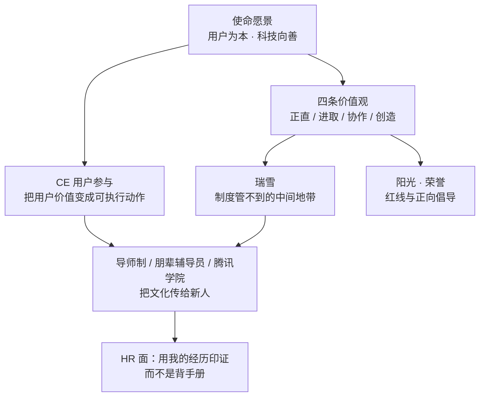

本篇解决 HR 面一个很具体的失分点：**「你了解腾讯文化吗」答成背口号**。腾讯自己给过答案——2019 年文化 3.0 全员邮件写的是「**文化不是写在纸上、挂在墙上的**」「让文化融入我们的血液，成为一种自然的选择」。所以准备顺序是：先记住**官方原文**，再记住**瑞雪 / CE / 导师制这些只有真待过、真查过才知道的具体细节**，最后用自己做过的项目去印证，而不是复述标语。

动机、城市、业务理解、行为面 STAR 已有专篇（索引见文末），本篇只负责**文化、价值观、瑞雪、师生情谊**。

## 〇、证据口径（**先读，这一篇尤其容易踩坑**）

| 标记             | 含义                                                                             | 面试中的允许表述                       |
| ---------------- | -------------------------------------------------------------------------------- | -------------------------------------- |
| **【官方】**     | 腾讯官网、全员邮件原文、ESG 报告、腾讯网自有新闻稿                               | 「官方公布的是……」                     |
| **【内部分享】** | 腾讯 HR / 企业文化负责人的公开演讲、腾讯招聘官方账号文章、《腾讯人力资源管理》等 | 「我看到过腾讯 HR 的公开分享里提到……」 |
| **【媒体】**     | 权威媒体转述、候选人分享                                                         | 「公开报道里提到……」                   |
| **【项目】**     | 本仓库 `content/` 里我自己的实习复盘                                             | 「我在 IEG 实习时……」                  |
| **【观点】**     | 我的理解与推导                                                                   | 「我的理解是……」                       |

:::danger 网上关于「瑞雪」有一批不能引用的二手内容
检索中会发现一类文章把瑞雪写成一套量化制度：「每人每年 12 分瑞雪分」「会议超时扣 1 分」「清风网匿名举报、区块链存证」「瑞雪分 <9 分禁止晋升答辩」「PPT 禁超 10 页」「会议室争论低于 60 分贝」「主管连带扣 30%」等。**这类内容没有官方来源，且与瑞雪的定义直接冲突**——腾讯 HR 的公开分享明确说瑞雪管的是「**不是制度、不是劳动合同里要管理的东西**」，靠氛围同化而不是扣分处罚（见文末来源清单）。把它做成扣分和晋升挂钩，恰好是对这套文化的误读。

**面试里一个字都不要提**；被问到「瑞雪有没有考核」，稳妥答法是：「就我看到的公开资料，它更偏文化引导和同伴提醒，具体内部制度我不了解，也不该替公司下结论。」
:::

**另一个常见口误**：网上有把瑞雪起点写成 2006 年、也有写成 2007 年的（见 Q5）。**口述统一用「2006 年前后」**，不要报一个精确年份去赌。

## 一、官方事实基线：使命愿景与四条价值观

### 1.1 现行表述（**截至 2026-11-08 官网仍是这一版**）

| 项           | 官方原文                                                                                                                     |
| ------------ | ---------------------------------------------------------------------------------------------------------------------------- |
| **使命愿景** | **用户为本，科技向善**                                                                                                       |
| 展开         | 「一切以用户价值为依归，将社会责任融入产品及服务之中；推动科技创新与文化传承，助力各行各业数字升级，促进社会的可持续发展。」 |
| **价值观**   | **正直、进取、协作、创造**                                                                                                   |

四条价值观的官方释义（**2019-11-11 全员邮件原文**，建议逐字记）：

| 价值观   | 全员邮件释义                                                                           | ESG 报告英文释义【官方】                                                            |
| -------- | -------------------------------------------------------------------------------------- | ----------------------------------------------------------------------------------- |
| **正直** | 坚守底线、以德为先，**坦诚公正不唯上**                                                 | uphold principles, ethics, honesty and fairness                                     |
| **进取** | **无功便是过**，勇于突破有担当                                                         | pursue positive contributions, volunteer for responsibility, push for breakthroughs |
| **协作** | **开放协同，持续进化**；对内放大格局、打开边界、以开源心态协同，对外协同伙伴与生态共创 | be inclusive of our community and working together to strive to progress and evolve |
| **创造** | **超越创新，探索未来**；不忽视微创新，但面向未来、通过创造力实现更大社会价值           | push for innovations and explore all possibilities for a better future              |

:::note 三个最容易说错的细节

1. **「正直」是唯一从未改过的关键词**（2005 至今）。被问「哪条最重要」时，答正直并给出理由最稳。
2. 2019 年是「**合作→协作**」「**创新→创造**」，不是新增、也不是把「进取」换掉。说成「正直、进取、合作、创新」是 2005 版，属于**背了旧版**。
3. **动物形象有两版，别混着背**：早期文化用「四大神兽」诠释旧版价值观——长颈鹿（正直）、海燕（进取）、犀牛与犀牛鸟（合作）、鹦鹉螺（创新）【内部分享】；2019 升级后，官方 ESG 报告记载全员投票选出**蜜蜂象征协作、海豚象征创造**【官方】。面试说一句「文化载体也在跟着价值观迭代」即可，不要报六个动物。
   :::

### 1.2 文化 1.0 → 3.0 演进（**一条时间线看穿「为什么是这八个字」**）

| 时间           | 版本         | 使命 / 愿景 / 价值观                                                                                       | 背景                                                                   |
| -------------- | ------------ | ---------------------------------------------------------------------------------------------------------- | ---------------------------------------------------------------------- |
| 1998-11        | —            | 公司成立                                                                                                   | —                                                                      |
| **2003**       | 文化 1.0     | 使命含「用户依赖的朋友、**快乐活力的大学**」等；愿景「创一流的互联网企业」                                 | 首次正式发布                                                           |
| **2005**       | 文化 2.0     | 使命「通过互联网服务提升人类生活品质」；愿景「**最受尊敬的互联网企业**」；价值观「正直、尽责、合作、创新」 | 同年腾讯网新闻稿提出「**视员工为第一财富**」「以做人之道引领做事之道」 |
| **2011**       | 2.x          | 「尽责」→「**进取**」                                                                                      | 开放战略，合作的内涵从跨部门转向产业链协同                             |
| **2018-09-30** | 930 变革     | 「扎根消费互联网，拥抱产业互联网」，成立 PCG 与 **CSIG**                                                   | 文化升级的前置背景                                                     |
| **2019-11-11** | **文化 3.0** | 使命愿景「**用户为本，科技向善**」；价值观「正直、进取、协作、创造」                                       | 21 周年，Pony、Martin 及全体总办全员邮件                               |
| **2025**       | AI 时代延伸  | SSV 年度报告：「『用户为本，科技向善』在 AI 时代的实现方式就是『**以人为本，AI 向善**』」                  | 不是替换使命愿景，是**实现方式**                                       |
| 2026           | 沿用         | 官网、ESG 页仍为「Value for Users, Tech for Good」                                                         | 未见新版本                                                             |

**两条生命线**（全员邮件原话）：「一条叫**用户**，一条叫**责任**」。这句话是理解全部文化的钥匙——「用户为本」对应用户，「科技向善」对应责任；前者是 2005 年「一切以用户价值为依归」的传承，后者是 21 年后公司规模带来的新要求。

:::tip 一个很新的加分点（对 Agent 岗位尤其合适）
腾讯 SSV 2025 年度报告提出「**以人为本，AI 向善**」，并解释「技术平权」：AI 不只服务效率，也服务公平；让更多人使用、改造、反馈 AI，才会形成持续进化的上升螺旋。**它是「科技向善」在 AI 时代的实现方式，不是新使命愿景**——说错成「腾讯改了价值观」会扣分。做 Agent 的人讲这句，比空谈「AI 改变世界」贴得多（见 Q3）。
:::

### 1.3 CE：把「用户为本」变成动作的内部黑话

**【官方 + 内部分享】** 2019 全员邮件原文：「21 年来，无论是对业务影响深远的『**CE**』、对员工言行举止影响广泛的『**瑞雪**』，还是『一切以用户价值为依归』的理念，腾讯文化都贯穿始终。」——**CE 和瑞雪是同一句里被点名的两个文化符号**，这是它们不是网传段子的硬证据。

- CE = **Customer Engagement（用户参与 / 用户调研）**，由腾讯首席探索官网大为（David Wallerstein）在内部普及，通过见客户、小组座谈、数据分析理解用户需求；他在 2016 年采访中说「大概 10 年前开始普及」【官方媒体采访】。
- 腾讯网 2025 年的文章称 CE 是「最能代表腾讯用户思维、也是公司内部流传度最广的黑话」，做产品前「CE 一下」是下意识的习惯。
- **面试价值**：说「我理解用户为本不只是口号，腾讯内部有 CE 这种把用户拉进产品过程的机制」，比背使命愿景更像做过功课。

**气质的具体证据**【内部分享，2015 腾讯 HR 高管演讲】：内部 BBS / 乐问「只要不违反法规就不删帖」，有员工发截图吐槽财付通体验差，马化腾回帖「财付通是很烂」；总办面对面、腾讯电视台、文化衫「同衣同心」；「务实、低调、透明、平等」是员工对文化的普遍描述。这些**细节比形容词可信**，Q1 里挑一个用就够。

### 1.4 CSIG 与腾讯云：产业互联网的文化落点（**面腾讯云必读**）

**【官方】** 2018-09-30 的「930 变革」里，腾讯把使命愿景升级为「用户为本，科技向善」，同时新成立 **CSIG（云与智慧产业事业群）**，战略口号是「**扎根消费互联网，拥抱产业互联网**」。也就是说，**腾讯云从成立那天起，就是腾讯「科技向善」往 B 端落的那条腿**——不是把 C 端产品卖给企业，而是用技术帮产业数字化。

- **面试价值**：面腾讯云「技术与产品方向」时，把文化讲到这一层最加分——「我理解 CSIG 是腾讯把『科技向善』落到产业侧的事业群，做的是让企业用好云和 AI 的事；这和我想做的 Agent 工程化方向一致，因为 toB 场景对『可靠、可审计』的要求最高，正好是科技向善的具体化。」
- **四条价值观在 toB 场景的翻译**：**正直**＝对客户不夸大能力、数据口径诚实（对应你的「误放率 0% 要给口径」）；**进取**＝toB 交付压力大、要扛住上线与故障（对应你的 native 泄漏排查）；**协作**＝云产品是「被集成」的，要跟销售/交付/客户多方配合（对应你的跨团队 JSError 链路）；**创造**＝把 AI 做成客户愿意付费的新产品（对应你的 workflow + agent 混合架构）。
- **雷区**：别把 CSIG 说成「卖服务器的」；别把「拥抱产业互联网」当成和己无关的口号——它正是你投的「技术与产品方向」的存在理由。

## 二、瑞雪精神：制度管不到的那一层

### 2.1 它到底是什么

**一句话定义**【内部分享】：在「好」与「不好」之间有一片**制度管不到、劳动合同里写不进去、却极大影响组织气氛**的中间地带，腾讯把它叫「瑞雪」——用**氛围同化**和同伴提醒，而不是用处罚去管那些小事。

**命名**：取「**瑞雪兆丰年**」——雪后大地洁白一片，把不好的行为去掉；另有「瑞雪冻死细菌害虫、弃恶扬善」的说法【媒体 / 内部分享】。腾讯 HR 负责人奚丹的表述是：「**瑞雪关注的是小行为**，但腾讯希望用好的氛围同化大家，至少在公司的环境里相互信任相互尊重。」

**行为清单**（多来源交叉一致，可放心举例）：

| 类别     | 具体行为                                                                    |
| -------- | --------------------------------------------------------------------------- |
| 秩序     | 班车、电梯、食堂自觉排队；电梯「先出后进」、不逆乘；不占座；不占两个车位    |
| 公共空间 | 不在班车吃东西、不在公共区域/厕所抽烟、用完会议室不占用、开会不迟到、冲厕所 |
| 效率     | **「瑞雪会议」**：减少无聊冗长的会议（2012-04 内部发布《瑞雪会议公约》）    |
| 职业化   | 不泄漏内部信息（2010 年 Pony 重申瑞雪精神时的重点）                         |

**语言现象**（很值得讲）：腾讯人会说「**你真瑞雪**」「**这不瑞雪**」。HR 分享里的解释很妙——中国人不好当面撕破脸说谁不对，用「不瑞雪」就委婉得多，既点了问题又保住体面。这是**柔性约束能跑起来的关键机制**，不是靠罚。

**民间故事**：荒岛生存拓展、每人只有一碗粥时大家仍自觉排队；「瑞雪使者」戴袖标在电梯口请大家排队【内部分享 / 媒体】。故事的意义是「文化内化成了习惯」，讲一个就够，别讲成段子合集。

### 2.2 阳光 / 瑞雪 / 荣誉：三层不要混

| 品牌     | 管什么                         | 手段                         | 例子                           |
| -------- | ------------------------------ | ---------------------------- | ------------------------------ |
| **阳光** | **红线、零容忍**               | 制度与处罚，阳光行为准则     | 贪污、舞弊等违法违规           |
| **瑞雪** | **中间地带、不文明与不职业化** | 文化引导、同伴提醒、氛围同化 | 占座、逆乘电梯、抽烟、冗长会议 |
| **荣誉** | **正向倡导**                   | 表彰、故事传播               | 公司鼓励的行为、年度文化故事   |

**关键区分**：阳光是硬的，瑞雪是软的。**把瑞雪说成「腾讯的罚款/扣分制度」是最常见的外行错误**（也正好是那批不可信二手文的错法）。

### 2.3 时间线与官方背书

| 时间           | 事件                                                                                                                                                                      | 来源等级                                      |
| -------------- | ------------------------------------------------------------------------------------------------------------------------------------------------------------------------- | --------------------------------------------- |
| 2006 年前后    | 组织快速膨胀，出现圣诞晚会乱丢荧光棒、班车插队、饭堂占座、电梯逆行、公共区域吸烟；Pony 发邮件号召「做受尊敬的腾讯人」，「瑞雪行动」启动，最初从杜绝逆乘电梯、文明排队做起 | 媒体 / 内部分享（**年份有 2006、2007 两说**） |
| 2009           | 上线《行在腾讯，正直为本》课程                                                                                                                                            | 百科词条（二手）                              |
| 2010-08        | 员工破万，出现内部信息外泄，Pony 呼吁「重温瑞雪精神，对不文明、不职业化的行为说不」                                                                                       | 百科词条（二手）                              |
| 2012-04        | 《瑞雪会议公约》内部发布，主题转向组织效率                                                                                                                                | 百科词条（二手）                              |
| **2019-11-11** | **文化 3.0 全员邮件把「对员工言行举止影响广泛的『瑞雪』」与 CE 并列写进正文**                                                                                             | **【官方】最高等级证据**                      |
| 延续           | 瑞雪从文明礼仪延伸到会议效率、职业化与信息安全                                                                                                                            | 内部分享                                      |

:::note 为什么这件事对面试有用
**瑞雪是腾讯官方全员邮件点名过的文化符号，却几乎不在对外宣传里**。HR 问「你了解腾讯文化吗」，能说出「用户为本科技向善 + 四条价值观」是及格；能补一句「还知道 CE 和瑞雪，瑞雪管的是制度之外的中间地带」才是「做过功课」。但**点到为止**，不要装作内部人、不要讲没核实过的内部制度。
:::

## 三、导师制与师生情谊：文化是怎么传给新人的

### 3.1 公开可查的培养机制

| 机制                  | 内容                                                                                                                                             | 来源                                          |
| --------------------- | ------------------------------------------------------------------------------------------------------------------------------------------------ | --------------------------------------------- |
| **一对一导师带教**    | 2026 实习生招聘官方口径：为实习生安排一对一导师，「让实习生真正接触并参与到一线业务中，短时间内就可以看到自己的工作成果落地」                    | 【媒体引腾讯招聘】中国新闻周刊 2026-03-06     |
| **导师具体做什么**    | 设晨会让新人汇报进展与下一步计划、帮把握方向与优先级；问「问题没解决的原因」；缺资源时**对接相关接口人**；帮新人完成「从学生到职场人」的身份转变 | 【腾讯招聘官方账号】TEG「求职笔记」人才培养篇 |
| **导师的带法**        | 给新人「一定范围的发展空间」：让其承担项目某个模块；做难模块时带新人一起讨论，用「**我是这么想的，你呢？**」鼓励发表观点，有好观点及时正反馈     | 同上                                          |
| **朋辈辅导员**        | TEG 邀请毕业两年内的优秀校招生担任，新人「有些顾虑更愿意问同龄人」，既成就他人也完成自我身份转变                                                 | 同上                                          |
| **学习资源**          | 腾讯学堂 / 技术分享 / 行家分享；校招封闭培训（约一周，自媒体口径，标注）、内部「活水」转岗平台                                                   | 官网 ESG 页提到腾讯学堂课程数；其余【媒体】   |
| **腾讯学院 / 大师兄** | 创始人之一张志东卸任 CTO 后在腾讯学院（荣誉院长），被称为「**大师兄**」，关心文化传承与员工发展，教师节等场合被邀请讲腾讯老故事                  | 【内部分享】2015 腾讯 HR 高管演讲             |

**最打动人的一句是导师自述**【腾讯招聘官方账号】：「我记得自己作为毕业生进入公司时的经历和感受，所以当我做导师时，会设身处地为新人着想。」——**被带过的人，再去带人**，这就是「师生情谊」的实际含义：不是行政指定的汇报关系，是经验与信任的传递。

**校招生的一句话**（中国新闻周刊引 2D 角色设计岗校招生文彬）：「**第一份工作不是选光环，而是选土壤**，关键是找到能让自己『开花』的环境。愿意带你的导师、自己喜欢的项目、可以持续学习的环境，都让自己受益匪浅。」

### 3.2 为什么腾讯愿意这么投入

- **文化 1.0 里就写着「快乐活力的大学」**【官方】——校园般的氛围不是后来包装的，是 2003 年写在使命里的。
- 2005 年腾讯网新闻稿：奚丹提出「**视员工为第一财富**」「关心员工成长、强化执行能力、追求高效和谐、平衡激励约束」【官方】。
- 2026 实习生招聘，腾讯招聘负责人刘一峰：「**将校招实习生作为未来核心力量培养**，不仅提供充足的当下回报，更为实习生提供长期的投入」【媒体引述】。
- **【观点】** 这跟我在业务面那套判断是同一条逻辑：Agent 这类复杂链路，稳定性、可观测、故障定位这些能力很难靠文档速成，靠人带人、靠复盘传承。所以「愿意投入导师制」对我不是福利项，是**能不能长期长出来的土壤**。

:::warning 别把公开资料讲成自己的经历
我在腾讯 IEG 实习过是**项目事实**（TcaplusDB 管理端、连接池、native 内存、前端监控、内存泄漏定位闭环，见 [简历叙事](/interview/hr/narrative)）；但「我的 mentor 具体怎么带我」**必须按真实情况讲**，不要套用上面 TEG 那篇文章的细节。没有可讲的细节时，用：「我实习时感受到的是团队对稳定性和可观测性要求很高，遇到问题导师会让我先把现象和证据讲清楚，这个习惯我一直保留」这类**真实、可追问**的表述。
:::

## 四、HR 面 15 题（口述版 + 采分点 + 雷区）

### Q1. 你怎么理解腾讯的企业文化？

> 我不只想说八个字。腾讯 2019 年 21 周年时把使命愿景更新为「用户为本，科技向善」，价值观是「正直、进取、协作、创造」；再往前，2005 年版是「正直、尽责、合作、创新」，正直是唯一没改过的词。我理解它有两条生命线：**用户**和**责任**。用户这条线落到内部有个很具体的做法叫 CE，就是用户参与、用户调研，做产品前先「CE 一下」；责任这条线在 AI 时代的延伸，我看到官方报告里提的是「以人为本，AI 向善」。还有一点我很认同，全员邮件里写「文化不是写在纸上、挂在墙上的」——所以我会更看重它怎么落到日常，比如瑞雪和导师制。

**采分点：** 有原文、有演进、有具体机制、有一句自己的理解。**雷区：** 只背八个字；把「科技向善」说成公益口号；说「腾讯文化就是氛围好、福利好」。

### Q2. 四条价值观里，哪条和你最契合？

> **正直**。因为我做过的事里，最花心思的不是把结果做漂亮，是把口径说清楚。阿里经营托管 Agent 我报的 `recall@5 98%`、幻觉率 0.7%、置信度门控误放率 0%、误拦率 17%，误拦 17% 是个不好看的数字，但它是真实的边界，我不会把它藏起来；我也不会把团队成果说成自己一个人做的。官方对正直的解释是「坚守底线、以德为先、坦诚公正不唯上」，我理解在 engineer 身上就是**数据诚实、敢讲边界、不唯上**。

**采分点：** 选一条 + 引官方释义 + 用自己的项目数字落地。**雷区：** 「四条我都符合」；只讲性格（「我比较老实」）不给事例。

### Q3. 你怎么理解「科技向善」？AI 时代呢？

> 我的理解是「**科技是一种能力，向善是一种选择**」——这是全员邮件里的原话。腾讯规模到了这个量级，能力越大，「有所不为、有所必为」就越重要，从早期的未成年人保护、99 公益日，到把社会责任写进产品。对我做 Agent 的人来说更具体：Agent 能执行动作、能碰到业务数据，所以**可审计、可回滚、human-in-the-loop** 不是附加项，是「向善」在工程上的兑现；我在阿里做经营托管 Agent 时把高风险动作留给人确认、生成前加置信度门控，就是这个思路。另外我注意到腾讯 SSV 2025 年度报告里提到「以人为本，AI 向善」，说的是 AI 时代的实现方式，还讲了技术平权——让更多普通人用得上、反馈得了 AI。**注意这是实现方式，不是新的使命愿景。**

**采分点：** 官方原话 + 落到自己业务 + 新口径且说清边界。**雷区：** 空谈公益；把「以人为本，AI 向善」说成腾讯换了价值观。

### Q4. 你知道「瑞雪」吗？（**本篇最重要的一题**）

> 知道一些，我按公开资料说。瑞雪取「瑞雪兆丰年」，管的是**制度管不到、但影响组织气氛的中间地带**：自觉排队、不占座、不逆乘电梯、开会不迟到、不占用会议室，后来也延伸到减少冗长会议的「瑞雪会议」和信息安全。腾讯 HR 的公开分享里讲，它不靠扣分处罚，靠氛围同化和同伴提醒，大家会说「你真瑞雪」「这不瑞雪」，用比较委婉的方式提醒人。它和「阳光」「荣誉」是三个不同层次：阳光管红线和处罚，荣誉倡导正向行为，瑞雪管中间那片灰度。**2019 年文化 3.0 的全员邮件里，瑞雪和 CE 被一起点名，说这些年来腾讯文化贯穿始终**——这点我印象很深，说明它不是段子，是被正式承认的文化符号。具体的内部制度我不了解，就不多说了。

**采分点：** 定义准确 + 行为例子 + 三层次 + 官方背书 + **主动划清「我不了解内部制度」的边界**。**雷区：** 背网上那套「12 分扣分制 / 晋升一票否决」；装作内部人；把瑞雪说成罚款制度；说「没听过」。

### Q5. 排队、占座这种小事，值得一家公司专门做文化吗？

> 我觉得值得，而且越是规模大的组织越值得。第一，**小事是信任的成本**：班车插队、会议室占用、开会迟到，单次看都很小，但积累起来会让人觉得「这里不讲规矩」，互相尊重的成本就上去了。第二，**制度管不到**：这些写不进劳动合同，硬要写就会变成一堆罚则，反而更僵；用氛围和同伴提醒，成本更低、也更持久。第三，它其实是「**最受尊敬的互联网企业**」这个老愿景在内部的落地——官方当年的说法是，要获得外界尊敬，先要在内部获得所有腾讯人的尊敬。我做工程也有类似体会：线上稳定性不是靠某次大重构，是靠每次把日志、监控、释放资源这些小事做对。

**采分点：** 三层递进 + 引官方「内部获得尊敬」的表述 + 用自己的工程习惯类比。**雷区：** 「小题大做」「靠制度罚就行」。

### Q6. 为什么「正直」是唯一没改过的价值观？

> 【观点】因为其他三条都在回答「怎么把事做大」，正直回答的是「**做事的底线**」，底线不该随战略变。2005 年是「正直、尽责、合作、创新」，2011 年开放战略把「尽责」换成「进取」，2019 年 930 变革之后把「合作、创新」升级成「协作、创造」——每次都是战略变了，做事方式跟着变；但「坦诚公正不唯上」这种要求，在 1800 人的公司和 4 万人的公司里都一样，人越多反而越不能松。

**采分点：** 把价值观演进和 2011 / 2018–2019 的战略变化对上。**雷区：** 「因为正直最重要」却不给理由；说错年份和版本。

### Q7. 你期待什么样的 mentor？平时怎么和 mentor 交流？

> 我期待的是**愿意给空间、也愿意给反馈**的导师。我看到腾讯招聘公开的 TEG 导师分享里，导师会设晨会让新人讲进展和下一步、帮看方向和优先级，缺资源时帮忙对接接口人；做难模块时带新人一起讨论，会问「我是这么想的，你呢？」。这种「不替你做决定，但帮你把方向校准」的方式我很喜欢。我自己交流的习惯是**带着证据和方案去问**：先说现象、我已经排除了什么、我倾向哪个方案和为什么，而不是空问「这个怎么办」；问完会同步结论和后续动作，不让同一个问题问第二遍。[真实经历部分按实际情况补，见第三节的提醒]

**采分点：** 有公开资料依据 + 有自己的可验证习惯 + 不编经历。**雷区：** 「希望导师手把手教」；「我一般不麻烦别人」；把公开文章里的细节说成自己经历过。

### Q8. 为什么腾讯愿意给实习生配导师、而不是直接要产出？

> 【观点】因为复杂能力传不动，只能带着长。Agent、稳定性、可观测这类东西，文档能写清楚「是什么」，写不清楚「当时为什么这么判断」；导师制、朋辈辅导员、腾讯学堂、技术分享，传的其实是这部分。腾讯招聘公开的说法是「**把校招实习生作为未来核心力量培养**」，给的是长期投入而不是短期产出——这跟 2005 年「视员工为第一财富」、文化 1.0 里「快乐活力的大学」是一条线。对我来说，这也是我判断第一份工作的标准：**不是选光环，是选土壤**。

**采分点：** 引官方口径 + 解释机制 + 落到自己的选择标准。**雷区：** 把导师制讲成福利（「有人带比较轻松」）。

### Q9. 你和导师/leader 有分歧怎么办？

**去 [行为面 Q4](/interview/hr/behavioral#q4-和领导或导师出现分歧怎么办) 用既有 STAR 答案**（workflow vs 纯 agent 的架构分歧）。**补一句文化口径**：腾讯对正直的解释里有「坦诚公正不唯上」，所以我会把证据和取舍摆到台面上讲清楚，而不是表面同意、背后按自己那套做；如果结论最后不是我的方案，我会把决策和理由记下来，执行到底。

**雷区：** 「我一般听领导的」「我会坚持到他同意」；另编一个和既有材料不一致的分歧故事。

### Q10. 腾讯文化里最打动你的是哪一点？

> 是「**文化不是写在纸上、挂在墙上的，是大家的事**」这句话，以及它背后的具体做法。比如瑞雪用同伴提醒而不是罚则，比如文化故事会被整理成册、创始人「大师兄」在教师节回去讲老故事，比如内部论坛可以公开吐槽产品、老板会回帖。这些事都不大，但说明文化是被**当产品一样运营**的——有用、有趣、有参与感，员工才会真的认。我在腾讯 IEG 实习时感受到的也是这种务实：不怎么喊口号，但对稳定性和可观测性的要求一点不含糊。

**采分点：** 引原文 + 两三个具体细节 + 自己的实习感受。**雷区：** 「福利好」「氛围轻松」。

### Q11. 你说文化要落地，那在你自己的工作里怎么落地？

> 三条可检查的：① **用户为本**——先把用户/商家会遇到什么、答错了代价是什么想清楚，再谈模型；阿里那版经营托管 Agent 里，误放率 0%、误拦率 17% 就是「宁可多问一句也不乱承诺」的选择。② **协作**——跨团队链路把接口、日志、责任边界先对齐，我在腾讯做过 JSError 自动修复的跨团队链路，在阿里做 workflow 与 agent 的分工也是这个思路。③ **正直**——量化结论给口径、不把推导讲成已落地。**我不太会说「我很有腾讯味儿」，我更愿意让这些做法自己说话。**

**采分点：** 每条价值观配一个可追问的项目事实。**雷区：** 空喊认同；编没做过的项目。

### Q12. 如果同事做了「不瑞雪」的事，你会怎么处理？

> 先看是不是红线：涉及合规、舞弊、数据安全的，走正式渠道，那是「阳光」的范围，不是靠提醒。如果只是中间地带的小事，我会**私下、就事论事**地提醒一句，不带评价人；瑞雪本来就是「不撕破脸」的委婉表达，用公开点名的方式反而违背它的意思。再往上，如果是流程导致的（比如会议室总被占是因为预约机制不好），我会去改机制而不是反复提醒人——这和瑞雪后来衍生出「瑞雪会议」去解决冗长会议是一个思路。

**采分点：** 先分层（阳光 vs 瑞雪）+ 方式符合文化 + 想到机制改进。**雷区：** 「我会举报/扣分」；「我会当场指出」；「这不归我管」。

### Q13. 你为什么觉得自己适合腾讯文化？

> 我在腾讯 IEG 实习过，不是从招聘页上了解这里的：做 TcaplusDB 管理端、连接池、native 内存和前端监控，印象最深的是一次内存泄漏的定位闭环——大家对「把证据摆清楚、把根因找到」的要求很高，这种务实和透明我很适应。后来在阿里做经营托管 Agent，我把不确定的模型放进确定的业务约束里，用置信度门控守住「不乱承诺」；在字节做采集和数据链路，练的是怎么测量。三段串起来是「**测量 → 稳定 → 自动化**」，和「用户为本 + 正直 + 协作」这几条能对上。所以我不是想「适应一种新文化」，是想回到一个我已经知道怎么做事的地方。

**采分点：** 与 [为什么腾讯](/interview/hr/motivation#为什么腾讯) 的既有口径完全一致 + 有 IEG 独有细节。**雷区：** 另编一套动机；贬低前东家；「我什么文化都能适应」。

### Q14. 反问环节问什么？

- 「团队对新人的培养路径大概是怎样的？有没有导师制、轮岗或内部技术分享？」——既有材料见 [收尾与背调](/interview/hr/close-and-compensation#到岗时间与提前实习)。
- 「校招生/新人前半年，团队最希望他先补上的能力是什么？」
- 「团队内部做技术复盘和分享的节奏是怎样的？」
- **不要问**「瑞雪分怎么扣」「转正率多少」「加班多不多」这类把文化当制度或显得功利的问题。

### Q15. 「这些是不是你为了面试背的？」

> 坦白说，使命愿景和四条价值观确实是查资料记的，我不想装成早就背得滚瓜烂熟。但瑞雪、CE 和导师制我是带着问题去看的：我想知道这家公司**怎么把口号变成日常动作**，也想知道新人进来会被怎么带。看完之后的判断是，这些做法和我自己在 IEG 感受到的务实、对证据和稳定性的要求是吻合的。所以我记的是事实，认同的是我验证过的部分。

**采分点：** 诚实 + 说清「查了什么、为什么查、验证了什么」。**雷区：** 硬说「我早就很了解」；反问 HR「这也要考？」；把二手杜撰内容当「查到的资料」讲出来。

## 五、价值观 × 我的经历映射表（**背这张表，不要背口号**）

| 官方词条                         | 我的可追问事实【项目】                                                   | 口述一句话                                                 |
| -------------------------------- | ------------------------------------------------------------------------ | ---------------------------------------------------------- |
| **用户为本**                     | 阿里妈妈经营托管 Agent 面向商家经营问题；置信度门控误放率 0%、误拦率 17% | 「宁可多问一句、多转一次人工，也不让模型乱承诺」           |
| **科技向善 / 以人为本，AI 向善** | workflow 把查订单/查政策设为必经步骤，生成前门控、可追问可转人工         | 「Agent 能执行动作之后，可审计、可回滚就是向善的工程兑现」 |
| **正直**                         | 数字给口径、不藏 17% 误拦、不把团队成果说成个人成果                      | 「坦诚公正不唯上，在 engineer 身上首先是数据诚实」         |
| **进取**                         | IEG native 内存泄漏的定位闭环；主动补 K8s / 可观测短板                   | 「无功便是过，我更愿意把问题追到根因」                     |
| **协作**                         | JSError 自动修复的跨团队链路；workflow 与 agent 的分工编排               | 「打开边界、把接口和责任先对齐」                           |
| **创造**                         | 混合编排 + 500 题五桶评估集 + 数据飞轮                                   | 「不只是调 prompt，是把不确定的模型做成可迭代的系统」      |
| **瑞雪**                         | 工程习惯：日志、监控、释放资源、复盘这些小事                             | 「稳定性不是靠大重构，是靠每次把小事做对」                 |
| **导师制 / 传承**                | IEG 实习后一直保留「先讲现象和证据」的沟通习惯                           | 「被带过的人，才知道怎么带人和怎么被带」                   |

## 六、速背卡

**60 秒「我为什么认同腾讯文化」：**

> 我理解腾讯文化有两条生命线：用户和责任。官方使命愿景是「用户为本，科技向善」，价值观是「正直、进取、协作、创造」，其中正直从 2005 年到现在没变过。让我觉得不只是口号的是三个细节：一是内部的 CE，做产品前先把用户拉进来；二是瑞雪，用同伴提醒去管制度管不到的中间地带，2019 年文化 3.0 的全员邮件里专门点了它；三是导师制和腾讯学院，把经验传给新人。我在腾讯 IEG 实习过，感受到的正是这种务实——不喊口号，但要求把证据、根因和稳定性讲清楚。后来在阿里做经营托管 Agent，我把「不乱承诺」做成置信度门控，其实也是同一套逻辑：**把不确定的东西，放进确定的约束里**。所以我不是想适应一种新文化，是想回到一个我知道怎么做事的地方。

**30 秒「瑞雪」：** 取「瑞雪兆丰年」，管排队、占座、逆乘电梯、冗长会议这些制度写不进去的小事；靠氛围和同伴提醒，不靠处罚；和管红线的「阳光」、做正向倡导的「荣誉」是三层；2019 年全员邮件把它和 CE 一起点名过。

**雷区清单：**

- ❌ 背成 2005 版「正直、尽责、合作、创新」；把「科技向善」说成公益部门的事。
- ❌ 引用网传「瑞雪分 12 分 / 晋升一票否决 / PPT 不超 10 页」等无来源制度；把瑞雪说成扣分罚款。
- ❌ 把「以人为本，AI 向善」说成腾讯改了使命愿景；把 2006/2007 说死；混背两版动物形象。
- ❌ 装内部人、讲没核实过的「内部规定」、把公开文章里的导师细节说成自己的经历。
- ❌ 只讲福利和氛围；说「没听过」「接触不多」（真实被挂案例见 [业务理解题](/interview/hr/motivation#业务理解题)）。
- ❌ 和 [动机与岗位匹配](/interview/hr/motivation)、[行为面](/interview/hr/behavioral) 的既有事实口径不一致；贬低前东家。

## 七、来源清单（核实于 2026-11-08）

**【官方】一手**

| 来源                                                                                                                                                                                                       | 用于                                                                           |
| ---------------------------------------------------------------------------------------------------------------------------------------------------------------------------------------------------------- | ------------------------------------------------------------------------------ |
| 腾讯官网《用户为本，科技向善》愿景页 `tencent.com/zh-cn/who-we-are/our-vision`                                                                                                                             | 使命愿景展开、四条价值观中文表述                                               |
| 《用户为本 科技向善——写在腾讯文化 3.0 发布之际》全员邮件全文，2019-11-11（腾讯科技 `new.qq.com/omn/TEC20191/TEC2019111100701400.html`、中国经济网 `m.ce.cn/bwzg/201911/11/t20191111_33580300.shtml` 转载） | 文化 1.0→3.0 时间线、四词释义、两条生命线、CE 与瑞雪原文、「文化不是写在纸上」 |
| 腾讯 ESG 报告 / 官网 ESG 页（英文，`static.www.tencent.com/uploads/2020/11/20/...pdf`、`tencent.com/en-us/esg.html`）                                                                                      | 四价值观英文释义、蜜蜂/海豚全员票选、腾讯学堂                                  |
| 腾讯可持续社会价值事业部 2025 年度报告 `static.www.tencent.com/reports/ssv/SSV_AR_2025_0720_all.pdf`                                                                                                       | 「以人为本，AI 向善」、技术平权                                                |
| 腾讯网 2005-07-19 新闻稿 `tencent.com/index.php/zh-cn/articles/80209.html`                                                                                                                                 | 「视员工为第一财富」「以做人之道引领做事之道」、2005 价值观                    |
| 央广网 2016 网大为采访 `tech.cnr.cn/techgd/20161107/...`                                                                                                                                                   | CE = Customer Engagement 的提出与含义                                          |

**【内部分享 / 腾讯招聘官方账号】**

- 腾讯企业文化与员工关系部总监陆文卓 2015 公开演讲（多家转载）：阳光/瑞雪/荣誉三品牌、瑞雪定义与行为清单、「你真瑞雪」、四大神兽、文化衫、内部 BBS 不删帖、张志东「大师兄」与教师节、腾讯学院。
- 腾讯 HRVP 奚丹访谈（MeetHR）：瑞雪 2006 年推出、瑞雪使者、瑞雪会议、「用好的氛围同化大家」。
- 腾讯招聘官方账号《TEG「求职笔记」之人才培养篇》：导师制 Q&A、朋辈辅导员、导师原话。
- 《腾讯人力资源管理》（云起书院章节）：阳光/瑞雪/荣誉、「一切以用户价值为依归」。

**【媒体】**

- 中国新闻周刊 2026-03-06 实习生招聘报道：一对一导师带教、活水、校招生文彬「不是选光环，是选土壤」、刘一峰口径。
- 腾讯网 2025《腾讯基因：「产品经理」化的公司集体人格》：CE 是内部流传最广的黑话。
- 中国经济新闻网 2026 文化样本、百度百科「腾讯科技」词条：确认 2026 年仍沿用 2019 版表述。
- 搜狗百科「瑞雪文化」词条：2007 年前后起因、《瑞雪会议公约》2012-04、2010-08 Pony 重申瑞雪精神（**二手，年份与奚丹口径有出入，正文已标注**）。

**【排除】** 微信公众号《腾讯企业文化"瑞雪精神"》一类文章中的「瑞雪分」「清风网」「晋升一票否决」「PPT 页数/分贝限制」等量化制度：无官方来源，且与瑞雪「非制度、软性引导」的定义冲突，**不采信、不在面试中引用**。
