面向 **AI 全栈 / Agent 工程** 岗位的系统化备考资料。按知识域组织，给出可复述的机制、工程取舍与边界；所有结论都可回填到本仓库的源码笔记与本机仓库源码中核对。

```mermaid
flowchart TB
    A[面试备考] --> B[知识体系]
    A --> E[专题题库 4238 题]
    A --> C[示范答案]
    A --> D[自检工具]
    B --> B1[Agent 与 MCP]
    B --> B2[RAG 全链路]
    B --> B3[Go 网关 / 存储 / OS 网络]
    B --> B4[前端 / 安全 / 算法]
    E --> E1[LLM / Agent / MCP / Electron]
    E --> E2[RAG / 框架 / 评测 / 全栈应用]
    E --> E3[Go / 分布式 / MySQL-InnoDB / Redis / 中间件 / 服务架构]
    E --> E4[JS-TS / React / 流式 UI / 安全]
    E --> E5[云原生 / 沙箱 / 数据链路 / ClickHouse-Kafka / 性能采集]
    E --> E6[生成式 UI 协议 / Harness / Yukino Code 内核 / LangGraph 内核 / 项目深挖]
    E --> E7[Go 组件 / HTTP-RPC / 缓存-ORM / TaskFlow / WANProxy / CSS / Next-Vite-TanStack]
    E --> E8[Yukino Chat / Chatbot / Codegen / MCP / Go Eino Agent 项目深挖]
    C --> C1[项目深挖]
    C --> C2[系统设计与协议辨析]
    C --> C3[可运行代码题 ×13]
    D --> D1[题库]
    D --> D2[易错点]
    D --> D3[指标口径]
```

## 证据纪律

本套资料区分两类陈述，**面试中不可混用**：

| 标记         | 含义                                                                 | 允许的表述                     |
| ------------ | -------------------------------------------------------------------- | ------------------------------ |
| **事实基线** | 来自本仓库 `content/` 源码笔记或源码实读，可给出路径、常量、实测数值 | 「项目里是这么做的，常量是 X」 |
| **方案推导** | 通用工程方案、设计思路、容量估算，非项目已实现                       | 「如果要做，我会这样设计」     |

三条硬性纪律：

1. **不把推导讲成项目已做**。评测报告未归档、无 A/B 实验、参数无消融时，如实说明缺口并给补做方案，见 [指标口径与基线定义](/interview/metrics-baseline)。
2. **量化结论先给口径**。任何「提升 X%」「QPS 是多少」都要能答出 baseline、分子分母、采集位置、样本量与验证方式。
3. **先澄清再作答**。格式陷阱、语义歧义、概念误用（如「cookie 的 same origin」）先拆解，本身就是采分点。

:::note 专题题库的佐证口径
`qa/` 与 `code/` 下所有「项目里/源码里」的陈述均实读**本机仓库当前 HEAD** 后写出（各篇文首给出证据锚点表与短哈希）；`content/` 笔记 frontmatter 的 `local_commit` 落后于本机 HEAD 时，以磁盘代码为准并如实标注差异。
:::

## 能力矩阵

| 维度   | 覆盖范围                                    | 主卡片                                                                                                                | 专题题库                                                                                                                                                                | 示范答案                                                                       |
| ------ | ------------------------------------------- | --------------------------------------------------------------------------------------------------------------------- | ----------------------------------------------------------------------------------------------------------------------------------------------------------------------- | ------------------------------------------------------------------------------ |
| **D1** | LLM 基础、prompt / tool calling、上下文工程 | [Agent 执行链路与 MCP](/interview/fundamentals/agent-and-mcp)                                                         | [LLM 与推理基础](/interview/qa/llm-fundamentals)                                                                                                                        | [Agent 链路、网关与流式前端](/interview/answers/agent-loop-gateway-streaming)  |
| **D2** | Agent 执行链路、MCP、权限与恢复、Harness    | [Agent 执行链路与 MCP](/interview/fundamentals/agent-and-mcp)                                                         | [Agent 执行循环与工具体系](/interview/qa/agent-loop-and-tools)、[MCP 协议与 Agent 安全](/interview/qa/mcp-and-agent-security)                                           | [Coding Agent 记忆与基线](/interview/answers/coding-agent-memory)              |
| **D3** | RAG、检索评估、幻觉治理、切分与上下文预算   | [RAG 全链路](/interview/fundamentals/rag-pipeline)                                                                    | [RAG 与检索深挖](/interview/qa/rag-and-retrieval)、[LLM 评测与可观测性](/interview/qa/llm-eval-observability)                                                           | [RAG 项目深挖](/interview/answers/rag-deep-dive)                               |
| **D4** | 后端服务：流式、并发、限流、幂等、存储      | [Go 与网关](/interview/fundamentals/backend-go-gateway)、[存储一致性](/interview/fundamentals/storage-consistency)    | [Go 语言与运行时](/interview/qa/go-language-runtime)、[HTTP 框架与网关工程](/interview/qa/http-framework-gateway)、[缓存、存储与 ORM](/interview/qa/cache-storage-orm)  | [大 Body 与并发容量](/interview/answers/large-payload-capacity)                |
| **D5** | 前端：流式渲染、状态分层、取消与恢复        | [浏览器与 React](/interview/fundamentals/frontend-browser)                                                            | [React 与浏览器](/interview/qa/react-and-browser)、[AI 流式前端专题](/interview/qa/ai-streaming-ui)                                                                     | [续传、虚拟滚动与告警治理](/interview/answers/upload-scroll-alerting-deadlock) |
| **D6** | 系统设计、可观测性、成本与评测              | [Web 安全与可观测性](/interview/fundamentals/security-observability)                                                  | [服务架构与任务系统](/interview/qa/service-architecture)、[AI 全栈应用架构](/interview/qa/fullstack-ai-app)、[前端监控与可观测性](/interview/qa/frontend-observability) | [CSRF 与 SameSite](/interview/answers/csrf-and-samesite)                       |
| **D7** | Web 安全与协议基础、OS / 网络               | [Web 安全与可观测性](/interview/fundamentals/security-observability)、[OS 与网络](/interview/fundamentals/os-network) | [Web 安全与认证](/interview/qa/web-security-auth)、[RPC 与网络编程](/interview/qa/rpc-and-network)                                                                      | [CSRF 与 SameSite](/interview/answers/csrf-and-samesite)                       |
| **D8** | HR 面：动机、稳定性、行为面与收尾           | [HR 面总览](/interview/hr/)                                                                                           | [行为面题库](/interview/hr/behavioral)、[动机与岗位匹配](/interview/hr/motivation)                                                                                      | [自我介绍与简历叙事](/interview/hr/narrative)                                  |

## 专题题库总览

**54 篇 / 4238 题**，每题带权威解答：按「机制 → 源码佐证 → 工程取舍 → 边界」展开，深挖题附采分点；所有项目事实均实读本机仓库源码核验（各篇文首给出证据锚点与 HEAD 短哈希）。累计新增 33 篇 2906 题，覆盖云原生与沙箱、性能采集与数据链路、ClickHouse 与 Kafka、MySQL 与 InnoDB、Redis、中间件与分布式基础设施、Node 服务端、生成式 UI 协议、Coding Agent Harness、Yukino Code 执行内核与多代理协作、LangChain/LangGraph 内核、CSS/Next/Vite/TanStack/FetchPriority、Yukino Go 组件库，以及 Yukino Chat/Chatbot/Codegen/官方 MCP 全栈应用与 Go Eino RAG 运维 Agent 项目深挖。

| 分组                   | 文档（题数）                                                                                                                                                                                                                                                                                                                                                                                                                                                                                                                                             | 小计    |
| ---------------------- | -------------------------------------------------------------------------------------------------------------------------------------------------------------------------------------------------------------------------------------------------------------------------------------------------------------------------------------------------------------------------------------------------------------------------------------------------------------------------------------------------------------------------------------------------------- | ------- |
| **LLM 与 Agent**       | [LLM 与推理基础](/interview/qa/llm-fundamentals)（85）· [Agent 执行循环与工具体系](/interview/qa/agent-loop-and-tools)（88）· [MCP 协议与 Agent 安全](/interview/qa/mcp-and-agent-security)（68）· [Electron 桌面 Agent 应用](/interview/qa/electron-agent-app)（60）· [Go 实现 AI Agent 工程](/interview/qa/go-agent-engineering)（56）                                                                                                                                                                                                                 | **357** |
| **RAG 与评测**         | [RAG 与检索深挖](/interview/qa/rag-and-retrieval)（72）· [Agent 框架与架构对比](/interview/qa/agent-frameworks)（80）· [LLM 评测与可观测性](/interview/qa/llm-eval-observability)（60）· [AI 全栈应用架构](/interview/qa/fullstack-ai-app)（60）                                                                                                                                                                                                                                                                                                         | **272** |
| **Go 后端**            | [Go 语言与运行时](/interview/qa/go-language-runtime)（68）· [HTTP 框架与网关工程](/interview/qa/http-framework-gateway)（53）· [RPC 与网络编程](/interview/qa/rpc-and-network)（52）· [缓存、存储与 ORM](/interview/qa/cache-storage-orm)（59）· [MySQL 与 InnoDB 技术深挖](/interview/qa/mysql-innodb)（96）· [Redis 技术深挖](/interview/qa/redis-internals)（95）                                                                                                                                                                                     | **423** |
| **分布式与架构**       | [分布式组件与一致性](/interview/qa/distributed-components)（57）· [服务架构与任务系统](/interview/qa/service-architecture)（45）· [中间件与分布式基础设施](/interview/qa/middleware-infrastructure)（95）                                                                                                                                                                                                                                                                                                                                                | **197** |
| **前端与全栈**         | [JavaScript 与 TypeScript](/interview/qa/js-ts-language)（71）· [React 与浏览器](/interview/qa/react-and-browser)（65）· [AI 流式前端专题](/interview/qa/ai-streaming-ui)（72）· [前端监控与可观测性](/interview/qa/frontend-observability)（59）· [前端工程化](/interview/qa/frontend-engineering)（61）· [Web 安全与认证](/interview/qa/web-security-auth)（53）                                                                                                                                                                                       | **381** |
| **前端与全栈（新增）** | [前端监控 SDK](/interview/qa/frontend-monitoring-sdk)（91）· [CSS 与布局工程](/interview/qa/css-layout-engineering)（89）· [Next.js / Vite / TanStack Query](/interview/qa/nextjs-vite-tanstack)（89）· [FetchPriority 与 HTTP SWR](/interview/qa/fetchpriority-http-swr)（72）                                                                                                                                                                                                                                                                          | **341** |
| **Go 项目与基础设施**  | [Yukino Go 分布式组件](/interview/qa/yukino-go-components)（93）· [Yukino HTTP 框架与 RPC](/interview/qa/yukino-http-rpc)（91）· [Yukino 缓存与 ORM](/interview/qa/yukino-cache-orm)（85）· [Yukino Task Flow](/interview/qa/yukino-task-flow)（83）· [WANProxy 与 Agent Proxy](/interview/qa/wanproxy-agent-proxy)（77）                                                                                                                                                                                                                                | **429** |
| **协议与框架深挖**     | [生成式 UI 协议（A2UI 与 MCP Apps）](/interview/qa/generative-ui-protocols)（88）· [Coding Agent Harness 实现剖析](/interview/qa/coding-agent-harness)（90）· [Yukino Code 执行内核与上下文工程](/interview/qa/yukino-code-engine)（96）· [Yukino Code 多代理协作与宿主形态](/interview/qa/yukino-code-orchestration)（95）· [LangGraph.js 内核机制](/interview/qa/langgraph-internals)（86）· [LangChain.js 内核机制](/interview/qa/langchain-internals)（86）                                                                                          | **541** |
| **云原生与沙箱**       | [Docker 与容器运行时](/interview/qa/docker-container-runtime)（88）· [Kubernetes 架构与运维](/interview/qa/kubernetes-architecture)（102）· [Agent 沙箱与 JSError 自动修复](/interview/qa/agent-sandbox-autofix)（48）                                                                                                                                                                                                                                                                                                                                   | **238** |
| **性能采集与数据链路** | [移动端性能采集与 Profiling](/interview/qa/mobile-perf-profiling)（84）· [数据链路与 OLAP](/interview/qa/data-pipeline-olap)（92）· [ClickHouse 与 Kafka 技术深挖](/interview/qa/clickhouse-kafka)（96）                                                                                                                                                                                                                                                                                                                                                 | **272** |
| **Node 服务端**        | [Node 原生绑定与池化资源治理](/interview/qa/node-native-pooling)（82）· [Node 服务可观测性](/interview/qa/node-service-observability)（76）                                                                                                                                                                                                                                                                                                                                                                                                              | **158** |
| **项目深挖**           | [Yukino Dev Agent 项目深挖](/interview/qa/yukino-dev-agent-project)（92）· [Yukino Ecomm Agent 项目深挖](/interview/qa/yukino-ecomm-agent-project)（94）· [Yukino Chat 自托管 IM 与内嵌 Agent](/interview/qa/yukino-chat-project)（92）· [Yukino Chatbot 全栈 LLM 应用](/interview/qa/yukino-chatbot-project)（88）· [Yukino Codegen AI 代码生成平台](/interview/qa/yukino-codegen-project)（90）· [Yukino 官方 MCP 服务器](/interview/qa/yukino-mcp-server-project)（85）· [Yukino Agent（Go Eino RAG 运维）](/interview/qa/yukino-agent-project)（88） | **629** |

## 内容地图

| 分类                       | 文档                                                                                                                                                                                                                                                                                                                                                                                                                                                                                                                                                                                                                                                                    | 用途                                         |
| -------------------------- | ----------------------------------------------------------------------------------------------------------------------------------------------------------------------------------------------------------------------------------------------------------------------------------------------------------------------------------------------------------------------------------------------------------------------------------------------------------------------------------------------------------------------------------------------------------------------------------------------------------------------------------------------------------------------- | -------------------------------------------- |
| **专题知识卡**             | [Agent 与 MCP](/interview/fundamentals/agent-and-mcp)、[RAG 全链路](/interview/fundamentals/rag-pipeline)、[Go 网关](/interview/fundamentals/backend-go-gateway)、[存储一致性](/interview/fundamentals/storage-consistency)、[浏览器与 React](/interview/fundamentals/frontend-browser)、[OS 与网络](/interview/fundamentals/os-network)、[安全与可观测性](/interview/fundamentals/security-observability)、[算法手撕](/interview/fundamentals/algorithms)                                                                                                                                                                                                              | 按知识域建立机制级理解，含取舍、边界与采分点 |
| **专题题库**               | 54 篇 / 4238 题带权威解答，见上方[专题题库总览](#专题题库总览)                                                                                                                                                                                                                                                                                                                                                                                                                                                                                                                                                                                                          | 海量刷题：机制、源码佐证、取舍与采分点       |
| **项目与系统设计示范答案** | [Agent 链路、网关与流式前端](/interview/answers/agent-loop-gateway-streaming)、[大 Body 与并发容量](/interview/answers/large-payload-capacity)、[CSRF 与 SameSite](/interview/answers/csrf-and-samesite)、[电商 RAG 项目深挖](/interview/answers/ecomm-rag-project)、[Coding Agent 记忆与基线](/interview/answers/coding-agent-memory)、[Yukino Code 编码 Agent 项目深挖](/interview/answers/yukino-code-project)、[续传、虚拟滚动、告警与死锁](/interview/answers/upload-scroll-alerting-deadlock)、[RAG 六连问](/interview/answers/rag-deep-dive)                                                                                                                     | 完整答法骨架、事实基线、采分点与追问链       |
| **代码题**                 | [JS 手写限流器](/interview/code/rate-limiter)、[Promise 并发池](/interview/code/promise-concurrency)、[Promise.all/race/allSettled/any](/interview/code/promise-static)、[EventEmitter 发布订阅](/interview/code/event-emitter)、[防抖与节流](/interview/code/debounce-throttle)、[虚拟滚动](/interview/code/virtual-scroll)、[深拷贝](/interview/code/deep-clone)、[指数退避重试](/interview/code/retry-backoff)、[熔断器](/interview/code/circuit-breaker)、[SSE 客户端与重连退避](/interview/code/sse-retry)、[LRU 缓存](/interview/code/lru-cache)、[一致性哈希](/interview/code/consistent-hashing)、[Go singleflight 与两级 LRU](/interview/code/go-singleflight) | 可运行实现 + 自测 + 分布式延伸               |
| **HR 面试**                | [HR 面总览](/interview/hr/)、[自我介绍与简历叙事](/interview/hr/narrative)、[行为面题库](/interview/hr/behavioral)、[动机与岗位匹配](/interview/hr/motivation)、[薪资、到岗与反问](/interview/hr/close-and-compensation)、[真实面经拆解](/interview/hr/real-cases)                                                                                                                                                                                                       | 腾讯 HR 面逐题脚本、真实面经频次与收尾话术   |
| **自检工具**               | [全量题库](/interview/question-bank)、[高频易错点](/interview/pitfalls)、[指标口径与基线定义](/interview/metrics-baseline)                                                                                                                                                                                                                                                                                                                                                                                                                                                                                                                                              | 逐条自测、纠偏、量化结论治理                 |

## 评分量表

用于对照示范答案自评，每题 0–5 分。

| 维度         | 权重 | 判定标准                                               |
| ------------ | ---- | ------------------------------------------------------ |
| **正确性**   | 30%  | 概念、机制、事实无硬伤；前提有误时先纠偏               |
| **深度**     | 25%  | 下钻到实现层（常量、数据结构、状态机），而非停留在名词 |
| **工程取舍** | 20%  | 说清 trade-off、成本、失败模式与适用规模               |
| **表达结构** | 15%  | 先主干后细节，分层递进，结论先行                       |
| **边界意识** | 10%  | 主动点出异常、安全、规模、降级与可观测性               |

**评级**：`4.5+` 强 · `3.5–4.5` 达标 · `2.5–3.5` 需补 · `<2.5` 重点补。

## 复习路径

1. **建体系**：按 D1–D7 顺序读专题知识卡，每章末尾「面试怎么讲」对照自评。
2. **刷题库**：按[专题题库总览](#专题题库总览)分组精刷对应篇章，先脱稿口述再对照权威解答，重点补自己漏掉的**源码层细节、量级计算与概念纠偏**。
3. **做自检**：用 [全量题库](/interview/question-bank) 逐条口述，卡住的主题回到对应卡片与题库篇。
4. **对答案**：读示范答案的「标准答法骨架」与「采分点」，重点看自己漏掉的**量级计算、概念纠偏、事实缺口口径**。
5. **纠偏**：把反复答错的点固化到 [高频易错点](/interview/pitfalls)；涉及量化表述时统一走 [指标口径与基线定义](/interview/metrics-baseline)。
6. **回源码**：任何「项目里怎么做」的表述，回 `content/` 对应文档与本机仓库核对路径与数值。

## 知识库锚点

| 域           | 可核对的源码笔记                                                                                                                         |
| ------------ | ---------------------------------------------------------------------------------------------------------------------------------------- |
| Agent / MCP  | `content/docs/claude-code.md`、`content/docs/pi.md`、`content/docs/mcp-app.md`、`content/fe/yukino-mcp.md`、`content/docs/yukino/mcp.md` |
| 框架与评测   | `content/docs/langchain.md`、`content/docs/langgraph.md`、`content/docs/yukino-ecomm-agent/observable.md`                                |
| 后端         | `content/be/yukino-agent.md`、`content/be/yukino-http.md`、`content/be/middleware.md`、`content/be/redis.md`、`content/be/mysql.md`      |
| 前端         | `content/fe/fe.md`、`content/fe/react.md`、`content/fe/tanstack.md`、`content/fe/yukino-chat.md`                                         |
| 可观测与沙箱 | `content/docs/ieg.md`、`content/docs/docker-k8s-agent-sandbox.md`、`content/docs/yukino/sandbox.md`                                      |
