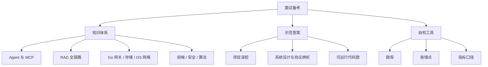

面向 **AI 全栈 / Agent 工程** 岗位的系统化备考资料。按知识域组织，给出可复述的机制、工程取舍与边界；所有结论都可回填到本仓库的源码笔记中核对。

## 证据纪律

本套资料区分两类陈述，**面试中不可混用**：

| 标记         | 含义                                                                 | 允许的表述                     |
| ------------ | -------------------------------------------------------------------- | ------------------------------ |
| **事实基线** | 来自本仓库 `content/` 源码笔记或源码实读，可给出路径、常量、实测数值 | 「项目里是这么做的，常量是 X」 |
| **方案推导** | 通用工程方案、设计思路、容量估算，非项目已实现                       | 「如果要做，我会这样设计」     |

三条硬性纪律：

1. **不把推导讲成项目已做**。评测报告未归档、无 A/B 实验、参数无消融时，如实说明缺口并给补做方案，见 [指标口径与基线定义](/interview/metrics-baseline)。
2. **量化结论先给口径**。任何「提升 X%」「QPS 是多少」都要能答出 baseline、分子分母、采集位置、样本量与验证方式。
3. **先澄清再作答**。格式陷阱、语义歧义、概念误用（如「cookie 的 same origin」）先拆解，本身就是采分点。

## 能力矩阵

| 维度   | 覆盖范围                                    | 主卡片                                                                                                                | 示范答案                                                                       |
| ------ | ------------------------------------------- | --------------------------------------------------------------------------------------------------------------------- | ------------------------------------------------------------------------------ |
| **D1** | LLM 基础、prompt / tool calling、上下文工程 | [Agent 执行链路与 MCP](/interview/fundamentals/agent-and-mcp)                                                         | [Agent 链路、网关与流式前端](/interview/answers/agent-loop-gateway-streaming)  |
| **D2** | Agent 执行链路、MCP、权限与恢复、Harness    | [Agent 执行链路与 MCP](/interview/fundamentals/agent-and-mcp)                                                         | [Coding Agent 记忆与基线](/interview/answers/coding-agent-memory)              |
| **D3** | RAG、检索评估、幻觉治理、切分与上下文预算   | [RAG 全链路](/interview/fundamentals/rag-pipeline)                                                                    | [RAG 项目深挖](/interview/answers/rag-deep-dive)                               |
| **D4** | 后端服务：流式、并发、限流、幂等、存储      | [Go 与网关](/interview/fundamentals/backend-go-gateway)、[存储一致性](/interview/fundamentals/storage-consistency)    | [大 Body 与并发容量](/interview/answers/large-payload-capacity)                |
| **D5** | 前端：流式渲染、状态分层、取消与恢复        | [浏览器与 React](/interview/fundamentals/frontend-browser)                                                            | [续传、虚拟滚动与告警治理](/interview/answers/upload-scroll-alerting-deadlock) |
| **D6** | 系统设计、可观测性、成本与评测              | [Web 安全与可观测性](/interview/fundamentals/security-observability)                                                  | [CSRF 与 SameSite](/interview/answers/csrf-and-samesite)                       |
| **D7** | Web 安全与协议基础、OS / 网络               | [Web 安全与可观测性](/interview/fundamentals/security-observability)、[OS 与网络](/interview/fundamentals/os-network) | [CSRF 与 SameSite](/interview/answers/csrf-and-samesite)                       |

## 内容地图

| 分类                       | 文档                                                                                                                                                                                                                                                                                                                                                                                                                                                                     | 用途                                         |
| -------------------------- | ------------------------------------------------------------------------------------------------------------------------------------------------------------------------------------------------------------------------------------------------------------------------------------------------------------------------------------------------------------------------------------------------------------------------------------------------------------------------ | -------------------------------------------- |
| **专题知识卡**             | [Agent 与 MCP](/interview/fundamentals/agent-and-mcp)、[RAG 全链路](/interview/fundamentals/rag-pipeline)、[Go 网关](/interview/fundamentals/backend-go-gateway)、[存储一致性](/interview/fundamentals/storage-consistency)、[浏览器与 React](/interview/fundamentals/frontend-browser)、[OS 与网络](/interview/fundamentals/os-network)、[安全与可观测性](/interview/fundamentals/security-observability)、[算法手撕](/interview/fundamentals/algorithms)               | 按知识域建立机制级理解，含取舍、边界与采分点 |
| **项目与系统设计示范答案** | [Agent 链路、网关与流式前端](/interview/answers/agent-loop-gateway-streaming)、[大 Body 与并发容量](/interview/answers/large-payload-capacity)、[CSRF 与 SameSite](/interview/answers/csrf-and-samesite)、[电商 RAG 项目深挖](/interview/answers/ecomm-rag-project)、[Coding Agent 记忆与基线](/interview/answers/coding-agent-memory)、[续传、虚拟滚动、告警与死锁](/interview/answers/upload-scroll-alerting-deadlock)、[RAG 六连问](/interview/answers/rag-deep-dive) | 完整答法骨架、事实基线、采分点与追问链       |
| **代码题**                 | [JS 手写限流器](/interview/code/rate-limiter)                                                                                                                                                                                                                                                                                                                                                                                                                            | 可运行实现 + 自测 + 分布式延伸               |
| **自检工具**               | [全量题库](/interview/question-bank)、[高频易错点](/interview/pitfalls)、[指标口径与基线定义](/interview/metrics-baseline)                                                                                                                                                                                                                                                                                                                                               | 逐条自测、纠偏、量化结论治理                 |

## 评分量表

用于对照示范答案自评，每题 0–5 分。

| 维度         | 权重 | 判定标准                                               |
| ------------ | ---- | ------------------------------------------------------ |
| **正确性**   | 30%  | 概念、机制、事实无硬伤；前提有误时先纠偏               |
| **深度**     | 25%  | 下钻到实现层（常量、数据结构、状态机），而非停留在名词 |
| **工程取舍** | 20%  | 说清 trade-off、成本、失败模式与适用规模               |
| **表达结构** | 15%  | 先主干后细节，分层递进，结论先行                       |
| **边界意识** | 10%  | 主动点出异常、安全、规模、降级与可观测性               |

**评级**：`4.5+` 强 · `3.5–4.5` 达标 · `2.5–3.5` 需补 · `<2.5` 重点补。

## 复习路径

1. **建体系**：按 D1–D7 顺序读专题知识卡，每章末尾「面试怎么讲」对照自评。
2. **做自检**：用 [全量题库](/interview/question-bank) 逐条口述，卡住的主题回到对应卡片。
3. **对答案**：读示范答案的「标准答法骨架」与「采分点」，重点看自己漏掉的**量级计算、概念纠偏、事实缺口口径**。
4. **纠偏**：把反复答错的点固化到 [高频易错点](/interview/pitfalls)；涉及量化表述时统一走 [指标口径与基线定义](/interview/metrics-baseline)。
5. **回源码**：任何「项目里怎么做」的表述，回 `content/` 对应文档核对路径与数值。

## 知识库锚点

| 域           | 可核对的源码笔记                                                                                                                         |
| ------------ | ---------------------------------------------------------------------------------------------------------------------------------------- |
| Agent / MCP  | `content/docs/claude-code.md`、`content/docs/pi.md`、`content/docs/mcp-app.md`、`content/fe/yukino-mcp.md`、`content/docs/yukino/mcp.md` |
| 框架与评测   | `content/docs/langchain.md`、`content/docs/langgraph.md`、`content/docs/yukino-ecomm-agent/observable.md`                                |
| 后端         | `content/be/yukino-agent.md`、`content/be/yukino-http.md`、`content/be/middleware.md`、`content/be/redis.md`、`content/be/mysql.md`      |
| 前端         | `content/fe/fe.md`、`content/fe/react.md`、`content/fe/tanstack.md`、`content/fe/yukino-chat.md`                                         |
| 可观测与沙箱 | `content/docs/ieg.md`、`content/docs/docker-k8s-agent-sandbox.md`、`content/docs/yukino/sandbox.md`                                      |
