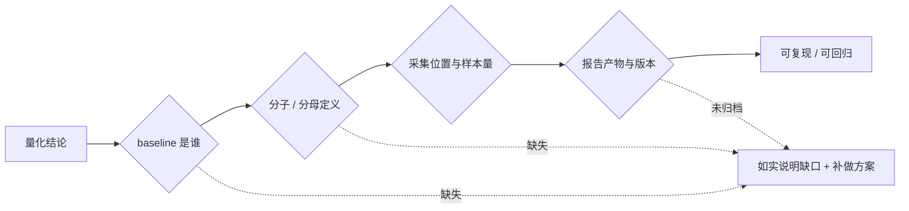

项目深挖里最高频、也最容易翻车的一类追问：**「这个数字怎么来的」**。答不出统计口径，比答不出数字更致命；把设计动机或未归档产物讲成效果数据，会直接失去可信度。



## 一、量化结论的六个要素

任何百分比、QPS、提升幅度、阈值，都要能逐项答出：

| 要素               | 要回答什么                                                      | 常见失误                                          |
| ------------------ | --------------------------------------------------------------- | ------------------------------------------------- |
| **指标定义**       | 这个指标度量什么，语义是否唯一                                  | 「写入率」不区分 cache 写入 / 记忆写入 / 会话追加 |
| **baseline**       | 对照组是谁，同一数据集 / 模型 / prompt / 工具集，只切换一个变量 | 把「迁移前的 Python 版」当成效果对照              |
| **分子分母**       | 精确定义，去重与排除规则（维护窗口、测试流量、静默、重复风暴）  | 按告警条数 / 独立事件 / 故障次数混用              |
| **采集位置**       | 哪个节点、哪段代码、哪个 SDK 打点产生                           | 说「监控里看到的」但指不出埋点                    |
| **样本量与统计**   | 样本数、重复次数、均值与方差、是否 `temperature=0`、置信区间    | 单次运行就报结论；LLM 非确定性被忽略              |
| **产物路径与版本** | 报告落在哪、meta 是否带 commit / 模型版本 / 语料规模 / 时间戳   | 运行时产物未归档，现场编数字                      |

:::warning 报告产物未归档时的标准口径
「机制与评测脚本都在，报告是运行时生成的、当前仓库没有归档，所以历史具体分数不在版本库里。要复现就在同一份固定数据集上重跑，对比报告里的 overall MRR / Recall@5 与证据覆盖率，meta 会带 `kb_chunks`、`chat_model` 和时间戳以便对齐版本。」
:::

## 二、证据分级

| 级别                        | 类型                        | 项目实例                                                                              | 能否给具体数字              |
| --------------------------- | --------------------------- | ------------------------------------------------------------------------------------- | --------------------------- |
| **A · 确定性可复现**        | 机械计算、不经过 LLM        | 300 条固定评测集上的 `Recall@5` / `MRR`、证据覆盖率子串匹配、置信度阈值扫描           | ✅                          |
| **B · 半定量**              | LLM judge、单次实测         | `faithfulness`（`temperature: 0` + 结构化输出 + 七类豁免）、cache 命中率 99.4% → 9.5% | ⚠️ 需说明判定方式与次数     |
| **C · 未归档运行时产物**    | 报告只在运行时落盘          | `data/rag/reports/rag_eval.json/.txt`                                                 | ❌ 只能讲机制与重跑方案     |
| **D · 从未定义 / 从未实验** | 无 baseline、无脚本、无报告 | 输入 token 降低 X%、写入率提升 Y%、跨模型 A/B、分块长度消融、告警归属率               | ❌ 明确说没有，并给补做方案 |

**关键区分**：检索策略的**消融实验**（ablation）不等于模型选型的**对照实验**。前者固定模型比较 4 种检索管线；后者需要控制变量比较模型 A/B。把两者说成一件事，是这题最常见的扣分点。

## 三、项目事实盘点

| 主题           | 已有事实                                                                                                                                | 依据                                                                                |
| -------------- | --------------------------------------------------------------------------------------------------------------------------------------- | ----------------------------------------------------------------------------------- |
| 语料规模       | 6 份 Markdown、20,950 字节，按 `buildChunks` 默认参数实跑 74 条 chunk；评测集 300 行                                                    | `server/data/kb/`、`server/src/kb/documents.ts`、`server/tests/data/eval_rag.jsonl` |
| 检索评测       | 4 策略 × 4 问题桶（A_policy / B_model / C_colloquial / E_multi），`Recall@5`、`MRR`、证据覆盖率、答案覆盖率、`faithfulness`、库外拒答率 | `content/docs/yukino-ecomm-agent/observable.md`                                     |
| 防假分数       | 生成阶段全部调用失败会抛错拒绝记录零分；部分失败在报告注明可用样本                                                                      | `server/scripts/eval-rag.ts`                                                        |
| 阈值校准       | `0.05–0.95` 步长 `0.01` 扫描，以 Youden J（库内通过率 − 库外漏放率）最大选推荐阈值，默认 `0.26`                                         | `server/scripts/calibrate-confidence.ts`                                            |
| 趋势防劣化     | `eval-flywheel` 记 `recall_at_5 / mrr / faithfulness / refusal_rate` 进 `eval_run`，相邻轮差 > `0.005` 标回归                           | `content/docs/yukino-ecomm-agent/observable.md`                                     |
| 分块参数       | `chunkSize=400`、`overlap=60`、`tableMaxRows=10` 是函数默认常量；调用点只传 `(raw, ctype)`，全 `src/` 无配置化、无消融                  | `server/src/kb/documents.ts`                                                        |
| 模型槽位       | `chat` 用 `deepseek-flash`；`intent` / `summary` 未配置，回落 chat 组；embedding 与 rerank 是独立上游                                   | `server/.env.example`、`core/llm.ts`                                                |
| Token 打点     | `inputTokens` / `cacheReadInputTokens` / `cacheCreationInputTokens` / `outputTokens` 四类计费口径 + usage anchor                        | `content/docs/yukino/llm.md`、`context-compaction.md`                               |
| 唯一的缓存实测 | 约 20k token 历史下，仅在 tools 末尾追加一个工具，cache 命中率 **99.4% → 9.5%**                                                         | `content/docs/yukino/mcp.md` 源码注释                                               |
| **缺口**       | 仓库无 eval / bench / report 脚本（另一项目）、无跨模型 A/B、无参数规模论证、无参数消融、无告警归属率指标、评测报告未归档               | 源码与知识库检索结论                                                                |

## 四、五个高频追问的标准口径

| 追问                                            | 诚实口径                                                                                                                         | 补做方案                                                                                                                                          |
| ----------------------------------------------- | -------------------------------------------------------------------------------------------------------------------------------- | ------------------------------------------------------------------------------------------------------------------------------------------------- |
| **改造前分数怎么来的？**                        | 有明确定义的 baseline（同一 300 条集上的 4 策略消融），但报告未归档，历史具体分数不在仓库里                                      | 改造前后各跑一次同一脚本、同一数据集，对比 `rag_eval.json` 的 overall MRR / Recall@5 与证据覆盖率；报告 meta 带 `chat_model`、`kb_chunks`、时间戳 |
| **意图分类为什么用这个量级的模型？**            | 项目没有为意图分类指定参数量级；`INTENT_MODEL` 为空、回落 chat 组，且 API 模型不公开参数规模                                     | 用固定标注集的**准确率 / JSON 合法率 / P95 延迟 / 每千次成本**四轴实测定档位，借 `resolveSlot` 只改环境变量切换                                   |
| **输入 token 降低 / 写入率提升多少？**          | 有四类 token 打点与一次 cache 命中率实测（解释 tools 数组必须稳定的**设计动机**），但没有定义过相对指标 baseline，也没有对照实验 | 先澄清「写入率」口径；固定会话轨迹做开关式 A/B（关闭溢出 / 关闭压缩 / 关闭缓存优化），同时守住任务成功率与回读率作为质量护栏                      |
| **分块长度 400 是谁定的？为什么不是 300/500？** | 是开发者写死的源码默认常量，只有定性设计理由（结构感知、句子级 overlap、表格复制表头），没有消融实验                             | 固定 300 条评测集做 `chunkSize × overlap × topK` 网格，看 Recall@5 / MRR / 证据覆盖率拐点，并联动上下文预算与答案覆盖率                           |
| **告警归属率做了多少？**                        | 熟悉指标的分子分母与验证方式，但知识库里没有该指标的落地记录，不当作项目已做                                                     | 先固定口径（按告警条数 / 独立事件 / 故障次数），建立去重后有效告警分母，用事后复盘人工确认做归属准确率的 ground truth，再补打标规则并回归验证     |

:::note 质量护栏不可省
所有「省 token / 提速度」的 A/B 必须同时记录**任务成功率、答案质量、是否需要回读源文件、拒答率**。只报性能收益而不报质量变化，本身就是设计缺陷。
:::

## 五、可复现报告的最小元信息

```json
{
  "dataset": "server/tests/data/eval_rag.jsonl",
  "sample_size": 300,
  "strategy": "hybrid_rerank",
  "metrics": {
    "recall_at_5": 0,
    "mrr": 0,
    "evidence_coverage": 0,
    "faithfulness": 0
  },
  "meta": {
    "commit": "<local_commit>",
    "chat_model": "deepseek-flash",
    "kb_chunks": 74,
    "temperature": 0,
    "runs": 3,
    "generated_at": "ISO-8601"
  }
}
```

`runs` 与 `temperature` 必须显式记录：LLM 生成环节非确定性，单次结果不构成证据。报告里同时写清**排除了哪些样本**（调用失败、维护窗口、库外拒答），否则分母不可比。

## 六、采分点

| 维度     | 加分                                                     | 扣分                 |
| -------- | -------------------------------------------------------- | -------------------- |
| 正确性   | 分清消融实验与对照实验；区分项目事实、推导、未归档产物   | 把设计动机当效果数据 |
| 深度     | 能给出分子分母、采集位置、埋点代码与报告路径             | 只说「监控里看的」   |
| 工程取舍 | 主动加质量护栏、多轮取均值与方差、标注 commit 与模型版本 | 只报性能收益         |
| 表达结构 | 「有没有 → 口径 → 缺口 → 补做方案」四段式                | 先报数字再被追问穿   |
| 边界意识 | 承认报告未归档、语料是演示规模、结论不可外推到百万级     | 现场编数字           |

## 速记卡

- **六要素**：定义 / baseline / 分子分母 / 采集位置 / 样本量与统计 / 产物路径与版本。
- **四级证据**：确定性可复现 > LLM judge 半定量 > 未归档运行时产物 > 从未定义。
- **三个「没有」**：没有跨模型 A/B、没有参数消融、没有相对指标 baseline —— 如实说并给补做方案。
- **一个不能混**：检索策略消融 ≠ 模型选型对照；cache 命中率实测 ≠ 压缩方案收益。
- **一句万能口径**：「机制与脚本都在，报告是运行时产物未归档；在同一数据集上重跑即可复现，meta 会带版本信息。」
