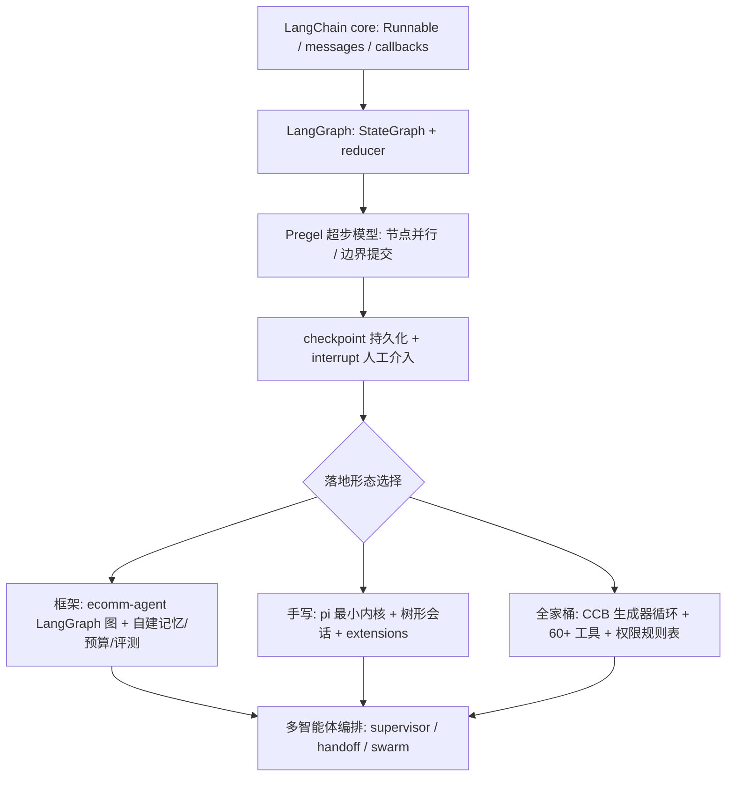

:::note 事实基线
项目例证来自本机实读源码: `$HOME/github/yukino-ecomm-agent`（`c90c8433796f`，`server/src/`）、`$HOME/Downloads/claude-code`（`77a7934e15d6`，社区复原工程 **Claude Code Best V5（CCB）**）、`$HOME/Downloads/pi`（`26293e74f664`）。LangChain / LangGraph / A2UI 框架源码未在本机检出, 相关抽象按标准框架知识作答并标注为**通用框架结论**或**方案推导**, 不附未核对的行号与内部表结构。
:::

本篇是「Agent 框架与架构对比」带解答题库, 共 **80 题**。先讲 LangChain 接口层与 LangGraph 状态编排, 再对比手写 harness、CCB 与 Pi 两套 coding agent 工程, 最后落到生成式 UI 路线、多智能体编排与工程化取舍。每题区分**事实基线**（源码/文档可核对）与**方案推导**（如果要做会这样设计）。

**主线一览**

## 一、LangChain 核心抽象

### Q1. LangChain 的核心抽象 Runnable 解决什么问题？

**通用框架结论**（LangChain core `Runnable` 抽象）: `Runnable` 统一了 prompt、模型、解析器、工具、检索器的调用接口——`invoke / stream / batch` 三套入口加 `pipe()` 组合。任何组件实现这一个接口, 就能任意串联成管道（LCEL）。价值: **调用协议统一后, 组合、重试、回退、回调、流式都变成可复用的装饰能力**, 而不是每个组件各写一套。

### Q2. LCEL 管道里 pipe / batch / stream 的语义？

**通用框架结论**: `pipe()` 返回 `RunnableSequence`（前一步输出作为后一步输入）; `batch()` 支持并发度控制（`maxConcurrency`）与失败继续（`returnExceptions`）; `stream()` 产出增量块, 让管道支持「模型逐 token 流 + 解析器增量解析」。面试表述: LCEL 把「同步批处理、单条调用、流式」收敛到同一组件模型上, **流式是一等公民**而不是附加 API。

### Q3. RunnableLambda / RunnableParallel / RunnableBranch / RunnablePassthrough 各用在什么场景？

**通用框架结论**:

| 类                    | 用途                                                  |
| --------------------- | ----------------------------------------------------- |
| `RunnableLambda`      | 把任意函数包成 Runnable（胶水逻辑、后处理）           |
| `RunnableParallel`    | 多分支并行执行, 输出合并成对象（如同时跑改写 + 检索） |
| `RunnableBranch`      | 条件路由: `(condition, runnable)` 列表 + default      |
| `RunnablePassthrough` | 透传输入, 常配合 `.assign()` 增量加字段               |

**事实基线**（`server/src/core/llm.ts: RunnableLambda.from`）: ecomm-agent 用 `RunnableLambda.from(run)` 把「带重试的结构化输出」包进管道。

### Q4. withRetry 与 withFallbacks 的区别和组合方式？

**通用框架结论**: `withRetry({ stopAfterAttempt, ... })` 对**同一 runnable** 重试（瞬时错误: 429 / 超时）; `withFallbacks([...])` 换**备选 runnable**（模型降级: 主模型挂了切备用模型/小模型/缓存答案）。组合顺序: 先 retry 穷尽再 fallback。**失败要分级**——可重试错误与不可恢复错误走不同路径, fallback 链末端要有确定性兜底。

### Q5. callbacks 体系在 LangChain 里承担什么职责？

**通用框架结论**: 回调是贯穿 invoke/stream 生命周期的观察者钩子（`handleLLMStart / handleChainStart / handleToolStart` 等）, tracer 就是回调的一种实现。

**事实基线**（`server/src/core/observability.ts: graphCallbacks`）: ecomm-agent 把 Langfuse 的 `CallbackHandler` 作为 callbacks 注入图执行, 携带 `sessionId` 与 `tags: ["chat-turn"]`——**观测不改业务代码, 靠回调注入**, 这是框架可观测性的标准姿势。

### Q6. 结构化输出（withStructuredOutput）有哪些实现方式, 项目怎么选的？

**事实基线**（`server/src/core/llm.ts: structured`）: ecomm-agent 显式用 `method: "functionCalling"`——把 zod schema 变成工具定义让模型调用, 返回后 `schema.parse` 校验; 失败重试一次（共两次尝试, `for (const attempt of [1, 2])`）, 两次都拿不到 tool_calls 就抛错。备选方式（**通用框架结论**）: JSON mode（`response_format: json_object`）、约束解码（grammar/前缀树）。function calling 兼容性最好但多一层工具开销; 约束解码最可靠但依赖推理引擎支持。

### Q7. output parser 与结构化输出什么关系？

**通用框架结论**: output parser 负责「文本 → 结构」的解析与纠错; 结构化输出是「让模型直接产出结构」, parser 退化为校验层。项目路径是「functionCalling + zod 校验」, parser 只做兜底。**先让模型产出结构化, 再用 parser 校验**, 比「让模型自由发挥再解析」稳一个量级。

### Q8. ChatPromptTemplate 与消息类型体系？

**事实基线**（`@langchain/core/messages`, ecomm-agent `server/src/graph/nodes.ts` 全量使用）: 消息类型为 `SystemMessage / HumanMessage / AIMessage / ToolMessage`; `ChatPromptTemplate.fromMessages` 组装带占位符的模板（项目 `SELF_CHECK_PROMPT`、`RAG_ANSWER_PROMPT` 等全部如此, 见 `server/src/core/prompts.ts`）。`AIMessage` 携带 `tool_calls` 与 `usage_metadata`（含 `input_token_details.cache_read`, 项目用它统计 prompt cache 命中）。

### Q9. langchain-textsplitters 在项目里承担什么？

**事实基线**（`server/src/kb/chunking.ts: recursiveSplit`, 调用方 `server/src/kb/documents.ts` 默认 `chunkSize = 400`）: 用 `RecursiveCharacterTextSplitter`（可配 `separators` 序列与 `keepSeparator: true`）做 400 字递归切分, 再叠加自研的句子级 overlap（`applySentenceOverlap` → `trailingSentences`）。启示: 框架提供**可组合的原子能力**（递归切分）, 领域语义（句子回卷、表格分组）自己补——用框架但不被框架的默认行为绑架。

### Q10. langchain-mcp-adapters 解决什么问题？

**通用框架结论**: MCP 适配器把 MCP server 的工具批量转成 LangChain tools 载入 agent。意义: MCP 负责「工具从哪来」（协议与生态）, 框架负责「工具怎么用」（循环与状态）, 适配器是两者的桥。

**事实基线**（`server/src/tools/mcp-client.ts`, 配置 `server/src/config.ts: mcpLogisticsUrl / mcpAftersalesUrl`）: ecomm-agent 自己实现了 MCP 客户端接入物流/售后两个 server（`MCP_LOGISTICS_URL` / `MCP_AFTERSALES_URL`, 默认 `http://127.0.0.1:8101/mcp` 与 `http://127.0.0.1:8102/mcp`）, 等价于手写了这个适配层。

### Q11. 框架的 memory 抽象（chat_history / memory.ts）为什么被弃用式演进？

**通用框架结论**: 早期 `memory` 是「黑盒存取字符串」, 无法表达分层压缩、摘要边界、预算控制; 现代做法把「历史管理」交给图状态 + checkpointer（可持久化、可回放、可分支）。**记忆从「存取问题」变成了「状态管理问题」**。

**事实基线**（`server/src/core/memory.ts: summaryUptoMsgId / layer1FromMsgId`）: ecomm-agent 用这两个边界字段显式建模记忆分层。

### Q12. 怎么评价「LangChain 太重」这个说法？

分层回答: ① `langchain-core` 是接口层（Runnable / messages / callbacks）, 依赖很轻, 项目实际大量使用（ecomm-agent 的 prompt、messages、structured output 全走 core）; ② `langchain` 主包是集成层, 按需引入; ③ 「重」的观感来自早期链式黑盒 API, LCEL 之后组合是显式的。**面试表述**: 用 core 的抽象、按需取集成、领域逻辑自己写——项目正是这么用的。

## 二、LangGraph

### Q13. StateGraph + Annotation 的状态模型怎么工作？

**事实基线**（`server/src/graph/state.ts: ConversationState / mergeDict`）: `Annotation.Root({...})` 声明状态 schema, 每个字段可配 `reducer`（多次写入如何合并）与 `default`; 节点返回**部分更新**（`State.Update`）, 框架按 reducer 合并进全局状态。项目 `messages` 用 `messagesStateReducer`（按 id 追加/替换/删除）, `trace` 用自定义 `mergeDict`（`{ ...(a ?? {}), ...b }` 浅合并）——**reducer 决定了并发/多步写入的合并语义**, 是状态图区别于普通流程图的根。

### Q14. messagesStateReducer 有什么特殊语义？

**通用框架结论**: 按消息 `id` 合并——新 id 追加、同 id 替换、`RemoveMessage` 做 **tombstone 删除**。意义: 消息列表不是简单 append, 而是**可寻址、可修订的集合**——工具重试、消息压缩、人工编辑都依赖按 id 操作。

### Q15. channels 是什么？LastValue 与 BinaryOperatorAggregate 的区别？

**通用框架结论**: channel 是状态字段的运行时载体。`last_value` 只保留最后一次写（默认语义, 并发多写会冲突报错）; `binop`（BinaryOperatorAggregate）用二元运算合并（reducer 的底层实现）; 另有 topic（多值累积）、ephemeral value（单步有效）、named barrier（同步栅栏）等变体。**Annotation 里写 reducer, 本质是给字段选了 channel 类型**。

### Q16. Pregel 执行模型怎么理解？

**通用框架结论**: LangGraph 借鉴 Google Pregel 的 BSP（Bulk Synchronous Parallel）模型——**超步（superstep）内并行执行就绪节点 → 超步边界统一提交 channel 写入与 checkpoint → 下一超步**。这解释了: 为什么节点返回的是更新而非直接改状态; 为什么 checkpoint 天然落在超步边界; 为什么同层节点可以并行。

### Q17. 条件边（conditional edges）怎么实现路由？

**事实基线**（`server/src/graph/build.ts`, 路由函数 `server/src/graph/routing.ts: routeByIntent / shouldContinue`）: `addConditionalEdges("classify_intent", routeByIntent, { escalate: "complaint_reply", ... })`——路由函数读 state 返回键, 映射表决定下一节点; `shouldContinue` 判断最后一条 `AIMessage` 是否带 `tool_calls` 且 `steps < settings.maxAgentSteps`（默认 6, `config.ts: maxAgentSteps`）, 返回 `continue / stop`。**路由是纯函数**: 可单测（`server/tests/routing.test.ts`）、可枚举、可审计——这比把分支逻辑藏在 prompt 里可控得多。

### Q18. checkpointer 解决什么问题？Postgres 实现存什么？

**事实基线**（`server/src/graph/runtime.ts: PostgresSaver.fromConnString`, 配置 `server/src/config.ts: checkpointerDbUrl`）: ecomm-agent 用独立库 `yukino_agent2_checkpoints`（`CHECKPOINTER_DB_URL`）, 启动时 `checkpointer.setup()` 建表。checkpoint 让图具备: **会话持久化**（跨进程恢复）、**时间旅行**（回到任意 checkpoint 重放）、**human-in-the-loop**（interrupt 后状态落盘等人）。

**通用框架结论**: Postgres checkpointer 以 `(thread_id, checkpoint_ns, checkpoint_id)` 为键, 分状态快照表与待合并写入表两张表; 快照存序列化后的状态 blob, 写入表存尚未提交的 channel 变更。

### Q19. interrupt() 的实现机制是什么？为什么不能在 try/catch 里吞掉？

**通用框架结论**: `interrupt(value)` 在有 `resume` 值时直接返回该值; 否则**抛出 `GraphInterrupt` 特殊错误**向上传播, 图在 checkpoint 处暂停; 用 `Command({ resume })` 重新 invoke 时从中断点继续。因此「avoid using try/catch blocks around interrupt」——捕获后不重抛会破坏暂停语义。

**事实基线**（`server/src/graph/nodes.ts`）: 两处 `interrupt<...>(...)` 调用均来自 `@langchain/langgraph` 的 `interrupt` 导入。

### Q20. 项目里 interrupt 用在哪两处？

**事实基线**（`server/src/graph/nodes.ts`）: ① `fetchOrder`: 订单号缺失或不属于当前用户时 `interrupt({ type: "select_order", orders })`, 等前端选单后 resume（resume 值为订单 id 字符串）; ② `agentTools`: `create_ticket` 参数校验通过后 `interrupt({ type: "confirm_ticket", preview })`, 用户确认才真正执行, 取消则注入 denyNote 告知模型。**采分点**: human-in-the-loop 不是弹窗那么简单——它是「状态落盘 → 外部决策 → 携带决策恢复」的完整状态机, 且**恢复值要能表达拒绝**, 拒绝还要以模型能理解的方式回填。

### Q21. createReactAgent 预构建了什么？参数有哪些？

**通用框架结论**: `createReactAgent({ llm, tools, prompt?, checkpointSaver/checkpointer?, interruptBefore?, interruptAfter?, stateSchema?, responseFormat? })`——内置「模型 → 有 tool_calls 就执行工具 → 回环」的标准 ReAct 图; `prompt` 支持字符串 / SystemMessage / 函数 / Runnable 四种形态; `responseFormat` 要求模型支持结构化输出做最终收尾。**它是教学与快速原型的起点, 生产系统通常在它之上或之外自定义**。

### Q22. 流式输出有哪些模式？

**通用框架结论**: `streamMode` 支持 `values`（每超步后的完整状态）、`updates`（每节点的增量更新）、`messages`（节点内 LLM 的 token 流）、`debug`、`custom`（节点主动写自定义事件）等, 可数组叠加。ecomm-agent 的聊天接口需要 token 级流式, 走 `messages` 模式透传模型增量。**答题要点**: 状态流（给调试/前端状态同步）与 token 流（给用户感知）是两层, 别混为一谈。

### Q23. 子图（subgraph）什么时候用？

**方案推导 + 框架能力**: 子图把一段可复用流程（如退款判定: 取单 → 政策检索 → 判定）封装成独立 StateGraph 嵌入父图, 拥有自己的状态 schema 与 checkpoint 命名空间（`checkpoint_ns`）。适用: 流程复用、团队分工、需要独立重放/回放。**ecomm-agent 没用子图**——它的退款流是父图上的节点链（`fetch_order → retrieve_policy → main_agent`）, 规模不大时平铺更直观; 这是「该不该用子图」的真实取舍案例。

### Q24. 函数式 API（@entrypoint/@task）与图 API 怎么选？

**通用框架结论**: 函数式 API 用装饰器把普通 async 函数变成可 checkpoint、可 resume 的任务（`@task` 的中间结果落盘, 长函数可从最近的 task 恢复）。选择: 流程是**固定拓扑**（审批链、RAG 管线）→ 图 API, 拓扑可视可审计; 流程是**模型驱动的开放循环**（agent 自主决定下一步）→ 函数式或裸循环更顺手。ecomm-agent 是「固定路由 + 局部自主（main_agent 工具循环）」的混合, 图 API 恰好表达这种结构。

### Q25. langgraph-supervisor 与 langgraph-swarm 代表哪两种编排？

**通用框架结论**:

| 模式       | 结构                                           | 控制权       |
| ---------- | ---------------------------------------------- | ------------ |
| supervisor | 中心调度者把任务派给 worker, worker 汇报回中心 | 中心始终握有 |
| swarm      | agent 之间通过 handoff 工具**互相移交**控制权  | 去中心化传递 |

两者都靠 `handoff` 机制实现（把「转交给 X」做成工具调用）。**答题要点**: supervisor 可控性强、易审计, 适合业务流; swarm 灵活但难预测, 适合探索型任务; 生产系统多选 supervisor 或受限 handoff。

### Q26. retry policy 与节点幂等怎么配合？

**事实基线**（`server/src/tools/engine.ts: audit`, 审计记录携带 `tool_call_id`）: 框架在超步边界提交写入, 节点重试发生在同一超步内, 写入尚未提交, 不会产生半更新; 但节点若有副作用（调外部 API、写库）, 重试必须幂等——项目用 `tool_call_id` 与审计日志兜底。**框架保证状态一致, 副作用一致要业务自己保证**。

### Q27. LangGraph 的图能可视化吗？

**通用框架结论**: 图实例支持导出 mermaid 拓扑。价值: 拓扑即文档, 评审与面试都能直接画出来。

**事实基线**（`server/src/graph/build.ts` 逐边可复述）: ecomm-agent 的图结构为 START → resolve_reference → classify_intent → 五路分支 → main_agent ⇄ agent_tools → log → END——**能徒手画出自己系统的状态图是硬要求**。

### Q28. 用 LangGraph 的项目实际踩哪些坑？（结合 ecomm-agent）

**事实基线**（从 `server/src/` 代码反推）: ① 状态字段要显式声明 reducer, `trace` 不写 `mergeDict` 就会被后写节点覆盖（`graph/state.ts`）; ② interrupt 的恢复值要 zod 校验; ③ checkpointer 单独建库隔离业务数据（`runtime.ts: ensureCheckpointerDatabase`）; ④ 流式与非流式模型差异（`core/llm.ts: NO_STREAM_TOOLCALL_FAMILIES = ["minimax"]`, structured 输出对该家族关流式）; ⑤ 消息窗口要自己管理（框架不管 token 预算, 项目自建 `core/budget.ts` + `core/memory.ts` 层）。**坑都长在「框架边界之外」**——状态合并语义、恢复值校验、模型差异适配、上下文预算。

## 三、手写 harness vs 框架

### Q29. 什么时候选手写 agent 循环, 什么时候选框架？

判断矩阵:

| 维度       | 手写                      | 框架                   |
| ---------- | ------------------------- | ---------------------- |
| 控制粒度   | 每个 token/工具调用可拦截 | 受框架抽象约束         |
| 状态持久化 | 自建                      | checkpointer 现成      |
| 生态集成   | 自己接                    | 丰富                   |
| 升级成本   | 全在自己                  | 跟框架 breaking change |
| 团队认知   | 需懂全链路                | 学框架心智模型         |

**事实参照**: ecomm-agent 用 LangGraph（需要 checkpoint + interrupt + 可审计拓扑）; pi 手写（追求最小内核 + 完全可控）; 两条路都有成功样本。**答题落点**: 固定流程重审计 → 框架; 极致控制与定制 → 手写; 中间态最常见——**框架的接口层 + 自己的领域层**（ecomm-agent 用 core 抽象 + 自建预算/记忆/评测）。

### Q30. 手写一个生产级 agent 循环最少要实现哪些模块？

**事实基线**（`packages/agent/src/agent-loop.ts`, 949 行的单循环实现）: ① 消息模型与「仅在 LLM 边界转 provider Message[]」的隔离; ② 工具声明/参数校验/执行/结果回填; ③ 流式事件协议（`AgentEvent` 流）; ④ 轮次终止判定（无 tool_calls 即停）; ⑤ 取消（AbortSignal）; ⑥ 重试续跑（`agentLoopContinue`, 要求 context 末尾必须是 user/toolResult）; ⑦ 上下文装配与压缩钩子。**七件套缺一不可**——这是「手写循环有多难」的标准答案。

### Q31. 「harness」到底指什么？它和模型、工具的关系？

harness = 模型之外的一切工程脚手架: 循环控制、上下文工程、工具运行时、权限、持久化、观测、恢复。模型是引擎, 工具是手脚, harness 是底盘 + 传动 + 仪表。**同一个模型换 harness, 能力表现差异巨大**（上下文管理决定模型能看到什么, 权限层决定它能做什么）——这也是为什么 coding agent 竞争本质是 harness 竞争。

### Q32. 框架升级（breaking change）风险怎么管？

**方案推导**: ① 把框架用法收敛到少数适配层文件（如项目里只有 `core/llm.ts` 碰模型客户端、`graph/build.ts` 碰 StateGraph）, 升级影响面可控; ② 锁版本 + 升级走评测回归（固定评测集跑 Recall/忠实度对比）; ③ 状态 schema 与 checkpoint 存储格式变更要有迁移脚本。**「收敛接触面 + 回归门禁」**是通用答案。

### Q33. 为什么很多团队最后「框架引入又拆掉」？

常见路径: 原型期框架提速 → 生产期遇到抽象泄漏（流式细节、状态合并、模型差异）→ 补丁越打越厚 → 拆成手写。反过来的路径也存在（手写撑不住多会话持久化再引框架）。**理性表述**: 框架与手写不是信仰问题, 是「当前阶段最贵的成本是开发速度还是控制力」的问题; ecomm-agent 的选择（LangGraph 图 + 自建记忆/预算/评测）展示了第三条路——**框架管拓扑与持久化, 领域难点自己写**。

### Q34. 如何评估一个 agent 框架是否适合生产？

检查清单（每条都能用源码验证有无）: ① 状态持久化与恢复（checkpointer）; ② 中断/人工介入（interrupt/Command）; ③ 流式分层（状态流/token 流）; ④ 重试与超时策略; ⑤ 可观测注入点（callbacks/tracing）; ⑥ 子图/命名空间隔离; ⑦ 版本迁移工具; ⑧ 社区与 breaking change 记录。**拿清单去审框架, 比听口碑可靠**。

## 四、Claude Code（CCB 复原工程）架构分析

> 口径说明: 本机 `$HOME/Downloads/claude-code` 是社区复原项目 **Claude Code Best V5（CCB）**（README 自述为对 Anthropic Claude Code 的工程化复原并扩展特性）, HEAD `77a7934e15d6`。以下分析基于该仓库源码事实。

### Q35. CCB 的主查询循环是什么形态？

**事实基线**（`src/query.ts`, 2057 行）: `export async function* query(params)` 是**异步生成器**——把 `StreamEvent | Message | TombstoneMessage | ToolUseSummaryMessage` 逐个 yield 给消费端, 内部委托 `queryLoop`。进入循环前创建 Langfuse trace（子 agent 复用父 trace: `ownsTrace = !params.toolUseContext.langfuseTrace`, `src/query.ts`）, 退出时 `finally` 里结算 autonomy commands。**采分点**: 用生成器统一「流式事件 + 消息 + 工具摘要」三类输出, 调用方用 `for await` 消费——事件流即协议。

### Q36. CCB 的内置工具体系有多大？举几类代表。

**事实基线**（`packages/builtin-tools/src/tools/`, 实测 64 个工具目录）: 文件类（`FileReadTool / FileEditTool / FileWriteTool / GlobTool / GrepTool`）、执行类（`BashTool / PowerShellTool / ExecuteTool`）、任务类（`TaskCreateTool / TaskGetTool / TaskListTool / TaskOutputTool / TaskStopTool / TaskUpdateTool`）、agent 类（`AgentTool / SendMessageTool / ListPeersTool`）、计划类（`EnterPlanModeTool / ExitPlanModeTool`）、MCP 类（`MCPTool / ListMcpResourcesTool / ReadMcpResourceTool / McpAuthTool`）、特色类（`GoalTool / SkillTool / ScheduleCronTool / PushNotificationTool / EnterWorktreeTool / ExitWorktreeTool`）。**答题要点**: 工具集本身就是产品能力的地图——coding agent 的差异化大量体现在工具面。

### Q37. 权限模型怎么设计？canUseTool 的角色？

**事实基线**（`src/Tool.ts`, 803 行; 类型 `src/types/permissions.ts`、`src/utils/permissions/denialTracking.js`）: 权限类型集中在 `types/permissions.ts`（打破循环导入）; 工具上下文携带 `canUseTool` 决策器、`DenialTrackingState`（拒绝跟踪）、`ToolPermissionRulesBySource`（按来源分层的规则, 分 alwaysAllow / alwaysDeny / alwaysAsk）; 注释明确: 后台 agent「permission prompts are auto-denied（无法弹 UI 时自动拒绝）」; coordinator worker「先等自动检查（classifier/hooks）再弹权限框」; plan mode 进出要保存/恢复权限模式。**权限是数据（规则表）+ 决策器 + 状态跟踪**, 且对无人值守场景有明确的默认拒绝语义。

### Q38. 上下文压缩（compact）在 CCB 里怎么做？

**事实基线**（`src/services/compact/`、`src/services/contextCollapse/`、`src/services/extractMemories/`、`src/services/SessionMemory`）: compact 服务负责把旧上下文卷成摘要; contextCollapse 负责折叠展示与按需展开; 两者与会话记忆、记忆提取分工——**压缩解决「窗口装不下」, 记忆解决「跨会话遗忘」**。对照 pi 的 compaction（见 Q45）与 ecomm-agent 的三层记忆（见 [RAG 与检索深挖题库](/interview/qa/rag-and-retrieval)）, 三家殊途同归: **摘要替代 + 原文保留 + 按需恢复**。

### Q39. CCB 的多 agent 能力怎么组织？

**事实基线**: `AgentTool`（子 agent 工具）、`SendMessageTool / ListPeersTool`（agent 间通信与发现）、`src/coordinator/`（`coordinatorMode.ts`、`workerAgent.ts`）、`TaskCreate/Get/List/Output/Stop/Update` 系列（任务板）; `src/services/AgentSummary/`（`agentSummary.ts`、`summaryContext.ts`、`summaryPrompt.ts`）负责子 agent 汇总。README 还描述了 `/ultracode` workflow 编排（`Workflow` 工具跑确定性 JS 脚本, 原语 `agent / pipeline / parallel / phase` + journal 重放 + token budget + 并发上限）。**答题要点**: 多 agent 需要三件套——**任务分配（Task 系列）、通信（SendMessage）、汇总（AgentSummary 服务）**, 外加防冲突的写协调（共享文件/工作区隔离, 如 `EnterWorktreeTool`）。

### Q40. Goal（持续驱动）机制解决什么问题？

**事实基线**（`src/services/goal/`: `goalState.ts`、`goalStorage.ts`、`prompts.ts`; `src/commands/goal/`）: `/goal <objective>` 设定目标后跨轮自动驱动 agent 直至完成, 带 token budget、completion/blocked audit、`pause/resume/continue/clear` 子命令、网络中断自动暂停。它把「一次性问答」升级为「目标导向的长程执行」, 核心难点是**终止判定**（完成/受阻的审计）与**预算护栏**（token budget）——长程 agent 没有这两样就会跑飞或烧钱。

### Q41. CCB 的可观测与成本怎么管？

**事实基线**: `src/services/langfuse/`（Langfuse 监控: `client.ts`、`tracing.ts`、`convert.ts`、`sanitize.ts`）、`src/cost-tracker.ts` + `src/costHook.ts`（成本跟踪）、`src/services/providerUsage` 与 `src/services/rateLimitMessages.ts`（用量与限流提示）。**答题要点**: agent 级观测的最小集 = trace（每轮循环细节）+ cost（每轮 token/钱）+ rate limit（配额预警）; trace 能转评测数据集是数据飞轮的关键一步。

### Q42. 从这个复原工程能学到哪些「coding agent 工程化」要点？

归纳（均有源码目录佐证）: ① 事件流生成器作为核心协议（`query.ts`）; ② 权限规则数据化、分来源分层（`Tool.ts`）; ③ 上下文压缩与记忆分离（`services/compact` vs `SessionMemory`）; ④ 多 agent 用任务板 + 消息总线而非共享内存; ⑤ 成本与限流一等公民; ⑥ 插件面（plugins/skills/workflow）与内核分离。**面试表述**: 分析一个 agent 产品, 按「循环 / 工具 / 权限 / 上下文 / 记忆 / 观测 / 编排」七层拆解, 每层找源码证据。

## 五、Pi 架构分析

### Q43. Pi 的设计哲学是什么？与 CCB 的差异？

**事实基线**（`pi` README: 「a minimal, extensible agent harness that you can make your own」）: **刻意不做** sub-agents 和 plan mode, 缺的能力用 extensions / skills / prompt templates / themes 自己加, 以 Pi packages（npm/git）分发。对比: CCB 走「全家桶」（60+ 内置工具 + goal/workflow/remote）, Pi 走「最小内核 + 生态插槽」。**两种产品形态对应两类用户**: 要开箱即用 vs 要完全掌控。

### Q44. Pi 的会话模型有什么特别的？

**事实基线**（`packages/coding-agent/docs/how-pi-works.md`）: 会话是**树**——消息与事件构成树形结构, 每条路径是一个 branch, 当前 entry 所在分支提供历史; 持久化为 JSONL 文件, 每个 entry 有 id 与 parent 引用; 从旧 entry 继续即创建新分支; fork/clone 复制选定历史到新文件。**采分点**: 树形会话让「回退、分叉、对比不同策略」成为原生操作——比线性历史强得多, 代价是 compaction 与展示要处理分支（所以有 branch summarization）。

### Q45. Pi 的自动 compaction 触发条件与细节？

**事实基线**（`packages/coding-agent/docs/compaction.md`）: 触发式 `contextTokens > contextWindow − reserveTokens`, 默认 `reserveTokens = 16384`; 检查时机是**工具执行完、结果追加后、下一次 assistant 响应前**（`prepareNextTurn`）, 另有新 prompt 前与低层 run 结束后的 overflow 兜底; provider 上下文溢出错误或提前的 `stopReason: "length"` 可触发一次 compact-and-retry; 摘要请求**关闭 prompt-cache 写入**（一次性 prompt 不值得缓存）; compaction 只替换后续请求里的旧消息, **原始 entry 保留在会话树里**。**每个细节都是面试素材**: 为什么工具后检查（峰值在工具结果）、为什么关缓存写（成本）、为什么留原文（可回放）。

### Q46. Pi 的 extension 机制如何工作？安全边界在哪？

**事实基线**（`packages/coding-agent/docs/extensions.md`）: extension 是导出默认工厂函数的 TS 模块, 工厂接收 `ExtensionAPI`, 可注册 tools/commands/shortcuts/providers/event handlers/renderers/TUI; 用 `jiti` 直接加载 TS 免编译; 生命周期约束——工厂里**不得**启动进程/socket/timer（有些调用不启动会话）, 长生命周期资源从 `session_start` 起、`session_shutdown` 幂等关闭。安全边界: extension 与 Pi 进程同权限, 能看 prompt/工具调用/凭据, **只加载可信来源**; 项目级 extension 加载前先走 `project_trust` 决策（只有个人与显式命令行 extension 参与该事件）。**可扩展性与安全是同一枚硬币**——插槽越大, 信任决策越重要。

### Q47. Pi 的 agent loop 实现有哪些值得抄的设计？

**事实基线**（`packages/agent/src/agent-loop.ts`）: ① 全程用 `AgentMessage`, **只在 LLM 调用边界转 provider Message[]**（内部模型与外部协议解耦）; ② `agentLoopContinue` 支持无新消息续跑（重试场景）, 并注释硬约束「context 末尾必须能转成 user/toolResult, 否则 provider 拒收」; ③ 事件通过 `AgentEventSink` 异步发射, 流用 `EventStream` 封装。**答题要点**: 内部消息模型与 provider 模型分离, 是可移植 agent 循环的前提。

### Q48. Pi 提供哪些运行模式？为什么一套内核要多形态？

**事实基线**（`packages/coding-agent/docs/how-pi-works.md`）: Interactive（TUI）、Print（跑一个 prompt 输出最终结果）、JSON（事件以 JSONL 输出）、RPC（stdin JSONL 命令 / stdout 响应）、TypeScript SDK（进程内）。**「All interfaces use the same agent and session mechanisms」**——同一内核多形态出口, 让 agent 既能人用（TUI）又能被程序用（RPC/SDK/CI）。这是「agent 作为基础设施」的标准架构。

## 六、生成式 UI 路线

### Q49. 声明式生成式 UI（A2UI 类协议）解决什么问题？核心理念是什么？

**通用框架结论**: agent 擅长产出文本与代码, 但**跨信任边界呈现富交互 UI** 很难。这类协议让 agent 发送**声明式 JSON 描述 UI 意图**, 客户端用自己的原生组件库渲染（Flutter/Angular/Lit 等）。三条核心理念: ① 安全优先: 客户端维护受信组件 **catalog**, agent 只能请求渲染 catalog 内的组件, 不执行任意代码; ② LLM 友好: 组件是**带 ID 引用的扁平列表**, 便于增量生成与渐进渲染; ③ 框架无关: 同一份 JSON 多端渲染。

### Q50. 声明式 UI 协议有哪些典型消息类型与时序？

**通用框架结论**: agent→renderer 消息围绕「表面生命周期 + 组件/数据更新」展开: 创建表面、更新组件、更新数据模型、删除表面、渲染函数调用、函数响应。典型时序: `createSurface(surfaceId)` → `updateComponents(components)` → `updateDataModel(path, value)` → 交互事件回流 → `deleteSurface`。约束: surface 必须先创建才能更新; 重复创建同 id 是完整性错误; surfaceId 全局唯一（多子 agent 场景建议加前缀或 UUID）。**UI 结构（components）与数据（dataModel）分离更新**——增量只发改动的部分。

### Q51. 「catalog」机制为什么是安全关键？

catalog 是客户端**预先批准**的组件集合（含组件定义与能力声明）。agent 产出的 JSON 只能引用 catalog 内组件名与属性, 客户端按白名单渲染——**把「模型输出」永远挡在「可执行代码」之外**, 注入面收敛到数据校验。对比三种生成式 UI 路线: ① 直接生成 HTML/代码（灵活但危险, 需沙箱）; ② 组件白名单声明式（A2UI 路线, 安全但表达受限于 catalog）; ③ 模板填充（最安全最不灵活）。**安全与表达力的权衡是生成式 UI 的第一问题**。

### Q52. 声明式协议如何做数据绑定与增量更新？

**通用框架结论**: 组件属性可用数据绑定（`{"@path": "..."}` JSON Pointer）绑定数据模型; 列表渲染用模板对象（template componentId + path）从数据模型生成子节点; 更新按路径局部更新, 绑定该路径的组件自动刷新。**这就是「声明式 UI + 响应式数据」的 agent 版**——agent 不重发整棵树, 只发 diff, 天然适配流式生成与低带宽。

### Q53. 生成式 UI 协议与 A2A、MCP 是什么关系？

**通用框架结论**: 分工: **MCP 解决 agent↔工具/数据, A2A 解决 agent↔agent, 生成式 UI 协议解决 agent↔用户界面**——三层协议各管一段, 可组合（agent 通过 A2A 协作、经 MCP 取数、用声明式协议呈现）。

### Q54. 前端如何落地生成式 UI？结合项目经验谈。

**事实基线 + 方案推导**（结合 ecomm-agent 前端的 `suggestedActions` 机制——`server/src/graph/state.ts: SuggestedAction { type, draft?, orders? }`, 项目里 `select_order / confirm_ticket / refund_form` 就是最小生成式 UI）: ① 定义动作/组件白名单（对应 catalog）, 后端只发类型 + 数据; ② 前端按类型渲染受信组件, 交互结果以结构化值回流（对应 interrupt 的 resume 值）; ③ 增量更新走状态合并而不是整页重绘; ④ 未知类型**降级为文本**而不是报错。从「动作卡片」到全协议声明式 UI 是连续光谱, 按交互复杂度选档位。

## 七、多智能体编排与边界

### Q55. supervisor / handoff / swarm / 群聊四种模式怎么选？

| 模式       | 控制流         | 优点           | 风险           | 适用          |
| ---------- | -------------- | -------------- | -------------- | ------------- |
| supervisor | 中心派发-汇总  | 可审计、易限流 | 中心瓶颈       | 业务流水线    |
| handoff    | 控制权定向移交 | 路径清晰       | 移交环         | 客服升级链    |
| swarm      | 任意互移       | 灵活           | 难预测、难计费 | 探索型任务    |
| 群聊/黑板  | 共享状态发言   | 信息共享充分   | 发言风暴       | 评审/头脑风暴 |

**事实锚点**: LangGraph supervisor/swarm 是前两种的参考实现（Q25）; CCB 的 coordinator + SendMessage 是任务板 + 消息总线变体（Q39）。**选型先问两个问题: 谁对结果负责（审计）？预算怎么分（成本）？**

### Q56. 多 agent 系统的状态一致性怎么保证？

**方案推导**（结合可核对的机制）: ① 共享状态走带 reducer 的状态存储（LangGraph channel 语义, Q15）或任务板（CCB Task 系列）, 禁止裸共享内存; ② 文件级冲突用工作区隔离（worktree）或分配不相交的文件集; ③ 消息用 mailbox + 明确的发起/响应配对; ④ 所有跨 agent 写入可审计（审计日志）。**「共享即协议」**——没有协议就没有共享。

### Q57. workflow 引擎与自主 agent 的边界在哪？

**事实参照**: ecomm-agent 的图是「workflow 骨架 + 节点内自主」——路由、闸门、fallback 全确定性, 只有 `main_agent ⇄ agent_tools` 环是模型自主, 且被 `maxAgentSteps = 6` 封顶。边界判据: ① 步骤可枚举、错误代价高 → workflow; ② 路径不可预知、允许试错 → 自主 agent; ③ 生产系统几乎都是**确定性骨架包裹局部自主**, 自主度用步数/预算/权限三个旋钮控制。**「先画确定性骨架, 再决定哪里开口子」**是可复述的设计方法。

### Q58. 给你一个全新客服 agent 项目, 技术栈怎么选？（综合题）

示范回答（全部回扣本套题库的事实案例）:

1. **编排**: LangGraph StateGraph——要 checkpoint（会话恢复）、interrupt（选单/确认）、可审计拓扑（Q17–Q20）;
2. **检索**: 结构优先切分 + hybrid_rerank 漏斗 + 置信度闸门（[RAG 与检索深挖题库](/interview/qa/rag-and-retrieval)）;
3. **记忆**: 三层（摘要/Layer2/Layer1）+ 预算公式先行（见 RAG 篇）;
4. **工具**: 注册表 + schema 校验 + 超时重试 + 审计, MCP 接外部系统（Q10）;
5. **观测**: Langfuse callbacks + 每轮 trace + token 成本（Q5、Q41）;
6. **评测**: 固定评测集分桶 + 四策略对照 + 台账闭环（见 RAG 篇）;
7. **UI**: 动作卡片起步, 复杂度上来再考虑声明式协议（Q54）。

**采分点**: 每个选择都给出「为什么是它 + 项目里怎么验证的 + 不选备选的代价」, 而不是报菜名。

## 八、工程化与落地细节

### Q59. 图状态为什么必须可序列化？这约束了什么？

checkpoint 要把状态写进数据库的 blob 列（Q18）, interrupt 的暂停-恢复跨越进程边界——**状态字段必须可 JSON 序列化**。约束: ① 状态里不能放函数、数据库连接、流对象（ecomm-agent 的 `ConversationState` 全是标量/消息/纯对象, `graph/state.ts`）; ② 大负载（订单详情、检索命中）要么放状态外按 id 引用, 要么接受 checkpoint 膨胀; ③ 消息对象要用框架自带的可序列化类型（BaseMessage 家族）。**「状态即持久化数据」的心智模型要在设计期立住**。

### Q60. thread_id / checkpoint_ns 怎么做多租户与会话管理？

**通用框架结论**: Postgres checkpointer 的键是 `(thread_id, checkpoint_ns, checkpoint_id)`。实践: `thread_id` = 会话 id（ecomm-agent 的 conversationId）, 多租户把租户拼进 thread 前缀或加独立 schema; `checkpoint_ns` 隔离子图命名空间, 同名子图多实例不串状态; 删除会话 = 两张表同删对应 thread 行。**会话生命周期管理（创建/恢复/清理）全部落到这两个键上**。

### Q61. checkpoint 存储会无限膨胀, 怎么治理？

**方案推导**（框架未内置 TTL, 需自建）: ① 定期清理过期 thread 的 checkpoints + checkpoint_writes（同删两张表）; ② 保留策略分级——活跃会话全量、历史会话只留首尾 checkpoint; ③ 大状态字段外置（对象存储存 blob, 表里存指针）; ④ 监控表体积与写入速率。ecomm-agent 把 checkpointer 放独立库（`yukino_agent2_checkpoints`）, 清理不影响业务表——**独立库就是为治理准备的接缝**。

### Q62. 图怎么测？ecomm-agent 的测试分层是什么样？

**事实基线**（`server/tests/`）: ① 节点单测——`graph-nodes.test.ts`、`graph-nodes-extended.test.ts` 直接调节点函数（节点是纯/近纯函数, 输入 state 输出 update, 天然可单测）; ② 路由单测——`routing.test.ts` 枚举意图→路由映射; ③ 领域模块单测——`retrieval-pipeline / rerank / confidence / budget / chunking / dedup` 各自成文件; ④ API 集成测——`api-agent-chat / api-rageval / api-review` 等走 HTTP 层。**采分点**: 图的可测性是「节点写成纯函数 + 路由写成查表」的直接回报; 副作用（DB/LLM）注入化（repository 层、模型客户端可换 slot）。

### Q63. 如何实现确定性回放（deterministic replay）？

**方案推导**（基于框架能力）: ① checkpoint 链天然记录每个超步的状态, 支持从历史 checkpoint 重放; ② 但 LLM 输出不确定——回放要区分「重放拓扑」（状态流确定）与「重放模型输出」（需录制当时的响应）; ③ 评测场景用固定输入 + 固定工具结果（mock 掉 LLM/工具）, 只验证编排逻辑; ④ 随机性来源（temperature、时间戳、并发顺序）要逐一登记。**「确定性回放 = checkpoint + 录制的外部响应 + 受控随机源」**。

### Q64. 图部署为服务（langgraph-api / CLI / SDK）代表什么部署形态？

**通用框架结论**: 图服务端把图部署为带 checkpoint/streaming 的 HTTP 服务, CLI 负责构建与本地运行, 客户端 SDK 提供接入（含流式与 interrupt 交互）。这是「图即服务」路线。**取舍**: 托管部署省去自建会话存储与流式网关, 但引入平台依赖与数据出域问题; ecomm-agent 选择自建 Hono 服务内嵌图执行——**数据与部署自主权优先**。两条路都要能讲出代价。

### Q65. langchain 与 langchain-classic 什么关系？依赖时怎么避坑？

**通用框架结论**: 生态里可能并存新包与 classic 旧版 API 面, 不同集成包可能依赖不同代际。**避坑**: ① 锁定主版本并检查依赖树里的 langchain 代数（`pnpm why`）; ② 导入路径统一走 `@langchain/core` 与新版包, 不混用 classic 路径; ③ 升级时跑评测回归（Q32）。**「代数混用」是 LangChain 生态最常见的隐性故障源**。

### Q66. 工具的 JSON Schema 从哪来？手写还是生成？

**事实基线**（`server/src/tools/registry.ts: jsonSchemaOf`, `server/src/tools/engine.ts: validateArgs`）: ecomm-agent 的工具 spec 带 `jsonSchema`, zod schema 是单一事实源——schema 既用于向模型声明参数, 又用于执行前校验（`engine.validateArgs` 走 ajv 编译, `create_ticket` 校验不过就不触发确认卡）。LangChain 侧同理（zod → JSON Schema 自动转换）。**一份 schema 三处用: 模型声明、入参校验、文档生成**——手写 JSON Schema 必然漂移。

### Q67. 图里节点抛错怎么传播？errorHandler 怎么用？

**通用框架结论**: `StateGraph.addNode(..., { errorHandler })` 支持节点级错误处理器, 可设全局默认（per-node 优先）; error handler 本身不再套用 handler。结合 retry policy, 错误处理链是: **重试 → errorHandler → 向调用方抛出**。ecomm-agent 的实践是节点内把可预期失败转成状态（selfcheck 失败 → `useful: false`; 改写失败 → 原 query）, **只有不可恢复错误才真正抛出**——图不轻易死, 但死要死得可观测。

### Q68. 前端接入流式图执行要注意什么？

结合 ecomm-agent 前端（`client/`）与通用要点: ① token 流（messages 模式）与状态流（updates/values）分通道消费——打字机效果用前者, 动作卡片（suggestedActions: select_order/confirm_ticket）用后者; ② interrupt 事件要能渲染成交互组件, 并把用户选择作为 resume 值回传（Q20 的两处 interrupt 对应两种卡片）; ③ 断线重连后按 thread_id 从 checkpoint 恢复而不是重放整个请求; ④ 错误状态（超时/低置信 fallback）要有确定性文案兜底。**前端不是被动渲染, 是图交互协议的一半**。

### Q69. 五个仓库的定位一张表说清楚？

| 仓库              | 定位                     | 核心抽象                               | 面试里用来证明什么           |
| ----------------- | ------------------------ | -------------------------------------- | ---------------------------- |
| LangChain core    | 组件与接口层             | Runnable/LCEL、messages、callbacks     | 会用接口层、不依赖黑盒       |
| LangGraph         | 状态机编排层             | StateGraph/Pregel/checkpoint/interrupt | 会建可持久化、可中断的流程图 |
| claude-code (CCB) | 全家桶 coding agent 复原 | 生成器循环 + 60+ 工具 + 权限规则表     | 会拆成熟 agent 的七层架构    |
| pi                | 最小内核 harness         | 树形会话 + agent loop + extensions     | 会手写循环、懂插槽化扩展     |
| ecomm-agent       | 框架落地案例             | LangGraph 图 + 三层记忆 + 预算/评测    | 框架管拓扑、领域难点自己写   |

### Q70. 框架层的 tracing（Langfuse/LangSmith）与自建观测怎么分工？

**事实基线**: ecomm-agent 两条腿走路——`CallbackHandler`（Langfuse 的 LangChain 集成, `observability.ts: graphCallbacks`）自动抓图执行的 span 树, `recordTurn / tagIntent`（OTel SDK + LangfuseSpanProcessor）手动补业务语义（意图标签、token 用量、sessionId）。分工原则: **框架 tracer 管「结构」（调用树/耗时）, 业务埋点管「语义」（意图/置信度/成本）**; 只有结构没有语义, trace 里看不出「这轮为什么拒答」。

### Q71. 同一个业务从 LangGraph 迁到手写（或反向）要动哪些东西？

**方案推导**（按 ecomm-agent 的接触面盘点）: ① 拓扑定义（`graph/build.ts`）→ 换成显式循环/状态机; ② checkpoint 存储 → 自建会话表（messages + summary 边界字段, 项目的 repository 层已有雏形）; ③ interrupt → 自建「会话挂起 + 恢复值」协议（可用数据库状态字段表达）; ④ callbacks 观测 → 换成自建 span; ⑤ 状态 reducer 语义 → 手写合并函数。**迁移成本集中在持久化与中断恢复**, 纯计算逻辑（节点函数）基本可平移——这就是「节点写纯函数」的又一回报。

### Q72. agent 应用的 prompt 管理怎么做？

**事实基线**: ecomm-agent 把 prompt 集中在 `core/prompts.ts`（285 行: `AGENT_SYSTEM`、`SELF_CHECK_PROMPT`、`RAG_ANSWER_PROMPT`、`FAITHFULNESS_PROMPT`、`MINING_PROMPT`、`FLYWHEEL_NORMALIZE_PROMPT` 等）, 全部 ChatPromptTemplate 化、带占位符、可单测（`tests/prompts.test.ts`）。**管理要点**: prompt 是代码不是配置——入仓库、有名字、有测试、改动走评测回归; system 前缀稳定以命中 prompt cache（证据放 turn-ctx 不放 system）; 不同 slot（chat/intent/summary）可用不同模型。

### Q73. 模型可移植性怎么保证？换模型要改哪里？

**事实基线**（`server/src/core/llm.ts: resolveSlot / needsNonStreamingTools`, `core/budget.ts: lookupWindow`, 配置 `config.ts: chatThinking / chatReasoningEffort`）: `resolveSlot` 把模型配置收敛为 `(model, baseUrl, apiKey)` 三元组, slot 缺配自动回退 chat 配置; `lookupWindow` 按模型名前缀查上下文窗口（未知兜底 `FALLBACK_WINDOW = 32768`）; `needsNonStreamingTools` 处理模型家族差异（minimax 不支持流式 tool call）。**换模型清单**: 窗口/预算重算、流式能力探测、结构化输出方法兼容、thinking 参数（`CHAT_THINKING / CHAT_REASONING_EFFORT`）适配、评测回归。**「差异收敛在适配层, 业务层无感」**是可移植性的标准答案。

### Q74. 这套框架栈的成本结构长什么样？怎么控？

**方案推导**（结合项目机制）: 成本 = 主模型（对话+工具循环, 大头）+ 结构化小调用（意图/改写/selfcheck/摘要, 频次高但单次便宜）+ embedding/rerank（离线建索引为主）。项目已有的控制手段: slot 分离（意图/摘要可用便宜模型）、闲聊路由不进模型、Layer2 压缩减输入、prompt cache（system 稳定 + cache_read 统计）、步数上限 6、评测并发限流。**答题口径**: 先拆成本结构（谁的 token）, 再按「能不用模型就不用、能用小模型就不用大模型、能缓存就不重算」三层治理。

### Q75. LangGraph 与 Temporal 这类 durable execution 引擎怎么比？

共同点: 都把「长时问、可中断、可恢复的工作流」做成一等公民（checkpoint ≈ event sourcing）。差异: ① Temporal 面向**任意代码**的持久执行（replay 重建 worker 状态）, LangGraph 面向 **LLM 图拓扑**（状态 schema + 超步模型）; ② LangGraph 原生理解消息/流式/interrupt 语义, Temporal 需要自己封装; ③ Temporal 的运维重量（server 集群）远高于一个 checkpointer 表。**选型口径**: LLM 编排为主、需要人工介入 → LangGraph; 企业级长事务、跨服务 saga、非 LLM 主体 → Temporal 类引擎。

### Q76. 框架里的历史裁剪与项目自建三层记忆怎么分工？

**事实基线**: 框架提供按 id 删改消息的机制（tombstone）, 但**不提供预算策略**; ecomm-agent 自建了完整策略层（`core/budget.ts` 公式 + `core/memory.ts` 三层 + `core/summarizer.ts` 触发）。分工结论: 框架给**机制**（按 id 删改消息、状态合并）, 业务给**策略**（什么时候压、压到哪层、留什么）。把策略写进节点而不是塞进 reducer, 才能单测（项目 `tests/budget.test.ts`、`memory.test.ts`、`summarizer.test.ts` 各自成文件）。

### Q77. 多模型编排（不同环节用不同模型）在框架层怎么落地？

**事实基线**（`server/src/core/llm.ts: resolveSlot`）: ecomm-agent 的 slot 机制（chat/intent/summary 三元组, 缺配回退 chat）+ 框架接受任意 `llm` 实例——框架不关心你用几个模型, **路由是业务层的事**。落地要点: ① 每个 slot 独立配置 model/baseUrl/apiKey（供应商异构）; ② 能力探测收敛在适配层（流式 tool call、结构化输出方法、窗口查表）; ③ 成本报表按 slot/意图分账。**「模型是可替换组件」的前提是差异被适配层吃掉**。

### Q78. 图的版本演进怎么做？在线会话跨版本怎么办？

**方案推导**: ① 拓扑变更（加节点/改边）对存量 checkpoint 的影响——恢复时按**当前编译的图**执行历史状态, 新增字段靠 Annotation default 兜底, 删除字段要确认无节点再读; ② 不兼容变更（状态语义改变）用 `checkpoint_ns` 或新 thread 前缀隔离, 旧会话跑旧版图（双版本并行窗口）; ③ 发布前用历史 checkpoint 做回放测试（Q63）。**把图当数据库 schema 管理**: 变更要有迁移意识, 不能假设存量状态消失。

### Q79. 框架层的 prompt injection 面在哪？怎么收窄？

**方案推导**（结合项目机制）: ① 工具结果回填是最大注入面——外部内容（检索证据、API 返回）进入消息流后可能携带指令; 项目对策: 证据放 turn-ctx 并附「基于证据回答」约束、工具结果限额（`TOOL_RESULT_MAX_TOKENS`, 默认 3000, `config.ts`）、高危动作（退款/工单）用 interrupt 把最终决定权交给人; ② 权限层默认拒绝（CCB 的 auto-deny 语义, Q37）; ③ 路由层把不可信输入限制在确定性通道（闲聊不进模型）。**框架不能替你解决注入, 但好的框架给你拦截点（节点边界/工具钩子/权限回调）**。

### Q80. 给团队定「agent 技术选型 RFC」要写哪几节？

**方案推导**（本篇方法论的汇总）: ① 需求画像——流程固定度、会话持久化、人工介入点、并发规模; ② 候选对比——用 Q69 的维度表逐项打分（框架/手写/混合）; ③ 风险清单——breaking change、代数混用（Q65）、状态序列化约束（Q59）、观测接入点; ④ 验证计划——用评测集跑原型（而非 demo 手感）; ⑤ 退出策略——接触面收敛在哪几个文件（Q32/Q71）, 迁移成本估算。**选型文档的价值在于把「可逆性」写进方案**。

## 九、框架对比总表

| 维度       | LangChain core | LangGraph              | CCB            | Pi                  | 声明式生成式 UI      |
| ---------- | -------------- | ---------------------- | -------------- | ------------------- | -------------------- |
| 层次       | 组件/接口      | 编排/状态              | 产品级 agent   | 最小 harness        | UI 协议              |
| 状态持久化 | 无             | checkpoint 多后端      | 自建会话       | JSONL 会话树        | 无（dataModel 在端） |
| 人工介入   | 无             | interrupt/Command      | 权限弹窗       | 交互 TUI            | 组件事件回流         |
| 扩展点     | 集成包         | 节点/子图              | plugins/skills | extensions/packages | catalog 注册         |
| 观测       | callbacks      | callbacks+stream debug | Langfuse+cost  | telemetry 包        | 无                   |
| 适用       | 管道组装       | 可审计流程             | 开箱即用       | 完全掌控            | 跨端生成式 UI        |

## 速记卡

- **LangChain**: core 是接口层（Runnable/messages/callbacks）, LCEL = pipe 组合; `withRetry` 重试同源、`withFallbacks` 换源; 结构化输出 = functionCalling + zod 校验 + 重试。
- **LangGraph**: Annotation + reducer 定义状态合并语义; Pregel 超步模型; checkpoint 支撑恢复与时间旅行; interrupt 靠抛 `GraphInterrupt` 实现, try/catch 不能吞; supervisor 与 swarm 是两种 handoff 拓扑。
- **选型**: 固定拓扑重审计 → 框架; 极致控制 → 手写（pi 七件套）; 生产常态 = 框架管拓扑与持久化 + 自建预算/记忆/评测。
- **CCB**: 异步生成器查询循环; 64 个内置工具目录; 权限 = 规则表 + canUseTool + 拒绝跟踪; compact 与记忆分离; goal = 长程驱动 + 预算 + 完成审计。
- **Pi**: 最小内核 + 树形 JSONL 会话 + extensions 插槽; compaction = `contextTokens > window − 16384`, 工具后检查、关缓存写、留原文。
- **生成式 UI**: 声明式 JSON + catalog 白名单 + 扁平组件 ID 引用 + 数据绑定增量更新; MCP 管工具、A2A 管协作、UI 协议管呈现。
- **编排边界**: 确定性骨架包局部自主; 自主度三旋钮 = 步数、预算、权限。

## 延伸阅读

[Agent 执行链路与 MCP](/interview/fundamentals/agent-and-mcp) · [RAG 与检索深挖题库](/interview/qa/rag-and-retrieval) · [LLM 评测与可观测性](/interview/qa/llm-eval-observability) · [Agent 链路、网关与流式前端](/interview/answers/agent-loop-gateway-streaming) · [Coding Agent 记忆与基线](/interview/answers/coding-agent-memory) · [全量题库](/interview/question-bank)
