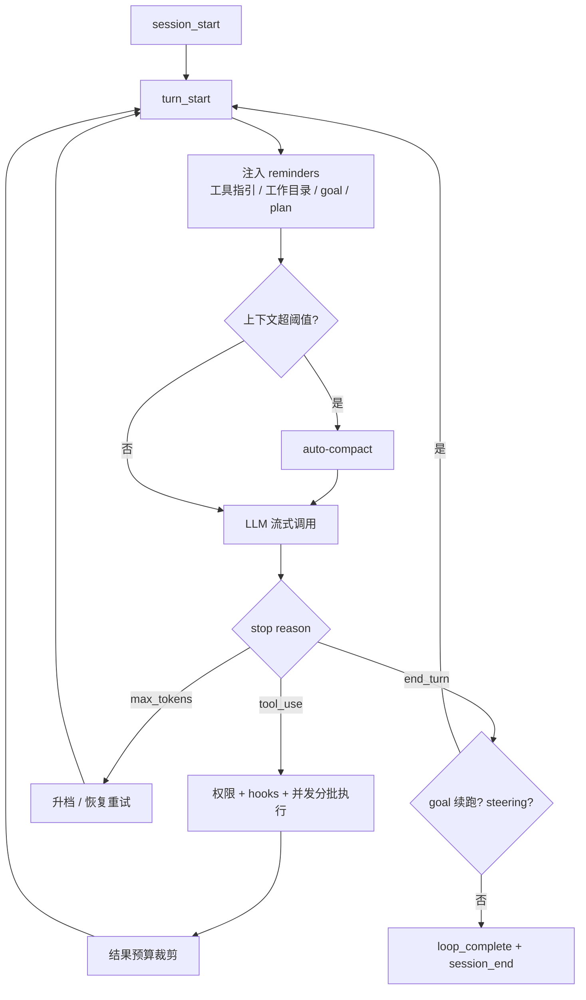

本篇是「Agent 执行循环与工具体系」题库精讲：88 题。项目事实全部来自 `yukino-code`（HEAD `7b9add5`）的 `apps/yukino/src/` 实读——`agent/`、`tools/`、`permissions/`、`hooks/`、`compact/`、`memory/`、`subagent/`、`teams/`、`goal/`、`todo/`、`sandbox/`、`worktree/`、`workflow/` 等模块，引用路径相对该目录。



## 一、Agent 循环与状态机

### Q1. agent loop 和单轮 chat 的本质区别是什么？

单轮 chat 是「请求 → 响应」的纯函数；agent loop 是**以 LLM 为决策核心的状态机**：模型每轮可以选择调用工具，宿主执行后把结果回填上下文，再让模型继续决策，直到模型主动结束（end_turn 且无工具调用）。这就是 ReAct（Reason + Act）模式的运行时形态——推理与行动交替，观察结果修正下一步。循环的终止条件、错误恢复、预算控制全部是宿主的责任，模型只负责「下一步做什么」。

### Q2. 项目的一轮循环具体做哪些事？

`Agent.run()`（`agent/index.ts`）每轮顺序：① 组装工具 schema（按协议 + toolFilter）；② 注入动态 reminder（工具指引、工作目录、goal、plan mode、协调者、deferred 工具、hook 通知、新 skill）；③ `manageContext` 自动压缩检查；④ `client.stream()` 流式调用，消费 text/thinking/tool_call/usage 事件；⑤ stop reason 分派（max_tokens 恢复、tool_use 执行、end_turn 收尾）；⑥ 工具执行 → 结果预算裁剪 → 回填历史 → 持久化；⑦ 投递 steering 消息；⑧ `turn_end` hook。外层 try/finally 保证 `session_end` hook、goal 结算、telemetry 收尾、max_tokens 升档还原一定执行。

### Q3. stop reason 有哪几种？循环怎么分派？

| stopReason                | 含义         | 循环行为                                         |
| ------------------------- | ------------ | ------------------------------------------------ |
| `end_turn` / `stop`       | 模型主动收尾 | 无工具调用 → 检查 goal 续跑与 steering，否则结束 |
| `tool_use` / `tool_calls` | 需要执行工具 | 执行 → 回填 → 下一轮                             |
| `max_tokens`              | 输出被截断   | 升档一次 + 最多 3 次恢复重试（见 Q7）            |
| `interrupted`（内部）     | 用户取消     | 持久化部分输出后退出                             |

映射发生在协议层：Anthropic 直接给 `stop_reason`；Chat Completions 把 `finish_reason` 显式映射（`length→max_tokens`、`tool_calls→tool_use`、未知值 throw，`llm/openai.ts`）。

### Q4. 为什么空的 assistant 轮次不能持久化？

部分 provider 会结束一轮却不产出任何内容。`agent/index.ts` 注释：空 assistant 消息不携带信息，还会让恢复后的历史**角色交替失效**（Anthropic 要求 user/assistant 严格交替，连续两条 user 会被拒）。所以只有 `fullText || thinkingBlocks.length || toolUses.length` 非空才 `addAssistantFull` + 持久化。同类纪律：max_tokens 零输出时不落空轮次、直接原样重放（再补一条 user 提示同样会破坏交替）。

### Q5. maxIterations 是干什么的？为什么默认 0？

`AgentConfig.maxIterations`（默认 0 = 不限）是循环轮数硬上限，超限发 error 事件终止——防工具调用死循环的最后闸门。默认不限是因为 coding agent 的合法任务本身可能几十上百轮；真正的预算控制交给更细的机制：goal 的 token 预算（Q53）、压缩阈值、以及模型自己的 end_turn。`summarizingGoal` 轮次豁免计数——收尾摘要不应被轮数上限掐死。

### Q6. 运行中插话（steering）怎么实现？为什么在轮边界注入？

`steer(text)` 把消息压入 `steeringQueue`；`deliverSteering()` 在**轮边界**——当前轮工具结果之后、下一次 LLM 调用之前——把队列消息作为 user 消息注入并发 `steering_delivered` 事件。不在流中途注入是因为请求已经发出，内容进不了本次上下文；等整个 run 结束又太迟钝。细节：模型没发工具调用本该收尾时，若队列非空则投递后 `continue` 续命（pi-style）；`removeSteering(inputId)` 支持投递前撤回（如召回编辑器）；投递循环每步检查 abort。

### Q7. max_tokens 截断的完整恢复流程？

三段（`agent/index.ts` + `agent/constants.ts`）：① 升档一次——`maxOutput` 提到 `min(MAX_TOKENS_CEILING=64000, contextWindow)`，已有输出先持久化 + 记 usage 锚点，再注入 `MAX_TOKENS_RESUME_PROMPT`（"Resume directly... Do not apologize or repeat"）；② 仍截断则多轮恢复，上限 `MAX_TOKENS_RECOVERIES=3`，提示词换成 "Break remaining work into smaller pieces"；③ 每次恢复发 `retry` 事件（reason 带计数 `max_tokens recovery 2/3`）供 UI 展示。截断轮的工具调用参数全部打 `MAX_TOKENS_TRUNCATED_ARGS_NOTICE` 的 parseError——不执行、让模型重发。finally 里还原升档前的 maxOutput。

### Q8. 用户中断（abort）后系统怎么收敛？

`AbortSignal` 贯穿全链路，每个检查点行为不同：流消费中 abort → 停止消费，**已生成的部分文本/thinking 仍持久化**（`addAssistantFull`）再发 `loop_complete{interrupted}`；工具执行中 abort → 未启动的调用统一回填 `COMMAND_INTERRUPTED_ERROR` 的 error result（保证每个 tool_use 有配对结果），已记录的结果保留后直接结束循环——注释：不再烧一次注定中止的 LLM 调用；重试等待中 abort → `interruptibleSleep` 提前返回 true。收敛原则：**历史完整、配对不破、不浪费调用**。

### Q9. 会话持久化为什么放在主循环而不是各前端？

`persistLastMessage()` 的注释：UI 与 Web 前端共享同一条记录路径，保证中间 assistant 文本与完整工具链都被捕获，会话恢复才可能忠实。每条消息追加写入 session `.jsonl`（`session/constants.ts`），带秒级时间戳；subagent 用独立的 `transcript.jsonl`，不与 leader 历史混写。压缩发生时另写 `compact_boundary` 记录（`saveTranscriptCompactBoundary`），恢复时知道哪里被重写过。会话 30 天过期（`SESSION_EXPIRY_DAYS`）。

### Q10. 进程崩溃后怎么诊断？哪些「错误」不算崩溃？

`recover.ts` 把生命周期事件（start/exit/crash）追加进 `~/.yukino/crash.log`，写入失败静默忽略——**诊断代码自己绝不能崩进程**。关键判别：终端消失（关窗、VS Code 主进程死亡、ssh 断开、pty 拆除）会让后续所有 stdio 写入报 EIO/EPIPE/ERR_STREAM_DESTROYED，注释明确这是「会话的终端没了，不是 yukino 的故障」，不得记为 crash。这道题的通用形态是：**区分「系统环境失效」与「程序缺陷」是崩溃分类的第一原则**。

### Q11. 怎么设计可确定性回放的 agent harness？

**方案推导**（以项目机制为基）：① 输入侧——session jsonl 完整记录每条消息与工具结果，`ensureToolPairing` 的「存储真实、发送修补」分离保证回放素材未被污染；② 随机性侧——固定 thinking 档位与 provider 配置，记录每轮 usage 与模型版本（telemetry `registerLlmClient` 带 model/protocol）；③ 工具侧——回放时用记录的工具结果替代真实执行（mock executor），文件类工具配合 FileStateCache 的 mtime 快照；④ 断言侧——对比事件流（AgentEvent 序列）而非仅最终文本。项目未实现完整回放器，但持久化与事件流设计已为此留好接口。

## 二、工具注册与 schema

### Q12. ToolRegistry 的所有权模型是什么？

`tools/registry.ts` 区分 `register`（拥有所有权，dispose 时调用 `tool.dispose?.()`）与 `registerBorrowed`（只挂载不拥有）；`takeOwnershipFrom(source)` 在两个 registry 间转移所有权（subagent 复用父 registry 的工具但接管部分生命周期）。`dispose()` 幂等（`disposal ??=` 缓存 Promise），disposed 后 register/addCleanup 全部 throw。这套设计解决「工具被多个 agent 共享时谁负责关」的问题——MCP 连接、后台任务这类持有资源的工具必须有明确 owner。

### Q13. dispose 为什么用 allSettled 而不是 all？

清理要**尽力而为**：一个工具 dispose 失败不能阻止其他工具释放资源（MCP 子进程、文件句柄、定时器）。`Promise.allSettled` 收集全部结果，把 rejected 的聚合成 `AggregateError` 最后抛——既保证全部尝试，又不吞错误。`Promise.all` 会 fail-fast，第一个失败后其余清理悬空，是资源泄漏的经典来源。

### Q14. 工具可见性为什么必须「一处判定、处处一致」？

`getAllSchemas`（发给模型的 schema）与 `listVisibleToolNames`（reminder 里告知模型的可用工具清单）共享同一个 `isToolVisible` 谓词，注释点名原因：任何「广告可用工具」的地方（比如压缩恢复附件）必须与实际可调用的集合一致——两处规则漂移会让模型调用一个「看得见但发不出」的工具，或反之。谓词三条件：调用方 filter、ToolSearch/McpCall 的暴露开关、deferred 隐藏规则。

### Q15. deferred 工具与 ToolSearch 发现机制怎么工作？

MCP 工具默认 `deferred = true`（`mcp/tool-wrapper.ts`），不进模型可见列表。发现路径：模型调用 `ToolSearch(query)` → `searchDeferred()` 在 deferred 池里按名称/描述子串匹配（上限 5 条）→ `markDiscovered(name)` 后该工具进入可见集。native 模式下工具留在 tools[] 但带 `defer_loading`，由服务端对模型隐藏、ToolSearch 返回 `tool_reference` 让服务端展开 schema；dispatch 模式下 deferred 工具完全不进 tools[]，统一走 `McpCall` 单入口。`unregister` 同时清 discovery 状态，重新注册的同名工具回到 deferred——`/mcp reload` 依赖这个语义。

### Q16. getDeferredToolNames 为什么必须字典序排序？

注释原话：排序不是装饰——调用方拿这个列表**做集合变更检测**（与上轮公告比较，决定要不要重新注入 deferred 工具指引）。不稳定顺序会让同一集合产生不同文本，比较永远不等，reminder 每轮重发，既浪费 token 又破坏 `addSystemReminderIfChanged` 的去重。凡是「序列化后做 diff」的数据，顺序必须是规范化的。

### Q17. 工具分类（read/write/command）在系统里起什么作用？

`ToolCategory` 是权限与并发的枢纽：权限矩阵按类别决定 default 模式下 ask 还是 allow（read 自动放行，`permissions/index.ts` `modeDecide`）；并发安全兜底按类别判定（`category === "read"` 默认可并行，`agent/index.ts` `partitionToolCalls`）；plan mode 按类别拒绝一切非 read 变更。分类是**粗粒度默认值**，细粒度由工具自己的 `isConcurrencySafe(args)` 与权限规则覆盖。

### Q18. 面向模型的错误信息应该怎么写？

项目的错误文案是范本（`tools/constants.ts`）：`FILE_NOT_READ_ERROR` = "file has not been read yet, read it first before editing"——**说明状态 + 给出下一步动作**；`GREP_PATTERN_TIMEOUT_ERROR` 直接教模型改法（"avoid nested quantifiers such as (a+)+"）；`NOT_IN_PLAN_MODE_CONTINUE_ERROR` 纠正工具误用并指明正确工具（"AskUserQuestion is for clarification, not approval"）。错误是模型自我修正的唯一反馈通道，写「Error: invalid input」等于浪费一轮。

### Q19. exit code hints 解决什么问题？

shell 退出码语义因命令而异：`grep` 退出 1 是「无匹配」不是失败，`diff` 退出 1 是「文件不同」，`robocopy` 1/2/4 都算成功。`EXIT_CODE_HINTS`（`tools/constants.ts`）按命令名映射退出码到人类可读解释，`GENERIC_HINTS` 覆盖通用码（126 不可执行、127 不存在、137 SIGKILL/OOM、141 SIGPIPE、143 SIGTERM）。没有这层翻译，模型会把「搜到了 0 条」当成「搜索坏了」而反复重试。

## 三、工具执行与并发

### Q20. StreamingExecutor 的提交/执行模型是什么？

`agent/streaming-executor.ts`：`submit()` 把调用压入 pending（快照当时的权限模式 `approvedPermissionMode`——审批期间模式变了也按提交时语义执行）；`runPending()` 一次性并发启动全部 pending，然后**按提交顺序 yield 结果**。串行批则每 submit 一个立即 runPending。执行体 `executeCall` 统一处理四类前置失败：parseError（参数损坏，不执行）、abort（`EXECUTION_CANCELLED_ERROR`）、未知工具（error result，循环继续让模型自纠）、执行异常（catch 后转 error result）——**任何路径都产出结果，绝不悬空**。

### Q21. 「完成乱序、产出有序」是怎么实现的？为什么？

`runPending()` 用 `completed` 数组 + `wake` 回调：每个执行完成就 push 并唤醒消费者；消费者按 index 顺序检查，`index === completed.length` 时挂起等待。效果：并发执行拿到墙钟收益，yield 顺序恒等于提交顺序。为什么必须有序：工具结果按顺序回填进同一条消息，模型看到的顺序应与它发出的顺序一致；UI 渲染同理。若按完成序 yield，慢的 ReadFile 会排到快的 Grep 后面，历史与预期错位。

### Q22. 并发安全分批的判定标准是什么？

`partitionToolCalls()`（`agent/index.ts`）：`safe = tool.isConcurrencySafe?.(args) ?? tool.category === "read"`——**由本次调用的实际参数决定，不是工具类别一刀切**。注释举例：`ls` 和 `rm` 都是 Bash，前者可与 ReadFile 并发，后者必须独占。连续 safe 调用合并为一个并发批；unsafe 调用单独成批串行执行。分批是贪心的：safe→safe 合并，遇到 unsafe 断开。

### Q23. 同一工作区的变更怎么串行化？

`tools/execution-coordinator.ts`：`acquireWorkspaceMutation(cwd)` 按 canonical 路径维护每工作区一把互斥队列（running + pending waiters），返回释放函数；队列排空时删除 key 防泄漏。`acquireCommandExecution` 是智能入口：`isSafeCommand` 的只读命令**直接放行不排队**，其余命令按工作区串行。等待支持 abort（从 pending 里摘除自己并 reject）。这解决「并行工具批里两个写操作打架」与「后台任务与前台编辑竞争」两类问题。

### Q24. read-before-edit 是怎么强制的？

`tools/file-state-cache.ts`：ReadFile 成功后 `record(path, mtimeMs)` 登记「模型见过此文件」；EditFile/WriteFile 前置检查——没读过报 `FILE_NOT_READ_ERROR`，读过但 mtime 变了报 `FILE_MODIFIED_ERROR`（外部改动，要求重读），文件没了报 `FILE_DELETED_ERROR`。key 统一走 `canonicalPath`（注释：symlink 别名与 macOS `/tmp → /private/tmp` 平台别名绝不能「一个名字记录、另一个名字检查」），canonical 失败回落 `resolve`。这是防「模型凭幻觉记忆改文件」的机械闸门。

### Q25. 工具结果预算的完整机制？

见 [LLM 与推理基础](/interview/qa/llm-fundamentals) Q70，此处补执行细节：spill 文件写入会话工件目录 `tool-results/<toolId>.txt`（`tool-result/index.ts` `spillDir`）；`replaceToolResultContent` 同时替换文本 fallback 与富文本块，保证两个通道一致；`isSpillReadback` 按「工具名 + 参数路径落在 spill 目录」识别读回调用并豁免；`applyBudget` 在整批结果入历史**之前**处理聚合超限——注释：消息从一开始就是最终形态，不存在「先入历史再裁剪」的中间态。匿名会话（无 sessionId）的工件目录注册 exit cleanup，进程退出即删。

### Q26. 后台任务怎么管理？通知预算是什么？

`BACKGROUNDABLE_TOOL_NAMES = ["Bash", "PowerShell"]`（`tools/constants.ts`），Ctrl+B 把前台命令转后台。输出治理三层：磁盘上限 `MAX_SHELL_OUTPUT_FILE_BYTES = 5GB`（独立于展示限制）、`SIZE_WATCHDOG_INTERVAL_MS = 500` 周期检查输出体积、完成通知只带 `BACKGROUND_NOTIFICATION_BYTES = 30_000` 字节预算内的预览——大输出留在磁盘，通知里给路径。任务注册进本循环的 `TaskManager`（`AgentConfig.taskManager`，subagent 传自己的；显式 `null` 禁用后台能力），完成后经 `notificationFn` 在下一轮以 reminder 形式浮出。

### Q27. shell 命令的超时与终止怎么设计？

`DEFAULT_TIMEOUT = 120s`、`MAX_TIMEOUT = 600s`（`tools/constants.ts`）；终止是两段式：SIGTERM 后给 `KILL_GRACE_MS = 3000` 优雅期，仍未退出升级 SIGKILL。前台输出展示上限 `MAX_SHELL_OUTPUT_BYTES = 10MB`。超时值必须校验（`TIMEOUT_INVALID_ERROR`：有限正数）。**采分点**：只发 SIGKILL 会让子进程没机会清理（临时文件、锁）；只发 SIGTERM 会对忽略它的进程失效——两段式是标准答案。

## 四、权限模型

### Q28. 四种权限模式的决策矩阵是什么？

`modeDecide()`（`permissions/index.ts`）按「模式 × 工具类别」出默认效果：

| 模式                | read  | write | command |
| ------------------- | ----- | ----- | ------- |
| `default`           | allow | ask   | ask     |
| `acceptEdits`       | allow | allow | ask     |
| `plan`              | allow | deny  | deny    |
| `bypassPermissions` | allow | allow | allow   |

这是**最后一层兜底**（Layer 6），前面还有规则引擎、路径沙箱、安全命令白名单等层（Q29）。`readOnly` 标志强制等效 plan 模式（mode getter 第一行）。

### Q29. checkAction 的六层决策管线是什么？

`permissions/index.ts` `checkAction()` 顺序：

```text
0. plan mode 变更拒绝（例外: 协调工具 / plan 文件写 / 安全命令）
1. 显式规则 deny/ask → 立即返回（allow 记下继续）
1.5 plan 协调工具 allow；teammate 协调工具 allow
2. 安全只读命令 auto-allow（isSafeCommand）
3. 空命令 ask；复杂 shell 语法 ask（analyzeShell 不完整时）
3.5 sandbox auto-allow（仅 Bash，且 sandboxEnabled + sandboxAutoAllow）
4. write 类路径越界 → ask（PathSandbox）
5. 规则引擎 allow 生效
6. 模式矩阵兜底
```

整个 check 包在 try/catch 里：**路径解析失败一律 deny**——权限代码的异常必须 fail-closed。

### Q30. 规则优先级为什么是 deny > ask > allow？

`evaluateRules()`：deny 命中立即返回（最严效果不可被覆盖）；ask 记录但继续扫（可能被后面的 deny 升级）；allow 只在没有更严命中时记录（`hit ??= "allow"`）。若 allow 能压 deny，一条 `Bash(*)` allow 就会废掉所有安全规则——**权限系统的合并语义必须单调向严**。规则来自两个 YAML（用户级 `~/.yukino/permissions.yaml` + 项目级），格式 `Tool(pattern)` + effect，`RULE_RE` 解析。

### Q31. isSafeCommand 怎么防「安全前缀」被滥用？

两道闸（`permissions/index.ts`）：① 含任何 shell 元字符 `[\r\n&|;<>`(){}[\]]` 直接不安全——注释：`cat` 这样的安全前缀绝不能成为管道/链式/重定向/命令替换的入口（`cat x; rm -rf /` 被拒）；② 前缀匹配要求完全相等或后跟空格/制表符（`catalog`不会命中`cat`）。`SAFE_PREFIXES`（`permissions/constants.ts`）是白名单：echo/wc/grep/head/tail/cat/stat/diff/ls 类只读命令 + `/^docker\s+(?:ps|images)/`正则。正则前缀每次匹配前重置`lastIndex`——防 `g`/`y` 标志的状态残留。

### Q32. 复杂 shell 语法为什么要单独 ask？

`analyzeShell` 解析命令结构，`COMPLEX_COMMANDS`（`permissions/constants.ts`）列出 if/for/while/case/eval/exec/source/sudo/bash/xargs/find 等控制流与再入命令。解析不完整（嵌套、引号、转义超出分析器能力）时非 bypass 模式一律 ask——**分析器看不懂的命令就是不可信命令**。这与 Q31 互补：白名单管「简单且安全」，语法分析管「复杂但可能合法」，两者之间没有静默放行的缝隙。

### Q33. 规则文件怎么做到热更新且不重复解析？

`RuleEngine`（`permissions/index.ts`）缓存每个规则文件的 `{mtimeNs, size, rules}`；每次决策 stat 两个文件，**mtimeNs 与 size 都相同**才复用缓存。注释解释为什么两个都要：文件系统时间戳粒度可能粗（同 ns 内改写），改写也可能保持 size 不变——单一指标都会漏。决策内多次评估（复合命令逐段检查）共享一份快照（memoize）。编辑规则文件后下一次评估即生效，无需重启。

### Q34. allowAlways 怎么持久化？并发写怎么防？

用户在审批弹窗选「always allow」→ `checker.rememberPatterns()` 生成规则 pattern → `appendProjectRule()` 写入项目级 YAML。写入三重防护（`permissions/index.ts`）：`withFileSyncLock` 文件锁防多进程并发；写 `<path>.<pid>.tmp` 再 `renameSync`——**原子替换**，读者永远看到完整文件；finally 里 `rmSync` 清临时文件。持久化的是「审批时展示的 pattern」而非当前路径别名——注释：审批挂起期间路径别名可能变化。

### Q35. PathSandbox 的允许根有哪些？路径怎么归一？

`PathSandbox`（`permissions/index.ts`）默认允许根 = 项目目录 + `os.tmpdir()`（注释点名 macOS 的 temp 是 `/var/folders/...` 不是 `/tmp`，不能硬编码）；`allowExtraRoot` 追加（worktree 注册时自动加）。检查时 `canonicalPath(resolveToolPath(cwd, filePath))` 双重归一（相对路径解析 + symlink/别名 canonical 化）后做前缀包含判断。越界的 write 返回 ask（不是 deny——用户可能确实要写外部路径，交给审批）。

### Q36. subagent 的权限怎么继承？

`forSubagent(cwd, mode)`：复制父 checker 的规则引擎、worktree 登记、沙箱配置，但 `parent = this` 且模式状态独立。mode getter 的传播规则：父或子是 `bypassPermissions` → 取 bypass；父是 `acceptEdits` → 子继承 acceptEdits；否则用子自己的模式。**放宽只向下传、收紧不向上问**——父给了 bypass，子不能假装严格；父严格时子不能自我放宽。teammate + `requiresLeaderPlanApproval` 时 plan 模式保持（等 leader 批计划）。

### Q37. ask 决策但没有审批处理器时发生什么？

`decision.effect === "ask" && !this.onPermissionRequest` → 直接产出 error result："Permission required, but this agent has no approval handler. The tool was not executed."（`agent/index.ts`）。典型场景：无头/print 模式、被裁剪掉 AskUserQuestion 的 subagent。设计原则：**ask 不能静默降级为 allow，也不能挂起等待不存在的用户**——显式失败并告诉模型原因，模型可以改走不需要审批的路径或如实上报。

### Q38. MCP dispatch 调用的双重权限检查怎么做？

dispatch 模式下模型调用 `McpCall(server, tool, arguments)`，权限要查两层：wrapper（McpCall 本身，content 为 `server__tool` 派生串，支持 `McpCall(linear__*)` 这类按服务器/按工具的规则）与 target（真实 MCP 工具名 + 内层 arguments）。合并规则（`agent/index.ts`）：任一 deny → deny；任一 ask → ask；特例——wrapper 被规则显式 allow 而 target 仅因模式矩阵 ask 时，以 wrapper 的 allow 为准（用户已对该服务器整体授权）。**采分点**：单入口聚合工具必须「入口 + 目标」双查，否则规则粒度退化到入口级。

## 五、Hooks 体系

### Q39. 项目支持哪些 hook 事件？

九个（`hooks/index.ts` `EventName`）：`session_start / session_end / turn_start / turn_end / pre_send / post_receive / pre_tool_use / post_tool_use / shutdown`。生命周期钩子由 agent 循环的 `fireLifecycle` 触发；`pre_tool_use` 走专用 `firePreToolHooks`（返回 rejected/reason，可拦截工具执行）；`post_tool_use` 在结果产出后触发，能拿到 toolName/args/output/filePath。hook 输出的文本经 `recordNotification` 排队，下一轮以 system-reminder 浮出给模型。

### Q40. hook 有哪几种 action？为什么 agent 类型在校验期就被拒？

四种：`command`（shell 命令，注入 `YUKINO_EVENT/YUKINO_TOOL/YUKINO_FILE_PATH` 环境变量）、`prompt`（静态文本）、`http`（fetch，GET/HEAD 无 body，其余 POST JSON context，`AbortSignal.timeout(30s)` 与外部 signal 合并）、`agent`（跑一个子 agent）。`validate()` 对 agent 类型**无条件报错**："not supported yet — use command or prompt instead"，注释：没有宿主注册 agent runner，接受配置只会把失败推迟到运行时，而默认 `on_error: "ignore"` 会把它吞掉——**校验期拒绝优于运行期静默失败**。

### Q41. async hook 的语义边界是什么？

`async: true` 的 hook 后台执行不阻塞主流程，完成后输出进通知队列。硬约束：**`reject` 与 `async` 互斥**（validate 报错）——异步结果无法同步拦截 pre_tool_use，工具早已执行。异步失败按 `on_error` 处理：`ignore` 只记日志，其余把错误文本浮出；once 型异步 hook 失败时释放 once 槽位（下次事件重试）。命令执行统一 30s 超时（`HOOK_TIMEOUT_MS`）+ 10MB 输出上限（`HOOK_MAX_BUFFER_BYTES`），POSIX 显式用 bash、Windows 用平台默认 shell。

### Q42. once hook 的槽位为什么要「先占后释」？

`firedOnce` 集合按 `id:<hookId>` 或 `index:<i>` 作 key，**执行前先占位**，执行失败（同步 throw 或异步 reject）再删除。注释：出错的 once-hook 不算「已触发」，下一个匹配事件应该重试它。若成功后才占位，并发事件会重复执行；若失败不释放，一次性通知永久丢失。这是 exactly-once 语义在「至少一次 + 失败回滚槽位」上的工程近似。

### Q43. hook condition 用 new Function 编译，安全吗？

`compileCondition` 把条件字符串编译成 JS 表达式（参数 event/tool/filePath/message/args）。注释给出安全论证：**配置文件已经通过 command action 授予了任意 shell 执行权**，对同一来源的表达式求值不增加新权限——威胁模型里「能写配置的人 = 能执行任意命令的人」。边界：求值异常 catch 后返回 false（fail-closed）+ 记日志。若 hook 配置来源不可信（如项目级配置随仓库分发），这个假设就不成立，必须换沙箱求值——面试要能主动说出这个前提。

### Q44. hook 输出怎么回到模型上下文？为什么不当场注入？

`fire()` 收集各 hook 的 stdout/响应文本，非空的经 `recordNotification` 入队；agent 循环在**下一轮开头**统一 `drainNotifications()` 注入为 system-reminder 并立即持久化（`agent/index.ts` 注释：pre_send/turn_start 的通知也必须持久化，恢复时不能静默丢掉已发给模型的输出，每条恰好写一次）。不当场注入因为 hook 触发点在请求组装前后各处，统一在轮首 drain 保证注入位置可预期、且与 reminder 机制共用去重与转义。

## 六、上下文压缩与恢复

### Q45. auto-compact 的触发与执行流程？

每轮 LLM 调用前 `manageContext()`（`compact/compact.ts`）：`currentContextTokens`（usage 锚点 + 增量估算）越过 auto 阈值 → `doCompact`。执行：切分「待摘要前缀」与「保留尾部」（Q46）→ 用同一 client 以受限工具集请求摘要 → 校验 `<summary>` 协议 → 重写会话（摘要消息 + 恢复附件 + 逐字尾部）→ 写 `compact_boundary` 到 transcript → 返回 boundary 供 agent 持久化并发 `compact` 事件。压缩后 agent 调 `restoreContext()` 重注入指令/记忆/skills，并重发工具指引与 deferred 指引 reminder。

### Q46. 保留尾部怎么选？三个常量的分工？

`computeKeepStartIndex` 从尾部向前走，双「足够」条件 + 一个上界（`compact/constants.ts`）：**下界** `KEEP_RECENT_TOKENS = 10000`——走到保留尾部至少 1 万 token；**底线** `MIN_KEEP_MESSAGES = 5`——再短也保 5 条；**上界** `KEEP_MAX_TOKENS = 40000`——再加一条就超 4 万则停，但最近一条永远保留（哪怕单条超限，尾部可以超出上界）。另有退化守卫 `MIN_COMPACT_PREFIX = 2`：待摘要消息少于 2 条就跳过压缩——省下的钱抵不上摘要往返与缓存损失。

### Q47. 摘要输出协议为什么用 <summary> 标签？

摘要模型被指示把答案包在 `<summary>...</summary>` 里（`SUMMARY_BLOCK_RE` 提取），前面允许出现自发的 `<analysis>` 块但会被剥掉（`ANALYSIS_BLOCK_RE`）。标签协议的价值：① 机械可校验——提取不到 summary 就是 `COMPACTION_EMPTY_SUMMARY_ERROR`，不会把半截分析当摘要用；② 容忍模型「想出声」——analysis 随便写，不污染结果。同类设计贯穿项目：goal 的 `--budget` 参数用正则解析、记忆抽取用 `MEMORY_NAME:` 行协议。

### Q48. 压缩请求本身怎么防跑偏？

四道防线（`compact/compact.ts` 常量）：摘要轮**禁用工具**——请求了工具直接 `COMPACTION_TOOL_CALL_ERROR`；流没有终态事件 → `COMPACTION_STREAM_INCOMPLETE_ERROR`；摘要期间会话被并发修改 → `COMPACTION_CONVERSATION_CHANGED_ERROR`，保留现有历史放弃本次压缩；连续失败 `MAX_CONSECUTIVE_FAILURES = 3` 次后停止自动尝试。输出预算专门放大：`SUMMARY_ANSWER_RESERVE_TOKENS = 16_000` 传入 stream options，防固定 thinking 预算把摘要挤到 1024 token 的答案下限（呼应 [LLM 基础](/interview/qa/llm-fundamentals) Q59）。

### Q49. 压缩请求自己超窗（PTL）怎么办？

`MAX_PTL_RETRIES = 3` 次重试，每次丢弃约 1/5 的最旧 API 轮次：token 缺口按 `prefixTokens / PTL_TRUNCATE_DIVISOR` 估算，provider 没报可用缺口时就按这个比例丢「API 轮次组」（`groupMessagesByAPIRound` 保证 tool_use/tool_result 成组丢弃，不破配对）。丢弃后在头部留合成 user 消息 `PTL_RETRY_MARKER`（"[earlier conversation truncated for compaction retry]"）维持角色交替。**采分点**：压缩是「用 LLM 修 LLM 的上下文」，它自己也会超窗，必须有无 LLM 参与的降级路径（机械截断）。

### Q50. 压缩后模型「忘了刚读过的文件」怎么补救？

恢复附件机制（`compact/constants.ts` + `compact/recovery.ts`）：`RecoveryState.recordFileRead(path, output)` 在每次 ReadFile 成功时快照**模型实际看到的文本**（`agent/index.ts` `processToolResult`，注释：与模型所见对齐，不是重新读盘）；压缩时把最近读过的至多 `RECOVERY_FILE_LIMIT = 5` 个文件、每个至多 `RECOVERY_TOKENS_PER_FILE = 5000` token 的快照附在摘要消息后。附件里还带当前可见工具清单（`listVisibleToolNames`，与 Q14 的一致性纪律呼应）。

### Q51. 压缩后哪些内容必须重注入？为什么用函数形式？

`Agent.restoreContext()` 重注入三样：项目指令（AGENTS.md 等）、记忆内容、skills（可用列表 + 激活中的 SOP），经 `conversation.injectLongTermMemory` 进 system-reminder。`AgentConfig.instructions/memoryContent` 支持**函数形式**，注释：每次（重）注入时重读当前内容——长寿命宿主不会注入过期的启动快照。压缩重写历史会连带冲掉这些注入，所以 `mc.compacted` 为真时必须 restore，工具指引与 deferred 指引 reminder 也要重发。

### Q52. compact_boundary 记录什么？会话回退（rewind）怎么保证原子？

boundary 是压缩重写 transcript 的元数据（摘要位置、被折叠的范围），先 `saveTranscriptCompactBoundary` 持久化再发布事件——恢复时能区分「原始历史」与「压缩后历史」。回退用临时文件协议：`REWIND_TMP_SUFFIX = ".rewind-tmp"`（`session/constants.ts`），写临时文件再原子替换，`REWIND_TMP_PATTERN` 用于启动时清理残留——崩溃在替换前只会留下可识别的垃圾文件，不会损坏主 transcript。

## 七、记忆系统

### Q53. 项目的记忆分几层？索引怎么控制体积？

两层目录：用户级 `~/.yukino/memory/` 与项目级 `<project>/.yukino/memory/`（`memory/manager.ts`），每条记忆是带 frontmatter（name/description/type）的 md 文件，默认 type 为 `reference`。索引文件 `MEMORY.md` 有硬上限：`MAX_ENTRYPOINT_LINES = 200` 行或 `MAX_ENTRYPOINT_BYTES = 25_000`，先到为准（`memory/constants.ts`）——行数上限同时约束每目录保留的 header 数量（新者优先）。**记忆索引本身要进每轮上下文，不限体积等于慢性上下文中毒**。

### Q54. 记忆召回怎么做到不阻塞主链路？

非阻塞预取模式（`agent/index.ts`）：宿主在 LLM 调用**之前**发起 `memoryRecallPromise`（选择器用独立 LLM 调用挑相关记忆，`SELECTOR_ANSWER_RESERVE_TOKENS = 4000`、至多 `MAX_SELECTED_MEMORIES = 5` 条）；构造时挂 then/catch 置 `memoryRecallSettled` 标志；主循环在工具执行后**只读标志不 await**——settled 才注入 reminder，没好就本轮放弃。注入成功才调 `onMemoriesSurfaced(paths)`，未消费的召回不留痕迹、下次仍可被选。召回与主调用并行，延迟被工具执行时间掩盖。

### Q55. 记忆写入怎么筛选？什么东西不配进记忆？

后台抽取（`memory/background.ts` + `extractor.ts`）：run 结束后 fire-and-forget 触发（`onLoopComplete`），门槛 `MIN_EXTRACT_MESSAGES = 2`、摘要窗口 `EXTRACT_SUMMARY_WINDOW = 40` 条、摘要行最短 `MIN_SUMMARY_LINE_CHARS = 12`。抽取 sub-agent 工具被裁剪到 `MEMORY_TASK_TOOLS = {ReadFile, Grep, Glob, WriteFile, EditFile}`，迭代上限 `EXTRACTION_MAX_ITERATIONS = 5`；无可存内容时输出哨兵 `NONE`。**写入筛选的原则**：存「跨会话仍成立的偏好与事实」，不存任务过程细节——后者属于 session transcript。

### Q56. 记忆整合（consolidation）怎么防并发与过频？

`memory/consolidation.ts` + 常量：触发门槛 `DEFAULT_MIN_HOURS = 24` 且 `DEFAULT_MIN_SESSIONS = 5`（距上次整合至少一天、至少积累 5 个会话）；`SCAN_THROTTLE_MS = 10min` 限制扫描频率；双锁文件 `.consolidate-lock` 与 `.consolidate-running` 防多进程同时整合；整合 sub-agent 迭代上限 `CONSOLIDATION_MAX_ITERATIONS = 15`。整合做的是去重、合并、淘汰过期条目——**记忆系统没有 GC 就会退化成垃圾场**。

### Q57. 为什么读记忆文件也要过权限检查器？

`MemoryManager.readMemory` 先 `checker.check("ReadFile", "read", {file_path})`，非 allow 直接返回 null；`scanAllMemories` 对目录同样先查 Glob 权限。原因：记忆内容会被注入模型上下文，**记忆目录是数据进入模型的一条隐蔽通道**——如果权限系统禁止读某路径（deny 规则、隔离 worktree），记忆机制不能成为绕过路径。同族防御：malformed 记忆按 `mtimeMs:size` 指纹去重报错日志，坏文件不刷屏。

### Q58. 两条记忆冲突（用户偏好变了）怎么裁决？

**方案推导**（项目未实现自动裁决）：① 时间优先——新会话抽取的偏好覆盖旧条目，整合期按 mtime 淘汰；② 来源分级——用户显式写入 > 抽取推断（frontmatter type 可承载）；③ 冲突保留双方 + 标注时间，让模型在上下文里看到演变（与 RAG 的「冲突保留双方」同一原则）；④ 拒绝写入模糊项——抽取器拿不准就输出 NONE。关键立场：记忆是**低置信度通道**，裁决规则要保守，错误记忆比没有记忆更贵。

## 八、Subagent 与 Team 协作

### Q59. subagent 和 teammate 有什么区别？

`AGENT_KINDS = ["subagent", "teammate"]`，默认 teammate（`subagent/constants.ts`）。**subagent**：一次性任务，结果内联返回，不能收消息、不能续派——完成/失败/取消即离场；**teammate**：持久成员，属于某个 team，有共享任务板与文件邮箱，可被 SendMessage 唤醒续作，上下文跨消息保留。选择标准：需要后续沟通或追加指派 → teammate；纯并发外包 → subagent。fork 参数正交：fork 复制父对话快照，非 fork 从空白开始（需要父上下文却没 fork 报 `FORK_CONTEXT_REQUIRED_ERROR`）。

### Q60. 内置 agent 角色有哪些？只读角色怎么实现？

`BUILTIN_AGENTS`（`subagent/constants.ts`）：`general-purpose`（默认）、`plan`、`explore`、`review`。plan/explore 是**硬只读**：`permissionMode: "plan"` + `readOnly: true` + `disallowedTools: [EditFile, WriteFile, ExitPlanMode]`——三层冗余，权限模式拒绝变更、readOnly 强制 plan 语义、工具直接不存在。review 不禁 ExitPlanMode 但同样无写工具。用户级 md 定义（`~/.yukino/agents/*.md`，frontmatter + 正文）可覆盖内置。

### Q61. 委派 agent 的工具裁剪规则是什么？

三套集合（`subagent/constants.ts`）：**MAIN_AGENT_ONLY_TOOLS**（Workflow/ComputerUse/AskUserQuestion/EnterPlanMode/ExitPlanMode/Goal）从所有委派 agent 剥离，注释给了每个的理由——ComputerUse 争抢唯一物理屏幕、AskUserQuestion 会劫持单例弹窗且并行兄弟竞态挂死、Goal 属于主会话；**SUBAGENT_DISALLOWED_TOOLS** 再加 Agent/TeamCreate/TeamDelete/SendMessage——防递归孵化与团队权限僭越；**ASYNC_AGENT_ALLOWED_TOOLS** 是后台 agent 的白名单（含 ToolSearch+McpCall 必须成对——只看得到 schema 调不动等于没有）。

### Q62. fork 的上下文快照带多少内容？

`FORK_CONTEXT_RECENT_MESSAGES = 5` / `FORK_CONTEXT_FULL_MESSAGES = 100`（`skills/constants.ts`，fork 与 skill 共享该常量组）：fork 复制父对话的近期消息作快照，让子 agent 继承工作现场而非从零解释。取舍：全量复制会让每个 fork 背上完整历史（token 成本 × 并发数），5 条近期 + 任务 prompt 自包含是折中。**给 fork 派活时 prompt 仍要自包含**——快照是背景不是规格书。

### Q63. team 的文件协议怎么设计？为什么用文件而不是内存？

`teams/constants.ts`：团队目录 `teams/<slug>/`，`config.json` 存成员与元数据，`inboxes/` 是每成员的文件邮箱。文件协议的动机：① 跨进程——leader 与 teammate 是独立运行体，内存结构无法共享；② 崩溃可恢复——进程死了状态还在；③ 可审计——邮箱与任务板都是可 cat 的 JSON。并发控制靠文件锁：`LOCK_ACQUIRE_TIMEOUT_MS = 5000`、`LOCK_STALE_MS = 10_000`（超时视为陈旧锁可抢）、退避 5–80ms 随机；邮箱轮询 `IDLE_POLL_INTERVAL_MS = 500`。

### Q64. 团队消息有哪几类？哪些操作只有 leader 能做？

消息类型（`teams/constants.ts`）：`text`、`shutdown_request/response`、`plan_approval_request/response`；广播目标 `*`；leader 邮箱名固定 `leader`。leader 专属：发起 shutdown（`SHUTDOWN_LEADER_ONLY_ERROR`）、审批 teammate 计划（`PLAN_APPROVAL_LEADER_ONLY_ERROR`）、停止 teammate 任务（`TEAMMATE_STOP_LEADER_ONLY_ERROR`）；teammate 只能访问自己的团队（`TEAM_SCOPE_ERROR`）。teammate 的计划由运行时自动批准，但 `requiresLeaderPlanApproval` 开启时 plan 模式保持到 leader 批复。协调类工具（SendMessage/TodoWrite 等 `TEAMMATE_COORDINATION_TOOLS`）在权限层自动 allow（Q29 Layer 1.5）——**协作通道不能被逐次审批卡死**。

### Q65. 共享任务板怎么防止依赖环与写覆盖？

`todo/` 模块：任务存 `tasks.json`，board id 前缀区分 `private:` 与 `team:`；单次 `TodoWrite` 至多 `MAX_TODO_WRITE_ITEMS = 200` 条，**整批原子提交**。依赖校验（`todo/dependencies.ts` `validateTaskDependencies`）：ID 唯一、禁止重复依赖、禁止自依赖（"cannot depend on itself"）、检测环；blocks/blockedBy 维护互反链接。认领用「host 原子写 owner」——`in_progress` 认领时由宿主写入任务者名字，拒绝他人已认领的任务与未完成依赖的开工。写覆盖靠文件锁 + 原子批提交防。

### Q66. 后台任务的生命周期参数有哪些？

`subagent/constants.ts` + `task-manager.ts`：完成任务内存保留上限 `MAX_RETAINED_FINISHED_TASKS = 200`（超出淘汰最旧，`pruneCompleted`）；`TaskOutput` 等待上限 `MAX_TASK_WAIT_TIMEOUT_MS = 60_000`（超范围报 `TASK_WAIT_TIMEOUT_RANGE_ERROR`）；任务记录持久化在 `background-tasks/*.json`（写 `.tmp` 再改名）；被停任务输出 `TASK_STOPPED_OUTPUT = "Stopped by user"`；会话恢复时未完成任务标 `TASK_RESTORE_INTERRUPTED_ERROR`；切换/清理会话前必须先停并等待所有任务（`TASKS_PENDING_*` 错误）。teammate 名字上限 30 字符。

## 九、Goal、TODO 与 Plan mode

### Q67. goal 系统解决什么问题？状态机什么样？

goal 是**用户设定的持久目标**，独立于 TODO：跨轮驱动 agent 续跑（end_turn 后 `goalManager.continuation()` 返回续跑 prompt 则继续循环）。状态：active → `in_progress / complete / blocked`（agent 可报），paused / resumed / cleared（**仅用户可操作**，`GOAL_INVALID_STATUS_ERROR` 明说 "Only the user can pause or resume"）。agent 更新必须带 status + reason（`GOAL_UPDATE_REQUIRES_STATUS_REASON`）。goal 属于主会话，委派 agent 不可用（`GOAL_MAIN_SESSION_ONLY`）。

### Q68. goal 的预算与轮数限制怎么工作？

`--budget <tokens>` 设定 token 预算（`BUDGET_ARG_PATTERN` 解析），每轮 usage 四字段之和累进（`addTokens`）；预算耗尽进入 `budget_limited`：工具调用全部打 `GOAL_BUDGET_LIMITED_NOTICE` parseError 不执行，若允许则进入 `summarizingGoal` 收尾轮——工具全禁（`toolFilter = () => false`）、`maxRetries: 0`、注入 `takeBudgetSummary()` 的摘要 prompt，产完摘要结束。轮数限制 `MAX_GOAL_TURNS = 150`，blocked 上报至多 `MAX_BLOCKED_ATTEMPTS = 3` 次，目标文本上限 `MAX_OBJECTIVE_CHARS = 4000`。

### Q69. plan mode 的完整工作流是什么？

`EnterPlanMode`（仅主 agent）→ 权限切 plan（read allow、变更 deny，例外见 Q29 Layer 0）→ 每轮注入 plan reminder（含 plan 文件路径、是否已存在、可用协调工具清单，`buildPlanModeReminder` 按 12 个能力开关生成不同文案）→ 模型调研后把计划写进**唯一可写文件**（plan file，WriteFile/EditFile 精确路径匹配才放行）→ `ExitPlanMode` 成功 → **run 直接结束**（`exitPlanSucceeded` 分支），把控制权交还用户审批。计划批准前不动任何真实文件——这是「先对齐再执行」的机械化。

### Q70. 为什么 ExitPlanMode 成功要终止整个 run？

`agent/index.ts` 注释："Successful planning pauses execution for user approval."。若不终止，模型会在同一 run 里继续执行刚写完的计划——审批环节被跳过，plan mode 形同虚设。终止后用户在 UI 审阅 plan 文件、切换权限模式、再发起执行 run。同类「成功即停」的设计还有 shutdown_response：teammate 批准关停请求后收尾离场。**采分点**：识别「工具成功 = 流程暂停点」这类反直觉控制流，是读懂 agent 状态机的标志。

### Q71. TODO 板和 goal 的分工是什么？

TODO 是**任务簿记**：分解、认领、依赖、进度，面向「这轮工作怎么组织」，agent 可自由增删改；goal 是**续跑驱动 + 预算闸**：面向「为什么还没停、还能花多少」，只有用户能设/停。TODO 完成不会自动结束 run（模型自己决定 end_turn），goal 的 complete/blocked 上报会改变循环行为（停止续跑）。混用的典型错误：把 goal 当任务列表拆成 20 条——goal 只有一个，拆分属于 TODO。

### Q72. teammate 的计划审批和 subagent 的有什么不同？

teammate 的计划**由运行时自动批准**（宿主注入的 system-reminder 声明了这一点），因为 teammate 是持久协作体，逐计划人审会卡死流水线；但 leader 可开启 `requiresLeaderPlanApproval`，此时 teammate 的 plan 模式保持、计划经 `plan_approval_request` 消息发 leader、只有 leader 能回 `plan_approval_response`（`PLAN_APPROVAL_LEADER_ONLY_ERROR`），且响应必须带 approve 布尔。subagent 没有计划通道——一次性任务用 prompt 对齐，不需要中途审批。

## 十、隔离与工作区

### Q73. worktree 会话怎么保证「只进自己创建的」？

`permissions/index.ts`：`enterWorktree` 要求 worktree 是本次运行时创建的（`worktree.created`）或曾进入过（`enteredWorktrees` 集合），否则 `WORKTREE_NOT_OWNED_ERROR`——**不能把既有 worktree 认领为隔离区**（`ISOLATED_WORKTREE_CLAIM_ERROR`）。同时只能有一个活动会话（`WORKTREE_ALREADY_ACTIVE_ERROR`）。进入后 checker 的 cwd 切到 worktree 路径、原 cwd 记入 `originalCwd` 供退出恢复；worktree 路径自动加入沙箱允许根。slug 限 `[a-zA-Z0-9_-]`。

### Q74. 隔离 worktree 的沙箱根怎么算？

`forWorktree()` 创建隔离 checker：`isolatedRoot = canonical(worktree.path)`，`PathSandbox(isolatedRoot, false)`——**不含 tmpdir**、清空 extraRoots、独立 worktree 登记。`sandboxWriteRoots()` 汇总：isolatedRoot（或 fallback）+ extraRoots + 已注册 worktree 的可写根，去重后交给 OS 沙箱。效果：隔离 agent 的文件写被钉死在自己的 worktree 里，读仍全盘允许（seatbelt profile read 不限制，Q75）。

### Q75. macOS seatbelt 沙箱 profile 长什么样？

`sandbox/seatbelt.ts` `buildProfile()` 动态生成：`(version 1)` + `(deny default)` 起手，放行 `process-exec/process-fork/sysctl-read` 与全盘 `file-read*`；写权限白名单——`/dev/null` 单点放行（shell 重定向需要，注释：不给整个 /dev）+ 每个 allowWrite 路径的 `subpath` 规则；denyWrite 路径**同时发 literal 与 subpath 两条**（注释：避免构建期存在性检查过期）；网络按 `networkEnabled` 全开或全关。路径经 `pathVariants()` 扩展出 realpath 变体——seatbelt 匹配 canonical 路径，`/tmp` 与 `/private/tmp` 两种拼写都要覆盖。profile 字符串里的路径拒绝 NUL/换行（注入防护）。

### Q76. 为什么 sandbox-exec 的路径要硬编码？

`SANDBOX_EXEC_PATH = "/usr/bin/sandbox-exec"`，注释原话："Hardcoded path to prevent PATH injection attacks"。若按名字走 PATH 查找，被沙箱的命令（或先前任何写 PATH 内目录的操作）可以用同名二进制劫持沙箱入口——**用沙箱保护执行，沙箱本身却可被替换**，整个机制归零。同族纪律：Linux 侧 `BWRAP_BINARY_NAME = "bwrap"`；hook 的 command 明确声明走 shell（那是用户配置的特权），而沙箱入口绝不经 shell。

### Q77. worktree 之间共享哪些配置？为什么？

`SHARED_AGENTS_ENTRIES = [AGENTS.md, skills/]`（`worktree/constants.ts`）：项目指令与技能目录在新建 worktree 时共享（链接/复制），其余工作区文件独立。理由：AGENTS.md 与 skills 是**项目级约定**，隔离的是代码变更而不是行为规范——子 worktree 里 agent 若丢了项目指令，行为会与主工作区不一致。git 细节：worktree 的 `.git` 是指针文件（`gitdir:` 前缀），ref 解析深度上限 `MAX_REF_RESOLUTION_DEPTH = 64` 防符号引用环，ref 名过 `SAFE_REF_RE` 白名单。

### Q78. 文件历史快照怎么支撑回退？

`FileHistory.makeSnapshot(conversationLen, summary, sessionLineCount)` 在三个时点打快照：run 开始（摘要取最近 user 消息）、goal 续跑轮开始（取本轮输出前 60 字符）、run 正常结束（输出截 60 字符做摘要）。快照绑定「对话长度 + transcript 行数」两个坐标，回退（rewind）时三者对齐：会话消息截断到该长度、transcript 重写到该行数、文件系统按快照恢复——**代码、对话、日志三个时间轴必须同步回退**，只回退其一会让模型基于不存在的文件状态继续工作。

## 十一、工具实现细节与 Workflow 引擎

### Q79. ReadFile 的三层限额分别防什么？

`tools/constants.ts` 三个常量三层目的：**准入层** `MAX_READ_FILE_BYTES = 10MB`——超过直接拒读（注释：内存边界，防把多 GB 文件读爆堆）；**行数层** `DEFAULT_LIMIT = 2000` 行——默认窗口，配合 offset 分页读；**输出层** `MAX_READ_BYTES = 50KB`——文本输出上限，截断后要求按读回提示继续。三层缺一不可：只限行数会被单行 10MB 的压缩文件穿透，只限字节会让模型一次吞下无法消化的内容。读回协议（offset 是 0 基、显示行号 1 基）在工具描述里显式声明——**分页语义必须无歧义，否则模型会重复读或漏读**。

### Q80. Grep 为什么要重写正则的 \w \b \d？

JS 正则即使开 `u` 模式，`\w/\b/\d` 仍是 ASCII-only，而 ripgrep 默认 Unicode-aware——不重写则 `\w+` 匹配不到中文、`\b` 在 CJK 旁边失效。`tools/constants.ts` 的 `TOP_LEVEL` 映射表把它们改写为 property escape：`\w → [\p{L}\p{M}\p{N}_]`、`\d → \p{Nd}`、`\b` 改写为前后看断言组合；字符类内部（`IN_CLASS`）只展开 `\w/\d`——`\b` 在类内是退格符、补集类无法内联。另有灾难性回溯防护：模式匹配限时 2–10s（`MATCH_MIN/MAX_TIMEOUT_MS`），超时报 `GREP_PATTERN_TIMEOUT_ERROR` 并教模型改写（避免 `(a+)+` 嵌套量词）。

### Q81. 文件遍历的安全边界有哪些？

Glob/Grep 共享一组遍历限制（`tools/constants.ts`）：`SKIP_DIRS` 固定跳过 `.git/.agents/.yukino/node_modules/dist/__pycache__/.next/.venv/.mypy_cache`（注释：是固定目录而非 .gitignore 规则，也不跟随目录 symlink）；单次遍历上限 `DEFAULT_MAX_TRAVERSED_ENTRIES = 10_000` 条目、`DEFAULT_MAX_TRAVERSAL_DEPTH = 25` 层；搜索输出上限 `MAX_SEARCH_OUTPUT_BYTES = 50KB`、匹配行上限 `MAX_RESULTS = 500`、单匹配行 2000 字节、二进制嗅探前 8KB（`BINARY_SNIFF_BYTES`）；超过 `MAX_GREP_FILE_BYTES = 25MB` 的文件跳过而非整读——注释：500 匹配上限下巨文件几乎不会贡献模型需要的内容，读它只会尖峰内存。

### Q82. WebFetch 的资源控制怎么做？

四道闸（`tools/constants.ts` 注释原话：让一次 fetch 无法压垮会话）：响应体上限 `MAX_CONTENT_BYTES = 10MB`；请求超时 `FETCH_TIMEOUT_MS = 60s`；转 Markdown 后进模型的内容截到 `MAX_MARKDOWN_LENGTH = 100_000` 字符；缓存按 URL 键控 `CACHE_TTL_MS = 15min`（过期条目访问时丢弃），总预算 `MAX_CACHE_SIZE_BYTES = 50MB` 最旧优先淘汰。另有限制声明：只接 http/https、跟随重定向并报告最终 URL、二进制内容（图片/PDF）拒绝。**缓存同时是性能优化与安全边界**：15 分钟内重复 fetch 同一 URL 不再出网，也压缩了 DNS rebinding 类攻击的时间窗口。

### Q83. diff 类工具的输出为什么要限流？

`CONTEXT_LINES = 3`（上下文行）与 `MAX_DIFF_LINES = 200`（`tools/constants.ts` 注释：防过大 diff 压垮 UI 渲染与上下文窗口）。EditFile 返回的 diff 是模型确认「改对了没」的反馈，但大重构的千行 diff 对确认无益、对上下文有害——截断后模型需要时用 ReadFile 看全量。同类设计：A2A 跨 agent 传输工具输出截 8000 字符（见 [MCP 与 Agent 安全](/interview/qa/mcp-and-agent-security) Q51）——**每个跨边界的内容通道都要有自己的预算**。

### Q84. AskUserQuestion 为什么限制 1–4 个问题且主线程专属？

`QUESTION_COUNT_ERROR = "must have 1-4 questions"`（`tools/constants.ts`）：问题是弹窗式交互，超过 4 个对用户是负担、对模型是逃避决策的借口（把思考外包给用户）。主线程专属的原因见本篇 Q61：单例模态弹窗，委派 agent 会劫持它并与并行兄弟竞态（输家挂死）。配套纪律在提示层：`NOT_IN_PLAN_MODE_CONTINUE_ERROR` 明说 "AskUserQuestion is for clarification, not approval"——**澄清与审批是两个通道，混用会让审批失去审计语义**。

### Q85. Workflow 引擎的资源闸门有哪些？

`workflow/constants.ts`：脚本扩展名限 `.ts/.js/.mjs`；并发默认 `DEFAULT_MAX_CONCURRENCY = 3`、硬顶 `MAX_CONCURRENCY_CAP = 16`（`clampMaxConcurrency` 收敛非法值）；单次 run 总 agent 数上限 `MAX_TOTAL_AGENTS = 1000`、单次调用条目上限 `MAX_ITEMS_PER_CALL = 4096`；run id 过 `RUN_ID_RE` 白名单。token 预算由 `Budget` 类执行（`workflow/budget.ts`）：`total = null` 为无限，`assertCanSpend()` 在每次消耗前检查，超限抛 `BudgetExhaustedError`——**预算检查在花钱之前，不是之后**。

### Q86. Workflow 的可恢复性怎么设计？

每个 run 在 `workflow-runs/` 下有四个持久化产物（`workflow/constants.ts`）：`journal.jsonl`（事件日志，append-only）、`script.js`（编译后脚本快照）、`request.json`（原始请求）、`state.json`（当前状态）。恢复 = 重放 journal + 对齐 state；面板支持 stop agent / stop run / resume（`WORKFLOW_PANEL_HINT`），重复启动同一 run 报 `WORKFLOW_RUNNING_ERROR`。展示限额 `MAX_VISIBLE_RUNS = 20`、日志 `MAX_WORKFLOW_LOGS = 100`。这是事件溯源（event sourcing）在 agent 编排上的应用：**脚本是意图，journal 是事实，state 是缓存**。

### Q87. 为什么关键落盘都走「tmp + rename」原子写？

`tools/atomic-write.ts` 的 `writeFileAtomically`：lstat 检查既有目标（ENOENT 容忍、其他错误上抛）、写临时文件、`rename` 原子替换、失败清理，全程支持 abort；私有状态路径额外走 `mkdirPrivateSync/protectPrivateFileSync`（权限收紧的目录与文件模式）。同款协议出现在：权限规则追加（`<path>.<pid>.tmp` + rename + 文件锁）、session rewind（`.rewind-tmp`）、后台任务记录（`.json.tmp`）。原理：rename 在同文件系统内是原子的，读者永远看到「旧完整」或「新完整」，绝无半截文件；崩溃只留下可识别的临时垃圾。

### Q88. 无头模式（print mode）与交互模式共享什么、裁剪什么？

`print-mode.ts` 的装配清单显示无头模式复用同一套核心：loadConfig → createClient → createToolRegistry → MCPManager + decideAndApply → PermissionChecker → buildSystemPrompt → Agent。裁剪的是交互面：无 TUI、审批走预设策略而非弹窗（无 onPermissionRequest 时 ask 变显式失败，Q37）、结果经结构化出口（SyntheticOutput）或 stdout 交付。**采分点**：「同一 agent 核心、不同宿主壳」是 harness 架构成熟的标志——交互/无头/远程三壳共享循环、权限、持久化，行为差异只在 I/O 适配层。

## 速记卡

- **循环骨架**：reminder 注入 → 压缩检查 → 流式调用 → stop reason 分派 → 工具执行 → 预算裁剪 → 回填持久化 → steering 投递。
- **配对铁律**：每个 tool_use 必有 tool_result；中断补 `COMMAND_INTERRUPTED_ERROR`，恢复靠 `ensureToolPairing`，空轮次不落盘。
- **截断恢复**：升档一次到 min(64000, window)，再 3 次 recovery prompt；截断参数打 parseError 不执行。
- **并发分批**：`isConcurrencySafe(args) ?? category==="read"`；完成乱序、产出有序；写操作按工作区互斥，安全命令免排队。
- **权限六层**：plan 拒变更 → 显式规则（deny>ask>allow）→ 协调工具放行 → 安全命令白名单（拒元字符）→ 路径沙箱 → 模式矩阵；异常一律 fail-closed。
- **hooks**：9 事件 4 action；reject 与 async 互斥；agent 类型校验期拒绝；once 槽位先占后释；输出下一轮以 reminder 浮出。
- **压缩**：阈值 = window − min(maxOutput,20000) − margin；尾部保留 10k/5 条/40k 三常量；`<summary>` 协议机械校验；PTL 重试每次丢 1/5 轮次组；恢复附件 5 文件 × 5000 token。
- **记忆**：召回非阻塞预取、settled 才注入、注入才算 surfaced；写入过权限检查；整合 24h + 5 会话 + 双锁文件。
- **委派裁剪**：ComputerUse/AskUserQuestion/EnterPlanMode/ExitPlanMode/Goal/Workflow 主线程专属；subagent 再禁 Agent/Team*/SendMessage；ToolSearch 与 McpCall 必须成对。
- **plan mode**：唯一可写文件是 plan 文件；ExitPlanMode 成功 = run 终止等审批。
- **沙箱**：deny default + 写白名单（realpath 变体双写）+ /dev/null 单点；sandbox-exec 路径硬编码防 PATH 注入；隔离 worktree 不含 tmpdir。
- **工具限额三层式**：准入（文件大小）→ 窗口（行数/条目数）→ 输出（字节预算）；每个跨边界通道都有自己的预算。
- **Workflow**：并发默认 3 硬顶 16、总 agent 1000、Budget 花钱前检查；journal.jsonl 事件溯源，脚本是意图、journal 是事实、state 是缓存。
- **原子写协议**：lstat 检查 → tmp → rename → 清理；权限规则/session rewind/任务记录同款。

## 延伸阅读

[LLM 与推理基础](/interview/qa/llm-fundamentals) · [MCP 协议与 Agent 安全](/interview/qa/mcp-and-agent-security) · [Agent 执行链路与 MCP 知识卡](/interview/fundamentals/agent-and-mcp) · [Coding Agent 记忆与基线](/interview/answers/coding-agent-memory) · [Agent 链路、网关与流式前端](/interview/answers/agent-loop-gateway-streaming) · [全量题库](/interview/question-bank)
