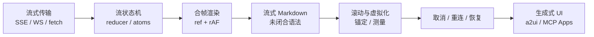
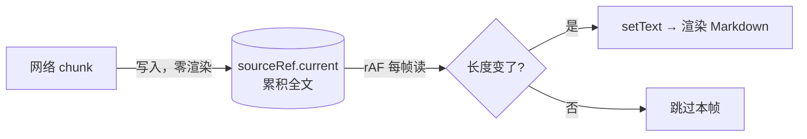
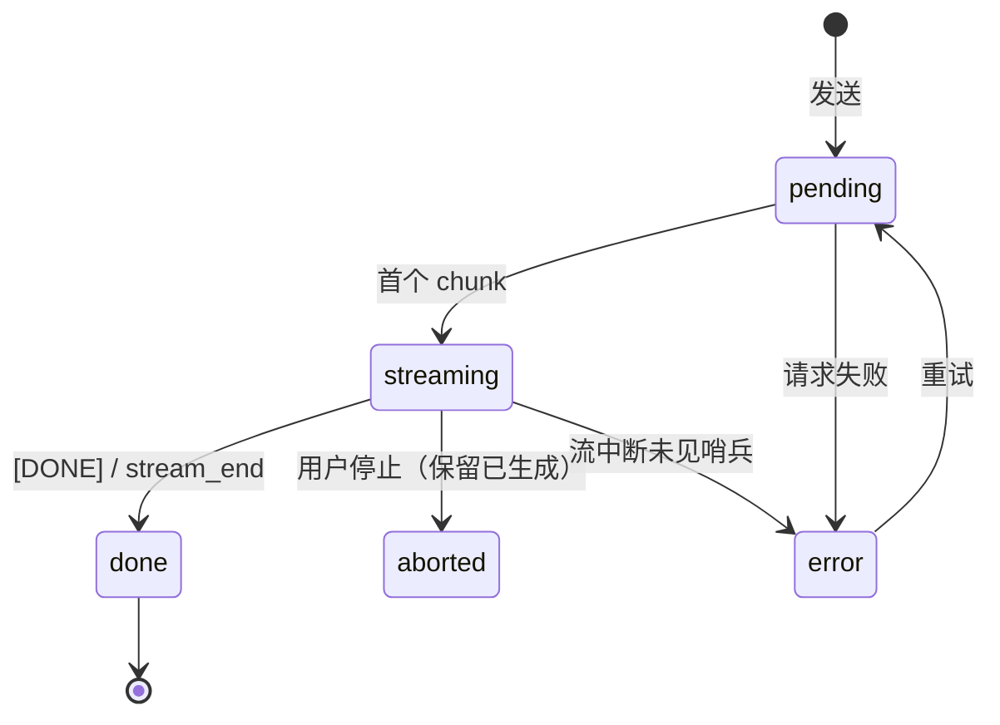
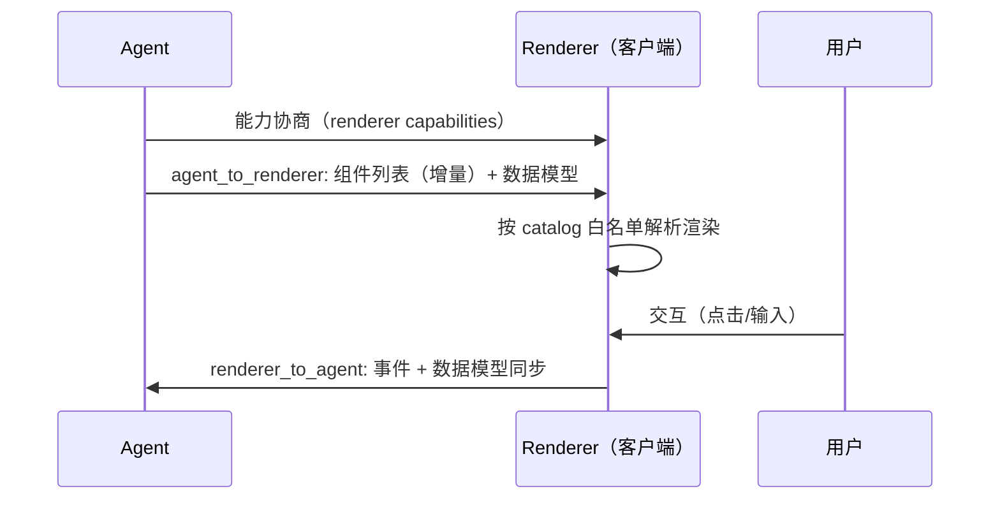

:::note 事实基线
项目事实来自本机实读源码: `$HOME/github/yukino-chatbot`（HEAD `13332f3cd402`, SSE 流式问答）、`$HOME/github/yukino-chat`（HEAD `555f62572a3a`, WebSocket JSON-RPC agent 桥）、`$HOME/github/yukino-code/apps/mcp`（HEAD `7b9add587b16`, MCP Apps 沙箱 UI）, 路径相对各自仓库根目录。生成式 UI 协议（A2UI）源码未在本机检出, 相关描述按通用协议知识作答并标注**方案推导**, 不附未核对的内部文件路径与版本号。
:::

AI 应用的前端难点不在「显示一段文字」, 而在**把一条持续变化、可能中断、夹带工具调用与权限交互的数据流, 渲染成稳定可交互的界面**。本篇 72 题按「传输 → 状态 → 渲染 → 滚动 → 恢复 → 生成式 UI → 质量 → 会话与工程周边」组织。

**主线一览**



## 一、流式传输层

### Q1. SSE、WebSocket、fetch + ReadableStream、长轮询如何选

**基础**。

| 方案                   | 方向          | 协议                | 自定义头         | 断线重连             | 典型场景                                          |
| ---------------------- | ------------- | ------------------- | ---------------- | -------------------- | ------------------------------------------------- |
| SSE（EventSource）     | 服务端→客户端 | HTTP                | ✗（仅 GET）      | 内建 + Last-Event-ID | 通知流、只读推送                                  |
| fetch + ReadableStream | 服务端→客户端 | HTTP                | ✓（任意方法/头） | 手写                 | **LLM 流式补全**（POST 带 body 与 Authorization） |
| WebSocket              | 双向          | 独立协议（Upgrade） | 握手期受限       | 手写                 | IM、协同、agent 双向控制                          |
| 长轮询                 | 模拟推送      | HTTP                | ✓                | 天然                 | 兼容兜底                                          |

两个项目的选择即是答案:`yukino-chatbot` 的 AI 问答是**单向流 + 需要 POST body 与 Bearer 头** → fetch 流（`client/src/hooks/queries/use-stream-message.ts`）；`yukino-chat` 的 agent 桥需要**双向**（发指令、答权限、停止生成）→ WebSocket JSON-RPC（`client/src/store/agent.ts`）。

### Q2. EventSource 有哪些硬限制？为什么 LLM 应用普遍用 fetch 流替代

**进阶**。EventSource 只能 **GET**、不能设置请求头（Authorization 只能塞 query，有日志泄露风险）、不能带 body、响应必须 `text/event-stream`。LLM 补全是「POST 大 prompt + 鉴权头 + 流式响应」，三条全撞限制，所以业界（含 OpenAI SDK 浏览器侧）统一用 `fetch` + `response.body.getReader()` 手动解析 SSE 帧。代价:重连、Last-Event-ID、超时都要手写——这正是 [SSE 客户端代码题](/interview/code/sse-retry) 的考点。

### Q3. SSE 的线格式（wire format）是什么

**基础**。`text/event-stream`，UTF-8，按**空行**分帧，帧内字段:

```text
event: message        ← 事件名（缺省 "message"）
data: {"delta":"你"}  ← 数据行，可多行（拼接时以 \n 连接）
id: 42                ← 事件 id（重连时经 Last-Event-ID 回传）
retry: 3000           ← 建议重连间隔（ms）
: comment             ← 冒号开头是注释，常用作心跳保活
```

解析要点:`data:` 后**至多一个前导空格**要剥掉；多行 data 需按帧聚合后再 JSON.parse；`\r\n` 与 `\r` 也是合法行结束符。

### Q4. `[DONE]` 哨兵与直接关流有什么区别

**进阶**。HTTP 流没有「业务层结束」信号——TCP 正常关闭可能是完成，也可能是代理超时截断。`data: [DONE]`（OpenAI 约定）让客户端**显式区分**「说完了」与「断了」:收到哨兵走 onDone，流关闭但没收到哨兵按异常处理（可重试/提示）。事实基线:`yukino-chatbot` 的流解析对 `payload === "[DONE]"` 调 `callbacks.onDone()`，其余行累积进正文（`client/src/hooks/queries/use-stream-message.ts`）。

### Q5. 流式解析为什么要「行缓冲 + 保留残行」

**进阶**。网络 chunk 边界与 SSE 帧边界**无关**:一个 chunk 可能含半行、一行半、几十行。正确做法是维护 buffer，按 `\n` 切分后**把最后一段不完整的行留回 buffer**:

```ts
// client/src/hooks/queries/use-stream-message.ts —— 完整消费循环（节选）
const { ok, body } = await fetch(url, {
  method: "POST",
  headers,
  body: JSON.stringify(payload),
});
if (!ok) throw new Error("Fetch error");
const reader = body?.getReader();
if (!reader) throw new Error("No reader");

const decoder = new TextDecoder();
let buffer = "";
let fullContent = "";

while (true) {
  const { done, value } = await reader.read();
  if (done) break;

  const chunk = decoder.decode(value, { stream: true }); // 多字节字符跨 chunk 安全
  buffer += chunk;
  const lines = buffer.split("\n");
  buffer = lines.pop() || ""; // 残行留待下一个 chunk

  for (const line of lines) {
    const cleanLine = line.endsWith("\r") ? line.slice(0, -1) : line;
    if (!cleanLine || !cleanLine.startsWith("data:")) continue;

    let payload = cleanLine.slice(5);
    if (payload.startsWith(" ")) payload = payload.slice(1); // 剥掉 data: 后单个空格

    if (payload === "[DONE]") {
      callbacks.onDone();
      continue;
    }

    let content = payload;
    try {
      const parsed = JSON.parse(payload);
      if (typeof parsed === "string") content = parsed;
      else if (parsed && typeof parsed === "object") {
        if (parsed.session_id)
          callbacks.onSessionCreated(String(parsed.session_id));
        continue; // 控制帧不进正文
      }
    } catch {} // 非 JSON 行直接当纯文本

    fullContent += content;
    callbacks.onChunk(fullContent); // 累积全量回调
  }
}
```

这段 50 行代码里藏着五个考点:残行缓冲、`{stream:true}` 解码、`\r` 兼容、`[DONE]` 哨兵、控制帧（session_id）与内容帧分流。漏掉残行处理的典型症状:JSON.parse 间歇性失败、正文随机丢字——面试能说出「chunk 边界 ≠ 消息边界」即抓住本质。

### Q6. `TextDecoder` 的 `{ stream: true }` 解决什么问题

**进阶**。UTF-8 多字节字符（中文 3 字节、emoji 4 字节）可能被 chunk **拦腰截断**；一次性 decode 会把半个字符解成替换符 ``。`decode(value, { stream: true })` 让解码器把不完整尾部字节**暂存到下次调用**，保证字符完整。这是流式中文界面乱码问题的第一排查点。

### Q7. Last-Event-ID 断点续传如何工作

**深挖**。服务端每帧带 `id:`，浏览器 EventSource 记住最后一个 id；断线重连时自动带 `Last-Event-ID` 请求头，服务端从该 id 之后**续发**而非重发全量。手写 fetch 流要自己实现:本地记录 lastId → 重连时放入头或 query → 服务端支持按 id 回放（需要服务端有事件日志/环形缓冲）。LLM 场景的替代方案:按「已收到的字符数/消息序号」续传，或干脆整条重新生成（幂等成本低于实现回放）。

### Q8. 心跳为什么必要？代理链路上有哪些坑

**进阶**。LLM 首 token 前可能有几十秒静默（长 prompt prefill、工具执行），中间的 nginx/ALB/CDN 会按空闲超时（如 `proxy_read_timeout` 默认 60s）**掐掉连接**。对策:服务端定期发 SSE 注释帧（`: ping`）或应用层心跳；客户端做「心跳超时判定」主动重连。WS 侧同理:`yukino-chat` 的 agent 桥每 `PING_INTERVAL = 10_000` ms 发一帧 `{method:"ping"}`（`client/src/store/agent.ts`），既保活又探测半开连接。

### Q9. 流式请求的超时应该怎么设

**进阶**。普通请求超时是「总时长」，流式请求要拆成两个:**首字节超时**（TTFB，防服务端挂死）与**帧间超时**（防中途僵死），总时长通常不限。反例（事实基线）:`yukino-chatbot` 的 axios 实例 `timeout: 0`（`client/src/api/fetch-client.ts`）——对流式端点是合理选择（不掐长连接），但意味着僵死检测完全依赖服务端与浏览器；更完备的做法是 fetch 流 + 帧间 watchdog 定时器。

### Q10. 为什么流式响应不能被 CDN/代理缓冲

**进阶**。缓冲型代理（nginx 默认 `proxy_buffering on`）会攒满缓冲区再转发，流式退化为「一次性全量」，TTFT 优化归零。对策:响应头 `X-Accel-Buffering: no`（nginx 专用）、`Cache-Control: no-cache`、`Content-Type: text/event-stream`，服务端每帧后 flush；部署链路上确认 CDN 对该路径关闭缓冲。排查手段:curl 直连源站对比经代理的到达节奏。

## 二、流式状态管理

### Q11. chunk 到达就 setState 有什么问题？合帧方案怎么做

**深挖**。LLM 出字速度可达每秒几十 chunk，每 chunk 一次 setState = 每 chunk 一次渲染 + Markdown 重解析，中低端机直接掉帧。合帧方案（事实基线，`yukino-chatbot`）:网络层把 chunk 累积进**可变 ref**（不触发渲染），渲染层用 rAF 轮询 ref，长度变化才 setState——**每帧至多一次渲染**，且天然把一帧内的多个 chunk 合并:



```tsx
// client/src/pages/ai-chat/components/streaming-markdown/index.tsx（节选）
const flush = () => {
  const latest = sourceRef.current ?? "";
  if (latest.length !== lastLengthRef.current) {
    lastLengthRef.current = latest.length;
    setText(latest);
  }
  rafId = requestAnimationFrame(flush);
};
```

**采分点**:说清「写入路径（ref，零渲染）与消费路径（rAF → state，每帧一次）分离」，以及 rAF 在后台标签页自动暂停带来的省电红利。

### Q12. 流式文本应该传增量还是全量

**进阶**。两种模式:① **增量 delta**——每帧只带新 token，客户端拼接（省带宽，但丢帧即永久缺字，需序号+补发）；② **累积全量**——回调直接给 `fullContent`（幂等、可任意丢帧重同步，代价是 O(n²) 字符串拷贝）。事实基线:`yukino-chatbot` 的 `onChunk(fullContent: string)` 用累积全量（`client/src/hooks/queries/use-stream-message.ts`），`yukino-chat` 的 agent 桥用增量（`agent/stream_text` 事件带 `params.text`，reducer 里 `content: item.content + event.params.text` 拼接，`client/src/store/agent.ts`）。选型判据:单条消息规模（几 KB 全量无压力）、丢帧概率（WS 有序可靠 → 增量安全）。

### Q13. 聊天消息的状态机怎么设计

**进阶**。最小状态集:`pending`（已发送待响应）→ `streaming`（增量到达）→ `done`；旁路 `error`（可重试）、`aborted`（用户停止，保留已生成部分）:



工程要点:状态挂在**消息实体**上而非全局（多条消息可各自处于不同状态）；全局只留一个派生的 `isStreaming`（禁用输入/切换按钮）——`yukino-chatbot` 用 jotai `isStreamingAtom` + 页面级 `useState` 双轨（`client/src/stores/chat.ts`、`client/src/pages/ai-chat/index.tsx`）；`yukino-chat` 的 agent store 把 `streaming` 放进快照，由 `agent/run_start` 置真、`agent/loop_complete | agent/error | session/command_done` 置假（`client/src/store/agent.ts`）。

### Q14. agent 事件流的 reducer 应该怎么组织

**深挖**。`yukino-chat` 的 agent 桥是「服务端事件 → 纯函数 reducer → 不可变快照」的教科书实现（`client/src/store/agent.ts` 的 `apply(state, event)`）:

| 事件                  | reducer 行为                                                             |
| --------------------- | ------------------------------------------------------------------------ |
| `session/connected`   | 写入 model/streaming/ready/anchorId/usage                                |
| `agent/run_start`     | `streaming: true`，anchorId 指向用户消息                                 |
| `agent/thinking_text` | 无当前 thinking 项则新建，有则**追加文本**                               |
| `agent/stream_text`   | 先 `finalizeThinking`，再新建/追加 stream 项                             |
| `agent/stream_end`    | stream 项 `streaming: false`，绑定服务端 messageId                       |
| `agent/tool_use`      | 按 `toolKey(toolName, toolId)` 去重建 tool 项（status running）          |
| `agent/tool_result`   | 匹配 tool 项写 output/elapsed/status；无匹配则补建                       |
| `permission/request`  | 追加 permission 项（response: null 待用户答复）                          |
| `question/ask`        | 追加 question 项（answered: false）                                      |
| `agent/loop_complete` | `settlePrompts + finalizeThinking`，streaming false，notice "Done in Xs" |
| `agent/error`         | settlePrompts，streaming false，error notice                             |
| `agent/usage`         | 更新 `{inputTokens, outputTokens}`                                       |

**采分点**:① 事件帧只接受 JSON-RPC 2.0 **通知**（`handleFrame` 拒绝带 `id` 的帧）；② reducer 纯函数 + `setState(state => apply(...))` 原子更新；③ 未知事件走 default 原样返回（向前兼容）。

### Q15. thinking（推理过程）与正文流如何切换渲染

**进阶**。推理模型会先流 thinking 再流正文，UI 要分段展示且**thinking 结束后折叠**。事实基线:`yukino-chat` 用 `currentThinkingId / currentStreamId` 两个游标——`agent/thinking_text` 到达时若无游标则新建 thinking 项；`agent/stream_text` 到达时先 `finalizeThinking`（把当前 thinking 项标 `done: true`）再开 stream 项（`client/src/store/agent.ts`）。`done` 标志驱动 UI 从「展开滚动」切到「可折叠摘要」。设计要点:thinking 与正文是**两个 item**而非一个 item 的两个字段，时间线上才能保持先后顺序。

### Q16. 工具调用卡片如何渲染与更新

**进阶**。工具调用是「开始 → 参数 → 结果」的异步生命周期，卡片要就地更新而非追加新卡。事实基线:`yukino-chat` 的 tool 项以 `toolKey(toolName, toolId)` 为身份:`agent/tool_use` 建卡（`status: "running", output: "", elapsed: 0`），`agent/tool_result` 按同 key 匹配写 `status: ok|error`、output、elapsed；**乱序兜底**——result 先于 use 到达时直接补建完整卡片（`client/src/store/agent.ts`）。UI 层 running 态转圈、error 态标红、output 默认折叠可展开。

### Q17. 权限请求与提问卡片:人在回路（human-in-the-loop）的前端形态

**深挖**。agent 执行敏感操作前要用户批准，前端把它渲染成**阻塞式交互卡片**。事实基线:`yukino-chat` 的 `permission/request` 事件生成 permission 项，`AgentPermissionCard` 渲染三按钮 **Allow / Always allow / Deny**，点击调 `respondPermission(id, response)` 经 WS 回传；已答复的卡片退化为一行结果文本（`RESULT_LABEL`: "Allowed once / Always allowed / Denied"，`client/src/components/agent/agent-permission-card.tsx`）。`question/ask` 同理渲染问答卡片（`agent-question-card.tsx`）。**关键设计**:`settlePrompts` 在 run 结束/出错时把未答复的 permission 强制置 `deny`、未答 question 置 `answered`——**服务端已继续执行，前端不能留下永远悬着的交互卡片**。

### Q18. 事件重复与乱序如何防御

**深挖**。WS 重连补发、服务端重试都可能造成重复事件。防御三层:① **身份去重**——tool 项按 `toolKey` 匹配而非盲目追加；消息按 `uuid` 用 `uniqBy` 去重（`client/src/store/ws.ts` 的 `appendToConversation`）；② **幂等 reducer**——`agent/tool_use` 重复到达且无新 args 时原样返回 state；③ **展示去重**——`notice()` 对连续同 tone 同 content 的通知直接跳过（`client/src/store/agent.ts`），避免重试风暴刷屏。乱序:result 先于 use 到达时补建卡片（Q16）；缺序号的纯文本流无法重排，只能靠传输层有序性（WS/TCP 保证）。

### Q19. 通知类消息（notice）与内容类消息如何区分

**进阶**。事实基线:`yukino-chat` 的 agent 时间线是异构 item 列表——`kind: "notice" | "thinking" | "stream" | "tool" | "permission" | "question"`，notice 带 `tone: "info" | "error" | "done"` 与可选 `markdown` 标志（`agent/system` 事件可携带 Markdown 正文）；`agent/compact`（上下文压缩）与 `agent/retry`（重试）也渲染为 notice（前缀 `⟳` / `↻`）。设计要点:系统事件**进时间线**而非 toast——用户回看时能理解「当时为什么慢了/断了」。

### Q20. token 用量与模型信息如何展示

**基础**。事实基线:`yukino-chat` 的 `agent/usage` 事件更新 `{inputTokens, outputTokens}`，`AgentStatus` 组件以 `formatTokens(usage.inputTokens)↑ outputTokens↓` 常显，旁边是模型名与连接状态圆点（idle 灰 / connecting 琥珀脉冲 / connected 翠绿 / reconnecting 琥珀脉冲，`client/src/components/agent/agent-status.tsx` 的 `DOT_CLASS/DOT_LABEL`）。产品意义:成本透明 + 「connected 但未 ready」的 warming 态（"Yukino is starting up…"）管理用户预期。

### Q21. 「停止生成」如何实现

**进阶**。前端三件事:① 传输层中止——fetch 流走 `AbortController.abort()`（reader 立即结束），WS 发停止指令（`yukino-chat` 的 agent store 暴露 `stop()`，经 JSON-RPC 通知服务端）；② 状态收口——当前 stream 项标 `streaming: false`，**保留已生成部分**并标注「已停止」；③ 服务端联动——真正省钱的是服务端停止 LLM 上游请求（否则 token 照烧）。注意 abort 触发的 `AbortError` 要在 catch 里与真实错误区分，不上报、不 toast。

### Q22. 流式期间输入框与发送按钮如何治理

**基础**。策略:流式中禁用发送（防并发流互踩）但**允许编辑草稿**；提供「停止」替代「发送」按钮（同一位置形态切换，`yukino-chatbot` 的 ai-chat 页面按 `isStreaming` 切换 handleStreaming/handleNormal 分支，`client/src/pages/ai-chat/index.tsx`）；多会话产品要按**会话粒度**禁用（A 会话流式不影响 B 会话输入）——此时 `isStreaming` 必须是 `sessionId → boolean` 的映射而非全局布尔。

## 三、流式 Markdown 渲染

### Q23. 流式 Markdown 的核心难题是什么

**进阶**。Markdown 是**块级语法**，而流式输入永远处于「语法未闭合」中间态:代码块只有开头 ``` 没有结尾、加粗只有前 `**`、表格只有一半行、链接文本到了 URL 没到。朴素做法（每帧全量丢给 marked 渲染）会闪烁:未闭合代码块先被渲染成正文，下一帧又变回代码块，布局反复跳动。解法方向:**容错解析**（把未闭合语法当已闭合处理）+ **块级稳定渲染**（已完成的块不再重解析）。

### Q24. `parseIncompleteMarkdown` 这类容错机制如何工作

**深挖**。思路:解析前扫描文本尾部，对未闭合语法做**虚拟补全**——未闭合的 ``` 视为已闭合代码块、悬空的 `**` 视为字面量或补全、半行表格丢弃该行——保证任意前缀都能渲染出**稳定且接近最终形态**的 DOM。事实基线:`yukino-chat` 的静态消息组件显式关闭该行为——`<Streamdown mode="static" animated={false} parseIncompleteMarkdown={false}>`（`client/src/components/message-content.tsx`），因为历史消息永远是完整文本，容错补全反而可能曲解原文（如故意展示半个反引号的教程文本）；流式侧（`yukino-chatbot` 的 `<Markdown mode="streaming" isAnimating>`）才需要它。**采分点**:同一渲染器按数据生命周期切模式，而不是两套组件。

### Q25. Streamdown 是什么？插件生态解决什么

**进阶**。Streamdown（Vercel 开源）是面向流式 LLM 输出的 Markdown 渲染器:内建未闭合语法容错、块级 memo（完成的块不重渲染）、安全默认值。事实基线:两个项目都用它——`yukino-chatbot` 配 `@streamdown/code` 插件与 `shikiTheme={["github-light","github-dark"]}` 双主题代码高亮（`client/src/components/markdown/index.tsx`）；`yukino-chat` 配齐 `cjk/code/math/mermaid` 四插件（`client/src/components/message-content.tsx` 的 `plugins = { cjk, code, math, mermaid }`），分别处理中日韩排版、代码高亮、数学公式、图表。选型对照:react-markdown + 手写容错是上一代方案，维护成本高。

### Q26. 代码高亮在流式场景的性能问题

**深挖**。shiki 类高亮器按**完整代码块**做语法分析，流式期间代码块每帧都在变 → 每帧全量重高亮，长代码块（几百行）单帧耗时可达几十 ms。缓解:① 块级 memo——只有「仍在增长的最后一个块」重渲染；② 高亮降级——流式期间用纯文本/轻量高亮，`done` 后再上 shiki；③ Worker 化高亮（shiki 支持）；④ 限制单块行数。事实基线:`yukino-chat` 用 `@streamdown/code`（内置 shiki）+ 双主题，主题切换靠 CSS 变量而非重高亮。

### Q27. 流式 Markdown 的 XSS 防线在哪里

**进阶**。LLM 输出是**不可信 HTML 源**（prompt injection 可诱导模型输出 ``、`javascript:` 链接）。防线:① 渲染器默认不产出原始 HTML（Streamdown/react-markdown 默认跳过 raw HTML，需显式开启才有风险）；② 链接协议白名单（http/https/mailto，拦 `javascript:`）；③ 若必须渲染 HTML，过 DOMPurify 并配 CSP；④ mermaid/数学公式渲染器的 `securityLevel` 配置（mermaid 默认 strict 禁点击交互）。原则:**把模型输出当数据，不当代码**——与 [a2ui 的 catalog 白名单](#q46-catalog-白名单模型为什么比让模型直接生成-html安全)同一哲学。

### Q28. 数学公式与 mermaid 图表何时渲染

**进阶**。两者都是「完整才有意义」的语法:半截 LaTeX 报错、半截 mermaid 画不出。策略:流式期间对未闭合的 `$$...$$` / ```mermaid 块显示**原文或占位骨架**，检测到闭合再触发渲染（KaTeX 同步快，mermaid 异步且贵，要 lazy + 失败降级为代码块展示）。事实基线:`yukino-chat` 挂载 `@streamdown/math` 与 `@streamdown/mermaid` 插件（`client/src/components/message-content.tsx`），由插件内部处理闭合检测与错误降级。

### Q29. 打字机效果（逐字动画）与真实流式的关系

**进阶**。真实 chunk 到达是**突发**的（一帧可能到 20 字），直接渲染会「一跳一跳」。打字机层在 chunk 与渲染之间加**匀速缓冲**:把到达文本入队，按固定速率（如 30 字/秒）出队上屏，队列积压过多时加速追赶。取舍:动画平滑 vs 信息延迟（用户等字）；技术内容（代码）建议关掉动画直接显示。事实基线:`yukino-chatbot` 的 `<Markdown mode="streaming" isAnimating>` 把动画交给 Streamdown 内建的块级动画处理（`client/src/components/markdown/index.tsx`），rAF 合帧已保证帧率上限。

### Q30. 长对话的 Markdown 渲染性能如何治理

**深挖**。四层:① **块级 memo**——消息内按块（段落/代码块/列表）拆组件，完成的块 props 不变不重渲染；② **消息级虚拟化**——只渲染视口内消息（见 Q33）；③ **静态/流式分离**——历史消息用 `mode="static"` 一次性渲染（`yukino-chat` 的 `MessageContent`），只有最后一条流式消息走高频路径；④ **content-visibility: auto** 推迟屏外消息的渲染成本。反模式:整条消息一个巨型字符串组件每帧重解析——O(全文) × 帧率。

## 四、滚动与虚拟化

### Q31. 滚动锚定（stick to bottom）的正确语义

**进阶**。聊天流式渲染的滚动需求是「**用户在底部时跟随增长，用户上滚阅读时绝不抢夺滚动条**」。实现三要素:① 判定「在底部」:`scrollHeight - scrollTop - clientHeight < 阈值`（事实基线:`yukino-chatbot` 的 `NEAR_BOTTOM_THRESHOLD = 80` px，`client/src/pages/ai-chat/components/message-list/index.tsx`）；② 内容增长时仅在「在底部」才 scrollToBottom；③ 用户主动上滚立即解除跟随（滚动事件里更新判定）。现成方案:`yukino-chat` 用 `use-stick-to-bottom` 库——`useStickToBottom({ initial: "instant", resize: "smooth" })` 返回 `scrollRef/contentRef/isAtBottom/scrollToBottom`（`client/src/pages/chat.tsx`），initial instant 防首屏动画、resize smooth 让跟随不生硬。

### Q32. 为什么不能用「每次更新都 scrollToBottom」

**基础**。后果:用户上滚阅读历史时被**每帧拽回底部**，产品不可用；且高频 scrollTo 触发强制同步布局。同理不能用 `overflow-anchor` 裸奔（浏览器滚动锚定防的是「上方内容变化推走视口」，不解决「跟随底部增长」）。正确姿势见 Q31:跟随是**有条件的**，条件由用户滚动行为实时改写。

### Q33. 虚拟列表如何与流式增长共存

**深挖**。矛盾:虚拟化假设「行高可预估、总量稳定」，流式消息**高度每帧变化**。方案（事实基线，`yukino-chatbot` 的 `MessageList`）:① `useVirtualizer` 配 `estimateSize: () => 120` 给初值；② 每行挂 `ref={virtualizer.measureElement}` + `data-index`，渲染后**实测回填**行高缓存；③ 内容区包一层 `bodyRef`，用 **ResizeObserver** 观测总高度变化——变化且用户在底部时 `virtualizer.scrollToIndex(messages.length - 1, { align: "end" })` 跟随；④ 组件声明 `"use no memo"` 退出 React Compiler（virtualizer 对象每帧变，memo 无益）。**采分点**:说出「测量驱动滚动（ResizeObserver）而非轮询 scrollHeight」。

### Q34. 定高、不定高、windowing 三种虚拟化的差异

**进阶**。① 定高:`scrollTop / rowHeight` 直接算区间，O(1)，无测量；② 不定高:预估 + 渲染后测量回填（TanStack Virtual 的 measureElement），滚动位置随测量修正，可能轻微跳动；③ **windowing padding 方案**:只渲染窗口内行，用 paddingTop/paddingBottom 撑出总高——事实基线:`yukino-chat` 的 `useWindowedRows(count, rowHeight)` 返回 `{scrollRef, items, paddingTop, paddingBottom, totalSize}`，`overscan: 8`（`client/src/lib/use-windowed-rows.ts`），用于定高会话列表。对照:chatbot 消息列表用绝对定位 + translateY（不定高必需），chat 用 padding 撑高（定高更简单）。

### Q35. overscan 的作用与取值

**基础**。视口外预渲染的行数，吸收快速滚动的白屏。取值权衡:太小（0–2）快滚露白；太大等于没虚拟化。事实基线:`yukino-chatbot` 消息列表 `overscan: 5`（行高不定、渲染贵），`yukino-chat` 会话列表 `overscan: 8`（行高固定、行渲染便宜）。经验:重行 3–5，轻行 8–15，再配合滚动方向感知（向滚方向加倍）更佳。

### Q36. 「回到底部」按钮与未读分隔线

**进阶**。用户上滚后出现悬浮「↓ 回到底部」按钮（`isAtBottom === false` 时显示），点击 `scrollToBottom()`；流式期间新内容到达而在底部之外时，按钮上挂**未读计数**徽章。未读分隔线:进入会话时记录 anchor（最后已读消息 id），渲染时在该消息后插「以下为新消息」分隔条——`yukino-chat` 的 agent 快照里保留 `anchorId`（run_start 时指向用户消息 id，`client/src/store/agent.ts`），时间线渲染按 anchor 分组。细节:分隔线要在用户滚到底后消失，计数要在聚焦会话时清零（配合 `markAsRead` mutation）。

### Q37. 图片/附件消息对滚动稳定性的破坏

**进阶**。异步加载的图片撑开行高 → 布局偏移 → 滚动位置跳动。治理:上传/发送时就记录**宽高比**，渲染用 `aspect-ratio` 占位（零 CLS）；加载完成若行高与预估不符，虚拟化层的测量回填会修正，但**视口上方**的行高变化仍会推走内容——用 CSS `overflow-anchor` 或手动补偿 scrollTop 差值。文件类消息先显示占位卡（文件名+大小），缩略图懒加载。

### Q38. 移动端键盘弹出对聊天布局的影响

**深挖**。键盘弹出压缩可视区:底部输入框要被顶到键盘上方、消息列表要保持锚定不跳。事实基线:`yukino-chat` 用 `useVisualViewport` 把 `visualViewport.height/offsetTop` 写成 CSS 变量 `--app-height/--app-offset-top/--app-viewport-bottom`（rAF 合帧、捏合缩放时跳过），布局全部基于变量而非 `100vh`（`client/src/lib/use-visual-viewport.ts`）。配合 `interactive-widget=resizes-content` viewport meta（Chrome Android）与 `dvh` 单位做渐进增强。

## 五、取消、重连与恢复

### Q39. AbortController 如何贯穿 fetch 流

**进阶**。`fetch(url, { signal })` → 流读取循环里 `reader.read()` 会因 abort 而 reject（AbortError）→ finally 里 `reader.releaseLock()`。要点:① abort 后**保留已渲染内容**并标记 aborted 态；② catch 里区分 `signal.aborted`（用户取消，静默）与网络错误（提示+重试）；③ 组件卸载时 abort（effect cleanup），防「离开页面还在流」；④ 与超时组合用 `AbortSignal.any([userSignal, AbortSignal.timeout(ms)])`——`yukino-chat` 的 http 层同款组合（`client/src/service/http.ts` 的 `withTimeout`）。完整实现见 [SSE 客户端代码题](/interview/code/sse-retry)。

### Q40. WebSocket 重连的指数退避如何实现

**进阶**。事实基线（`yukino-chat` 两个 WS store 同款模式，`client/src/store/ws.ts` 与 `client/src/store/agent.ts`）:

```ts
const INITIAL_RECONNECT_DELAY = 1000;
const MAX_RECONNECT_DELAY = 30_000;
// onclose:
reconnectTimer = setTimeout(() => {
  reconnectDelay = Math.min(reconnectDelay * 2, MAX_RECONNECT_DELAY);
  openSocket(userId);
}, reconnectDelay);
// onopen: reconnectDelay = INITIAL_RECONNECT_DELAY; // 成功即复位
```

要点:① `intentionalClose` 标志区分主动断开（不重连）与意外断开；② 重连前**先关旧 socket 并摘掉其 onclose**（防双连接与回调风暴）；③ 退避上限 30s 防「服务器宕机时客户端集体秒级重试」；④ 生产还应加**随机抖动**（jitter）防惊群——该项目未加，属可改进点（如实说明）。

### Q41. 半开连接（half-open）如何检测

**深挖**。TCP 连接可能「本地看着 OPEN、对端早已消失」（NAT 超时、网络切换），onclose 不会触发，消息发进黑洞。检测:应用层心跳——`yukino-chat` 的 agent 桥 onopen 后 `setInterval(() => send({method:"ping"}), PING_INTERVAL=10_000)`（`client/src/store/agent.ts`）；更严格的做法是 ping 带响应超时（N 秒无 pong 判定死链，主动 close 触发重连）。WS 协议层也有 ping/pong 帧，但浏览器 API 不暴露，只能应用层自做。

### Q42. 断线重连后数据如何对齐

**深挖**。重连期间漏掉的消息必须补。事实基线:`yukino-chat` 的 WS store 在 onopen 时若 `reconnecting` 为真，执行**全量** `queryClient.invalidateQueries()`（`client/src/store/ws.ts`）——让所有活跃查询重新拉取，用一次请求风暴换一致性，IM 数据量下是合理取舍。精细化方案（方案推导）:带序号/游标增量补拉（`GET /messages?after=lastSeq`）、服务端重连回放缓冲、或 sync token 模式。判据:消息频率低 → 全量失效够用；高频大数据 → 必须游标补拉。

### Q43. 页面刷新后流式状态如何恢复

**深挖**。刷新即 JS 状态全灭，但服务端 LLM 可能还在生成。方案（方案推导，两项目均未实现完整恢复）:① 消息实体持久化在服务端，刷新后拉历史——已生成部分立即可见；② 生成中的消息带 `status: streaming` 标记，前端重新**附着**（attach）到进行中的流（SSE 重放或 WS 重新订阅 + 服务端从缓冲续发）；③ 最低成本兜底:刷新后该消息显示「生成中断，点击重新生成」。`yukino-chatbot` 现状是 ①+③ 之间:历史从服务端拉（`use-chat-history.ts`），流中断即终止。面试如实区分「已实现」与「我会怎么补」。

### Q44. 流式请求的竞态:快速切换会话怎么办

**进阶**。场景:会话 A 流式中，用户切到会话 B——A 的 chunk 不能写进 B 的视图。治理:① 流绑定**会话 id**，onChunk 里校验当前会话再写入（`yukino-chatbot` 的 streamTextRef 由页面持有，切会话时重置，`client/src/pages/ai-chat/index.tsx`）；② 切换时 abort 旧流（省 token）或放任后台完成但只写缓存不写视图；③ TanStack Query 场景用 query key 天然隔离（key 含 sessionId，写入不会串台）。反模式:全局单例 currentStream 不校验归属。

## 六、生成式 UI 与 MCP 前端

### Q45. a2ui 是什么？解决什么问题

**进阶**。A2UI（Agent-to-User Interface）是让 agent「**说 UI**」的开放协议: agent 发送**声明式 JSON** 描述界面意图, 客户端用自己的**受信组件目录**渲染——理念概括为 _safe like data, but expressive like code_。解决的问题: 远端/跨信任边界的 agent 需要向用户呈现富交互界面（表单、卡片、审批面板）, 直接生成 HTML/代码有安全风险, 纯文本又表达不了交互。



**通用框架结论**: 协议分双向信封（agent→renderer / renderer→agent）、目录定义、数据模型与能力协商; 渲染器按宿主技术栈分别实现（Web、移动端、桌面端均有适配层）, 并有 A2A 传输扩展把协议信封映射进 agent 间消息。本机未检出该协议仓库源码, 上述结构为通用协议形态描述。

### Q46. catalog 白名单模型为什么比「让模型直接生成 HTML」安全

**深挖**。A2UI 的安全基石: 客户端维护 **catalog**（预先批准的组件清单: 卡片/按钮/输入框/复选框/列容器/图片等）, agent **只能请求渲染目录内的组件**——协议数据不可执行, 攻击面从「任意代码执行」降为「目录组件的参数滥用」, 参数再经 schema 校验。对照生成 HTML: 等于让不可信输入进 `innerHTML`, XSS 防线全押在 sanitize 上。扩展机制允许宿主开发者注册自定义组件映射（含 iframe 沙箱包装 legacy 内容）, 把信任决策显式交给宿主开发者。

### Q47. 为什么 a2ui 用「扁平组件列表 + ID 引用」而不是嵌套 JSON 树

**深挖**。协议把 UI 表示为**扁平组件列表, 子节点用 ID 引用**。动机: ① LLM **增量生成友好**——可以一个组件一个组件地流式输出, 渲染器边收边画（progressive rendering）, 嵌套树必须闭合才能解析; ② **增量更新便宜**——改一个按钮的文案只需发该组件的更新, 不用重发整棵树; ③ 数据模型与组件树分离, 组件通过绑定引用数据, 数据变了 UI 自动更新。这与 React 的 fiber 扁平化、数据库的范式化是同一思想: **用引用换增量效率**。

### Q48. a2ui 的消息面有哪些

**进阶**。**通用框架结论**: 协议消息面围绕四类对象展开——双向信封（agent→renderer / renderer→agent）、目录定义（catalog）、数据模型（data model）、能力声明（capabilities）。能力协商先行（renderer 声明支持哪些组件/函数, agent 按能力生成）, 与 MCP 的 capabilities 协商同构。宿主侧可声明应用侧自定义函数供组件绑定调用。

### Q49. a2ui 的 React 渲染器如何把协议数据接进 React

**深挖**。**方案推导**: 宿主渲染器需要把外部协议数据接进框架的响应式系统。React 侧的标准做法是用 `useSyncExternalStore` 一类订阅桥接——subscribe 里解析 surface 的组件引用图并订阅响应式信号, 数据层变化触发 React 重渲染, getSnapshot 读当前根节点状态。并发安全要点: resolver 在 subscribe 内创建（被丢弃的并发渲染不构造 resolver）, StrictMode 双挂载各建各销; 根未就绪时渲染占位; Markdown 等子渲染器在挂载阶段先注册进模块级槽位, 保证宿主元素更新前就位。这是「外部响应式系统 × React 并发安全」的标准答案。

### Q50. a2ui 的数据绑定如何工作

**进阶**。**通用框架结论**: 宿主侧提供一个 ReactiveController 一类的绑定层, 按组件的 **API schema** 把数据模型绑定到组件 props, 数据层变化时更新 props 并请求宿主更新——组件声明「我需要什么形状的 API」, 绑定层负责解析引用与响应式传播。事件反向: 用户交互经 renderer→agent 信封回传 agent, 形成闭环。

### Q51. MCP Apps 是什么？create_app 工具如何沙箱化 agent 生成的 UI

**深挖**。MCP Apps 扩展（`@modelcontextprotocol/ext-apps`）让 MCP 工具返回**可交互 UI 资源**（`ui://` URI），宿主在会话流里渲染。事实基线（`yukino-code/apps/mcp/src/tools/create-app/tool.ts`）:`create_app` 工具收 `html`（完整自包含文档，`MAX_HTML_CHARS = 200_000` 上限）与 `title`（≤120 字符），注册为资源 `ui://create-app/create-app.html`；沙箱约束写进工具描述——**iframe 无 storage/cookies**，外部资源仅允许 CDN 白名单 `RESOURCE_DOMAINS`（unpkg / jsdelivr / tailwindcss / cdnjs / esm.sh / Google Fonts）；不支持 MCP Apps 的宿主降级为文本说明（`NO_UI_FALLBACK_NOTE`）。与 a2ui 对照:create_app 是「**代码沙箱**」路线（给自由、关进笼子），a2ui 是「**数据白名单**」路线（不给执行权）——信任模型与表达力的两种取舍。

### Q52. MCP server 的传输层:stdio 与 Streamable HTTP 如何选

**进阶**。事实基线（`yukino-code/apps/mcp/src/main.ts` 与 `src/http.ts`）:默认 **stdio**（`StdioServerTransport`，本地进程，宿主拉起）；`--http` 或 `MCP_TRANSPORT=http` 切换 **Streamable HTTP**——h3 框架挂 `POST /mcp`，每请求新建 `WebStandardStreamableHTTPServerTransport({ enableJsonResponse: true })` 与 server 实例、处理完即关（**无状态模式**），`GET /mcp` 显式 405。优雅退出:SIGINT/SIGTERM 触发 shutdown，5 秒兜底 `setTimeout(...).unref()` 强杀。选型:本地工具用 stdio（零网络面）；多客户端共享/远程部署用 HTTP（可加鉴权与横向扩展，无状态模式天然可负载均衡）。

### Q53. MCP 的 docs_tool 展示了怎样的前端可感知设计

**进阶**。事实基线（`yukino-code/apps/mcp/README.md` 与 `src/tools/docs/tool.ts`）: `docs` 工具是对本地知识库（`YUKINO_DOCS_DIR`, 默认 `~/.yukino/docs`）的语义 RAG 检索——embedding 存本地 SQLite（`YUKINO_INDEX_DB`, 默认 `~/.yukino/index.sqlite`）, 余弦相似度打分, `top_k` 1–10 默认 3, **零外部服务**; `docs_sync` 原子替换 chunk 与内容哈希, embedding 失败保留上一版索引; 索引/嵌入不可用时返回**诚实错误**而非静默失败。前端可感知的点: 工具结果结构化（来源文件、章节标题、相似度分数）, UI 可渲染成引用卡片——工具输出设计要为「被渲染」而设计。

### Q54. 工具调用结果在前端的呈现层级

**进阶**。三层递进:① **原始层**——折叠的 JSON 输出（调试用）；② **语义层**——按工具类型定制卡片（SQL 结果渲染表格、diff 渲染对比视图、图片渲染缩略图）；③ **交互层**——结果内嵌操作（重试、复制、跳转源）。事实基线:`yukino-chat` 的 tool 卡片带 status（running/ok/error）、elapsed 耗时、output 折叠区（`client/src/store/agent.ts` 的 tool 项结构）；MCP Apps 则把③做到极致——结果本身是应用（Q51）。设计纪律:错误态永远可见可复制（`isError` 单独标红），耗时数据帮用户建立性能直觉。

## 七、质量与监控

### Q55. 流式首字时间（TTFT）在前端怎么测

**进阶**。口径:`用户点击发送 → 第一个内容 chunk 渲染上屏` 的差值。埋点:发送时 `performance.now()` 记 t0，onChunk 首次携带非空内容时记 t1（注意区分「收到首字节」与「渲染首字」，后者才含合帧延迟）；上报走 sendBeacon 防页面关闭丢失。拆解归因:网络 RTT（t0→响应头）、服务端 prefill（响应头→首 chunk）、前端合帧（首 chunk→上屏，rAF 方案下 ≤16.7ms）。与后端 Langfuse span 对齐才能全链路归因——口径纪律见[指标口径与基线定义](/interview/metrics-baseline)。

### Q56. 如何检测流式传输中的丢帧与截断

**深挖**。无序号协议（裸 SSE delta）只能靠**结束哨兵**判完整性:流关闭但未见 `[DONE]`/`stream_end` → 标记截断。有序协议:每帧带 seq，客户端检测缺口 → 请求补发或整段重拉。事实基线:`yukino-chat` 的 agent 桥以 `agent/stream_end`（带最终 messageId 与全文 text）为收口——reducer 里若 stream 项缺失还能用 end 事件的 text **整体补建**（`client/src/store/agent.ts` 的 stream_end 分支），这是「终态全量兜底增量」的实用模式。

### Q57. 流式失败的降级策略

**进阶**。阶梯:① 单帧解析失败（JSON 坏行）→ **跳过该行**继续（`yukino-chatbot` 的 try/catch 空 catch 即此策略，`client/src/hooks/queries/use-stream-message.ts`）；② 流中断且未收哨兵 → 保留已生成内容 + 「继续生成/重试」按钮；③ 流式端点整体不可用 → 降级非流式接口（一次性返回，牺牲 TTFT 保功能）；④ 渲染层崩溃（Markdown 解析异常）→ ErrorBoundary 降级为 `<pre>` 纯文本展示原文。原则:**已生成的内容永远不丢**，降级只降体验不降正确性。

### Q58. 流式 UI 的测试策略

**进阶**。单测:解析器用**任意切分的 chunk 序列**喂（模拟网络分片，断言输出与一次性输入一致）——行缓冲/多字节截断的 bug 只有随机切分能暴露；reducer 用事件序列快照测试（乱序/重复/缺失事件各一组）。组件测:mock ReadableStream 可控推送 chunk，断言 rAF 合帧后的渲染次数（`vi.useFakeTimers` + rAF stub）。E2E:Playwright 拦截流式响应注入延迟/截断/乱序故障。口径:流式 UI 的回归指标是「渲染次数/帧率/TTFT」而非仅快照一致。

## 八、会话、合并与工程周边

### Q59. 实时流与持久化历史如何合并渲染

**深挖**。agent 时间线（内存、实时）与消息历史（服务端、持久）是两套数据源，刷新/切会话后必须无缝拼接。事实基线（`yukino-chat/client/src/pages/chat.tsx`）的 overlay 模式:

```ts
// 已持久化的 stream 项跳过（messageId 已落库，历史里有了）
if (item.kind === "stream" && item.messageId && storedUuids.has(item.messageId))
  continue;
// 其余 agent 项按 anchorId 归组，叠加在对应历史消息之后
const bucket = storedUuids.has(item.anchorId)
  ? (overlayByAnchor.get(item.anchorId) ?? [])
  : trailingOverlay;
```

三层语义:① `agent/stream_end` 绑定服务端 messageId 后，该项与历史消息**去重**（同一条不渲染两次）；② thinking/tool/permission 等过程项按 `anchorId`（触发它们的用户消息 uuid）**叠加在历史锚点之后**；③ 找不到锚点的进 `trailingOverlay` 尾部兜底。**采分点**:说出「实时层是持久层的 overlay，身份字段（messageId/anchorId）是缝合线」。

### Q60. anchorId 在 agent 时间线里承担什么角色

**进阶**。事实基线:`yukino-chat` 的每个 AgentItem 都带 `anchorId`——`agent/run_start` 时置为 `event.params.userMessageId`（`client/src/store/agent.ts`），后续 thinking/stream/tool/permission/notice 项全部继承当前 anchorId。作用:① 把一轮 run 的所有产物**归属到触发它的用户消息**，多轮对话时间线不串；② 持久化合并时作分组键（Q59）；③ 重放/调试时按 anchor 还原一轮完整交互。这是「事件流 → 会话结构」的关键外键。

### Q61. 历史消息加载的门控与临时会话

**进阶**。事实基线:`yukino-chatbot` 的 `useChatHistory(sessionId, enabled)` 用 TanStack Query 的 `enabled: !!sessionId && sessionId !== "temp" && enabled` 门控（`client/src/hooks/queries/use-chat-history.ts`）——**临时会话**（首条消息前无服务端 session）不发历史请求；query key 按 sessionId 参数化（`CHAT_HISTORY_QUERY_KEY`），切会话天然隔离缓存。配套流程:新会话先走 `create-session-and-send-message-stream` 端点，流中收到 `session_id` JSON 帧后回调 `onSessionCreated` 落地真实 id（`client/src/hooks/queries/use-stream-message.ts`）——「先聊后建会话」减少一次前置 RTT。

### Q62. 文件上传如何接入聊天流

**进阶**。两个项目的两种形态。`yukino-chatbot`（知识库上传）:`useFileUpload` 做**扩展名白名单**（仅 `.md/.txt`）、sonner toast 反馈、`uploadMutation.isPending` 驱动按钮态、`onSettled` 重置 input value 允许重复选同一文件（`client/src/hooks/use-file-upload.ts`）。`yukino-chat`（IM 附件）:大文件走 Worker 分片 SHA-256（`client/src/workers/file-hash.worker.ts`，逐片 digest 再对 digest 求哈希的 Merkle 式结构）支撑**秒传**与断点续传，上传超时单独放宽到 `UPLOAD_TIMEOUT_MS = 120_000`（`client/src/service/http.ts`）。共同点:上传是 mutation 不是 query，进度/错误/成功三态都要有 UI 落点。

### Q63. 工具调用参数流式输出（partial JSON）怎么渲染

**深挖**。模型生成工具参数本身也是流式的——半截 JSON 无法 parse。策略阶梯:① **不渲染中间态**:参数攒齐再显示卡片（最简单，`yukino-chat` 的 `agent/tool_use` 事件到达时 args 已完整，`client/src/store/agent.ts`）；② **容错解析**:用 partial-json 类库解析前缀，边流边展示已确定的字段；③ **原文展示**:流式期间显示等宽字体的原始 token 流，完成后切换为结构化视图。判据:参数短（几行）用①；长参数（大段代码/文档）用②或③给用户进度感。注意②的失败模式——半截字符串里的转义符会误导解析器，必须用专门库而非手写补全。

### Q64. WS 帧协议怎么设计:JSON-RPC 通知与响应的分流

**进阶**。事实基线:`yukino-chat` 的 agent 桥用 JSON-RPC 2.0——出站请求带自增 `id`（`send()` 里 `requestCounter += 1`），入站帧在 `handleFrame` 里**显式分流**:`frame.jsonrpc !== "2.0" || "id" in frame` 的帧（响应/畸形帧）直接丢弃，只有**通知**（无 id、有 method）进 reducer（`client/src/store/agent.ts`）。设计要点:① 请求-响应（RPC 语义）与事件流（通知语义）分开处理，reducer 只消费通知，状态机才封闭；② 帧先过 `JSON.parse` try/catch 与形状校验再进业务（`client/src/store/ws.ts` 还叠了 zod `messageSchema.safeParse`）；③ method 命名空间化（`session/*`、`agent/*`、`permission/*`）便于路由与演进。

### Q65. WS 连接把 token 放 query string 有什么风险

**深挖**。事实基线:两个项目的 WS 都以 `${wsUrl}/wss?client_id=...&token=...`（`client/src/store/ws.ts`）或 `${wsUrl}/agent/ws?token=...`（`client/src/store/agent.ts`）携带凭据。风险:query 会进**访问日志、代理日志、浏览器历史**，token 泄露面扩大。为什么仍常见:浏览器 WebSocket API **不支持自定义握手头**，query/子协议（`Sec-WebSocket-Protocol` 塞 token）是仅有的两条路。缓解（方案推导）:短时效一次性 ticket（HTTP 换取、WS 消费、用后即焚）、连接建立后首帧鉴权、日志侧对 token 参数脱敏。面试先讲清 API 限制这个根因，再给缓解链，是满分结构。

### Q66. 流式内容的可访问性（a11y）怎么做

**进阶**。屏幕阅读器面对每帧变化的文本会**反复重读**。要点:① 流式区域用 `aria-live="polite"` + `aria-busy`（生成中标 busy，完成后清除，读屏器等 busy 结束再播报）；② 更稳的做法是 live region 只播报**状态**（「正在生成」「已完成」），正文完成后才可读；③ 停止按钮、权限卡片（`yukino-chat` 的 `AgentPermissionCard` 带 `aria-label={`Permission request for ${item.toolName}`}`，`client/src/components/agent/agent-permission-card.tsx`）必须键盘可达；④ 打字机动画提供 `prefers-reduced-motion` 降级。这是 AI 产品普遍欠账、面试提了就是差异化加分的领域。

### Q67. 流式 UI 的前端性能预算怎么定

**深挖**。三条可量化口径（方案推导，度量方法为事实）:① **渲染频率**——合帧后每帧至多一次 setState，流式期间 React commit 次数 ≈ 帧数（Profiler 可数）；② **帧耗时**——流式期间长任务（>50ms）数量趋零，`PerformanceObserver({entryTypes:["longtask"]})` 采集；③ **TTFT**——点击到首字上屏（Q55 口径）。预算示例:中端安卓机上流式期间 INP < 200ms、无连续掉帧。超预算的排查顺序:Markdown 重解析（块级 memo 是否生效）→ 虚拟列表失效（消息全量渲染）→ 高频 setState（合帧是否被绕过）→ 布局抖动（ResizeObserver 回调里读几何）。

### Q68. 聊天应用需要 SSR 吗

**进阶**。默认**不需要**:聊天是登录后应用，无 SEO 诉求，首屏瓶颈在鉴权与数据拉取而非 HTML 直出——两个项目都是纯 SPA（Vite + `index.html`，事实基线:`yukino-chat/client/index.html`、`yukino-chatbot/client/index.html`）。SSR/预渲染有价值的例外:营销落地页（另建）、PWA 离线壳（`yukino-chat` 用 `vite-plugin-pwa` 缓存应用壳，`client/vite.config.ts`）。面试口径:先给结论（SPA 足够），再给判据（SEO/首屏/登录墙），最后点出 PWA 壳缓存这个中间态——避免「逢应用必 Next.js」的惯性回答。

### Q69. 流式渲染崩溃时 ErrorBoundary 怎么兼顾

**进阶**。流式期间 Markdown 解析器可能遇到病态输入抛错（未预期的语法组合、插件 bug），若 ErrorBoundary 包在整个消息列表上，一条坏消息会**炸掉整个会话视图**。分层包裹:① 每条消息的 Markdown 渲染器单独包 boundary，崩溃降级为 `<pre>{rawText}</pre>` 展示原文（内容不丢）；② 消息列表外层再包一层兼底 boundary（防连锁）；③ boundary 的 `componentDidCatch` 上报时携带消息 id 与原文哈希（不传原文，防隐私泄露）。事实基线:`yukino-chat` 对静态消息显式 `parseIncompleteMarkdown={false}`（`client/src/components/message-content.tsx`）降低解析歧义，属同类「减少崩溃面」思路。

### Q70. SSE 与 WS 的运维成本差异

**进阶**。SSE:纯 HTTP，代理/CDN/负载均衡全兼容，水平扩容无状态（每请求独立），但**单向**且每会话占一个 HTTP 连接（HTTP/2 下多路复用缓解）；WS:双向、低延迟，但需要粘性会话或独立网关层（连接状态在内存）、部分企业代理会拦截 Upgrade、扩容要处理连接迁移。成本口径:SSE 按请求计费友好（serverless 可承载短流），WS 需要常驻实例。事实基线对照:`yukino-chatbot` 的问答流是短生命周期单向流 → SSE（fetch 变体）；`yukino-chat` 的 IM + agent 需要常驻双向通道 → WS，并自建重连/心跳/补漏全套（`client/src/store/ws.ts`、`client/src/store/agent.ts`）——**选 WS 就要连运维成本一起选**。

### Q71. 多会话并发流式如何组织状态

**深挖**。产品形态:用户可在 A 会话流式未结束时切到 B 会话继续提问（多 agent 并行）。架构要点:① 流状态按 `sessionId` 分片存储（`Map<sessionId, StreamState>` 或 store 里按 key 索引），全局 `isStreaming` 退化为派生值（`任何会话在流式`）；② 切换会话**不 abort** 后台流，chunk 继续写入对应分片（回来时内容已在）；③ 未读指示:非当前会话的流式进度在会话列表上显示「生成中」徽章；④ 并发上限:服务端/客户端限制同时流式数（防 token 成本失控），超限排队或拒绝。事实基线:`yukino-chatbot` 现状是单会话流式（页面级 `streamTextRef` + `isStreaming`，`client/src/pages/ai-chat/index.tsx`），`yukino-chat` 的 agent 桥也是单实例 socket（`client/src/store/agent.ts` 的模块级 `let socket`）——多会话并发是明确的演进方向（方案推导），面试如实区分现状与设计。

### Q72. 流式 UI 的调试技巧

**进阶**。① **录制重放**:把原始 chunk 序列（带时间戳）落盘，本地回放复现解析/渲染 bug——比断点调试高效得多（流式 bug 往往时序相关）；② **慢速注入**:dev 工具拦截流式响应，人为注入延迟/乱序/截断（Playwright route 或代理）；③ **渲染计数**:React DevTools Profiler 看流式期间每帧 commit 的组件数，验证合帧与 memo 生效；④ **帧日志**:在 rAF flush 里采样记录「本帧新增字符数」，突降为 0 即流中断；⑤ 网络面板看 EventStream（SSE）或 Messages（WS）逐帧核对服务端输出与前端渲染的差异归属（服务端给错了 vs 前端解析错了）。

## 速记卡

- **选型**:单向流 + POST/鉴权头 → fetch 流；双向控制 → WS；EventSource 因 GET-only 被 LLM 应用弃用。
- **解析三件套**:行缓冲留残行、`TextDecoder({stream:true})` 防多字节截断、`[DONE]` 哨兵区分「说完」与「断了」。
- **合帧**:chunk 写 ref（零渲染），rAF 读 ref 搬 state（每帧至多一次渲染）——`StreamingMarkdown` 模式。
- **reducer 纪律**:事件 → 纯函数 → 不可变快照；身份去重（toolKey/uuid）、幂等更新、未知事件向前兼容、终态全量兜底增量（stream_end 补建）。
- **人在回路**:permission/question 渲染为阻塞卡片（Allow/Always/Deny）；run 结束时 `settlePrompts` 强制收口悬置交互。
- **滚动**:跟随是有条件的（80px 阈值 / stick-to-bottom）；虚拟列表 + measureElement + ResizeObserver 应对流式增高。
- **重连**:指数退避 1s→30s、成功复位、intentionalClose 区分主动断开、心跳 10s 防半开、重连后全量失效补漏。
- **生成式 UI 两条路线**:a2ui = 数据白名单（catalog + 扁平组件列表 + ID 引用 + 能力协商）；MCP Apps = 代码沙箱（ui:// 资源 + iframe 无存储 + CDN 白名单 + 200K 上限）。
- **安全**:模型输出当数据不当代码；Markdown 默认禁 raw HTML、链接协议白名单、mermaid securityLevel。
- **质量**:TTFT 测「点击→首字上屏」；未见哨兵即截断；降级阶梯保内容不丢；解析器用随机切分 chunk 测试。
- **合并**:实时流是持久历史的 overlay，messageId/anchorId 是缝合线；已落库的 stream 项跳过，过程项按锚点归组。
- **协议**:JSON-RPC 通知进 reducer、响应分流丢弃；WS 凭据受 API 限制走 query，用一次性 ticket 缓解。

## 延伸阅读

[JavaScript 与 TypeScript 语言](/interview/qa/js-ts-language) · [React 与浏览器](/interview/qa/react-and-browser) · [MCP 协议与 Agent 安全](/interview/qa/mcp-and-agent-security) · [Agent 框架与架构对比](/interview/qa/agent-frameworks) · [SSE 客户端代码题](/interview/code/sse-retry) · [续传、虚拟滚动与告警治理](/interview/answers/upload-scroll-alerting-deadlock) · [Agent 链路、网关与流式前端](/interview/answers/agent-loop-gateway-streaming) · [全量题库](/interview/question-bank)
