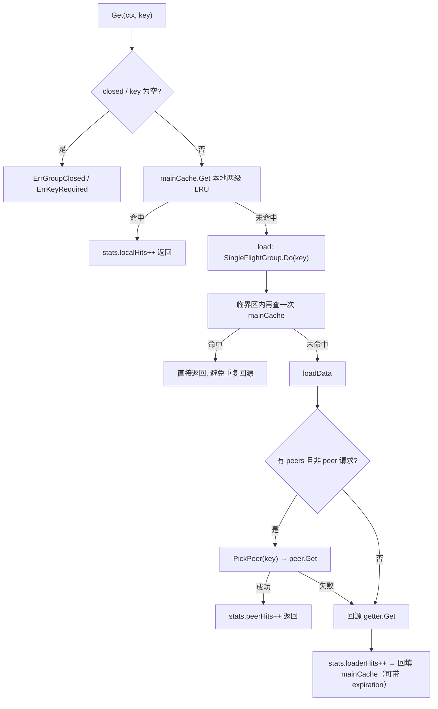
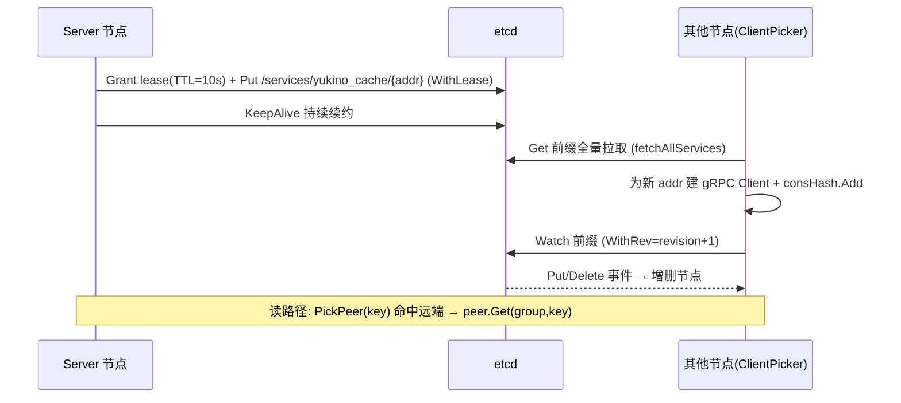
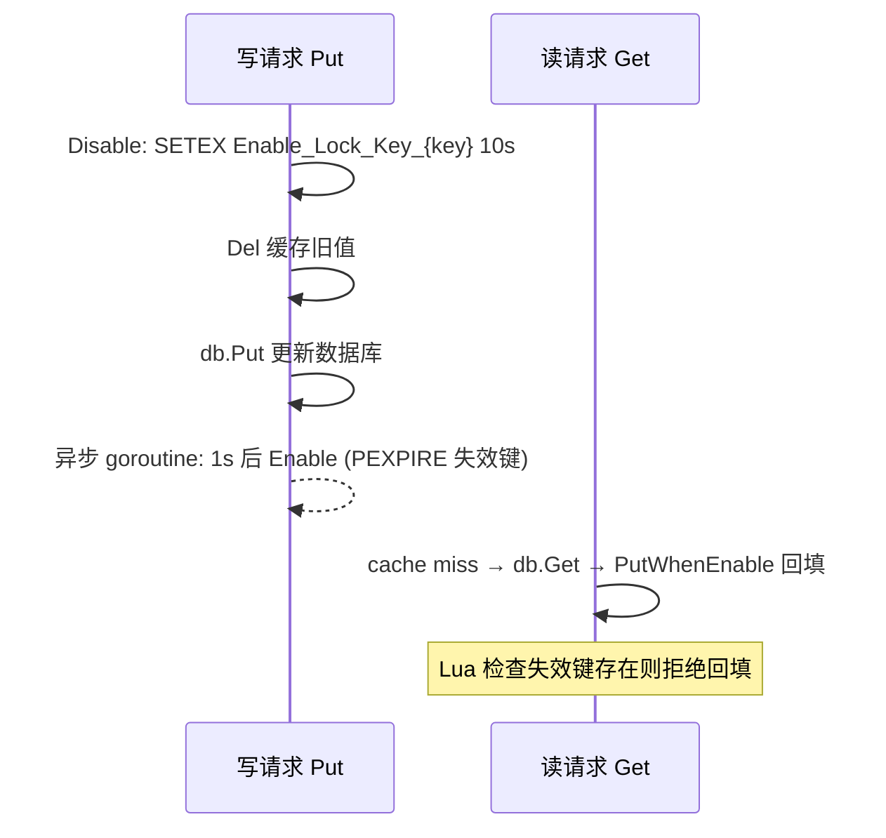

本篇覆盖缓存系统与存储层的高频面试题，全部「项目事实」均实读自 `yukino.go` 仓库（HEAD `facf5d6`）：`libs/yukino_cache`（read-through 缓存库）、`libs/yukino_orm`（MongoDB 查询构建器）、`components/consistent_cache`（缓存-DB 一致性服务）、`components/redis_lock`（分布式锁）、`components/consistent_hash`（带数据迁移的分布式一致性哈希）。路径均相对仓库根目录。

| 证据层级 | 说明                                                                  |
| -------- | --------------------------------------------------------------------- |
| 事实基线 | 标注 `源码:` 的陈述来自上述源码实读，可给出文件路径、常量、结构体字段 |
| 方案推导 | 通用工程方案与取舍分析，非项目已实现，面试中表述为「如果要做」        |

## 一、read-through 缓存与 Group 模型

### Q1. 什么是 read-through 缓存？它与 Cache Aside 的区别是什么？

**read-through**：调用方只面对缓存对象，缓存未命中时由缓存层自己调用注册的加载器（getter）回源并回填，调用方不感知数据源。**Cache Aside**：调用方自己维护「先读缓存、miss 后读 DB、再写缓存」的流程。

- 源码：`libs/yukino_cache/group.go` 的 `Getter` 接口只有一个方法 `Get(ctx, key) ([]byte, error)`，`NewGroup(name, cacheBytes, getter, opts...)` 注册时传入；`Group.Get` miss 后走 `load → loadData → g.getter.Get` 并回填 `mainCache`，调用方全程只调 `Group.Get`。
- 取舍：read-through 把回源、去重（singleflight）、回填集中收口，业务代码更干净、不易写错；代价是缓存层要知道如何加载数据，且加载逻辑与缓存生命周期耦合。Cache Aside 灵活但每个调用点都可能写出不一致的回填逻辑。

### Q2. 完整描述 `Group.Get` 的一次读取路径。



源码：`libs/yukino_cache/group.go`。要点：

1. `Get` 先查 `mainCache`（本地命中计入 `stats.localHits`）；
2. miss 后进入 `load`，用 `SingleFlightGroup.Do(key, fn)` 合并同 key 并发；
3. `fn` 内**先复查一次本地缓存**（双检），再 `loadData`；
4. `loadData` 优先问一致性哈希选中的 peer（`peerHits/peerMisses`），peer 失败才回源 getter（`loaderHits`）；
5. 回源结果按 `expiration` 是否 >0 选择 `AddWithExpiration` 或 `Add` 写回本地。

### Q3. 为什么 `load` 在 singleflight 临界函数里还要再查一次本地缓存？

并发场景：N 个 goroutine 同时 miss 同一个 key，singleflight 只放一个进去回源，其余 N-1 个等结果。但在「第一个请求 miss」到「进入 Do」之间，可能有**另一条已完成的路径**（例如 peer 同步、Set）刚把值写进本地缓存；也可能 singleflight 结束后缓存又被淘汰。临界区内复查一次（`libs/yukino_cache/group.go` 的 `load` 中 `if view, ok := g.mainCache.Get(ctx, key); ok { return view, nil }`）能省掉一次无谓回源。这是标准的 **double-check** 模式：锁外初筛、锁内复核。

### Q4. `Group.Set/Delete` 为什么要异步同步给 peer？代价是什么？

源码：`libs/yukino_cache/group.go`，`Set` 写本地后 `go g.syncToPeers(peers, "set", key, value)`，`Delete` 同理；`syncToPeers` 用 `peerSyncTimeout = 3 * time.Second` 的独立 context 调 `peer.Set/Delete`，失败只打日志。

- **为什么异步**：写路径对调用方保持本地延迟，不被跨节点 RPC 拖慢；缓存同步属于「尽力而为」，丢一次同步最坏只是别的节点多读一会儿旧值（最终一致）。
- **代价**：① 同步失败无重试、无补偿，只记日志——peer 上可能残留旧值直到过期或被读路径覆盖；② `go` 出去的 goroutine 用 `context.Background()` 派生，与请求生命周期解耦，进程退出时可能丢同步；③ 只同步给一致性哈希选中的**一个** peer（`PickPeer(key)`），不是广播——因为读路径也按同样规则路由，理论上只需要该 key 的归属节点有值。
- **采分点**：能指出「这是最终一致而非强一致」，并说出读路径如何兜底（peer miss 后回源 getter 并回填）。

### Q5. 如何防止 peer 之间的请求转发形成环路？

源码：`libs/yukino_cache/group.go` 定义私有 `peerRequestContextKey struct{}`，`withPeerRequest(ctx)` 写入标记、`isPeerRequest(ctx)` 读取。三处使用：

1. `loadData`：只有 `!isPeerRequest(ctx)` 才会去问 peer——**来自 peer 的请求绝不再向别的 peer 转发**；
2. `Set/Delete`：只有 `!isPeerRequest(ctx)` 才触发 `syncToPeers`——peer 同步写入不再二次扩散；
3. `server.go` 的 gRPC handler `Get/Set/Delete` 对入站 RPC 一律 `withPeerRequest(ctx)` 打标。

这是「请求来源标记」的通用手法：用 context value 携带拓扑角色，把「我可以问谁」和「我是被谁问的」解耦。面试可类比：消息队列的 TTL/防环跳数、BGP 的 AS-PATH 防环。

### Q6. `NewGroup` 对重复注册直接 panic，这个设计合理吗？

源码：`libs/yukino_cache/group.go`，全局 `groups map[string]*Group` 加 `groupsMu` 保护；重复 name 直接 `panic("duplicate registration of group ...")`，`getter == nil` 也 panic。

- 合理的一面：group 注册是**进程启动期**行为，重复注册是编程错误（类似 `http.Handle` 重复注册 panic），fail-fast 比静默覆盖安全——覆盖会让先注册方的 getter 失效，问题延迟暴露。
- 可讨论的一面：库代码 panic 会影响宿主进程；替代方案是返回 error 或幂等复用。项目同时提供 `DestroyGroup/DestroyAllGroups` 做显式生命周期管理，说明设计意图是「注册即全局单例，销毁需显式」。
- **采分点**：区分「启动期配置错误用 panic」与「运行期错误用 error」的边界。

### Q7. `groupStats` 记录了哪些指标？命中率怎么算？

源码：`libs/yukino_cache/group.go`，`groupStats` 全部用 `atomic.Int64`：`gets / loads / loadsDeduped / localHits / localMisses / peerHits / peerMisses / loaderHits / loaderErrors / serverRequests / loadDuration`。`Stats()` 输出：

- `hit_rate = localHits / (localHits + localMisses)`——注意分母是**本地层**的命中与未命中之和；
- `avg_load_time_ms = loadDuration / loads / 1e6`（纳秒累计换算毫秒）；
- 再并入 `mainCache.Stats()` 的 `cache_*` 字段（`hits/misses/hit_rate/bytes/evictions`）。

**深挖**：`loadsDeduped` 统计的是真正进入 singleflight 回源函数的次数，`loads` 是 `Do` 的总调用数——两者差值就是被合并掉的重复加载，这是衡量 singleflight 收益的直接指标。

### Q8. 已 Close 的 Group 为什么返回 `ErrGroupClosed` 而不是降级直读数据源？

源码：`libs/yukino_cache/group.go`，`Get/Set/Delete` 开头都检查 `g.closed.Load() == 1`。Close 通过 `CompareAndSwap(0,1)` 保证只执行一次，并从全局 registry 删除。

语义上 Close 表示「这个缓存实例被显式下线」（例如 `DestroyGroup` 做资源回收），此时继续用 getter 回源会让调用方误以为缓存还在工作，且绕过缓存的限流/统计。正确做法是让错误显式上抛，由调用方决定直连数据源还是换 group。**采分点**：资源生命周期管理的「关闭后行为」要显式定义——返回错误、静默降级、panic 三选一，选哪个取决于调用方能否安全兜底。

## 二、两级 LRU 与分桶存储

### Q9. 讲一下 `yukino_cache` 的两级 LRU 结构，两级各承担什么职责？

源码：`libs/yukino_cache/lru.go` 的 `lruStore`：每个桶持有 `caches [][2]*cache` 两个 LRU——`[0]`（容量 `CapPerBucket`，默认 512）与 `[1]`（容量 `Level2Cap`，默认 256）。

- **level0 是「最近写入/命中」层**：`Set` 只写 level0；
- **level1 是「被复用的热数据」层**：`Get` 在 level0 命中会把条目**搬进 level1**（`del` 出 level0、`put` 进 level1）；在 level1 命中则原地 LRU 提升（`adjust` 到头部）。
- 效果类似 2Q / SLRU 的思路：一次性访问（scan、冷查询）只污染 level0，被淘汰也不心疼；被第二次访问的数据进入 level1 获得更长驻留，**抗扫描污染**。

### Q10. 为什么 level0 命中要「搬进 level1」而不是在 level0 原地提升？

如果只在单级 LRU 里提升，一次全量扫描就能把整条热数据链冲掉（经典 LRU 的 scan-resistance 问题）。两级结构把「新进入」与「被验证过」分开：

- level0 容量大（512）承接所有新写入与首次命中，淘汰快；
- level1 容量小（256）只收被二次访问的 key，且 `Set` 新值会 `drop` 掉 level1 旧条目（`libs/yukino_cache/lru.go` 的 `SetWithExpiration`），保证 level1 里是当前版本的热点。

`Get` 的顺序也体现语义：先查 level0（最新写入优先），再查 level1（热点兜底）。**采分点**：能类比 Redis 的 LFU 热度衰减、MySQL InnoDB 的 young/old 分区（抗全表扫描冲刷）。

### Q11. 淘汰为什么按字节数而不是条数？`maxBucketBytes` 怎么算？

源码：`libs/yukino_cache/lru.go`，`NewStore` 里 `maxBucketBytes = opts.MaxBytes / (mask+1)`（`mask+1` 是向上取 2 的幂后的桶数）；`SetWithExpiration` 写入后循环 `for l0.bytes + l1.bytes > maxBucketBytes { evictFromBucket(idx) }`。

- 缓存的价值是**省内存**，条数限制对 value 大小差异大的场景毫无意义（1KB 和 1MB 的条目同样占一条）；
- `entryBytes(key, val) = len(key) + val.Len()` 在 put/evict 时增减 `bytes` 计数，O(1) 维护；
- 淘汰顺序：先 level0 最旧、再 level1 最旧（`evictFromBucket`），与「level1 更珍贵」一致。
- 边界：`MaxBytes` 太小导致 `maxBucketBytes <= 0` 时兜底为 1——单条都放不下，等效于禁用缓存，这是防御性写法。

### Q12. 为什么分桶（BucketCount=16，每桶一把锁）？mask 怎么选？

源码：`libs/yukino_cache/lru.go`：`locks []sync.Mutex` 每桶一把；`idx := HashBKRD(key) & s.mask`；`mask = MaskOfNextPowOf2(BucketCount)`——把桶数向上取 2 的幂再减 1，于是 `& mask` 等价于取模但更快。`HashBKRD` 是基数 131 的字符串散列。

- 单把全局锁会让所有 Get/Set 串行，分桶把锁粒度降到 1/16（默认），桶间天然无竞争；
- 桶数取 2 的幂是位运算取模的前提；
- 代价：容量与字节上限按桶均分（`CapPerBucket`、`maxBucketBytes`），**桶间不均衡**时某些桶提前淘汰而别的桶还有空间——用「少量空间利用率」换「锁简单、无全局协调」。
- **深挖**：这与 Go map 的分桶、`sync.Map` 的 read/dirty 分层、Redis Cluster 的 16384 槽是同一类「shard 降竞争」设计。

### Q13. 讲一下 `cache` 结构体的数组双向链表实现，与 `container/list` 相比取舍在哪？

源码：`libs/yukino_cache/lru.go`：

```go
type cache struct {
    doubleLink [][2]uint16 // 索引 0 是哨兵; [i][0]=prev, [i][1]=next
    m          []node      // 节点池, key/value/expireAt
    hashMap    map[string]uint16
    bytes      int64
    nevict     int64
    last       uint16
}
```

- 用 **uint16 索引**代替指针构成双向链表，节点预分配在连续切片 `m` 里：缓存友好、GC 扫描压力小（没有大量独立堆对象）；
- 哨兵节点 0：`doubleLink[0][p]` 是头、`doubleLink[0][n]` 是尾，插入/删除不需要判空边界；
- `adjust(idx, f, t)` 一次完成「摘下 + 挂到某端」；淘汰永远取 `doubleLink[0][p]`（最旧端）；
- 容量用满后复用尾节点做「替换插入」（put 的 `c.last == cap` 分支），避免反复分配。
- 取舍：`container/list` 通用但每个 `Element` 是独立堆对象、指针跳跃、GC 不友好；数组版牺牲通用性（容量上限、仅 string key）换性能与内存密度。
- **边界**：`uint16` 决定单桶单层容量上限 65535，`CapPerBucket`/`Level2Cap` 必须落在该范围——这是「紧凑结构」付出的类型约束代价。

### Q14. 过期为什么用惰性删除 + 后台清扫？`Now()` 的粗时钟是怎么回事？

源码：`libs/yukino_cache/lru.go`：

- **惰性**：`Get` 命中时比较 `currentTime >= expireAt`，过期则删并返回 miss；
- **后台**：`cleanupLoop` 每 `CleanupInterval`（默认 1 分钟）遍历所有桶，收集过期 key 后统一删除；
- **粗时钟**：包级 `clock` 变量由后台 goroutine 维护——每 100ms `atomic.StoreInt64(&clock, time.Now().UnixNano())`，随后 9 次「sleep 100ms 再原子加 100ms」，`Now()` 只读原子变量。

为什么这么做：缓存 Get 是超高频路径，每次 `time.Now()` 虽不昂贵但要过 vDSO/原子读，且多核下缓存行抖动；用 100ms 精度的原子时钟把时间读取降到一次普通原子 load，代价是**过期判断最多滞后约 100ms**——对缓存 TTL 完全可接受。**采分点**：这是「时钟精度换吞吐」的典型工程权衡，可类比 Redis 的 `serverCron` 每秒采样时间、Linux 内核的 coarse clock。

### Q15. `Cache` 为什么做延迟初始化（`ensureInitialized`）？

源码：`libs/yukino_cache/cache.go`：`NewCache(opts)` 只存配置不建 store；首次 `Add` 时 `ensureInitialized` 用「`initialized.Load()` 快路径 + 加锁后复查」的双检创建 `lruStore`。`Get` 在未初始化时直接计 miss 返回，**不触发初始化**。

- 读多写少的冷启动阶段不白白分配桶、链表与后台清理 goroutine；
- `lruStore` 创建即启动 `cleanupLoop` goroutine——延迟初始化也推迟了 goroutine 的诞生，避免「建了缓存却从没人写」时的资源浪费；
- `Close` 会把 `initialized` 置回 0、`store` 置 nil，与初始化互斥。
- **深挖**：双检锁在 Go 里必须配合原子变量/`sync.Once`，这里用 `atomic.Int32` + mutex 复查，是正确的 DCL 形态。

### Q16. `ByteView` 为什么在 `ByteSlice()` 时 clone？

源码：`libs/yukino_cache/byte_view.go`：`ByteView{b []byte}` 实现 `Value` 接口（`Len() int`）；`ByteSlice()` 返回 `cloneBytes(b.b)`，`Group` 回源后也用 `cloneBytes` 再入缓存。

- 缓存条目会被多个 goroutine 并发读取；若直接把内部 `[]byte` 交出去，调用方一旦修改就破坏了共享状态；
- 复制语义（返回副本）牺牲一次拷贝换不可变性，`String()` 同样发生拷贝（Go 的 `string(b)` 复制底层字节）；
- 取舍：超大 value 场景拷贝成本显著，可以改为引用计数/只读契约，但库选择了最安全的默认。**采分点**：说清「共享可变 vs 复制不可变」的边界，以及 `string(bytes)` 在 Go 里的拷贝语义。

### Q17. `CacheOptions` 的默认值是多少？你会怎么调？

源码：`libs/yukino_cache/cache.go` 的 `DefaultCacheOptions()`：`MaxBytes = 8MB`、`BucketCount = 16`、`CapPerBucket = 512`、`Level2Cap = 256`、`CleanupTime = 1min`、`OnEvicted = nil`；另有 `DashboardAddr` 可选（配置后 `StartDashboard` 起 WebSocket 监控面板，`libs/yukino_cache/dashboard.go`，每 2s 推快照、支持 delete 命令）。

调参思路（方案推导）：

| 参数           | 调大的收益         | 调大的代价                     |
| -------------- | ------------------ | ------------------------------ |
| `MaxBytes`     | 命中率上升         | 内存占用；GC 扫描对象变多      |
| `BucketCount`  | 锁竞争下降         | 每桶均分容量变小，碎片化加剧   |
| `CapPerBucket` | 单桶能容纳更多条目 | 内存与遍历成本                 |
| `Level2Cap`    | 热数据驻留更久     | level1 淘汰变慢，冷热点混淆    |
| `CleanupTime`  | 清扫开销下降       | 过期条目驻留更久，内存回收变慢 |

**采分点**：先报源码默认值（事实），再讲调参要盯 `Stats()` 的 `hit_rate/evictions/bytes`（观测闭环），而不是拍脑袋。

## 三、singleflight 与缓存击穿

### Q18. 缓存穿透、击穿、雪崩分别是什么？singleflight 解决哪一个？

| 问题 | 定义                                         | 典型对策                                               |
| ---- | -------------------------------------------- | ------------------------------------------------------ |
| 穿透 | 查询**不存在**的数据，缓存永远 miss，直打 DB | 缓存空值（见 Q43）、布隆过滤器前置                     |
| 击穿 | **热点 key 过期瞬间**大量并发同时回源        | singleflight 合并回源、热点永不过期/逻辑过期、互斥重建 |
| 雪崩 | 大量 key **同时过期**或缓存服务宕机          | 过期时间加随机抖动（见 Q44）、多级缓存、限流降级       |

singleflight 解决的是**击穿中的并发回源放大**：同一 key 的 N 个并发只回源 1 次。它不解决穿透（空值每次都要回源）也不解决雪崩（不同 key 各自回源）。

### Q19. 讲一下 `SingleFlightGroup.Do` 的实现。

源码：`libs/yukino_cache/single_flight.go`（42 行）：

```go
type call struct {
    wg  sync.WaitGroup
    val any
    err error
}

type SingleFlightGroup struct{ m sync.Map }

func (g *SingleFlightGroup) Do(key string, fn func() (any, error)) (any, error) {
    c := &call{}
    c.wg.Add(1)
    actual, loaded := g.m.LoadOrStore(key, c)
    if loaded {                    // 已有在途调用: 等它完成, 共享结果
        existing := actual.(*call)
        existing.wg.Wait()
        return existing.val, existing.err
    }
    defer g.m.Delete(key)          // 首个调用者负责执行与清理
    defer c.wg.Done()
    func() {
        defer func() {             // panic 转 error, 不扩散给等待者
            if r := recover(); r != nil {
                c.val, c.err = nil, fmt.Errorf("singleflight: panic during call: %v", r)
            }
        }()
        c.val, c.err = fn()
    }()
    return c.val, c.err
}
```

关键点：`LoadOrStore` 原子地决出「谁执行、谁等待」；等待者阻塞在 `wg.Wait()`；执行者 `defer` 里先 `Delete(key)` 再 `wg.Done()`——**注意顺序**：先删 map 再放行等待者，新来的请求会发起新的 `call`（不会挂到已完成的旧 call 上），而旧等待者仍能通过手里的 `c` 拿到结果。

### Q20. 这个实现把 panic 转成 error，与 `x/sync/singleflight` 的行为不同，怎么评价？

`golang.org/x/sync/singleflight` 会记录 panic 并在所有等待者上**重新 panic**（保持「就像你自己调用了 fn」的语义）；本项目选择 recover 后返回 `error`。

- 好处：缓存回源函数 panic 不会把 N 个等待 goroutine 一起带走，服务稳定性优先；对缓存场景「回源失败就当 miss 处理」是合理降级。
- 代价：吞掉了 panic 的堆栈语义，bug 被降级成普通错误，容易被忽略——所以错误信息里带了 `panic during call: %v` 便于日志定位。
- 另一个差异：没有 `Forget(key)`。若 fn 返回错误，map 项也随 `defer Delete` 移除，下一次调用会重新回源——**错误不会被缓存**，这是正确行为；但没有 Forget 意味着无法主动让某个在途 key 提前失效。
- **采分点**：能对比标准库行为并讲清取舍，而不是只会背「合并并发请求」。

### Q21. 只有 singleflight 够不够防击穿？还差什么？

不够。singleflight 只压缩**同一时刻**的并发回源；热点 key 过期后第一波请求合并成 1 次回源，但如果回源慢（比如 DB 要 200ms），期间所有请求仍阻塞等待（本项目是同步等待结果）。完整方案（方案推导）：

1. **逻辑过期**：value 里带过期时间，物理上永不过期；发现逻辑过期后异步重建，当前请求先返回旧值（牺牲短暂一致性换可用性）；
2. **热点预热/永不过期**：对已知热点提前加载、后台续期；
3. **二级互斥**：回源加分布式锁，只允许一个实例重建，其余读旧值或快速失败；
4. 配合本项目已有的能力：`WithExpiration` 加随机抖动防雪崩，`OnEvicted` 回调做淘汰监控。

**采分点**：把「并发合并」与「时间维度的过期重建」分开讨论——前者是空间维度去重，后者是时间维度错峰。

## 四、一致性哈希

### Q22. 为什么需要一致性哈希？普通取模有什么问题？

取模 `hash(key) % N` 在节点数 N 变化时**几乎所有 key 重新映射**，缓存集群扩缩容等于全量失效，瞬时全部打到数据源。一致性哈希把节点和 key 都映射到一个环上，key 归属顺时针第一个节点；增删节点只影响**相邻弧段**的 key，迁移量约 `1/N`。虚拟节点进一步把每个物理节点拆成多个环上点位，缓解节点少时的负载倾斜。

### Q23. 讲一下缓存库里 `ConsistentHashMap` 的实现与默认配置。

源码：`libs/yukino_cache/consistent_hash.go` + `config.go`：

- 默认配置 `DefaultConHashConfig`：`DefaultReplicas = 50`（每物理节点 50 个虚拟节点）、`MinReplicas = 10`、`MaxReplicas = 200`、`HashFunc = crc32.ChecksumIEEE`、`LoadBalanceThreshold = 0.25`；
- 结构：`keys []int`（有序虚拟点数组）+ `hashMap map[int]string`（点位→节点）+ `nodeHashes map[string][]int`（节点→其虚拟点，便于 Remove）+ `nodeCounts`（每节点请求计数）；
- `Add`：对每个节点生成 `"{node}-{i}"` 的哈希（`fmt.Appendf`），**跳过碰撞点位**，最后 `sort.Ints(keys)`；
- `Get(key)`：`sort.Search` 找第一个 `>= hash(key)` 的点位，越界回绕到 0（环语义），同时累加节点与总请求计数，`GetStats()` 输出各节点流量占比；
- `Remove`：按 `nodeHashes` 反查删除该节点全部虚拟点，原地过滤 `keys`。

### Q24. 虚拟节点数为什么默认 50？太多太少有什么问题？

虚拟节点越少，环上分布越稀疏，负载方差越大（极端情况一个节点占大段弧）；越多越均匀，但内存与 Add/Remove 的排序成本线性增长，且单节点故障时迁移的弧段更碎。50 是常见的经验值：标准差已经收敛到可接受范围（方案推导：N 个物理节点 × 50 虚拟点，负载偏离均值通常在 ±20% 内）。配置里的 `LoadBalanceThreshold = 0.25` 暗示了「偏离 25% 触发再平衡」的设计意图。

**事实口径提醒**：实读源码可见 `addNodeLocked` 目前只消费 `DefaultReplicas`，`MinReplicas/MaxReplicas/LoadBalanceThreshold` 三个字段**尚未被自适应逻辑使用**。面试若提到该库，应如实表述「配置预留了自适应副本数的字段，当前实现按固定 50 副本」，不要把未实现的能力说成已实现——这正是证据纪律的现场应用。

### Q25. 为什么用 crc32 而不是 Go 内置 `hash`/随机数？

- 一致性哈希要求**确定性**：同一 key 在任何进程、任何时刻算出同一位置，随机数直接出局；
- 要求**分布均匀**且计算便宜：`crc32.ChecksumIEEE` 是硬件加速友好的校验和，分布对短字符串足够均匀；Go 内置的 `hash/maphash` 带进程随机种子（每次启动不同），跨进程路由会错位，不能用；
- 对比：`components/consistent_hash` 用 `fnv32a % MaxInt32`（`encryptor.go`），Redis 环用 int32 分数；选型一致——非加密、快、确定性好。加密散列（SHA）均匀性更好但慢一个量级，路由场景不需要抗碰撞强度。

### Q26. `components/consistent_hash` 的 Redis 版环与内存版有什么不同？为什么需要分布式锁？

源码：`components/consistent_hash/`：

- 内存版（`libs/yukino_cache`）只服务**单进程内**的路由决策，每个进程各自维护一份环，靠所有进程看到相同的成员列表（etcd 发现）达成一致；
- `components/consistent_hash` 把环本身做成**共享状态**：`redis/hash_ring.go` 用 ZSET 存环表（score=虚拟点分数，member=JSON 编码的节点列表），另有节点副本表、节点→数据键集合；`Ceiling/Floor` 用 `ZRANGEBYSCORE` 找顺时针/逆时针邻居；
- 所有变更（`AddNode/RemoveNode/GetNode`）先 `hashRing.Lock`（复用 `components/redis_lock`，默认 `lockExpireSeconds = 15`）再操作——因为「读环 → 计算迁移集 → 写环」是多步复合操作，多个客户端并发改环会互相覆盖迁移决策，必须互斥。
- 代价：每次路由查询都要拿锁、访问 Redis，吞吐远低于内存版；换来的是**跨进程一致的环视图与数据归属记录**（`DataKeys` 记录每个节点拥有哪些 key，迁移时才能精确搬数据）。

### Q27. 增删节点时数据怎么迁移？讲一下 `migrateIn/migrateOut`。

源码：`components/consistent_hash/migration.go`：

- **migrateIn（加节点）**：新虚拟点插入环后，它的「责任弧段」是 `(逆时针邻居, 自己]`。找出**顺时针下一个节点**（原弧段主人）的 `DataKeys`，逐个重算分数，落在新弧段内的 key 组成迁移集：先 `DeleteNodeToDataKeys` 从旧节点摘除、`AddNodeToDataKeys` 挂到新节点，再由 `Migrator` 回调真正搬数据（`batchExecuteMigrator` 并发执行、recover 兜底）。
- **migrateOut（删节点）**：对将被移除的每个虚拟点，取其 `DataKeys`，筛选出属于该点弧段的 key，目标节点是同分的次节点或顺时针下一个**不同**节点（`getValidNextNode` 递归跳过仍是自己的点位），defer 里完成归属改挂。
- 环回绕用 `math.MaxInt32` 偏移归一化处理（`patternOne/patternTwo`），把环形区间比较转成线性比较。
- **采分点**：能指出「先改归属记录、再异步搬数据」存在中间态（数据还在旧节点但归属已变），需要读路径兜底（读不到再问旧主/回源），以及为什么迁移任务要 recover——单个迁移失败不能拖垮整个节点变更。

## 五、etcd 服务发现与 gRPC peer 同步

### Q28. 完整描述 `yukino_cache` 集群的组建流程。



源码：`libs/yukino_cache/register.go`（注册）、`peers.go`(发现)、`client.go`（peer 客户端）、`server.go`（gRPC 服务端）。

### Q29. 注册为什么用 lease + KeepAlive？keepalive 断了怎么办？

源码：`libs/yukino_cache/register.go`：`Grant(ctx, 10)` 建 10 秒租约，`Put` 服务键时 `WithLease`，随后 `KeepAlive` 持续续约。

- 租约把「服务存活」与「键存在」绑定：进程崩溃/网络隔离后不再续约，10 秒内 etcd 自动删键， watchers 收到 Delete 事件摘除节点——**无需健康检查探针**，这是 etcd 注册发现的标准姿势；
- keepalive channel 被关闭（网络抖动、etcd 切主）时，`registerWithConfig` 的守护 goroutine 调 `reRegister` 重新走 Grant+Put+KeepAlive，退避从 1s 起、每次翻倍、上限 30s；
- 主动停止（`stopCh` 关闭）时 `Revoke` 租约立即下线，不等 TTL 到期——优雅退出。
- **深挖**：TTL=10s 意味着故障感知最坏 10 秒+watch 延迟；要更快感知就得缩短 TTL，但续约频率与 etcd 负载上升——经典权衡。

### Q30. watch 为什么要在 `fetchAllServices` 之后用 `WithRev(revision+1)` 接续？

源码：`libs/yukino_cache/peers.go`：`fetchAllServices` 返回 `resp.Header.Revision`，`watchOnce(fromRev)` 以 `WithRev(fromRev+1)` 起 watch。

不传 revision 的话，watch 从**当前时刻**开始，全量快照与 watch 建立之间的事件窗口会丢：某个节点恰好在窗口内上线，本节点永远发现不了它（直到下一次 resync）。带上「快照 revision + 1」，etcd 从该版本重放事件，实现**无缝衔接**。watch 断开（`resp.Canceled`/错误）后外层循环重新全量同步再接续 watch，`time.After(time.Second)` 防止空转风暴。**采分点**：这是「快照 + 增量」同步协议的通用范式（K8s informer 的 list-watch + resourceVersion 同理）。

### Q31. peer 客户端为什么用 `WaitForReady(true)` + 3 秒超时？

源码：`libs/yukino_cache/client.go`：`grpc.NewClient(addr, insecure, WithDefaultCallOptions(grpc.WaitForReady(true)))`；`Get/Delete` 各自 `context.WithTimeout(3s)`。

- `WaitForReady`：RPC 发起时若连接未就绪（TRANSIENT_FAILURE），不立即失败而是等连接建立——对「节点刚被发现、连接还没握手」的窗口期友好；
- 3 秒超时：缓存读是低延迟路径，peer 慢于 3s 不如直接失败走回源（`loadData` 里 peer 错误计入 `peerMisses` 后 fallback getter）——**缓存访问必须有预算上限**，否则缓存反而成为延迟放大器；
- 注意 `Set` 用的是调用方 ctx（同步路径里是 `syncToPeers` 的 3s context），读写超时策略一致。
- 取舍：`insecure.NewCredentials()` 说明面向内网可信环境；跨公网需换 TLS——面试要点出信任边界。

### Q32. 服务端为什么限制 `MaxRecvMsgSize = 4MB`？value 超了会怎样？

源码：`libs/yukino_cache/server.go`：`DefaultServerOptions.MaxMsgSize = 4 << 20`，`grpc.MaxRecvMsgSize(options.MaxMsgSize)`。

- gRPC 默认接收上限 4MB，这里显式声明等于把默认值固化成配置项，便于按部署环境调整；
- 超限的 RPC 会被 gRPC 直接拒绝（`ResourceExhausted`），调用方 `getFromPeer` 收到错误 → 计 `peerMisses` → 回源。**大 value 不应进这个缓存**：内存按字节限额、gRPC 消息限长、dashboard 快照全量序列化，三处都假设条目是小对象；
- 方案推导：真要存大对象应拆分（chunk 化）、走对象存储，或单独建 group 并调大 MaxBytes/MaxMsgSize，同时评估对 GC 与网络的影响。

### Q33. 为什么服务端注册 gRPC health service？与 GracefulStop 如何配合？

源码：`libs/yukino_cache/server.go`：`health.NewServer()` + `SetServingStatus(svcName, SERVING)`；`Stop()` 顺序：`stopOnce` 保证单次 → `SetServingStatus(NOT_SERVING)` → `close(stopCh)`（触发注册 goroutine `Revoke` 租约）→ `grpcServer.GracefulStop()` → 关闭 etcd 客户端。

- health service 让客户端/负载均衡器可以主动探活（gRPC 标准协议），而不是靠 RPC 失败被动发现；
- 优雅停机三件套的顺序有讲究：**先摘流量**（NOT_SERVING + etcd 注销让 peer 摘除自己），**再等存量请求完成**（GracefulStop 阻塞直到所有 pending RPC 结束），最后释放资源。顺序反了会丢在途请求。
- **采分点**：能讲出「先摘流、再排水、后关进程」的通用停机模型。

## 六、缓存与数据库一致性

### Q34. Cache Aside、Read/Write Through、binlog 订阅各是什么？为什么 Cache Aside 最常用？

| 模式               | 读写责任                                  | 优点                 | 缺点                               |
| ------------------ | ----------------------------------------- | -------------------- | ---------------------------------- |
| Cache Aside        | 应用读缓存/回源回填；写时更新 DB + 删缓存 | 简单、对缓存无侵入   | 一致性逻辑散落在业务代码           |
| Read/Write Through | 缓存层代理读写，自动回源/写穿             | 业务无感             | 缓存层要理解数据模型               |
| binlog 订阅        | 订阅 DB 变更（Canal 类）异步刷缓存        | 业务零改动、天然解耦 | 引入订阅链路，延迟与运维复杂度上升 |

Cache Aside 最常用是因为它对基础设施要求最低、失败语义清晰；`yukino_cache` 的 read-through Group 本质是「把 Cache Aside 的读路径收口进库」，写路径（Set/Delete + peer 同步）仍由应用驱动。

### Q35. 「先删缓存再更新 DB」和「先更新 DB 再删缓存」哪个对？各在什么时序下出错？

**先更新 DB 再删缓存（Cache Aside 标准写）** 是更安全的默认，但仍非绝对一致：

- 先删缓存再更新 DB 的经典破绽：A 删缓存 → B 读 miss 把**旧值**回填缓存 → A 更新 DB。此后缓存长期是旧值（直到过期）。
- 先更新 DB 再删缓存的窗口：读请求在 A 更新 DB **之前**读到旧值、在 A 删缓存**之后**才回填——同样写回旧值，但该时序要求「读比写先开始、后结束」，且写必须发生在读的两次 IO 之间，概率远低于前者。
- 结论（方案推导）：两者都不能只靠顺序做到强一致，工程上用**延迟双删**（更新后再删一次）或**失效窗口**收窄窗口；要强一致就上「读时校验版本号」或串行化读写。

### Q36. 讲一下 `components/consistent_cache` 的失效窗口方案。

源码：`components/consistent_cache/service.go` + `redis/cache.go` + `option.go`：



- 默认参数：`cacheExpireSeconds = 60`、`disableExpireSeconds = 10`、`enableDelayMillis = 1000`；
- 写开始后 10 秒内（或主动 Enable 前的 1s 延迟内），任何回填都被 Lua 拒绝——**用一段「禁止写缓存」的窗口覆盖「旧值读取 → 回填」的竞态**；
- 读命中缓存正常返回；miss 回源后只有窗口外才回填；DB 里也没有则回填哨兵值 `NullData = "Err_Syntax_Null_Data"` 防穿透。
- 本质是「延迟双删」的强化版：不依赖第二次删除的时机，而是直接冻结回填通道。代价是窗口内所有读都打到 DB（写热点期间读放大），所以 `disableExpireSeconds` 要按最坏写耗时收敛。

### Q37. `PutWhenEnable` 为什么必须是 Lua？两步 GET+SET 会怎样？

源码：`components/consistent_cache/redis/cache.go` 的 `LuaCheckEnableAndWriteCache`：

```lua
local disable_flag = redis.call("get", KEYS[1]);
if disable_flag then return 0; end
redis.call("set", KEYS[2], ARGV[1], "ex", ARGV[2]);
return 1
```

若拆成客户端两步：`GET 失效键`（不存在）→ 此刻写请求 `Disable` 并更新 DB → 客户端 `SET` 把**旧值**回填。检查与写入之间的竞态正是失效窗口要防的事，两步执行等于窗口失效。Lua 在 Redis 单线程内原子执行，「检查 + 写入」无间隙。**采分点**：凡是「先检查后执行」的缓存/锁逻辑，多实例下都要原子化——Lua、事务或 SETNX 三选一。

### Q38. 为什么缓存 `NullData`？防穿透还有什么手段？

源码：`consistent_cache/service.go`：DB miss 时 `PutWhenEnable(ctx, key, NullData, ttl)`，读侧命中 `NullData` 直接返回 `ErrorDataNotExist`。

- 不缓存空结果时，攻击者用不存在的 key 洪泛请求，每次都穿透到 DB——穿透的本质是「缓存层对『不存在』没有记忆」；
- 缓存空值让「不存在」也变成可缓存的事实，代价是内存占用与「数据后来真的出现了」的短暂不可见（靠较短 TTL 收敛）；
- 其他手段（方案推导）：布隆过滤器前置（不存在则直接拒，容忍假阳性）、接口层参数合法性校验（拦截明显非法 key）、对异常 IP/key 模式限流。
- **深挖**：`NullData` 是字符串哨兵而非空串，避免与「值恰好是空串」混淆——设计哨兵值要选业务不可能出现的值。

### Q39. 过期时间加随机抖动（`WithCacheExpireRandomMode`）解决什么问题？

源码：`consistent_cache/option.go`：`CacheExpireSeconds()` 在随机模式下返回 `base + rand.Int63n(base+1)`，即 **[base, 2×base]** 均匀分布。

同一批数据若同一时刻写入、同一 TTL 过期，会**同时失效**引发雪崩（瞬时全部回源）。抖动把过期时刻摊开到一倍区间内，回源压力被时间维度稀释。这是缓存 TTL 设计的第一原则：**任何批量写入的 TTL 都不该是同一个数**。配合：回源侧 singleflight、DB 侧限流兜底。

### Q40. 失效键为什么写成 `Enable_Lock_Key_{key}`？花括号在 Redis Cluster 里起什么作用？

源码：`consistent_cache/redis/cache.go` 的 `disableKey`：`fmt.Sprintf("Enable_Lock_Key_{%s}", key)`。

Redis Cluster 按 `CRC16(key) % 16384` 分槽；**hash tag** 规则是：若 key 含 `{...}`，只用花括号内的子串算槽位。`PutWhenEnable` 的 Lua 同时操作两个 key（失效键 + 数据键），Cluster 要求 Lua 涉及的所有 key 同槽，否则拒绝执行。失效键用 `{key}` 做 tag，而数据键本身就是 `key`——两者算槽时一个取 `{key}` 内容、一个取整个 `key`，**哈希输入恰好一致**，保证同槽。

**采分点**：这个细节说明作者真的在 Cluster 环境跑过 Lua；面试能讲出「多 key Lua 在 Cluster 的同槽约束」就是区分度。

## 七、Redis 与分布式锁

### Q41. Redis 常用数据结构的底层编码与典型用途？

| 结构   | 底层编码（随规模转换）              | 典型用途                                  |
| ------ | ----------------------------------- | ----------------------------------------- |
| String | int / embstr / raw SDS              | 缓存值、计数器（INCR）、分布式锁（SETNX） |
| List   | listpack → quicklist                | 简单队列、最新 N 条                       |
| Hash   | listpack → hashtable                | 对象字段存取（HSET）、锁状态              |
| Set    | intset / listpack → hashtable       | 去重、共同好友（交并差）                  |
| ZSet   | listpack → **skiplist + hashtable** | 排行榜、延迟队列、滑动窗口限流、环表      |

项目例证：`components/red_mq` 用 Stream（XADD/XREADGROUP）做消息队列；`components/consistent_hash/redis` 用 ZSET 存环表（score=虚拟点、member=节点 JSON）；`components/timer` 用 bitmap（SETBIT）实现布隆过滤器；`components/redis_lock` 用 String + SETNX 做锁。**采分点**：说得出「为什么 ZSET 用跳表不用红黑树」（范围查询友好、实现简单、并发局部性好）。

### Q42. 讲一下 `components/redis_lock` 的单节点加锁流程。

源码：`components/redis_lock/lock.go` + `option.go`：

1. `NewRedisLock(key, client, opts...)`：token = `utils.GetProcessAndGoroutineIDStr()`（进程+goroutine 标识，保证同进程不同协程也不互串）；key 实际存储为 `REDIS_LOCK_PREFIX_ + key`；
2. `tryLock`：`SetNEX(key, token, expireSeconds)`——SET NX EX 一条命令原子完成「不存在才设 + 设过期」；默认 `expireSeconds = 30`；
3. 失败且 `WithBlock()`：`blockingLock` 以 **50ms ticker** 轮询重试，直到成功、ctx 取消或 `blockWaitingSeconds`（默认 5s）耗尽；
4. 加锁成功且未显式指定过期时间时自动启用 **watchdog**（见 Q43）。

`ErrLockAcquiredByOthers` 被 `IsRetryableErr` 标记为可重试错误，其他错误（网络、Redis 故障）不重试直接上抛——区分「竞争失败」与「系统故障」。

### Q43. watchdog 是干什么的？为什么每 10s 续期 15s？

源码：`components/redis_lock/lock.go`：`repairLock` 规定**只有未显式设置 expireSeconds 时才启用 watchdog**（默认 30s 过期 + `watchDogMode = true`）；`runWatchDog` 每 `WatchDogWorkStepSeconds = 10s` 执行 `DelayExpire(ctx, 10+5)`，即 Lua 校验 token 后 `EXPIRE 15s`。

- 解决的问题：业务执行时间不可预知，固定 TTL 太短会「锁还拿着、过期先到」，被别人抢走形成双持；太长则持有者崩溃后锁迟迟不释放。watchdog 让 TTL 跟随持有者存活——**活着就续期，死了就自然过期**；
- 10s 续 15s 留了 5s 缓冲：一次续期失败（网络抖动）还有下一次机会，连续两次失败才会丢锁；
- `DelayExpire` 返回 `errLockLost`（token 不匹配）时 watchdog 主动退出——锁已易主，不再续期，防止误续别人的锁；
- `Unlock` 先 Lua 校验 token 再 DEL，并停掉 watchdog。
- **采分点**：这套设计对应 Redisson 的看门狗机制；能讲出「续期周期 < TTL 且留缓冲」的参数关系。

### Q44. 为什么解锁必须用 Lua？写一下这个脚本。

源码：`components/redis_lock/lua.go`：

```lua
local getToken = redis.call('get', KEYS[1])
if (not getToken or getToken ~= targetToken) then
  return 0
else
  return redis.call('del', KEYS[1])
end
```

若客户端先 GET 比对再 DEL：A 比对 token 成功 → A 的锁恰好过期、B 抢到 → A 的 DEL 删掉了 **B 的锁**。token 校验与删除必须原子，否则锁的所有权保证形同虚设。续期脚本同理（GET 比对 + EXPIRE 原子）。**延伸**：token 用「进程+goroutine」而非 UUID 的取舍——同进程内可追溯持有者，但进程重启后 token 可能重复，配合 TTL 可接受。

### Q45. 讲一下 `RedLock` 的实现与法定人数。

源码：`components/redis_lock/red_lock.go`：

- 前置校验：节点数 **< 3 直接拒绝**（`can not use redLock less than 3 nodes`）；若设置了 `expireDuration`，还要求 `len(confs) × singleNodesTimeout × 10 ≤ expireDuration`——获取锁的总耗时预算必须远小于锁有效期，否则拿到手就快过期了；
- `Lock`：**顺序**对每个独立 Redis 节点执行单节点锁，单次耗时 ≤ `singleNodesTimeout`（默认 50ms）才计成功；成功数 ≥ `len>>1 + 1`（多数派）才算拿到锁；
- 失败时对所有已拿到的节点执行 Unlock（用 `context.WithoutCancel` 保证清理不被取消传播打断）；
- `Unlock` 遍历所有节点解锁，收集第一个错误返回。

### Q46. Redlock 的争议是什么？你怎么看？

争议（方案推导，业界共识）：

1. **时钟依赖**：Redlock 的安全性依赖各 Redis 节点时钟大致同步，NTP 跳变或节点时钟漂移可能让两个客户端同时「合法」持锁；
2. **GC pause / 网络延迟**：客户端拿到锁后发生长 GC，醒来时锁已过期易主，但它以为自己还持有——这个问题 Redlock 与单节点锁同样存在，本质是「持有者无法感知自己的停顿」；
3. Martin Kleppmann 与 antirez 的著名论战结论大致是：**靠锁做正确性保证就需要 fencing token**（单调递增序号，存储层拒绝旧序号写入）；若只为「效率」（避免重复计算），偶发双持可接受，Redlock 够用。

本项目的 `RedLock` 未实现 fencing token（事实），其使用场景（如 `components/tcc` 的 monitor 抢锁、`timer` 的调度锁）属于「效率锁 + 幂等兜底」类，双持的后果由业务幂等吸收——这个定位下 Redlock 是合理选择。**采分点**：先讲实现，再讲争议，最后落到「锁的用途决定方案」，避免站队式回答。

### Q47. `timer` 组件里的 `ReentrantDistributeLock` 与 `redis_lock` 有何不同？

源码：`components/timer/pkg/redis/lock.go`：

- **可重入**：`Lock` 先 `GET` 锁键，若值等于自己的 token（进程+goroutine 标识），直接走 `ExpireLock` 续期并返回成功——同一持有者重复加锁不阻塞；
- 否则 `SetNX` 抢占；`Unlock/ExpireLock` 同样是 Lua token 校验（脚本与 redis_lock 同款）；
- 键前缀 `FTIMER_LOCK_PREFIX_`。

对比：`redis_lock.RedisLock` 不做重入判断，同一 goroutine 二次 `Lock` 会自己把自己锁死（非可重入语义）。选型规则：**递归/嵌套调用路径用可重入锁，扁平临界区用非重入锁**（后者更简单、更难误用）。注意可重入锁的 GET+SetNX 不是原子的，重入判断依赖 token 唯一性保证安全。

## 八、MongoDB 与查询构建器

### Q48. `yukino_orm` 的 Query 构建器是什么结构？错误怎么处理？

源码：`libs/yukino_orm/query.go`：`Query` 持有 `collection/engine`、`conditions []condition`、`orGroups [][]condition`、`sort bson.D`、`limit/skip`、`fields`、聚合相关（`groupFields/havingConds/aggSpecs`）与 `err`。

- **链式可变构建器**：`Where/OrderBy/Limit/...` 都返回 `*Query` 自身；
- **sticky error**：构建期错误（如非法 Where 参数）不 panic、不立即返回，而是 `setErr` 记录**第一个**错误，后续调用短路保留，直到执行时由 `preflightBase` 统一抛出——链式 API 无法在每一步返回 error，这是 Go 构建器的常见解法（类比 `bufio.Scanner` 的 `Err()`）；
- `Clone()` 深拷贝所有切片字段，支持「基础查询 + 分叉变体」的复用模式。

### Q49. `Where` 支持几种调用形态？map 参数为什么按 key 排序？

源码：`libs/yukino_orm/filter.go` 的 `parseWhere`：

- 1 参：`bson.M` / `map[string]any`，每个键值对展开为等值条件（nil 值转 `null` 语义）；
- 2 参：`field, value` 等值；value 为 nil 时生成 `null` 条件；
- 3 参：`field, op, value`，op 走 `opAliases` 归一化（`=`/`==`、`!=`/`<>`→`$ne`、`>`→`$gt`、`in`/`not in`、`like`/`ilike`、`between`/`not between`）；未知的 `$` 前缀操作符**原样透传**（兼容 `$regex` 等原生操作符），其他报错。

map 遍历顺序在 Go 里是随机的，`parseWhereMap` 先 `sort.Strings(keys)` 再展开——**保证同一 map 生成相同的条件序列**，进而生成相同的 filter 与执行计划缓存键，也方便日志对比与测试断言。细节见真章。

### Q50. `like` 是怎么翻译成 `$regex` 的？有什么注意事项？

源码：`libs/yukino_orm/filter.go` 的 `likeToRegex`：先 `regexp.QuoteMeta(pattern)` 转义所有正则元字符，再把 SQL 通配符 `%`→`.*`、`_`→`.`，最后加 `^...$` 锚定全匹配；`ilike` 额外带 `Options: "i"` 忽略大小写。

- **先 QuoteMeta 再替换**是关键顺序：若 pattern 含 `.`、`*` 等字符，不转义会改变语义甚至注入正则（用户输入 `%` 之外的元字符被当作正则执行）——这是「翻译层也要防注入」的例证；
- 性能注意：`^` 锚定的前缀模式（`abc%` → `^abc.*$`）可走索引，`%abc` leading 通配必然全集合扫描；MongoDB 的 `$regex` 无法利用文本索引做中缀匹配，大表上要配 `$text` 或搜索引擎。

### Q51. 同一字段的多个条件如何合并？什么时候退化成 `$and`？

源码：`libs/yukino_orm/filter.go` 的 `buildConditionFilter`：

- 等值条件用 `setEquality`：字段首次出现直接 `filter[field] = value`；字段已是操作符文档则补 `$eq`；**两者都冲突**（如同字段两个不同等值）则推入 `$and` 数组——`{a:1, a:2}` 语义上永假，但构建器不替用户判真假，忠实表达；
- 操作符条件用 `setOp`：同字段不同操作符合并进同一个 `bson.M`（如 `between` 拆成 `$gte`+`$lte` 共存）；同操作符重复则同样落入 `$and`；
- `notBetween` 翻译为 `$not: {$gte, $lte}`；`notNull` 翻译为 `$ne: nil`。
- **采分点**：MongoDB 同一文档内同名字段只能出现一次（bson.M 是 map），多条件同字段必须靠 `$and` 数组表达——这是 filter 构造器绕不开的坑，能讲出来说明真写过。

### Q52. `OrWhere` 是怎么与基础条件组合的？

源码：`libs/yukino_orm/filter.go` 的 `buildFilter`：基础 conditions 先合成 base filter；每个 `OrWhere*` 追加一个 orGroup；最终若有 orGroups，则生成 `$or: [base, group1, group2...]`——**base 本身作为 $or 的一个分支**。语义是「(全部基础条件) 或 (or组1) 或 (or组2)」，与 SQL 的 `WHERE base AND (a OR b)` 不同，使用时要注意：想要 `base AND (a OR b)` 得把条件拆进同一个 orGroup 表达。只有一个 or 分支且无 base 时直接返回该分支，不套 `$or`。

### Q53. 讲一下 `GroupBy + SumAs/Having` 生成聚合管线的过程与校验。

源码：`libs/yukino_orm/query_group.go` 的 `buildGroupPipeline`：

1. **校验层**（先于构造，全部报错而非静默）：必须有 GroupBy；`Select` 不能与 GroupBy 同用（结果列只能是分组键+别名）；分组键按 `.`→`_` 扁平化后不得重复；别名非空、不得为 `_id`、不得含 `$` 或 `.`、不得与分组键/其他别名冲突；`Having` 与 `OrderBy` 引用的列必须存在于结果列集合，报错信息直接列出可用列；
2. **管线构造**：`$match`（Where 条件）→ `$group`（单字段 `_id: "$f"`；多字段 `_id: {f1: "$f1", ...}`；`CountAs` 用 `$sum: 1`，其余 `$sum/$avg/$min/$max: "$field"`）→ `$project`（`_id: 0`，分组键从 `$_id.xxx` 投影出来，别名保留）→ `$match`（Having）→ `$sort` → `$skip` → `$limit`。
3. Having 放在 `$group` 之后用第二个 `$match` 实现——这正是 SQL HAVING 的语义（对聚合结果过滤），而 Where 对应 `$group` 前的 `$match`。

**采分点**：能解释「为什么 Having 不能放在第一个 $match」（聚合列尚不存在），以及别名冲突校验为何必要（`$project` 阶段同名字段会互相覆盖）。

### Q54. `Engine.Transaction` 怎么实现？session 如何传播到每个查询？

源码：`libs/yukino_orm/engine.go`：

```go
func (e *Engine) Transaction(ctx context.Context, fn func(sc context.Context, tx *Engine) error) error {
    session, err := e.client.StartSession()
    defer session.EndSession(ctx)
    _, err = session.WithTransaction(ctx, func(sc context.Context) (any, error) {
        txEngine := &Engine{ /* 同 client/database, 注入 session */ }
        return nil, fn(sc, txEngine)
    })
    return err
}
```

- `WithTransaction` 负责提交/回滚与**瞬态错误重试**（mongo-driver 内建 TransientTransactionError 重试循环）；
- 回调拿到的是**携带 session 的新 Engine**，业务用它发起的每个查询经 `execCtx → sessionContext`：若 ctx 里没有 session 就注入 `mongo.NewSessionContext(ctx, e.session)`——同一事务内的所有操作自动落在同一 session，无需业务手动传；
- `Cursor`（`query_stream.go`）的 `bind` 同样注入 session，事务内流式读取也不掉线。
- **深挖**：MongoDB 事务要求副本集/分片集群，且事务内操作应短小——长事务持有锁与 oplog 窗口，代价远高于单文档原子操作。设计原则：**能用单文档原子性解决的不开事务**。

### Q55. `NextSequence` 的原子自增怎么实现？与 MySQL 自增主键比有什么限制？

源码：`libs/yukino_orm/engine.go`：对 `counters` 集合执行 `FindOneAndUpdate({_id: name}, {$inc: {value: 1}}, Upsert + ReturnDocument(After))`，返回更新后的值。

- `FindOneAndUpdate` 单文档操作天然原子，`Upsert` 保证首次自动建计数器，`ReturnDocument(After)` 直接拿到新值——一次往返完成「取号」；
- 限制（对比 MySQL AUTO_INCREMENT）：① 每次取号一次网络往返，高并发取号成为吞吐瓶颈（可批量取段：`$inc` 加 N，本地分配区间）；② 没有回卷/空洞保证，事务放弃取号后号码不回收；③ 依赖 counters 集合所在副本集可用性；
- 适用：MongoDB 里需要**人类可读短 ID**（订单号）时；`_id` 本身用 ObjectId 即可，无需自增。

### Q56. `normalizeUpdate` 为什么自动包 `$set`？

源码：`libs/yukino_orm/query_exec.go`：`Update/Upsert` 的 update 参数若是 `bson.M`/`map[string]any` 且**没有**任何 `$` 前缀键，就包成 `{"$set": doc}`；`bson.D` 逐元素检查；结构体同样包 `$set`；已含操作符的原样透传。

MongoDB 的 update 文档要么是「替换文档」（无操作符，整文档替换），要么全键都是操作符。构建器面向的是「改几个字段」的常见意图，自动包 `$set` 避免用户忘写操作符导致**整文档被替换**（丢字段事故）。这是「把危险默认变安全」的 API 设计。**追问**：想做整文档替换怎么办？——显式传带操作符的文档或直接用驱动 API。

### Q57. 流式读取（`Cursor/Each`）与 `Find` 全量加载怎么选？

源码：`libs/yukino_orm/query_stream.go`：`Cursor(ctx)` 返回包装的 `*Cursor`（`Next/Decode/Current/Err/Close`，且 `bind` 注入事务 session）；`Each(ctx, fn)` 是迭代语法糖，自动 Close。`Find` 则 `cursor.All` 一次性反序列化进切片。

| 场景                 | 选择                               | 理由                                                                  |
| -------------------- | ---------------------------------- | --------------------------------------------------------------------- |
| 结果集小（< 数千条） | `Find`                             | 一次加载，代码简单                                                    |
| 大结果集逐条处理     | `Cursor/Each`                      | 内存 O(1)，边读边处理；注意服务端游标超时（默认 10 分钟无活动会失效） |
| 分页展示             | `Limit/Offset` 或按 `_id` 游标分页 | `skip` 大偏移会扫丢（见 Q58）                                         |

**采分点**：提到游标超时与「长处理中定期 `TryNext`/分批」的应对，以及 `defer cursor.Close` 的必要性（泄漏服务端资源）。

### Q58. MongoDB 深分页为什么慢？怎么优化？

`skip(N)` 要求服务端**数出并丢弃** N 条文档，偏移越大扫描越多，O(N) 退化。优化（方案推导）：

1. **游标分页**：记住上一页最后一条的有序键（如 `_id`），下一页 `Where("_id", ">", lastID).Limit(n)`——走索引范围扫描，与页深无关；
2. 覆盖索引 + `Select` 投影减少回文档开销；
3. 业务上限：禁止跳页到极深位置（搜索引擎式「最多显示前 1000 条」）；
4. 聚合场景用 `$limit` 前置 `$match` 收窄集合。

`yukino_orm` 同时提供 `Offset`（小页码可用）与有序键条件查询（`OrderBy + Where`）两种能力，深分页应走后者。MySQL 同理（`LIMIT 100000, 20` 的经典问题），面试可对照回答。

### Q59. `CollectionName` 的命名规则是什么？有什么坑？

源码：`libs/yukino_orm/naming.go`：结构体名先 `toSnake`（大写字母前插 `_` 再全小写），再 `pluralize`：辅音+`y` 结尾 → `ies`（`category`→`categories`）；`s/x/sh/ch` 结尾 → `es`；其余 → `s`。指针/切片自动解引用到元素类型；非结构体返回空串。

坑：① 不规则名词不处理（`person`→`persons` 而非 `people`）；② 连续大写按字母拆（`HTTPServer`→`h_t_t_p_server` 这类退化）；③ 与既有集合名不一致时用 `Engine.Collection(name)` 显式指定。这类「约定优于配置」的命名层，面试重点是**知道边界在哪**，而不是背规则。

## 九、速记卡

- **read-through**：调用方只见 `Group.Get`；miss → singleflight 双检 → peer → getter 回填；peer 转发用 ctx 标记防环。
- **两级 LRU**：level0 收新、level1 收热；按字节淘汰（`maxBucketBytes`）；分桶 16 + `& mask` 定位；100ms 粗时钟换吞吐。
- **singleflight**：`sync.Map` + `WaitGroup`；panic 转 error；错误不缓存；只防「并发击穿」，不防穿透/雪崩。
- **一致性哈希**：crc32 + 50 虚拟点 + `sort.Search` 找顺时针首点；Redis 版环要分布式锁 + 数据归属表才能精确迁移。
- **etcd 注册发现**：lease 10s + KeepAlive，断线重注册退避 1→30s；watch 用 `WithRev(快照rev+1)` 无缝接续。
- **缓存一致性**：先更 DB 再删缓存是默认；`consistent_cache` 用「失效窗口 + Lua 原子回填 + NullData 防穿透 + 随机 TTL 防雪崩」。
- **分布式锁**：SETNX + token + Lua 解锁；watchdog 10s 续 15s；Redlock ≥3 节点多数派，争议在时钟与停顿，效率锁场景可用。
- **yukino_orm**：sticky error 链式构建；like 先 QuoteMeta 再转正则；同字段冲突落 `$and`；GroupBy 管线五段 + 别名/having 校验；事务靠 session 注入 ctx。

## 延伸阅读

[分布式组件与一致性](/interview/qa/distributed-components) · [服务架构与任务系统](/interview/qa/service-architecture) · [存储一致性](/interview/fundamentals/storage-consistency) · [Go 代码题：singleflight 与两级 LRU](/interview/code/go-singleflight) · [全量题库](/interview/question-bank)
