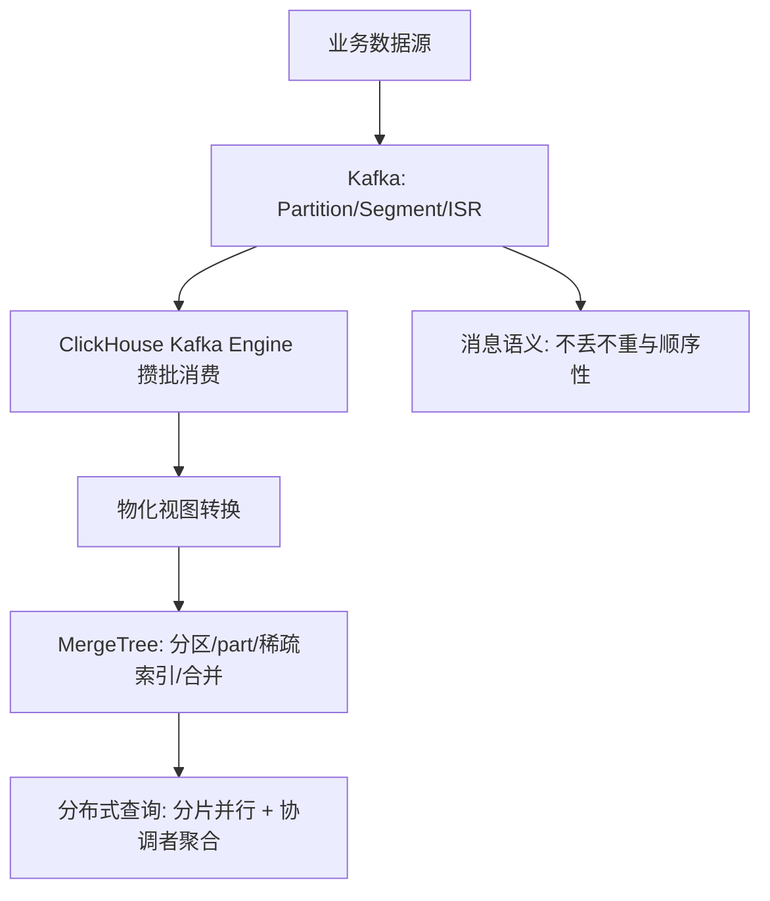

:::note 事实基线
本篇是「ClickHouse 与 Kafka 技术深挖」带解答题库，共 **96 题**，事实来源为 `content/be/clickhouse-kafka.md`，行为以 **ClickHouse 25.x** 与 **Kafka 4.x** 为基线（涉及 KRaft、Log Compaction 与 exactly-once 的结论均按该基线表述）；参数默认值核对官方文档，实例化结论需以本机 `system.settings` / broker 配置实测为准。本篇是「知识点」型题库（非单一项目），与 [数据链路与 OLAP 题库](/interview/qa/data-pipeline-olap)（以 TikTok 实时数据链路为案例）互补——本篇讲 ClickHouse/Kafka 的机制本身，那篇讲它们在完整数据系统里的落地。
:::

本篇是「ClickHouse 与 Kafka」技术深挖题库。它的面试价值在于：**ClickHouse 是 OLAP 列存的代表（MergeTree、稀疏索引、向量化、物化视图），Kafka 是消息/流处理管道的代表（分区、ISR、幂等/事务、Rebalance），二者联合构成实时数仓的标准架构**。本篇的组织顺序是：**先讲 ClickHouse 存储引擎 → 再讲 ClickHouse 查询优化 → 再讲 Kafka 架构与存储 → 再讲 Kafka 高级特性与调优 → 再讲 ClickHouse+Kafka 联合架构 → 最后讲综合方案设计**。

**主线一览**

## 一、ClickHouse 存储引擎

### Q1. 列式存储与行式存储的本质区别是什么？列存的三大优势？

行式存储（MySQL InnoDB）数据按行连续存放，一行所有列物理相邻，适合 OLTP——单行读写只需一次 I/O 即可取到完整记录。列式存储（ClickHouse）数据按列连续存放，同一列的所有值物理相邻，适合 OLAP——分析查询通常只涉及少数列，列存只读取需要的列，I/O 量与列数成正比而非总列数。

列存三大优势：① **I/O 放大消除**——100 列的表查 3 列，行存读 100 列数据，列存只读 3 列；② **压缩率极高**——同列数据类型相同、值域相近（如 status 列只有几个枚举值），重复度高，配合 LZ4/ZSTD 获得远高于行存的压缩率；③ **向量化执行友好**——同列数据连续存放，CPU 可用 SIMD 一次处理多个值，充分利用 cache line。

### Q2. MergeTree 的存储结构有哪些核心组件？

MergeTree 是最基础的表引擎，一个 part（数据分片）目录包含：`primary.idx`（稀疏主键索引，每 8192 行一个标记）、`column_a.bin`（列数据，压缩后）、`column_a.mrk2`（标记文件，记录每个 granule 的压缩块偏移、块内偏移与行数）、`count.txt`（行数）、`columns.txt`（列元信息）、`checksums.txt`（校验和）。

### Q3. MergeTree 的写入流程与合并流程？

写入流程：① 客户端发送 INSERT 数据，ClickHouse 按 ORDER BY 键排序；② 按 `index_granularity`（默认 8192 行）切分为 granule；③ 每个 granule 生成一条主键索引记录（稀疏索引，只记首行主键值）；④ 列数据按 granule 分块压缩（默认 LZ4）写入 `.bin` 文件；⑤ 标记文件 `.mrk2` 记录每个 granule 在 `.bin` 中的压缩块偏移、解压块内偏移与 granule 实际行数；⑥ 整个写入生成一个新的 part 目录，**原子 rename 对读可见**。

合并（Merge）流程：后台线程定期将多个小 part 合并为大 part（类似 LSM-Tree 的 compaction），合并时重新排序、重建索引、重新压缩；**合并是异步的，不阻塞读写**；读时如果数据跨多个 part，会做多路归并。

### Q4. 稀疏索引（primary.idx）与 MySQL B+ 树索引的差异？

ClickHouse 稀疏索引：每 `index_granularity`（默认 8192）行记录一个索引条目，只存该 granule 首行的 ORDER BY 键值；**索引常驻内存**（因为稀疏，10 亿行也只有约 12 万个条目，几 MB）；查询时二分查找定位到候选 granule 范围，再顺序扫描这些 granule。

| 维度     | ClickHouse 稀疏索引             | MySQL B+ 树索引                |
| -------- | ------------------------------- | ------------------------------ |
| 粒度     | 每 8192 行一个条目              | 每行一个叶子节点               |
| 内存占用 | 极小，全量常驻内存              | 大，通常只有热页在 buffer pool |
| 定位精度 | 定位到 granule 范围，需范围扫描 | 定位到具体行                   |
| 适用场景 | 范围查询、前缀匹配              | 点查、范围查询                 |
| 更新代价 | 合并时重建，无在线维护开销      | 每次写入都要维护 B+ 树平衡     |

### Q5. 稀疏索引生效的前提是什么？为什么 ORDER BY 键设计排在性能优化第一位？

稀疏索引要求数据**物理有序**（按 ORDER BY 排列），因此 MergeTree 写入时会排序。**如果查询条件不是 ORDER BY 的前缀，索引无法使用，退化为全表扫描**。这也是 ORDER BY 键设计排在性能优化第一位的根本原因——索引能不能用，完全取决于查询条件是否命中 ORDER BY 前缀。

### Q6. ReplacingMergeTree 的去重机制与关键陷阱？

ReplacingMergeTree(version) 解决「同一主键的多条记录（如 CDC 产生的多次更新），查询时只想看最新版本」：合并时按 ORDER BY 键去重，保留 `version` 列最大的行（version 相同保留最后写入的）。典型场景：从 MySQL binlog 同步到 ClickHouse，实现 upsert 语义。

**关键陷阱：去重只发生在合并时**——合并前查询仍会看到重复行，必须配合 `FINAL` 关键字或 `argMax` 聚合才能得到「最新版本」。**不能假设写入后即刻读到唯一行**。

**采分点**：能说出「**ReplacingMergeTree 去重只在合并时发生，合并前查询有重复，必须 FINAL 或 argMax**」——这是 ClickHouse 去重最常见的认知误区。

### Q7. AggregatingMergeTree 与 CollapsingMergeTree 分别解决什么问题？

**AggregatingMergeTree**：预聚合场景（如按小时统计 UV，原始数据量太大）。定义 AggregateFunction 类型的列（如 `uniqState(user_id)`），写入时存聚合中间状态，合并时将同主键的状态合并；查询时用 `uniqMerge` 从中间状态计算最终结果。典型场景：实时报表预计算，用物化视图 + AggregatingMergeTree 增量聚合。

**CollapsingMergeTree(Sign)**：需要「更新」但引擎不支持原地更新，用「先删后插」模拟。Sign 列（+1 表示有效行，-1 表示取消行），合并时将同主键的 +1 和 -1 配对抵消；写入更新 = 插入一条 Sign=-1 的旧值 + 一条 Sign=+1 的新值；查询时必须用 `GROUP BY ... HAVING sum(Sign) > 0` 或 `FINAL` 过滤未合并的脏数据。缺点：写入量翻倍、查询复杂，**实践中更常用 ReplacingMergeTree**。

### Q8. 分区（PARTITION BY）与分片（SHARD）的职责划分？

**分区（PARTITION BY）——单机内的逻辑划分**：将表数据按分区键（通常是日期 `toYYYYMM(event_date)`）切分为多个独立数据集合，每个分区独立存储、独立合并；查询时分区裁剪（partition pruning），WHERE 命中分区键时只扫描相关分区；`DROP PARTITION` 可瞬间删除整个分区（比 DELETE 快几个数量级）；**分区数不宜过多（建议千级以内），否则元数据膨胀、合并效率下降**。

**分片（SHARD）——多机间的物理分布**：通过 Distributed 表引擎实现，数据分散在多台机器的本地表上；写入按分片键（如 `rand()` 或 `sipHash64(user_id)`）路由到对应分片；查询下推到各分片并行执行再汇总。**分片解决单机容量和算力瓶颈，是水平扩展的手段**。

### Q9. ReplicatedMergeTree 的副本同步如何工作？ZooKeeper 的角色？

ReplicatedMergeTree 实现表级副本：ZooKeeper 作为协调者存储副本间的复制日志（replication log），记录每个 part 的创建、合并、变异操作。写入时数据写入当前副本本地磁盘后，在 ZK 的 replication log 中注册一个新 part；其他副本通过 Watch 机制感知 log 变化，从源副本拉取数据文件。合并操作：多个副本可同时成为 leader，leader 负责调度后台合并——先发起合并并把 "merge parts" 动作写入 replication log，其余副本各自独立执行同样的合并，保证结果字节级一致，只有复制严重落后时才直接下载合并结果 part。

**ZooKeeper 不存储数据本身，只存元数据和复制日志**，提供分布式协调（leader 选举、part 分配、DDL 同步）。**ZK 不可用时：读不受影响（本地有完整数据），但副本表的 INSERT 与 DDL/ALTER 都会失败**（写入依赖 ZK 中的 replication log，常见表现为表进入只读模式）。**ClickHouse Keeper 用 Raft 协议实现与 ZooKeeper 等价的协调能力，去掉 Java 依赖，是当前推荐的部署形态**。

### Q10. 副本与分片的区别？生产部署形态？

**副本解决高可用**（一个分片挂了，副本接管），**分片解决水平扩展**（数据分散到多台机器）。生产部署：N 个分片 × M 个副本，每个分片有 M 份数据。

### Q11. 向量化执行引擎与逐行 Volcano 模型的对比？

传统数据库（MySQL）的 Volcano 模型：每个算子每次处理一行，通过 `next()` 调用向上传递。问题：每行一次虚函数调用，CPU 分支预测失败率高；数据在算子间以行传递，cache 局部性差；无法利用 SIMD。

ClickHouse 的向量化执行：每个算子每次处理一列的一个 block（查询执行层由 `max_block_size` 控制，默认 65536 行；**不要与存储层的索引粒度 8192 混淆**——granule 是 MergeTree 稀疏索引与标记文件的最小单元，两者概念不同）；同列数据连续存放在内存中，一次加载到 CPU cache line；利用 SIMD（SSE4.2/AVX2/AVX-512）一条指令并行处理 4~16 个值；虚函数调用次数从 N 行 × M 列降为 (N/max_block_size) × M 次。

实际收益：在聚合、过滤等计算密集型操作上，向量化以列块为单位消除逐行虚函数调用并利用 SIMD，相比逐行 Volcano 模型有数量级级别的吞吐提升；具体加速比取决于列宽、过滤选择性与 CPU 指令集，需以本机 benchmark 实测为准。

### Q12. 物化视图的增量聚合机制是什么？与普通视图的区别？

普通视图（VIEW）只是一条保存的 SQL，每次查询时重新执行，不存储数据。**物化视图（MATERIALIZED VIEW）是独立存储数据的表，由 INSERT 触发器驱动增量更新**：数据 INSERT 到源表时触发物化视图的转换逻辑，只对本次 INSERT 的数据块执行 GROUP BY 产出增量聚合结果，INSERT 到目标表，SummingMergeTree 在合并时将同主键的 `cnt` 列累加得到最终聚合值。

关键特性：物化视图只处理 INSERT 之后的新数据，历史数据需手动 `INSERT INTO ... SELECT`（也可 POPULATE 一次性回填，但回填期间新写入的数据会丢失）；源表删除数据不会级联删除目标表已聚合的结果（聚合不可逆）；多个物化视图可挂在同一张源表上各自独立增量计算。

### Q13. TTL 机制支持哪些操作？执行时机？

TTL 可设置在列级或表级：列级 TTL（如 `message String TTL event_time + INTERVAL 30 DAY`，30 天后 message 列被清空但行仍在）；表级 TTL（如 `TTL event_time + INTERVAL 30 DAY DELETE WHERE level = 'DEBUG'`）。还支持：`TTL ... TO DISK 'cold'`（数据冷却后迁移到廉价存储如 HDD/S3）、`TTL ... TO VOLUME 'archive'`（迁移到指定存储卷）、`TTL ... GROUP BY ... SET cnt = max(cnt)`（过期后不删除而是聚合压缩，保留统计值丢弃明细）。

执行机制：**TTL 在 part 合并时检查和执行（不是实时删除）**，后台合并线程发现 part 中有数据超过 TTL，在合并时过滤掉过期行；可手动 `OPTIMIZE TABLE ... FINAL` 强制全量合并立即清理；`merge_with_ttl_timeout` 控制 TTL 合并的最小间隔（默认 4 小时）。

## 二、ClickHouse 查询优化与实战

### Q14. ORDER BY 键的设计原则有哪些？

ORDER BY 键决定数据的物理排列顺序和稀疏索引结构，是 ClickHouse 性能优化的第一要素。设计原则：① **最左前缀匹配**——查询条件必须是 ORDER BY 键的前缀才能利用索引，`ORDER BY (a,b,c)` 时 `WHERE a=1 AND b=2` 走索引、`WHERE b=2` 不走；② **按查询模式决定列顺序，而非单纯按区分度**——若查询总是同时等值过滤多个键列，列间顺序对裁剪能力影响很小（通用排除搜索支持），此时顺序主要影响压缩率与主键索引体积，官方建议低基数列在前；若高频查询只过滤某个高区分度列，则必须把它放最左；③ **常用查询模式优先**——多种查询模式时优先满足最高频的，次要模式用投影（PROJECTION）或物化视图；④ **不要太多列**——ORDER BY 键越长索引越大、排序开销越高，通常 3~5 列足够；⑤ **与 PARTITION BY 配合**——分区键通常是时间，ORDER BY 键通常是业务维度，同时命中分区裁剪 + 索引查找效率最高。

### Q15. 一个常见的 ORDER BY 误区是什么？

高频查询是 `WHERE user_id = ?`（不带 status）时，`ORDER BY (status, user_id)` 会让 user_id 不是最左前缀、无法裁剪、只能全表扫描；正确是 `ORDER BY (user_id, status)`，user_id 是最左列直接定位到少量 granule。

另一类常见误区：`ORDER BY (status, user_id)` 时查询 `WHERE status = ? AND user_id = ?` **依然能精确裁剪**（status 圈定范围后，段内数据按 user_id 有序，通用排除搜索可继续定位），此时两种顺序的裁剪效果等价，区别只在压缩率与索引大小。

### Q16. ClickHouse 的 JOIN 实现方式有哪些？大表 JOIN 的性能陷阱与优化？

JOIN 实现：① **Hash JOIN（默认）**——右表构建为内存哈希表，左表逐行探测，右表必须能放进内存否则 OOM；② **Partial Merge JOIN**——右表太大时分块加载、排序后归并，速度慢但不 OOM；③ **Grace Hash JOIN**——右表按哈希分桶写磁盘，逐桶加载构建哈希表（`join_algorithm = 'grace_hash'`）；④ **Distributed JOIN**——分布式表 JOIN 时数据需在节点间 shuffle，网络开销大。

性能陷阱与优化：**小表放右边**（ClickHouse 总是构建右表的哈希表）；**避免分布式 JOIN**（两表按相同键分片 colocate 时可在本地表 JOIN 避免 shuffle）；**用 IN 替代 JOIN**（只是过滤不需要右表列时 `WHERE id IN (SELECT ...)` 更快）；**字典（Dictionary）**（维度表加载为内存字典，用 `dictGet` 替代 JOIN）；`join_algorithm` 按数据量选 hash/partial_merge/grace_hash/auto。

### Q17. Mutation 为什么慢？生产替代方案有哪些？

Mutation（`ALTER TABLE UPDATE/DELETE`）是异步的重量级操作。**慢的根源：ClickHouse 的 part 是不可变的（immutable），UPDATE/DELETE 不是原地修改**——实际执行时读取包含目标行的整个 part，重写所有列文件（即使只改一列），生成新 part，旧 part 标记删除；一个 1 亿行的 part 改其中 1 行也要重写全部列；且**多个 mutation 排队串行执行，不并发**。

生产替代方案：① **ReplacingMergeTree**——插入新版本行，合并时自动去重，查询用 FINAL 或 argMax；② **CollapsingMergeTree**——插入 -1 行抵消旧行 + +1 行写入新值；③ **分区级操作**——`ALTER TABLE DROP PARTITION` 删除整个分区（瞬间完成）；④ **轻量删除**——`DELETE FROM events WHERE ...`（注意不是 `ALTER TABLE DELETE`），只把命中的行标记为删除不重写 part，查询时过滤掉，合并时物理清除，比 mutation 快很多但标记行在物理清除前仍占磁盘。

**采分点**：能说出「**不可变 part 导致整块重写 + mutation 串行排队**」并给出「ReplacingMergeTree / DROP PARTITION / 轻量删除」三类替代——这是 ClickHouse「更新」问题的完整答案。

### Q18. ClickHouse 与 MySQL 在 OLAP 场景的性能差异根源？ClickHouse 不适合什么？

同一条 `SELECT count(*) ... GROUP BY region`（1 亿行 20 列）：I/O 上 MySQL 读所有 20 列而 ClickHouse 只读 2 列；压缩上 MySQL 页级约 2x 而 ClickHouse 列级 LZ4/ZSTD 5~10x；执行模型上 MySQL 逐行 Volcano 而 ClickHouse 向量化按 block 批量 SIMD；并行度上 MySQL 通用查询单线程而 ClickHouse 多核并行（max_threads）；索引上 MySQL B+ 树定位行回表而 ClickHouse 稀疏索引定位 granule 顺序扫描。典型 OLAP 聚合查询在这四个环节同时占优，ClickHouse 相对 InnoDB 行存常有数量级以上的吞吐差距（具体倍数随数据分布与查询形态变化，不应作为固定指标）。

**ClickHouse 不适合**：高并发点查（每次查询都要启动多线程、读多个列文件，延迟高）；频繁单行更新/删除（不可变 part 设计导致更新代价极高）；事务（不支持 ACID，没有行锁）。

## 三、Kafka 架构与存储

### Q19. Kafka 的核心组件有哪些？

**Broker**（服务节点，负责消息存储和转发）、**Topic**（逻辑消息分类，一个 topic 可有多个 partition）、**Partition**（topic 的物理分片，是并行度和顺序性的基本单位，每个 partition 是一个只追加的有序日志）、**Leader/Follower**（每个 partition 有一个 leader 处理所有读写，多个 follower 同步数据）、**Controller**（集群中一个节点担任，KRaft 角色，负责 partition leader 选举、broker 上下线感知）、**Consumer Group**（一组消费者共同消费一个 topic，每个 partition 只被组内一个消费者消费）、**Offset**（每条消息在 partition 内的唯一递增编号，消费者通过 offset 记录消费进度）。

### Q20. Kafka 的消息存储结构是什么？

partition 目录下有多个 segment：`00000000000000000000.log`（消息数据文件）、`.index`（稀疏偏移量索引）、`.timeindex`（时间戳索引）。**Segment** 按大小（`log.segment.bytes` 默认 1GB）或滚动时间切分，每个 segment 以第一条消息的 offset 命名，查找时二分定位到 segment 文件；`.index` 是稀疏索引，每 4KB 记录一个 (offset, 物理位置) 对，查找时先定位到索引区间再顺序扫描；`.timeindex` 按时间戳查找消息（用于 `offsetsForTimes` API）。

### Q21. Kafka 高吞吐的来源有哪些？

① **顺序写磁盘**——消息追加到日志文件末尾，顺序写吞吐远高于随机寻道写；② **Page Cache**——写入只到 OS 页缓存由操作系统异步刷盘，读取热数据命中页缓存不经过 JVM 堆；③ **零拷贝（sendfile）**——消费者读消息时数据从磁盘→页缓存→网卡，不经过用户空间，省两次内存拷贝；④ **批量 + 压缩**——Producer 端攒批（默认 16KB `batch.size`）压缩（lz4/zstd）后一次网络请求发多条；⑤ **分区并行**——多个 partition 分布在不同 broker，读写天然并行；⑥ **消息格式紧凑**——二进制协议、变长编码、无冗余字段。

### Q22. ISR 机制的同步标准是什么？HW 与 LEO 的关系？

ISR（In-Sync Replicas）是与 leader 保持同步的副本集合。**LEO（Log End Offset）** 是该副本下一条将要写入的 offset（已写入的最大 offset + 1）。**Kafka 对副本是否同步的判定依据是时间而非落后条数**：follower 在最近 `replica.lag.time.max.ms`（默认 30s）内向 leader 拉取并追平到 leader 的 LEO 就认为同步，超过该时间窗口没追上则被踢出 ISR。

**HW（High Watermark）是 ISR 中所有副本的最小 LEO，消费者只能读到 HW 之前的消息**（保证读到的数据不会因 leader 切换而丢失）。

**采分点**：能说出「**ISR 同步判定按时间（replica.lag.time.max.ms）而非落后条数 + HW 是 ISR 最小 LEO、消费者只能读 HW 之前**」。

### Q23. Leader 选举流程是什么？ISR 为空时如何处理？

KRaft 模式下：① Controller 检测到某 partition 的 leader broker 下线（心跳超时）；② 从该 partition 的 ISR 列表中选第一个存活副本作为新 leader；③ 如果 ISR 为空，取决于 `unclean.leader.election.enable`——**false（默认）：partition 不可用，等待 ISR 中的副本恢复（保证数据不丢）**；true：从所有副本（包括不同步的）中选一个，可能丢数据但恢复可用性。这是「一致性 vs 可用性」的显式开关。

### Q24. Producer 的 acks 参数有哪几档？各的权衡？

`acks=0`：Producer 不等待任何确认，发了就认为成功，最快但可能丢消息；`acks=1`（默认）：leader 写入本地日志即返回成功，follower 未同步时 leader 宕机会丢；`acks=all`（或 -1）：等待 ISR 中所有副本写入才返回，最高可靠但延迟最高。配合 `min.insync.replicas`（ISR 中副本数低于此值时 leader 拒绝写入，宁可不可用也不丢数据）使用。

### Q25. 幂等 Producer 与事务 Producer 分别保证什么？

**幂等 Producer（单分区 exactly-once）**：开启 `enable.idempotence=true`，Producer 初始化时获取 PID，每条消息携带 (PID, Partition, SequenceNumber)，Broker 端为每个 (PID, Partition) 维护序列号——`seq = 期望值`正常写入、`seq < 期望值`重复丢弃、`seq > 期望值`乱序报错。**局限：只保证单分区内不重复，Producer 重启后 PID 变化幂等失效**。

**事务 Producer（跨分区 exactly-once）**：设置 `transactional.id` 调用 `initTransactions()`，引入 Transaction Coordinator 管理事务状态；`beginTransaction` → send 多个分区 → `sendOffsetsToTransaction`（消费位移也纳入事务）→ `commitTransaction`。底层事务协调者在 `__transaction_state` topic 记录事务状态，再向各分区 leader 下发 COMMIT/ABORT 标记；消费者设 `isolation.level=read_committed` 只读 COMMIT 标记之前的消息。**代价：两阶段提交与状态日志写入使单条延迟上升、吞吐下降**。

### Q26. Consumer Group 的 Rebalance 触发条件与 Eager 协议的问题？

触发条件：消费者加入/离开 group（崩溃、主动 unsubscribe）、订阅 topic 的 partition 数量变化、订阅 topic 列表变化（正则订阅时新 topic 创建）。

Eager 协议流程：所有消费者向 Group Coordinator 发 JoinGroup，Coordinator 选第一个加入的为 Leader，Leader 按分配策略（Range/RoundRobin/Sticky）计算分配方案发给 Coordinator，Coordinator 发给所有消费者。

Eager 的问题：**Stop-the-world**（Rebalance 期间所有消费者停止消费）；**重复消费**（Rebalance 前未提交的 offset 被重新分配）；**频繁 Rebalance**——心跳由后台线程独立发送，业务处理慢并不会导致 `session.timeout.ms`（默认 45s）超时，处理慢真正触发的是超过 `max.poll.interval.ms`（默认 5min）没有再次调用 poll，消费者主动离组引发 Rebalance 形成恶性循环。

**采分点**：能说出「**业务处理慢触发的是 max.poll.interval.ms 而非 session.timeout.ms**」——这是 Rebalance 排查最常见的误区。

### Q27. Rebalance 的优化手段有哪些？

① **Cooperative Rebalance（增量式）**——只迁移需要变动的 partition，不涉及的继续消费，大幅减少停顿，通过 `partition.assignment.strategy` 指定 CooperativeStickyAssignor 启用；② **Static Membership**——消费者设 `group.instance.id`，短暂离线（GC、重启）不触发 Rebalance，在 session.timeout.ms 内重连恢复原分配；③ **调参**——增大 session.timeout.ms、max.poll.interval.ms，减小 max.poll.records 避免处理超时；④ **手动提交 offset**——处理完再提交，避免自动提交导致重复消费。

### Q28. 端到端不丢失要在哪三个环节保证？

消息可能在三个环节丢失：① **Producer→Broker**（网络抖动、broker 宕机）——解决：`acks=all` + 重试，幂等 Producer 防重复；② **Broker 存储**（leader 宕机，未同步到 follower 的消息丢失）——解决：`replication.factor >= 3` + `min.insync.replicas >= 2` + `acks=all`；③ **Consumer 处理**（拉到消息后崩溃，offset 已提交但处理未完成）——解决：手动提交 offset，处理成功后再 commit，或事务性消费。

### Q29. 端到端 exactly-once 如何实现？局限是什么？

Kafka Streams 的 read-process-write 场景：Consumer（read_committed）→ 处理逻辑 → Transactional Producer，通过 `sendOffsetsToTransaction()` 将消费 offset 纳入 producer 事务——**消费 offset 的提交和生产消息在同一个事务中原子完成**，要么都成功（消息产出 + offset 前进）要么都回滚。**局限：只适用于 Kafka→Kafka 的场景；如果下游是外部系统（如 MySQL），需要业务层幂等（唯一键去重）或两阶段提交**。

## 四、Kafka 高级特性与调优

### Q30. Kafka 的顺序保证是什么？乱序场景与解决？

Kafka 的顺序保证：**单 partition 内消息严格按写入顺序排列**，消费者按 offset 顺序消费天然有序；**跨 partition 无顺序保证**。保证全局有序：将 topic 设为单 partition（牺牲并行度），或将需要有序的消息用相同 key 路由到同一 partition（如订单 ID 作 key）。

乱序场景：① **Producer 重试**——消息 A 发送失败触发重试，消息 B 先到达 broker，导致 B 在 A 前面，解决：幂等 Producer + `max.in.flight.requests.per.connection=1`（牺牲吞吐）或开启幂等后设为 5（broker 端排序）；② **多 partition**——不同 partition 消费速度不同，跨 partition 到达下游顺序不确定；③ **Consumer 多线程处理**——一个 partition 的消息分发到多个线程处理完成顺序不确定，解决：单 partition 单线程或按 key 哈希分发到固定线程。

### Q31. 零拷贝（Zero-Copy）的原理？与传统 I/O 的对比？

传统 I/O（read + write）：磁盘→内核缓冲区→用户空间缓冲区→Socket 缓冲区→网卡，**4 次拷贝（2 次 DMA + 2 次 CPU）+ 4 次上下文切换**。Kafka 使用 sendfile 系统调用：磁盘→内核缓冲区→网卡，**2 次拷贝（都是 DMA，无 CPU 拷贝）+ 2 次上下文切换**。

实现：Java 中通过 `FileChannel.transferTo()` 调用底层 sendfile；Kafka 的 `LogSegment.read()` 返回 `FileRecords`，底层用 `FileChannel.transferTo` 将日志文件内容直接传输到 SocketChannel；数据不经过 JVM 堆内存，不触发 GC，不占用应用缓冲区。**补充：如果开启压缩，消息在 broker 端是压缩存储的，消费者压缩接收后自行解压，broker 转发时不需要解压，零拷贝仍然有效**。

### Q32. Kafka、RocketMQ、RabbitMQ 如何选型？

| 维度     | Kafka                  | RocketMQ              | RabbitMQ             |
| -------- | ---------------------- | --------------------- | -------------------- |
| 设计目标 | 高吞吐日志/流处理      | 业务消息，金融级可靠  | 灵活路由，企业集成   |
| 吞吐量   | 百万级 TPS             | 十万级 TPS            | 万级 TPS             |
| 消息模型 | Pull                   | Pull + 长轮询         | Push                 |
| 延迟消息 | 不原生支持             | 支持                  | 插件支持             |
| 事务消息 | 支持（事务 Producer）  | 支持（半消息 + 回查） | 不原生支持           |
| 消息回溯 | 支持（按 offset/时间） | 支持（按时间）        | 不支持（消费即删除） |

选型建议：**日志收集、指标监控、流计算（Flink/Spark）→ Kafka**；电商交易、金融支付、需要延迟消息和事务回查 → RocketMQ；中小规模、复杂路由、多协议接入 → RabbitMQ。

### Q33. KRaft 元数据管理的优势？

Kafka 用 KRaft 管理集群元数据与 Controller，不需要外部协调服务：部分节点配置为 Controller 角色（`process.roles=controller`）组成 Raft 组，其余为 broker 角色（也可混合角色）；Controller 组内 Raft 选举，拿到多数派选票的成为 active controller，元数据变更以日志形式复制到多数派；元数据存放在内部日志 `__cluster_metadata` 中。

优势：① 元数据管理只需一套系统（不必额外维护 ZooKeeper）；② 元数据作为 Kafka 内部日志，复用 Kafka 自身的复制与持久化机制；③ 启动更快（从本地日志恢复，不需与外部协调服务交互）；④ 支持更大规模（不受 ZooKeeper Watch 机制在大量 partition 下的限制）。

### Q34. 消费者 Offset 的自动提交与手动提交各有什么问题？

**自动提交**（`enable.auto.commit=true`）：按 `auto.commit.interval.ms` 定期提交，简单但可能导致重复消费（处理完未提交就崩溃）或丢失（提交了未处理完）。**手动提交**：`commitSync`（阻塞直到成功）或 `commitAsync`（不阻塞，回调处理失败）；更精细的控制包括 `commitSync(offsets)` 提交指定 partition 的指定 offset、每处理完一条就提交（可靠性最高但频繁提交影响性能）、批量处理后提交（平衡可靠性与性能）、异步 + 同步兜底（平时 commitAsync 提高吞吐，poll 循环结束或 Rebalance 回调中 commitSync 保证最后一次成功）。

Rebalance 时的 offset 处理：在 `ConsumerRebalanceListener.onPartitionsRevoked` 里 `commitSync()`（交出 partition 前提交当前进度），`onPartitionsAssigned` 里初始化新 partition 状态（如 seek 到指定位置）。

### Q35. Log Compaction 的原理与适用场景？

两种清理策略（`log.cleanup.policy`）：**delete（默认）**——按时间（`log.retention.hours` 默认 7 天）或大小删除过期 segment；**compact**——保留每个 key 的最新值，删除旧值（类似 LSM-Tree 的 compaction）。

Log Compaction 原理：后台 Log Cleaner 线程维护一个 offset map（key → 最大 offset），扫描日志时只保留每个 key 的最后一条；活跃 segment（正在写入的）不会被 compact，只有非活跃 segment 参与；Compaction 不保证立即执行，有延迟（`log.cleaner.min.cleanable.ratio` 控制触发阈值）。

适用场景：`__consumer_offsets` topic 本身就是 compact 策略（只保留每个消费者的最新 offset）；数据库变更日志（CDC，只关心每行的最终状态）；配置/缓存同步（每个 key 只需最新值）。

### Q36. 生产环境 Broker/Producer/Consumer 的关键调优参数？

**Broker**：`num.io.threads` 8~16、`num.network.threads` 4~8、`log.flush.interval.messages` 不设置（依赖 OS 刷盘，强制刷盘严重降低吞吐）、`default.replication.factor` 3、`min.insync.replicas` 2（配合 acks=all）。

**Producer**：`acks=all`、`batch.size` 64KB（攒批大小，太小浪费网络）、`linger.ms` 10~50（攒批等待）、`compression.type` lz4 或 zstd、`buffer.memory` 64MB、`max.in.flight.requests.per.connection` 5（幂等模式下最大 5 保证顺序）。

**Consumer**：`fetch.min.bytes` 1024~65536（最少攒够多少再返回）、`fetch.max.wait.ms` 500、`max.poll.records` 500（防处理超时）、`max.poll.interval.ms` 5min、`session.timeout.ms` 45s。

## 五、ClickHouse + Kafka 联合架构

### Q37. ClickHouse Kafka Engine 的数据消费机制？

ClickHouse 内置 Kafka 引擎，把 Kafka topic 作为数据源，典型三表结构：① **Kafka 引擎表**（消费入口，`ENGINE = Kafka()`，配置 broker/topic/group/format/num_consumers）；② **目标存储表**（MergeTree）；③ **物化视图**（`TO events AS SELECT * FROM events_kafka`）。

工作原理：Kafka 引擎表不存储数据，是一个虚拟的消费者；物化视图触发时 ClickHouse 从 Kafka 引擎表 poll 一批消息，经物化视图 SELECT 转换后 INSERT 到目标表；消费 offset 由 ClickHouse 管理，提交到 Kafka 的 `__consumer_offsets`。

### Q38. Kafka Engine 消费的注意事项有哪些？

① `kafka_num_consumers` **不要超过 topic 的 partition 数**（多出的消费者分不到 partition）；② **消息解析失败不会重试**——`kafka_skip_broken_messages` 默认 0，一条坏消息即报错并阻塞该引擎表的消费，调大可跳过坏消息；`kafka_handle_error_mode` 控制错误处理（default 抛异常、stream 把错误写入 `_error`/`_raw_message` 虚拟列、dead_letter_queue 写入 system.dead_letter_queue），需自行监控 system.kafka_consumers 与日志；③ 每批消费量由 `kafka_max_block_size` 控制（默认取 max_insert_block_size 即 1048576 行）；④ **ClickHouse 重启后从上次提交的 offset 继续消费，可能重复消费（需目标表去重）**。

### Q39. 实时数仓的分层设计（ODS/DWD/DWS/ADS）与职责？

**ODS（原始层）**：Kafka 保存原始数据，保留 7 天，作为数据回溯和重放的基础；**DWD（明细层）**：清洗（去重、补全、格式化）后的明细数据，可仍在 Kafka（流处理中间态）或落入 ClickHouse；**DWS（汇总层）**：按维度预聚合（如每小时 UV、每日 GMV），用 AggregatingMergeTree 存储；**ADS（应用层）**：面向具体业务的宽表或指标表，直接服务查询。

关键设计决策：**是否需要 Flink**——简单 ETL 用 ClickHouse 物化视图即可，复杂的多流 JOIN、窗口计算、状态管理需要 Flink；**去重策略**——Kafka 的 at-least-once 语义导致 ClickHouse 端必须去重，用 ReplacingMergeTree 或查询时 `GROUP BY + argMax`；**数据回溯**——Kafka 保留期内可重置 offset 重新消费，重建 ClickHouse 聚合表。

### Q40. 高频小批量写入为什么是 ClickHouse 的命门？如何优化？

**ClickHouse 每次 INSERT 都生成一个新 part，后台合并跟不上时就会触发 `Too many parts` 错误**。核心解法只有一个字——**攒批**：客户端攒够一批（如 10000~100000 行）再 INSERT，或借助 **Buffer 表引擎** / 服务端 `async_insert` 在服务端合并。每个 part 都有独立索引与标记文件，小文件随机 I/O 远慢于少量大文件的顺序 I/O。

高频小批量写入的问题：每秒 INSERT 一次每次 100 行 → 每秒产生一个 part → 后台合并跟不上 → part 数量爆炸（Too many parts）→ 元数据膨胀 → 合并时大量小文件随机 I/O 效率低。优化方案：① 攒批写入（客户端攒够一批再 INSERT，或用 Buffer 表引擎缓冲）；② Buffer 表引擎（在内存攒批，达到阈值后刷入目标 MergeTree 表）。

**采分点**：能说出「**每次 INSERT 生成新 part → Too many parts → 攒批是唯一核心解法（客户端攒批/Buffer 表/async_insert）**」——这是 ClickHouse 写入优化的第一原则。

### Q41. ClickHouse 分布式查询的执行流程与性能瓶颈？

分布式查询经 Distributed 表：查询下推到各分片并行执行，每个分片在本地表上执行（利用本地稀疏索引、分区裁剪、向量化），返回部分结果给协调者（发起查询的节点），协调者做最终聚合（合并各分片的聚合中间结果）返回客户端。性能瓶颈：协调者的聚合内存与网络（大结果集汇聚）；跨分片 JOIN 的 shuffle；分片数据不均导致的长尾。优化：查询尽量命中分区裁剪 + ORDER BY 前缀索引；聚合下推到分片（`distributed_aggregation_memory_efficient`）；避免跨分片大 JOIN。

### Q42. 高并发查询的表结构设计与常见陷阱？

高并发查询场景（如实时看板）的表结构设计：用预聚合表（SummingMergeTree/AggregatingMergeTree）把查询打到小结果集而非扫明细；分区键 + ORDER BY 键对齐高频查询；避免高并发点查（ClickHouse 不适合，每次查询启动多线程延迟高）。常见陷阱：对明细表做高并发实时查询（应路由到聚合表）；ORDER BY 键未命中查询前缀导致全表扫描；分布式查询未下推聚合导致协调者压力大。

## 六、综合方案设计

### Q43. 实时用户行为分析系统的全链路设计要点？

关键设计决策：① **Kafka 分 64 partition**——支撑消费并行度，按 user_id 分区保证同一用户事件有序；② **Flink 和 ClickHouse Kafka Engine 双通道**——Flink 做复杂计算（多流 JOIN、窗口），ClickHouse 直接消费做简单入库，两者消费不同 consumer group 互不影响；③ **去重**——Kafka at-least-once + ClickHouse ReplacingMergeTree(event_id) 双重保障；④ **分层存储**——明细 90 天后 TTL 删除，聚合数据长期保留，控制存储成本；⑤ **查询路由**——实时看板查 events_hourly（数据量小毫秒响应），明细分析查 events_detail（按需扫描）。

### Q44. Kafka 消费积压（Consumer Lag）如何排查与解决？

排查步骤：① 确认积压程度——`kafka-consumer-groups.sh --describe --group my_group`，关注 LAG 列（log-end-offset - current-offset）；② 定位原因——消费速度低于生产速度、消费者频繁 Rebalance、下游阻塞（外部 API 超时、数据库慢查询）、分区数不足（消费者数 > 分区数时多出的空闲）。

解决方案：消费能力不足→增加消费者实例（不超过 partition 数）或增加 partition；处理逻辑慢→异步化、批量处理、优化下游调用；频繁 Rebalance→增大 session.timeout.ms、max.poll.interval.ms，减小 max.poll.records；分区数不足→扩 partition（注意扩分区后按 key 的路由会变化，顺序性被打破）；突发流量→临时扩容消费者、非核心消息降级。

**紧急处理（积压数百万条）**：临时新建一个 partition 数翻倍的 topic，原消费者改为「转发模式」（只转发到新 topic 不做业务处理），新消费者消费新 topic 有足够并行度处理积压，积压消化后恢复正常架构。

### Q45. ClickHouse 集群扩容如何做到服务不中断？

扩容流程（3 分片扩到 4 分片）：① 新增节点部署 ClickHouse 加入集群（修改 remote_servers 配置）；② 新节点创建本地表（与现有分片结构一致）；③ 修改 Distributed 表分片配置加入新分片；④ 数据再平衡——方案 A（新数据自动路由到新分片，旧数据不动，简单但不均匀）、方案 B（`INSERT INTO new_shard SELECT ... WHERE sipHash64(user_id) % 4 = 3` 手动迁移，均匀但有 I/O 开销）、方案 C（脚本自动化方案 B）。**注意 ClickHouse 没有内建的「跨分片数据再平衡」命令，迁移只能靠 INSERT SELECT 或外部工具**。

保证不中断：扩容期间 Distributed 表读请求新分片无数据返回空不影响正确性；写入修改配置后新数据自动写入新分片；数据迁移在低峰期执行并限制 `INSERT SELECT` 资源（max_insert_threads、max_execution_time、max_memory_usage）；副本保障（迁移期间某分片压力大时查询路由到副本）。缩容更复杂：先迁移数据到其他分片→修改配置移除分片→确认无流量后下线，缩容前必须确保数据已完整迁移否则丢失。

## 七、一句话速答

**Q46. 一句话解释为什么列存压缩率高。** 同列数据类型相同、值域相近、重复度高，配合 LZ4/ZSTD 获得远高于行存的压缩率（5~10x vs 行存约 2x）。

**Q47. 一句话解释 granule 与 block 的区别。** granule 是 MergeTree 存储层稀疏索引与标记文件的最小单元（默认 8192 行），block 是查询执行层向量化处理的单元（max_block_size 默认 65536 行）——两者概念不同，不要混淆。

**Q48. 一句话解释 .mrk2 标记文件的作用。** 记录每个 granule 在 .bin 中的压缩块偏移、解压块内偏移与 granule 实际行数——从稀疏索引定位到 granule 后，靠标记文件找到压缩块内的精确位置。

**Q49. 一句话解释 part 原子 rename 的意义。** 整个写入生成新 part 目录，原子 rename 对读可见——读者要么看到完整新 part 要么看不到，不存在半写状态。

**Q50. 一句话解释为什么稀疏索引能常驻内存。** 因为稀疏（每 8192 行一个条目），10 亿行也只有约 12 万条目、几 MB——全量常驻内存，二分查找定位 granule。

**Q51. 一句话解释 FINAL 关键字的代价。** FINAL 强制查询时做合并去重，保证读到最新版本，但代价是查询时额外计算——大表上用 argMax 聚合往往比 FINAL 更可控。

**Q52. 一句话解释 SummingMergeTree 与 AggregatingMergeTree 的分工。** SummingMergeTree 对数值列直接累加（适合 count/sum 预聚合），AggregatingMergeTree 存 AggregateFunction 中间状态（适合 uniq/HLL 等复杂聚合）。

**Q53. 一句话解释为什么分区数不宜过多。** 分区数过多（超千级）导致元数据膨胀、合并效率下降——每个分区独立存储独立合并，part 数量随分区数放大。

**Q54. 一句话解释 DROP PARTITION 为什么比 DELETE 快几个数量级。** DROP PARTITION 直接删除整个分区目录（元数据操作），而 DELETE（mutation）要重写 part 的所有列文件——分区是「物理隔离的删除单元」。

**Q55. 一句话解释 ClickHouse Keeper 相对 ZooKeeper 的优势。** 用 Raft 协议实现等价协调能力，去掉 Java 依赖，是当前推荐部署形态（原 ZooKeeper 配置下两者可互换）。

**Q56. 一句话解释 ZK 不可用时副本表为什么「可读不可写」。** 读用本地完整数据不依赖 ZK；写依赖 ZK 中的 replication log，ZK 不可用则 INSERT/DDL 失败、表进入只读模式。

**Q57. 一句话解释向量化的 SIMD 收益。** 同列数据连续存放，一条 SIMD 指令并行处理 4~16 个值，虚函数调用从 N×M 降为 (N/block)×M——数量级级吞吐提升。

**Q58. 一句话解释物化视图为什么「聚合不可逆」。** 物化视图存的是聚合结果，源表删除数据不会级联删除已聚合的结果——聚合丢失了明细，无法还原。

**Q59. 一句话解释 POPULATE 的陷阱。** 创建物化视图时 POPULATE 一次性回填历史数据，但回填期间新写入的数据会丢失，需另行处理。

**Q60. 一句话解释 TTL 为什么「不是实时删除」。** TTL 在 part 合并时检查和执行，后台合并线程发现过期数据在合并时过滤——要立即清理需 OPTIMIZE TABLE FINAL。

**Q61. 一句话解释 PROJECTION 的用途。** 次要查询模式用投影（PROJECTION）或物化视图满足——ORDER BY 键只能服务最左前缀的查询模式，投影提供另一种物理排序。

**Q62. 一句话解释为什么小表放 JOIN 右边。** ClickHouse 总是构建右表的哈希表，右表必须能放进内存否则 OOM——小表放右边避免大表进内存。

**Q63. 一句话解释字典（Dictionary）替代 JOIN 的场景。** 维度表（城市名、商品类目）加载为内存字典，用 dictGet 函数替代 JOIN——避免每次查询构建哈希表。

**Q64. 一句话解释轻量删除与 mutation 的区别。** `DELETE FROM`（轻量删除）只标记命中行不重写 part、合并时物理清除，比 `ALTER TABLE DELETE`（mutation 重写整个 part）快很多，但标记行在清除前仍占磁盘。

**Q65. 一句话解释 ClickHouse 为什么不适合高并发点查。** 每次查询都要启动多线程、读多个列文件，延迟高——列存为「少量大查询」优化，不为「大量小查询」优化。

**Q66. 一句话解释 Kafka partition 是什么的基本单位。** partition 是并行度和顺序性的基本单位，每个 partition 是一个只追加的有序日志——并行度上限 = partition 数。

**Q67. 一句话解释为什么消费者数不能超过 partition 数。** 每个 partition 只被组内一个消费者消费，消费者数 > partition 数时多出的消费者空闲分不到 partition。

**Q68. 一句话解释 segment 的 .index 为什么是稀疏索引。** 每 4KB 记录一个 (offset, 物理位置) 对，查找时先定位索引区间再顺序扫描——与 ClickHouse primary.idx 同思路，用稀疏换内存。

**Q69. 一句话解释 Page Cache 对 Kafka 的意义。** 写入只到 OS 页缓存由 OS 异步刷盘，读热数据命中页缓存不经过 JVM 堆——把内存管理交给 OS，避免 JVM GC。

**Q70. 一句话解释 unclean.leader.election.enable 的取舍。** false（默认）ISR 为空时 partition 不可用等副本恢复（保数据不丢），true 从不同步副本选 leader（恢复可用性但可能丢数据）——一致性 vs 可用性的显式开关。

**Q71. 一句话解释 min.insync.replicas 的作用。** ISR 中副本数低于此值时 leader 拒绝写入，宁可不可用也不丢数据——配合 acks=all 保证至少 N 副本写入。

**Q72. 一句话解释幂等 Producer 为什么「重启后失效」。** 幂等靠 (PID, Partition, SequenceNumber) 去重，Producer 重启后 PID 变化，序列号重置——跨重启的 exactly-once 需要事务 Producer。

**Q73. 一句话解释事务 Producer 的 sendOffsetsToTransaction。** 把消费 offset 的提交纳入 producer 事务，消费与生产在同一事务原子完成——实现 Kafka→Kafka 的端到端 exactly-once。

**Q74. 一句话解释 read_committed 隔离级别。** 消费者设 isolation.level=read_committed 只读 COMMIT 标记之前的消息——看不到未提交事务的消息，配合事务 Producer 实现端到端 exactly-once。

**Q75. 一句话解释 Eager vs Cooperative Rebalance。** Eager 是 stop-the-world 全量重分配，Cooperative 只迁移需要变动的 partition、不涉及的继续消费——大幅减少停顿。

**Q76. 一句话解释 Static Membership 解决什么。** 消费者设 group.instance.id，短暂离线（GC、重启）在 session.timeout.ms 内重连不触发 Rebalance、恢复原分配——避免瞬时抖动引发重平衡风暴。

**Q77. 一句话解释为什么「处理慢」触发 max.poll.interval.ms 而非 session.timeout.ms。** 心跳由后台线程独立发送（session.timeout.ms 只在进程挂起/断网时生效），处理慢导致超过 max.poll.interval.ms 没再 poll，消费者主动离组——这是 Rebalance 排查的关键区分。

**Q78. 一句话解释 max.in.flight.requests.per.connection 与顺序。** 设为 1 保证绝对顺序但牺牲吞吐，开启幂等后可设为 5（broker 端按序列号排序）——幂等让「多 in-flight + 顺序」兼得。

**Q79. 一句话解释零拷贝为什么「压缩后仍有效」。** 压缩消息在 broker 端压缩存储、消费者压缩接收自行解压，broker 转发不解压——sendfile 直接传压缩字节，零拷贝不受影响。

**Q80. 一句话解释 KRaft 的 \__cluster_metadata。** 元数据存放在内部日志 __cluster_metadata，active controller 处理变更、follower 同步——元数据复用 Kafka 自身复制机制，去掉 ZooKeeper。

**Q81. 一句话解释 \__consumer_offsets 为什么用 compact。** 只保留每个消费者的最新 offset，旧 offset 无意义——Log Compaction 的典型应用。

**Q82. 一句话解释自动提交 offset 的重复/丢失风险。** 自动按间隔提交：处理完未提交就崩溃→重复消费，提交了未处理完→丢失——手动提交（处理成功后 commit）才可控。

**Q83. 一句话解释 Rebalance 回调里为什么要 commitSync。** onPartitionsRevoked 时交出 partition 前 commitSync 提交当前进度——否则未提交 offset 被重新分配导致重复消费。

**Q84. 一句话解释 log.retention 与 log.compaction 的区别。** retention 按时间/大小删除过期 segment（delete 策略），compaction 保留每个 key 最新值（compact 策略）——前者「到期即删」，后者「只留最新」。

**Q85. 一句话解释为什么 log.flush.interval.messages 不建议设置。** 强制刷盘会严重降低吞吐——依赖 OS 页缓存异步刷盘 + 副本复制保证持久性，比强制刷盘更高效。

**Q86. 一句话解释 Kafka Engine 表为什么「不存储数据」。** 它是虚拟消费者，物化视图触发时 poll 一批消息经转换 INSERT 到目标表——Kafka 引擎表只是消费入口，存储在目标 MergeTree。

**Q87. 一句话解释 ClickHouse 重启后 Kafka 消费为什么可能重复。** 从上次提交的 offset 继续消费，上次提交到重启之间的消息会被重新消费——需目标表用 ReplacingMergeTree 去重。

**Q88. 一句话解释实时数仓为什么「Kafka at-least-once + ClickHouse 去重」。** Kafka 保证不丢（at-least-once 会重），ClickHouse 端用 ReplacingMergeTree 或 argMax 去重——两端分工保证最终不丢不重。

**Q89. 一句话解释 ODS 层保留 7 天的意义。** 原始数据保留 7 天作为数据回溯和重放的基础——聚合表算错时可重置 offset 重新消费重建。

**Q90. 一句话解释 Buffer 表引擎的作用。** 在内存攒批，达到阈值（时间/行数/字节数）后刷入目标 MergeTree 表——把高频小批量写入缓冲成大批量，缓解 Too many parts。

**Q91. 一句话解释 async_insert 的作用。** 服务端攒批合并多个客户端的小批量 INSERT——客户端不便攒批时的服务端兜底方案。

**Q92. 一句话解释消费积压的 LAG 是什么。** LAG = log-end-offset - current-offset，即未消费的消息数——kafka-consumer-groups.sh --describe 的 LAG 列。

**Q93. 一句话解释扩 partition 为什么打破顺序性。** 扩 partition 后按 key 的路由会变化（同一 key 可能落到新 partition），原本同 partition 有序的消息被打散——需要顺序性的场景扩 partition 要谨慎。

**Q94. 一句话解释积压紧急处理的「转发模式」。** 新建 partition 翻倍的 topic，原消费者只转发不做业务处理，新消费者有足够并行度消化积压——用空间换时间快速消化积压。

**Q95. 一句话解释 ClickHouse 扩容为什么「没有内建再平衡」。** ClickHouse 没有跨分片数据再平衡命令，迁移只能靠 INSERT SELECT 或外部工具——新数据自动路由新分片、旧数据手动迁移。

**Q96. 一句话总结 ClickHouse + Kafka 实时数仓的核心取舍。** 列存 + 稀疏索引 + 向量化让 ClickHouse 擅长少量大聚合查询、不擅长高并发点查与频繁更新；顺序写 + 页缓存 + 零拷贝 + 分区并行让 Kafka 高吞吐；联合架构用「Kafka 攒批消费 + 物化视图增量聚合 + ReplacingMergeTree 去重 + 分层存储 + 预聚合表查询路由」把两者拼成实时数仓——写入侧攒批是第一原则，查询侧预聚合 + 命中索引是第一原则。

---

**延伸阅读**

- [数据链路与 OLAP 题库](/interview/qa/data-pipeline-olap)：以 TikTok 实时数据链路为案例，讲 ClickHouse/Kafka 在完整数据系统里的落地（与本篇「机制本身」互补）。
- [缓存、存储与 ORM 题库](/interview/qa/cache-storage-orm)：Redis/MySQL 存储与本篇 OLAP 存储的对照。
- [分布式组件与一致性题库](/interview/qa/distributed-components)：副本、一致性、分布式协调的通用原理（与 ISR/KRaft/ZooKeeper 呼应）。
- [服务架构与任务系统题库](/interview/qa/service-architecture)：MQ 消费、任务编排的服务侧视角。
- [工作文档 · ClickHouse 与 Kafka 技术手册](/be/clickhouse-kafka)：本篇的事实来源（ClickHouse 25.x / Kafka 4.x 基线）。
