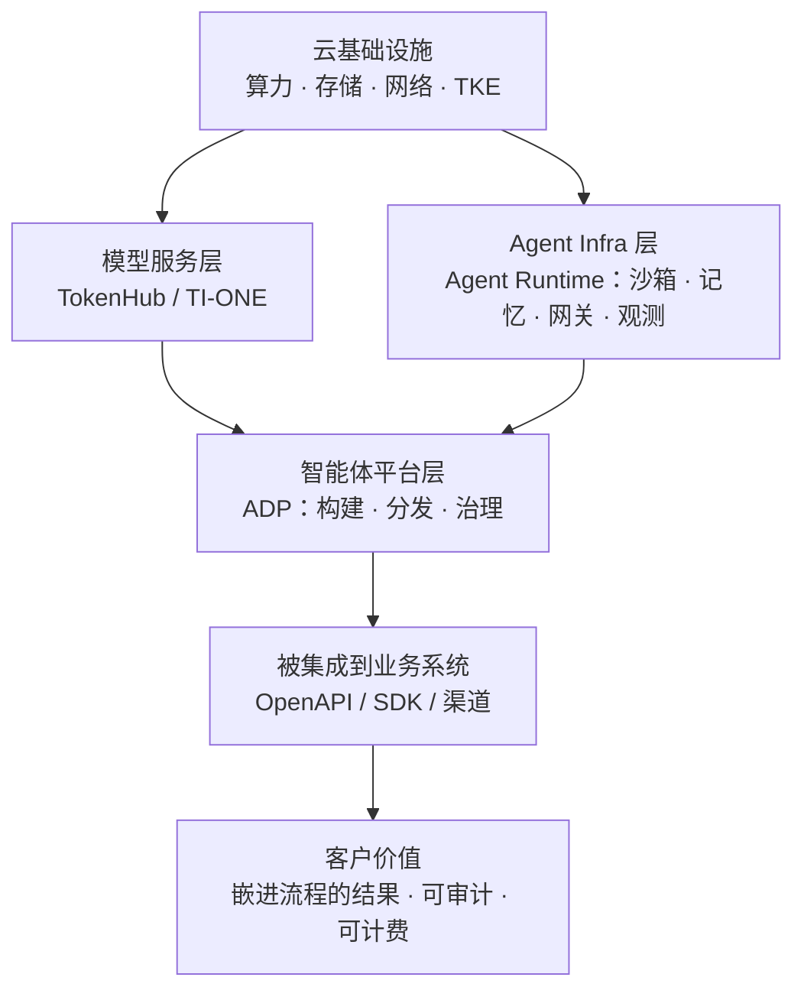

本篇补充三块面试里最容易被问到、又最容易答空的理解：**云业务本身 → Agent + 云业务 → Managed Agent API + 云业务**（用户口中的「Managed API Agent」即 Managed Agent API，托管智能体 API）。

材料来自本机打开的 [腾讯云智能体开发平台 ADP 官方产品页](https://cloud.tencent.com/product/adp)，并补齐了 [产品概述文档](https://cloud.tencent.com/document/product/1759/104193)、[Agent Runtime 官方页](https://cloud.tencent.com/product/ags)、[EdgeOne Makers 运行时文档](https://cloud.tencent.com/document/product/296/132759)，均核实于 **2026-11-08**。此前媒体转述的发布会话题见 [业务面 QA：Managed Agent 运行时与赛道判断](/interview/qa/managed-agents-business)，本篇专注**云的商业与产品视角**。

## 〇、证据口径与产品分层

| 标记             | 含义                                                   | 面试表述                                       |
| ---------------- | ------------------------------------------------------ | ---------------------------------------------- |
| **【官方】**     | 腾讯云官网页、官方文档原文（含价格、接口数、能力清单） | 「官方产品页显示……」                           |
| **【官方案例】** | 产品页客户案例中的数字，属厂商宣传口径                 | 「官方客户案例里提到……」（**不当第三方实测**） |
| **【观点】**     | 我对商业模型的理解与推导                               | 「我的理解是……」                               |
| **【项目】**     | 本仓库已确认的实习事实                                 | 「我在 IEG / 阿里做项目时……」                  |

**腾讯云 AI 产品栈（官网与官方文档可查）**：

| 层          | 产品                                                                                                                  | 卖什么                           |
| ----------- | --------------------------------------------------------------------------------------------------------------------- | -------------------------------- |
| 基础设施    | TKE、云沙箱、AgentCBS/CFS/Bucket                                                                                      | 算力、存储、隔离                 |
| 模型服务    | **TokenHub**（汇聚混元、优图及第三方模型）、**TI-ONE**（训推平台）                                                    | 模型调用与训练                   |
| Agent Infra | **Agent Runtime**（`/product/ags`）：运行 / 治理 / 智能三层，执行引擎、安全沙箱、身份权限、工具网关、观测、记忆、评估 | 让 Agent 跑得稳、管得住          |
| 智能体平台  | **Tencent Cloud ADP**：LLM+RAG / Workflow / Multi-Agent / **Claw** 四种范式，AgentOps 全生命周期                      | 让企业搭得出、发得出去、管得起来 |
| 托管运行时  | **EdgeOne Makers**、ADP **Agent Harness**                                                                             | 开发者不自建运行时也能上生产     |
| 分发入口    | **ADP Agent Portal**                                                                                                  | 员工侧的门户与多 Agent 协作      |

:::note 一句话分层（背这个就够）
**Runtime 卖「能跑」，ADP 卖「能搭能管」，Portal 卖「能用起来」，OpenAPI 卖「能长进客户自己的系统里」。** 面试里把云业务讲成「产品栈 + 计费 + 客户采购逻辑」，比背产品名更像懂业务。
:::

## 一、云业务本身：它到底是怎么赚钱的

### Q1. 你怎么理解「云业务」？和做 C 端产品、做内部平台有什么不同？

> 【观点】三点根本不同。**第一，卖的是能力而不是功能**：C 端卖一个体验，云卖「客户可以反复调用、按量付费的能力」，所以接口稳定性、SLA、配额、计量计费本身就是产品。**第二，客户是企业，采购链路长**：要过安全、合规、审计、采购、POC，决策看的是「能不能进现有系统、出事谁负责」，不是「好不好用」。**第三，成本结构相反**：前期机房、研发、安全投入是重固定成本，规模化之后边际成本才降下来，所以**资源利用率、续费率、客单价、毛利率**是核心指标，而不是日活。
>
> 腾讯 2018 年「930 变革」提「扎根消费互联网，拥抱产业互联网」并成立 CSIG，我理解就是把这套 ToB 能力正式变成一条主线（见 [腾讯文化 3.0 时间线](/interview/hr/tencent-culture-values)）。

**采分点**：接口即产品、企业采购逻辑、固定/边际成本。**雷区**：「云就是租服务器」「云业务就是 ToB 销售」。

### Q2. 云厂商的钱具体是怎么赚的？用 ADP 套餐说明

> 【官方】看 ADP 产品页的套餐最直观：公有云分三层——体验版 0 元/月（1.5 万 PU/月、1 人、10 应用、64MB 知识库）、进阶版 188 元/月（15 万 PU、30 应用、512MB、工作流/API 接入、用量统计）、企业标准版 4880 元/月（160 万 PU、20 坐席、5 空间、100 应用、10GB、自定义模型接入、长期记忆、自定义安全策略、成本与权限管控）；年付 9 折。此外还有**云部署 / 本地部署**的 License 订阅（部署在客户自有 TKE 集群、VPC 内网互联、数据主权保障），报价另询。
>
> 【观点】这里能看到云业务的典型计价：**不是单一按 token，而是「资源单位（PU）+ 坐席 + 空间 + 应用数 + 存储容量 + 部署形态」的组合分层**。低门槛版本获客、企业版吃预算、私有化吃合规预算；同一套底座覆盖不同客单价，这正是云平台能规模化的原因。

**注意**：价格与配额是产品页当前展示，**面试不要背具体金额**，讲「分层计价 + 资源单位 + 坐席/空间配额 + 私有化另计」这个结构即可。

### Q3. 为什么 ToB / 云业务对工程要求更高？

> 【观点 + 项目】因为错误成本、隔离要求和可追溯性都不一样。C 端一个 bug 影响体验，企业里可能就是**跨租户数据、审计合规、生产流程中断**。所以官方文档里 ADP 强调多租户数据强隔离、平台/空间/应用/知识库多层级权限、数据权限与功能权限解耦、操作审计、全链路监控；这些在 C 端往往不是第一优先级。
>
> 我在阿里做经营托管 Agent 时体会很直接：团队最怕的不是答不出来，是**答错引发商家纠纷**，所以把必经步骤放进 workflow、生成前加置信度门控，宁可误拦 17% 也要把误放压到 0%（口径见 [行为面 Q1](/interview/hr/behavioral#q1-你最有成就感的一件事是什么)）。这种「先定义不能错什么，再谈效果」的习惯，我认为就是 ToB 场景的工程底色。

### Q4. 云业务里常说的「被集成」是什么意思？为什么它比控制台重要？

> 【官方】ADP 产品页专门有一块「企业级 OpenAPI · 让现有系统长出智能体」：围绕 Agent 构建、发布运行、观测治理开放为 **10 大模块、100+ 接口**，让企业在自有门户、工作台、CRM、小程序里完成 Agent 的创建、配置、调用与治理；常见问题里还写到可以**导出智能体的 API/SDK 接入信息**下发到外部系统，以及通过「原子能力」页面按场景选模型、知识库、插件、工作流，配置入出参后在自定义应用里调用。官方文档补充：智能体 API 提供 RESTful API、SDK，支持发布到企业微信与小程序。
>
> 【观点】**「被集成」= 客户不必登录你的控制台也能用你的能力**。控制台是给少数管理员用的，接口才是长进客户业务流程里的那部分；一个云产品真正的护城河，往往是它被嵌进了多少业务系统、迁移成本有多高，而不是界面多好看。

### Q5. 为什么你个人更看重云业务？

**直接沿用 [动机与岗位匹配](/interview/hr/motivation#为什么腾讯) 的既有口径**：从行业角度最看重云业务，ToB 场景业务链路复杂、客户对稳定性/权限/评测要求最高，最能检验「workflow + agent + 评测 + 权限」这套工程能力；加上在腾讯 IEG 实习过，知道这里对稳定性和可观测性的标准。**不要另编一套动机。**

## 二、Agent + 云业务：为什么 Agent 天然长在云上

### Q6. 为什么说 Agent 是天然的云业务？

> 【观点】因为 Agent 的资源形态和传统 Web 服务完全不同：① **长任务**——一次跑几分钟到几小时，HTTP 短请求扛不住，要任务队列、状态持久化、断点续跑；② **弹性不可预测**——有的任务只调模型，有的循环跑代码、开浏览器、编译，CPU/内存/IO 波动极大，只有云的资源池能按需供给；③ **执行不可信**——模型生成的代码要跑，必须沙箱隔离、凭证不进执行环境、网络白名单；④ **多租户与合规**——会话、文件、密钥、审计日志都要按租户隔离，企业还要私有化部署。
>
> 这四件事（调度、隔离、凭证、审计）恰好都是云基础设施的看家本领。所以**不是「Agent 需要一台服务器」，而是「Agent 需要一整层新的云运行时」**——Agent Runtime 这类产品的出现就是这个逻辑。展开见 [业务面 QA Q1/Q2](/interview/qa/managed-agents-business)。

### Q7. 从 ADP 官方产品页，你读出了哪些产品判断？

| 官方事实                                                                                           | 我读到的判断【观点】                                                                                                  |
| -------------------------------------------------------------------------------------------------- | --------------------------------------------------------------------------------------------------------------------- |
| 四种范式：**Claw（推荐）** / 标准 / 工作流 / Multi-Agent                                           | 按**业务复杂度**分层，而不是推一种「万能 Agent」；Claw 有独立云端工作空间、可自主编码、调 Skills/连接器、长时任务运行 |
| Agent 与 Workflow **双向互调** + 动态 **Agentic RAG**                                              | 确定性和灵活性不是二选一：规则清楚的步骤交给流程，非结构化判断唤起 Agent——和我做混合编排的思路一致                    |
| 构建 · 分发 · 治理骨架，六大模块（构建/评测/分发/权限/安全/观测）                                  | 平台卖的是**全生命周期**，不是搭一个 bot；评测与治理才是企业敢上生产的前提                                            |
| 200+ 连接器与工具、全面支持 MCP、多模型统一接入                                                    | 工具层标准化、模型层可替换，避免把客户绑死在单一模型上                                                                |
| 内置裁判模型/规则/代码评测，一键批量对比模型、提示词、工作流版本；回答附命中片段、相似度、检索路径 | **效果可证、可解释**比「答得像」更重要；对应我一直在补的评测体系                                                      |
| 首字时间 < 1 秒、流式响应、细粒度权限、操作审计、Token 消耗监控                                    | 云的 SLA、成本归因、安全合规被写进了产品指标                                                                          |

### Q8. 企业客户买 Agent，到底在买什么？

> 【官方案例】产品页的几个案例指向同一件事：迈瑞医疗把 30 多年经验、500+ 产品资料、5000+ 临床知识做成 7×24 支持，官方称关键问题准确率 95%、日均问答 1700+；华润信托的智能债券助手替交易员完成指令录入、咨询、询报价，官方称 80% 咨询问题由「润宝」回答、人均维护客户数与日均订单数提升 30%，**全程自动仅留人工确认**；碧桂园服务把「一问」AI 客服**嵌入 30+ 业务系统**，沉淀 8 万+ 知识，试点区域工单量下降 25%+。
>
> 【观点】客户买的不是聊天窗口，是**嵌进流程、可度量、有人兜底的结果**：转人工率、工单量、人均订单、准确率。尤其华润那句「仅留人工确认」，和我做置信度门控时「误放 0%、误拦 17%」是同一个产品选择——**自动化的边界由业务风险决定，不由模型能力决定**。

**注意**：这些都是**厂商客户案例自述**，不是第三方实测；面试说「官方客户案例里提到」，不要说「行业数据显示」。

### Q9. Agent 给云带来了什么新的计费与成本结构？

> 【观点】传统云按 vCPU/小时、存储 GB、流量计费，负载和成本大致线性；Agent 的成本是**混合且不可预测的**：token、沙箱时长、存储快照、闲置会话、浏览器/工具调用都烧钱，而 Agent 大部分时间在「等」——等模型、等外部工具、等人工确认。
>
> 所以我在官方材料里特别关注两件事：① ADP 用 **PU + 坐席 + 空间 + 应用数**把不可预测的成本打包成可采购的套餐；② Agent Harness / Agent Runtime 强调**闲置自动暂停、停时不计费、快照唤醒**，把「等待时不烧钱」做成产品能力。**未来 Agent 平台的竞争力，一半在效果，一半在单位任务的运行时成本**——这和 [业务面 QA Q6/Q19](/interview/qa/managed-agents-business) 里的商业账是同一笔。

### Q10. 为什么「零代码平台」和「OpenAPI」要同时存在？

> 【观点】因为客户里有两类人：业务团队要能自己配出知识助手、工单流程（官方文档明确「零代码/低代码优先，绝大部分功能可视化配置完成，复杂场景再补少量代码」）；开发团队要把能力接进 CRM、OA、小程序，不希望被控制台锁住。前者决定**能不能试点**，后者决定**能不能规模化**。
>
> 一个有意思的对照【观点】：OpenAI 2026 年关停的是可视化 **Agent Builder**、把开发者导向代码优先的 Agents SDK；腾讯 ADP 则把**低代码构建、Claw 模式、100+ OpenAPI、Agent Portal** 放在同一个企业级平台里。这不是谁对谁错，是**客户结构不同**——面向海量开发者的普惠平台和面向企业采购的云平台，产品形态本来就不一样。

### Q11. 私有化/专有云为什么是云业务的关键差异？

> 【官方】ADP 产品页列出**公有云 / 云部署 / 本地部署**三种方式：云部署是 License 订阅、部署在客户自有腾讯云 TKE 集群，强调数据主权保障、VPC 内网安全互联、分钟级交付、标准化升级与扩缩容；Agent Portal 独立定价，还支持接入 ADP / Dify / 直连 LLM 等多供应商智能体。Agent Runtime 官方页也把身份权限、工具网关、零凭证零信任作为核心能力。
>
> 【观点】金融、政务、医疗这类客户「数据不出域」是硬约束，公有云托管再好也进不去。能不能把同一套能力**交付到客户的 VPC 里**，是云厂商相对模型厂商最实在的优势之一。Anthropic 用自托管 Sandbox + MCP tunnels 解决类似问题（见 [业务面 QA Q10](/interview/qa/managed-agents-business)），路径不同、诉求相同。

## 三、Managed Agent API + 云业务：把运行时做成可调用的能力

### Q12. 什么是 Managed Agent API？在腾讯这套产品里对应哪一层？

> 【观点】一句话：**把「Agent 循环 + 会话状态 + 沙箱执行 + 权限凭证」托管在云端，开发者通过 API 发起任务、订阅事件、拿回结果**，不用自己养分布式 Harness。
>
> 【官方】对应三层：
>
> - **ADP OpenAPI**：10 大模块、100+ 接口，覆盖构建、发布运行、观测治理；客户在自己系统里创建/配置/调用/治理 Agent。
> - **ADP Agent Harness**：云端托管的智能体运行环境，断点自动续跑、闲置自动暂停、全链路 Trace 可观测、密钥隔离托管、秒级故障恢复、多重备份；官方定位是「让企业智能体从演示走向生产、7×24 稳定在岗」。
> - **Agent Runtime（`/product/ags`）**：面向 Agentic Agent、Agentic RL、企业 Agent 平台构建的**基础设施平台**，围绕**运行 / 治理 / 智能**三层提供执行引擎、安全沙箱、身份权限、工具网关、观测、记忆与评估；EdgeOne Makers 文档里还能看到按会话粘性路由、单次执行最长 60 分钟的托管运行时设计。
>
> 【观点】**ADP 是「应用平台 + 被集成的 API」，Agent Runtime 是「这些应用和别人家 Agent 都能用的底座」**——一个面向业务与开发者，一个面向平台工程师，别混成同一个产品。

### Q13. 为什么说「Agent Harness 云端托管」是 Managed Agent API 的核心卖点？

> 【官方 → 观点】产品页列的六项能力，逐条都能对上 [业务面 QA](/interview/qa/managed-agents-business) 里 Anthropic 的 Session / Harness / Sandbox 三抽象：
>
> | ADP Agent Harness 能力                     | 对应运行时问题                                         |
> | ------------------------------------------ | ------------------------------------------------------ |
> | 断点自动续跑、秒级故障恢复、多重备份防丢失 | **Session 事件日志外置**，Harness 崩溃后从最后事件恢复 |
> | 闲置自动暂停                               | 长任务等待期释放算力，直击单位 DAU 成本                |
> | 全链路 Trace 可观测                        | 会话时间线、回放、评测与审计                           |
> | 密钥隔离托管                               | 凭证不进沙箱，防 prompt injection 横向拿 token         |
> | 统一调度的智能体运行环境                   | Hands 作为可替换资源池，Brain 无状态                   |
> | 7×24 稳定在岗                              | HTTP 短请求与长任务解耦，任务队列 + worker             |
>
> 所以这不只是「多了几个运维功能」，而是**把前面聊过的分布式 Harness 整套复杂度，打包成一个可采购的云服务**——这就是 Managed Agent API 在云业务里的位置。

### Q14. 云厂商做 Managed Agent API，相对模型厂商优势和劣势在哪？

|                  | 云厂商（腾讯云 / AWS）                                                                               | 模型厂商（Anthropic / OpenAI）                                                         |
| ---------------- | ---------------------------------------------------------------------------------------------------- | -------------------------------------------------------------------------------------- |
| 优势             | 现成沙箱、VPC、身份、存储、私有化、多模型接入、已有企业客户与采购关系                                | Harness 与模型**协同调优**，模型升级时运行时同步演进（Anthropic 的「元 Harness」逻辑） |
| 劣势             | 模型迭代节奏不在自己手里，Harness 容易跟不上模型行为变化                                             | 缺企业私有化与合规交付能力，安全与逃逸责任更重                                         |
| 共同趋势【观点】 | **薄托管**：卖标准化 Hands（沙箱 + 会话 + 网关 + 可观测），Brain 交还开发者；工具层走 MCP 等开放协议 | 同左                                                                                   |

**面试收口**：「所以我不认为这是模型 API 的升级版，而是**云上多了一层新的运行时产品**——它把卖算力，推进到卖『能安全稳定跑长任务的环境』。」

### Q15. 如果让你设计 Agent 平台的计价，怎么设计？

> 【观点 + 官方参照】我会分四段，且**先解决成本可预测，再谈单价**：① **资源单位**（ADP 的 PU）承接模型与执行的混合消耗；② **组织维度**（坐席、空间、应用数、知识库容量）承接企业采购的分层；③ **部署形态**（公有云套餐 / 云部署 License / 本地部署）承接合规溢价；④ **闲置治理**（暂停不计费、快照唤醒）作为成本优化能力而不是隐藏收费。
>
> 关键是**给客户能预算的口径**：企业最怕的不是贵，是「这个月账单为什么突然翻三倍」。所以计量要可归因到应用/会话/任务，配上用量统计、成本管控和权限（ADP 企业标准版就把「座席/资源成本/安全管控」写进了套餐）。

### Q16. 企业要上 Agent，ADP / Agent Runtime / 自建怎么选？

| 场景                                        | 建议                  | 理由                                                               |
| ------------------------------------------- | --------------------- | ------------------------------------------------------------------ |
| 业务团队要快速做知识助手、工单、客服        | **ADP**               | 四种范式 + 评测 + 分发 + 治理开箱即用，可先小场景试点再扩          |
| 要把 Agent 能力嵌进自有 CRM/OA/小程序       | **ADP OpenAPI / SDK** | 100+ 接口、原子能力、渠道发布，客户不用登录控制台                  |
| 自研 Harness、超大规模沙箱、Agentic RL 训练 | **Agent Runtime**     | 运行/治理/智能三层能力可单独使用，毫秒级启动、零凭证网关、快照恢复 |
| 强合规、数据不出内网                        | **云部署 / 本地部署** | 客户自有 TKE、VPC 内网、数据主权                                   |
| 运行时本身就是核心竞争力、有平台团队        | 自建                  | 避免抽象泄露与平台锁定，代价是长任务/隔离/可观测全部自己扛         |

**决策判据（与 [业务面 QA Q8](/interview/qa/managed-agents-business) 一致）**：差异化落在业务知识与上下文 → 用平台；差异化落在运行时本身 → 自建；工具层一律 MCP 化，压薄平台特有抽象。

### Q17. 90 秒把三层串起来

> 我理解云业务是把能力做成可按量采购、被客户系统集成的服务，核心是 SLA、多租户隔离、成本归因和私有化交付，成本结构重固定、靠规模摊薄。Agent 之所以天然长在云上，是因为它有长任务、弹性沙箱、不可信代码执行和强审计需求，这四件事正好是云基础设施的看家本领——腾讯云的 ADP 负责「搭得出、管得住、发得出去」，Agent Runtime 负责「跑得稳、管得住、可观测」，TokenHub 和 TI-ONE 在下面供模型。
>
> 再往上一层是 Managed Agent API：ADP 把构建、发布运行、观测治理开放成 10 大模块 100+ 接口，Agent Harness 把断点续跑、闲置暂停、全链路 Trace、密钥隔离托管做成云端托管运行时。**这就把「卖算力」推进到「卖能安全稳定跑长任务的环境」**，也是我认为云业务里最有工程含量的一层。它和我自己做的事是连着的——我在阿里把不确定的模型放进确定的业务约束里，云厂商是把同一件事做成了可被上千家企业采购的产品。

## 四、HR 面口径（**与既有动机题严格一致**）

### Q18. 你为什么看重云业务？

> 从行业角度我更希望加入腾讯云业务：ToB 场景业务链路复杂、客户对稳定性/权限/评测要求最高，最能检验「workflow + agent + 评测 + 权限」这套工程能力；我在腾讯 IEG 实习过，知道团队对稳定性和可观测性的要求，不是从招聘页上看来的。**这不是换一个做广告 Agent 的地方，是换一个业务复杂度和工程标准都更高的地方。**

**与 [为什么腾讯](/interview/hr/motivation#为什么腾讯)、[为什么离开阿里](/interview/hr/motivation#为什么离开阿里与为什么看机会) 逐句一致；不贬低前东家，不另编动机。**

### Q19. 你对腾讯云产品了解吗 / 用过什么？

> 我得先说清边界：腾讯云的产品我没有大规模实操，**不会说「精通」**；但我认真看过官方产品页和文档，能讲清它的分层和取舍。比如智能体开发平台 ADP 按业务复杂度给了四种范式，Claw 模式有独立云端工作空间、能自主编码跑长任务；Agent 和 Workflow 可以双向互调；企业级 OpenAPI 开放了 10 大模块 100+ 接口，让 Agent 长进客户自己的 CRM、工作台、小程序；下面是 Agent Runtime 提供沙箱、记忆、网关和可观测，再下面是 TokenHub 供模型。**我理解这套设计的关键是「构建—分发—治理」加「被集成」**——企业买的不是一个聊天窗口，是能嵌进流程、可审计、可计费的能力。如果岗位需要，我愿意在两周内把核心产品跑一遍并结合 Agent 场景做选型。

**采分点**：诚实区分「了解公开资料」与「实操过」+ 讲得出结构和取舍 + 给可兑现的学习承诺。**雷区**：背产品名却说不出场景；把腾讯云和阿里云产品名混着说；把没用过的说成用过。

### Q20. 你怎么看云业务的前景？Agent 会让云更值钱吗？

> 【观点】短期有泡沫，长期我更看好**云在 AI 时代的位置反而更关键**。模型能力会趋同、会降价，但企业要的不是模型，是「能把模型放进自己业务流程、还敢为结果负责」的那层东西——沙箱隔离、身份权限、数据不出域、全链路审计、成本可预算、失败能恢复。这些恰恰是云厂商二十年积累的能力，不是换个更强模型就能替代的。所以我判断价值会从「卖模型调用」往「卖运行时和治理」上移，而衡量它的指标也会从 token 单价变成**单位任务的运行时成本 + 可治理性**。这也是我想在这个方向做深的原因。

**与 [HR 面业务前景 QA](/interview/hr/business-outlook-qa) Q7/Q9 保持同一判断（短期泡沫、长期基础设施、形态洗牌），不要说成两套。**

## 五、速背卡与雷区

**30 秒「云业务是什么」**：把能力做成可按量采购、能被客户系统集成的服务；核心不是功能，是 SLA、多租户隔离、成本归因、私有化交付；成本重固定、靠规模摊薄，所以续费率和资源利用率比日活更重要。

**30 秒「Agent + 云」**：Agent 有长任务、弹性沙箱、不可信代码执行、强审计四个特点，全是云基础设施的看家本领；ADP 管搭和管，Agent Runtime 管跑和治，OpenAPI 管长进客户系统。

**30 秒「Managed Agent API + 云」**：把 Agent 循环、会话状态、沙箱执行、凭证隔离托管成一组 API；卖的不是模型，是能安全稳定跑长任务的环境——这是云上新增的一层运行时产品。

**雷区清单**：

- ❌ 把「云业务」说成「租服务器 / ToB 销售」；只讲产品名不讲计费、客户采购和 SLA。
- ❌ 背套餐价格、PU 数值、接口数量、客户案例数字——**都是厂商官网页自述且会变**，讲结构不讲数字；被问到就说「按官方产品页当前展示，具体以页面为准」。
- ❌ 把客户案例的 95%、30%、25% 说成第三方实测或自己的实践成果。
- ❌ 把 ADP（应用平台）和 Agent Runtime（基础设施）混成一个产品；把「元器」和 ADP 混为一谈（见 [业务面 QA Q12](/interview/qa/managed-agents-business)）。
- ❌ 说「我用过腾讯云 ADP」——**没有实操就诚实说没有**（[动机篇](/interview/hr/motivation#业务理解题) 的既定口径）。
- ❌ 和 [业务面 QA](/interview/qa/managed-agents-business)、[HR 面前景 QA](/interview/hr/business-outlook-qa)、[动机与岗位匹配](/interview/hr/motivation) 的既有口径冲突；尤其「为什么看重云业务」不要另编一套。
- ❌ 把「Managed Agent API」说成「模型 API 加了工具调用」；忽略运行时、凭证隔离与成本结构。

## 六、来源清单（核实于 2026-11-08）

| 来源                                                                                                                                       | 用于                                                                                                                                                     |
| ------------------------------------------------------------------------------------------------------------------------------------------ | -------------------------------------------------------------------------------------------------------------------------------------------------------- |
| [腾讯云智能体开发平台 ADP 产品页](https://cloud.tencent.com/product/adp)                                                                   | 四种范式、Agent Harness、10 大模块 100+ OpenAPI、三种部署、套餐与 PU、Agent Portal、六个客户案例、常见问题（导出 API/SDK、原子能力）                     |
| [ADP 产品概述文档](https://cloud.tencent.com/document/product/1759/104193)（最近更新 2026-06-15）                                          | 官方全称 Tencent Cloud ADP、四种模式定义、Agentic RAG / Text-to-SQL、200+ 连接器与 MCP、评测体系、首字 <1 秒、多层级权限、监控告警、YouTu-Agent 开源项目 |
| [Agent Runtime 官方页](https://cloud.tencent.com/product/ags)                                                                              | 运行/治理/智能三层、执行引擎/沙箱/身份权限/工具网关/观测/记忆/评估、MiniMax / 元宝 / 面壁智能客户案例、生产可用与能力可单独使用的 FAQ                    |
| [EdgeOne Makers 运行时文档](https://cloud.tencent.com/document/product/296/132759)                                                         | 托管运行时、会话粘性路由、单次执行最长 60 分钟、请求模式与会话模式分工、框架任选                                                                         |
| [ADP 购买指南](https://cloud.tencent.com/document/product/1759/104197)、[计费概述](https://cloud.tencent.com/document/product/1759/106152) | 按模型类型/数量/并发选购的口径（本篇未展开金额）                                                                                                         |
| 腾讯云开发者社区《Agent Runtime 技术概要》                                                                                                 | 60ms 启动、16 万沙箱/分钟、100 万级并发、停时不计费、Session 全留痕等**腾讯云公开材料**指标（厂商披露，非第三方实测）                                    |
| [腾讯文化 3.0 全员邮件](/interview/hr/tencent-culture-values)                                                                              | 930 变革与 CSIG 成立背景                                                                                                                                 |

:::note 维护提示
云产品套餐、接口数量、功能名称更新很快，本篇数据均标注 **2026-11-08** 快照。**面试前一天按上表重查一次产品页与文档**；不确定时口述改用「官方产品页目前展示」「大概十个模块、上百个接口」这类不会错的说法。
:::
