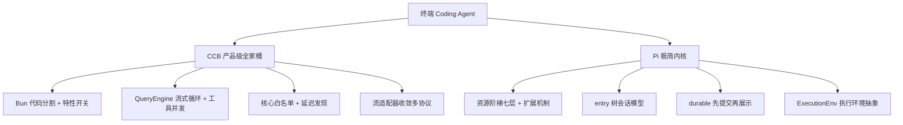

:::note 事实基线
本篇是「Coding Agent Harness 实现剖析」带解答题库，共 **90 题**，事实来源为 `content/docs/claude-code.md`（对照 `$HOME/Downloads/claude-code` @ `77a7934e`，社区复原工程 **Claude Code Best V5（CCB）**）与 `content/docs/pi.md`（对照 `$HOME/Downloads/pi` @ `26293e74`）。两者是终端 Coding Agent 的两种工程取舍：**CCB 是产品级全家桶（大、全、可裁剪），Pi 是极简内核 + durable 运行时（小、可扩展）**。
:::

本篇是「Coding Agent Harness 实现剖析」题库。面试里它以「**你研究过哪些 Coding Agent 的实现**」「**如果让你设计一个 Agent harness 你会怎么做**」的形式出现。本篇的组织顺序是：**先讲 CCB 的构建与核心循环 → 再讲工具系统与流适配器 → 再讲 Pi 的极简内核与扩展 → 再讲 durable 运行时与执行环境 → 最后讲两者的对比与启发**。

**主线一览**

## 一、CCB：构建体系

### Q1. CCB 是什么？它解决什么问题？

CCB 是一个终端里的交互式 AI 编码助手，**与官方 Claude Code CLI 的配置文件保持兼容**：用户不需要改动原有配置即可替换使用。它的自我定位是**复原核心功能、裁剪次要能力**，并持续追平企业版与登录态特性。

它解决的问题可以拆成三层：

| 层次   | 问题                                                                                            |
| ------ | ----------------------------------------------------------------------------------------------- |
| 接入层 | 官方实现只对接自家模型与云平台；团队常需要接入 OpenAI 兼容端点、Gemini、Grok（xAI）与多家云平台 |
| 编排层 | 终端 Agent 需要在流式输出中并发执行工具调用，同时保证结果顺序、权限确认与中断语义都正确         |
| 工程层 | 一个上千文件的大型 TypeScript CLI 在 Bun 运行时下会遇到解析与内存问题，需要构建层面的解法       |

与通用 Agent 框架相比，它的差异在于：**它不是让用户自己搭一个 Agent，而是一份开箱可用的完整产品形态**，包含终端 UI、权限审批、插件体系、远程控制与 IDE 协议接入。

### Q2. 为什么大型 CLI 必须代码分割？内存依据是什么？

构建由 Bun 的打包器完成（`build.ts`），入口是 `src/entrypoints/cli.tsx`，**开启 `splitting: true`**，输出一个主文件加大量分块文件，并注入 `MACRO.*` 编译期常量（版本号从 `package.json` 读取，避免漂移）与 `NODE_ENV=production`。

**内存依据**：这是被内存数据验证过的硬约束——**JSC（JavaScriptCore，Bun 的引擎）全量解析下，单文件产物的常驻内存可以是分割后的数倍到数十倍**。Bun 启动时会解析整个入口 bundle，如果所有代码打成一个巨大文件，解析与 JIT 的内存开销巨大。代码分割让启动只加载主文件，其余分块按需加载。

**采分点**：能说出「**JSC 全量解析下，单文件产物的常驻内存可以是分割后的数倍到数十倍**」——这不是泛泛的「分割好」，而是有内存数据支撑的硬约束。

### Q3. 编译期特性开关怎么工作？

**编译期特性开关加环境变量注入**，让一份代码支持按构建裁剪功能面：**关闭的开关在清单里注明原因，条件 `require` 配合死代码消除让未启用的代码不占产物**。

**采分点**：能说出「**条件 require + 死代码消除，未启用的代码不占产物**」——这是「一份代码，多种构建形态」的标准做法，关闭的开关要注明原因（可审计）。

## 二、CCB：核心 Agent 循环

### Q4. CCB 的核心循环由哪三部分构成？

| 组件                   | 职责                                                                                |
| ---------------------- | ----------------------------------------------------------------------------------- |
| `src/query.ts`         | 主 API 查询：发送消息、处理流式响应、执行工具调用、管理会话轮次循环                 |
| `src/QueryEngine.ts`   | 包裹 `query()` 的高层编排：会话状态、上下文压缩、文件历史快照、归属标注、轮次级记账 |
| `src/screens/REPL.tsx` | 基于 React/Ink 渲染的交互界面：输入、消息展示、工具权限确认、快捷键                 |

API 客户端（`src/services/api/claude.ts`，约 3600 行）负责组装请求参数（系统提示词、消息、工具 schema、beta 试验开关），调用所选供应商的流式端点，并把统一的事件流交给上层。

### Q5. 入口的快速路径分流是什么？

整体是一条「**入口快速路径分流，命中则进完整 CLI**」的结构。入口（`src/entrypoints/cli.tsx`）先处理一批零开销或低开销的快速路径：版本查询（**零模块加载**）、系统提示词导出、以独立 MCP 服务形态启动、ACP 代理模式、远程控制与桥接、后台会话管理、模板任务等。**只有这些都没命中，才加载完整的主程序 `main.tsx`**。

主程序用 Commander 注册 50 多条子命令，主命令处理器负责权限初始化、MCP 连接、会话恢复与运行模式（交互式 REPL / 打印模式 / SDK）分发。

**采分点**：能说出「**版本查询零模块加载**」——快速路径的价值是「高频轻量操作不付出加载整个 CLI 的成本」，这是启动性能优化的标准手法。

### Q6. 工具并发调度怎么做？结果怎么保证按序回吐？

**流式工具执行把模型剩余输出时间与工具执行时间重叠**：模型还在流式输出后续内容时，已经完成的工具调用可以开始执行。**结果仍按调用顺序回吐**——即使并发执行，结果回填到消息的顺序与工具调用的顺序一致，保证模型看到的上下文是确定的。

**错误传播按工具语义分级（只有 Bash 连坐）**：只读工具失败不影响其他工具；但 **Bash 命令失败可能改变环境状态**，所以 Bash 失败会「连坐」（影响后续工具的可靠性判断）。

**采分点**：能说出「**结果按调用顺序回吐（即使并发执行）**」+「**错误传播分级，只有 Bash 连坐**」——前者保证上下文确定性，后者体现对不同工具副作用的理解。

### Q7. 工具契约的安全默认值是什么？

**工具契约的安全默认值全部 fail-closed（默认非并发安全、默认非只读）**，由统一的构建工厂集中兜底。即：一个工具如果没有显式声明「可并发」「只读」，就默认「不可并发」「有副作用」——保守默认避免误判。

**采分点**：能说出「**安全默认值 fail-closed，由统一构建工厂集中兜底**」——这是「默认保守」的安全设计，避免每个工具各自声明导致遗漏。

## 三、CCB：工具系统与流适配器

### Q8. 核心白名单与延迟发现是什么？

工具数量膨胀后用「**核心白名单加延迟发现**」：**延迟工具干脆不进 API 请求，tools 数组跨轮稳定，提示缓存友好**；**发现记录随消息历史持久化，压缩时快照到边界标记上跨压缩存活**。

具体：核心工具（read/write/edit/bash 等）始终在 tools 数组里；非核心工具通过「延迟发现」机制按需加载——模型先看到一个「工具搜索」入口，需要时检索出具体工具再加载。这样 tools 数组不会因为工具多而膨胀，**跨轮稳定 → prompt cache 命中率高**。

**采分点**：能说出「**延迟工具不进 API 请求，tools 数组跨轮稳定，prompt cache 友好**」——这是「工具数量是有上下文价格的资源」的工程应对（与 yukino 引擎的 MCP 工具 eager/deferred 加载同源）。

### Q9. 延迟搜索的检索实现与开关模式？

延迟搜索的检索实现：把工具的名称、描述、参数建成可检索的索引，模型通过「工具搜索」工具按需求检索出匹配的工具，再把这些工具加载进当前轮的 tools。**开关模式**：延迟发现可以按场景开关（工具少时全部 eager，工具多时启用延迟）。

### Q10. 流适配器模式解决什么问题？

**第三方模型协议统一走流适配器，把异构格式收敛到内部格式，下游零改动**。CCB 要接入多家模型供应商（Anthropic、OpenAI 兼容、Gemini、Grok），每家的流式事件格式不同。流适配器在「供应商协议」与「内部事件流」之间做转换：**下游（QueryEngine、REPL）只消费统一的内部格式，不感知供应商差异**。

适配器里最容易被忽略的是协议边角：**「空思考块也是有效信号」与「尾部 usage 块要等到 message_delta 再报」**。

**采分点**：能说出「**流适配器把异构协议收敛到内部格式，下游零改动**」+「**空思考块也是有效信号、usage 要等 message_delta**」——前者是架构模式，后者是协议适配的边角细节，都体现对流式协议的深入理解。

### Q11. 供应商选择怎么做？

供应商选择由配置决定（环境变量/配置文件），支持 Anthropic、OpenAI 兼容端点、Gemini、Grok（xAI）与多家云平台。选择后由对应的流适配器处理协议转换。

## 四、CCB：权限与工程纪律

### Q12. 权限裁决的 resolver 竞速是什么？

**权限裁决做成多路 resolver 竞速、先到者赢得**，渠道/界面/钩子/分类器共用同一套 claim 语义，是分布式审批的干净解法。即：多个权限判定来源（规则表、用户交互、hook、分类器）并发给出裁决，第一个返回的有效裁决生效（claim 语义防止重复裁决）。

**采分点**：能说出「**多路 resolver 竞速、先到者赢得、claim 语义防重复**」——这是「分布式审批」的干净设计，比「串行判定链」更灵活。

### Q13. 测试的 mock 污染纪律是什么？

有一个重要的测试陷阱被系统性总结：**Bun 的 `mock.module` 是进程全局的（last-write-wins），一个测试文件的 mock 会污染同进程其他文件，且测试执行顺序不保证**。

核心规则是「**不要 mock 被测模块的上层业务模块**」，集成测试应 **mock 底层 HTTP 客户端（axios）而非源 API 模块**，从而保证同目录的单元测试仍能测到真实逻辑。

其他纪律：测试框架用 Bun 自带测试；单元测试就近放置于 `__tests__/`，集成测试单独成组；**Mock 规范严格：只 mock 有副作用的依赖链，不 mock 纯函数**；日志与调试模块必须使用共享 mock；类型纪律：生产代码禁止 `as any`，优先用 `as unknown as T` 双重断言或补 interface。

**采分点**：能说出「**mock.module 是进程全局 last-write-wins，会跨文件污染**」+「**集成测试 mock 底层 HTTP 客户端而不是源 API 模块**」——这是「在缺乏稳定外部契约时，用 mock 污染纪律保证测试隔离」的实战经验。

## 五、Pi：极简内核哲学

### Q14. Pi 的内核边界是什么？

贡献指南的第一句是「**pi 的内核是最小的**」。不属于内核的功能应当做成扩展，**试图膨胀内核的 PR 会被拒绝**；就连扩展的 hook 点也要经过慎重讨论，以免引入不可维护的复杂交互。配套的一条规则是「**你必须理解你的代码**」：用 AI 写代码可以，但不理解就提交不行。

这条哲学的直接后果是：**sub-agent、plan mode 这类能力刻意不放进内核**。内核提供强力默认，同时给用户两条路——指挥 Pi 自己生成所需能力，或安装现成的 Pi package。**扩展不只是插件系统，它是内核主动让位的结果**。

内核的自我描述是最小集（read、write、edit、bash 加会话管理），但实际工具面更宽：还包括 find、grep、ls 与 powershell。**所有文件变更经专门的队列串行化**，扩展自己的文件写操作也可以挂进同一队列，避免并发工具调用互相踩踏。

**采分点**：能说出「**扩展是内核主动让位的结果**」+「**sub-agent/plan mode 刻意不进内核**」——这是「极简内核」哲学的具体体现，与 CCB 的「全家桶」形成鲜明对比。

### Q15. 资源阶梯七层是什么？

快速上手文档维护一张「**从最弱机制开始**」的选择表，复杂度递增：

| 需求                         | 使用                     |
| ---------------------------- | ------------------------ |
| 文件夹级持久指令             | `AGENTS.md`              |
| 复用菜单里的提示             | prompt template          |
| 任务专属指令加附件           | skill                    |
| 可执行的工具、命令、事件处理 | extension                |
| 自定义终端组件               | Terminal UI              |
| 接入未支持的模型服务         | custom provider          |
| 打包分发多种资源             | Pi package（npm 或 git） |

这张表的价值在于它把「**该用哪一层**」变成工程决策而非偏好：**能用更弱的机制解决就不上扩展**。

**采分点**：能说出「**能用更弱的机制解决就不上扩展**」——这是「最小够用」的工程决策框架，避免过度设计。

### Q16. Pi 的扩展机制与五档工具暴露是什么？

扩展是**加载进 Pi 进程的 TypeScript 模块（经 jiti 加载）**。工厂函数可以注册工具、命令、快捷键、provider、事件处理器、渲染器与终端 UI，并声明一组面向运行时的能力。

**生命周期事件**覆盖面很长：`input`、`before_agent_start`、`agent_start`、`turn_start`、`context`、`before_provider_request`、`after_provider_response`、`provider_stream_event`、`message_update`/`message_end`、`tool_execution_start`/`tool_execution_end`、`tool_call`、`tool_result`、`turn_end`、`agent_end`、`session_start`/`session_shutdown` 等。

**工具暴露级别分五档**：`direct`（进上下文）、`model-only`、`codemode`（只对脚本可见）、以及其他档位——控制工具对模型/脚本的可见性。

**采分点**：能说出「**扩展是经 jiti 加载的 TypeScript 模块，生命周期事件覆盖从 input 到 session_shutdown 的全链路**」——这是 Pi 扩展能力的广度。

## 六、Pi：会话模型与 SDK

### Q17. entry 树会话模型是什么？

Pi 的会话用 **entry 树**组织：每个 entry 是会话里的一个节点（用户消息、助手回复、工具调用等），entry 之间形成树结构。**树形会话支持分叉（fork）与切换**——用户可以从任意 entry 分叉出新的对话分支，或切换到历史分支。这与「线性消息列表」的会话模型不同，树形更适合「探索性对话」（尝试不同方向后回退）。

### Q18. TypeScript SDK 的进程内嵌入怎么做？

Pi 提供 TypeScript SDK，可以**进程内嵌入**——不需要启动独立的 Pi CLI 进程，直接在 Node 应用里 import SDK、创建会话、驱动 Agent 循环。这让 Pi 可以作为「Agent 内核」被其他应用复用（而不是只能用它的 TUI）。

**采分点**：能说出「**SDK 进程内嵌入让 Pi 可以作为 Agent 内核被复用**」——这是「极简内核」的可嵌入性价值，与 CCB 的「完整产品形态」形成对比。

## 七、Pi：durable 运行时

### Q19. durable 运行时的核心不变量是什么？

durable 做「**先提交存储再展示**」的持久化运行时。核心不变量：**任何状态变更先持久化到存储，再展示给用户/触发后续动作**——这样即使进程崩溃，重启后能从存储恢复到崩溃前的状态，不丢失已确认的进展。

这与「先展示再异步持久化」的模型相反——durable 牺牲一点延迟（每次变更要先写存储），换来**崩溃恢复的确定性**。

**采分点**：能说出「**先提交存储再展示，崩溃后能恢复到崩溃前状态**」——这是 durable 的核心不变量，是「可恢复 Agent 运行时」的基础。

### Q20. ExecutionEnv 执行环境抽象是什么？

「**工具在哪台机器上跑**」抽象成 **ExecutionEnv**（文件系统与 shell 两个接口的合集）。`HarnessOptions.env` 是一个构建器：**每次工具调用、段落渲染与显式取环境时，以目标 conversation 的当前 cwd 与已提交读权限现场构建**，可以异步，永不跑在 Session 变更线上；没有配置环境时内置工具以错误结果失败，构建器抛错则成为该调用的错误结果。

环境对象本身便宜，每次调用新建无妨——**edit 与 write 按「环境 id + 规范路径」串行化对同一文件的变更**，因此同 id 环境必须看到同一文件系统；自定义环境要设好 id，比如一个容器一个 id。于是「**这个会话的工具进容器、那个会话进远程机**」成为配置而非改码。

宿主也可以直接用环境：`openBinaryReader()` 按字节范围读已打开文件，`openDirReader()` 分页读目录，`exec()` 带 argv 数组不经 shell 跑程序。默认参考实现 `NodeExecutionEnv` 不实现 `listFiles`，由 pi-env 补上。

**采分点**：能说出「**ExecutionEnv 让『工具在哪台机器跑』成为配置而非改码**」+「**edit/write 按环境 id + 规范路径串行化**」——这是「执行环境抽象」的核心价值，与沙箱篇的「隔离强度可配置」同源。

### Q21. durable 的可见状态与 watch 机制是什么？

durable 的可见状态组织成**五类内置文档**：`pi.agent`（会话的 agent 配置）、`pi.provider`（provider 侧身份）、`pi.live`（进行中的 run 与工具槽位）、`pi.inbox`（输入受理队列）、`pi.usage`（用量）。

观察接口是 **watch**：`harness.watch()`/文档 watch 返回 `{ value, ops, retired }`——`value` 是当前视图，`ops` 是 chord 的精确操作而非要求消费者自己 reduce 的快照，`retired` 标记文档被退役；**待投递操作积压超阈值时折叠为一次根替换**。

**采分点**：能说出「**watch 返回 value + ops + retired，ops 是精确操作而非快照**」——这是「增量状态同步」的设计，消费者不需要自己 reduce。

### Q22. task graph 与子代理怎么组织？

task graph 视图把每个活任务挂成可观察状态或 watch，**状态机为 pending/running/waiting/sleeping/completing**，含 owner 边、已提交状态、后台与中止标记、拥有的会话；重启后 running 落回 pending 再被调度。

**子代理就是任务所有权的组合**：新 conversation 的 owner 记为 `{ kind: "task", taskId }`，加 `background: true` 即后台跑。任务的上报（`onReport`）有固定类型集，失败 run 之后由 `afterFailedRun`（keep/continue/withdraw，默认 keep）决定排队中的输入是留在队列、交给下一次 run 还是按未回答结算。

**采分点**：能说出「**子代理 = 任务所有权的组合（owner 记为 task + background）**」——这是「多代理」在 durable 里的极简表达，不需要专门的 sub-agent 机制（呼应 Q14「sub-agent 刻意不进内核」）。

### Q23. provider 会话身份为什么持久化？

durable 为每个会话**持久化 provider 侧身份**：每个新建、任务拥有、原始创建与分叉的会话都在创建提交里生成自己的 **UUIDv7 会话 ID**，分叉从不复制父会话的身份。这个身份被传给模型请求，**供 provider 做提示缓存与会话亲和**；重置、压缩、换模型与重新打开存储都不改变它。

**采分点**：能说出「**会话身份持久化是为了 provider 的提示缓存与会话亲和**」+「**分叉不复制父会话身份**」——这是「会话身份与 prompt cache 关联」的细节。

## 八、Pi：chord、pi-env、codemode

### Q24. chord 是什么？对象/引用/重载模型？

chord 为 durable 提供**复制状态与热重载的应用组合基座**。核心模型：**对象/引用/重载**——chord 管理应用对象的状态复制（多副本同步）、对象间的引用关系、以及代码热重载（开发时改代码不丢状态）。

### Q25. pi-env 的远程执行帧协议是什么？

pi-env 把工具执行**经 SSH 部署的 Rust 守护程序落到远程机器**。帧协议定义「Pi 主进程 ↔ 远程守护程序」之间的通信帧（命令执行、文件读写、结果回传）。这让 Pi 的工具可以在远程机器上执行（本地只是控制面）。

### Q26. codemode 的沙箱化脚本执行是什么？

codemode 是 Pi 的**沙箱化脚本执行**模式：模型写的脚本在受限环境里执行（工具暴露级别有 `codemode` 档，只对脚本可见）。durable 侧 bash 的结构化结果是 `{ output, truncated, fullOutputPath?, exitCode }`（camelCase，与 coding-agent 里 codemode 沙箱的 snake_case 结果区分）。

图像处理经 Photon：`createNodePhotonImages` 起一个 worker 线程做缩放/转码（空闲 30 秒回收），默认上限 2000x2000、4.5 MB。

## 九、对比与启发

### Q27. CCB 与 Pi 的工程取舍对比是什么？

| 维度     | CCB（产品级全家桶）              | Pi（极简内核）                          |
| -------- | -------------------------------- | --------------------------------------- |
| 定位     | 开箱可用的完整产品形态           | 最小内核 + 扩展                         |
| 体量     | 大（上千文件、50+ 子命令）       | 小（最小集 + 资源阶梯）                 |
| 工具     | 60+ 工具 + 核心白名单 + 延迟发现 | 最小集 + 扩展注册 + 五档暴露            |
| 多代理   | 内置                             | **刻意不进内核**（任务所有权组合）      |
| 会话     | 线性 + 压缩                      | **entry 树**（分叉/切换）               |
| 持久化   | 会话状态 + 文件历史快照          | **durable 先提交再展示**                |
| 执行环境 | 本地                             | **ExecutionEnv 抽象**（本地/容器/远程） |
| 可嵌入   | 完整 CLI                         | **TypeScript SDK 进程内嵌入**           |
| 构建     | Bun 代码分割 + 特性开关          | jiti 加载扩展                           |

**采分点**：能说出「**CCB 是产品级全家桶（大全可裁剪），Pi 是极简内核（小可扩展）**」——两者代表了 Coding Agent 的两种工程哲学，没有绝对优劣，取决于「要产品还是要内核」。

### Q28. 两者对「设计一个 Agent harness」的启发是什么？

从 CCB 学到的：① **大型 CLI 必须代码分割**（内存依据）；② **流适配器收敛异构协议**（下游零改动）；③ **工具数量膨胀用核心白名单 + 延迟发现**（prompt cache 友好）；④ **工具契约安全默认值 fail-closed**；⑤ **权限 resolver 竞速**；⑥ **mock 污染纪律**。

从 Pi 学到的：① **极简内核 + 扩展让位**（能用更弱机制就不上扩展）；② **entry 树会话**（支持分叉/切换）；③ **durable 先提交再展示**（崩溃恢复确定性）；④ **ExecutionEnv 抽象**（执行环境可配置）；⑤ **子代理 = 任务所有权组合**（不需要专门机制）。

**采分点**：能从两者的对比中提炼出**通用的 harness 设计原则**——协议收敛、工具渐进披露、安全默认保守、状态可恢复、执行环境可配置。这比单独讲任一实现更有说服力。

### Q29-Q90. 快速自检与深挖补充

**Q29. 一句话解释 CCB 与官方 Claude Code 的关系。** 配置文件兼容（用户不改配置即可替换），复原核心功能、裁剪次要能力，差异在可裁剪的编译期特性开关与可扩展的模型供应商层。

**Q30. 一句话解释 splitting: true 的内存收益。** JSC 全量解析下单文件产物常驻内存是分割后的数倍到数十倍——代码分割让启动只加载主文件，其余按需。

_*Q31. 一句话解释 MACRO.* 编译期常量。_* 版本号从 package.json 读取注入（避免漂移），配合 NODE_ENV=production——编译期确定，不占运行时。

**Q32. 一句话解释特性开关的死代码消除。** 关闭的开关用条件 require，打包器死代码消除让未启用代码不占产物——一份代码多种构建形态。

**Q33. 一句话解释 QueryEngine 的职责。** 包裹 query() 的高层编排：会话状态、上下文压缩、文件历史快照、归属标注、轮次级记账。

**Q34. 一句话解释快速路径分流的版本查询。** 零模块加载——高频轻量操作不付出加载整个 CLI 的成本，只有快速路径都没命中才加载完整主程序。

**Q35. 一句话解释工具并发为什么结果按序回吐。** 即使并发执行，结果回填到消息的顺序与工具调用顺序一致——保证模型看到的上下文是确定的。

**Q36. 一句话解释为什么只有 Bash 连坐。** Bash 命令失败可能改变环境状态，影响后续工具可靠性；只读工具失败不影响其他工具——错误传播按工具副作用分级。

**Q37. 一句话解释工具契约 fail-closed 的含义。** 默认非并发安全、默认非只读，由统一构建工厂集中兜底——保守默认避免误判。

**Q38. 一句话解释延迟发现为什么 prompt cache 友好。** 延迟工具不进 API 请求，tools 数组跨轮稳定——prompt cache 命中率高（tools 是稳定前缀）。

**Q39. 一句话解释发现记录为什么跨压缩存活。** 发现记录随消息历史持久化，压缩时快照到边界标记上——压缩后仍知道哪些工具已被发现。

**Q40. 一句话解释流适配器的下游零改动。** 把供应商异构格式收敛到内部事件流，下游（QueryEngine/REPL）只消费统一格式，不感知供应商差异。

**Q41. 一句话解释空思考块为什么是有效信号。** 思考块的开始/结束标记即使内容为空也要传递——下游靠它判断思考阶段的边界，丢了会错乱。

**Q42. 一句话解释 usage 为什么要等 message_delta。** 尾部 usage 块（token 计数）在 message_delta 事件才完整——提前报会拿到不完整的 usage。

**Q43. 一句话解释权限 resolver 竞速的 claim 语义。** 多路 resolver 并发裁决、先到者赢得，claim 语义防止重复裁决——分布式审批的干净解法。

**Q44. 一句话解释 mock.module 为什么跨文件污染。** Bun 的 mock.module 是进程全局 last-write-wins，一个文件的 mock 污染同进程其他文件，且执行顺序不保证。

**Q45. 一句话解释为什么集成测试 mock axios 而不是源 API 模块。** mock 底层 HTTP 客户端让同目录单元测试仍能测到源 API 模块的真实逻辑——mock 被测模块的上层会让单测失效。

**Q46. 一句话解释 Pi 内核为什么拒绝膨胀。** 不属于内核的功能做成扩展，膨胀内核的 PR 被拒——极简内核是设计立场，扩展是内核主动让位的结果。

**Q47. 一句话解释「你必须理解你的代码」。** 用 AI 写代码可以，但不理解就提交不行——这是 Pi 贡献指南的配套规则，强调人对代码的责任。

**Q48. 一句话解释文件变更队列串行化。** 所有文件变更经专门队列串行化，扩展的文件写操作也挂进同一队列——避免并发工具调用互相踩踏。

**Q49. 一句话解释资源阶梯的核心原则。** 能用更弱的机制解决就不上扩展——AGENTS.md < prompt template < skill < extension < TUI < provider < package。

**Q50. 一句话解释扩展经 jiti 加载。** 扩展是加载进 Pi 进程的 TypeScript 模块，jiti 负责运行时 TS 加载——不需要预编译。

**Q51. 一句话解释五档工具暴露的意义。** direct/model-only/codemode 等档位控制工具对模型/脚本的可见性——不是所有工具都要进模型上下文。

**Q52. 一句话解释 entry 树相对线性会话的优势。** 树形支持分叉与切换——探索性对话可以尝试不同方向后回退，线性列表做不到。

**Q53. 一句话解释 SDK 进程内嵌入的价值。** 不需要启动独立 CLI 进程，直接在 Node 应用里驱动 Agent 循环——Pi 可作为 Agent 内核被复用。

**Q54. 一句话解释 durable 先提交再展示的代价与收益。** 代价是每次变更先写存储（一点延迟），收益是崩溃后能恢复到崩溃前状态（确定性）。

**Q55. 一句话解释 ExecutionEnv 的两个接口。** 文件系统与 shell——「工具在哪台机器跑」抽象成这两个接口的合集。

**Q56. 一句话解释为什么 edit/write 按环境 id + 规范路径串行化。** 同 id 环境必须看到同一文件系统，按「环境 id + 规范路径」串行化对同一文件的变更——避免并发写冲突。

**Q57. 一句话解释「一个容器一个环境 id」的意义。** 自定义环境设好 id（一个容器一个 id），让「这个会话的工具进容器、那个会话进远程机」成为配置而非改码。

**Q58. 一句话解释 watch 的 ops 为什么是精确操作。** 消费者不需要自己 reduce 快照——ops 是 chord 的精确操作，value 是当前视图，retired 标记退役。

**Q59. 一句话解释待投递操作积压折叠。** 积压超阈值时折叠为一次根替换 [["r", view]]——避免无限积压，用一次全量替换收敛。

**Q60. 一句话解释 task graph 的状态机。** pending/running/waiting/sleeping/completing——重启后 running 落回 pending 再被调度（崩溃恢复）。

**Q61. 一句话解释子代理为什么是任务所有权组合。** 新 conversation 的 owner 记为 { kind: "task", taskId }，加 background: true 即后台跑——不需要专门的 sub-agent 机制。

**Q62. 一句话解释 afterFailedRun 的三种策略。** keep（留在队列，默认）/continue（交给下一次 run）/withdraw（按未回答结算）——失败 run 后排队输入的去向。

**Q63. 一句话解释会话身份用 UUIDv7 的原因。** UUIDv7 时间有序——会话 ID 既唯一又能按时间排序，供 provider 做提示缓存与会话亲和。

**Q64. 一句话解释分叉为什么不复制父会话身份。** 分叉是新会话，需要独立的 provider 身份（提示缓存/会话亲和独立）——复制会导致两个会话共享身份冲突。

**Q65. 一句话解释 chord 的对象/引用/重载。** 对象（状态复制）、引用（对象间关系）、重载（热重载不丢状态）——durable 的应用组合基座。

**Q66. 一句话解释 pi-env 的远程执行。** 工具执行经 SSH 部署的 Rust 守护程序落到远程机器——本地是控制面，远程是执行面。

**Q67. 一句话解释 codemode 的工具暴露档。** codemode 档的工具只对脚本可见，不对模型直接可见——沙箱化脚本执行的权限控制。

**Q68. 一句话解释 durable bash 结果为什么 camelCase。** 与 coding-agent 里 codemode 沙箱的 snake_case 结果区分——两个运行时的结果格式约定不同。

**Q69. 一句话解释 Photon 图像处理为什么用 worker 线程。** 缩放/转码是 CPU 密集，丢进 worker 线程不阻塞事件循环，空闲 30 秒回收。

**Q70. 一句话解释 CCB 的「归属标注」。** QueryEngine 给消息标注归属（哪个工具/哪轮产生）——会话历史的可追溯性。

**Q71. 一句话解释 CCB 的「轮次级记账」。** 每轮的 token/成本记账——成本可观测（与 LLM 成本治理同源）。

**Q72. 一句话解释 CCB 的文件历史快照。** 每次文件变更前快照，支持回退——Coding Agent 的「可撤销文件修改」（与 yukino 的 git 快照 rewind 同源）。

**Q73. 一句话解释 CCB 的上下文压缩。** QueryEngine 负责上下文压缩（会话过长时摘要）——与 yukino 的 compact 机制同源。

**Q74. 一句话解释 CCB 的 beta 试验开关。** API 客户端组装请求时带 beta 试验开关——启用供应商的实验性特性。

**Q75. 一句话解释 CCB 的三种运行模式。** 交互式 REPL / 打印模式 / SDK——主命令处理器按模式分发。

**Q76. 一句话解释 CCB 的 ACP 代理模式。** --acp 以代理模式启动——IDE 协议接入的一种形态。

**Q77. 一句话解释 CCB 的远程控制与桥接。** remote-control/rc/bridge 子命令——自托管远程控制界面，不依赖厂商托管。

**Q78. 一句话解释 Pi 的 AGENTS.md 在资源阶梯的位置。** 最弱机制（文件夹级持久指令）——能用它解决就不上 skill/extension。

**Q79. 一句话解释 Pi 的 skill 与 AGENTS.md 的区别。** skill 是任务专属指令加附件（按需加载），AGENTS.md 是文件夹级持久指令（始终生效）——粒度与触发方式不同。

**Q80. 一句话解释 Pi 的 custom provider。** 接入未支持的模型服务——provider 是可扩展的，不绑定特定供应商。

**Q81. 一句话解释 Pi 的 Terminal UI 扩展。** 自定义终端组件——TUI 本身也是扩展面，不是内核硬编码。

**Q82. 一句话解释 Pi package 的作用。** 打包分发多种资源（npm 或 git）——扩展/技能/提示模板的分发单元。

**Q83. 一句话解释 durable 的「永不跑在 Session 变更线上」。** ExecutionEnv 构建器可以异步，但不阻塞 Session 的状态变更——环境构建与会话状态解耦。

**Q84. 一句话解释 durable 的「没有配置环境时内置工具以错误结果失败」。** 内置工具需要执行环境，没配置就以错误结果失败（而不是崩溃）——优雅失败。

**Q85. 一句话解释 openBinaryReader 的字节范围读。** 按字节范围读已打开文件——大文件不需要全部加载，按需读区间。

**Q86. 一句话解释 exec 为什么带 argv 数组不经 shell。** 避免 shell 注入——argv 数组直接传给程序，不经过 shell 解析。

**Q87. 一句话解释 listFiles 像 fd 的行为。** 像 fd --hidden --exclude .git 列出目录树，不跟随符号链接、跳过 git 忽略项，受条目数/字节数/超时约束并带 truncated 标记。

**Q88. 一句话解释 CCB 与 yukino 的关系。** 都是终端 Coding Agent，CCB 是社区复原工程（产品级），yukino 是自研引擎——本篇的延迟发现、流适配器、上下文压缩等机制在 yukino 都有对应实现（可对照）。

**Q89. 一句话解释 Pi 与 yukino 的关系。** 都是极简/可扩展取向，Pi 的 entry 树、durable、ExecutionEnv 与 yukino 的会话模型、记忆、沙箱可对照——两者代表「极简内核」路线的不同实现。

**Q90. 一句话总结两个实现对 Agent 工程的核心贡献。** CCB 贡献了产品级工程（代码分割、流适配器、工具渐进披露、权限竞速、mock 纪律），Pi 贡献了内核级抽象（极简内核 + 扩展让位、entry 树、durable 先提交再展示、ExecutionEnv）——设计 Agent harness 时，协议收敛、渐进披露、安全默认保守、状态可恢复、执行环境可配置是通用原则。

---

**延伸阅读**

- [Agent 执行循环与工具体系题库](/interview/qa/agent-loop-and-tools)：ReAct 循环、工具调用、MCP 的通用机制。
- [Agent 框架与架构对比题库](/interview/qa/agent-frameworks)：LangChain/LangGraph、CCB、Pi 的框架层对比。
- [Yukino 引擎相关题库](/interview/qa/agent-loop-and-tools)：yukino-code 的 ReAct 主循环、上下文压缩、Skill、Subagent 实现对照。
- [工作文档 · Claude Code 兼容实现](/docs/claude-code) 与 [Pi Agent Harness](/docs/pi)：本篇的事实来源。
