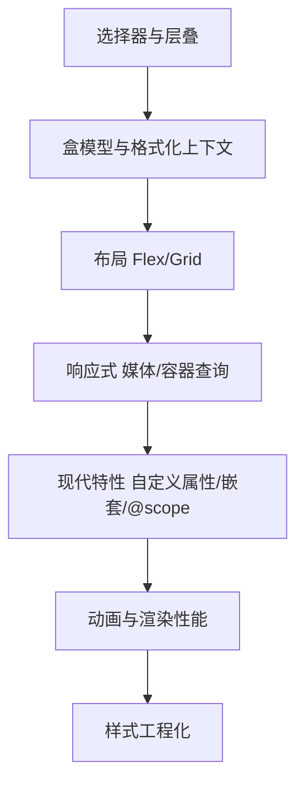

:::note 事实基线
本篇是「CSS 与布局工程」带解答题库，共 **88 题**，事实来源为 `content/fe/css.md`。CSS 知识按当前主流浏览器（三大引擎已落地的稳定特性）口径撰写，标注为「已稳定」的特性（`:has()`、`@layer`、容器查询等）三大引擎均已支持；实验性特性会注明需 `@supports` 检测降级。
:::

本篇是「CSS 与布局工程」题库。CSS 是前端面试的必考基础，但很多人停留在「会用 flex/grid」，讲不清**层叠优先级、BFC、合成层、容器查询**这些机制。本篇的组织顺序是：**先讲选择器与层叠（优先级机制）→ 再讲盒模型与格式化上下文 → 再讲布局（Flex/Grid/居中/三栏）→ 再讲响应式（媒体查询/容器查询/流式排版）→ 再讲现代特性（自定义属性/嵌套/@scope）→ 再讲动画与渲染性能 → 最后讲样式工程化**。

**主线一览**



## 一、选择器与层叠

### Q1. CSS 选择器有哪些家族？伪类与伪元素的区别？

类型选择器（`div`）、类选择器（`.btn`）、ID 选择器（`#app`）、属性选择器（`[type="text"]`）、伪类（`:hover`）、伪元素（`::before`）、通配符（`*`）以及后代、子代、相邻兄弟、通用兄弟四种组合器。

**伪类选中真实存在的元素在特定状态或位置下的情形，伪元素选中或创建 DOM 树中并不真实存在的部分**；规范用双冒号区分伪元素。**伪元素不在 DOM 树中，JS 无法直接获取或绑定事件，只能通过 `getComputedStyle(el, "::before")` 读取其计算样式**；一个选择器只能有一个伪元素且必须位于末尾，伪类可以叠加。

### Q2. :is() / :where() / :not() / :has() 的特异性与容错语义？

| 选择器         | 语义                                                   | 特异性               |
| -------------- | ------------------------------------------------------ | -------------------- |
| `:is(a, b)`    | 匹配参数列表中任一选择器                               | 取参数中特异性最高者 |
| `:where(a, b)` | 同 `:is()`，但强制零特异性                             | 恒为 0               |
| `:not(a, b)`   | 排除参数列表中的任一选择器                             | 取参数中特异性最高者 |
| `:has(rel)`    | 后代或后续兄弟满足参数时选中自身，即关系型「父选择器」 | 取参数中特异性最高者 |

**`:is()` 与 `:where()` 的容错语义和传统选择器列表不同**：传统列表中有一个无效选择器会导致整条规则被丢弃，而 `:is()`/`:where()` 会忽略无效参数、保留有效部分，因此可以安全地写「新特性加降级写法」的组合。

**采分点**：能说出「**`:where()` 恒为零特异性，适合写成可被任意覆盖的基础样式**」+「**`:is()/:where()` 容错（忽略无效参数），传统列表不容错（整条丢弃）**」。

### Q3. :has() 打通了什么限制？有什么约束？

`:has()` 属于**已稳定**能力（三大引擎均已落地），**打通了 CSS 长期只能向下、向右选择的限制**（关系型「父选择器」）。典型场景：表单校验时按输入状态给外层容器加样式、卡片含图片与否切换布局、`h1:has(+ h2)` 描述相邻兄弟关系、`ul:has(li:nth-child(6))` 做「超过若干项」的计数式样式。

**限制**：规范禁止在 `:has()` 内嵌套 `:has()`，也不允许在参数中使用伪元素（多数伪元素条件性存在，查询会引入循环）；**由于参数是容错选择器列表，被禁止的部分会被静默丢弃而不是报错**，容易让人误以为已支持。性能上浏览器为 `:has()` 做了缓存与快照优化，常规使用无碍，但在超大 DOM 上写 `:has(*)` 这类宽泛参数仍应避免。

### Q4. 选择器为什么从右往左匹配？

选择器的匹配方向是**从右往左**，最右侧的选择器称为**关键选择器**。引擎为元素找样式时，先用关键选择器筛出候选元素集合，再沿每个候选元素向祖先方向验证左侧选择器；这样绝大多数规则在第一步就被排除。反过来从左往右会退化为在子树中反复遍历，回溯代价高得多。

**编码推论**：关键选择器越精确越好（`.nav a` 优于 `.nav *`），嵌套层级不必过深。不过现代引擎用索引结构与规则哈希对匹配做了高度优化，**真实项目中选择器性能极少成为瓶颈，优先级远低于重排与 JS 开销**。`父选择器`长期不存在正是因为匹配方向与反向查询冲突，`:has()` 的实现依赖引擎专门的前向检查优化。

**采分点**：能说出「**选择器性能极少是瓶颈，优先级远低于重排与 JS**」——避免过度优化选择器而忽略真正的大头。

### Q5. 层叠的来源与重要性顺序是什么？

一条声明最终是否生效由层叠规则决定，顺序是：**先比来源与重要性，再比选择器权重（specificity），最后比书写顺序**。来源与重要性从高到低：

1. 过渡（transition）进行中的声明
2. 用户代理的 `!important` 声明
3. 用户样式表的 `!important` 声明
4. 作者样式的 `!important` 声明
5. CSS 动画（`@keyframes`）运行期间的声明
6. 作者普通声明
7. 用户普通声明
8. 用户代理（浏览器默认样式表）的普通声明

**注意 `!important` 反转了来源优先级**：用户代理的 `!important` 高于作者的 `!important`，这是为可访问性兜底，让用户能强制覆盖页面样式。另外，**过渡期间的声明优先级高于所有 `!important` 声明**，这正是过渡能平滑接管样式的原因。

**采分点**：能说出「**！important 反转来源优先级（UA !important > 作者 !important），为可访问性兜底**」+「**transition 进行中的声明高于一切**」——这两个反直觉点是层叠的精髓。

### Q6. 特异性（specificity）怎么计算？

规范把特异性定义为**三元组（ID 数，类/属性/伪类数，类型/伪元素数）**，行内样式单独处理且高于任何选择器；工程上常把它记成四元组按位比较。补充规则：**通配符与组合器不增加权重**；`:is()`/`:not()`/`:has()` 计入参数中最高者；`:where()` 恒为零；权重相同则后书写者生效；**直接命中元素的声明永远高于继承来的值**。

```css
:is(#app, .theme) .btn {
  color: red;
} /* 权重含 ID */
:where(#app, .theme) .btn {
  color: red;
} /* 权重只有类与类型 */
```

### Q7. @layer（层叠层）解决什么问题？

`@layer`（**已稳定**）在权重之上再引入一层排序：

```css
@layer reset, base, components, overrides;
@layer reset {
  /* ... */
}
@layer components {
  .btn {
    color: blue;
  }
}
```

**层的顺序决定优先级，后声明的层优先级更高，与选择器权重无关**——未分层（unlayered）的样式优先级高于所有分层样式。这解决了「第三方库样式权重太高覆盖不了」的问题：把库样式放进低优先级层，自己的样式放进高优先级层，不需要拼 `!important` 或堆特异性。

**采分点**：能说出「**@layer 让层的顺序优先于选择器权重，未分层样式高于所有分层**」——这是「不靠 !important 和特异性战争管理优先级」的现代方案。

### Q8. 继承与全局关键字有哪些？

可继承属性（color、font-*、line-height、visibility 等）默认从父元素继承；不可继承属性（box model、position、display 等）不继承。全局关键字：`inherit`（强制继承父值）、`initial`（重置为初始值）、`unset`（可继承属性=inherit，不可继承=initial）、`revert`（回退到用户代理/用户样式）、`revert-layer`（回退到上一层 @layer）。

## 二、盒模型与格式化上下文

### Q9. 盒模型与 box-sizing 是什么？

盒模型由 content、padding、border、margin 四层组成。`box-sizing: content-box`（默认）下 width/height 只算 content；`border-box` 下 width/height 包含 content + padding + border。**现代项目普遍用 `* { box-sizing: border-box }`**，因为「设了 width 就是最终占位宽度」更符合直觉，避免 padding/border 把元素撑大。

### Q10. BFC（块级格式化上下文）是什么？怎么触发？解决什么问题？

BFC 是一个独立的渲染区域，内部的块级盒布局不受外部影响、也不影响外部。**触发条件**：`overflow` 非 visible、`display: flow-root`（最纯粹）、浮动元素、绝对/固定定位、inline-block、flex/grid 子项等。

**解决的问题**：① **清除浮动**（父元素塌陷）——父元素触发 BFC 后会包含浮动子元素的高度；② **阻止 margin 合并**——同一 BFC 内相邻块级元素的垂直 margin 会合并，分属两个 BFC 则不合并；③ **阻止元素被浮动覆盖**——BFC 区域不与浮动重叠（两栏自适应布局的基础）。

**采分点**：能说出「**`display: flow-root` 是创建 BFC 最纯粹的方式（无副作用）**」——传统的 `overflow: hidden` 会裁剪溢出内容，flow-root 只创建 BFC 不带其他效果。

### Q11. margin 合并的三种情况与阻止方法？

**三种情况**：① 相邻兄弟元素的垂直 margin（前一个的 margin-bottom 与后一个的 margin-top）合并取较大值；② 父元素与第一个/最后一个子元素的 margin（父没有 border/padding 分隔时）合并；③ 空块级元素自身的 margin-top 与 margin-bottom 合并。

**阻止方法**：在合并的双方之间创建 BFC 边界（`display: flow-root`）、加 border/padding 分隔、用 flex/grid 容器（子项 margin 不合并）。**注意：水平 margin 不合并，浮动/绝对定位元素的 margin 不合并**。

### Q12. 定位（position）与层叠上下文是什么？

| position | 行为                                 | 是否脱离文档流 |
| -------- | ------------------------------------ | -------------- |
| static   | 默认，正常文档流                     | 否             |
| relative | 相对自身原位置偏移，**仍占据原空间** | 否             |
| absolute | 相对最近的非 static 祖先定位         | 是             |
| fixed    | 相对视口定位                         | 是             |
| sticky   | 滚动到阈值前 relative，之后 fixed    | 否（混合）     |

**层叠上下文（stacking context）**：决定 z-index 的比较范围。创建条件：根元素、`z-index` 非 auto 的定位元素、`opacity < 1`、`transform`/`filter`/`will-change` 非 none、flex/grid 子项设 z-index 等。**关键规则：z-index 只在同一层叠上下文内比较，子元素的 z-index 再大也跳不出父层叠上下文**。

**采分点**：能说出「**z-index 只在同一层叠上下文内比较，子元素跳不出父层叠上下文**」——这是「z-index 设了很大还是被盖住」的根因（父元素创建了一个低优先级的层叠上下文）。

## 三、布局：Flex 与 Grid

### Q13. Flexbox 的主轴/交叉轴与核心属性？

Flex 是**一维弹性布局**：`flex-direction` 决定主轴（row/column），`justify-content` 控制主轴对齐，`align-items` 控制交叉轴对齐。容器属性还有 `flex-wrap`（换行）、`align-content`（多行交叉轴分布）、`gap`。项目属性：`flex-grow`（放大比例）、`flex-shrink`（收缩比例）、`flex-basis`（初始尺寸）、`align-self`（覆盖单个项目交叉轴对齐）、`order`（视觉顺序）。

**`flex` 缩写默认值是 `0 1 auto`，而 `flex: 1` 等价于 `flex: 1 1 0%`**，因此常用于均分剩余空间。**收缩时实际收缩量按 `flex-shrink × flex-basis` 加权分配，基准大的缩得多**。

### Q14. Flex 的两个高频陷阱是什么？

1. **flex 子项的 `min-width`/`min-height` 计算值是 `auto`**，意味着它默认不会收缩到内容尺寸以下，因此**文本省略（`text-overflow: ellipsis`）常常不生效，需要显式给子项加 `min-width: 0`**。
2. **`margin: auto` 在 flex 容器中会吸收主轴或交叉轴上的剩余空间**，是实现「单个元素推到一端」或「两端分布但间距固定」的简洁手段，但也容易与 `justify-content` 的效果混淆。

```css
.container {
  display: flex;
}
.side {
  flex: 1 1 0;
  min-width: 0;
} /* min-width: 0 让侧栏能被压缩，内部文本省略才生效 */
.center {
  flex: 0 0 300px;
} /* 中间固定宽度 */
```

**采分点**：能说出「**flex 子项 min-width 默认 auto，文本省略要显式 min-width: 0**」——这是 flex 布局最高频的坑。

### Q15. order 为什么不该用于逻辑重排？

`order` 改变视觉顺序但**不改变 DOM 顺序**（规范明确它不影响 Tab 导航与读屏遍历顺序），**视觉序与键盘序错位本身就是无障碍风险，不应用于逻辑重排**。要改变逻辑顺序应该改 DOM 顺序。

### Q16. Grid 的核心属性与 auto-fill/auto-fit 的区别？

Grid 是**二维轨道布局**，同时控制行与列。容器核心属性：`grid-template-columns`/`grid-template-rows`（轨道列表，支持 `fr`、`repeat()`、`minmax()`、`auto-fill`/`auto-fit`）、`gap`、`grid-template-areas`（命名区域画图）、`justify-items`/`align-items`（单元格内对齐）、`justify-content`/`align-content`（整个网格在容器内分布）、`grid-auto-flow`（隐式网格）。项目属性用 `grid-column`/`grid-row` 做基于线的定位，或 `grid-area` 引用命名区域。

**`auto-fill` 与 `auto-fit` 的区别在容器有剩余空间时显现**：`auto-fill` 保留空轨道，`auto-fit` 折叠空轨道让现有项目拉伸填满。因此**响应式卡片网格通常用 `auto-fit`**。

```css
/* 不写媒体查询即可自适应的卡片网格，每列严格对齐 */
.list {
  display: grid;
  grid-template-columns: repeat(auto-fit, minmax(200px, 1fr));
  gap: 16px;
}
```

### Q17. fr 与 auto 的差别？minmax(0, 1fr) 解决什么？

**`fr` 分配的是剩余空间，而 `auto` 会先满足内容尺寸**。`minmax(0, 1fr)` 是解决「**网格子项被内容撑破**」的常用写法——默认 `1fr` 等价于 `minmax(auto, 1fr)`，auto 最小值会让子项不小于内容尺寸，长内容（如长单词、不换行文本）会撑破轨道；改成 `minmax(0, 1fr)` 让最小值为 0，轨道才能被压缩。**与 flex 中的 `min-width: 0` 是同一类问题的不同解法**。

**采分点**：能说出「**`1fr` 默认是 `minmax(auto, 1fr)`，auto 最小值会被内容撑破，改 `minmax(0, 1fr)`**」+「**与 flex 的 min-width: 0 同源**」——这是 Grid 最高频的坑。

### Q18. subgrid 解决什么问题？

嵌套网格可以用 `subgrid` 让**子网格沿用父网格的轨道线**，使跨组件的行列对齐成为可能。没有 subgrid 时，子网格的轨道是独立的，无法与父网格对齐；subgrid 让子组件的列宽与父组件严格对齐（如卡片列表里每张卡的标题/内容/按钮三行对齐）。

### Q19. 居中方案矩阵（按子元素尺寸是否已知）？

| 场景               | 方案                                                       | 说明                                                                      |
| ------------------ | ---------------------------------------------------------- | ------------------------------------------------------------------------- |
| 尺寸已知，绝对定位 | `inset: 0; margin: auto`                                   | 四边归零后 auto margin 均分剩余空间                                       |
| 尺寸未知，绝对定位 | `top/left: 50%` 加 `transform: translate(-50%, -50%)`      | transform 百分比相对自身尺寸，top/left 百分比相对包含块；会创建层叠上下文 |
| 尺寸未知，flex     | 父元素 `justify-content: center` 加 `align-items: center`  | 对子元素数量与尺寸变化最健壮，现代首选                                    |
| 尺寸未知，grid     | 父元素 `place-items: center` 或子元素 `place-self: center` | 语义简洁                                                                  |
| 单行文本           | `line-height` 等于容器高度加 `text-align: center`          | 仅适用于单行                                                              |

### Q20. flex 与 grid 怎么选？三栏布局怎么实现？

**flex 与 grid 是互补而非替代关系**，选择取决于布局维度与元素位置的来源：**元素位置由内容决定、单方向排列**（导航栏、按钮组、工具栏、卡片内部）用 flex；**布局是二维的、元素位置需要由设计稿精确指定、需要重叠或固定行列结构**（页面骨架、仪表盘、画廊、数据表格）用 grid。实践中二者经常嵌套配合：外层 grid 划分页面区域，内层 flex 排列区域内的元素。

**三栏布局**（单侧自适应加中间固定）：flex 用两侧 `flex: 1 1 0` 加中间 `flex: 0 0 300px`；grid 一行 `grid-template-columns: 1fr 300px 1fr`；传统方案用浮动加 margin 避让或绝对定位。**圣杯布局与双飞翼布局是浮动时代的经典考题**，通过负 margin 与父 padding 实现「中间栏在 DOM 中优先渲染」，理解其对文档流与负 margin 的运用即可，新项目不再需要。

## 四、响应式与自适应

### Q21. 媒体查询的常用特性与断点策略？

常用特性：`width`/`height` 区间、`orientation`、`hover` 与 `pointer`（触屏与精确指针）、`prefers-color-scheme`、`prefers-reduced-motion`、`prefers-contrast`、`min-resolution`（高分屏）、`scripting`（JS 是否可用）。多个条件用 `and` 连接，逗号表示「或」。

**断点策略**：**移动优先**（基础样式面向小屏，用 `min-width` 逐级增强）是主流，天然渐进增强且代码量小；桌面优先（`max-width` 递减）适合存量 PC 站改造。**现代理念是「能不用媒体查询就不用」**：优先用内在尺寸（`min-content` 等）、flex/grid 的自适应性、`clamp()` 与流式布局，把断点留给真正的结构级变化（侧栏隐藏、栅格列数、字号阶梯）。

### Q22. 容器查询解决什么问题？container-type 的代价？

媒体查询依据**视口**尺寸，**容器查询（已稳定）依据组件自身容器的尺寸**，解决的是「同一个卡片放在侧栏和放在主区域布局应当不同，但视口宽度相同」的问题。用法分两步：先在容器元素上声明 `container-type: inline-size` 并可选地用 `container-name` 命名；再在容器后代上用 `@container` 查询。

**`container-type: inline-size` 的代价**：它对容器施加布局、样式与行内尺寸包含，**容器的行内尺寸不再由内容撑开**，因此在浮动、inline-block、绝对定位等收缩尺寸场景下可能塌成 0，使用时要确保容器有确定的宽度来源。容器查询**只能影响容器的后代而不能查询自身**。配套的容器查询单位 `cqw`/`cqh`/`cqmin`/`cqmax` 让字号、圆角等可以直接随容器缩放（如 `font-size: 5cqw`）。

**采分点**：能说出「**容器查询让组件按自身容器尺寸自适应，而不是视口**」+「**container-type: inline-size 会让容器行内尺寸不由内容撑开，可能塌成 0**」——这是组件级响应式的核心与代价。

### Q23. clamp() 与流式排版怎么用？

`calc()` 允许混合不同单位参与计算，`min()`/`max()` 取边界，**`clamp(min, preferred, max)` 一次表达区间约束**（等价于 `max(min, min(preferred, max))`）。使用时要注意 **`+` 与 `-` 两侧必须有空格**，`*` 与 `/` 则不必。

```css
.content {
  width: min(90%, 1200px);
  margin-inline: auto;
} /* 小屏占满，大屏限宽 */
h1 {
  font-size: clamp(16px, 2.5vw, 24px);
} /* 流式字号 */
```

**`clamp()` 驱动的流式字号与间距能显著减少媒体查询数量**。`repeat(auto-fit, minmax(min(100%, 300px), 1fr))` 是网格场景常见组合，用内层 `min()` 保证低于最小列宽时列宽退化为可用宽度的 100%。

### Q24. 深色模式怎么做？color-scheme 为什么必须设？

跟随系统偏好用 `prefers-color-scheme`，现代做法是配合 `color-scheme` 属性与 `light-dark()` 函数：

```css
:root {
  color-scheme: light dark;
}
body {
  background: light-dark(#fff, #141414);
  color: light-dark(#1f2329, #e8e8e8);
}
```

**`color-scheme` 必须设置**，它告诉浏览器页面支持哪些配色方案，浏览器据此把**表单控件、滚动条、自动填充底色**切换为对应风格；不设置则暗色环境下输入框仍是亮色，体验割裂。手动切换与系统跟随并存通常用 `data-theme` 属性加自定义属性。**主题判定脚本必须内联在文档头部同步执行，否则暗色用户会先看到一帧亮色**（FOUC）。

**采分点**：能说出「**color-scheme 影响表单控件/滚动条/自动填充的原生配色**」+「**主题脚本要内联同步执行防 FOUC**」——这两个是深色模式落地的关键细节。

## 五、自定义属性与现代特性

### Q25. CSS 自定义属性与 @property 的区别？

CSS 自定义属性（CSS 变量）是**运行时的值**，真实存在于计算样式中：`el.style.setProperty("--brand", "red")` 立即生效并联动所有引用处。它遵循层叠与继承规则，可以在任意选择器、媒体查询、伪类里重新定义。

**`@property`** 给自定义属性注册**类型、初始值与继承行为**：

```css
@property --angle {
  syntax: "<angle>";
  initial-value: 0deg;
  inherits: false;
}
```

注册后浏览器知道它的类型，**可以对它做 transition/animation 插值**（未注册的自定义属性是字符串，无法插值），还能做类型校验。

**采分点**：能说出「**@property 注册类型后自定义属性才能被 transition 插值**」——这是「渐变动画」「角度动画」的实现基础（未注册的变量是离散跳变）。

### Q26. 原生嵌套（CSS Nesting）与预处理器嵌套的区别？

原生嵌套（已稳定）让 CSS 直接支持 `&` 与嵌套规则，无需预处理器：

```css
.card {
  color: black;
  & .title {
    font-weight: bold;
  }
  &:hover {
    color: blue;
  }
}
```

与 Sass 嵌套的区别：原生嵌套的 `&` 是**完整的选择器引用**（不是字符串拼接），早期版本要求嵌套选择器以符号开头（`& .x` 而非 `.x`），现已放宽。原生嵌套普及后，预处理器在「嵌套」这方面的需求在弱化。

### Q27. @scope、相对颜色与锚点定位是什么？

- **`@scope`**：给样式划定作用域根与边界，`@scope (.card) to (.content) { ... }` 只影响 .card 内、.content 外的元素——解决「组件样式作用域」的原生方案（不依赖 Shadow DOM 或预处理器）。
- **相对颜色**：`rgb(from var(--brand) r g b / 50%)` 从已有颜色派生新颜色（调透明度、改通道）——替代 Sass 的 `darken()`/`rgba()`。
- **锚点定位（anchor positioning）**：把一个元素（弹出层）定位到另一个元素（锚点）的相对位置，`position-area`/`anchor()`——原生实现 tooltip/popover 的定位（此前要 JS 计算）。

### Q28. 层叠层、特性查询与现代交互特性？

- **特性查询 `@supports`**：检测浏览器是否支持某特性，做渐进增强（`@supports (display: grid) { ... }`）。
- **`:focus-visible`**：只在键盘导航时显示焦点环（鼠标点击不显示），改善无障碍与视觉。
- **`accent-color`**：一行代码统一表单控件（checkbox/radio/progress）的主题色。
- **`scroll-behavior: smooth`**、**`overscroll-behavior`**（控制滚动链与回弹）、**`:modal`/`::backdrop`**（dialog 背景）。

## 六、动画与渲染性能

### Q29. transition 与 animation 的区别？

| 维度       | transition                               | animation                                                                  |
| ---------- | ---------------------------------------- | -------------------------------------------------------------------------- |
| 触发方式   | 被动，属性值变化时发生，从 A 到 B 走一遍 | 主动，绑定即按 `@keyframes` 运行                                           |
| 关键帧     | 只有起点与终点                           | 任意多个关键帧                                                             |
| 循环与方向 | 一次性                                   | 支持 `iteration-count`、`direction: alternate`、`play-state`               |
| 填充模式   | 无                                       | `animation-fill-mode` 控制前后定格帧（不加 `forwards` 结束会跳回初始状态） |
| 步进       | 支持 `steps()`                           | 支持 `steps()`，可做逐帧动画与打字机效果                                   |

**`transition-property: all` 会监听所有可过渡属性，带来不必要的计算，生产上应显式列举**。

### Q30. display:none 与 height:auto 为什么无法过渡？现代解法？

两个高频「过渡失效」问题：① **`display: none` 与 `block` 之间无法插值**，因为元素进出渲染树没有中间状态——新方案是 `transition-behavior: allow-discrete` 配合 `@starting-style` 定义入场前样式（允许离散属性参与过渡），或改用 `opacity`/`visibility`；② **`height: auto` 不是可插值数值**——方案包括用 JS 测量 `scrollHeight` 后赋值、用 grid 的 `grid-template-rows: 0fr` 到 `1fr` 技巧，或使用 `interpolate-size: allow-keywords` 与 `calc-size()`。后两组新特性按引擎逐步落地，**使用前应通过 `@supports` 检测并以无动画作为降级**。

**采分点**：能说出「**grid 的 `grid-template-rows: 0fr → 1fr` 是 height:auto 过渡的现代纯 CSS 技巧**」——这是「不定高展开动画」的优雅解法。

### Q31. transform 与 position 走的渲染阶段有什么不同？动画属性白名单是什么？

| 维度       | transform                | position                                                    |
| ---------- | ------------------------ | ----------------------------------------------------------- |
| 影响布局   | 不影响，元素仍占据原位置 | `absolute`/`fixed` 脱离文档流，影响布局                     |
| 渲染阶段   | 可只在合成阶段生效       | 布局阶段                                                    |
| 百分比参照 | 元素自身尺寸             | 包含块尺寸                                                  |
| 层叠上下文 | 非 none 即创建           | fixed/sticky 总是创建，absolute/relative 需 z-index 非 auto |

修改 `top`/`left`/`width`/`margin` 会触发**重排、重绘再到合成**，每帧走完整管线且运行在主线程；修改 `transform`/`opacity` 时，若元素已被提升为合成层，变化由**合成器线程直接对 GPU 纹理做矩阵变换或透明度混合，完全跳过布局与绘制**。因此**动画属性白名单就是 `transform` 与 `opacity`**（视情况加 `filter`），位移用 `translate`、缩放用 `scale`、旋转用 `rotate` 等效替代布局属性。

```text
top/left 动画:   JS → Style → Layout → Paint → Composite   (每帧全套, 主线程)
transform 动画:  JS → Style → Composite                    (每帧合成, 合成线程)
```

**采分点**：能说出「**transform/opacity 走合成线程，跳过布局与绘制；top/left 走完整管线在主线程**」——这是「动画用 transform 不用 top/left」的根本原因。

### Q32. FLIP 动画技术是什么？

**FLIP（First Last Invert Play）**：用 `transform` 模拟布局变化，把昂贵的布局动画换算成便宜的合成动画。四步：① **First**——记录元素初始位置；② **Last**——让元素到达最终位置（布局变化），记录最终位置；③ **Invert**——用 transform 把元素「反变换」回初始位置（视觉上还在原地）；④ **Play**——移除 transform，让元素用合成动画「播放」到最终位置。这样布局变化（重排）只发生一次，动画全程走 transform（合成）。

### Q33. will-change 与合成层的正确用法？

`will-change` 提前告知浏览器元素将发生何种变化，让它有时机准备资源（如创建合成层、分配 GPU 资源）。**正确用法是在动画即将开始时添加、结束后立即移除**（`mouseenter` 时设 `willChange = "transform"`，`animationend` 时恢复 `auto`）。

**注意事项**：① 每个合成层都是一份独立纹理，**过度提升尤其隐式合成引发的层爆炸会暴涨 GPU 内存，低端设备反而掉帧**；② `will-change` 只对能走合成路径的属性有效，改 `width`/`height` 之类的布局属性仍然重排；③ **长期挂在大量元素上是反模式**；④ 它还会创建层叠上下文并可能改变包含块。相比 `transform: translateZ(0)` 这类 hack，`will-change` 语义更明确。

**采分点**：能说出「**will-change 要动画前加、动画后移除，长期挂是反模式**」+「**层爆炸暴涨 GPU 内存**」——这是合成层优化最容易踩的坑。

### Q34. 什么是强制同步布局（layout thrashing）？怎么避免？

**强制同步布局是性能杀手**：写入样式使布局失效后，立刻读取 `offsetTop`、`offsetWidth`、`getBoundingClientRect()` 等几何属性，会迫使浏览器**立即同步完成一次完整布局**才能返回正确值。在循环里「写一点、读一点」会把一次布局放大成 N 次，页面直接卡死。

**解法只有一条：读写分离**——先在循环外一次性读完需要的几何值缓存到变量，再统一写样式，或用 `requestAnimationFrame` 合并每帧写操作。

### Q35. contain 与 content-visibility 怎么优化渲染？

`contain` 与 `content-visibility` 属于 **CSS Containment** 体系，核心思想是开发者向浏览器承诺「某子树与外界互不影响」，浏览器据此跳过子树的样式计算、布局与绘制。`contain` 的取值：`layout`（内部布局独立）、`paint`（后代不绘制到边界外）、`size`（尺寸不依赖内容，需给确定尺寸否则塌陷）、`style`（计数器等不逸出）；组合值 `strict` = layout+paint+size+style，`content` = layout+paint+style。

**`content-visibility: auto`** 是最常用的值：**视口外的内容跳过渲染，滚动到附近才开始渲染**，由浏览器自动管理。配合 `contain-intrinsic-size` 提供预估尺寸，避免未渲染内容高度为 0 导致滚动条漂移：

```css
.card-list > li {
  content-visibility: auto;
  contain-intrinsic-size: auto 200px;
}
```

**采分点**：能说出「**content-visibility 与虚拟列表互补——虚拟列表解决 DOM 节点数，content-visibility 解决渲染成本，简单场景甚至可直接替代虚拟列表**」。

## 七、样式组织与工程化

### Q36. 四种主流样式方案的对比？

| 维度       | 原子化（Tailwind 等）    | CSS Modules            | 运行时 css-in-js         | 编译时 css-in-js     |
| ---------- | ------------------------ | ---------------------- | ------------------------ | -------------------- |
| 作用域     | 预定义工具类按约定组合   | 编译期哈希类名         | 运行时生成唯一类名       | 编译期抽取为静态类名 |
| 运行时开销 | 无，产物是静态 CSS       | 无                     | 有序列化与样式注入开销   | 无                   |
| 动态样式   | 有限，靠变体与 CSS 变量  | 需配合内联样式或变量   | 表达力最强               | 通过 CSS 变量传值    |
| 首屏样式   | 静态 CSS 可并行加载      | 同左                   | 必须等 JS 执行后才存在   | 同静态方案           |
| 典型问题   | 类名冗长，需统一设计约束 | 类名是哈希，调试不直观 | 与并发渲染、SSR 存在张力 | 工具链依赖重         |

### Q37. 运行时 css-in-js 性能差的四个原因？

① **序列化开销**：每次渲染都要把 props 插值进模板并序列化成 CSS 字符串再做哈希查缓存，列表场景每项样式不同会完全失去缓存；② **样式注入会触发受影响子树的样式重算**；③ **样式必须等 JS 下载、解析、执行、组件渲染后才存在**，首屏样式可用时间显著延后，SSR 下还要额外做样式收集与注水；④ **动态类名无法像静态文件那样长缓存**。

**采分点**：能说出「**这是社区整体转向静态方案（编译时 css-in-js、CSS Modules、原子化）的原因**」——性能敏感、SSR 与大体积项目应优先静态方案。

### Q38. Tailwind v4 的 CSS-first 配置是什么？

Tailwind v4 采用 **CSS-first 配置**：入口样式表只需 `@import "tailwindcss"`，默认自动探测源文件，**设计 token 用 `@theme` 声明**（声明 `--color-brand` 会自动派生出 `bg-brand`、`text-brand` 等工具类），插件用 `@plugin` 加载。原子化方案的思想是每个类只做一个声明，**构建期扫描源码提取类名 token，按需生成对应规则，未使用的类不进入产物**，因此产物体积随项目变大很快收敛。变体前缀（`hover:`、`md:`、`dark:`）编译为伪类或媒体查询包裹的规则，动态值通过 CSS 变量注入。

### Q39. mixin 与 @extend 的区别？@use 为什么取代 @import？

**mixin 把声明复制到每个调用处、支持参数，产物体积可能膨胀；`@extend`（配合占位选择器 `%placeholder`）把选择器合并到同一组声明，产物更精简但不能传参，且会改变选择器的位置、可能引入意外的层叠顺序**。**带参复用选 mixin，纯静态公共样式选占位选择器**。模块化用 `@use` 与 `@forward` 取代会重复引入并污染全局的 `@import`。

### Q40. 为什么用 link 而不是 @import 加载 CSS？

**多个 link 可被预加载扫描器在 HTML 解析早期并行发现，而 `@import` 必须等包含它的 CSS 下载解析后才能发现下一层 URL，形成串行瀑布**；link 还支持 media、disabled、`rel="preload"` 且能被 JS 操作。真正的按需加载需要 JS 动态插入 link（或构建期按路由拆分）；**`media` 属性不会阻止 CSS 下载，只是不匹配时不阻塞渲染**。Critical CSS 的思路是把首屏所需样式内联进 HTML，其余样式异步加载。

**采分点**：能说出「**@import 形成串行瀑布，link 能被预加载扫描器并行发现**」——这是 CSS 交付性能的关键。

### Q41. Shadow DOM 与 Vue scoped 的隔离机制有什么不同？

**Shadow DOM** 的隔离依赖影子树独立的样式作用域：外部选择器无法选中影子树内部节点，内部样式也不泄漏。**穿透通道**：可继承属性（color、font）照常继承进影子树，**CSS 自定义属性能无视边界**（外部定义 `--card-color`、内部用 `var(--card-color)` 是官方推荐的主题定制方式）。主动开放的接口：`:host`、`::slotted()`（只作用插槽直接子节点）、`::part()` 配合 `part`/`exportparts`。**Constructable Stylesheets**（`adoptedStyleSheets`）可在多实例间共享同一份样式表，避免每个实例内联重复样式。

**Vue `<style scoped>`** 是编译期转换：给每个元素加唯一数据属性（`data-v-xxx`），样式编译时给每条选择器末尾追加属性选择器。**子组件根节点同时带父组件属性，因此父组件 scoped 样式可影响子组件根节点**；影响子组件内部用 `:deep()`。

**采分点**：能说出「**CSS Modules 把类名改写为唯一哈希（隔离彻底），scoped 是给类名追加属性选择器（权重加一，类名仍全局）**」——两者隔离强度不同。

### Q42. React Native 的「CSS」与 Web CSS 有什么本质区别？Yoga 是什么？

React Native 没有浏览器、没有 DOM、没有 CSSOM，所谓「RN 里的 CSS」只是**借用 CSS 属性命名与 Flexbox 语义的 JS 对象**，最终由原生视图渲染。差异：样式是 JS 对象且属性名驼峰化，没有选择器/样式表/层叠；继承极弱（只有文本组件嵌套时继承部分文字属性，所有文本必须包在文本组件里）；数值是无单位逻辑像素（按 DPR 换算，不支持 em/rem/vw）；**默认布局是 Flexbox 且主轴为纵向**（Web 默认横向），没有 float、没有 grid，position 基本只有 relative/absolute；没有伪类/伪元素/媒体查询，transform 用数组语法。

**Yoga** 是 Meta 开源的跨平台 C++ 布局引擎，实现了与 W3C Flexbox 高度一致的算法：JS 侧样式同步到原生层构建 Yoga 节点树，Yoga 依据可用空间自顶向下递归计算每个节点的几何框架并回写原生视图。**它的价值是让一份 Flexbox 布局代码在 iOS 与 Android 上像素级一致**。

**采分点**：能说出「**RN 默认主轴纵向（Web 横向）**」+「**Yoga 让一份 Flexbox 在双端像素级一致**」——这是跨端布局的关键差异。

### Q43-Q88. 快速自检与深挖补充

**Q43. 一句话解释伪类与伪元素的区别。** 伪类选中真实元素的特定状态/位置，伪元素选中或创建 DOM 中不存在的部分——伪元素不在 DOM 树，JS 只能用 getComputedStyle(el, "::before") 读。

**Q44. 一句话解释 :where 为什么恒零特异性。** 设计目的就是「可被任意覆盖的基础样式」——写重置/默认样式时用 :where，后续任何选择器都能覆盖。

**Q45. 一句话解释 :has 为什么不能嵌套 :has。** 规范禁止，且参数里不能用伪元素（条件性存在会引入循环）——被禁止的部分静默丢弃而非报错。

**Q46. 一句话解释关键选择器。** 最右侧的选择器，从右往左匹配时先用它筛候选集——越精确越好（.nav a 优于 .nav *）。

**Q47. 一句话解释层叠的三步比较。** 先比来源与重要性，再比特异性，最后比书写顺序——来源优先级高于特异性。

**Q48. 一句话解释为什么 transition 优先级最高。** 过渡期间的声明高于所有 !important——这是过渡能平滑接管样式的原因。

**Q49. 一句话解释特异性三元组。** (ID 数，类/属性/伪类数，类型/伪元素数)，行内样式单独处理且高于任何选择器——按位比较。

**Q50. 一句话解释直接命中为什么高于继承。** 直接命中元素的声明永远高于继承来的值——继承是最低优先级。

**Q51. 一句话解释 @layer 未分层样式为什么最高。** 未分层（unlayered）样式优先级高于所有分层样式——分层是为了把第三方库压低。

**Q52. 一句话解释 box-sizing: border-box 的价值。** width/height 包含 padding+border，「设了 width 就是最终占位」更符合直觉——现代项目普遍全局 border-box。

**Q53. 一句话解释 display: flow-root。** 创建 BFC 最纯粹的方式（无副作用），不像 overflow: hidden 会裁剪溢出内容。

**Q54. 一句话解释 BFC 解决的三个问题。** 清除浮动（父塌陷）、阻止 margin 合并、阻止被浮动覆盖（两栏自适应）。

**Q55. 一句话解释 margin 合并的三种情况。** 相邻兄弟垂直 margin、父子（无 border/padding 分隔）、空块自身上下 margin——水平 margin 不合并。

**Q56. 一句话解释 relative 与 absolute 的占位差异。** relative 偏移但仍占据原空间，absolute 脱离文档流不占空间。

**Q57. 一句话解释 sticky 的混合行为。** 滚动到阈值前 relative，之后 fixed——需要父容器有足够高度且 overflow 不能是 hidden。

**Q58. 一句话解释层叠上下文的创建条件。** 根元素、z-index 非 auto 的定位元素、opacity<1、transform/filter/will-change 非 none、flex/grid 子项设 z-index。

**Q59. 一句话解释 z-index 为什么跳不出父层叠上下文。** z-index 只在同一层叠上下文内比较，子元素再大也受父层叠上下文优先级约束。

**Q60. 一句话解释 flex: 1 的展开。** flex: 1 = flex: 1 1 0%，默认值是 0 1 auto——flex: 1 让项目均分剩余空间（basis 0）。

**Q61. 一句话解释 flex-shrink 的加权收缩。** 实际收缩量按 flex-shrink × flex-basis 加权分配，基准大的缩得多。

**Q62. 一句话解释 margin: auto 在 flex 里的行为。** 吸收主轴/交叉轴剩余空间——「单个元素推到一端」的简洁手段。

**Q63. 一句话解释 order 的无障碍风险。** 改视觉顺序不改 DOM 顺序，不影响 Tab/读屏遍历——视觉序与键盘序错位是无障碍风险。

**Q64. 一句话解释 auto-fill 与 auto-fit。** 容器有剩余空间时 auto-fill 保留空轨道，auto-fit 折叠空轨道让项目拉伸填满——响应式卡片用 auto-fit。

**Q65. 一句话解释 grid-template-areas 的价值。** 用命名区域画图，可读性极强——页面骨架用 areas 比线定位更直观。

**Q66. 一句话解释 justify-items 与 justify-content。** justify-items 控制单元格内对齐，justify-content 控制整个网格在容器内分布。

**Q67. 一句话解释 subgrid 的价值。** 子网格沿用父网格轨道线，跨组件行列对齐——卡片列表每卡的标题/内容/按钮三行对齐。

**Q68. 一句话解释居中为什么 flex 最健壮。** 对子元素数量与尺寸变化最健壮，不依赖已知尺寸——现代首选。

**Q69. 一句话解释 transform 居中的百分比参照。** transform 百分比相对自身尺寸，top/left 百分比相对包含块——translate(-50%,-50%) 配 top/left:50%。

**Q70. 一句话解释圣杯/双飞翼的核心。** 负 margin + 父 padding 实现「中间栏在 DOM 中优先渲染」——浮动时代经典，新项目不再需要。

**Q71. 一句话解释移动优先为什么是主流。** 基础样式面向小屏，min-width 逐级增强——天然渐进增强且代码量小。

**Q72. 一句话解释「能不用媒体查询就不用」。** 优先内在尺寸、flex/grid 自适应、clamp 流式布局，断点留给真正的结构级变化。

**Q73. 一句话解释容器查询单位 cqw。** 字号/圆角随容器缩放（font-size: 5cqw）——组件级响应式的配套单位。

**Q74. 一句话解释 clamp 的空格要求。** + 与 - 两侧必须有空格，* 与 / 不必——calc 语法约束。

**Q75. 一句话解释 light-dark() 的前提。** 必须先设 color-scheme: light dark，浏览器才知道页面支持双配色——否则原生控件不切换。

**Q76. 一句话解释 FOUC 与主题脚本内联。** 主题判定脚本必须内联在头部同步执行，否则暗色用户先看到一帧亮色（Flash of Unstyled Content）。

**Q77. 一句话解释 @property 让变量可插值。** 注册类型后浏览器知道它是 <angle>/<color>，能做 transition 插值——未注册是字符串只能离散跳变。

**Q78. 一句话解释原生嵌套的 & 语义。** & 是完整选择器引用（不是字符串拼接）——与 Sass 的 & 字符串拼接不同。

**Q79. 一句话解释 @scope 的价值。** 原生划定样式作用域根与边界，不依赖 Shadow DOM 或预处理器——组件样式作用域的原生方案。

**Q80. 一句话解释相对颜色。** rgb(from var(--brand) r g b / 50%) 从已有颜色派生——替代 Sass 的 darken()/rgba()。

**Q81. 一句话解释锚点定位。** 把弹出层定位到锚点元素的相对位置（position-area/anchor()）——原生实现 tooltip/popover 定位。

**Q82. 一句话解释 :focus-visible 的价值。** 只在键盘导航时显示焦点环，鼠标点击不显示——改善无障碍与视觉。

**Q83. 一句话解释 animation-fill-mode: forwards。** 不加 forwards 动画结束会跳回初始状态——forwards 让结束定格在最后一帧。

**Q84. 一句话解释 transition-property: all 的代价。** 监听所有可过渡属性带来不必要计算——生产应显式列举。

**Q85. 一句话解释 grid-template-rows: 0fr→1fr 技巧。** 不定高展开动画的纯 CSS 解法——0fr 到 1fr 可插值，替代 height:auto。

**Q86. 一句话解释层爆炸。** 过度提升合成层（尤其隐式合成）暴涨 GPU 内存，低端设备反而掉帧——will-change 要克制。

**Q87. 一句话解释读写分离防 layout thrashing。** 循环外一次性读完几何值缓存，再统一写样式，或用 rAF 合并每帧写——避免写一点读一点把一次布局放大成 N 次。

**Q88. 一句话总结 CSS 工程的核心认知。** 层叠（来源>特异性>顺序）与 BFC/层叠上下文是「样式为什么不生效」的根因；flex/grid 的 min-width:0 与 minmax(0,1fr) 是「内容撑破」的同源解法；transform/opacity 走合成线程是动画性能的根本；content-visibility/contain 是渲染优化的现代手段；静态方案（原子化/Modules/编译时）优于运行时 css-in-js 是社区共识。

---

**延伸阅读**

- [React 与浏览器题库](/interview/qa/react-and-browser)：浏览器渲染管线、重排重绘的 JS 侧机制。
- [前端工程化题库](/interview/qa/frontend-engineering)：构建工具、样式交付的工程化。
- [Next.js / Vite / TanStack 题库](/interview/qa/nextjs-vite-tanstack)：现代前端框架与构建工具。
- [前端监控 SDK 题库](/interview/qa/frontend-monitoring-sdk)：渲染性能指标（FSP、长任务）的采集。
- [工作文档 · CSS](/fe/css)：本篇的事实来源。
