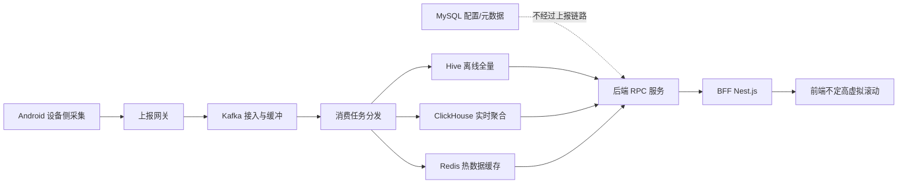
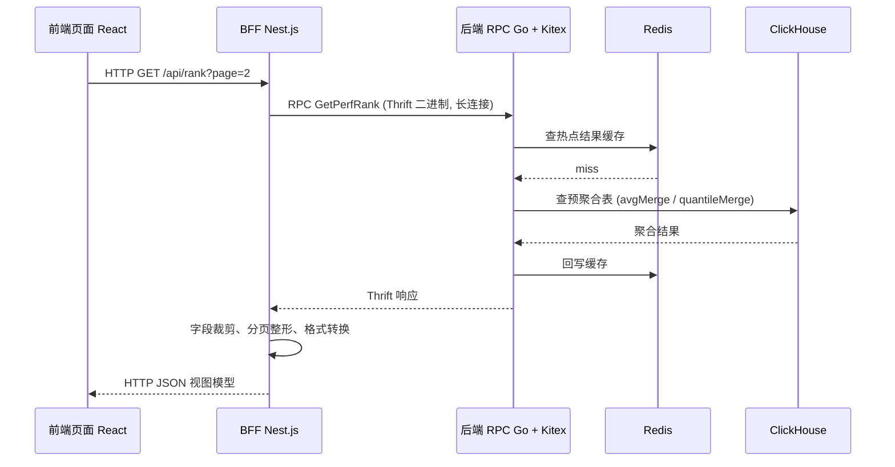

:::note 事实基线
本篇是「数据链路与 OLAP」带解答题库，共 **92 题**，事实来源为 `content/docs/tiktok.md`（TikTok Android 性能采集与数据链路）。链路口径：Kafka 4.x、ClickHouse 25.x、离线数仓 Hive、关系库 MySQL、缓存 Redis；后端 Go + Kitex（Thrift RPC），BFF 为 Nest.js，前端 React。文中的批量大小、超时阈值、采样频率等均为**设计取值或示例**，落地时需按目标环境实测标定。
:::

本篇是「数据链路与 OLAP」带解答题库。这块内容在面试里几乎总是以「**你设计过一条数据链路吗**」「**Kafka 怎么保证不丢不重**」「**为什么用 ClickHouse**」的形式出现。本篇的组织顺序是：**先讲链路全景与各组件职责 → 再深挖 Kafka（投递语义/顺序/去重/一致性/积压）→ 再讲 ClickHouse 建模与优化 → 再讲 RPC/BFF 分层与治理 → 最后落到前端的虚拟滚动渲染**。

**主线一览**



## 一、链路全景与组件职责

### Q1. 这条数据链路的整体结构是什么？

```text
Android 设备侧采集 -> 上报网关 -> Kafka -> 消费任务分发
                                          -> Hive (离线全量)
                                          -> ClickHouse (实时聚合)
                                          -> Redis (热数据缓存)
MySQL (配置/元数据, 不经过上报链路)
存储层 (Hive / ClickHouse / MySQL / Redis) -> 后端 RPC 服务 -> BFF -> 前端页面
```

设备侧采集结果上报后先落 Kafka，再由消费任务分发到不同存储；配置与元数据独立存放在 MySQL，**不经过上报链路**。后端从存储读取数据并提供 RPC 服务，前端 BFF 层消费后渲染设备性能排行榜。

### Q2. 每个组件解决的是什么性质的问题？

**划分依据是数据的读写模式与延迟要求，不是技术偏好**：

| 组件           | 承接的负载                      | 为什么是它                        |
| -------------- | ------------------------------- | --------------------------------- |
| **Kafka**      | 高吞吐流动数据（接入 + 缓冲）   | 削峰填谷、解耦、可重放            |
| **Hive**       | 全量历史、离线 ETL              | HDFS 低成本存海量历史，分钟级查询 |
| **ClickHouse** | 在线聚合分析（明细 + 多维过滤） | 列存 + 向量化，秒级聚合           |
| **MySQL**      | 事务型小数据（配置/元数据）     | 点查、事务、强一致                |
| **Redis**      | 热点读（结果缓存）              | 内存、低延迟                      |

**采分点**：判断「新数据放哪里」，先问它是**高吞吐流动数据、全量历史、在线聚合、事务型小数据，还是热点读**——这个判断框架比记住五个组件的名字重要得多。

### Q3. Kafka 在这条链路里充当什么角色？

Kafka 是**数据接入层**，四个职责：

1. **削峰填谷**：海量设备上报流量有明显波峰波谷，Kafka 先把数据持久化到 topic，下游按自己的处理能力匀速消费，避免上报洪峰直接打垮数据库。
2. **解耦上报端与消费端**：设备侧只需写入 Kafka，不需要知道下游有哪些存储；后续新增一个分析库只需新增一个消费组，上报逻辑不用改。
3. **数据分发**：一份上报数据可以被多个消费组独立消费，分别写入 Hive、ClickHouse 等不同存储——这是「一份数据落多个库」的实现基础。
4. **可重放**：数据按保留策略落盘保存，某个下游消费任务写错数据时可以重新消费、重新灌库。

**Kafka 不承担查询职责**，它只是流动的管道，真正的查询能力由后面的存储提供。

### Q4. 这条链路的消息模型长什么样？

```json
{
  "event_id": "0f9c1e2a-7b3d-4c56-9a1e-2d4f6a8b0c1e",
  "device_id": "a1b2c3d4e5",
  "session_id": "s-1762400000-9527",
  "app_version": "31.2.0",
  "os_version": "Android 15",
  "runtime": "js",
  "scene": "miniprogram-game",
  "ts": 1762400000123,
  "payload": { "type": "cpu_profile", "format": "chrome-trace", "data": "..." }
}
```

关键设计：① **`event_id` 由设备端生成、全局唯一，是全链路的幂等键**；② **分区 key 取 `device_id`**，保证同一设备的上报落同一分区（保序）；③ `runtime` 标记数据属于哪个运行域（java/native/js），服务端据此路由符号还原；④ `scene` 标记业务场景，服务端据此做维度聚合。

**采分点**：能说出「**event_id 在设备端生成是幂等的第一环**」+「**分区 key 用 device_id 保证同设备保序**」，这两个设计决定了整条链路的幂等与顺序语义。

## 二、Kafka 投递语义与端到端不丢

### Q5. 三种投递语义的取舍是什么？为什么选至少一次？

| 语义     | 保证         | 代价                     | 适用               |
| -------- | ------------ | ------------------------ | ------------------ |
| 最多一次 | 不重，可能丢 | 实现简单，丢失不可恢复   | 可采样的统计型遥测 |
| 至少一次 | 不丢，可能重 | 需要幂等与去重           | 绝大多数业务数据   |
| 恰好一次 | 不丢不重     | 事务开销大，跨系统难落地 | 资金、账务、库存   |

这条链路选**至少一次**：消费位点在业务处理成功之后提交，失败或进程崩溃时消息会被重新投递，因此**不会因为消费失败而丢失**，代价是同一条消息可能被处理多次。

选择依据：**设备性能数据不可替代**——丢失无法从上游重建，而重复可以通过业务唯一键与幂等写入收敛。

**采分点**：能说出「**恰好一次在海量链路上很少真正端到端成立**」——Kafka 的事务只能保证 Kafka 内部读写与位点提交的原子性，数据一旦写入 ClickHouse、Hive 或对象存储，是否重复取决于 sink 自身的幂等能力。**工程上的「恰好一次」通常是「至少一次加幂等写」**。

### Q6. 端到端不丢要守住哪三段？

任何一段放松都会出现缺口：

| 环节   | 典型丢失原因                               | 关键手段                                            |
| ------ | ------------------------------------------ | --------------------------------------------------- |
| 生产   | 未等待 ack、重试耗尽、缓冲区满、元数据超时 | acks=all、幂等生产者、有限重试加失败落 outbox       |
| Broker | 副本落后、unclean 选举、保留期过期         | 多副本、min.insync.replicas、禁用 unclean、监控 ISR |
| 消费   | 先提交后处理、rebalance、处理超时、毒消息  | 手动提交、处理成功后提交、优雅停机、死信队列        |

### Q7. 生产者侧怎么保证不丢？

- **acks=all**：等待 ISR 中所有副本确认，不能只用 acks=1 或 acks=0。
- **开启幂等生产者**（`enable.idempotence=true`）：配合 acks=all、retries>0、`max.in.flight.requests.per.connection` 不超过 5，避免重试在 broker 端写出重复。
- **设置合理的 retries 与 delivery.timeout.ms**，并在发送回调里处理异常；缓冲区满（buffer.memory）或 metadata 超时会直接抛错，不能吞掉。
- **关键数据不要 fire-and-forget**：发送失败要落地本地 outbox 或重试队列，否则生产端就是缺口。

### Q8. Broker 侧怎么保证不丢？

- **副本数至少 3，min.insync.replicas 至少 2**，再配合 acks=all，单副本故障时仍可写且不丢。
- **关闭 `unclean.leader.election.enable`**：宁可短暂不可用，也不让落后副本当 leader 造成数据截断。
- **监控 UnderReplicatedPartitions 与 ISR 收缩**，副本尽量跨机架或可用区。
- **保留期要覆盖最长故障恢复时间**：积压或消费者停机超过 retention 时，未消费数据会被删除。

**采分点**：能说出「**关闭 unclean 选举是『可用性换一致性』的选择**」——unclean 选举让落后副本当 leader 会截断数据（丢已提交的消息），所以宁可短暂不可写也不丢数据。

### Q9. 消费者侧怎么保证不丢？

- **关闭自动提交**（`enable.auto.commit=false`），处理成功后再提交位点；下游写入失败时不提交，让消息重新投递。
- **提交时机与下游事务对齐**：先写库成功、再提交位点；反过来会在崩溃时丢消息。
- **单批处理时间要小于 `max.poll.interval.ms`**，否则消费者被踢出组，未提交的消息重新分配；长任务用 pause/resume 加定期 poll。
- **实现 ConsumerRebalanceListener**：revoke 时提交已处理完的位点；停机时处理完当前批再退出。
- **毒消息不能无限重试**：超过阈值转死信队列并告警，否则会阻塞整个分区。

**采分点**：「**先写库成功、再提交位点**」是消费侧不丢的核心——顺序反了（先提交后写库）会在「提交成功但写库失败」时丢消息。这与「至少一次 + 幂等」是配套的：先写库再提交保证了不丢，幂等写入保证了重复无害。

## 三、消费顺序性与重复消费

### Q10. Kafka 的顺序保证边界是什么？

Kafka 的顺序保证边界是**分区**：同一分区内按 offset 有序，不同分区之间没有顺序。因此「保证顺序」是两道设计题：**把需要保序的消息路由到同一分区，并保证该分区在消费端串行处理**。

- **生产端按业务键选分区**：同一设备、同一会话或同一订单用同一个 key（设备 ID、session_id、order_id），默认分区器会把相同 key 落到同一分区。**不要用随机 key 再指望全局有序**。
- **分区扩容会改变 key 到分区的映射**：同一设备的历史消息可能落到新分区，保序链路要么预留分区，要么在扩容时做双读或切换。
- **消费组内一个分区同一时刻只由一个消费者消费**，这是 Kafka 的顺序基础；但消费者内部用线程池并发处理会立刻破坏顺序。做法是**按 key 哈希到固定 worker 队列，每个 key 串行**，或对保序 topic 单线程消费。
- **生产端开启幂等后，`max.in.flight.requests.per.connection` 可以到 5** 而不会因重试乱序；不开启幂等时要设为 1，否则重试可能让后发的消息先到。
- **重试与死信会打破顺序**：失败消息进重试 topic 后，与原队列的后续消息形成竞态。需要保序时按 key 阻塞后续消息，或用序列号加下游重排缓冲。
- **跨系统写库也可能乱序**：两个消费者线程同时写同一 key，后到的旧版本会覆盖新版本。用版本号或序列号做条件更新，或在 ClickHouse 用 `ReplacingMergeTree(version)` 保留最新版本。

**采分点**：能说出「**全局有序的代价是单分区，吞吐会被锁死；海量上报场景应把『有序』收敛到设备或会话维度，而不是要求整个 topic 有序**」——这是顺序设计的核心取舍。

### Q11. 至少一次语义下，重复的来源有哪些？

重复不是异常，而是协议的一部分。常见来源：

- **生产端重试**：未开幂等生产者时，broker 已写入但客户端没收到 ack，重试会写两条。
- **消费端提交失败**：业务已处理成功，提交位点前进程崩溃或网络超时，重启后从旧位点重放。
- **rebalance**：分区从一个消费者转移到另一个，原消费者已处理但未提交的消息会被新消费者再处理一次。
- **处理超时**：超过 `max.poll.interval.ms` 被踢出组，位点未提交，消息重新分配。
- **人工回放或补数**：重置位点或新消费组重放，必然产生重复。

### Q12. 重复消费怎么解决？三层去重是什么？

1. **业务幂等（首选）**：用业务唯一键做 upsert 或状态机条件更新，例如 `INSERT ... ON DUPLICATE KEY UPDATE`、`UPDATE ... WHERE status = 'pending'`，让重复执行的结果与执行一次一致。**这是最可靠的一层，不依赖 MQ**。
2. **去重表或去重键**：消费前用 event_id 做 SETNX 或唯一索引插入，已存在则跳过；**去重键的 TTL 要覆盖最大重试与回放窗口**，否则窗口外的重复仍会漏过。
3. **存储层收敛**：ClickHouse 用 `ReplacingMergeTree(version)` 按主键保留最新版本，查询时用 FINAL 或 argMax 取最新；Hive 用 `row_number() over (partition by event_id order by ts desc)` 去重。**注意 ReplacingMergeTree 是后台最终合并，不是写入瞬间去重**。

| 去重层 | 做法                                 | 注意                               |
| ------ | ------------------------------------ | ---------------------------------- |
| 业务表 | 唯一索引加 upsert、状态机条件更新    | 最可靠，与业务写入放在同一事务     |
| 去重表 | event_id 唯一键，冲突即跳过          | 保留期要覆盖重试与回放窗口         |
| 缓存   | Redis SET NX EX                      | 缓存丢失会退化为重复，不能单独兜底 |
| OLAP   | ReplacingMergeTree(version)          | 最终合并，查询需 FINAL 或 argMax   |
| 离线   | row_number() over (partition by ...) | 批处理去重，有延迟                 |

### Q13. 去重的两个容易踩的坑是什么？

1. **去重与业务写入必须在同一个事务或同一张本地表里完成**；先写去重表再写业务表，中间崩溃会出现「标记已消费但业务没写」的**丢数据**。
2. **不要用 offset 当幂等键**：它只在单个分区内唯一，跨分区会冲突；分区调整或重建后也无法稳定映射到同一条业务消息。

**采分点**：第 1 条是「**去重本身也可能丢数据**」的反直觉点——去重标记与业务写入不在同一事务时，「标记成功但业务失败」会导致这条消息被永久跳过。所以去重要么和业务写入同事务，要么去重只是预筛、正确性由业务唯一索引兜底。

### Q14. 三类 sink 的幂等写怎么落地？

**MySQL 业务表**用唯一索引加 upsert，重复退化为空操作：

```sql
-- event_id 上有唯一索引 uk_event_id
INSERT INTO perf_event (event_id, device_id, runtime, scene, duration_ms, ts)
VALUES (?, ?, ?, ?, ?, ?)
ON DUPLICATE KEY UPDATE updated_at = NOW();
```

**Redis 去重**做快路径预筛，MySQL 唯一索引做最终兜底：

```text
SET dedup:{event_id} 1 NX EX 604800   -- 返回 OK 说明首次，继续业务写入；返回 nil 说明重复，跳过
```

注意「Redis 去重」与「MySQL 写入」**不是原子操作**：标记去重后、业务写入前崩溃，这条消息会被永久跳过。因此 **Redis 只能作为减少无效写入的预筛层，正确性由 MySQL 唯一索引保证**；或者把去重记录与业务数据放同一库同一事务（去重表方案）。

**ClickHouse** 用 ReplacingMergeTree 按 event_id 收敛重复：

```sql
CREATE TABLE perf_detail
(
    event_id    String,
    device_id   String,
    runtime     LowCardinality(String),
    scene       LowCardinality(String),
    duration_ms UInt32,
    ts          DateTime,
    version     UInt64
)
ENGINE = ReplacingMergeTree(version)
PARTITION BY toDate(ts)
ORDER BY (device_id, runtime, event_id);
```

查询时用 argMax 或 FINAL 取去重后的最新版本；注意 ReplacingMergeTree 只在后台 merge 时去重，merge 之前同一 event_id 能查出多行，**实时口径要按此设计**。

如果链路只在 Kafka 内部流转（Kafka 到 Kafka），可以用事务生产者加 `sendOffsetsToTransaction` 做到 Kafka 范围内的恰好一次；一旦落到外部存储，仍然要回到业务幂等。

## 四、数据库与 MQ 一致性

### Q15. 「写库又发消息」的双写点怎么保证原子？

这条链路里存在双写点：消费任务把聚合结果写入 MySQL 业务表后，需要向下游 topic 发「榜单更新」消息触发 BFF 缓存刷新；运营后台修改采集配置（存 MySQL）后，需要通知设备侧长连接通道下发新配置。

问题：**写库与发消息是两个独立操作，无法用一个本地事务保证原子**——先写库后发消息，发消息失败则库写了但下游不知道；先发消息后写库，写库失败则下游收到了但库没写。

### Q16. 本地消息表（outbox）怎么解决双写一致性？

```text
1. 业务写入 + 消息写入 outbox 表，在【同一个数据库事务】里提交
   （outbox 表与业务表同库，所以能用本地事务保证原子）
2. relay 任务（独立进程/定时）扫描 outbox 表未发送的消息，
   投递到 Kafka（至少一次，可能重复投递）
3. 投递成功后标记 outbox 消息为已发送
4. 下游按 event_id 幂等消费（收敛 relay 的重复投递）
```

关键点：① **outbox 写入与业务写入同库事务**——这是原子性的来源（本地事务，不依赖分布式事务）；② **relay 至少一次投递**——投递失败会重试，所以可能重复，靠下游幂等收敛；③ **下游幂等**——与 Q12 的业务幂等是同一条纪律。

**采分点**：能说出「**outbox 的本质是『把跨系统的分布式事务，降级为本地事务 + 异步可靠投递 + 下游幂等』**」——它不解决「恰好一次」，而是用「至少一次 + 幂等」达到等效的最终一致。

### Q17. CDC 订阅 binlog 与 outbox 的区别？

| 维度     | 本地消息表（outbox）         | CDC 订阅 binlog                       |
| -------- | ---------------------------- | ------------------------------------- |
| 侵入性   | 业务代码要写 outbox 表       | **业务零侵入**（订阅数据库变更日志）  |
| 实现     | 自己写 relay 任务            | 用 Debezium/Canal 等工具              |
| 消息内容 | 业务自定义（想发什么发什么） | 数据库变更事件（行级 before/after）   |
| 适用     | 需要自定义消息语义           | **纯数据同步**（库 → 其他存储）       |
| 复杂度   | 低                           | 中（要处理 binlog 格式、schema 变更） |

**采分点**：**纯数据同步场景用 CDC 订阅 binlog，业务零侵入**——比如「MySQL 的订单表变更同步到 ES/数仓」，不需要业务代码配合。但如果要发的是「业务语义消息」（如「榜单更新」），用 outbox 更合适，因为 CDC 只能给你行级变更，业务语义要自己拼。

## 五、消费积压定位

### Q18. 消费积压（lag 上涨）怎么系统定位？

**先看 lag 与消费 RT，再下钻存储**：

```text
1. 看 lag 曲线：哪个 topic/分区/消费组在积压
2. 看消费 RT：单条/单批处理耗时是否上升
   → RT 上升说明「消费变慢」，下钻下游存储
3. 下钻 MySQL：慢查询日志、锁等待、连接池
4. 下钻 ClickHouse：query_log、part 数量、merge
5. 关联 SQL 与消费批次（SQL 注释带消费上下文）
```

**核心认知**：**SQL 慢查询是「消费变慢」的证据，不是根因；根因通常在索引、锁、事务粒度、连接池或存储写入模型**。用 lag 定位到时间段，用慢查询定位到具体 digest，再用执行计划确认修复点。

### Q19. MySQL 侧积压怎么排查？

- **慢查询日志**：`SHOW PROCESSLIST` 或查 `information_schema.processlist`，关注 State 里的 `Waiting for table metadata lock`、`Waiting for row lock`、`Sending data`。
- **锁等待**：`sys.innodb_lock_waits`、`performance_schema.data_lock_waits`（MySQL 8.0），或 `SHOW ENGINE INNODB STATUS` 的 `LATEST DETECTED DEADLOCK`；**消费批越大、事务越长，持锁时间越长，越容易把并发消费拖成串行**。
- **执行计划**：对 Top SQL 做 EXPLAIN，看 `type=ALL`、rows 过大、`Using filesort`、`Using temporary`；常见修复是补联合索引、把范围条件放到索引前缀、拆分大批事务。
- **连接池**：`Threads_running` 持续接近上限、消费线程等待连接，也会表现为 lag 上涨；这时 SQL 单条不一定慢，但整体吞吐被池大小卡住。

### Q20. ClickHouse 侧积压怎么排查？

ClickHouse 没有 MySQL 那种慢查询日志，用系统表：

```sql
SELECT query_duration_ms, read_rows,
       formatReadableSize(read_bytes) AS read_bytes,
       formatReadableSize(memory_usage) AS memory, written_rows, query
FROM system.query_log
WHERE type = 'QueryFinish' AND event_time > now() - INTERVAL 1 HOUR
ORDER BY query_duration_ms DESC LIMIT 20;
```

- **system.query_log**：看耗时、扫描行数、内存、写入行数；**扫描行数远大于结果行数通常是分区裁剪失效或排序键不匹配**。
- **system.processes**：看当前正在跑的查询，必要时 `KILL QUERY`。
- **system.parts**：单分区 active part 数异常升高，说明**写入批太小或合并跟不上**，会触发 `Too many parts` 限流，消费端写入 RT 直接上升。
- **system.merges 与 system.mutations**：后台合并或 mutation 占满 IO 时，写入会排队。
- **EXPLAIN indexes=1**：确认 granule 是否被跳过；没跳过就是全表扫描。

### Q21. 怎么把 SQL 与消费批次关联起来？

两种做法：① **在 SQL 注释里带上消费上下文**，例如 `/* consumer=perf-etl partition=3 offset=123456 */`，这样慢查询日志和 query_log 能直接定位到是哪个 topic、分区、批次拖慢；② **在消费端记录「批次开始/结束加下游 RT」**，与 lag 曲线放在同一时间轴；没有关联 ID 时只能靠时间窗口猜，效率很低。

**采分点**：能说出「**SQL 注释带消费上下文**」这个技巧——它把「存储层的慢查询」与「消费层的批次」关联起来，是跨层排障的关键。这个技巧同样适用于 RPC 链路排障（trace id 贯穿）。

### Q22. 定位到积压后的处理顺序是什么？

1. **索引与 SQL 重写**：补覆盖索引、避免函数包裹索引列、减少回表与排序。
2. **批处理与事务**：减小单事务行数，缩短持锁时间；批量写入但不要一次提交过大。
3. **连接池与并发**：调整池大小与消费线程数，避免消费者等连接。
4. **存储扩容或降级**：读写分离、冷热分离、把非核心查询挪走；仍不够再扩分片。
5. **消费端**：扩容消费者、pause/resume 背压、把慢 sink 拆到独立消费组。

## 六、Hive 与 ClickHouse

### Q23. Hive 在这条链路里承接什么？

Hive 是构建在 Hadoop 生态上的**离线数仓**，用类 SQL（HiveQL）查询存储在 HDFS 上的海量数据：

- **存全量历史数据**：设备性能数据量大且持续增长，Hive 依托 HDFS 可以低成本存储大规模历史数据，适合作为全量数据的底座。
- **离线批量分析**：按机型、系统版本、App 版本维度做长周期趋势分析与回溯分析，这类查询对延迟不敏感，但对数据全量性要求高。
- **数据加工上游**：可以在 Hive 上做 ETL，把清洗、聚合后的结果导出给在线库使用。

Hive 的查询延迟是**分钟级甚至更高**，不适合在线页面直接查询，在线场景交给 ClickHouse 与 Redis。

### Q24. ClickHouse 在这条链路里承接什么？

ClickHouse 是**列式存储的 OLAP 数据库**，承担在线可查的分析职责：

- **排行榜类聚合查询**：按机型聚合性能分、排序、分页，这是典型的 group by + order by 场景；列式存储只读取查询涉及的列，配合向量化执行引擎，可以在大规模明细数据上做到秒级响应。
- **多维筛选分析**：页面支持按系统版本、App 版本、时间范围等维度筛选，ClickHouse 对这类宽表多维过滤加聚合的查询模式非常友好。
- **压缩比高**：同一列的数据类型相同、取值相近，列存压缩率远高于行存，存储成本更低。

ClickHouse **不擅长高频单行更新与事务**，所以只承接「写入后主要做聚合查询」的性能数据，不存需要频繁修改的业务数据。

### Q25. 为什么 ClickHouse 必须批量写？

写入侧有一条**硬约束：必须批量写**。MergeTree 把每次写入落成一批数据分片（part），再由后台线程异步合并；**高频单行插入会瞬间堆出大量小分片，触发 `Too many parts` 限流甚至拒写**。

因此消费任务从 Kafka 取数后**按批写入**（攒够一定行数或按秒级窗口触发），而不是逐条插入——这也是 **Kafka 作为缓冲层的另一重价值**：它把设备侧零散的上报攒成适合 ClickHouse 的批量写入节奏。

**采分点**：能说出「**ClickHouse 的写入模型是『批量追加 + 后台合并』，所以高频单行插入是反模式**」+「**Kafka 缓冲层把零散上报攒成批量，正好匹配 ClickHouse 的写入节奏**」——这是两个组件契合的关键。

### Q26. ClickHouse 的选型依据是什么？为什么不是「因为它快」？

选型不是「因为它快」，而是**数据形态与查询模式刚好落在它的强项上**。这条链路的数据是设备性能明细：**只追加、不更新、写入量大且可批量**；查询是**多维过滤加聚合排序**（按机型、系统版本、App 版本、时间范围过滤，再按机型聚合性能分排序）；延迟要求秒级，数据规模大，不需要事务。

用其他存储承接都会在某一维上明显吃亏：

| 组件          | 强项                       | 为什么不适合承接性能明细                   |
| ------------- | -------------------------- | ------------------------------------------ |
| MySQL         | 点查、事务、小规模关系数据 | 大规模明细做全表聚合扫描会把 OLTP 库拖垮   |
| Hive          | 全量历史、离线 ETL         | 查询分钟级起步，在线页面等不起             |
| Elasticsearch | 全文检索、日志检索         | 高基数多维聚合的内存与精度成本高，压缩比低 |
| Druid         | 固定维度的预聚合           | 维度组合灵活时预聚合表膨胀，明细回溯能力弱 |
| Redis         | 热点结果缓存               | 内存成本高，不能存明细，不能做范围聚合     |

契合点归纳为四条：**列存加向量化执行**（聚合只读涉及的列，大规模明细上的 group by 能到秒级）、**MergeTree 批量追加**（与 Kafka 消费侧攒批写入天然匹配）、**压缩比高**（适合长期保留明细）、**分片加副本水平扩展**。

**边界同样明确**：不做高频单行更新、不做事务、不适合高并发点查。所以配置与元数据放 MySQL，热点结果放 Redis，页面层再做缓存，**各存储只承接自己擅长的负载**。

**采分点**：能说出「**选型是数据形态与查询模式匹配，不是性能跑分**」+「**每个存储只承接自己擅长的负载，边界明确**」，这是存储选型的成熟表述。

### Q27. ClickHouse 的优化分哪四层？顺序为什么重要？

优化分四层，**先建模再调参，顺序反了收益很小**：建模 → 写入 → 查询 → 运维。

**采分点**：能说出「**只在已有表结构上改参数，收益有限；建模（分区、排序键、预聚合）才是大头**」——这是 ClickHouse 优化的第一原则。

### Q28. ClickHouse 建模层怎么优化？

- **分区按天或按月**，分区总数控制在合理量级；**不要按机型、设备 ID 这类高基数列分区**，否则小 part 与元数据开销会失控。
- **ORDER BY 就是稀疏主键**，把最常用的等值过滤维度放在前缀，**低基数列在前更利于压缩**；时间范围交给分区裁剪。例如查询基本都带机型条件时，`ORDER BY (model, os_version, app_version, ts)`。
- **机型、版本用 `LowCardinality(String)`**；时间用 DateTime 而不是字符串；**避免 Nullable**，它会额外存空值标记列。
- **时间列用 DoubleDelta 或 Delta 编码**，浮点用 Gorilla，整体再套 ZSTD。
- **用 AggregatingMergeTree 加物化视图做分钟级、机型级预聚合**，查询路由到聚合表，用 avgMerge、quantileMerge 读结果，把「每次扫明细」变成「扫小表」。
- **非主键但常过滤的列可以加 minmax、bloom_filter 跳数索引**，但要权衡存储与写入成本。
- **明细按 TTL 转冷存储**，超期降采样或删除；聚合表长期保留。

预聚合的典型写法：

```sql
CREATE MATERIALIZED VIEW perf_model_minute
ENGINE = AggregatingMergeTree
PARTITION BY toDate(ts)
ORDER BY (model, ts)
AS
SELECT model, toStartOfMinute(ts) AS ts,
       avgState(duration) AS avg_duration,
       quantileState(0.95)(duration) AS p95_duration
FROM perf_detail
GROUP BY model, ts;
```

查询侧用 `avgMerge(avg_duration)`、`quantileMerge(0.95)(p95_duration)` 读取合并后的状态。

### Q29. ClickHouse 写入层怎么优化？

- **批量是硬约束**：攒够一批行数或按秒级窗口触发再写；逐条插入会堆出大量 part。
- **写本地表，不写分布式表**：副本由 ReplicatedMergeTree 负责，写分布式表多一跳且容易重复。
- **监控 system.parts 的未合并 part 数与 merge 延迟**；**避免 ALTER UPDATE/DELETE 这类 mutation**，它会重写整个 part。
- **分片键按 hash(device_id) 之类打散**，避免单分片热点。
- **客户端批太小时可以用 async_insert 让服务端攒批**，但它引入可见延迟，去重语义要单独确认。

### Q30. ClickHouse 查询层怎么优化？

- **只 SELECT 需要的列，禁止 SELECT \***；带上分区过滤条件，确保分区裁剪生效。
- **避免对大表 JOIN**，维表用字典或 IN 下推；**避免 FINAL**，需要去重时用 argMax 或预聚合表。
- **去重用 uniqCombined**，分位数用 quantileTDigest，不在大结果集上做精确 COUNT(DISTINCT)。
- **排行榜类查询先聚合再排序再 LIMIT**，不让明细参与排序。
- **限制 max_memory_usage 与 max_threads**，大查询走队列，避免单条查询打满集群。
- **结果缓存分三层**：ClickHouse query cache、Redis 热点结果、BFF 预聚合降采样；**高 QPS 的榜单头部不应该每次都打到 ClickHouse**。

### Q31. ClickHouse 运维层怎么优化？

- **监控** system.query_log 里的慢查询与扫描行数、system.parts、system.merges、副本延迟与 Keeper 状态。
- **容量按「日增量 × 保留天数 × 副本数 × 压缩比」估算**，提前规划分片。
- **排序键、分区键的变更属于重建表级别操作**，上线前用真实数据量压测。

### Q32. MySQL 与 Redis 在这条链路里各承接什么？

- **MySQL**：**小规模的配置与元数据**（采集配置、机型维表、榜单定义），需要事务与点查；**不经过上报链路**（配置是运营写入的，不是设备上报的）。
- **Redis**：**热点结果缓存**（排行榜头部、高频查询结果）、**NX 去重预筛**（Q14）、缓存失效通知。内存成本高，不能存明细，不能做范围聚合。

**采分点**：能说出「**MySQL 存配置/元数据（事务型小数据），Redis 存热点结果（热点读），两者都不承接明细聚合**」——这是「各存储只承接自己擅长的负载」的具体体现。

## 七、RPC 与 BFF 分层

### Q33. 为什么需要 RPC 层？

后端使用 Go 与 Kitex 对外提供 RPC 服务，接口用 **Thrift IDL** 定义。把 Thrift 定义生成为 npm 包提供给 BFF 层消费，BFF 直接引入生成的客户端代码调用后端方法，**入参出参都有 TypeScript 类型，后端接口变更时 BFF 在编译期就能感知**。

这条链路上 RPC 的收益：① **后端的数据服务不止一个消费方**，其他团队也通过 RPC 接口消费同一份能力，契约模型让多消费方接入成本一致；② **设备性能数据查询 QPS 高**，二进制序列化与长连接降低了单次调用的开销；③ **BFF 与后端分属不同进程、不同语言运行时**，IDL 生成的代码保证了两端类型一致。

### Q34. 为什么需要 BFF 层？能省掉吗？

实际链路是「数据库 -> 后端（Go + Kitex）-> RPC -> 前端 BFF（Nest.js）-> HTTP -> 前端页面（React）」。一个自然的疑问是能否省掉 BFF，让后端直接暴露 HTTP 接口给页面：

```text
方案 A (含 BFF): 数据库 -> 后端 RPC 服务 -> rpc -> BFF (Nest.js) -> http -> 页面
方案 B (直连):   数据库 -> 后端 RPC 服务 -> http -> 页面
```

省掉一跳看起来更简单，但在这个场景下会带来三个问题：**后端接口被单一前端绑架、前端拿到未经加工的大块原始数据、渲染与首屏性能受损**。

### Q35. BFF 的三个必要性是什么？

**原因一：RPC 接口要保持通用**。后端数据服务不是只服务一个页面，其他团队也通过 RPC 接口消费同一份设备性能数据能力，这决定了接口形态：后端 RPC 接口必须**面向数据能力设计**（返回通用、完整、结构稳定的数据模型，不能为某一个页面的展示需求定制字段）。如果让后端直接出 HTTP 接口给页面，后端就要为这个页面写一套视图定制接口；另一个页面接入又要再加一套，接口数量随消费方膨胀。**把面向页面的适配收敛到 BFF**：后端只维护一套通用 RPC 接口，每个前端在各自的 BFF 里适配。

一句话：**RPC 层解决「多个消费方如何共用一份后端能力」，BFF 层解决「每个前端如何按自己的需要消费这份能力」**。

**原因二：数据清洗与整形**。RPC 返回的通用数据模型与页面真正要渲染的视图模型之间有明显差距，这部分加工放在 BFF：字段裁剪与重命名、多接口编排（并行调用后聚合成一次 HTTP 响应）、格式转换与派生计算（时间戳转展示格式、性能分分档、环比变化）、变更隔离（后端数据模型调整时只改 BFF 适配层，页面无感）。

**原因三：海量设备数据下的前端渲染性能**。数据源是海量设备上报的性能数据，即使经过聚合，排行榜与明细列表的数据量依然很大。BFF 在控制下发给前端的数据量上起关键作用：**服务端分页**（按页取数，一次 HTTP 响应只下发当前页需要的条目，不把全量数据推给浏览器）。

### Q36. 引入 BFF 的前提是什么？什么时候不该引入？

引入 BFF 的前提是：**后端能力有多个消费方、数据需要面向前端适配、以及服务端必须控制下发数据量**。

**如果只有一个前端且数据模型就是视图模型，BFF 只会增加一跳延迟与运维成本**——此时直连更简单。

**采分点**：能说出「**BFF 不是默认要有的，它的价值来自三个前提；前提不成立时 BFF 是负担**」——这体现「架构是为约束服务的，不是越多层越好」的判断力。

### Q37. 超时预算怎么设计？

一次榜单请求要穿透前端 → BFF → RPC → 存储四层，治理参数按整条链路设计：



- **超时预算逐跳递减**：前端 3s > BFF 2.5s > 单次 RPC 调用 1s，每一跳给自身与下一跳留余量；**反过来配（内层比外层长）会让外层先超时、内层还在空跑**，浪费资源还放大长尾。
- **重试只对幂等读**：这条链路的 RPC 都是查询接口，天然幂等，BFF 可以安全重试（限 1 次，配合熔断）；**写接口不自动重试，或必须携带幂等键**。**重试会放大流量，下游过载时重试风暴能把积压变成雪崩，必须配合熔断与退避**。
- **服务治理由框架提供**：注册中心完成实例发现与健康检查，负载均衡按加权轮询分发，错误率超阈值熔断，限流保护自身容量；**trace id 贯穿 BFF → RPC → SQL**——积压定位一节里「SQL 注释带上下文」的技巧同样适用于 RPC 链路排障。

**采分点**：能说出「**超时预算必须逐跳递减，内层比外层短**」+「**重试只对幂等读，且必须配合熔断与退避，否则重试风暴把积压变成雪崩**」——这是分布式调用治理的两条铁律。

## 八、前端渲染：不定高虚拟滚动

### Q38. 长列表为什么用虚拟滚动？它解决什么、不解决什么？

**虚拟滚动只解决渲染节点数量**——可视区域外的 DOM 节点不渲染，把「渲染 N 万个节点」降到「渲染可视区的几十个」。**传输体积要靠服务端分页与裁剪**（BFF 层，Q35）——虚拟滚动不减少网络传输的数据量。

**采分点**：能说出「**虚拟滚动解决渲染，分页解决传输，两者是不同层的问题**」——很多人混淆，以为虚拟滚动能解决一切长列表问题。

### Q39. 定高虚拟滚动怎么做？

定高（每项高度固定 h）时，定位是 O(1)：

- 总高度 = N × h，用一个撑高的占位元素撑起滚动条。
- `startIndex = floor(scrollTop / h)`，`endIndex = startIndex + ceil(viewportHeight / h)`。
- 渲染 `[startIndex - buffer, endIndex + buffer]`，buffer 是上下缓冲条数。
- 可视集合内的子项用绝对定位 `top = index × h`。

### Q40. 不定高虚拟滚动的难点是什么？

子项高度**渲染前未知**（内容长短不一），所以：① 总高度无法预先算出（滚动条长度不对）；② startIndex 无法用除法直接算出（不知道每项多高）；③ 滚动时位置会抖动（高度修正后总高度变化）。

### Q41. 不定高虚拟滚动怎么实现？

四步：

1. **预估高度撑总高**：给每项一个预估高度 `estimatedHeight`，总高度 = N × estimatedHeight，先撑起滚动条（长度是近似的）。
2. **前缀和加二分定位**：维护 `prefix[i]` 为第 i 项的顶部偏移（前 i 项高度之和）。滚动时，startIndex 是二分查找第一个满足 `prefix[i + 1] > scrollTop` 的下标，endIndex 是第一个满足 `prefix[i] > scrollTop + viewportHeight` 的下标。**二分把定位复杂度从 O(n) 降到 O(log n)**，滚动事件高频触发时很关键。渲染集合取 `[startIndex - buffer, endIndex + buffer]`。
3. **渲染后实测，修正高度缓存**：子项渲染完成后用 **ResizeObserver**（或 ref 加 getBoundingClientRect）测量真实高度，与缓存不一致时更新 `heights[i]`，并重算受影响的前缀和与总高度。**越滚动过的位置越准，滚动条长度与位置抖动逐渐收敛**。
4. **子项定位**：可视集合内的子项用绝对定位（`position: absolute, top = prefix[i]`），或用容器 padding / transform 偏移的方式摆放。

定位与修正的核心逻辑：

```ts
function findStartIndex(prefix: number[], scrollTop: number): number {
  let lo = 0;
  let hi = prefix.length - 1;
  while (lo < hi) {
    const mid = (lo + hi + 1) >> 1;
    if (prefix[mid] <= scrollTop) lo = mid;
    else hi = mid - 1;
  }
  return lo;
}

function onMeasure(index: number, realHeight: number) {
  if (heights[index] === realHeight) return;
  heights[index] = realHeight;
  rebuildPrefixFrom(index);
}
```

### Q42. 不定高虚拟滚动的工程细节有哪些？

- **前缀和的增量重算**：实测修正只影响该位置之后的前缀和，从 index 往后重算即可；数据量特别大时可以用**树状数组**把单点更新加区间查询做到 O(log n)。
- **向上滚动加载历史数据时要补偿 scrollTop**，否则视口内容会跳动。
- **测量放在布局完成后**（ResizeObserver 或 useLayoutEffect），避免拿到旧尺寸造成反复修正。

### Q43. 什么时候不该自己写虚拟滚动？

**若列表形态通用、定制少，直接使用成熟开源方案是更优选择**（如 @tanstack/react-virtual）——它已经处理了不定高测量、动态缓冲、定位、边界情况，自己写容易在这些细节上翻车。自研的价值在于「有深度定制需求」或「要理解原理」。

**采分点**：能说出「**通用场景用成熟库，自研只在有深度定制时**」——这体现「不重复造轮子」的工程判断，同时能讲清原理（说明不是只会调库）。

## 九、适用场景与结论

### Q44. 链路侧的选型结论是什么？

- 各组件的划分依据是**数据的读写模式与延迟要求，不是技术偏好**。判断新数据放哪里，先问它是高吞吐流动数据、全量历史、在线聚合、事务型小数据，还是热点读。
- 引入 BFF 的前提是**后端能力有多个消费方、数据需要面向前端适配、以及服务端必须控制下发数据量**；如果只有一个前端且数据模型就是视图模型，BFF 只会增加一跳延迟与运维成本。
- 投递语义选**至少一次**：不丢靠生产者 acks=all 加幂等、Broker 多副本与 min.insync.replicas、消费者处理成功后提交位点；重复靠业务唯一键、去重表与存储层收敛；顺序只保证分区内，按设备或会话维度选 key。
- 积压定位先看 lag 与消费 RT，再下钻 MySQL 慢查询与锁等待、ClickHouse query_log 与 part 数量；**SQL 慢是消费变慢的常见根因**，修复点在索引、事务粒度、连接池与写入模型。
- 「写库又发消息」的双写点用**本地消息表**：outbox 写入与业务写入同库事务，relay 任务至少一次投递，下游按 event_id 幂等消费；纯数据同步场景用 **CDC 订阅 binlog**，业务零侵入。
- ClickHouse 的选型依据是 **append-only 明细与大范围聚合**，优化顺序是**先建模（分区、排序键、预聚合）再调写入与查询**；只在已有表结构上改参数，收益有限。

### Q45. 渲染侧的结论是什么？

- 长列表优先虚拟滚动，但**虚拟滚动只解决渲染节点数量，传输体积要靠服务端分页与裁剪**。
- 子项高度不确定时，用「**预估高度撑总高、前缀和加二分定位、实测修正缓存**」实现；若列表形态通用、定制少，直接使用成熟开源方案是更优选择。

### Q46-Q92. 快速自检与深挖补充

**Q46. 一句话解释为什么选至少一次而不是恰好一次。** 设备性能数据不可替代（丢失无法重建），而重复可以用幂等收敛；恰好一次在海量链路上很少端到端成立（Kafka 事务只管 Kafka 内部），工程上的「恰好一次」通常是「至少一次加幂等写」。

**Q47. 一句话解释 acks=all + min.insync.replicas=2 + 副本 3 的组合。** 写入要等 ISR 全部确认（acks=all），ISR 至少 2 个副本（min.insync.replicas=2），共 3 副本——单副本故障时仍可写且不丢，两个副本同时故障才不可写（宁可不可写不丢数据）。

**Q48. 一句话解释为什么关闭 unclean 选举。** unclean 选举让落后副本当 leader 会截断已提交的数据（丢消息），所以宁可短暂不可用也不让落后副本当 leader——这是「可用性换一致性」的选择。

**Q49. 一句话解释消费侧「先写库再提交位点」。** 顺序反了（先提交后写库）会在「提交成功但写库失败」时丢消息；先写库再提交保证不丢，配合幂等写入保证重复无害。

**Q50. 一句话解释为什么不能用 offset 当幂等键。** offset 只在单个分区内唯一，跨分区会冲突；分区调整或重建后也无法稳定映射到同一条业务消息——幂等键必须用业务唯一键（event_id）。

**Q51. 一句话解释 ReplacingMergeTree 的去重时机。** 它只在后台 merge 时去重，不是写入瞬间去重——merge 之前同一主键能查出多行，实时查询要用 FINAL 或 argMax 取最新版本。

**Q52. 一句话解释 outbox 的本质。** 把跨系统的分布式事务，降级为「本地事务（业务 + outbox 同库）+ 异步可靠投递（relay 至少一次）+ 下游幂等」，达到等效的最终一致。

**Q53. 一句话解释 CDC 与 outbox 的选型。** 纯数据同步（库 → 其他存储）用 CDC 订阅 binlog（业务零侵入）；需要自定义业务语义消息用 outbox。

**Q54. 一句话解释 Kafka 顺序的边界。** 只保证分区内有序，跨分区无序；要保序就把消息按业务键路由到同一分区，并保证该分区在消费端串行处理——全局有序的代价是单分区吞吐锁死，应把「有序」收敛到设备/会话维度。

**Q55. 一句话解释为什么消费端不能用线程池并发处理保序 topic。** 线程池并发会破坏分区内的顺序；要按 key 哈希到固定 worker 队列（每个 key 串行），或对保序 topic 单线程消费。

**Q56. 一句话解释积压定位的思路。** 先看 lag 与消费 RT 确认「消费变慢」，再下钻存储（MySQL 慢查询/锁/连接池、ClickHouse query_log/part 数）；SQL 慢是证据不是根因，根因在索引、事务粒度、连接池或写入模型。

**Q57. 一句话解释 ClickHouse 为什么必须批量写。** MergeTree 每次写入落成一批 part 再后台合并，高频单行插入会堆出大量小 part 触发 Too many parts 限流——所以消费侧攒批写入，Kafka 缓冲层正好把零散上报攒成批量。

**Q58. 一句话解释 ClickHouse 分区键为什么不能用高基数列。** 按机型/设备 ID 分区会产生海量小 part 与元数据开销，分区裁剪也失效——分区按时间（天/月）这类低基数、查询必带的维度。

**Q59. 一句话解释 ORDER BY 为什么是稀疏主键。** ClickHouse 按 ORDER BY 排序后每隔若干行存一个索引项（稀疏索引），查询时先用索引定位到 granule 再扫描——把常用等值过滤维度放前缀、低基数列在前，能最大化跳过无关 granule 且利于压缩。

**Q60. 一句话解释 LowCardinality(String) 的价值。** 对低基数字符串（机型、版本）做字典编码，存储更小、比较更快、压缩更好——是 ClickHouse 建模的标配优化。

**Q61. 一句话解释预聚合（AggregatingMergeTree + 物化视图）的价值。** 把「每次扫明细聚合」变成「扫预聚合小表」，查询量级从亿行降到千行——代价是写入时多维护一份聚合表、且只能回答预定义的聚合维度。

**Q62. 一句话解释为什么 ClickHouse 查询要避免 FINAL。** FINAL 强制在查询时做去重合并，开销大；用 argMax 或预聚合表替代，把去重成本移到写入/合并阶段。

**Q63. 一句话解释 ClickHouse 结果缓存三层。** ClickHouse query cache（查询级）、Redis 热点结果（榜单头部）、BFF 预聚合降采样（页面级）——高 QPS 的榜单头部不应该每次都打到 ClickHouse。

**Q64. 一句话解释 Hive 与 ClickHouse 的分工。** Hive 存全量历史做离线 ETL 与长周期回溯（分钟级），ClickHouse 存明细做在线聚合分析（秒级）——两者都从 Kafka 消费，一份数据落两个库，各承接各的延迟要求。

**Q65. 一句话解释为什么 MySQL 不经过上报链路。** MySQL 存的是配置与元数据（运营写入的事务型小数据），不是设备上报的海量明细——上报链路（Kafka → Hive/ClickHouse）只承接流动数据，配置走独立的运营写入路径。

**Q66. 一句话解释 RPC 层的价值。** 后端数据服务有多个消费方，Thrift IDL 契约让多消费方接入成本一致、两端类型编译期一致、二进制序列化 + 长连接降低高 QPS 开销。

**Q67. 一句话解释 BFF 的三个必要性。** RPC 接口保持通用（不被单一前端绑架）、数据清洗整形（视图模型适配）、控制下发数据量（服务端分页保护渲染与首屏）。

**Q68. 一句话解释什么时候不该引入 BFF。** 只有一个前端且数据模型就是视图模型时，BFF 只增加一跳延迟与运维成本——BFF 的价值来自「多消费方、需适配、需控制下发量」三个前提。

**Q69. 一句话解释超时预算逐跳递减。** 前端 3s > BFF 2.5s > RPC 1s，每跳给自身与下一跳留余量；内层比外层长会让外层先超时、内层空跑，浪费资源还放大长尾。

**Q70. 一句话解释为什么重试只对幂等读。** 写接口重试可能造成重复副作用（不幂等时）；且重试会放大流量，下游过载时重试风暴把积压变成雪崩，必须配合熔断与退避。

**Q71. 一句话解释虚拟滚动解决什么不解决什么。** 只解决渲染节点数量（可视区外不渲染），不解决传输体积——传输靠服务端分页与裁剪，两者是不同层的问题。

**Q72. 一句话解释不定高虚拟滚动的三步。** 预估高度撑总高、前缀和加二分定位（O(log n)）、渲染后 ResizeObserver 实测修正缓存（越滚越准，逐渐收敛）。

**Q73. 一句话解释为什么二分定位不定高列表。** 高度不等时 startIndex 无法用除法算出，只能在前缀和数组上二分查找第一个 prefix[i+1] > scrollTop 的下标——把定位从 O(n) 降到 O(log n)，滚动事件高频触发时关键。

**Q74. 一句话解释为什么测量要用 ResizeObserver 而不是渲染前估算。** 渲染前高度未知，只有渲染后（布局完成）才能拿到真实高度；ResizeObserver 在布局完成后触发，避免拿到旧尺寸造成反复修正。

**Q75. 一句话解释向上加载历史为什么要补偿 scrollTop。** 在列表头部插入数据会让已有内容的偏移整体下移，如果不补偿 scrollTop，视口内容会跳动——要在插入后把 scrollTop 增加插入内容的总高度。

**Q76. 为什么「写库又发消息」不能用本地事务直接解决？** 因为写库（MySQL）与发消息（Kafka）是两个独立系统，没有跨系统的本地事务——要么用分布式事务（2PC，性能差且 Kafka 不支持），要么用 outbox（本地事务 + 异步投递 + 幂等）。outbox 是工程上的标准解。

**Q77. outbox 的 relay 任务怎么保证「至少一次投递」？** relay 扫描未发送的 outbox 消息，投递成功后才标记已发送——投递失败/进程崩溃时消息仍是未发送状态，下次扫描会重新投递。代价是可能重复投递，靠下游幂等收敛。

**Q78. 为什么去重键的 TTL 要覆盖最大重试与回放窗口？** 如果去重键 TTL 太短，窗口外的重复（如几天后的人工回放）会因为去重键已过期而被当作新数据再次处理——TTL 必须 ≥ 最大重试间隔 + 最长回放窗口。

**Q79. 为什么 Redis 去重不能单独兜底正确性？** Redis 是缓存，可能丢失（重启、驱逐）——去重键丢了，重复数据就会被再次处理。所以 Redis 只能做「减少无效写入」的预筛，正确性由 MySQL 唯一索引（或同事务去重表）兜底。

**Q80. 消费积压时为什么「扩容消费者」是最后手段而不是第一手段？** 因为如果根因是「单条消费慢」（SQL 慢、锁等待），扩容消费者只是把同样的慢查询并发更多，可能加剧锁竞争与数据库压力——应该先定位根因（索引、事务、连接池），扩容只在「消费能力确实不足」时才有效。

**Q81. ClickHouse 的 Too many parts 限流是怎么触发的？** 单分区 active part 数超过阈值（默认约 300 警告、更多则拒写）——根因是写入批太小或后台合并跟不上。解法：增大写入批、降低写入频率、检查 merge 是否被 IO 占满。

**Q82. 为什么 ClickHouse 不适合高并发点查？** 列存 + 向量化是为「大范围扫描聚合」优化的，单行点查要读整个 granule，且没有行存的点查索引结构——高并发点查应该用 MySQL/Redis，ClickHouse 只承接聚合分析。

**Q83. 一句话解释「各存储只承接自己擅长的负载」。** MySQL 存配置/元数据（事务点查）、Redis 存热点结果（低延迟读）、ClickHouse 存明细做聚合（秒级分析）、Hive 存全量历史（离线回溯）、Kafka 做接入缓冲（流动管道）——每个存储的边界明确，不越界承接。

**Q84. 为什么 trace id 要贯穿 BFF → RPC → SQL？** 因为积压/慢请求排障需要把「一次请求」在各层的行为关联起来——trace id 贯穿后，慢查询日志里的 SQL 能对应到具体的 RPC 调用与前端请求，否则只能靠时间窗口猜。这与「SQL 注释带消费上下文」是同一思想。

**Q85. 一句话解释 Kafka 的「一份数据落多个库」怎么实现。** 一份上报数据被多个消费组独立消费（消费组之间互不影响），每个消费组分别写入 Hive、ClickHouse 等不同存储——这是 Kafka 发布订阅模型的直接应用。

**Q86. 为什么设备侧 event_id 要用 UUID 而不是自增 ID？** 因为设备端是分布式的（海量设备各自生成），自增 ID 会冲突且需要中心化分配；UUID 设备端本地生成、全局唯一、无需协调——是分布式幂等键的标准选择。

**Q87. 一句话解释「消费批越大越容易拖成串行」。** 消费批越大、事务越长，持锁时间越长，越容易把并发消费拖成串行（锁等待）——所以要在「批量写入的效率」与「事务持锁的时间」之间平衡，单批不要过大。

**Q88. 为什么排行榜查询要「先聚合再排序再 LIMIT」？** 如果让明细参与排序，排序的数据量是亿级；先按机型聚合（group by）把数据降到千级，再排序 + LIMIT——排序成本从亿级降到千级。这是 ClickHouse 查询优化的基本姿势。

**Q89. 一句话解释 async_insert 的取舍。** 让服务端攒批（解决客户端批太小的问题），但引入可见延迟（数据不是立即可查），且去重语义要单独确认——适合对实时性要求不高的场景。

**Q90. 为什么「写本地表不写分布式表」？** 副本由 ReplicatedMergeTree 负责（写本地表自动同步副本），写分布式表多一跳转发且容易因重试造成重复——所以写入走本地表，查询才走分布式表。

**Q91. 一句话解释分片键为什么用 hash(device_id)。** 按设备 ID 哈希打散到各分片，避免单分片热点（某些设备上报特别多）——如果用时间分片，所有数据会集中写到当前时间的分片，形成写热点。

**Q92. 一句话总结这条链路的设计哲学。** 按数据的读写模式与延迟要求划分组件（Kafka 流动、Hive 全量、ClickHouse 聚合、MySQL 事务、Redis 热点），用至少一次 + 幂等保证不丢不重，用 outbox/CDC 解决双写一致，用 BFF 控制下发量，用虚拟滚动控制渲染量——每一层只解决自己那一层的问题。

---

**延伸阅读**

- [移动端性能采集与 Profiling 题库](/interview/qa/mobile-perf-profiling)：本篇的上游——设备侧采集、插桩与抓栈、火焰图归因。
- [缓存、存储与 ORM 题库](/interview/qa/cache-storage-orm)：MySQL/Redis 的通用机制（索引、事务、缓存一致性）。
- [分布式组件与一致性题库](/interview/qa/distributed-components)：消息队列、分布式锁、一致性的通用原理。
- [React 与浏览器题库](/interview/qa/react-and-browser)：虚拟滚动、长列表渲染的浏览器侧机制。
- [工作文档 · TikTok 性能采集与数据链路](/docs/tiktok)：本篇的事实来源，含完整链路与虚拟滚动实现。
