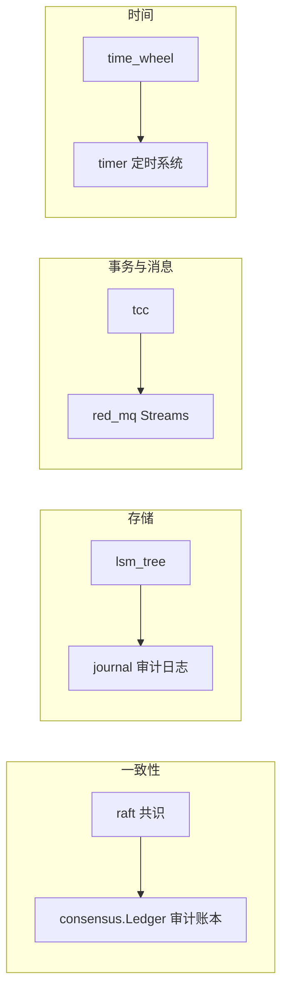
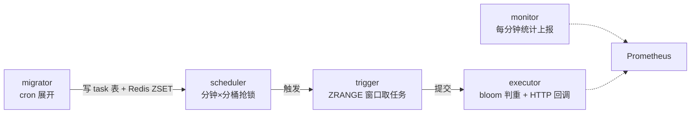

本篇围绕 `yukino.go` 仓库（HEAD `facf5d6`）`components/` 目录的六个自研组件出题：**raft**（共识）、**lsm_tree**（存储引擎）、**tcc**（分布式事务）、**red_mq**（Redis Streams 消息队列）、**time_wheel**（延迟任务）、**timer**（分布式定时系统），并延伸到通用分布式理论。路径均相对仓库根目录；标注 `源码:` 的陈述为实读事实，其余为通用工程知识或方案推导。



## 一、Raft：选举、复制与线性一致读

### Q1. Raft 解决什么问题？与 Paxos 的关系？

Raft 解决**复制状态机**的共识问题：多节点对「操作日志的顺序」达成一致，只要初始状态相同、按相同顺序应用相同日志，各节点状态必然一致。它把共识拆成三个相对独立的子问题——**leader 选举、日志复制、安全性**——用「强 leader + 任期（term）」简化推理。与 Paxos 等价（都能解决共识），但 Multi-Paxos 论文留白多、工程实现分歧大；Raft 以可理解性为第一设计目标，etcd/raft、TiKV、CockroachDB 都采用它。

### Q2. 本实现的三种角色与状态转换是怎样的？

源码：`components/raft/raft/`：`StateType` 有 `StateFollower/StateCandidate/StateLeader/StatePreCandidate` 四态（`model.go`）。转换函数分布在三个文件：

- `follower.go`：`becomeFollower(term, lead)` → `step = stepFollower`、`tick = tickElection`；
- `candidate.go`：`becomeCandidate()` → `reset(r.Term + 1)`（任期 +1、清空投票）、`Vote = r.id`、`step = stepCandidate`；`becomePreCandidate()` **不加任期**；
- `leader.go`：`becomeLeader()` → `step = stepLeader`、`tick = tickHeartbeat`，并把所有 peer 的 `Progress.Next` 初始化为 `lastIndex + 1`。

非法转换直接 panic（`follower -> leader`、`leader -> candidate`），状态机纪律靠断言保证。任何节点收到更高 term 的消息都退回 follower（`raft.go` 的 `Step`）。

### Q3. 选举超时为什么要随机化？本实现怎么做的？

若所有 follower 超时相同，掉线后会**同时**发起选举、互相分票、无限重选。随机化让某个节点大概率先超时、先拉票、先成为 leader。源码：`raft.go` 的 `resetRandomizedElectionTimeout`：`randomizedElectionTimeout = n + rand.Intn(n)`，即在 `[ElectionTick, 2×ElectionTick)` 内均匀取值；`tickElection` 每 tick 递增 `electionElapsed`，超过随机阈值且 `promotable` 时向自己发 `MsgHup` 触发选举。

### Q4. 完整描述一次选举流程。

源码：`raft.go` 的 `Step`（`MsgHup` 分支）与 `campaign`：

1. follower 超时 → `MsgHup`；前置检查：已是 leader 则忽略、不在配置中（`promotable`）则忽略、**已提交但未应用的日志里存在 ConfChange 条目则推迟选举**（`numOfPendingConf`，避免成员变更中途换 leader）；
2. `campaign(campaignElection)` → `becomeCandidate`（term+1、投自己）；
3. 单节点集群特判：`quorum() == poll(r.id, true)` 直接 `becomeLeader`；
4. 否则向所有 peer 发 `MsgVote`，携带 `LogTerm/LogIndex`（自己的最后日志坐标）；
5. 收到 `MsgVoteResp`：`poll` 计票，**granted == quorum → becomeLeader + broadcastAppend**；拒绝数达到 quorum（`len(votes) - granted == quorum`）→ 退回 follower；否则继续等；
6. 投票方规则（`Step` 的 `MsgVote` 分支）：候选人日志**不旧于**自己（`isUpToDate`）且本任期未投过票（`Vote == None`）或 term 更高或已投给它 → 授予。

### Q5. PreVote 是什么？解决什么问题？

**问题**：被网络分区隔离的节点收不到心跳，不断超时 → 任期疯狂自增；分区恢复后它带着巨大 term 回归，**强制所有节点退位重选**，造成无谓的服务抖动（disruptive server 问题）。

**PreVote**：正式选举前先做一轮「预投票」——不增加任期、不改状态，只问「假如我发起选举你们会投我吗」。源码：`raft.go` `MsgHup` 分支在 `r.preVote` 为真时走 `campaign(campaignPreElection)` → `becomePreCandidate`（term 不变）→ 发 `MsgPreVote`；拿到多数 `MsgPreVoteResp` 后才真正 `campaign(campaignElection)`。`Step` 里对 `MsgPreVote` 的处理**不触发 becomeFollower**（`m.Type != MsgPreVote && ...` 的条件），保证预投票不扰动现有 leader。被隔离节点预投票必然失败（多数派已有 leader），term 不再膨胀。

### Q6. 投票的「日志足够新」怎么判定？为什么这样能保证安全性？

源码：`log.go` 的 `isUpToDate(index, term)`：`term > r.lastTerm() || (term == r.lastTerm() && index >= r.lastIndex())`——先比最后一条日志的**任期**，任期相同再比**长度**。

安全性来自「选举限制 + 提交规则」的配合：已提交条目必然存在于多数派节点上；新 leader 也必须获得多数派投票；两个多数派必有交集，交集节点的日志不旧于已提交位置，而投票规则拒绝比自己旧的候选人——因此**新 leader 必然包含所有已提交条目**（Leader Completeness）。日志可能多出未提交尾巴，由 leader 的 `prevLogIndex/prevLogTerm` 匹配逐步裁剪。

### Q7. 日志复制的完整路径？

源码：`leader.go` + `follower.go` + `log.go`：

1. 客户端 `Propose(data)` → leader 收到 `MsgProp` → `appendEntry`：为每条 entry 盖上当前 `Term` 与连续 `Index`，写入 `raftLog.unstable`，更新自己的 `Progress.Match`，尝试 `maybeCommit`；
2. `broadcastAppend` → 对每个 peer `sendAppend(to)`：取 `pr.Next - 1` 位置的 `term` 作为 `prevLogTerm`，携带 `entries(pr.Next)` 与当前 `commitIndex` 发 `MsgApp`；
3. follower `handleAppendEntries` → `raftLog.maybeAppend(m.LogIndex, m.LogTerm, m.CommitIndex, entries...)`：先 `matchTerm` 校验一致性，通过则 `findConflict` 找第一条冲突条目、`truncateAndAppend` 覆盖追加、`commitTo(min(commitIndex, lastNewI))`，回 `MsgAppResp{LogIndex: 新末尾}`；
4. 校验失败回 `Reject + RejectHint(自己的 lastIndex)`；leader `mayDecreaseTo(logIndex, hint)` 快速回退 `Next` 后重发；
5. leader 收到成功响应 → `pr.maybeUpdate` → `maybeCommit`：把所有 `Match` 降序排序取第 `quorum` 位（中位匹配位），若该位置超过 `commitIndex` **且该位置条目属于当前任期**，推进提交并 `broadcastAppend` 把新 commitIndex 扩散出去。

### Q8. 为什么 `maybeCommit` 要求「中位位置的条目属于当前任期」？

这是 Raft 论文 Figure 8 的著名陷阱：**leader 不能通过数副本数直接提交「前任任期」的条目**。反例：前任条目已复制到多数派但尚未提交，新 leader 在另一分区产生；若旧 leader 恢复后靠副本数提交了前任条目，而新分区 leader 的日志（含不同条目）随后覆盖多数派，已提交条目被回滚——违反安全性。限制为「只直接提交当前任期条目」后，前任条目只能**随当前任期条目一起间接提交**（commitIndex 推进覆盖它们），此时当前任期条目已在多数派上，形成不可逆的提交屏障。源码：`log.go` 的 `maybeCommit(maxIndex, term)` 中 `r.zeroTermOnErrCompacted(r.term(maxIndex)) == term` 的判断。

### Q9. `Progress` 的 `Match/Next` 各是什么？冲突回退怎么加速？

源码：`components/raft/raft/progress.go`：`Match` 是「已确认复制到该 peer 的最高日志位」，`Next` 是「下次要发给它的日志位」。`maybeUpdate(n)`：`Match < n` 才推进并返回 true（触发提交检查）；`Next` 至少为 `n+1`。

朴素回退是每次 `Next--`，日志分歧长时要来回 O(n) 次。本实现的加速：follower 拒绝时带 `RejectHint = 自己的 lastIndex`，leader `mayDecreaseTo(logIndex, hint)` 把 `Next` 直接降到 `min(logIndex, hint+1)`——一步跳到 follower 日志末尾附近。`pr.Next-1 != logIndex` 时忽略响应（乱序/过期消息防护）。etcd/raft 进一步用「按 term 成段回退」，本实现是 hint 版。

### Q10. 新 leader 上任为什么先追加一条空日志（no-op entry）？

源码：`leader.go` 的 `becomeLeader` 最后一行 `r.appendEntry([]Entry{{Data: nil}}...)`。

两个作用：① **尽快确立提交位**——leader 只能直接提交当前任期的条目（Q8），前任留下的未提交日志无法被主动提交；追加当前任期的 no-op 并复制到多数派后，commitIndex 推进，把前任条目一并间接提交，leader 才能对外提供完整读；② 强制与 follower 做一轮日志匹配，尽早暴露分歧。这是 etcd/raft 的同款做法。

### Q11. ReadIndex 线性一致读是怎么实现的？

从 quorum 读（读也走日志复制，慢）退而求其次的方案。源码：`leader.go` 的 `MsgReadIndex` 分支 + `read.go`：

1. 请求方 `ReadIndex(ctx, rctx)` → leader 收到 `MsgReadIndex`；
2. **先确认自己还是 leader**：`raftLog.term(commitIndex) != r.Term` 则丢弃（任期已变，可能已被取代）；单节点集群跳过心跳确认直接产出 `ReadState`；
3. 记录 `readIndex = commitIndex`，把请求按 `ctx` 去重挂进 `readOnly.pendingReadIndex`（map + 队列），首个请求触发 `broadcastHeartbeatWithCtx(ctx)`——用一轮心跳确认**多数派仍承认自己是 leader**；
4. 心跳响应 `MsgHeartbeatResp` 携带同一 `Context`，`recvAck` 收集 ack，达到 quorum 后 `advance(ctx)` 按 FIFO 批量放行：本地请求追加 `ReadState{Index, RequestCtx}`，远端请求回 `MsgReadIndexResp`；
5. 应用层拿到 `ReadState.Index` 后**等状态机 apply 到该位点**再读本地状态——读到的必然包含 readIndex 前的一切已提交写，线性一致。

follower 收到 `MsgReadIndex` 会转发给 leader（`follower.go`）。**采分点**：能讲出「心跳确认领导权 + 等待 apply 位点」两个不可省略的步骤，以及 ReadIndex 与 Lease Read（靠时钟租约省掉心跳，牺牲时钟假设）的对比。

### Q12. 成员变更（ConfChange）在本实现里怎么做的？为什么用 `pendingConf` 限制？

源码：`raft.go`：`ProposeConfChange` 把 `ConfChange` JSON 序列化后作为 `EntryConfChange` 类型条目提案；leader 在 `stepLeader` 的 `MsgProp` 分支检查 `pendingConf`——**已有未应用的 ConfChange 时，新 ConfChange 被降级为普通空条目**（`m.Entries[i] = Entry{Type: EntryNormal}`）；条目被应用后由外部调 `ApplyConfChange` → `applyConfChange` 增删 `prs` 并清 `pendingConf`。选举侧同样有 `numOfPendingConf` 检查（Q4）。

为什么一次只允许一个：多节点同时变更可能让「旧配置多数派」与「新配置多数派」不相交，出现双 leader（Raft 论文的单步变更保证任意中间态的两个多数派必相交）。joint consensus（两阶段联合配置）支持批量变更，本实现未做——**事实口径**：只支持单步 Add/Remove/Update。`removeNode(r.id)` 时自己退位为 follower。

### Q13. `raftLog` 的 stable/unstable 分层是什么？

源码：`log.go`：`raftLog = storage(已持久化) + unstable(内存待持久化)`。`unstable{entries, offset}` 保存已 append 进状态机但还没落盘的条目；`slice(lo, hi)` 跨两段拼接；`stableTo(i, t)` 在存储层确认落盘后把 unstable 前缀裁掉（校验 term 匹配防止裁错代）。

- `nextEntries()` 返回 `(applyIndex, commitIndex]` 区间——**已提交未应用**的条目，供状态机消费；
- `append` 拒绝把 `commitIndex` 之前的位置当作新条目起点（panic 保护）；
- `maybeAppend` 的 `findConflict` 返回第一条「本地同位置 term 不匹配」的条目索引，`truncateAndAppend` 三分支处理（纯追加/整段覆盖/部分截断后追加）。
- **深挖**：为什么要分 stable/unstable？——持久化是异步的（Ready 循环），状态机内部必须先看到条目（复制、提交推进都依赖内存视图），落盘确认后再收缩 unstable；这正是 Ready/Advance 协议的内核。

### Q14. `Node` 的事件循环与 Ready/Advance 协议是怎么工作的？

源码：`node.go` 的 `run(r *raft)`：raft 状态机**只被这一个 goroutine 触碰**，外部通过 channel 注入事件：`proc`（本地 Propose，`From` 强制改为自己）、`recvChan`（网络消息）、`confChan`（成员变更）、`tickChan`（时钟，`Tick()` 非阻塞投递——丢了就丢了，ticker 不排队）、`advanceChan`。

Ready 循环的背压设计：

1. 每轮先 `newReady(r, prevSoft, prevHard)` 计算增量（SoftState 变化、HardState 变化、unstable entries、committed entries、待发消息、ReadStates）；有更新才把 `readyChan` 放进 select；
2. 消费方收到 Ready 后必须：**持久化 HardState 与 Entries → 发送 Messages → 应用 CommittedEntries → 调 `Advance()`**；
3. `advanceChan` 触发前，`readyChan` 被置 nil（`if advanceChan != nil { readyChan = nil }`）——**上一批没处理完就不发下一批**，天然背压；
4. Advance 分支里由 run 循环代为执行 `storage.SetHardState / storage.Append / stableTo / appliedTo`。

`Stop()` 用 `stopOnce` 关 `stopped` 并等 `done`。**采分点**：能讲出「单 goroutine 状态机 + channel 事件注入 + Ready 批量输出 + Advance 背压」这套 etcd/raft 同款架构，以及为什么 tick 允许丢（时钟只是启发式，堆积 tick 反而引发选举风暴）。

### Q15. `Storage` 接口有哪些方法？`ErrCompacted/ErrUnavailable` 的语义？

源码：`storage.go`：`InitialState / Entries(l, r) / Term(i) / LastIndex / FirstIndex / Append / SetHardState` 七个方法；`MemoryStorage` 用 `entries[0]` 作**哑元**记录截断位点（`firstIndex = entries[0].Index + 1`，`lastIndex = entries[0].Index + len - 1`）。

- `ErrCompacted`：请求的索引已被日志压缩删除（落后太多的 follower 需要走**快照**安装，而本实现没有快照接口——事实缺口，见 Q17）；
- `ErrUnavailable`：请求的索引超出已有日志（尚未产生）；
- `Append` 对 `first < offset` 的重复追加静默成功（幂等），`first > lastIndex+1` 报 `ErrUnavailable`（有空洞）。

### Q16. raftkv 示例是怎么把 raft 接成 KV 服务的？

源码：`components/raft/cmd/raftkv/`：`main.go` 建 `proposeC chan string` 与 `commitC chan *string` 两条通道；`newRaftProxy(1, []string{"node1"}, ...)` 启动单节点 raft（MemoryStorage），run 循环消费 proposeC → `node.Propose`，Ready 循环把 `CommittedEntries` 的 Data 推入 commitC；`kvStore.readCommit` 消费 commitC，把 JSON `{key, val}` 应用到内存 map（RWMutex 保护）；HTTP API 在 8091 端口提供读写（读走本地 map）。

这就是「**复制状态机 = 共识层 + 应用层**」的最小样例：raft 只保证日志顺序一致，状态机（map）各自应用。生产化要补：读走 ReadIndex（否则读到旧值）、持久化 Storage、快照与日志压缩、网络传输层（示例没有节点间 RPC）。

### Q17. 这个 raft 实现与 etcd/raft 相比缺什么？（事实缺口题）

实读源码可确认的缺口：**无快照（Snapshot）支持**——`Storage` 接口没有 `ApplySnapshot`，`Ready` 没有 Snapshot 字段，日志无法压缩，落后节点只能全量重放；**无 joint consensus**——成员变更单步进行；**无 CheckQuorum/PreVote 的完整联动**（`checkQuorum` 字段存在，`Step` 里对旧 term 心跳有回应逻辑，但 leader 侧主动降级检查未实现）；`Progress` 只有 Probe/Replicate 两态定义但**未使用状态切换**（`State` 字段无消费方）；传输层需自建（`msgs` 只是攒在内存里）。

**面试怎么讲**：先讲清楚它「有什么、对不对」（核心选举/复制/ReadIndex/PreVote 语义正确、结构对齐 etcd/raft），再如实讲缺口与补齐路径——把教学实现说成生产级实现是最容易被打穿的点。

## 二、LSM-Tree：写优化存储引擎

### Q18. LSM-Tree 为什么写快？三种放大怎么权衡？

写路径只做两件事：**顺序追加 WAL + 写内存 memtable**，没有随机 IO、没有原地更新的读-改-写，机械盘与 SSD 都友好。代价转移到了后台：

| 放大     | 含义                           | LSM 的缓解                             |
| -------- | ------------------------------ | -------------------------------------- |
| 写放大   | 同一数据被 compaction 反复重写 | 分层合并、每层容量 10 倍递增（见 Q26） |
| 读放大   | 一次读要查 memtable + 多层 SST | 布隆过滤器跳过不含 key 的块（见 Q24）  |
| 空间放大 | 旧版本/删除标记占空间          | compaction 时丢弃被覆盖数据            |

B+ 树（原地更新）读放大低、写放大高；LSM 反之——**写多读少选 LSM**（RocksDB、LevelDB、Cassandra、HBase），读多写少选 B+ 树（InnoDB）。

### Q19. 讲一下本实现 `Tree.Put` 的完整路径与 flush 触发条件。

源码：`components/lsm_tree/tree.go`：

1. `dataLock.Lock()`（写路径全局互斥）；
2. **先写 WAL**：`walWriter.Write(key, value)`——崩溃恢复的持久化保证先于内存生效；
3. `memTable.Put(key, value)`（skiplist）；
4. 触发检查：`memTable.Size()*5/4 > conf.SSTSize`（默认 SSTSize=1MB）→ `refreshMemTableLocked`：当前 memtable 连同 WAL 文件名打包成 `memTableCompactItem` 挂入 `rOnlyMemTable`（只读列表）、关闭旧 WAL、异步投递 `memCompactC`、`memTableIndex++` 并新建 memtable + 新 WAL（`{index}.wal`）。

`*5/4` 的含义：预估 flush 期间还会写入约 25% 增量，提前换手避免新 memtable 立刻又满。**采分点**：WAL 先行的顺序不能反（先内存后 WAL 会在两步之间崩溃丢数据）。

### Q20. `Tree.Get` 的查找顺序是什么？为什么是这个顺序？

源码：`tree.go` 的 `Get`：**memtable → rOnlyMemTable（`slices.Backward` 从新到旧）→ level0 节点（从新到旧逐个查）→ level1..N（每层二分定位一个节点再查）**。

- 顺序即「数据新鲜度」顺序：新写入一定在更上层，先查上层保证读到最新版本，命中即停；
- rOnlyMemTable 逆序：多个待 flush 的 memtable 中越靠后越新；
- level0 的 SST 由不同 memtable flush 而来，**key 范围互相重叠**，必须逐个查（逆序 = 新文件优先）；
- level≥1 每层内节点 key 范围**不重叠且有序**，`levelBinarySearch` 按 `startKey/endKey` 二分定位唯一候选节点。
- 锁策略：memtable 段用 `dataLock.RLock`，每层用各自的 `levelLocks[i].RLock`——读路径分段加读锁，与写路径（dataLock 写锁）和 compaction（level 写锁）解耦。

### Q21. memtable 为什么选跳表？本实现的跳表有什么特点？

源码：`components/lsm_tree/memtable/skiplist.go`：`skipNode{nexts []*skipNode, key, value}`，`Put` 逐层找插入位、`getNode` 逐层下降查找，`roll()` 抛硬币决定层高（p=1/2）。

- 选跳表的原因：有序结构支持范围扫描与有序导出（flush 要按 key 序写 SST）；期望 O(log n)；实现远比红黑树/AVL 简单；并发友好（局部指针修改，RocksDB 用无锁跳表）；
- 本实现特点：`size` 字段精确记账（覆盖写时 `size += len(new) - len(old)`），供 flush 阈值判断；`All()` 沿 level0 链表导出有序 KV；
- **可挑剔的事实**：`roll()` 每次 `rand.New(rand.NewSource(time.Now().Unix()))`——同一秒内创建的所有节点层高序列相同（种子按秒），随机性退化；生产实现应使用共享随机源或固定 p 层数上限。面试指出这一点是「真读过代码」的信号。

### Q22. WAL 的记录格式与恢复流程？没有 CRC 意味着什么？

源码：`components/lsm_tree/wal/`：记录格式为 `uvarint(keyLen) + uvarint(valLen) + key + value`，`O_APPEND` 追加写。恢复（`tree_restore.go` 的 `constructMemtable/restoreMemTable`）：按 `{index}.wal` 的数字序排序，**最后一个** WAL 重放为活跃 memtable 并重开 writer 续写；**其余**各自重放为只读 memtable 挂入 `rOnlyMemTable` 并投递 compaction（它们对应的 flush 在崩溃前未完成）。

没有 CRC/校验和（事实）意味着：尾部半截记录（写到一半崩溃）无法被检测——`readAll` 会在 `ReadUvarint/ReadFull` 处报 EOF/短读，当前实现把 `io.EOF` 当正常结束，**恰好**能容忍「最后一条不完整」的常见情形，但无法区分「截断」与「位翻转损坏」。生产级 WAL（RocksDB）按 32KB block 存、每块带 CRC，损坏块之后全部丢弃。这是教学实现与生产实现的典型差距，面试可主动讲。

### Q23. SST 文件的物理格式是什么？

源码：`components/lsm_tree/sst_writer.go` 的 `Finish` + `sst_reader.go`：

```text
┌────────────┬──────────────┬─────────────┬──────────────────────────┐
│ data blocks │ filter block │ index block │ footer (32B, 4×uvarint)  │
└────────────┴──────────────┴─────────────┴──────────────────────────┘
footer: dataEnd | filterLen | indexEnd(=data+filter) | indexLen
```

- 写入顺序：数据块攒满 `SSTDataBlockSize`（默认 16KB）刷入 dataBuf，同时该块的布隆位图追加进 filterBuf、块索引追加进 indexBuf；`Finish` 收尾最后一个块后依次落盘四段；
- 读取：`readFooterLocked` 从文件尾 `Seek(-32)` 读四个 uvarint 定位三段；`ReadFilter/ReadIndex` 在**打开文件时一次性载入内存**（`loadNode`），数据块按需 `ReadBlock(offset, size)`；
- `SSTReader` 内部 `sync.Mutex` 串行化——单文件句柄 + bufio Seek 复用，不支持并发读同一 SST（取舍：简单省内存，读并发靠多文件分摊）。

### Q24. 布隆过滤器在本实现里怎么组织？参数怎么定的？

源码：`components/lsm_tree/filter/bloom_filter.go` + `sst_writer.go`：

- **按数据块**建过滤器：`Append` 每写一个 key 就 `Filter.Add(key)`（攒 fnv32a 哈希值）；块写满 `refreshBlock` 时 `Filter.Hash()` 生成位图，以 `blockOffset → bitmap` 存入 filterBlock 与内存 map，然后 `Reset`；
- 位图构造：`m` 位（默认 `NewBloomFilter(1024)`，即 128 字节 + 1 字节存 k）；每个 key 用**双哈希模拟 k 个哈希**：`delta = (h >> 17) | (h << 15)`（循环移位），第 i 个位 = `(h + i*delta) % m`；
- `bestK = clamp(69*m/100/n, 1, 30)`——0.69 ≈ ln2，即教科书最优 `k = (m/n)·ln2`，n 是块内 key 数：**块越密，k 自动越大**；
- 查询路径（`node.go` 的 `Get`）：索引二分定位块 → `blockToFilter[offset]` 取位图 → `Exist` 判 k 个位 → 全 1 才真正 `ReadBlock` 读盘。
- **采分点**：能推导假阳性率 ≈ `(1-e^(-kn/m))^k`，并说明「过滤器只能证明不存在，不能证明存在」——所以 miss 可以直接跳过块，hit 仍要读块确认。

### Q25. 索引块的 separator key 是什么？为什么不用块内最后一个 key？

源码：`sst_writer.go` 的 `insertIndex` + `util/string.go` 的 `GetSeparatorBetween(prevKey, key)`：索引项的 key 取「上一块最后 key 与当前块第一 key 之间的分隔串」——常规情况直接用 prevKey；首块（prevKey 为空）用「当前 key 末字节减一」构造一个严格小于它的前驱。

用分隔串而非精确边界可以**缩短索引 key**（ RocksDB 的 shortest separator：找两者最短的中间串，如 `apple` 与 `application` 之间取 `applic`），索引块更小、缓存更友好。查找语义相应变成「找第一个 `indexKey >= target` 的块」（`node.go` 的 `binarySearchIndex`），配合 separator ≤ 下一块首 key 的性质保证不漏。**采分点**：讲清「索引 key 是路由提示而非精确边界」这一层抽象。

### Q26. compaction 的触发条件与执行流程？

源码：`components/lsm_tree/tree_compact.go`：

- **触发**：`tryTriggerCompact(level)` 在每次 flush/合并后检查——该层总字节 > `SSTSize × 10^level × SSTNumPerLevel`（默认 1MB × 10^level × 10）时投递 `levelCompactC`。即 level0 上限 10MB、level1 上限 100MB……每层容量 10 倍递增（LevelDB 同款 T=10）；
- **选文件**：`pickCompactNodes(level)` 取该层**第一个节点与中间节点**（`len>>1`）的 key 范围并集，收集 level 与 level+1 中所有与该范围**重叠**的节点；
- **归并**：`pickedNodesToKVs` 把所有选中节点的 KV 灌进一个临时 memtable——skiplist 的 `Put` 覆盖语义自动完成**去重与新胜旧**（picked 顺序是先 level+1 后 level，level 的后写覆盖旧层）；
- **写出**：按序导出、写 level+1 的新 SST，单文件上限 `SSTSize × 10^(level+1)`，超限切新文件（seq 由 `levelToSeq` 原子递增）；
- **收尾**：`removeNodes` 摘除旧节点并异步 `Destroy`（关句柄删文件，`destroyWG` 跟踪）；`tryTriggerCompact(level+1)` 级联触发下一层。

### Q27. 为什么 compaction 用单 goroutine 串行执行？

源码：`tree_compact.go` 的 `compact()`：一个 goroutine select 消费 `memCompactC`（memtable flush）与 `levelCompactC`（层合并），两类任务天然串行。

- 好处：无并发合并的锁复杂度；同一层不会有两个 compaction 选中重叠文件；flush 与合并互斥，`rOnlyMemTable` 的摘除时序简单（flush 完成后按指针匹配摘除）；
- 代价：合并大层时 flush 排队，写入背压（memtable 换手堆积）；生产系统（RocksDB）用多 subcompaction 线程 + 速率限制器平衡写停顿；
- 单 goroutine 事件循环 + channel 投递，与 `time_wheel`、raft 的 `Node.run` 是同一模式：**用串行化换正确性，用 channel 换背压**。

### Q28. 这个 LSM-Tree 没有 Delete，真实系统怎么做删除？

事实：`Tree` 只有 `Put/Get`，无删除 API。真实 LSM 的删除是**写墓碑（tombstone）**：删除 = 写入一条 value 为墓碑标记的新版本；读路径遇到墓碑返回不存在；compaction 时墓碑与被覆盖数据一起丢弃。

墓碑的两个经典难题（方案推导）：① **墓碑不能过早丢**——若下层还有旧版本，提前丢弃会让旧值「复活」，所以墓碑要下沉到最底层或确认无更旧版本才能清；② **范围查询被墓碑拖慢**——scan 要跳过大量墓碑条目，删除风暴后读性能劣化，需要 compaction 策略感知墓碑密度（RocksDB 的 tombstone-triggered compaction）。面试答到「删除也是追加写 + 延迟回收」就抓住了 LSM 的本质：**一切修改都是新版本，回收是后台的事**。

### Q29. 崩溃恢复后数据一致性怎么保证？哪些窗口会丢数据？

恢复流程（Q22）+ WAL 先行（Q19）保证：**已返回成功的 Put 不丢**（WAL 已落盘才写 memtable）。会丢/会重的窗口：

- `dest.Write` 成功返回 ≠ 落盘——没有 `fsync`（事实），掉电（而非进程崩溃）时 OS page cache 里的 WAL 尾巴会丢；生产要按策略 fsync（每条/每批/每秒），这是持久性与吞吐的核心权衡；
- 恢复时最后一个 WAL 重放为活跃 memtable，其中**已 flush 成功但 WAL 未删**的部分会重复进入 memtable——重复 Put 同 key 同 value，幂等无害；flush 完成才 `os.Remove(walFile)`，删除前崩溃只会重放不会丢；
- compaction 中途崩溃：新 SST 已写、旧节点未删——重启后 `constructTree` 按文件名 `(level, seq)` 排序全部加载，新旧文件共存导致同 key 多版本，Get 按「新文件优先」仍能读到正确值（level0 逆序、level≥1 二分命中其一），残留旧文件靠后续 compaction 收敛。

## 三、TCC：柔性分布式事务

### Q30. TCC 是什么？与 2PC、SAGA 的本质区别？

TCC = **Try / Confirm / Cancel**，业务层面的两阶段：Try 预留资源（冻结库存、预扣余额），全部成功则 Confirm 落实，任一失败则 Cancel 释放。

| 方案 | 层次         | 隔离性                     | 侵入性             | 适用                       |
| ---- | ------------ | -------------------------- | ------------------ | -------------------------- |
| 2PC  | 资源层（DB） | 锁资源直到提交，强隔离     | 低（DB 原生）      | 单体内多库、XA             |
| TCC  | **业务层**   | 冻结中间态，业务自定义隔离 | **高**（三个接口） | 资金、库存等强一致核心链路 |
| SAGA | 业务层       | 无隔离，靠补偿             | 中（正向+补偿）    | 长流程、可补偿             |

本质区别：2PC 把「预留」交给数据库锁，TCC 把「预留」建模成**业务可见的中间状态**（冻结字段、预留表），因此不依赖底层资源的事务能力，跨异构存储（MySQL + Redis + RPC）也能用；代价是每个参与者要写三个幂等接口。

### Q31. 讲一下 `TXManager.Transaction` 的完整流程。

源码：`components/tcc/txmanager.go`：

1. `getComponents`：校验请求（非空、ComponentID 不重复）、从 `registryCenter` 取已注册组件；
2. `txStore.CreateTX(ctx, components...)`：持久化事务记录（初始 `TXHanging`，各组件 `TryHanging`），返回 txID；
3. `twoPhaseCommit`：**并发**对所有组件执行 `Try`（`sync.WaitGroup.Go`），每个 Try 的结果立即 `txStore.TXUpdate(txID, componentID, ok)` 落盘；`errCh` 收到第一个错误就 `cancel()` 取消其余在途 Try；
4. 排空 errCh 后，用 `context.WithoutCancel(ctx) + Timeout` 调 `advanceProgressByTXID`——**即使调用方 ctx 已取消，二阶段的推进也必须执行**（否则悬挂）；
5. `advanceProgress`：按事务状态对所有组件统一 Confirm 或 Cancel，全部 ACK 后 `TXSubmit(txID, success)` 终态落盘。

返回 `(txID, ok, err)`：ok=false 且 err=nil 表示事务被正常回滚。

### Q32. 事务状态是怎么判定的？超时悬挂怎么处理？

源码：`components/tcc/model.go` 的 `Transaction.getStatus(createdBefore)`：

- 任一组件 `TryFailure` → **TXFailure**（立即判死）；
- 存在非 successful 组件（hanging）且 `CreatedAt < now - Timeout` → **TXFailure**（超时判死，走 Cancel）；
- 存在 hanging 但未超时 → **TXHanging**（还在途，monitor 跳过不处理）；
- 全部 `TrySuccessful` → **TXSuccessful**（走 Confirm）。

悬挂的来源：Try 的响应丢失（网络分区、进程崩溃）——组件侧可能已预留成功，但管理器不知道。处理：`run()` 监控循环每 `MonitorTick`（默认 10s）抢 `txStore.Lock`（分布式互斥，多实例只有一个 monitor 生效），`GetHangingTXs` 捞出悬挂事务，`batchAdvanceProgress` 用 **8 个 worker** 并发推进；出错则退避翻倍（上限 `MonitorTick << 3` 即 80s）。**采分点**：「Try 结果未知时按失败处理（Cancel），但 Cancel 必须容忍 Try 从未到达（空回滚）与迟到（悬挂）」。

### Q33. 空回滚、悬挂、幂等三大问题分别是什么？组件侧怎么防？

- **空回滚**：Try 请求丢失，Cancel 先到——组件没预留过却收到取消。防法：Cancel 先查事务记录，无 Try 记录则直接 ACK 并**记录「已空回滚」标记**；
- **悬挂**：空回滚之后，迟到的 Try 又到了——预留将永远无人释放。防法：Try 前查「已空回滚」标记，存在则拒绝；
- **幂等**：Confirm/Cancel 会被 monitor 重试到 ACK 为止，必须可重入。防法：状态机判重（已终态直接 ACK）。

项目内的实战范例：`apps/task_flow/server/internal/engine/components.go` 的 `ExecutionReserveComponent`——`Try` 用条件更新 `Transition(pending→reserved, tx_id=TXID)`，`affected==0` 时检查 `exec.TxID == req.TXID` 判定「本事务已预留过」（幂等 ACK）还是「被别人占了」（拒绝）；`Confirm` 对 `queued/running/succeeded/failed` 状态都 ACK（已推进过，幂等）；`Cancel` 对 `TxID` 不匹配或状态非 reserved 的情况直接 ACK（空回滚安全）。**用状态机 + 事务号做天然防重**，不需要额外的防悬挂表。

### Q34. `TXStore` 接口为什么自带 `Lock/Unlock`？

源码：`components/tcc/txstore.go`：接口七个方法——`CreateTX / TXUpdate / TXSubmit / GetHangingTXs / GetTX / Lock / Unlock`。

Lock 不是给业务事务用的，是给 **monitor 循环**用的：多实例部署时每个实例都跑悬挂扫描，若不加互斥，N 个 monitor 同时对同一悬挂事务发 Confirm/Cancel——虽然组件幂等能兜住，但会产生 N 倍无效调用与日志噪音。`txStore.Lock(ctx, Timeout+1s)` 把「扫悬挂 + 推进」变成集群内单实例执行。task_flow 的实现（`apps/task_flow/server/internal/engine/tccstore.go`）用 `redis_lock` 做这把锁、MySQL `tcc_tx_records` 表（`SELECT ... FOR UPDATE` 行锁保护状态更新）做事务存储——**锁与数据分离**：Redis 管互斥，MySQL 管持久化。

### Q35. 二阶段为什么用 `context.WithoutCancel`？

源码：`txmanager.go` 两处：`twoPhaseCommit` 的 commit 阶段 `context.WithTimeout(context.WithoutCancel(ctx), t.opts.Timeout)`；monitor 的 Unlock 同样 `WithoutCancel`。

语义：调用方取消（HTTP 请求断开、上层超时）时，**Try 阶段可以中止**（还没预留完，取消即回滚），但**推进阶段不能中止**——事务记录已存在，必须走到 Confirm/Cancel 终态，否则留下悬挂等 monitor 兜底（延迟数十秒）。`WithoutCancel` 保留 ctx 的 value（trace 等）但剥离取消信号，是 Go 1.21+ 处理「清理逻辑不受上游取消影响」的标准工具。**采分点**：能区分「可取消的阶段」与「必须完成的阶段」，并知道对应的 ctx 工具（`WithoutCancel` vs 独立 Background ctx）。

## 四、red_mq：Redis Streams 消息队列

### Q36. 为什么用 Redis Streams 做 MQ？与 Kafka 的取舍？

Streams（5.0+）提供 MQ 三要素：**持久化条目**（AOF/RDB）、**消费组**（组间广播、组内竞争）、**ACK + PEL**（pending entries list，未确认消息可重投）。

| 维度   | red_mq (Streams)                 | Kafka                       |
| ------ | -------------------------------- | --------------------------- |
| 吞吐   | 单机十万级                       | 分区并行，百万级            |
| 持久化 | 内存为主 + AOF，容量受 maxLen 限 | 磁盘日志，天级保留          |
| 顺序   | 单 stream 全序                   | 分区内有序                  |
| 重放   | 按 ID 范围读，但会被 trim 掉     | offset 任意重放（保留期内） |
| 运维   | 复用现有 Redis                   | 独立集群 + ZK/KRaft         |

适用判断（方案推导）：中小规模、已有 Redis、消息可容忍容量上限裁剪的场景（通知、任务分发、事件扇出）用 Streams 成本极低；日志管道、事件溯源、需要长期重放的用 Kafka。源码：`components/red_mq/producer.go` 的 `SendMsg` 即 `XADD topic * key val`，`msgQueueLen` 默认 **500**（`option.go`）——明确的「短队列」定位。

### Q37. 消费循环是怎么组织的？一条消息的完整生命周期？

源码：`components/red_mq/consumer.go` 的 `run()`，每轮四步：

1. （可选）`XAutoClaim`：认领空闲超过 `claimIdle` 的**别人家** pending 消息（`WithAbandonedMessageRecovery` 开启）；
2. `receive()`：`XREADGROUP GROUP g c COUNT 1 BLOCK {receiveTimeout} STREAMS topic >`——`>` 表示只取**从未投递**的新消息，阻塞默认 2s；
3. `handlerMsgs`：逐条 `invoke`（recover 保护回调 panic → 转 error）；成功则 `XACK`（校验 reply==1）并从 `failureCnts` 删除；失败则 `failureCnts[msg]++`；
4. `deliverDeadLetter`：失败次数 ≥ `maxRetryLimit`（默认 3）的消息投递 `DeadLetterMailbox`（默认实现只打 error 日志），成功后 XACK 摘除；
5. `receivePending()`：`XREADGROUP ... STREAMS topic 0-0` 重读**自己的** PEL——上轮失败但未进死信的消息在这里重试。

生命周期：`XADD` → PEL（投递未确认）→ 回调成功 `XACK`（出 PEL）；或失败重试 ≤3 次 → 死信投递 + XACK。接收错误时 `backoff()` 固定 1s 退避防打爆 Redis。

### Q38. 这套 MQ 的投递语义是什么？哪些环节会重复？

**at-least-once**。重复来源：① 回调成功但 `XACK` 失败（网络抖动）→ 消息留在 PEL → `receivePending` 重投；② 消费者崩溃 → PEL 消息被 `XAutoClaim` 认领重投；③ `handleMsgsTimeout`（默认 1s）超时取消回调，但回调可能仍在执行成功 → ACK 没发出。

不重复的唯一办法是**消费端幂等**（去重表、唯一键、状态机判重）——与 Q33 的 TCC 幂等同源。做不到 exactly-once 的根因：「处理」与「确认」是两个系统的两步操作，无法原子。**采分点**：能明确说「MQ 只能给 at-least-once + 幂等消费 = 业务上的 exactly-once」。

### Q39. `XAUTOCLAIM` 解决什么问题？与 `XPENDING + XCLAIM` 的关系？

消费者崩溃后，它的 PEL 消息**永远无人 ACK**——没有认领机制就会卡死。传统做法两步：`XPENDING` 列出空闲消息 → `XCLAIM` 逐个转移所有权（查与改之间有竞态，还要自己过滤 idle 时间）。`XAUTOCLAIM`（Redis 6.2+）一条命令原子完成「扫描 PEL + 认领 idle ≥ min-idle-time 的消息 + 返回游标」。源码：`redis/redis.go` 的 `XAutoClaim` 以 `Count: 1` 小步认领，`run()` 里用 `claimCursor` 续扫；task_flow 的 executor 把 `claimIdle` 设为 `HandleTimeoutSeconds + 60`（`apps/task_flow/server/internal/engine/executor.go`）——**必须大于处理超时**，否则正常处理中的消息会被别人抢走造成并发双跑。

### Q40. 死信队列怎么设计才算完整？本实现的边界在哪？

本实现（`consumer.go` + `dead_letter.go`）：内存计数 `failureCnts map[MsgEntity]int`，达到 `maxRetryLimit` 投 `DeadLetterMailbox` 接口，默认 `DeadLetterLogger` 只打日志。

边界与生产化差距（方案推导）：① 计数在**内存**——消费者重启后计数清零，消息可能重试超过 3 次（可接受，at-least-once 语义内）；② 默认 mailbox 不落盘，死信即丢失——生产必须换成持久化实现，task_flow 就是这么做的：`DeadLetterMailbox` 写入 MySQL `mq_dead_letters` 表（`apps/task_flow/server/internal/model/po/po.go` 的 `DeadLetter`，含 topic/msgID/msgKey/val/reason），配合管理端重放；③ 死信要可观测（计数指标 + 告警）与可治理（人工修复后重投、定期清理）。**采分点**：死信不是「扔进去就完事」，闭环 = 持久化 + 告警 + 重放工具。

### Q41. `XADD` 的 `MAXLEN 500` 是精确裁剪，有什么代价？

源码：`redis/redis.go` 的 `XADD` 设 `MaxLen: int64(maxLen)`，未设 `Approx: true`。精确裁剪每次 XADD 都要把 stream 修剪到恰好 500 条；近似裁剪（`MAXLEN ~ 500`）允许按 radix tree 节点整块删除，摊销 O(1)，是 Redis 官方推荐的高吞吐写法。精确版在高频写入时裁剪开销显著。**取舍**：本库定位短队列 + 可容忍丢失（超出即被裁掉、未消费消息直接消失），精确 500 让内存上界严格可控；若消息不可丢，MAXLEN 本身就不该是主要回收手段，应改用消费位点驱动的 `XTRIM MINID`。

## 五、时间轮与分布式定时系统

### Q42. 时间轮解决什么问题？与最小堆、有序链表的复杂度对比？

海量定时任务（百万级连接超时）下：有序链表插入 O(n)；最小堆插入/删除 O(log n) 且堆顶之外的任务无法 O(1) 定位删除。**时间轮**：环形槽数组 + 当前指针，每 tick 前进一格并执行该槽到期任务——插入 O(1)（算槽位挂链表）、删除 O(1)（持有元素引用直接摘）、每 tick 只处理当前槽。代价是精度受 tick 间隔限制、超过一圈的任务要记「圈数」。

| 结构     | 插入     | 删除        | 到期处理      |
| -------- | -------- | ----------- | ------------- |
| 有序链表 | O(n)     | O(1) 持引用 | O(1) 头部     |
| 最小堆   | O(log n) | O(log n)    | O(log n)      |
| 时间轮   | **O(1)** | **O(1)**    | O(槽内任务数) |

### Q43. 讲一下本实现 `TimeWheel` 的槽位与圈数计算。

源码：`components/time_wheel/time_wheel.go`：`NewTimeWheel(slotNum=10, interval=1s 默认)`；`getPosAndCircle(executeAt)`：

```go
delay := int(time.Until(executeAt))          // 纳秒
cycle := delay / (len(slots) * int(interval)) // 要转几整圈
pos := (curSlot + delay/interval) % len(slots)
```

`execute` 遍历当前槽链表：`cycle > 0` 的减一圈留在原槽；`cycle == 0` 的 `go task()`（**每个任务独立 goroutine + recover**，慢任务不阻塞轮转）并从链表与 `keyToETask` 摘除。同 key 重复 `AddTask` 会先移除旧任务——**key 即幂等键**，天然支持「刷新超时」语义（task_flow 的 monitor 每 30s 用同一个 `monitor-sweep` key 重新挂任务，正是利用这一点）。

### Q44. `TimeWheel` 为什么不需要锁？

源码：所有状态变更（`addTask/removeTask/tick`）都发生在 `run()` 这**一个 goroutine** 里，外部通过 `addTaskCh/removeTaskCh` 投递意图，`select` 串行消费；`ticker.C` 也在同一 select——**tick 与增删天然互斥**，无数据竞争。`Stop` 用 `sync.Once` 关 ticker 与 stopChan；`AddTask/RemoveTask` 的 select 同时监听 stopChan，关闭后投递直接返回不阻塞。

这与 raft `Node.run`、LSM compactor 是同一设计范式：**单线程事件循环消灭锁，channel 提供线程安全入口**。面试可总结：Go 里「不要通过共享内存来通信，而要通过通信来共享内存」的标准落地。

### Q45. 分布式版 `RTimeWheel` 是怎么设计的？

源码：`components/time_wheel/redis_time_wheel.go` + `time_wheel_lua.go`：任务不再是本地闭包，而是 **HTTP 回调描述**（`RTaskElement{Key, CallbackURL, Method(仅 GET/POST), Req, Header}`），状态全在 Redis：

- **按分钟分片的 ZSET**：`yukino_time_wheel_task_{2006-01-02 15:04}`，score = `executeAt.Unix()`，member = 任务 JSON；花括号 hash tag 保证同分钟的任务键与删除键同槽（Lua 多 key 约束，同 Q40 篇的 Cluster 讨论）；
- **AddTask**（Lua 原子）：`SREM` 删除集（撤销同 key 的墓碑）+ `ZADD`；
- **RemoveTask**（Lua）：向 `yukino_time_wheel_delete_set_{minute}` `SADD` 墓碑，首个墓碑时 `EXPIRE 120s`；
- **执行**：本地每秒 tick → Lua `ZRANGEBYSCORE [分钟起点, 当前秒] BYSCORE` + `ZREMRANGEBYSCORE` **原子弹出**到期任务 + 读墓碑集 → 过滤已删任务 → **16 个 worker** 并发发 HTTP 回调（30s 总超时，逐任务 recover）。

多实例同时跑 tick 也安全：Lua 的「查 + 删」原子性保证同一任务只被一个实例弹出。

### Q46. 删除为什么用墓碑集合而不是直接 `ZREM`？

`ZREM` 需要知道 member 的**完整内容**（任务 JSON），而调用方 `RemoveTask(key, executeAt)` 只有业务 key——按 member 前缀删 ZSET 没有原生命令，扫描匹配代价高。墓碑方案把「删除意图」与「任务内容」解耦：删除只记 key，执行时弹出任务再按 key 过滤。墓碑集 120s 过期：只需覆盖「任务所在分钟窗口 + 执行延迟」，过期自动清理防止集合膨胀。**采分点**：这是「延迟物化删除」的通用思路，与 LSM 墓碑（Q28）、CRDT 删除标记同源。

### Q47. `timer` 组件的整体架构是什么？

源码：`components/timer/`，一个完整的分布式 cron 系统，四个角色（各自独立部署，靠 Redis 锁协调）：



- **migrator**（`internal/service/migrator/worker.go`）：每 `MigrateStepMinutes` 抢小时级分布式锁，把启用中 timer 的 cron 表达式用 `robfig/cron` 展开成未来窗口的 `task` 记录（MySQL），再 `BatchCreateTasks` 灌入 Redis ZSET（键 = `{分钟}_{timerID % BucketsNum}`，member = `timerID_unixMillis`，score = 毫秒时间戳，TTL = 执行时间 + 24h）；
- **scheduler**（`scheduler/worker.go`）：每 `TryLockGapMilliSeconds` 对「上一分钟 + 当前分钟」× 每个 bucket 抢分布式锁，抢到者调 trigger；成功后 `ExpireLock(SuccessExpireSeconds)` **把锁变成完成标记**，防止同分钟重复触发；
- **trigger**（`trigger/worker.go`）：把一分钟按 `ZRangeGapSeconds` 切成子窗口并发 `ZRANGEBYSCORE` 取任务，逐条提交 executor 池；全部成功后才 `ack()`；
- **executor**（`executor/worker.go`）：布隆过滤器判重（见 Q48）→ 取 timer 定义（本地缓存 + DB 兜底）→ 按 `NotifyHTTPParam` 发 GET/POST/PATCH/DELETE 回调 → 回写 task 状态（Succeed/Failed）与 Output → Prometheus 上报执行数与**延迟**（实际执行时间 - 期望时间）。

### Q48. executor 的布隆过滤器判重是怎么做的？为什么 fail-open？

源码：`components/timer/pkg/bloom/filter.go` + `executor/worker.go`：

- 结构：Redis bitmap，`bitmapBits = 1 << 24`（2MB/天）；双哈希 = murmur3-128 的高 64 位与低 64 位（`Murmur3Encryptor/Murmur3AltEncryptor`）；`Set` 用 Lua 原子 `SETBIT×2 + 首次 EXPIRE 24h`；键按天分片；
- 流程：执行前 `Exist(timerIDUnixKey)`——**可能存在**则回源查 DB task 状态，已执行（非 NotRun）就跳过；**一定不存在**则直接执行。执行成功后 `Set` 标记；
- **fail-open**：`Exist` 出错（Redis 故障）时按「可能存在」处理走 DB 核查，DB 也查不到未执行记录才执行——宁可多查一次 DB，不能漏执行任务。布隆过滤器无假阴性，「不存在」结论绝对可靠，这正是它适合做**快速放行**而非快速拒绝的原因。
- **采分点**：讲清「布隆 + 回源」两层判重的分工——布隆挡掉 99% 的重复查询流量，DB 状态是最终权威；以及为什么用两个独立哈希函数而不是一个哈希取两段（murmur3-128 天然产出两个 64 位，省一次哈希）。

### Q49. scheduler 为什么要同时扫「上一分钟」和「当前分钟」？锁为什么成功后要续期？

源码：`scheduler/worker.go` 的 `handleSlice`：对每个 bucket 提交两个任务——`asyncHandleSlice(now-1min)` 与 `asyncHandleSlice(now)`。

- 扫上一分钟：tick 间隔（`TryLockGapMilliSeconds`）内可能错过分钟边界，或上一分钟的任务因锁竞争/故障未触发——**双分钟窗口是补偿机制**，配合 executor 判重保证补扫不重复执行；
- 锁的两段生命周期：`Lock(TryLockSeconds)` 抢到 → trigger 完整跑完一分钟窗口 → `ack() = ExpireLock(SuccessExpireSeconds)` 把 TTL 拉长。锁在这里身兼两职：**执行互斥**（短 TTL，失败自动释放让别的实例重试）与**完成标记**（长 TTL，成功者在标记过期前不再被触发）。失败不 ack，短 TTL 过期后其他实例自然接管——无中心协调的故障转移。

## 六、通用分布式理论

### Q50. CAP 与 BASE 怎么讲才准确？

CAP：一致性（线性一致）、可用性（每个非故障节点都响应）、分区容忍三者**在网络分区发生时**只能取其二——P 在分布式系统里不是选项而是现实，所以实际选择是「分区时保 C 还是保 A」。常见误读：把 CAP 说成「三选二随时成立」；把 C 混同为 ACID 的 C。

BASE：基本可用（Basically Available，降级响应）、软状态（Soft state，允许中间态）、最终一致（Eventually consistent）——是对「分区时选 A」的工程化描述。项目例证：`yukino_cache` 的 peer 异步同步是软状态 + 最终一致；`red_mq` 的 PEL 是软状态；raft 则是分区时保 C 的代表（少数派侧不可写）。**采分点**：用「分区发生时的选择」定义 CAP，用项目组件举例两种取向。

### Q51. Paxos、Raft、ZAB 怎么对比？

| 维度     | Paxos (Multi)      | Raft                                         | ZAB                     |
| -------- | ------------------ | -------------------------------------------- | ----------------------- |
| 目标     | 通用共识           | 可理解的状态机复制                           | ZooKeeper 主备复制      |
| leader   | 非必需（basic 无） | **强 leader**，日志只从 leader 流向 follower | 强 leader（epoch 机制） |
| 日志     | 允许空洞，逐槽决议 | 连续日志，Match/Next 推进                    | 连续 zxid（epoch+计数） |
| 恢复     | 复杂（多阶段）     | 简单（term+日志匹配）                        | 崩溃恢复阶段同步        |
| 典型实现 | Chubby、Spanner    | etcd、TiKV、本仓库组件                       | ZooKeeper               |

三者都靠 **quorum 交集**保证已决议值不丢。Raft 的强约束（日志连续、leader 完整）正是它可理解性的来源；ZAB 的 epoch 类似 Raft 的 term，额外强调「新 leader 必须拥有所有已提交事务」。

### Q52. 幂等设计有哪些模式？分别在项目里哪里出现？

1. **唯一键/去重表**：task_flow 的 `Execution.FireKey` 唯一索引 + `idem.Service` 的 Redis `SETNX`（`task_flow:idem:fire:` 前缀，TTL 化）双层防重；
2. **状态机判重**：TCC 组件的 `Transition(from→to)` 条件更新，`affected==0` 时按当前状态判定「已完成/被抢占」（Q33）；
3. **token 机制**：请求方先领 token、执行方核销，天然一次性；
4. **自然幂等操作**：`SET`（覆盖）、`DELETE`（不存在也成功）、`$inc` 不幂等而 `SET value` 幂等——API 设计时优先选自然幂等语义；
5. **判重加速层**：timer 的布隆过滤器（Q48）——判重本身也要考虑性能，布隆挡流量、DB 做权威。

**采分点**：能说出「幂等的核心是把『执行 N 次』与『执行 1 次』的效果对齐，手段无非唯一标识 + 状态检查 + 原子写」。

### Q53. 分布式事务方案全景对比？

| 方案       | 一致性         | 性能                   | 侵入性             | 失败处理                           | 项目对应                     |
| ---------- | -------------- | ---------------------- | ------------------ | ---------------------------------- | ---------------------------- |
| 2PC/XA     | 强             | 低（同步阻塞、锁资源） | 低                 | 协调者故障需人工/恢复协议          | —                            |
| 3PC        | 强             | 更低                   | 低                 | 引入超时缓解阻塞，仍不解决网络分区 | —                            |
| TCC        | 强（业务定义） | 中                     | **高**（三接口）   | monitor 推进悬挂事务               | `components/tcc` + task_flow |
| SAGA       | 最终           | 高                     | 中（补偿接口）     | 正向/补偿链                        | —                            |
| 本地消息表 | 最终           | 高                     | 中                 | 扫描重发                           | task_flow 的 `Outbox` 表     |
| 事务消息   | 最终           | 高                     | 低（依赖 MQ 能力） | 半消息回查                         | —（red_mq 无半消息）         |

选型口诀（方案推导）：资金/库存等**核心强一致**链路用 TCC；长流程业务编排用 SAGA；异步通知类用本地消息表/事务消息；单库多表直接本地事务。task_flow 同时用了 TCC（执行预留 + MQ 投递的原子性）与 Outbox（`task_flow_outbox` 表 + relay 发布），是「按环节选方案」的组合拳。

### Q54. 什么是脑裂？fencing 怎么做？

脑裂：网络分区使旧 leader 与新 leader **同时认为自己在服务**——旧 leader 可能继续接受写（若它不检查自己是否仍被多数派承认）。防线：

1. **任期/纪元号**：新 leader 任期更高，存储层或客户端拒绝旧任期写入（raft 的 term、ZAB 的 epoch）；
2. **quorum 确认**：写必须多数派确认才生效，少数派侧的旧 leader 写不进去（raft 天然具备）；
3. **fencing token**：锁服务发放单调递增序号，资源方拒绝比已见序号旧的写入——解决「持锁者 GC 停顿后锁已易主」的经典漏洞（Redlock 争议的正解，见缓存篇 Q46）；
4. **STONITH**：直接隔离/击杀旧节点（硬件手段）。

项目例证：raft 的 `Step` 对 `m.Term < r.Term` 的消息直接丢弃（旧任期无法扰动）；`checkQuorum` 字段预留了「leader 定期确认多数派」的降级机制；task_flow 的 `TransitionOwned(id, txID, ...)` 用事务号做行级 fencing——只有持有当前 txID 的推进者能改状态。

### Q55. NWR 模型是什么？与 quorum 复制的关系？

N 副本、写 W 份确认、读 R 份取最新：`W + R > N` 时读写集合必相交，能读到最新写（强一致的必要条件，还需处理并发写合并与版本）；`W=1, R=N` 读重写轻，`W=N, R=1` 写重读轻；`W=R=N/2+1` 即多数派——**raft 是 NWR 的强化版**：不仅 quorum 确认，还固定了写入顺序（单 leader）与冲突裁决（term/index），把「读多数派还要合并版本」简化为「读 leader（或 ReadIndex）」。Dynamo/Cassandra 是松散 NWR 的代表（允许读修复、反熵同步）。

### Q56. 为什么分布式系统不能信任本地时钟？项目里怎么应对？

时钟漂移（NTP 校正、虚拟机暂停、闰秒）使跨节点的 `time.Now()` 不可比：TTL 判断、事件排序、锁过期都依赖时间，时钟错乱会破坏正确性（Redlock 争议的核心）。项目应对：

- **相对时间 + 单一权威**：raft 用逻辑 tick（`ElectionTick/HeartbeatTick` 计数）而非墙钟；租约类逻辑（etcd lease、redis TTL）把计时交给**单一存储节点**，客户端只消费结果；
- **粗时钟降频**：`yukino_cache` 的 100ms 原子时钟（缓存篇 Q14）——承认时间不精确，把精度需求降到业务可接受；
- **超时都用 duration 而非绝对时刻**：`peerSyncTimeout`、`HandleTimeoutSeconds` 等全部是相对量；
- 需要全局时序时（方案推导）：逻辑时钟（Lamport/向量钟）表达因果序，TrueTime（Spanner）用硬件 + 不确定区间换外部一致性。

### Q57. 把这些组件拼成一个「延迟任务 + 事务 + 审计」系统，你会怎么组合？（开放设计题）

参考 task_flow 的真实组合（`apps/task_flow`，详见[服务架构与任务系统](/interview/qa/service-architecture)）：

1. **定时触发**：cron 定义 → migrator 展开成 execution 行（MySQL，`FireKey` 唯一索引防重）→ `RTimeWheel` 到点 HTTP 回调 fire 接口；
2. **可靠派发**：fire → Dispatcher：布隆预检 + Redis SETNX 认领 → **TCC 事务**原子完成「execution 置 reserved（MySQL）」+「执行命令入队（red_mq XADD）」；
3. **消费执行**：executor 消费组拉取 → 状态机 `queued→running→succeeded/failed`（`TransitionOwned` 带 txID fencing）→ 失败进死信表；
4. **兜底恢复**：monitor 时间轮每 30s 扫描——stuck running 判失败、overdue pending 重派发、stuck queued 重投递；
5. **审计与共识**：派发/终态写 `journal`（**lsm_tree** 持久化 KV）并 `Propose` 进 **raft Ledger**（单节点共识账本，保留最近 64 条 applied entries 供查询）。

**采分点**：能画出「触发 → 事务派发 → 幂等执行 → 监控兜底 → 审计」五段，并指出每段用的组件与防重手段，就是一道满分系统设计。

## 速记卡

- **Raft**：随机选举超时 `[T, 2T)`；PreVote 防 term 膨胀；投票比 `(lastTerm, lastIndex)`；只直接提交**当前任期**条目（Figure 8）；no-op 上任条目确立提交位；ReadIndex = 心跳确认领导权 + 等 apply 位点；ConfChange 单步 + `pendingConf`；单 goroutine 状态机 + Ready/Advance 背压。
- **LSM**：WAL 先行、memtable 换手阈值 `Size×5/4 > SSTSize`；读序 memtable → 只读表 → L0 逆序 → L≥1 二分；每层容量 ×10；布隆按块、`k = 0.69·m/n`；删除 = 墓碑 + compaction 回收；无 fsync/CRC 是教学实现缺口。
- **TCC**：Try 并发 + 首个失败即取消；`WithoutCancel` 保二阶段；状态判定「任一 failure 即死、超时 hanging 即死」；monitor 抢锁扫悬挂、8 worker 推进；组件侧三大防护 = 幂等 + 空回滚 + 防悬挂（状态机 + txID）。
- **red_mq**：XADD MAXLEN 500 精确裁剪；消费组 `>` 新消息 / `0-0` PEL 重试；XAUTOCLAIM 认领孤儿（idle 必须 > 处理超时）；at-least-once + 幂等消费；死信默认只打日志，生产要落表。
- **时间轮**：O(1) 增删、cycle 记圈、单 goroutine 无锁；分布式版 = 分钟 ZSET + 墓碑删除集 + Lua 原子弹出 + hash tag 同槽。
- **timer**：migrator 展开 cron → scheduler 分钟×桶抢锁（锁 = 互斥 + 完成标记）→ trigger 窗口 ZRANGE → executor 布隆判重（fail-open）+ HTTP 回调 + Prometheus 延迟上报。
- **理论**：CAP 看分区时的取舍；幂等 = 唯一标识 + 状态检查 + 原子写；脑裂防线 = term + quorum + fencing token；时钟不可信 → 逻辑 tick / 单一权威 / duration。

## 延伸阅读

[缓存、存储与 ORM](/interview/qa/cache-storage-orm) · [服务架构与任务系统](/interview/qa/service-architecture) · [存储一致性](/interview/fundamentals/storage-consistency) · [Go 代码题：singleflight 与两级 LRU](/interview/code/go-singleflight) · [全量题库](/interview/question-bank)
